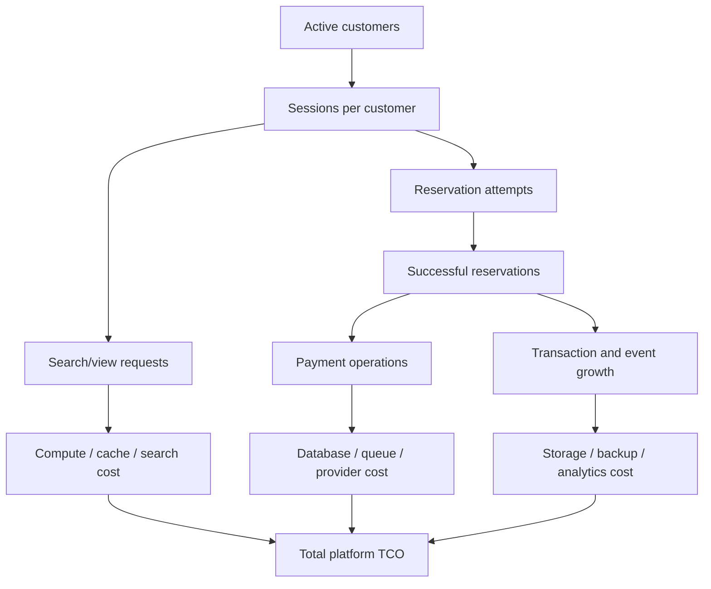

# Mô hình hóa TCO và chi phí theo đơn vị nghiệp vụ

Một hóa đơn cloud cho biết tổ chức đã chi bao nhiêu trong kỳ, nhưng chưa trả lời được dịch vụ có hiệu quả về kinh tế hay không. Chi phí tăng có thể do lượng khách hàng tăng, do truy vấn kém hiệu quả, do lưu dữ liệu trùng, do môi trường thử nghiệm chạy ngoài giờ hoặc do kiến trúc cần nhiều bản sao để đạt availability. Chỉ nhìn tổng hóa đơn khó phân biệt tăng trưởng lành mạnh với lãng phí.

**Total Cost of Ownership (TCO)** mô hình hóa toàn bộ chi phí để sở hữu, vận hành và thay đổi một giải pháp trong khoảng thời gian xác định. **Unit economics** phân bổ chi phí đó theo một đơn vị nghiệp vụ có ý nghĩa, chẳng hạn chi phí trên mỗi reservation hoàn tất, mỗi payment thành công, mỗi thiết bị hoạt động hoặc mỗi khách hàng hoạt động. Kết hợp hai góc nhìn giúp so sánh phương án kiến trúc, lập ngân sách, dự báo và xác định nơi cần tối ưu.

Trong module **CLOUD_ARCHITECTURE**, TCO và chi phí theo đơn vị nghiệp vụ kết nối lựa chọn compute, storage, network, database, observability, security, resilience và operating model với kết quả kinh doanh. Bài học dùng ví dụ nền tảng cho thuê thiết bị. Các số tiền, tỷ lệ và giả định trong bài chỉ để minh họa cách mô hình hóa; khi lập business case thực tế, cần thay bằng báo giá, dữ liệu usage, hợp đồng, thuế, tỷ giá, SLA và dự báo đã được xác nhận.

## 1. Từ cloud bill đến quyết định kiến trúc

Một hóa đơn tháng có thể cho biết compute, database, storage, network egress, load balancer, NAT, CDN, logging, metrics, tracing, security service, backup, replication, DR, managed service, license và support plan.

Nhưng hóa đơn không tự giải thích dịch vụ nào tạo ra chi phí, chi phí phục vụ bao nhiêu reservation hoặc payment thành công, phần nào cố định hay biến đổi theo traffic, phần nào dùng chung, mức dự phòng có giá trị kinh doanh nào, và nếu traffic tăng gấp đôi thì chi phí sẽ thay đổi ra sao.

TCO trả lời bài toán vòng đời. Unit economics trả lời hiệu quả trên một đơn vị đầu ra. Cả hai cần được đọc cùng chất lượng dịch vụ: cost per request giảm nhưng error rate tăng hoặc dữ liệu mất thì không phải tối ưu tốt.

## 2. Phân biệt TCO, cloud spend, unit cost và ROI

| Khái niệm | Câu hỏi | Ví dụ |
| --- | --- | --- |
| **Cloud spend** | Trong kỳ đã bị tính phí bao nhiêu? | Hóa đơn cloud tháng 11 |
| **TCO** | Sở hữu và vận hành giải pháp tốn bao nhiêu trong toàn bộ thời hạn? | Cloud, migration, nhân lực, license và DR trong 3 năm |
| **Unit cost** | Một đơn vị nghiệp vụ tiêu tốn bao nhiêu? | Chi phí trên một reservation hoàn tất |
| **Unit economics** | Mỗi đơn vị tạo giá trị và gánh chi phí ra sao? | Revenue/contribution margin trên mỗi reservation |
| **ROI** | Giá trị thu về so với vốn đầu tư? | Tiết kiệm vận hành và doanh thu tăng từ migration |
| **Payback period** | Bao lâu lợi ích tích lũy bù chi phí đầu tư? | 14 tháng |
| **NPV** | Giá trị hiện tại của dòng tiền tương lai? | Dùng discount rate để so sánh phương án |

Không đồng nhất TCO với hóa đơn cloud. Cloud bill là một đầu vào của TCO. Không đồng nhất unit cost với giá bán: chi phí mỗi reservation là góc nhìn vận hành; giá bán còn phụ thuộc nhu cầu, cạnh tranh và chiến lược.

## 3. Xác định ranh giới mô hình trước khi tính

TCO chỉ có ý nghĩa khi các phương án có cùng scope và horizon.

- **Business scope:** một sản phẩm, một domain, toàn công ty hay một transaction flow?
- **Technical scope:** compute, database, network, storage, security, observability và DR nào nằm trong mô hình?
- **Organization scope:** platform team, SRE, engineering, support, finance và vendor có được tính?
- **Time horizon:** 1, 3 hay 5 năm?
- **Currency and tax:** tiền tệ gốc, tỷ giá, VAT/thuế, support fee và discount?
- **Workload:** traffic bình thường, peak, seasonal, growth và retention?
- **Service level:** availability, latency, RPO/RTO và security requirement?

So sánh active-active đa region với single region mà bỏ qua yêu cầu RTO sẽ làm mô hình thiên lệch. So sánh self-managed database với managed database nhưng không tính nhân lực trực vận hành cũng thiếu chi phí.

### Baseline và alternative

Mô hình nên có baseline là kiến trúc hiện tại nếu không thay đổi, target là kiến trúc đề xuất và một hoặc nhiều alternative hợp lý. Baseline không phải chỉ là hóa đơn tháng gần nhất nhân 36. Cần hiệu chỉnh seasonality, growth, contract expiry, reserved pricing, staffing, maintenance và refresh cycle.

## 4. Xây dựng cost breakdown theo vòng đời

| Nhóm | Chi phí điển hình | Ví dụ cloud |
| --- | --- | --- |
| **Acquire/build** | Migration, implementation, license, setup, hardware | Thiết kế landing zone, migrate database |
| **Run/operate** | Compute, storage, network, managed service, support, nhân lực | VM/container, database, SRE/on-call |
| **Change/evolve** | Upgrade, refactor, schema change, test, integration | Engine upgrade, API migration |
| **Retire/exit** | Data export, archive, contract termination, decommission | Egress khi rời cloud, xóa tài nguyên |

Có thể bổ sung expected loss từ downtime hoặc security incident thành mô hình rủi ro riêng, nhưng không cộng trùng với chi phí vận hành đã ghi nhận.

### Chi phí hữu hình và chi phí ẩn

Chi phí hữu hình gồm invoice, license, payroll allocation, contractor và support contract. Chi phí thường bị bỏ sót gồm toil, incident response, integration maintenance, training, duplicated environments, data transfer, security review, delayed feature delivery và vendor exit.

Không phải mọi chi phí ẩn đều cần quy đổi thành tiền với độ chính xác giả tạo. Ghi rõ giả định, phạm vi và confidence; dùng range khi chưa đo được.

## 5. CapEx, OpEx và mô hình tiêu thụ

Cloud thường chuyển nhiều khoản đầu tư hạ tầng ban đầu thành chi phí vận hành theo mức sử dụng, nhưng không có nghĩa mọi thứ đều là OpEx trong mọi chính sách kế toán.

| Mô hình | Dòng chi phí | Đặc điểm |
| --- | --- | --- |
| On-premise hardware | Mua thiết bị trước, khấu hao và bảo trì | Đầu tư ban đầu, capacity planning và refresh cycle |
| Cloud on-demand | Tính theo usage/giờ/second/request | Linh hoạt, phù hợp workload biến động |
| Reserved/commitment | Cam kết chi tiêu hoặc capacity theo kỳ | Đơn giá thấp hơn có thể đi cùng utilization risk |
| Managed service | Usage fee cộng tier/feature fee | Giảm công vận hành, có thể tăng vendor dependency |
| SaaS | Subscription/user/volume/tier | Giảm hạ tầng tự quản, cần tính license growth |

Phân loại CapEx/OpEx trong báo cáo tài chính phải theo chính sách kế toán và hướng dẫn của finance, không suy ra chỉ từ việc dịch vụ được gọi là cloud.

## 6. Direct cost và shared cost

**Direct cost** có thể gắn trực tiếp với một sản phẩm, tenant hoặc môi trường. **Shared cost** được nhiều consumer dùng chung và cần quy tắc phân bổ.

| Cost item | Loại | Driver phân bổ có thể dùng |
| --- | --- | --- |
| Booking API compute pool riêng | Direct | Usage hoặc resource allocation |
| Shared Kubernetes platform | Shared | CPU/memory request, pod usage hoặc weighted capacity |
| Central logging platform | Shared | Ingest bytes, retention bytes, query usage |
| NAT gateway/network egress | Shared | Bytes/connection theo source workload |
| Security monitoring | Shared | Số asset, workload criticality hoặc fixed platform share |
| Backup vault riêng cho payment | Direct | Storage, requests và replication thực tế |
| Platform engineering | Shared | Product team capacity, service count hoặc agreed allocation |

Phân bổ theo tỷ lệ doanh thu có thể không phản ánh mức sử dụng hạ tầng. Chọn driver có quan hệ nhân quả hợp lý, có thể đo và có owner. Nếu không thể gán chính xác, hiển thị phần shared/unallocated và owner của pool thay vì phân bổ tùy ý.

## 7. Showback và chargeback

- **Showback:** hiển thị cost theo team/product/tenant nhưng chưa chuyển ngân sách thực.
- **Chargeback:** dùng allocation để phân bổ hoặc tính ngân sách nội bộ cho nhóm tiêu thụ.

Showback thường là bước đầu phù hợp để kiểm tra tagging và driver. Chargeback cần quy tắc ổn định, minh bạch, quy trình dispute và finance alignment.

Một mô hình có thể đưa direct cost trực tiếp tới owner; shared cost phân bổ theo usage driver; fixed platform baseline phân bổ theo agreed capacity; unallocated cost hiển thị riêng; credits/refunds/discounts ghi nhận theo chính sách chung.

Không dùng chargeback để trừng phạt team vì chi phí họ không kiểm soát được. Cost transparency cần đi cùng quyền tối ưu và trách nhiệm thiết kế.

## 8. Cost allocation tags và metadata

| Tag | Ví dụ | Mục đích |
| --- | --- | --- |
| environment | production, staging, dev | Tách môi trường |
| service | booking-api, payment-ledger | Nhận diện dịch vụ |
| product/domain | rental-core, marketplace | Phân bổ theo sản phẩm |
| owner_team | booking-platform | Xác định owner |
| cost_center | CC-204 | Đối chiếu ngân sách |
| data_classification | confidential, internal | Liên hệ yêu cầu bảo mật |
| criticality | tier-1, tier-2 | Hiểu chi phí resilience |
| managed_by | terraform, platform | Xác định cách thay đổi |

### Tag governance

- Định nghĩa vocabulary và format thống nhất.
- Bắt buộc tag ở IaC/module hoặc deployment policy.
- Validate tag khi tạo resource.
- Propagate tag sang resource con nếu nền tảng hỗ trợ.
- Theo dõi tỷ lệ cost có owner.
- Có quy tắc xử lý untagged và shared resources.
- Không đưa PII, secret hoặc thông tin nhạy cảm vào tag.

Tag không phải lúc nào cũng có mặt ở line item invoice. Một số resource cần allocation rule từ telemetry/usage hoặc metadata registry.

## 9. Xây dựng cost model từ workload driver

Một cost model tốt bắt đầu từ hoạt động tạo ra workload, không bắt đầu từ danh sách instance.

| Business activity | Technical driver | Resource/cost |
| --- | --- | --- |
| Khách tìm thiết bị | Search requests, index size, query CPU | Search cluster, cache, network |
| Xem availability | Read QPS, cache hit, database reads | Database/replica, cache |
| Tạo reservation | Write transactions, locks, connection time | Compute, database, transaction log |
| Xử lý payment | Payment calls, callback events, ledger writes | Compute, DB, queue, audit |
| Lưu hợp đồng | File count, GB-month, retrieval | Object storage, replication, CDN |
| Analytics | Events/day, bytes scanned, query frequency | Stream, warehouse, object storage |
| Vận hành | Logs/metrics/traces volume, retention | Observability platform |

### Workload profile

Định nghĩa average arrival rate và peak rate, request mix, payload/response size, cache hit/miss, data growth, retention, replication factor, batch/stream schedule, peak duration, seasonality, availability và latency. Một con số request/second tổng không đủ nếu search request nhẹ nhưng payment transaction có lock và durability requirement cao.

## 10. Fixed, variable và step-function cost

| Cost behavior | Ý nghĩa | Ví dụ |
| --- | --- | --- |
| Fixed | Không đổi đáng kể trong một khoảng capacity | Minimum cluster nodes, support plan |
| Variable | Tăng gần theo usage | Request fee, egress bytes, storage GB-month |
| Step function | Tăng theo ngưỡng capacity hoặc tier | Thêm database replica/node |
| Commitment | Cam kết mức chi tiêu/tài nguyên | Reserved capacity |
| One-time | Phát sinh một lần | Migration, data transfer ban đầu, training |

Chi phí thực tế thường là hỗn hợp. Database cluster có baseline node và storage, cộng variable I/O/backup, rồi tăng step khi cần thêm replica.

Mô hình khái quát: **Total cost = fixed cost + variable rate × usage + step costs + one-time costs**. Mỗi line item có unit, rate, tier, discount và minimum khác nhau; không áp công thức tuyến tính cho toàn bộ hóa đơn.

## 11. Tính unit cost theo đơn vị nghiệp vụ

**Unit cost = attributable cost / eligible business units**

Ví dụ:

- Cost per successful reservation.
- Cost per completed rental.
- Cost per payment captured.
- Cost per active customer-month.
- Cost per 1,000 search sessions.
- Cost per GB-month retained.
- Cost per support ticket resolved.

### Chọn denominator đúng

Đừng chia cloud bill cho mọi request nếu nhiều request là health check, retry hoặc bot traffic. Denominator nên phản ánh kết quả business: reservation thành công chứ không phải số lần bấm nút; payment captured chứ không phải mọi lần gọi provider; completed rental chứ không phải reservation bị hủy; active customer theo định nghĩa thống nhất.

Nếu có nhiều loại transaction, có thể tính riêng theo class hoặc dùng weighted workload unit, nhưng phải giải thích weighting.

### Không để unit cost che giấu chất lượng

Đọc cost/unit cùng success rate, error rate, p95/p99 latency, fraud/chargeback, availability, customer support contact rate, freshness và data quality. Cost/reservation giảm vì từ chối nhiều reservation không phải cải thiện unit economics.

## 12. Unit economics và contribution margin

**Contribution margin per completed rental = net revenue per rental - variable cost per rental**

Variable cost có thể gồm payment fee, transaction-based cloud cost, delivery/support variable cost và partner fee. Fixed platform cost vẫn quan trọng nhưng thường được xem riêng khi tính contribution margin; sau đó contribution margin dùng để bù fixed operating cost và investment.

Không tính toàn bộ TCO vào variable cost nếu mục đích là đo contribution margin. Ghi rõ metric đo direct variable cost, fully loaded cost hay margin sau phân bổ.

## 13. Mô hình chi phí theo lớp kiến trúc

| Layer | Cost driver | Tối ưu có thể cân nhắc |
| --- | --- | --- |
| Edge/CDN/WAF | Request, rule, cache hit, egress | Cache policy, compression, request filtering |
| Compute | vCPU/memory time, request count, concurrency | Right-sizing, autoscaling, efficient code |
| Container platform | Node capacity, reserved resources, idle pod | Bin packing, requests/limits, scale-to-zero phù hợp |
| Database | Instance-hours, storage, IOPS, backup, replicas | Query/index, tier, connection pooling, retention |
| Cache | Memory GB-hours, operations, replication | TTL, eviction, key size, hit rate |
| Messaging/stream | Throughput units, partition, retention, consumer | Batch, partition sizing, retention và consumer lag |
| Object storage | GB-month, request, retrieval, replication | Lifecycle, compression, dedupe |
| Network | Egress bytes, NAT, inter-AZ/region transfer | Data locality, CDN, private routing |
| Observability | Ingest volume, query, retention, cardinality | Sampling, tiering, useful signal |
| Security | Asset/license/scan volume, log retention | Risk-based coverage, shared platform |
| Backup/DR | Copy count, retention, region, restore test | Tiering theo criticality |

Một tối ưu làm giảm chi phí ở lớp này có thể tăng chi phí lớp khác. Giảm cache memory có thể làm database CPU và read I/O tăng. Mô hình nên xem end-to-end cost.

## 14. Dự báo tăng trưởng và capacity

Cost model cần chuyển forecast business thành workload forecast:

1. Marketing dự báo số khách hoạt động tăng 30%.
2. Tỷ lệ search, view, reserve và payment trên mỗi khách được ước lượng.
3. Request mix và peak/average ratio được xác định.
4. Reservation/payment volume chuyển thành DB read/write, queue events và storage growth.
5. Retention và replica factor chuyển thành storage forecast.
6. Autoscaling/capacity step được mô hình hóa.

Forecast không nên chỉ ngoại suy tháng gần nhất. Xem seasonality, chiến dịch marketing, khu vực, ngày lễ, thay đổi sản phẩm, peak profile và growth capacity.

## 15. Scenario analysis và sensitivity

| Scenario | Giả định | Mục đích |
| --- | --- | --- |
| Low | Growth chậm, cache hit cao, retention ổn định | Kiểm tra mức chi tối thiểu |
| Base | Forecast business/engineering đồng thuận | Ngân sách và quyết định chính |
| High | Growth nhanh, peak lớn, egress/retention tăng | Kiểm tra headroom và downside |

Sensitivity analysis thay đổi từng driver quan trọng: active customer +10%, peak-to-average 3× lên 5×, cache hit giảm 10 điểm phần trăm, retention 90 lên 365 ngày, egress/session +20%, thêm một database replica hoặc support fee/license tăng tier.

Một biểu đồ tornado có thể sắp xếp driver theo tác động tới TCO. Không cần dự đoán chính xác mọi biến; cần biết quyết định phụ thuộc mạnh nhất vào giả định nào.

## 16. Ví dụ tính TCO 3 năm cho nền tảng thuê thiết bị

Giả sử tổ chức so sánh kiến trúc tự quản lý trên VM với kiến trúc managed/container. Các con số dưới đây là **đơn vị chi phí giả định (CU)** để minh họa, không phải báo giá nhà cung cấp.

### Giả định phạm vi

- 3 năm vận hành.
- Cùng workload forecast và SLO.
- Bao gồm infrastructure, database, storage, network, observability, security, support và nhân lực vận hành.
- Có migration/setup ở năm đầu.
- Không tính doanh thu, thuế hoặc marketing.

| Cost category (CU) | Self-managed VM | Managed/container |
| --- | ---: | ---: |
| Compute/platform | 180,000 | 210,000 |
| Database | 105,000 | 120,000 |
| Storage/backup | 48,000 | 55,000 |
| Network/egress | 42,000 | 45,000 |
| Observability/security tools | 36,000 | 39,000 |
| Vendor/support/license | 24,000 | 45,000 |
| Engineering/operations effort | 150,000 | 90,000 |
| Migration/setup | 10,000 | 28,000 |
| **3-year TCO** | **595,000** | **632,000** |

Managed/container có chi phí nền tảng/vendor cao hơn nhưng giảm effort vận hành trong giả định này. TCO trực tiếp cao hơn 37.000 CU trong ba năm. Chưa thể kết luận chỉ từ tổng tiền; cần xem uptime, release lead time, incident impact, security capability và khả năng mở rộng.

### Tính cost per completed rental

| Năm | Completed rentals |
| --- | ---: |
| Year 1 | 100,000 |
| Year 2 | 130,000 |
| Year 3 | 169,000 |
| **Total** | **399,000** |

- Self-managed VM = 595,000 / 399,000 = **1.49 CU/rental**.
- Managed/container = 632,000 / 399,000 = **1.58 CU/rental**.

Trong base case, phương án VM có TCO và unit cost thấp hơn. Nếu managed/container giảm downtime, tăng tốc độ release hoặc giảm rủi ro vận hành, phải định lượng giá trị đó hoặc ghi thành tiêu chí quyết định riêng, không tự cộng savings nếu chưa có bằng chứng.

Nếu effort vận hành managed/container giảm thêm 20.000 CU nhờ automation đã được chứng minh, TCO còn 612.000 CU. Nếu volume thực tế thấp hơn forecast 20% nhưng fixed cost giữ nguyên, unit cost tăng dù hóa đơn tổng không đổi. Đây là lý do cần scenario và utilization assumptions.

## 17. Phân bổ shared cost trong ví dụ

Giả sử platform có cost chung cho logging và Kubernetes. Cost pool mỗi tháng là 12.000 CU:

| Consumer | Driver trong tháng | Share | Allocated cost |
| --- | ---: | ---: | ---: |
| Booking | 50% ingest/compute usage | 50% | 6,000 CU |
| Payment | 30% | 30% | 3,600 CU |
| Analytics | 20% | 20% | 2,400 CU |
| **Total** | **100%** | **100%** | **12,000 CU** |

Driver phải phù hợp loại cost pool. Nếu logging chi phí chủ yếu do ingest bytes và retention, phân bổ theo ingest/retained GB hợp lý hơn số lượng pod. Nếu Kubernetes pool chủ yếu chịu CPU/memory reserved, dùng allocated vCPU/memory hoặc measured usage có thể tốt hơn.

### Cost allocation bridge

Tổng hóa đơn phải nối được tới invoice line items, resource/tag mapping, direct cost assignment, shared pool và allocation driver, discount/credit/tax treatment, product/team showback và unit cost denominator. Reconcile tổng sau phân bổ với tổng nguồn; giải thích unallocated, excluded tax, rounding hoặc credit.

## 18. Chi phí resilience: HA, backup và disaster recovery

| Thiết kế | Chi phí tăng | Giá trị cần đánh giá |
| --- | --- | --- |
| Multi-AZ database | Replica, storage, replication traffic | Giảm downtime khi lỗi zone |
| Cross-region DR | Duplicate capacity/data transfer/backup | Phục hồi khi region mất |
| Immutable backup | Retention storage và management | Bảo vệ trước xóa nhầm/ransomware |
| Active-active | Nhiều stack, conflict handling | RTO thấp hơn trong một số failure |
| Additional observability | Log/trace ingest và retention | Detection nhanh, diagnosis tốt |
| On-call coverage | Nhân lực/rotation | Giảm thời gian phản ứng và phục hồi |

Không tính chi phí multi-region như tỷ lệ tùy ý của production. Ước tính từ architecture: warm standby có thể cần ít compute khi bình thường nhưng tăng khi failover; active-active cần capacity chạy liên tục ở nhiều region.

Expected annual loss có thể mô hình hóa bằng tổng của (probability of scenario × impact cost of scenario). Đây là công cụ so sánh, không phải dự báo chắc chắn. Dùng range/scenario vì probability và impact bất định; tránh cộng downtime loss nếu đã nằm trong revenue model để không double-count.

## 19. Chi phí migration và dual-running

Migration thường tạo giai đoạn chi phí cao:

- Assessment, landing zone, network và identity.
- Data transfer/egress giữa source và target.
- Parallel environment trong cutover.
- Data validation, reconciliation và test.
- Refactor application, schema và pipeline.
- Training, documentation và change management.
- Decommission, contract termination và archive.

TCO phải tính dual-running: nếu source và target cùng chạy 3 tháng, tính compute/database/storage ở cả hai, cùng nhân lực vận hành và khả năng phải giữ rollback window.

Một migration cost curve có thể tách one-time assessment/build, migration waves, dual-run, cutover/validation, decommission/exit và target steady-state. Không so target steady-state với current bill mà quên chi phí chuyển đổi.

## 20. FinOps: liên kết engineering, finance và business

FinOps là cách vận hành tài chính cloud theo hướng cộng tác, dùng dữ liệu usage và phản hồi liên tục. Không chỉ là nhóm finance cắt giảm hóa đơn.

- **Inform:** visibility về cost, usage, allocation và forecast.
- **Optimize:** right-size, scheduling, commitment, architecture efficiency.
- **Operate:** budgets, policy, accountability, review và continuous improvement.

| Nhóm | Trách nhiệm |
| --- | --- |
| Finance | Budget, forecast, invoice reconciliation, accounting treatment |
| Engineering/platform | Workload drivers, architecture, resource efficiency, tags |
| Product/business | Volume, unit economics, growth assumptions, value trade-off |
| FinOps | Cost model, allocation, anomaly, commitment analysis, governance |
| Procurement/vendor management | Contract, pricing tier, discount và renewal |

Không giao chỉ tiêu giảm cost cho engineering nếu họ không có quyền thay đổi workload hoặc kiến trúc tương ứng.

## 21. Budgets, forecast và anomaly management

Budget nên có owner/cost center, scope, period/currency, baseline/forecast, threshold cảnh báo, action khi vượt mức và exception/approval.

Budget alert không tự động dừng workload trừ khi policy được thiết kế rõ. Tắt database hoặc service quan trọng chỉ vì budget threshold có thể gây thiệt hại lớn hơn khoản vượt chi.

Forecast kết hợp historical spend đã loại one-time/abnormal item, business growth, seasonality, pricing/discount change, new service/region/retention, migration và decommission. Ghi forecast version, assumption owner và actual-versus-forecast variance hàng tháng.

Theo dõi anomaly theo service, region, SKU, tag hoặc usage driver: egress spike, log ingestion tăng do debug, database IOPS/backup tăng, idle compute, retry loop tạo request phí, storage version bùng nổ. Anomaly cần được điều tra; có thể là tăng trưởng hợp lệ hoặc lỗi cấu hình.

## 22. Cloud pricing model và commitment

Các dạng pricing: on-demand, reserved/capacity commitment, spot/preemptible, serverless request/duration, storage tier/retrieval, data transfer/egress, per-seat/per-core/per-transaction license, managed tier và support plan.

### Commitment risk

Cam kết có thể giảm unit price nhưng tạo rủi ro nếu forecast không đạt, workload đổi instance family/region, resource idle, hợp đồng thiếu linh hoạt hoặc discount scope bị tính sai.

Trước khi commit, kiểm tra utilization lịch sử, demand forecast, flexibility, coverage và break-even. Không mua commitment để đạt discount danh nghĩa nếu không có workload phù hợp.

Spot/preemptible có thể phù hợp job stateless, batch có checkpoint và worker có thể retry. Không mặc định dùng cho transaction stateful hoặc workload không chịu interruption.

## 23. Tối ưu chi phí mà không làm giảm chất lượng

- Right-size compute theo CPU/memory/concurrency thật.
- Scale theo driver phù hợp và schedule môi trường dev/test.
- Tối ưu query/index và connection pooling.
- Cache data có semantics/freshness rõ.
- Giảm log noise, sampling trace phù hợp, giữ audit/security evidence cần thiết.
- Lifecycle storage theo access pattern và retention.
- Giảm egress bằng data locality/CDN/compression.
- Xử lý retry loop, duplicate event và batch nhỏ kém hiệu quả.
- Tách workload priority để resource không bị tranh chấp.
- Tự động xóa resource không còn owner sau quy trình review.

Không tắt backup immutable, giảm replica dưới availability cam kết, rút ngắn security log trái policy, bỏ test/monitoring hoặc dùng spot cho transaction không có thiết kế interruption chỉ để giảm bill. Luôn đọc cost cùng reliability, security, performance và sustainability.

## 24. Sustainability và carbon-aware decision

Chi phí tài chính và tác động môi trường có liên hệ nhưng không đồng nhất. Thiết kế ít tốn tiền chưa chắc carbon thấp hơn nếu workload chạy ở vùng có carbon intensity khác hoặc phải replicate nhiều dữ liệu. Compute hiệu quả hơn có thể giảm cả cost và energy cho cùng output.

Cơ hội gồm tăng utilization, giảm idle capacity, chọn compute phù hợp, schedule môi trường không cần chạy liên tục, giảm dữ liệu không còn giá trị, giảm data movement/duplicate copies và dùng batch hiệu quả khi có thể trì hoãn.

Không suy carbon chính xác từ hóa đơn cloud nếu thiếu hệ số và methodology. Ghi nguồn, boundary, location và uncertainty khi báo cáo.

Metric có thể gồm carbon estimate trên 1.000 reservation nếu provider hỗ trợ, storage GB-month trên active customer, compute utilization, data transfer bytes trên business transaction và tỷ lệ dữ liệu lifecycle/archive đúng hạn.

## 25. TCO theo Well-Architected

| Trụ cột | Thành phần TCO | Unit metric gợi ý | Rủi ro/đánh đổi |
| --- | --- | --- | --- |
| **Operational excellence** | SRE, monitoring, automation, training, support | Cost per service/release/incident | Thiếu đầu tư vận hành làm toil và MTTR tăng |
| **Security** | IAM, KMS, WAF, detection, audit retention, compliance | Security cost per protected workload | Cắt logging/scan làm tăng residual risk |
| **Reliability** | HA, replicas, backup, DR, on-call, testing | Cost per successful transaction at target SLO | Resilience dư thừa hoặc thiếu so với BIA |
| **Performance efficiency** | Compute, cache, database, network, query | Cost per successful request/rental | Tối ưu unit price gây latency và error |
| **Cost optimization** | Allocation, FinOps, rightsizing, commitment | Fully loaded unit cost | Allocation sai dẫn tới quyết định sai |
| **Sustainability** | Idle compute, storage, data movement | Resource/energy per business output | Thiếu dữ liệu carbon hoặc tối ưu lệch scope |

Không chọn kiến trúc chỉ vì TCO danh nghĩa thấp nhất. So sánh cost với SLO, risk, delivery speed, operational capability và business value.

## 26. Governance cho cost model

Cost model cần được quản trị như một tài sản dữ liệu:

- Có owner và purpose.
- Có source cho invoice, rate card, usage và business denominator.
- Có data dictionary cho cost category và unit.
- Có allocation rules/version.
- Có assumptions và scenario.
- Có refresh cadence.
- Có reconciliation và quality check.
- Có change log khi pricing/discount thay đổi.

Kiểm tra tổng line item có reconcile invoice không; credit/refund/tax có nhất quán không; resource chưa tag có bị bỏ khỏi allocation không; denominator lấy từ source of truth nào; tỷ giá và cutoff period có rõ; shared pool có bị phân bổ hai lần không.

Nếu cost data sai, unit economics chính xác về số học nhưng sai về ý nghĩa.

## 27. Những sai lầm thường gặp

1. **Lấy bill tháng gần nhất nhân 36.** Bỏ qua growth, seasonality, contract và migration.
2. **Chỉ tính cloud invoice.** Bỏ sót nhân lực, license, security, support và exit cost.
3. **So sánh scope khác nhau.** Một phương án có DR, phương án kia không có.
4. **Dùng cost/request thay cost/business outcome.** Retry, health check và failed request làm denominator sai.
5. **Phân bổ shared cost tùy ý.** Team nhận cost không phản ánh usage.
6. **Không theo dõi untagged cost.** Resource vô chủ bị bỏ ngoài showback.
7. **Tính unit cost nhưng không xem SLO.** Giá rẻ vì hệ thống từ chối hoặc chậm hơn.
8. **Quên dual-running và decommission.** Migration business case thấp giả tạo.
9. **Đếm discount như savings chắc chắn.** Commitment utilization không đạt.
10. **Cắt backup/log/security để giảm bill.** Chuyển cost thành risk.
11. **Dùng một forecast duy nhất.** Không thấy sensitivity hoặc downside.
12. **Không có owner cho cost anomaly/action.** Dashboard chỉ hiển thị mà không ai thay đổi.

## 28. Case study: cost per completed rental

### Bối cảnh

Nền tảng có ba nhóm workload: Booking/availability với traffic biến động; Payment/ledger cần durability, audit và consistency; Search/analytics nhiều read và batch, có thể cache hoặc defer.

Tổ chức muốn giảm fully loaded cost trên mỗi completed rental nhưng vẫn giữ checkout SLO.

### Cost tree

| Cost pool | Driver | Allocation |
| --- | --- | --- |
| Booking compute | CPU/memory usage weighted by request class | Booking |
| Payment/database | Transaction count, storage and I/O | Payment |
| Search/cache | Search QPS, memory and egress | Search |
| Shared observability | Ingest bytes and retention | Theo service usage |
| Platform/SRE | Agreed capacity share and criticality | Shared |
| Backup/DR | Protected GB and recovery tier | Theo data product |

### Giả định tháng hiện tại

| Metric | Value |
| --- | ---: |
| Fully allocated platform cost | 180,000 CU |
| Completed rentals | 60,000 |
| Cost per completed rental | 3.00 CU |
| Checkout success rate | 98.8% |
| p95 checkout latency | 420 ms |

### Sau một vòng tối ưu

Nhóm giảm truy vấn N+1, tăng cache hit cho browse, schedule môi trường test và sampling trace cho span không trọng yếu; giữ audit, backup và checkout capacity.

| Metric | Before | After |
| --- | ---: | ---: |
| Fully allocated platform cost | 180,000 CU | 168,000 CU |
| Completed rentals | 60,000 | 61,500 |
| Cost per completed rental | 3.00 CU | 2.73 CU |
| Checkout success rate | 98.8% | 99.0% |
| p95 checkout latency | 420 ms | 360 ms |

Unit cost giảm khoảng 9% trong ví dụ. Vì volume tăng và success/latency cải thiện, cần tách phần tiết kiệm từ efficiency khỏi phần cost thay đổi theo growth. Trong vận hành thật, so sánh cần normalize theo workload mix, seasonality, pricing và thay đổi phạm vi.

## 29. Quy trình xây dựng TCO và unit economics

1. **Xác định decision:** quyết định kiến trúc, migration, region, managed service hay capacity model nào cần hỗ trợ.
2. **Chốt scope/horizon:** business, technical, organization, currency, tax và thời gian.
3. **Mô tả workload:** business volume, traffic, peak, data growth, retention và SLO.
4. **Lập architecture bill of materials:** resource, tier, replica, region, network, backup và observability.
5. **Gắn rate/pricing:** on-demand, discount, commitment, license và support.
6. **Thêm people/transition cost:** build, migration, operation, training, dual-run và exit.
7. **Phân loại direct/shared:** xác định allocation driver và unallocated bucket.
8. **Tính TCO:** baseline/target/alternative theo từng kỳ.
9. **Tính unit economics:** chọn denominator nghiệp vụ và fully loaded/direct unit cost.
10. **Tạo scenario/sensitivity:** low/base/high và các biến ảnh hưởng mạnh.
11. **Đối chiếu SLO/risk:** performance, security, reliability và sustainability.
12. **Review với finance/business/engineering:** thống nhất assumption, owner và confidence.
13. **Theo dõi actual:** reconcile invoice, forecast variance và unit cost theo thời gian.
14. **Cải tiến:** gắn anomaly với action owner và đo savings thực tế.

## 30. Bài tập thực hành

### Bài tập A — So sánh managed và self-managed

Managed database có bill cao hơn 20%, nhưng giảm 0.5 FTE vận hành và giảm sự cố do patching.

**Câu hỏi:** TCO nào thấp hơn và cần thêm dữ liệu gì?

**Gợi ý:** tính license/support, nhân lực, patching/upgrade, backup/DR, incident cost, migration và SLA. Định lượng 0.5 FTE bằng chi phí đầy đủ và kiểm tra khả năng nhân lực được tái sử dụng tạo giá trị khác.

### Bài tập B — Unit cost giảm nhưng dịch vụ xấu đi

Cost per request giảm 15%, nhưng success rate giảm 4 điểm phần trăm và payment retries tăng.

**Câu hỏi:** metric nào phù hợp hơn?

**Gợi ý:** cost per successful payment hoặc completed rental; thêm retry cost, error, latency và reconciliation. Không dùng mọi request làm denominator nếu một phần thất bại.

### Bài tập C — Shared logging pool

Ba team chia logging bill 10.000 CU. Booking tạo 70% ingest, Payment 20%, Analytics 10%; retention khác nhau.

**Câu hỏi:** allocation rule nên là gì?

**Gợi ý:** tách ingest và retained storage cost; phân bổ theo GB ingest và GB-month theo retention, query cost riêng. Kiểm tra tổng allocation reconcile với bill.

### Bài tập D — Commitment

Nhà cung cấp đề xuất cam kết compute ba năm để giảm đơn giá 35%, nhưng traffic còn bất định.

**Câu hỏi:** cần phân tích gì trước khi ký?

**Gợi ý:** utilization, forecast scenarios, coverage, flexibility, workload migration, contract terms, break-even và opportunity cost. Không nhân discount với toàn bộ forecast nếu scope không đủ điều kiện.

### Bài tập E — Backup cost

Storage cost tăng 25% do retention và cross-region copies. Business yêu cầu giảm 15%.

**Câu hỏi:** tối ưu thế nào mà vẫn giữ DR requirement?

**Gợi ý:** inventory data criticality, retention/legal hold, dedupe/compression, lifecycle tiering, backup frequency theo RPO, loại dữ liệu rebuildable và restore time. Không xóa immutable copy quan trọng chỉ để đạt target.

### Bài tập F — Sensitivity

TCO phụ thuộc mạnh vào egress và cache hit rate.

**Câu hỏi:** nên đo và thử nghiệm gì?

**Gợi ý:** bytes per session, cache hit by endpoint, cross-AZ/region transfer, CDN hit, payload size, compression và cost per completed rental trong workload đại diện.

### Tiêu chí tự đánh giá

| Năng lực | Bằng chứng cần có |
| --- | --- |
| Scope/TCO | Baseline, target, alternatives và time horizon |
| Cost completeness | Cloud, people, license, migration, run, change, exit |
| Workload model | Business drivers, peak, growth, retention và SLO |
| Allocation | Direct/shared pools, tags và driver có căn cứ |
| Unit economics | Denominator nghiệp vụ và công thức nhất quán |
| Forecast | Low/base/high, sensitivity và variance review |
| Decision quality | TCO đi cùng reliability/security/performance/value |
| FinOps governance | Owner, budget, anomaly workflow và action tracking |

## 31. Checklist review trước khi phê duyệt kiến trúc

- Decision cần hỗ trợ và business outcome đã rõ?
- Baseline, target và alternatives có cùng scope, SLO và time horizon?
- Workload driver phản ánh request mix, peak, seasonality và data growth?
- Cost breakdown có compute, database, storage, network, security, observability, backup/DR và support?
- Có tính labor, license, migration, dual-run, training, change và exit?
- Fixed, variable, step-function và commitment được phân biệt?
- Direct và shared cost có allocation driver có thể đo?
- Untagged/unallocated cost được hiển thị?
- Unit denominator phản ánh business outcome thay vì traffic thô?
- Cost/unit được đọc cùng success rate, latency, availability và data quality?
- Có forecast low/base/high và sensitivity với biến quan trọng?
- Discount/commitment có utilization và break-even analysis?
- Resilience cost được liên kết với BIA, RPO/RTO và risk?
- Tax, FX, credit và accounting assumptions được finance xác nhận?
- Cost model có source, owner, version và reconciliation?
- Có cadence theo dõi actual-versus-forecast và unit economics?
- Mỗi cost anomaly/action có owner, deadline và success criteria?

TCO cho biết chi phí sở hữu giải pháp trong toàn bộ vòng đời; unit economics cho biết chi phí và giá trị trên một kết quả nghiệp vụ. Mô hình chỉ đáng tin khi có scope nhất quán, workload driver thực tế, đầy đủ chi phí trực tiếp/chia sẻ, denominator có ý nghĩa và giả định được công khai. Khi kết hợp forecast, sensitivity, SLO và FinOps governance, nhóm có thể chọn kiến trúc dựa trên tổng giá trị kinh doanh thay vì chỉ chọn hóa đơn cloud thấp nhất.
