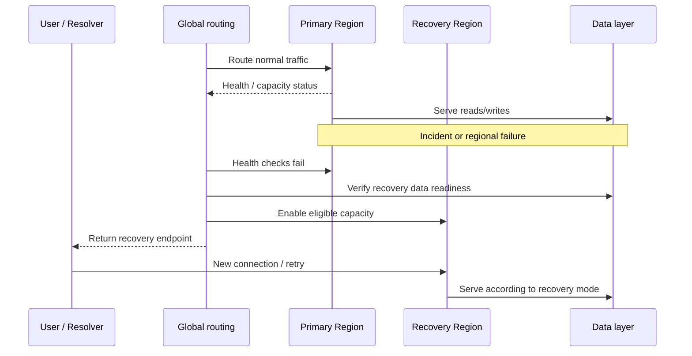
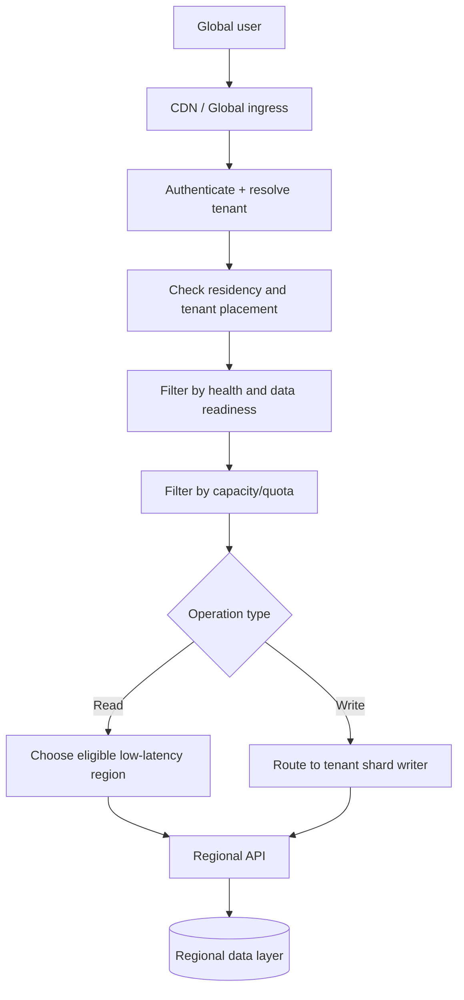

# Định tuyến toàn cầu theo vị trí, độ trễ và tình trạng dịch vụ

## 1. Định tuyến toàn cầu giải quyết bài toán gì?

Khi ứng dụng phục vụ người dùng ở nhiều quốc gia, một điểm truy cập duy nhất có thể khiến người dùng ở xa chịu round-trip time cao, đường truyền quốc tế không ổn định và mọi request phụ thuộc vào một region. Triển khai nhiều region giúp đưa compute đến gần người dùng hơn và tăng lựa chọn phục hồi khi một khu vực gặp sự cố. Tuy nhiên, có nhiều region không tự động làm hệ thống nhanh hoặc đáng tin cậy: traffic vẫn có thể đi sai nơi, health check có thể đánh giá nhầm, region còn sống nhưng quá tải, hoặc dữ liệu chưa sẵn sàng để phục vụ.

**Global traffic routing (định tuyến lưu lượng toàn cầu)** là việc quyết định request hoặc kết nối của người dùng được đưa tới endpoint, region, point of presence (PoP) hoặc cụm dịch vụ nào. Quyết định có thể dựa trên vị trí địa lý, độ trễ mạng, trọng số, tình trạng sức khỏe, capacity, chính sách dữ liệu và trạng thái phiên người dùng.

Bài học thuộc chương **Kiến trúc toàn cầu** của module **CLOUD_ARCHITECTURE**. Module học thiết kế ứng dụng cloud từ yêu cầu nghiệp vụ đến mạng, compute, dữ liệu và mô hình triển khai, cân bằng độ tin cậy, bảo mật, khả năng mở rộng, chi phí và vận hành theo Well-Architected. Định tuyến toàn cầu kết nối lớp truy cập người dùng với topology đa vùng, khả năng chịu lỗi và các ràng buộc về dữ liệu.

Sau bài học, bạn có thể phân biệt DNS-based routing, Anycast, CDN/edge và HTTP routing; chọn policy theo geography, latency, health, weight và capacity; thiết kế health check, failover/failback; kết hợp routing với session, data locality, consistency, residency, security, cost và observability.

## 2. Bắt đầu từ user journey và topology

Trước khi chọn DNS hoặc global load balancer, hãy xác định người dùng cần truy cập chức năng nào, dữ liệu nằm ở đâu và region nào thực sự có khả năng phục vụ.

### 2.1. Yêu cầu cần thu thập

- Phân bố người dùng theo quốc gia, ISP, mạng di động và thời gian.
- Critical user journey, API, protocol và loại traffic.
- SLO latency/availability theo population và region.
- Vị trí dữ liệu chính, replica, cache, object storage và dependency.
- Yêu cầu residency, sovereignty, privacy và hợp đồng.
- Recovery time objective (RTO) và recovery point objective (RPO).
- Capacity, quota và mức dự phòng khi một region mất.
- Chi phí compute, replication, inter-region transfer và egress.

Không chỉ thống kê số user theo quốc gia. Người dùng cùng một thành phố có thể đi qua ISP hoặc peering path khác nhau; region gần nhất trên bản đồ không nhất thiết có latency mạng thấp nhất.

### 2.2. Vai trò của region

| Mô hình | Mục đích | Đánh đổi |
|---|---|---|
| Active-active | Nhiều region cùng nhận traffic production | Chi phí, consistency và conflict phức tạp |
| Active-passive | Một region chính, một region dự phòng | Capacity standby và thời gian chuyển vùng |
| Warm standby | Region dự phòng có hạ tầng tối thiểu đang chạy | Cần scale và warm-up khi sự cố |
| Pilot light | Giữ thành phần cốt lõi/dữ liệu cần thiết | RTO dài hơn warm standby |
| Backup/restore | Chỉ lưu backup và IaC | Chi phí thấp hơn, RTO thường dài nhất |

Vai trò có thể khác nhau theo service. Web/API có thể active-active trong khi database là primary-secondary; static content phục vụ qua CDN toàn cầu nhưng write API chỉ chạy ở một số region.

### 2.3. Routing eligibility

Một region chỉ nên nhận loại request nếu đã provision đúng, chạy phiên bản tương thích, có quyền truy cập dữ liệu cần thiết, đạt freshness/consistency nghiệp vụ, còn capacity/quota, được phép xử lý dữ liệu theo policy và đáp ứng bảo mật. Endpoint trả HTTP 200 chưa đủ chứng minh region có thể phục vụ mọi operation.

## 3. Các lớp định tuyến toàn cầu

Định tuyến có thể diễn ra ở nhiều lớp. Mỗi lớp nhìn thấy thông tin khác nhau và có giới hạn riêng.

### 3.1. DNS-based global routing

DNS trả về record hoặc endpoint theo policy của authoritative/global DNS service. Các policy phổ biến:

- **Geolocation:** ánh xạ quốc gia/khu vực của resolver hoặc source IP theo cơ sở dữ liệu địa lý.
- **Geoproximity:** chọn endpoint theo độ gần, có thể điều chỉnh bằng bias.
- **Latency-based:** chọn endpoint có latency đo được thấp nhất từ vantage point của dịch vụ.
- **Weighted:** chia traffic theo trọng số giữa các endpoint.
- **Failover:** trả endpoint chính và chuyển sang dự phòng khi health check thất bại.
- **Multivalue:** trả nhiều địa chỉ/endpoint khỏe để client chọn.

DNS routing đơn giản, mở rộng tốt và hoạt động ở lớp hostname. Nhưng DNS cache và TTL có nghĩa thay đổi record không lập tức đến mọi client; recursive resolver có cache behavior riêng. Không dùng DNS failover như công tắc tức thời cho mọi kết nối đã mở.

### 3.2. Anycast

Anycast quảng bá cùng một IP prefix từ nhiều điểm mạng. Internet routing đưa packet đến điểm được chọn theo topology/BGP path tại thời điểm đó. Anycast thường dùng cho edge, DNS, CDN hoặc network ingress.

Ưu điểm là người dùng có thể tới PoP gần theo đường mạng và client không cần biết nhiều IP region. Giới hạn là “gần nhất” theo BGP không nhất thiết có latency ứng dụng thấp nhất; route thay đổi theo chính sách và trạng thái Internet; Anycast không tự giải quyết session affinity, database write ownership hoặc data residency. Một TCP connection đã mở cũng không chắc được chuyển mượt sang PoP khác khi route đổi.

### 3.3. CDN và edge routing

CDN đưa static content hoặc nội dung cache được đến edge gần người dùng. Dynamic request có thể được proxy về origin hoặc chọn origin theo policy.

CDN giúp giảm latency tải asset, giảm origin bandwidth và hấp thụ một phần traffic burst. Cần xác định cache key, TTL, invalidation, cookie/header forwarding, authenticated content và behavior khi origin lỗi. Cache sai có thể làm lộ nội dung giữa tenant hoặc phục vụ dữ liệu cũ.

### 3.4. Global load balancer và HTTP routing

Global application delivery controller có thể kết thúc TLS, kiểm tra request, chọn region và route HTTP/gRPC theo path, host, header, tenant hoặc health. Lớp này có nhiều ngữ cảnh hơn DNS nhưng thêm dependency và network hop.

Ví dụ: asset đi tới CDN; read API đi tới region có replica đủ freshness; write API tới region sở hữu partition; tenant có data residency tại EU chỉ được route tới region đã phê duyệt.

### 3.5. So sánh lớp routing

| Lớp | Quyết định dựa trên | Điểm mạnh | Giới hạn |
|---|---|---|---|
| DNS routing | Resolver/source IP, policy, health, latency estimate | Đơn giản, global hostname | Cache/TTL và resolver |
| Anycast | Internet routing topology | Ingress gần theo network path | Ít ngữ cảnh ứng dụng |
| CDN/edge | PoP, cache key, origin policy | Acceleration, edge security | Cache correctness và origin dependency |
| HTTP global routing | Host/path/header/health/capacity | Quyết định theo request | Thêm hop và control-plane complexity |
| Client-side routing | Client latency/config/discovery | Có thể đo từ client network | Client cũ, manipulation và policy consistency |

Các lớp có thể phối hợp: DNS chọn edge, edge chọn region, load balancer/service mesh chọn instance trong region.

## 4. Định tuyến theo vị trí địa lý

Geographic routing hướng người dùng đến region gần hoặc được phép phục vụ dữ liệu của họ.

### 4.1. Geolocation và geoproximity

Geolocation ánh xạ IP nguồn sang quốc gia/khu vực rồi áp policy. Geoproximity dùng vị trí endpoint và nguồn, đôi khi kết hợp bias để mở rộng/thu hẹp vùng phục vụ.

Ví dụ, người dùng Đông Nam Á có thể được hướng tới Singapore hoặc Jakarta tùy coverage và latency; tenant có yêu cầu residency chỉ được chuyển tới region đã phê duyệt.

Đây là policy định hướng, không bảo đảm request đi tới region gần nhất. Resolver IP có thể ở quốc gia khác với người dùng; VPN, mobile carrier NAT và corporate egress cũng làm sai vị trí ước lượng.

### 4.2. Geography không đồng nghĩa data residency

Routing theo IP chỉ chọn đường truy cập. Nó không tự bảo đảm dữ liệu chỉ được lưu hoặc xử lý trong một jurisdiction. Request có thể vào region hợp lệ rồi gọi database, log, analytics hoặc support service ở nơi khác.

Data residency cần được thực thi trên primary/replica, backup, cache, log, trace, search, analytics, support access, encryption key và đường export/deletion.

### 4.3. Fallback theo jurisdiction

Không phải lúc nào cũng được route người dùng sang region ngoài jurisdiction. Policy cần nói rõ có thể failover sang region khác trong cùng jurisdiction, phục vụ read-only/degraded mode, tạm từ chối operation hay có vùng thay thế đã phê duyệt. Đây là quyết định nghiệp vụ/pháp lý/bảo mật, không nên để health check tự quyết định.

## 5. Định tuyến theo độ trễ

Latency-based routing chọn endpoint có độ trễ ước tính thấp nhất trong tập candidate, dựa trên vantage point hoặc measurement của hệ thống routing.

### 5.1. Độ trễ đầu-cuối

Latency người dùng cảm nhận có thể gồm DNS resolution, TCP/TLS handshake, RTT client-edge-region, queueing tại load balancer/service, compute, database/cache/dependency, response transfer và client rendering. Chọn region RTT thấp không bảo đảm end-to-end latency thấp nếu region quá tải hoặc data nằm ở nơi khác.

### 5.2. Đo latency theo population

- Synthetic probes từ nhiều quốc gia/ISP/cloud vantage point.
- Real user monitoring (RUM) khi phù hợp.
- DNS/connect/TLS/TTFB và application latency tách riêng.
- p50/p95/p99 theo region, route và user population.
- Error rate, packet loss và retry cùng latency.

Không suy ra trải nghiệm mọi người dùng từ một probe chạy trong cùng cloud network. Phân nhóm theo khu vực lớn để tránh cardinality cao và bảo vệ privacy.

### 5.3. Hysteresis và threshold

Khi hai region có latency gần nhau, routing có thể dao động theo số đo nhỏ. Có thể dùng hysteresis (chỉ chuyển khi chênh lệch vượt ngưỡng), dwell time, smoothing theo moving window/percentile, capacity guardrail và minimum improvement threshold.

Những cơ chế này giảm route flapping nhưng làm phản ứng chậm hơn; tuning cần xét thời gian sự cố và độ biến động mạng.

## 6. Định tuyến theo health và capacity

Health-based routing loại endpoint không đáp ứng điều kiện phục vụ khỏi tập candidate. Health không chỉ là boolean.

### 6.1. Các tầng health check

| Check | Phạm vi | Câu hỏi |
|---|---|---|
| Network reachability | IP/port | Có kết nối được không? |
| Liveness | Process | Process còn chạy, không deadlock? |
| Readiness | Service instance | Instance sẵn sàng nhận traffic? |
| Dependency health | Database/cache/queue | Dependency cần thiết hoạt động? |
| Synthetic transaction | User journey | Thao tác đại diện hoàn tất đúng? |
| Capacity health | Resource saturation | Region còn đủ khả năng nhận tải? |
| Data health | Replication lag/consistency | Dữ liệu đủ mới và đúng? |

Health endpoint trả 200 có thể không kiểm tra database/data freshness. Ngược lại, nếu readiness phụ thuộc mọi dependency phụ, một dependency không thiết yếu lỗi có thể khiến toàn region bị loại dù core journey còn hoạt động.

### 6.2. Tránh false positive

- Kiểm tra đúng capability endpoint cần để phục vụ.
- Dùng timeout/retry phù hợp; không để một probe transient loại region ngay.
- Dùng nhiều vantage point nếu có để phân biệt lỗi cục bộ và lỗi region.
- Tách health endpoint public/internal theo phạm vi.
- Không để probe tạo tải đáng kể lên dependency.
- Giám sát cả probe không chạy hoặc không gửi được.
- Định nghĩa consecutive failure và recovery threshold.

### 6.3. Capacity-aware routing

Region có thể khỏe nhưng gần giới hạn. Chọn region theo health בלבד có thể dồn traffic vào nơi CPU, DB connection, queue hoặc quota đã bão hòa.

Capacity signal có thể gồm current load/headroom, concurrent requests, compute throttling, database connection/write capacity, replication lag, queue age, network egress/NAT và cloud quota/autoscaling delay.

Routing nên chỉ gửi traffic mới tới region còn headroom. Nếu mọi region gần bão hòa, dùng admission control, rate limit hoặc degraded mode thay vì chuyển vòng quanh.

## 7. Chính sách routing phổ biến

### 7.1. Weighted routing

Chia tỷ lệ traffic theo trọng số, ví dụ 80/20 để rollout region mới hoặc kiểm tra capacity. Weighted DNS mang tính xác suất theo query; không đảm bảo tỷ lệ request chính xác do DNS caching, client behavior và connection reuse.

### 7.2. Priority/failover

Có primary endpoint và endpoint dự phòng. Khi primary unhealthy, routing chuyển sang secondary theo policy. Cần định nghĩa recovery threshold, failback delay và data readiness.

### 7.3. Kết hợp geography, latency, health và capacity

Một thứ tự quyết định an toàn:

1. Lọc region không hợp lệ theo security/residency.
2. Lọc region unhealthy hoặc thiếu data readiness.
3. Lọc region không còn capacity.
4. Chọn latency tốt nhất trong tập còn lại.
5. Áp dụng weight/bias để cân tải hoặc phục vụ canary.

Latency không được override ràng buộc bắt buộc như residency hoặc health.

| Điều kiện | Quyết định |
|---|---|
| Region gần nhất khỏe, đủ data, còn capacity | Route tới region đó |
| Region gần nhất quá tải | Chọn region kế tiếp đủ capacity |
| Latency tốt nhưng replica quá trễ | Không route operation yêu cầu freshness |
| Region lỗi nhưng có region khác cùng jurisdiction | Failover nội vùng theo policy |
| Chỉ còn region ngoài vùng dữ liệu được phép | Degraded mode hoặc từ chối operation |
| Tất cả region unhealthy | Admission control/incident response; không chọn region giả khỏe |

## 8. Failover toàn cầu

Failover chuyển traffic khỏi endpoint/region lỗi sang nơi khác có khả năng phục vụ. Cần chuẩn bị failure mode và xác minh đích có thể nhận tải.

### 8.1. Failover sequence



DNS cache, client retry và connection lifetime có thể khiến một phần traffic tiếp tục tới primary sau routing change. Ứng dụng cần timeout, retry có backoff và idempotency; routing không tự chuyển request đang thực thi dở.

### 8.2. Trình tự failover có kiểm soát

1. Xác nhận incident và phạm vi ảnh hưởng.
2. Kiểm tra health từ nhiều góc nhìn.
3. Chặn hoặc giảm traffic mới tới endpoint lỗi.
4. Xác minh recovery region đủ compute, quota, network và data freshness.
5. Promote database/leader nếu cần, dùng fencing để ngăn hai writer.
6. Mở traffic theo stage và theo dõi error/latency/business correctness.
7. Xác nhận critical journey phục hồi.
8. Lưu evidence, timeline và quyết định failover.

### 8.3. Tránh split-brain

Nếu hai region cùng nghĩ mình là primary writer, dữ liệu có thể phân nhánh hoặc ghi đè. Cần quorum/consensus hoặc leader election có fencing token; epoch/lease/version tăng đơn điệu; tách quyền ghi ở standby cho đến khi promote; xác nhận old leader đã bị fence trước khi mở writer mới; và quy tắc conflict resolution.

Chỉ đổi DNS không đủ để bảo đảm single-writer.

### 8.4. Failback

Khi region cũ phục hồi, không tự động chuyển traffic về ngay. Xác minh hạ tầng/dependency ổn định, đồng bộ dữ liệu, kiểm tra lag, xác định writer ownership, reconcile dữ liệu, chuyển traffic theo stage và giữ rollback option. Failback quá sớm có thể tạo outage hoặc mất dữ liệu.

## 9. DNS caching và kết nối đang mở

DNS-based failover có độ trễ do authoritative DNS TTL, recursive resolver, operating system, browser/runtime và application connection pool. TTL thấp có thể giảm thời gian cache nhưng tăng query và không bảo đảm mọi client tuân thủ chính xác. TCP/HTTP2 connection đã mở vẫn có thể dùng endpoint cũ dù DNS thay đổi.

Thiết kế cần TTL phù hợp, client retry/re-resolve có giới hạn, drain/reconnect, timeout hợp lý, idempotency cho write API và theo dõi request tới region cũ sau cutover.

Không dùng TTL bằng 0 như giải pháp tức thời; nhiều resolver có minimum caching behavior và app có thể không hỏi DNS lại cho mỗi request.

## 10. Global routing và kiến trúc dữ liệu

Routing quyết định request tới đâu; data architecture quyết định request có thể xử lý đúng tại đó hay không.

### 10.1. Mô hình dữ liệu đa vùng

| Mô hình | Cách hoạt động | Ưu điểm | Đánh đổi |
|---|---|---|---|
| Single-writer, remote read replicas | Một region ghi chính, vùng khác đọc replica | Dễ kiểm soát conflict hơn | Cross-region write latency, replication lag |
| Active-passive database | Standby được promote khi failover | Write ownership rõ | RTO phụ thuộc promotion/readiness |
| Multi-writer | Nhiều region nhận write | Write locality | Conflict, ordering và consistency phức tạp |
| Partition theo geography/tenant | Mỗi region sở hữu một phần dữ liệu | Local write, giảm cross-region access | Tenant movement, global query, hotspot |
| Globally distributed database | Database điều phối replication/consistency | Có thể cung cấp semantics toàn cầu | Cost, latency và giới hạn consistency |

### 10.2. Read routing và freshness

Read tới replica gần user giảm latency nhưng có thể đọc dữ liệu cũ. Feed/profile có thể chấp nhận eventual consistency trong giới hạn; balance, payment và booking capacity có thể cần strong consistency hoặc đọc authoritative writer. Sau khi user vừa ghi, dùng session stickiness/read-your-writes token hoặc route đọc về nơi sở hữu dữ liệu.

Không mặc định mọi GET đều có thể đọc replica gần nhất. Định nghĩa freshness objective và cách đo replication lag.

### 10.3. Session và affinity

Session affinity giữ user tại cùng region nhưng không nên phụ thuộc local memory nếu cần failover. Dùng session store chia sẻ/replicate hoặc stateless signed token khi phù hợp. Affinity cần TTL và behavior rõ khi region cũ unhealthy.

### 10.4. Idempotency và retry

Client có thể retry khi timeout dù operation đầu đã commit. Write API cần idempotency key và durable deduplication tại nơi có thẩm quyền. Retry cần backoff, jitter, deadline và giới hạn số lần; retry storm có thể làm recovery region quá tải.

## 11. Security và trust boundary toàn cầu

Traffic routing không thay thế authentication, authorization hoặc network policy.

### 11.1. Rủi ro

- GeoIP sai hoặc bị spoof qua proxy/VPN.
- Host header/SNI manipulation làm route sai tenant hoặc origin.
- Edge-to-origin không xác thực, cho phép bypass WAF/CDN.
- Health endpoint lộ topology hoặc thông tin nội bộ.
- Failover đưa dữ liệu tới region ngoài residency policy.
- Cross-region replication mở rộng quyền đọc dữ liệu.
- Routing control plane bị chiếm quyền và chuyển traffic tới endpoint độc hại.

### 11.2. Kiểm soát

- TLS phù hợp; xác thực edge-to-origin bằng mTLS hoặc origin authentication.
- Chỉ cho origin nhận traffic từ edge/load balancer được phép khi mô hình cho phép.
- Validate host, SNI, tenant context và signed forwarding headers.
- Không tin forwarding header nếu không đến từ proxy đáng tin.
- Health check trả tín hiệu tối thiểu, không tiết lộ secret.
- RBAC, MFA/JIT, approval và audit cho global routing policy.
- Policy-as-code ngăn target không được phê duyệt hoặc sai jurisdiction.
- Least privilege và separation of duties cho DNS, certificate và routing control plane.

### 11.3. Geo routing không phải security boundary

Không dùng vị trí IP làm bằng chứng duy nhất về identity hoặc quyền. VPN có thể đổi vị trí; attacker cũng có thể ở đúng quốc gia. Geo restriction chỉ là lớp policy bổ sung; authorization cần dựa trên identity, entitlement và context đáng tin.

## 12. Capacity và traffic engineering

Failover có thể dồn tải vào region còn lại. Active-active với mỗi region chạy 50% traffic không chắc chịu được 100% khi một region mất.

### 12.1. N-1 capacity

Kiểm tra region còn lại có nhận được traffic cần thiết không; quota cloud, database connection, IP/NAT và egress có đủ không; autoscaling có nhanh hơn queue growth không; replica có thể promote mà không vượt throughput không; background jobs có bị nhân đôi không.

Nếu không thể giữ full service, định nghĩa ưu tiên theo nghiệp vụ: booking/payment trước, report/export sau; dùng admission control hoặc shed load theo business priority.

### 12.2. Weighted traffic management

Weighted routing có thể cân tải nhưng DNS weight không phải load meter real-time. Với tải biến động, global load balancer/application routing có thể dùng metric gần thời gian thực hơn; vẫn cần smoothing, cooldown và guardrail.

### 12.3. Retry và thundering herd

Khi region lỗi, nhiều client có thể retry cùng lúc. Dùng exponential backoff, jitter, retry budget, circuit breaker và load shedding. Tránh retry đồng bộ theo chu kỳ cố định khiến recovery region quá tải.

## 13. Observability cho global routing

Để biết routing hoạt động đúng, cần đo cả quyết định route và trải nghiệm đầu-cuối.

| Tín hiệu | Mục đích |
|---|---|
| Requests/traffic by region and route | Xác định phân bố traffic |
| User p50/p95/p99 by geography | Đánh giá trải nghiệm population |
| DNS answer/TTL/cache behavior | Hiểu thời gian hội tụ |
| Health status and probe location | Phân biệt lỗi region và vantage point |
| Failover/failback events | Truy vết quyết định |
| Capacity/headroom by region | Ngăn dồn tải vào region bão hòa |
| Replication lag/data freshness | Xác định region đủ điều kiện |
| Error/timeout/retry rate | Phát hiện partial outage và retry storm |
| Old-region traffic/connection reuse | Theo dõi client còn bám endpoint cũ |
| Cost/inter-region egress | Phân tích đánh đổi |

### 13.1. Synthetic và real-user measurement

Synthetic probe chạy theo lịch từ location cố định, hữu ích cho early warning và so sánh. RUM quan sát trải nghiệm thật nhưng chịu ảnh hưởng thiết bị, mạng và privacy policy. Kết hợp hai nguồn để tránh kết luận từ một vantage point.

### 13.2. Routing decision log

Với quyết định quan trọng, ghi decision ID/time, candidate region, lý do loại candidate, policy/version, health/latency/capacity signal, region được chọn và fallback reason. Không log dữ liệu nhạy cảm hoặc toàn bộ IP khi không cần; dùng aggregation/pseudonymization theo privacy policy.

## 14. Runbook cho sự cố global routing

1. Xác định geography/ISP, route, tenant, client version và thời điểm.
2. Kiểm tra synthetic probe/RUM để phân biệt lỗi cục bộ và diện rộng.
3. So sánh DNS answer, edge path, region health và application SLI.
4. Kiểm tra data readiness, replication lag, capacity và dependency.
5. Xác định policy routing và target có đủ điều kiện không.
6. Chuyển traffic có kiểm soát hoặc bật degraded mode theo runbook.
7. Theo dõi old connection, DNS cache, retry và load recovery region.
8. Xác nhận critical journey, data correctness và SLO.
9. Lập kế hoạch failback riêng sau khi region ổn định và dữ liệu được reconcile.
10. Lưu timeline, evidence, routing policy revision và action items.

Không failover/failback chỉ dựa trên một ping hoặc một synthetic check. Cần xác nhận serving path, dữ liệu và capacity.

## 15. Ví dụ: nền tảng SaaS phục vụ nhiều khu vực

Giả sử nền tảng đặt lịch phục vụ Đông Nam Á, châu Âu và Bắc Mỹ. Static assets phân phối qua CDN; API chạy ở Singapore, Frankfurt và Virginia. Một số tenant có yêu cầu dữ liệu ở EU; booking write dùng single-writer theo tenant shard.

### 15.1. Routing policy

- CDN phục vụ asset công khai và nội dung cache được.
- DNS/edge đưa user tới ingress theo geography và latency.
- API gateway xác thực và kiểm tra tenant policy/residency.
- Read request có thể tới region gần nhất nếu replica đạt freshness objective.
- Write request route tới region sở hữu shard của tenant.
- Region unhealthy hoặc thiếu capacity bị loại khỏi candidate.
- EU tenant chỉ failover trong region được duyệt cho data boundary.

### 15.2. Luồng quyết định



### 15.3. Sự cố region

Nếu Singapore mất khả năng phục vụ, edge ngừng chọn endpoint đó cho traffic đủ điều kiện. Tenant có writer ở region khác có thể tiếp tục theo shard ownership. Tenant chỉ có data tại Singapore phải theo recovery plan: promote replica trong jurisdiction phù hợp, read-only hoặc tạm từ chối write. Traffic chuyển sang region còn lại theo capacity guardrail; khi Singapore phục hồi, đồng bộ dữ liệu, fence writer cũ và failback theo stage.

Không giả định mọi tenant tự động chuyển sang Frankfurt hoặc Virginia; placement và residency quyết định khả năng đó.

## 16. Đánh đổi và anti-pattern

| Anti-pattern | Hệ quả | Cách cải thiện |
|---|---|---|
| Chọn region gần nhất theo bản đồ | Network path thực có thể chậm hơn | Đo nhiều vantage point, xét health/capacity |
| Xem DNS TTL thấp là failover tức thời | Resolver/client vẫn cache, connection còn mở | Retry, drain, timeout và convergence |
| Health check chỉ ping port | App/data path lỗi nhưng endpoint vẫn healthy | Readiness, synthetic transaction, data health |
| Chỉ xét health, bỏ capacity | Dồn tải vào region sắp bão hòa | Capacity-aware routing và N-1 test |
| Failover chỉ đổi DNS | Split-brain hoặc stale data | Writer fencing, data readiness và runbook |
| Failback ngay khi ping xanh | Flapping, dữ liệu chưa đồng bộ | Stability window, reconciliation, staged failback |
| GeoIP như authorization | VPN/proxy gây sai và bị spoof | Identity-based authorization |
| Active-active không xét write conflict | Mất/ghi đè dữ liệu | Partition ownership, consistency và idempotency |
| Replicate mọi dữ liệu mọi nơi | Vi phạm residency và tăng cost | Data classification và regional placement |
| Retry vô hạn sau outage | Recovery region bị thundering herd | Backoff, jitter, retry budget, circuit breaker |

## 17. Kiểm thử kiến trúc định tuyến toàn cầu

| Test | Mục tiêu |
|---|---|
| Geographic mapping | Location khác nhau nhận target đúng policy |
| Latency routing | Candidate phù hợp được chọn theo measurement |
| Health failure | Endpoint unhealthy bị loại sau threshold |
| Partial failure | Dependency phụ lỗi không loại region nếu core journey còn phục vụ an toàn |
| Capacity exhaustion | Region thiếu headroom không nhận thêm traffic |
| DNS convergence | Đo thời gian client/resolver ngừng dùng endpoint cũ |
| Open connections | Client reconnect/retry đúng sau cutover |
| Data lag | Read/write chỉ tới region đạt consistency/freshness |
| Split-brain | Old writer bị fence trước khi promote writer mới |
| Residency | Không có data path vượt region được phép |
| N-1 capacity | Region còn lại chịu tải hoặc degraded policy đúng |
| Failback | Reconciliation/cutover không gây mất dữ liệu |
| Security | Origin bypass, spoofed forwarding header và unauthorized routing change bị chặn |

Chaos/game day cần phạm vi được phê duyệt và stop condition. Diễn tập control plane, data plane, DNS/edge và dependency; không chỉ tắt một VM đơn lẻ.

## 18. Đánh giá theo Well-Architected

| Trụ cột | Câu hỏi review |
|---|---|
| **Operational Excellence** | Routing policy, health signal, runbook, failover/failback và game day có owner? |
| **Security** | Geo routing có bị nhầm với authorization? Origin, control plane, residency và admin access được bảo vệ? |
| **Reliability** | Có multi-region readiness, N-1 capacity, data fencing, DNS/client convergence và recovery test? |
| **Performance Efficiency** | Routing dựa trên end-to-end latency, cache, network path và capacity? Có tránh cross-region hop không cần thiết? |
| **Cost Optimization** | Active-active, replica, egress, CDN và standby cost có được so với user/SLO benefit? |
| **Sustainability** | Traffic tới region hiệu quả, giảm truyền dữ liệu vòng xa và tài nguyên standby nhàn rỗi? |

## 19. Mẫu global routing policy

YAML sau mô tả policy khái niệm, không phải cấu hình trực tiếp cho nhà cung cấp:

```yaml
global_routing:
  service: booking-api
  policy_version: 1
  candidate_filters:
    residency_required: true
    health_required: true
    data_freshness_required: true
    capacity_headroom_required: true
  selection:
    primary: latency
    secondary: weighted_capacity
    hysteresis_ms: 25
    minimum_stable_window_seconds: 30
  regions:
    - id: ap_southeast
      role: active
      eligible_operations:
        - read
        - tenant_owned_write
    - id: eu_central
      role: active
      residency_scopes:
        - eu
    - id: us_east
      role: active
      residency_scopes:
        - us
  failover:
    require_data_readiness: true
    require_writer_fencing: true
    staged_traffic_ramp: true
    automatic_failback: false
  observability:
    record_policy_version: true
    measure_user_latency_by_region: true
    track_dns_convergence: true
    track_replication_lag: true
```

Policy thực tế cần bổ sung endpoint, health threshold, freshness limit, capacity limit, fallback behavior, jurisdiction mapping, owner và approval. Không dùng giá trị mẫu làm production default.

## 20. Quy trình thiết kế định tuyến toàn cầu

1. **Xác định user population/journey:** geography, ISP, route, SLO, latency và availability.
2. **Lập topology:** edge, DNS, ingress, region, service, database, cache, queue và dependency.
3. **Xác định region eligibility:** health, capacity, data readiness, security và residency.
4. **Chọn routing layer:** DNS, Anycast, CDN, global HTTP router hoặc kết hợp.
5. **Chọn policy:** geography, latency, weighted, priority/failover và operation-specific routing.
6. **Thiết kế health/capacity:** probe, timeout, threshold, hysteresis và saturation.
7. **Thiết kế data semantics:** writer ownership, replica freshness, session affinity, idempotency và conflict handling.
8. **Lập failover/failback:** sequence, fencing, DNS convergence, admission control và degraded mode.
9. **Bảo vệ routing plane:** IAM, approval, origin auth, policy-as-code và audit.
10. **Đo và diễn tập:** RUM, synthetic, regional SLI, game day, N-1 capacity và evidence.

## 21. Bảng kiểm trước production

- [ ] User geography, ISP, critical journey, latency SLO và RTO/RPO được ghi rõ.
- [ ] Topology có DNS/edge/CDN, ingress, region, dependency và data placement.
- [ ] Routing eligibility xét health, capacity, data freshness, security và residency.
- [ ] Phân biệt DNS routing, Anycast, CDN và HTTP-layer routing.
- [ ] Geolocation có limitation của resolver IP, VPN, carrier NAT và proxy.
- [ ] Latency đo từ nhiều vantage point/user population, không chỉ bản đồ.
- [ ] Health check phân biệt reachability, liveness, readiness, data health và capacity.
- [ ] Có hysteresis/stability window và cách ngăn route flapping.
- [ ] Weighted routing hiểu đúng giới hạn DNS cache và connection reuse.
- [ ] Failover có sequence, data readiness, writer fencing và admission control.
- [ ] Failback cần stability, replication/reconciliation và staged cutover.
- [ ] DNS TTL, resolver cache, connection drain/reconnect và retry được kiểm tra.
- [ ] Read routing xét consistency/freshness; write route tới authoritative owner.
- [ ] Session, idempotency và retry budget được thiết kế cho multi-region.
- [ ] N-1 capacity, quota, autoscaling delay và downstream headroom đã kiểm chứng.
- [ ] Data residency bao phủ DB, replica, backup, cache, log, analytics và support.
- [ ] Routing control plane có least privilege, approval, audit và policy validation.
- [ ] Observability theo region, geography, route, health, replication lag và convergence.
- [ ] Đã diễn tập partial outage, regional failure, split-brain, failback và origin bypass.
- [ ] Runbook có owner, stop condition, degraded mode và evidence sau sự cố.

**Nguyên tắc áp dụng:** định tuyến toàn cầu không chỉ là chọn region gần nhất. Hãy lọc region không được phép hoặc không đủ điều kiện phục vụ, xét health và capacity trước khi tối ưu latency, rồi kết hợp routing với data consistency, session, security và recovery. Đo từ góc nhìn người dùng và diễn tập failover/failback mới chứng minh được kiến trúc đa vùng hoạt động đúng khi bình thường lẫn khi có sự cố.
