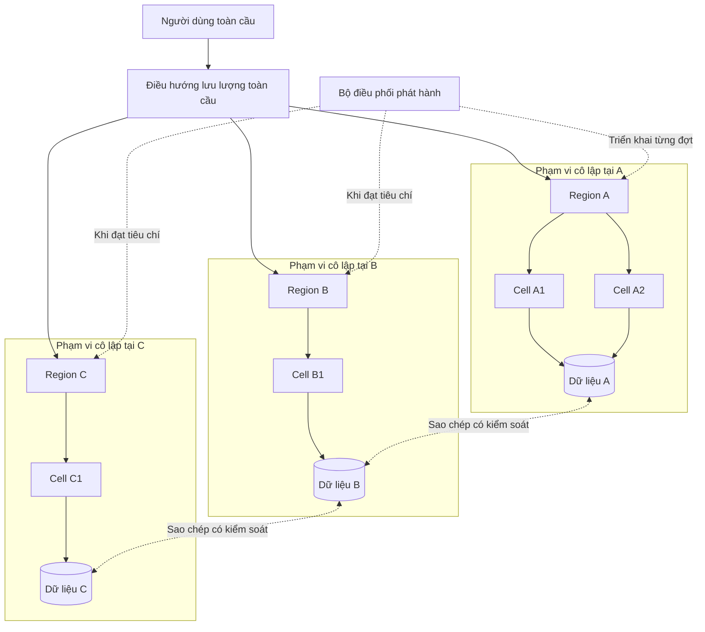

# Phát hành theo khu vực và giới hạn lỗi lan rộng

> **Chương:** Kiến trúc toàn cầu  
> **Phạm vi:** CLOUD_ARCHITECTURE — thiết kế kiến trúc ứng dụng đám mây dựa trên yêu cầu nghiệp vụ, lựa chọn mạng, compute, dữ liệu và mô hình triển khai; đánh đổi giữa độ tin cậy, bảo mật, khả năng mở rộng, chi phí và vận hành theo tư duy Well-Architected.

Một ứng dụng phục vụ nhiều quốc gia thường chạy ở nhiều **khu vực đám mây (region)** để giảm độ trễ, đáp ứng yêu cầu lưu trú dữ liệu và chịu được sự cố hạ tầng. Tuy nhiên, nếu cập nhật phần mềm cùng lúc ở mọi region, chỉ một bản phát hành lỗi cũng có thể khiến toàn bộ hệ thống ngừng phục vụ. **Phát hành theo khu vực (regional rollout)** là cách triển khai phiên bản mới theo từng phạm vi được kiểm soát, quan sát tác động rồi mới mở rộng. Mục đích là **giới hạn lỗi lan rộng (blast radius)** và giữ được đường lui khi có sự cố.

## Mục tiêu học tập

Sau bài này, bạn có thể:

1. Phân biệt phạm vi lỗi của instance, availability zone, cell, region và thành phần dùng chung toàn cầu.
2. Thiết kế thứ tự phát hành qua nhiều region bằng canary, rolling, blue-green và feature flag.
3. Ước tính phần lưu lượng có nguy cơ bị ảnh hưởng ở mỗi giai đoạn, đồng thời nhận diện những trường hợp công thức ước tính không còn đúng.
4. Đặt tiêu chí tự động tiếp tục, tạm dừng, rollback hoặc chuyển lưu lượng dựa trên SLO và tín hiệu toàn vẹn dữ liệu.
5. Xem xét sự phụ thuộc giữa mạng, compute, dữ liệu, bảo mật, vận hành và chi phí khi giới hạn sự cố.

## 1. Vì sao rollout toàn cầu có thể gây sự cố toàn cầu?

Giả sử một dịch vụ đặt hàng đang chạy ở ba region A, B và C. Phiên bản mới thêm cơ chế retry khi gọi dịch vụ thanh toán. Nếu triển khai đồng thời, lỗi retry có thể tạo giao dịch trùng ở cả ba nơi. Mặc dù hạ tầng của từng region độc lập, **các region cùng nhận một lỗi phần mềm** nên khả năng dự phòng theo địa lý không giải quyết được vấn đề.

Cần phân biệt hai tình huống:

- **Hỏng một region:** lỗi mất điện, mạng, cụm compute hoặc cơ sở dữ liệu tại A; điều hướng sang B/C *có thể* khôi phục dịch vụ nếu đủ năng lực và dữ liệu cho phép.
- **Phát hành phiên bản lỗi ở mọi region:** B/C cũng chạy mã lỗi; điều hướng lưu lượng chỉ chuyển người dùng sang nơi vẫn bị lỗi. Biện pháp phù hợp là dừng phát hành, tắt tính năng gây lỗi hoặc khôi phục phiên bản an toàn.

**Blast radius** là phạm vi tài nguyên, người dùng, tenant hoặc nghiệp vụ có thể bị tác động bởi một thay đổi hay sự cố. Đừng đo chỉ bằng số máy chủ: một thay đổi cấu hình xác thực dùng chung có thể ảnh hưởng toàn hệ thống dù được kích hoạt từ một máy.

| Đơn vị cô lập lỗi | Ví dụ | Điều gì có thể lan ra ngoài? |
| --- | --- | --- |
| Instance hoặc pod | Một tiến trình ứng dụng mới bị crash | Lưu lượng có thể bị tác động nếu cân bằng tải/health check không loại bỏ instance lỗi. |
| Availability zone (AZ) | Một cụm compute hoặc mạng nội vùng hỏng | Dịch vụ dùng database/queue đơn AZ có thể vẫn ngừng hoạt động. |
| **Cell** | Nhóm ứng dụng và dữ liệu phục vụ một tập tenant xác định | Phụ thuộc dùng chung, thao tác dữ liệu chéo cell hoặc route sai có thể mở rộng ảnh hưởng. |
| **Region** | Toàn bộ stack ở một khu vực hỏng | Hệ thống điều hướng, danh tính, cấu hình và dữ liệu toàn cầu vẫn có thể tạo lỗi chung. |
| Toàn cầu | Đổi schema, secret, DNS, policy hoặc thư viện dùng chung | Mọi region có thể gặp cùng một lỗi dù có nhiều bản sao hạ tầng. |

**Failure domain** là một phạm vi có thể hỏng tương đối độc lập. **Rollout unit** là phạm vi được cập nhật trong một lượt phát hành. Hai khái niệm không bắt buộc trùng nhau: có thể rollout cho 5% người dùng của một cell trong một region, thay vì cho toàn bộ region cùng lúc.

## 2. Kiến trúc để cô lập lỗi theo region

Phát hành tuần tự chỉ hữu ích khi lỗi thực sự được giữ trong vùng đã phát hành. Kiến trúc phải thể hiện rõ đường đi của request, lưu trữ trạng thái, phụ thuộc và quyền điều khiển.



Sơ đồ là **mô hình khái niệm**, không mặc định mọi ứng dụng đều sao chép hai chiều hoặc dùng chung dữ liệu giữa các cell. Hình thức sao chép phải phù hợp với chủ quyền dữ liệu và mô hình ghi/đọc thực tế.

Một thiết kế có khả năng giới hạn lỗi nên đáp ứng các điều kiện sau:

| Thành phần | Cách thiết kế | Nguy cơ nếu làm sai |
| --- | --- | --- |
| **Compute** | Có nhóm instance, cấu hình, autoscaling và health check độc lập theo region/cell. | Cùng một thay đổi autoscaling hoặc image lỗi làm mọi region thiếu năng lực xử lý. |
| **Mạng & điều hướng** | Có thể chuyển hoặc ngừng nhận lưu lượng theo region, cell, phiên bản; health check phản ánh đường đi nghiệp vụ. | Chỉ kiểm tra HTTP 200 của trang chủ, trong khi đặt hàng đã hỏng. |
| **Dữ liệu** | Quy định rõ region được ghi, cách sao chép, consistency, failover và giới hạn dữ liệu cư trú. | Dữ liệu sai hoặc thao tác phá hủy được sao chép ra toàn cầu trước khi rollback code. |
| **Cấu hình & feature flag** | Hỗ trợ phạm vi region/cell/tenant, audit và kill switch; thay đổi dùng chung được triển khai có thứ tự. | Một cờ toàn cầu vô tình kích hoạt cùng chức năng lỗi ở mọi nơi. |
| **Identity, secret, dependency** | Có cơ chế chịu lỗi khi dịch vụ dùng chung suy giảm; hạn chế coupling trên đường xử lý quan trọng. | Region khỏe vẫn ngừng phục vụ do dịch vụ xác thực hoặc secret store tập trung hỏng. |
| **CI/CD & quản trị** | Mỗi region nhận bản phát hành có thể dừng/khôi phục độc lập; có quyền phê duyệt và nhật ký. | Pipeline đồng thời ép nâng cấp tất cả region hoặc xóa luôn bản chạy ổn định. |
| **Quan sát** | Đo theo region, cell, phiên bản, route và cohort, đồng thời có tầm nhìn tổng thể. | Số liệu trung bình toàn cầu che mất lỗi nghiêm trọng ở canary nhỏ. |

Trong thực tế, **data plane** là đường xử lý request đang phục vụ khách hàng, còn **control plane** điều khiển deployment, routing, cấu hình và chính sách. Nếu bộ điều phối phát hành toàn cầu tạm mất kết nối, các region đang phục vụ nên tiếp tục xử lý request bằng trạng thái hợp lệ gần nhất; hệ thống phát hành sẽ dừng tiến trình cho đến khi phục hồi. Không để một lỗi pipeline trở thành lý do khiến toàn bộ data plane dừng hoạt động.

### Region, AZ và cell có vai trò khác nhau

- **Đa AZ trong cùng region** giúp chịu lỗi hạ tầng cục bộ, nhưng không đủ trước sự cố cấp region hoặc thay đổi mã áp dụng cho cả region.
- **Đa region** cải thiện độ sẵn sàng theo địa lý, nhưng chi phí mạng, đồng bộ dữ liệu và vận hành cao hơn.
- **Chia cell trong mỗi region** tiếp tục giảm blast radius cho lỗi phần mềm hoặc tenant quá tải. Cell chỉ có ý nghĩa khi có giới hạn tài nguyên và phụ thuộc phù hợp; nhiều cell dùng chung một database quá tải vẫn có điểm lỗi chung.

Không phải ứng dụng nào cũng cần active-active toàn cầu. Hãy chọn mức cô lập theo SLO, RTO/RPO, yêu cầu dữ liệu và ngân sách; tránh nhân bản hạ tầng mà không kiểm soát các phụ thuộc chung.

## 3. Phát hành tăng dần qua nhiều region

Một quy trình an toàn kết hợp **phát hành từng vùng** và **tăng lưu lượng trong vùng đó**. Việc đưa artifact lên máy chủ và việc kích hoạt chức năng mới cũng có thể tách thành hai bước.

### Những cách triển khai thường dùng

| Cách làm | Cách vận hành | Khi phù hợp | Điểm cần chú ý |
| --- | --- | --- | --- |
| **Rolling deployment** | Thay từng nhóm instance trong một region. | Cập nhật thông thường, các phiên bản có thể chạy song song. | Cần đảm bảo tương thích API, session, event và schema giữa phiên bản cũ/mới. |
| **Canary** | Cho một tỷ lệ nhỏ lưu lượng thật đến phiên bản mới, so với nhóm đối chứng. | Thay đổi rủi ro cao hoặc khó đo bằng test trước sản xuất. | Canary không có ý nghĩa nếu mẫu quá ít, phân bổ không đại diện hoặc dữ liệu dùng chung gây tác động rộng. |
| **Blue-green** | Dựng môi trường phiên bản mới và chuyển lưu lượng qua khi sẵn sàng. | Cần chuyển đổi nhanh và có thể giữ môi trường cũ để quay lại. | Chi phí compute cao; rollback ứng dụng không tự khôi phục dữ liệu đã thay đổi. |
| **Feature flag** | Triển khai mã trước, kích hoạt tính năng theo cohort/region. | Muốn tách thời điểm triển khai mã khỏi thời điểm thay đổi hành vi. | Cấu hình cờ là một kênh phát hành; phải kiểm soát quyền, audit và thời gian hội tụ. |

Các cách trên có thể kết hợp: rolling để đưa artifact tới 5% instance của region A, canary để gửi lưu lượng phù hợp tới chúng, sau đó bật feature flag riêng cho một nhóm tenant.

### Quy trình triển khai đề xuất

1. **Chuẩn bị:** xác nhận thay đổi, tác động đến data/schema, phạm vi tenant, quy định lưu trú dữ liệu, khả năng rollback, phiên bản tương thích và kế hoạch hỗ trợ. Xác nhận SLO hiện tại đạt ngưỡng và không có sự cố đang diễn ra.
2. **Kiểm tra trước production:** chạy test tự động, kiểm tra hợp đồng API/event, migration tương thích, khả năng khởi động, bảo mật artifact và diễn tập rollback. Nếu có thể, dùng môi trường giống production nhưng không xem đó là thay thế canary thực tế.
3. **Chọn region đầu tiên:** chọn nơi đủ đại diện để quan sát nhưng có phạm vi ảnh hưởng chấp nhận được. Cân nhắc giờ cao điểm theo múi giờ, khách hàng quan trọng, yêu cầu pháp lý, lượng traffic và mức trưởng thành vận hành; đừng mặc định region ít traffic nhất luôn đại diện tốt nhất.
4. **Canary nhỏ trong region đầu:** phân bổ lưu lượng theo tỷ lệ hoặc cohort ổn định; đánh dấu version/cohort trong metric, log và trace. Theo dõi cả chỉ số kỹ thuật lẫn kết quả nghiệp vụ.
5. **Giữ thời gian quan sát (soak time), đánh giá và tăng dần:** tăng lên mức tiếp theo chỉ khi đủ lưu lượng, đủ thời gian và các điều kiện an toàn cùng đạt. Một bước có thể là 5% → 25% → 100% *trong một region*; đây là ví dụ, không phải tỷ lệ bắt buộc.
6. **Triển khai từng đợt region (wave):** lần lượt đến region khác theo thứ tự được duyệt, vẫn canary trong từng region. Luôn duy trì khả năng dừng toàn bộ chiến dịch khi có tín hiệu xấu.
7. **Kết thúc:** xác nhận không còn phiên bản lỗi, lưu bằng chứng rollout, rà soát lỗi tiềm ẩn và thu dọn feature flag/nhánh tương thích sau khi đã qua giai đoạn an toàn.

**Nguyên tắc quan trọng:** nếu có lỗi ở region A, **không** tiếp tục đẩy phiên bản đó sang B/C với hy vọng “lỗi chỉ do A”. Phải phân loại nguyên nhân và chứng minh việc tiếp tục là an toàn.

### Tính phần lưu lượng đang tiếp xúc với bản mới

Nếu có các region \(r\), đặt:

- \(w_r\): tỷ trọng request toàn cầu đến region \(r\), sao cho \(\sum_r w_r = 1\).
- \(c_r\): tỷ lệ request trong region \(r\) được phục vụ bởi phiên bản mới.

Khi đó, tỷ lệ request đang được phục vụ trực tiếp bởi phiên bản mới là:

\[
B_{\text{request}} = \sum_r w_r c_r
\]

Ví dụ A xử lý **20%**, B **30%**, C **50%** lưu lượng toàn cầu:

| Giai đoạn | Phiên bản mới tại A | Tại B | Tại C | Tổng lưu lượng dùng bản mới |
| --- | ---: | ---: | ---: | ---: |
| Canary đầu tiên | 5% | 0% | 0% | 1% |
| Hoàn tất A | 100% | 0% | 0% | 20% |
| Bắt đầu B | 100% | 5% | 0% | 21,5% |
| Hoàn tất A và B | 100% | 100% | 0% | 50% |
| Hoàn tất toàn cầu | 100% | 100% | 100% | 100% |

Con số **1%** ở bước đầu chỉ biểu thị lượng request trực tiếp đi qua mã mới, **không bảo đảm sự cố sẽ bị giới hạn ở 1%**. Nếu canary ghi dữ liệu lỗi vào cơ sở dữ liệu dùng chung, làm đầy hàng đợi, thay đổi DNS, hoặc khiến một dịch vụ trung tâm quá tải, người dùng bản cũ cũng có thể bị ảnh hưởng. Với dữ liệu, blast radius phải đo cả **số tenant/bản ghi bị thay đổi** và các hệ thống tiêu thụ dữ liệu đó.

Đặt **ngân sách phạm vi phát hành** (exposure budget), ví dụ giới hạn tối đa một tỷ lệ traffic hoặc một nhóm tenant quan trọng được phép tiếp xúc với thay đổi *chưa được xác nhận*. Ngân sách này phải đi kèm ranh giới lỗi thực tế và quy tắc dừng; không xem tỷ lệ canary là bằng chứng cô lập.

## 4. Tiêu chí ra quyết định: tiếp tục, dừng, khôi phục

Một pipeline tốt có **cổng chất lượng (release gate)**. Quyết định dựa trên khả năng sử dụng của người dùng và tính đúng đắn nghiệp vụ, không chỉ dựa vào deployment trả về trạng thái thành công.

| Nhóm tín hiệu | Ví dụ cần quan sát | Lý do |
| --- | --- | --- |
| **Availability / lỗi** | Tỷ lệ request 5xx, timeout, tỷ lệ thất bại của đặt hàng/thanh toán/đăng nhập theo region và version. | Phát hiện bản mới làm giảm mức phục vụ theo SLO. |
| **Hiệu năng** | p95/p99 latency, queue wait time, CPU/memory saturation, autoscaling lag. | Một bản phát hành có thể vẫn trả 200 nhưng chậm đến mức không dùng được. |
| **Tính đúng đắn dữ liệu** | Đơn trùng, số dư/số lượng âm, lỗi idempotency, replication lag, conflict, dead-letter queue. | Tránh tiếp tục phát hành lỗi dữ liệu mà rollback mã không sửa được. |
| **Hành vi nghiệp vụ** | Tỷ lệ thanh toán thành công, hoàn tất đơn, tỷ lệ checkout bỏ dở; chia theo thị trường. | Bắt lỗi mà HTTP metrics không phản ánh. |
| **Năng lực khi failover** | Mức sử dụng tài nguyên B/C, hạn ngạch, dung lượng database, băng thông, giới hạn kết nối. | Tránh chuyển tải vào region không đủ sức phục vụ. |
| **Bảo mật & chi phí** | Lỗi phân quyền, lượng secret/API access bất thường, chi phí truyền dữ liệu hay retry tăng vọt. | Đánh giá tác động ngoài uptime. |

Nên so sánh canary với **nhóm đối chứng cùng region, cùng loại request và điều kiện gần tương đương**; nếu chỉ so với trung bình toàn cầu, khác biệt về địa lý và giờ sử dụng có thể làm sai kết luận. Với canary có lưu lượng thấp, cần ngưỡng số lượng mẫu và khoảng quan sát tối thiểu, đồng thời có tín hiệu dừng khẩn cấp không phụ thuộc đủ mẫu khi phát hiện lỗi toàn vẹn dữ liệu.

Ví dụ chính sách minh họa cho một lần phát hành:

```yaml
# Pseudoconfiguration minh họa, không phải cú pháp của một nền tảng CI/CD cụ thể.
rollout:
  first_region: A
  region_order: [A, B, C]
  in_region_stages_percent: [5, 25, 100]
  minimum_observation_minutes: 30
  minimum_comparable_requests: 5000
  advance_only_when:
    - slo_burn_rate_within_approved_limit
    - checkout_success_not_degraded
    - latency_p95_within_approved_limit
    - no_data_integrity_alarm
    - receiving_regions_have_capacity
  stop_immediately_when:
    - confirmed_duplicate_charge
    - confirmed_data_corruption
    - critical_security_signal
  on_gate_failure: pause_all_regions_and_page_owner
```

Các giá trị **30 phút**, **5.000 request**, **5%/25%/100%** chỉ để diễn giải. Từng dịch vụ cần chọn ngưỡng theo lưu lượng, tính mùa vụ, mức rủi ro và mục tiêu SLO; một lỗi hiếm theo chu kỳ ngày có thể cần thời gian quan sát lâu hơn. Đặt gate độc lập theo region và gate tổng thể; không để sức khỏe ở B/C che mất suy giảm tại A.

Quy tắc xử lý nên rõ ràng:

- **Continue:** đủ dữ liệu quan sát, không vi phạm guardrail, đáp ứng tiêu chí năng lực và tương thích.
- **Pause:** tín hiệu chưa chắc chắn, mất observability, region nguồn không khỏe hoặc có sự cố phụ thuộc chưa phân loại. Không mở rộng phiên bản khi không quan sát được tác động.
- **Rollback code/flag:** lỗi thuộc thay đổi có thể đảo ngược; khôi phục nhóm đang canary trước, rồi các phạm vi đã mở rộng khi cần.
- **Fail forward hoặc phục hồi dữ liệu có kiểm soát:** dùng khi migration/ghi dữ liệu đã thay đổi trạng thái theo cách rollback code không đủ an toàn; có hướng xử lý nghiệp vụ riêng.
- **Traffic failover:** chỉ áp dụng khi nguyên nhân thuộc hỏng region hoặc nhu cầu cô lập luồng xử lý, và region đích còn đủ năng lực, dữ liệu phù hợp.

## 5. Điều hướng lưu lượng và failover không đồng nghĩa với rollout

**Regional rollout** quyết định *phiên bản nào chạy ở đâu*; **traffic steering** quyết định *request nào được gửi đến đâu*; **failover** chuyển request khỏi nơi không còn phục vụ an toàn. Cả ba cần phối hợp nhưng phải có điều kiện kích hoạt độc lập.

Một tầng điều hướng toàn cầu có thể dùng DNS, anycast hoặc global load balancer. Chọn giải pháp dựa trên khả năng kiểm tra sức khỏe, đặt trọng số, bảo vệ session và độ nhạy với thời gian hội tụ. **DNS TTL thấp không bảo đảm mọi client đổi đích ngay** vì cache, resolver và kết nối hiện có có thể kéo dài quá trình chuyển. Với kết nối dài hoặc giao dịch nhiều bước, cần thiết kế drain, retry và idempotency.

### Ba câu hỏi trước khi chuyển lưu lượng

1. **Đích có đủ năng lực không?** Nếu A chiếm 40% traffic, B/C phải có headroom, autoscaling và quota phù hợp để tiếp nhận tải. Khả năng thêm instance chưa đủ nếu database, queue hoặc dịch vụ bên thứ ba không mở rộng tương ứng.
2. **Đích có dữ liệu hợp lệ không?** Dữ liệu đang sao chép có thể trễ; chuyển ngay có thể khiến người dùng không thấy giao dịch vừa tạo. Xác định RPO (mức dữ liệu chấp nhận mất) và RTO (thời gian phục hồi mục tiêu), cũng như quy tắc đồng bộ lại khi failback.
3. **Có được phép chuyển dữ liệu và request không?** Hạn chế lưu trú dữ liệu, quyền truy cập, vị trí tenant, khóa mã hóa và hợp đồng cung cấp dịch vụ có thể cấm chuyển một số luồng sang region khác.

Mô hình **active-active** xử lý traffic tại nhiều region, giảm phụ thuộc vào một nơi nhưng khó hơn ở phần ghi đồng thời và giải quyết xung đột. **Active-passive** thường có đường ghi đơn giản hơn, nhưng cần duy trì dự phòng đủ nóng để đáp ứng RTO. Dù chọn mô hình nào, vẫn phải tập chuyển vùng và **failback** trong điều kiện có dữ liệu mới ở region dự phòng.

Không tự động failover sang region đang chạy đúng phiên bản lỗi. Nếu mọi region có chung lỗi mã hoặc cấu hình, giải pháp ưu tiên là vô hiệu hóa thay đổi và khôi phục phiên bản đã biết tốt.

## 6. Cơ sở dữ liệu và event: nơi blast radius dễ vượt qua ranh giới region

Compute có thể rollback nhanh; dữ liệu đã ghi thường khó khôi phục hơn. Chẳng hạn, phiên bản mới đổi cách tính thuế và ghi sai `total_amount`: quay về code cũ không sửa những đơn đã lưu. Vì vậy, mỗi rollout phải đánh giá cả **data compatibility** và **data repair**.

### Thay schema theo mô hình expand → migrate → contract

1. **Expand:** thêm cột/bảng/API/event mới ở dạng tương thích; phiên bản cũ vẫn chạy được.
2. **Migrate:** phát hành code có thể đọc cả định dạng cũ và mới; backfill hoặc chuyển dữ liệu từng phần, quan sát tính đúng đắn và độ trễ replication.
3. **Contract:** chỉ loại bỏ field/định dạng cũ sau khi tất cả region, worker và consumer đã được nâng cấp, dữ liệu đã xác minh và thời gian giữ tương thích đã kết thúc.

Không đồng thời triển khai schema phá vỡ tương thích cho cả hệ thống trước khi region đầu tiên phát hành; khi B/C còn chạy phiên bản cũ, chúng vẫn phải đọc/ghi an toàn.

### Các điểm cần quyết định rõ

- **Single-writer hay multi-writer?** Với dữ liệu cần tính nhất quán mạnh như số dư hoặc tồn kho, có thể chọn một quyền ghi có thẩm quyền cho mỗi phân vùng/tenant, thay vì tùy tiện cho nhiều region cùng ghi. Multi-writer cần cơ chế xử lý xung đột được thiết kế cho nghiệp vụ.
- **Sao chép đồng bộ hay bất đồng bộ?** Sao chép bất đồng bộ giúp giảm độ trễ ghi nhưng tạo replication lag và rủi ro mất cập nhật khi failover; đồng bộ xuyên vùng tăng độ trễ và phụ thuộc tính sẵn sàng mạng.
- **Retry và idempotency?** Với thanh toán, đặt hàng, xử lý message, hãy dùng idempotency key, deduplication và ranh giới transaction rõ ràng. Retry không được tự tạo hiệu ứng nghiệp vụ lặp.
- **Event/API versioning?** Consumer ở region chưa nâng cấp có thể tiếp tục xử lý event mới mà không lỗi không? Cần kiểm tra hợp đồng tương thích hai chiều trong thời gian chạy song song.
- **Dữ liệu hỏng lan đi đâu?** Một bản ghi được replicate, cache hoặc publish ra event bus có thể gây hại cho nhiều region; cần cơ chế ngừng phát tán, cách ly và sửa dữ liệu.

Phân tách rõ **rollback ứng dụng** (đưa mã về bản ổn định), **rollback cấu hình** (tắt feature flag hoặc policy mới), **revert routing** (điều hướng lại) và **phục hồi dữ liệu** (restore/compensation/reconciliation). Đây là bốn thao tác khác nhau, với rủi ro và thời gian khôi phục khác nhau.

## 7. Feature flag, cấu hình và các thay đổi toàn cầu

Feature flag giúp triển khai mã trước rồi bật chức năng sau, ví dụ chỉ bật phương thức thanh toán mới cho 2% tenant tại A. Cần có:

- **Phạm vi rõ ràng:** region, cell, tenant, loại yêu cầu, phiên bản ứng dụng; tránh nhầm lẫn giữa 5% request và 5% người dùng.
- **Cohort ổn định:** một tenant hoặc người dùng nên thấy hành vi nhất quán trong luồng nhiều bước; tránh thay đổi ngẫu nhiên giữa các request tạo sai lệch trạng thái.
- **Kill switch tại đúng phạm vi:** có khả năng tắt riêng tính năng ở A mà không phụ thuộc một lần phát hành toàn cầu mới.
- **Chế độ khi hệ thống cờ lỗi:** chọn giá trị mặc định an toàn, cache hợp lệ, thời gian hội tụ và cách phát hiện flag không đồng nhất giữa các instance.
- **Quyền hạn và audit:** giới hạn người có quyền đổi cấu hình toàn cầu; dùng thay đổi có phê duyệt, nhật ký và khả năng khôi phục.

Các thay đổi không gắn với một region như đổi secret dùng chung, policy IAM, DNS, API gateway trung tâm hoặc schema database toàn cầu cần **kế hoạch thay đổi riêng**. Đặt tên chúng trong phân tích blast radius; không giả định rollout theo khu vực tự động bảo vệ trước lỗi của những thành phần này.

## 8. Quy trình ứng phó khi canary phát hiện lỗi

Giả sử 5% lưu lượng trong A đang dùng phiên bản `v2` và hệ thống ghi nhận tỷ lệ thanh toán trùng tăng bất thường. Runbook cần chỉ rõ người quyết định, thứ tự thao tác và cách xác nhận phục hồi:

1. **Đóng băng chiến dịch:** tạm dừng đẩy `v2` sang các cell/region khác; lưu lại build ID, commit, thời điểm, cohort và thay đổi cấu hình tương ứng.
2. **Giảm tác động ngay:** nếu an toàn, tắt feature flag hoặc đưa canary về `v1`; dừng retry gây lỗi. Với giao dịch tài chính, có thể phải tạm ngừng đường ghi bị ảnh hưởng trước khi dữ liệu bị hỏng thêm.
3. **Khoanh vùng:** so sánh metric/traces/logs theo `region`, `cell`, `version`, `tenant`, `route`. Kiểm tra shared dependency để biết lỗi còn giới hạn trong A hay đã phát tán.
4. **Bảo vệ dữ liệu:** cách ly message lỗi, kiểm tra trùng lặp, lập danh sách giao dịch cần reconciliation; không xóa bản ghi hoặc replay queue hàng loạt khi chưa có phương án idempotency.
5. **Chọn phương án phục hồi:** rollback phiên bản, đảo flag, cô lập lưu lượng hoặc chuyển region theo nguyên nhân, tính sẵn sàng dữ liệu và sức chứa. Không chuyển tải sang B nếu B đang dùng cùng `v2` lỗi.
6. **Xác minh:** kiểm tra user journey, chỉ số nghiệp vụ, error/latency, backlog, replication lag; xác nhận từ tín hiệu per-region và end-to-end chứ không chỉ từ trạng thái pod.
7. **Khôi phục phát hành có kiểm soát:** chỉ mở lại chiến dịch khi đã hiểu nguyên nhân, sửa lỗi, có bằng chứng kiểm thử và cập nhật ngưỡng/guardrail liên quan.
8. **Rút kinh nghiệm:** xác định vì sao kiểm thử, canary, cô lập lỗi hoặc cơ chế dừng chưa ngăn được sự cố; cập nhật runbook và kiểm tra lại bằng diễn tập.

Luôn duy trì **đường liên lạc sự cố** và người chịu trách nhiệm quyết định pause, rollback, chuyển lưu lượng, xử lý dữ liệu và thông báo khách hàng. Một cơ chế tự động nên có cả quyền dừng ngay và khả năng can thiệp thủ công có kiểm soát.

## 9. Tình huống thiết kế: dịch vụ đặt hàng toàn cầu

Một hệ thống thương mại điện tử chạy ở A, B, C với tỷ trọng traffic lần lượt 20%, 30%, 50%. Dịch vụ `order-api` phiên bản `v2` thêm cơ chế retry sang payment provider. Mục tiêu nghiệp vụ là không tạo đơn hay khoản thu trùng, giữ thời gian thanh toán trong SLO và cho phép bảo trì từng khu vực.

**Thiết kế rollout:** triển khai bản tương thích schema; A nhận `v2` cho 5% nhóm tenant có thể kiểm soát, duy trì `v1` làm đối chứng, quan sát giao dịch thật. Trong thời gian này B/C giữ `v1`. Khi đạt gate, lần lượt mở rộng A và chuyển sang B rồi C, đồng thời xác minh mỗi đợt với metric theo từng region. Bản `v2` có idempotency key xuyên request retry và event xử lý bất đồng bộ; kho lưu đơn, payment webhook và công cụ reconciliation cần nhận diện được giao dịch trùng.

**Sự cố giả định:** sau vài phút, HTTP 5xx vẫn thấp nhưng chỉ số `duplicate_payment_attempt` tăng, dù tỷ lệ checkout thành công không đổi. Gate về toàn vẹn dữ liệu kích hoạt ngay mà không chờ hết soak time. Hệ thống dừng phát hành, vô hiệu hóa retry mới tại A, giữ B/C ở `v1`, cách ly các attempt bất thường và đối soát payment. Nếu A đã phát sự kiện ảnh hưởng đến B/C, việc xử lý dữ liệu phải xét các consumer toàn cầu; không thể tuyên bố lỗi chỉ ảnh hưởng 1% request.

**Điểm đánh đổi:** giữ hạ tầng `v1` đủ lâu làm tăng chi phí, canary lâu giảm tốc độ phát hành, lưu trữ metric theo cohort làm tăng chi phí quan sát; đổi lại, đội vận hành có cơ hội phát hiện và ngăn lỗi nghiệp vụ trước khi nhiều region cùng chịu tác động. Đây là quyết định cân bằng **reliability, security, performance, cost và operational excellence** theo tư duy Well-Architected.

## 10. Các sai lầm thường gặp

| Sai lầm | Hệ quả | Cách khắc phục |
| --- | --- | --- |
| Deploy đồng thời mọi region vì mỗi region đã có nhiều AZ | Cùng một bug lan toàn cầu. | Tách wave theo region/cell và giữ một phiên bản đã xác minh còn khả dụng. |
| Chỉ theo dõi số liệu trung bình toàn cầu | Lỗi canary nhỏ bị che bởi phần lớn traffic khỏe. | Tách metric theo version, region, cell, cohort và user journey. |
| Canary nhỏ nhưng ghi dữ liệu vào kho chung không có ranh giới | Lỗi dữ liệu lan sang tenant hoặc region ngoài canary. | Xác định blast radius dữ liệu, khoanh vùng quyền ghi và dùng kiểm soát tính đúng đắn. |
| Tự động failover ngay khi một health check báo lỗi | Region đích quá tải hoặc không có dữ liệu cần thiết. | Kết hợp health check nghiệp vụ, kiểm tra năng lực, RPO/RTO, quyền lưu trú dữ liệu. |
| Rollback code sau migration phá vỡ tương thích | Mã cũ không đọc được schema/dữ liệu mới. | Dùng expand–migrate–contract và có kế hoạch phục hồi dữ liệu riêng. |
| Feature flag toàn cầu kích hoạt tức thì không kiểm toán | Một sai sót cấu hình ảnh hưởng mọi region. | Scope theo region/tenant, kill switch, phân quyền và audit. |
| Pipeline mất kết nối thì ứng dụng cũng ngừng phục vụ | Lỗi control plane kéo sập data plane. | Đảm bảo region phục vụ bằng trạng thái hợp lệ gần nhất. |
| Dừng rollout nhưng bỏ qua queue, batch job và consumer | Tác động vẫn tiếp diễn sau khi web traffic đã rollback. | Theo dõi và xử lý đầy đủ các tiến trình bất đồng bộ, replay và backlog. |

## 11. Checklist dùng trong đánh giá kiến trúc

Trước khi duyệt một thiết kế phát hành đa khu vực, hãy tự kiểm tra:

- [ ] Xác định đơn vị rollout và đơn vị cô lập lỗi: instance, cell, region, tenant.
- [ ] Có sơ đồ các thành phần dùng chung toàn cầu và đường lan truyền lỗi qua dữ liệu/event.
- [ ] Có thứ tự region, mức canary, thời gian quan sát, giới hạn tiếp xúc với phiên bản mới và kế hoạch cho tình huống ít traffic.
- [ ] Có SLI/SLO và guardrail nghiệp vụ riêng cho từng region/cohort; có ngưỡng dừng khẩn cấp khi phát hiện sai dữ liệu.
- [ ] Có khả năng dừng độc lập, rollback code/flag và xử lý tương thích schema trong giai đoạn nhiều phiên bản cùng chạy.
- [ ] Có runbook routing/failover/failback với kiểm tra sức chứa, RTO/RPO và chính sách lưu trú dữ liệu.
- [ ] Có phương án khi mất hệ thống điều phối, quan sát hoặc cấu hình dùng chung.
- [ ] Đã diễn tập ít nhất một lỗi canary, một lỗi region và một tình huống dữ liệu sai được sao chép sang region khác.
- [ ] Có người chịu trách nhiệm, quyền thao tác, nhật ký thay đổi, kế hoạch truyền thông và chi phí dự phòng được phê duyệt.

### Bài thực hành thiết kế

Một dịch vụ cần phát hành `v3` ở bốn region, trong đó một region phục vụ 60% khách hàng và dữ liệu đơn hàng được sao chép bất đồng bộ. Hãy đề xuất (1) thứ tự rollout và canary trong từng region, (2) phạm vi lỗi có thể phát sinh từ bản ghi sai, (3) gate dừng phát hành, (4) chiến lược rollback/failover khi replication lag tăng, và (5) biện pháp bảo vệ tenant có yêu cầu dữ liệu chỉ nằm trong một khu vực. So sánh phương án phát hành nhanh với phương án nhiều đợt bằng tác động lên SLO, thời gian triển khai, chi phí dự phòng và công sức vận hành.

Một câu trả lời tốt phải chỉ ra rằng **thứ tự region chỉ giảm rủi ro khi ranh giới phụ thuộc và dữ liệu được hiểu rõ**; vì vậy, đánh giá khả năng phát hành an toàn là một phần của thiết kế kiến trúc toàn cầu, không chỉ là cấu hình pipeline triển khai.
