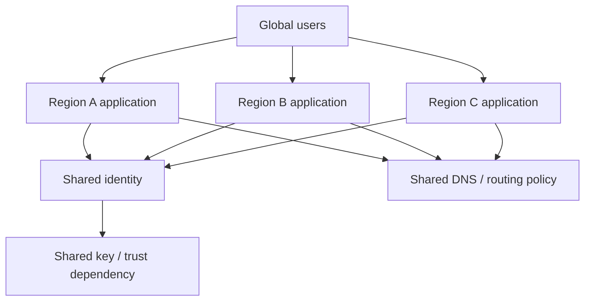
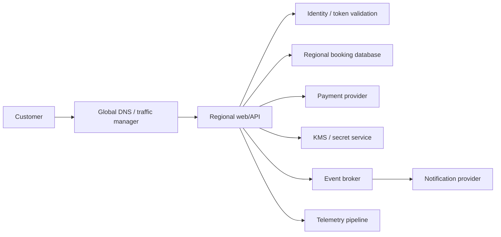

# Đánh giá phụ thuộc toàn cầu có thể trở thành điểm lỗi chung

## 1. Vì sao kiến trúc nhiều region vẫn có thể có một điểm lỗi chung?

Một hệ thống được triển khai ở nhiều availability zone hoặc region thường được xem là có tính sẵn sàng cao. Tuy nhiên, nhiều bản sao ứng dụng không bảo đảm các bản sao đó độc lập. Chúng có thể cùng phụ thuộc vào một DNS zone, identity provider, KMS key, network hub, control plane, registry, quota hoặc pipeline triển khai. Khi dependency chung đó lỗi, tất cả region có thể mất khả năng phục vụ cùng lúc.

**Shared global dependency** là thành phần hoặc dịch vụ được nhiều workload, region, account hoặc cell cùng sử dụng. Nó có thể là dịch vụ do tổ chức tự vận hành, dịch vụ cloud provider, SaaS bên ngoài hoặc một cấu hình/quy trình dùng chung. Dependency đó trở thành **common point of failure** khi một sự cố tại nó có thể làm gián đoạn nhiều failure domain vốn được thiết kế để độc lập.

Điểm lỗi chung không chỉ là một máy chủ đơn lẻ. Một dịch vụ chạy active-active vẫn có thể là điểm lỗi chung nếu mọi region dùng cùng một policy sai, cùng một credential bị lộ, cùng một route hub, cùng một quota hoặc cùng một bản phát hành lỗi.

Trong module **CLOUD_ARCHITECTURE**, chương **Kiến trúc toàn cầu** yêu cầu đánh giá các quan hệ phụ thuộc trên phạm vi nhiều region và failure domain. Việc đánh giá phải nhìn xuyên suốt identity, network, data, security, deployment và operations, đồng thời cân bằng độ tin cậy, bảo mật, khả năng mở rộng, chi phí và khả năng vận hành.

Sau bài học, người học có thể:

1. Phân biệt redundant component với independent failure domain.
2. Lập dependency graph ở cấp service, region, account và organization.
3. Nhận diện shared dependency có thể tạo correlated failure.
4. Đánh giá blast radius, failure mode và khả năng hoạt động khi dependency không khả dụng.
5. Phân tích các dependency phổ biến như DNS, identity, KMS, network, control plane, quota và provider.
6. Thiết kế isolation, fallback, cache, local autonomy và recovery path phù hợp.
7. Xác định dependency nào cần HA/DR riêng và dependency nào có thể giảm phụ thuộc.
8. Xây dựng kiểm thử, runbook và bằng chứng để chứng minh resilience toàn cầu.

## 2. Shared dependency, redundancy và common-cause failure

Cần phân biệt ba khái niệm:

- **Redundancy:** có nhiều instance, path hoặc replica để thay thế khi một thành phần lỗi.
- **Failure-domain independence:** các bản sao không cùng phụ thuộc vào một nguyên nhân hoặc thành phần có thể làm tất cả cùng lỗi.
- **Common-cause failure:** một nguyên nhân chung gây lỗi đồng thời cho nhiều thành phần tưởng như độc lập.

Ví dụ có ba region nhưng tất cả cùng:
- Dùng một identity tenant hoặc federation service.
- Phụ thuộc một DNS provider/account và cùng registrar.
- Dùng cùng KMS key hoặc cùng quyền quản trị key.
- Đi qua một network hub hoặc firewall stack.
- Nhận policy từ một organization-level configuration.
- Được deploy bởi một pipeline hoặc artifact registry duy nhất.

Trong trường hợp đó, số region tăng nhưng blast radius của dependency chung không giảm tương ứng.

### 2.1. Redundancy không đồng nghĩa độc lập



Ba application stack được nhân bản nhưng identity và DNS vẫn là shared dependency. Sự cố ở một trong các thành phần này có thể ảnh hưởng toàn bộ đường truy cập.

### 2.2. Dependency có thể là logic, không chỉ hạ tầng

Một policy sai được đẩy đồng thời tới mọi region cũng là common-cause failure. Các ví dụ khác:
- Certificate hết hạn ở mọi region do dùng chung automation.
- Một schema migration không tương thích với tất cả consumer.
- Một secret bị rotate sai và cập nhật đồng thời mọi workload.
- Một feature flag global vô hiệu hóa chức năng quan trọng.
- Một image có lỗi được deploy tới tất cả cell.
- Một thay đổi route/ACL tạo loop hoặc blackhole trên global network.

Đánh giá kiến trúc phải xem cấu hình, dữ liệu, danh tính, quy trình thay đổi và con người như các yếu tố có thể tạo ra failure domain chung.

## 3. Dependency graph: nhìn đường đi end-to-end

Một danh sách dịch vụ đơn lẻ không đủ. Cần mô tả dependency theo đường đi của user journey và hoạt động vận hành.

Ví dụ checkout:



Các dependency có thể nằm trong:
- **Critical request path:** cần thiết để hoàn tất request ngay lúc đó.
- **Async path:** có thể trì hoãn, retry hoặc buffer.
- **Management path:** triển khai, cấu hình, scale, rotate key và phục hồi.
- **Observability path:** thu thập log/metric/trace và cảnh báo.
- **Recovery path:** backup, restore, break-glass, DNS cutover và incident coordination.

Một dependency không nằm trong request path vẫn có thể gây gián đoạn kéo dài. Ví dụ control plane không khả dụng có thể không làm request đang chạy dừng ngay, nhưng ngăn scale-out, thay đổi route hoặc thay thế node bị lỗi.

### 3.1. Các câu hỏi cần trả lời cho mỗi dependency

1. Region/service nào gọi nó?
2. Đồng bộ hay bất đồng bộ?
3. Cần dependency lúc startup, mỗi request hay chỉ khi refresh?
4. Nếu dependency lỗi, service hiện tại tiếp tục bao lâu?
5. Có cache, local state hoặc fallback không?
6. Có shared account, key, quota, credential hoặc management plane không?
7. Ai vận hành và ai có quyền thay đổi?
8. Recovery time và recovery point được đo như thế nào?
9. Có dependency ngược hoặc vòng lặp không?
10. Đã test khi dependency mất ở peak load chưa?

### 3.2. Dependency inventory

| Thuộc tính | Nội dung cần ghi |
| --- | --- |
| Dependency ID | Tên ổn định và owner |
| Function | Vai trò đối với workload |
| Scope | Region, account, organization, provider |
| Consumers | Service/cell/region phụ thuộc |
| Criticality | Critical, important, best effort |
| Failure mode | Timeout, deny, stale data, unavailable, misconfiguration |
| Fallback | Cache, alternate endpoint, queue, local operation |
| RTO/RPO | Mục tiêu và số đo thực tế |
| Shared controls | Identity, KMS, DNS, quota, network, pipeline |
| Test evidence | Ngày, kịch bản và kết quả diễn tập |

## 4. Phân loại mức phụ thuộc

Không phải dependency nào cũng cần được loại bỏ. Mục tiêu là hiểu mức tác động và có biện pháp tương xứng.

| Loại dependency | Ví dụ | Hành vi khi lỗi cần xem |
| --- | --- | --- |
| Synchronous hard dependency | Identity validation, database commit | Request không thể hoàn tất hoặc phải fail closed |
| Synchronous soft dependency | Feature configuration, personalization | Dùng cache/default hoặc giảm tính năng |
| Asynchronous dependency | Notification, analytics event | Queue/buffer và xử lý trễ |
| Bootstrap dependency | DNS, registry, secret retrieval lúc khởi động | Existing process có thể chạy nhưng restart thất bại |
| Management dependency | Cloud control plane, deployment API | Workload đang chạy có thể tiếp tục, operation bị hạn chế |
| Observability dependency | Log/trace backend, alert manager | Mất visibility, có thể buffer locally |
| Recovery dependency | Backup catalog, KMS, break-glass | Không thể khôi phục khi disaster |
| Governance dependency | Organization policy, central configuration | Thay đổi hàng loạt hoặc lockout |

### 4.1. Startup dependency dễ bị đánh giá thấp

Một service đang chạy có thể giữ token, certificate hoặc secret trong memory. Khi identity/KMS/secret service bị lỗi, service vẫn xử lý request hiện tại. Nhưng khi process restart, node autoscale hoặc deployment diễn ra, instance mới không thể bootstrap.

Do đó cần đánh giá hai trạng thái:
- **Steady-state dependency:** request đã được phục vụ và credentials/config đã có.
- **Cold-start dependency:** một process mới cần DNS, identity, registry, KMS và secret để khởi động.

Một kiến trúc sống sót qua outage vài phút có thể thất bại khi xảy ra node replacement hàng loạt.

## 5. Định lượng blast radius và mức độ rủi ro

Một cách đánh giá hữu ích là xét:
- Số region/cell/service bị ảnh hưởng.
- Tỷ lệ critical workload đi qua dependency.
- Mức độ chức năng còn lại nếu fallback hoạt động.
- Thời gian phát hiện, mitigation và recovery.
- Khả năng lỗi lan sang dependency khác.
- Khả năng dependency bị tấn công hoặc cấu hình sai.

Có thể dùng score định tính:

| Dimension | Câu hỏi | Mức rủi ro cao khi |
| --- | --- | --- |
| Scope | Bao nhiêu workload phụ thuộc? | Hầu hết region/account cùng phụ thuộc |
| Criticality | Request nào cần nó? | Critical user journey cần mỗi lần |
| Failure coupling | Các bản sao có cùng nguyên nhân? | Shared credential, control plane, route hoặc policy |
| Recovery | Có đường thay thế? | Không có fallback hoặc restore chậm |
| Change risk | Thay đổi có thể lan rộng? | Một thao tác ảnh hưởng toàn cầu |
| Detection | Có biết nó lỗi? | Không có independent monitoring |
| Security impact | Có thể bị chiếm hoặc lạm dụng? | Quyền global, secret/key dùng chung |
| Capacity | Khi fallback, có chịu tải? | Alternate path thiếu capacity |

### 5.1. Một chỉ số phạm vi ảnh hưởng minh họa

```text
Blast radius ratio =
  critical workload capacity affected by dependency failure
  / total critical workload capacity
```

Ratio gần 1 nghĩa là sự cố dependency có thể làm mất phần lớn năng lực critical. Chỉ số này không thay thế risk assessment; nó giúp so sánh các dependency và ưu tiên remediation.

### 5.2. Failure-mode matrix

| Dependency | Failure mode | Tác động | Câu hỏi kiểm chứng |
| --- | --- | --- | --- |
| DNS | Không resolve hoặc record sai | Không route được traffic | Có cache, secondary path, rollback? |
| Identity | Token issue/validation fail | Login hoặc request bị từ chối | Existing session/local validation hoạt động bao lâu? |
| KMS | Encrypt/decrypt unavailable | Startup, storage hoặc restore lỗi | Có key replica/recovery path? |
| Network hub | Hub/route/firewall outage | Nhiều region mất connectivity | Có direct path hoặc alternate transit? |
| Control plane | API unavailable | Không deploy/scale/replace | Data plane tiếp tục được bao lâu? |
| Quota | Capacity allocation denied | Không scale hoặc failover | Quota reserve và alternate shape? |
| Artifact registry | Image/package unavailable | Deployment/restart thất bại | Có regional cache/mirror đã xác minh? |
| CI/CD | Pipeline hoặc credential lỗi | Change/fix không thể phát hành | Có safe manual recovery? |
| Observability | Telemetry backend unavailable | Mất visibility/alert | Có local buffer và out-of-band alert? |

## 6. DNS và global traffic management

DNS thường nằm ở đầu đường truy cập và được nhiều region dùng chung. DNS provider outage, registrar/account compromise, zone deletion, lỗi DNSSEC hoặc record rollout sai có thể ảnh hưởng toàn bộ dịch vụ.

### 6.1. Phân biệt DNS control plane và data path

- **Control plane:** chỉnh record, zone, delegation, DNSSEC, health policy.
- **Data path:** resolver trả lời query từ cache và authoritative server.

Control plane lỗi không nhất thiết lập tức làm mọi client mất kết nối vì resolver có thể cache record. Ngược lại, record TTL thấp hoặc cache behavior khác nhau có thể khiến traffic bị ảnh hưởng nhanh.

Cần xem:
- Authoritative name server có phân tán failure domain?
- Registrar và DNS hosting có cùng account/identity không?
- DNSSEC key và signing automation có recovery path?
- TTL có phù hợp failover objective?
- Resolver caching và negative caching ảnh hưởng ra sao?
- Có thể rollback record qua đường độc lập?
- Health check có cùng network/provider với target không?

### 6.2. DNS failover không phải instant failover

TTL không bảo đảm mọi resolver đổi record chính xác sau TTL. Client có thể giữ connection hoặc cache riêng; recursive resolver có thể áp dụng behavior khác; mobile/ISP network cũng có đặc tính khác.

Diễn tập cần đo end-to-end:
- Thời gian phát hiện endpoint lỗi.
- Thời gian health policy thay đổi.
- Thời gian resolver/client nhận endpoint mới.
- Connection cũ đóng bao lâu.
- Tỷ lệ request vẫn tới endpoint lỗi.
- DNSSEC/certificate/authentication ở region mới có hợp lệ không.

### 6.3. DNS resilience

Có thể cân nhắc:
- Provider/name server redundancy theo kiến trúc phù hợp.
- Export và version control cho zone records.
- Multi-person approval với thay đổi delegation/DNSSEC.
- Change validation và canary record.
- TTL strategy theo loại record.
- Out-of-band access tới registrar/provider.
- Independent monitoring từ nhiều network vantage points.

Secondary DNS hoặc nhiều nhà cung cấp chỉ có ích nếu delegation, signing keys, management credentials và runbook cũng được kiểm soát độc lập. Hai DNS service dùng cùng một identity/account và cùng một automation có thể vẫn có common cause.

## 7. Identity, federation và token validation

Identity thường là shared global dependency vì nhiều region cùng tin một tenant, federation, directory hoặc token issuer.

Các failure mode:
- IdP không phát token hoặc MFA unavailable.
- Federation certificate hết hạn.
- Signing key rotation không đồng bộ.
- JWKS endpoint hoặc metadata endpoint không truy cập được.
- Directory lockout/replication lag.
- Conditional access policy sai được áp dụng toàn bộ.
- Admin identity bị compromise.
- Quota/rate limit của token endpoint bị vượt.

### 7.1. Local token validation và key cache

Nếu service kiểm tra JWT offline với public key đã cache, nó có thể tiếp tục validate token hiện có khi IdP tạm mất. Tuy nhiên:
- Token mới không thể issue.
- Revocation có thể không được áp dụng tức thì.
- Key rotation cần phân phối đúng.
- Token expiry đặt quá dài tăng thời gian credential bị lạm dụng.
- Service restart có thể không lấy được JWKS nếu không có cache/persistence phù hợp.

Phải chọn trade-off giữa availability và revocation/security. Không kéo dài token vô hạn chỉ để “chịu được IdP outage”.

### 7.2. Break-glass và workload identity

Quyền emergency access phải có đường phục hồi khi SSO chính lỗi, nhưng cần least privilege, MFA/recovery factor, custodian, audit và expiry. Workload nên dùng managed/federated identity hoặc credential ngắn hạn; tránh shared long-lived secret giữa region.

### 7.3. Policy global và blast radius

Conditional access, organization role hoặc trust policy được đẩy toàn cầu có thể lockout mọi operator. Cần staged rollout, test principal, canary scope, rollback path và emergency identity độc lập với chính policy đang thay đổi.

## 8. KMS, secrets và certificate authority

KMS/secret manager là dependency quan trọng của encryption, application bootstrap, storage access và DR.

Một region có thể vẫn chạy nếu key material/DEK đã được cache trong memory, nhưng:
- Instance mới không thể unwrap data key.
- Backup restore không thể decrypt.
- Database encryption operation bị lỗi.
- Secret rotation không hoàn tất.
- Certificate renewal thất bại.
- Workload cần restart không thể lấy credential.

### 8.1. Key dependency map

Cần ghi:
- Key ID/alias và owner.
- Region và replication semantics.
- Key policy/role có thể decrypt.
- Service nào dùng key lúc runtime/startup/restore.
- Rotation/disable/delete protection.
- Backup và recovery path.
- KMS quota và throttling.
- Cross-account/cross-region access.
- Audit và alert khi policy/key state thay đổi.

### 8.2. Key replication và key independence

Replicated key có thể giúp sử dụng ở region khác theo semantics của provider, nhưng không mặc định hai key hoàn toàn độc lập về quản trị, billing hoặc control plane. Một policy deny toàn account hoặc credential compromised có thể ảnh hưởng cả hai.

Đối với workload cần DR, phải test decrypt từ region phục hồi bằng role phục hồi thật, trong môi trường tách biệt. Có backup encrypted mà không có key access không phải recovery capability.

### 8.3. Certificate và trust chain

Các dependency thường bị quên:
- Public/private CA.
- Certificate renewal automation.
- ACME account credentials.
- DNS challenge provider.
- Trust bundle trong container/image.
- Service mesh certificate authority.
- CRL/OCSP hoặc trust metadata endpoint.

Certificate hết hạn đồng loạt có thể làm gián đoạn TLS toàn cầu. Theo dõi expiration theo hostname/region, test renewal và giữ runbook khi ACME/DNS/IdP không khả dụng.

## 9. Network hub, transit và security appliances

Nhiều region có thể kết nối qua một hub tập trung như transit gateway, WAN, firewall cluster, proxy hoặc inspection service. Đây là cách quản trị dễ hơn nhưng có thể tạo shared bottleneck hoặc common failure.

Rủi ro:
- Một hub mất làm region không nói chuyện được.
- Firewall policy sai được deploy rộng.
- NAT/egress quota cạn ở một điểm tập trung.
- Route propagation lỗi tạo blackhole hoặc loop.
- DNS resolver tập trung không khả dụng.
- Certificate/proxy trust bị lỗi đồng loạt.
- Cross-region link nghẽn khi failover.

### 9.1. Hub-and-spoke và partial mesh

| Pattern | Ưu điểm | Rủi ro |
| --- | --- | --- |
| Central hub | Quản trị, inspection và routing tập trung | Hub là shared dependency/bottleneck |
| Dual hub | Có đường dự phòng | Cần tránh cùng region/provider/control path |
| Partial mesh | Giữ một số đường direct cho critical flow | Nhiều route/policy cần quản lý |
| Regional autonomy | Region xử lý phần lớn local traffic | Cross-region operation phức tạp hơn |
| Service endpoint/private link | Giảm public egress và central path | Provider endpoint/service quota vẫn cần xét |

Không nhất thiết bỏ central inspection. Hãy xác định traffic nào thật sự phải đi qua hub, capacity khi một hub mất và đường fallback nào được phép theo security policy.

### 9.2. Network failover capacity

Nếu traffic bình thường chia qua hai transit hubs, mất một hub có thể dồn toàn bộ traffic sang hub còn lại. Hub dự phòng phải chịu peak, replication, telemetry và recovery traffic đồng thời.

Test cả throughput, connection count, packet processing, NAT port, route convergence và security inspection; không chỉ ping connectivity.

## 10. Cloud control plane và data plane

Control plane quản lý resource lifecycle, configuration và orchestration. Data plane xử lý workload hoặc traffic nghiệp vụ. Khi control plane gặp sự cố, data plane có thể tiếp tục phục vụ một thời gian, nhưng khả năng thay đổi và phục hồi bị giới hạn.

Ví dụ:
- API quản lý cloud không tạo được VM mới.
- Kubernetes API unavailable nhưng pod đang chạy vẫn phục vụ.
- Managed database control API lỗi trong khi existing connections vẫn hoạt động.
- Global traffic manager không thể đổi record dù endpoint cũ vẫn chạy.
- IAM policy service lỗi khiến không thể cấp role mới hoặc rotate credential.

### 10.1. Tự chủ data plane

Thiết kế nên xem xét:
- Service tiếp tục xử lý request với config/cache hiện tại trong giới hạn an toàn.
- Existing workload identity/token có lifetime phù hợp.
- Service discovery có cache và TTL hợp lý.
- Không yêu cầu control-plane call trên mỗi business request nếu không cần.
- Local health check và routing có fallback.
- Worker không dừng toàn bộ chỉ vì management endpoint tạm lỗi.
- Có manual/out-of-band process cho hành động emergency.

Đây không phải lý do để bỏ policy enforcement. Local autonomy phải giới hạn thời gian, scope và hành vi; fail closed khi operation nhạy cảm không thể xác minh quyền hoặc integrity.

### 10.2. Control plane là dependency của recovery

Trong disaster, cần provision compute, network, storage, IAM, DNS và key access. Nếu region/provider control plane lỗi, automation có thể không tạo được môi trường phục hồi. Hãy xác định những resource phải có sẵn trước (warm standby/pilot light) và những operation có thể thực hiện qua provider support hoặc alternate region.

## 11. Quota, capacity reservation và provider limits

Quota thường bị xem là giới hạn quản trị, nhưng trong failover nó trở thành dependency availability.

Ví dụ:
- VM/vCPU quota không đủ để scale workload khi region khác mất.
- IP/subnet hết địa chỉ khiến không tạo thêm pod/instance.
- Load balancer, NAT gateway hoặc public IP quota bị chạm.
- API request rate limit ngăn orchestration.
- KMS request quota làm decrypt/unwrap chậm.
- Database connection/storage/IOPS quota giới hạn throughput.
- Cross-region transfer hoặc broker partition limit bị vượt.

### 11.1. Quota phải được tính theo failure scenario

Không chỉ kiểm tra current usage. Tính nhu cầu khi:
- Một AZ hoặc region mất.
- DR environment được scale lên.
- Cache cold gây tăng database load.
- Queue backlog được drain.
- Recovery và user traffic chạy đồng thời.
- Tất cả tenant cùng retry/reconnect.

Có thể cần request quota advance, reserve capacity hoặc benchmark instance family thay thế. Approval quota nên thực hiện trước sự cố, vì provider xét duyệt trong lúc incident không đáp ứng RTO.

### 11.2. Dependency quota và thundering herd

Một global identity endpoint hoặc KMS API có thể nhận burst từ mọi region cùng lúc sau reconnect. Dùng rate limit nội bộ, exponential backoff/jitter, caching an toàn, staggered retry và capacity headroom. Không để mọi region retry đồng bộ.

## 12. Artifact registry, package và CI/CD

Deployment pipeline có thể trở thành global dependency nếu mọi region chỉ lấy image/package từ một registry hoặc pipeline trung tâm.

Failure mode:
- Registry outage hoặc permission bị lỗi.
- Image bị xóa/retag.
- Signing key hoặc provenance service không hoạt động.
- CI runner/credential bị compromise.
- Pipeline template update sai làm mọi deployment lỗi.
- Package mirror upstream thay đổi.
- Build artifact không reproducible.
- Một release lỗi được rollout toàn bộ region cùng lúc.

### 12.1. Tách build path và runtime path

Existing workload nên tiếp tục chạy khi CI/CD outage. Startup hoặc replacement workload có thể cần artifact registry; vì vậy:
- Dùng immutable image digest thay mutable tag.
- Cache/mirror artifact ở region cần thiết.
- Giữ artifact đã xác minh trong retention phù hợp.
- Ký artifact và verify signature/provenance.
- Không để runtime tải dependency bất kỳ từ Internet lúc startup nếu có thể tránh.
- Test scale-out và node replacement khi registry primary không khả dụng.

### 12.2. Deployment blast radius

Một pipeline global có thể nhân bản lỗi rất nhanh. Dùng staged rollout, canary, regional wave, automated health gate, freeze/stop condition và rollback. Tách quyền sửa pipeline, policy và release; audit mọi thay đổi vào workflow.

## 13. Observability, alerting và incident coordination

Telemetry pipeline, dashboard, pager và incident platform cũng có thể là dependency chung.

Rủi ro:
- Một collector/region mất khiến mọi region mất telemetry.
- SIEM/index backend quá tải trong incident lớn.
- Alert routing phụ thuộc IdP hoặc DNS đang lỗi.
- Pager notification provider không gửi được.
- Dashboard cần control plane của region bị mất.
- Log export egress bị chặn.
- Shared credential bị revoke khiến agents không gửi dữ liệu.

### 13.1. Observability independence

Cân nhắc:
- Local buffering bounded cho log/metric/trace.
- Out-of-band health signals tối thiểu.
- Alert channel độc lập với application identity path.
- Synthetic checks từ nhiều provider/network.
- Runbook offline hoặc bản sao đọc được khi documentation service lỗi.
- Incident contact tree ngoài hệ thống chính.
- Không để log pipeline backpressure block business request.

Không nhất thiết phải nhân bản toàn bộ telemetry stack. Nhưng phải có đủ visibility để biết dịch vụ nào còn sống và phối hợp recovery khi shared backend bị lỗi.

## 14. Data plane, replication và global state

Data dependency có thể tạo common point dù compute được phân tán:
- Một global database single-writer.
- Shared schema registry.
- Shared object bucket/account.
- Centralized data catalog.
- Global cache hoặc session store.
- Replication controller.
- Shared encryption key.
- One global partition/leader.
- Centralized event broker.

### 14.1. Global single-writer

Single-writer có thể giúp consistency đơn giản, nhưng tạo latency và availability dependency cho region khác. Khi writer region lỗi hoặc network partition, region còn lại phải quyết định:
- Read-only tiếp tục?
- Chuyển writer?
- Đợi quorum/lease?
- Chấp nhận conflict và reconcile?
- Từ chối write để bảo vệ correctness?

Không thể giải quyết bằng cách tự promote hai writer độc lập nếu chưa có fencing/consensus; điều đó tạo split-brain và duplicate/lost updates.

### 14.2. Schema registry và contract dependency

Một schema registry global lỗi có thể ngăn producer/consumer khởi động hoặc serialize event mới nếu họ fetch schema mỗi lần. Cache schema đã phê duyệt, compatibility policy và offline validation có thể cho phép workload tiếp tục trong một khoảng thời gian. Tuy nhiên schema change phải có governance và rollback.

### 14.3. Shared storage và object access

Một bucket/account dùng cho nhiều region có thể trở thành dependency toàn cục. Xem xét replication, regional cache, versioning, access policy, KMS dependency, lifecycle và account-level quota. Có nhiều replica object nhưng chung account admin hoặc policy mutation vẫn có common cause.

## 15. Third-party SaaS và provider dependency

Các dịch vụ ngoài tổ chức thường nằm ngoài failure-domain assumptions:
- Payment gateway.
- Email/SMS/push provider.
- Identity SaaS.
- Fraud/risk API.
- Geolocation/maps.
- DNS/CDN/WAF.
- Source control, CI/CD, artifact service.
- Support/incident communication.

Cần biết:
- Service có endpoint/region độc lập không?
- SLA có định nghĩa measurement và exclusions?
- Rate limit, quota và burst behavior?
- Có sandbox/fallback/provider alternate?
- Data portability và export?
- Support escalation khi outage?
- Có phụ thuộc chung vào cùng cloud/network/identity không?

### 15.1. Fallback theo nghiệp vụ

Không phải dependency nào cũng có thể thay thế tức thì:
- Notification có thể queue để gửi sau.
- Fraud check có thể fail closed với transaction rủi ro cao.
- Recommendation/search personalization có thể degrade.
- Payment cần trạng thái pending và reconciliation; không giả định payment thành công khi timeout.
- Identity có thể dùng token đã issue trong policy window, nhưng cần kiểm soát revocation.

Fallback phải theo business invariant và threat model; không chỉ trả một response mặc định cho mọi lỗi.

## 16. Global configuration, feature flags và policy distribution

Centralized configuration giúp nhất quán nhưng có thể lan lỗi toàn cầu:
- Sai endpoint được phát cho mọi region.
- Feature flag tắt critical workflow.
- Rate limit global quá thấp.
- Certificate/trust bundle bị cập nhật sai.
- Security policy deny mọi operator.
- Schema/config version không tương thích với application rollout.

Guardrails:
- Schema validation và compatibility check.
- Versioned immutable config.
- Canary/staged rollout theo region/cell.
- Approval cho high-impact setting.
- Rollback/version pin.
- Local last-known-good cache có expiry và policy.
- Separate emergency override với audit.
- Global blast-radius limit.

Không để cache config cũ tồn tại vô thời hạn. Với security revocation, stale policy có thể nguy hiểm; phải định nghĩa loại config nào được dùng stale và trong bao lâu.

## 17. Correlated deployment và change management

Một thay đổi có thể làm tất cả region lỗi cùng lúc dù compute/network độc lập:
- Global image rollout.
- Database schema migration không backward compatible.
- Shared secret rotation.
- Global IAM policy.
- Terraform apply ở organization scope.
- DNS/certificate change.
- Firmware/agent update.
- Feature flag hoặc config push.

### 17.1. Giới hạn blast radius thay đổi

- Triển khai theo canary, cell và regional wave.
- Có health gate dựa trên service SLO.
- Giữ phiên bản artifact/config trước đó.
- Tách schema expansion và contraction.
- Dùng backward-compatible API/event contract.
- Thực hiện secret/key rotation theo overlap window.
- Có freeze condition và stop-the-line.
- Không rollout global nếu chưa quan sát region đầu.

Deployment isolation cũng là resilience control: nếu một release lỗi, các region chưa nâng cấp vẫn là recovery capacity.

## 18. Resilience patterns cho shared dependency

### 18.1. Redundancy và geographic separation

Tạo nhiều instance/path ở failure domain khác, nhưng cần xác minh cả:
- Account/organization boundary.
- Network/provider.
- Identity/credential.
- KMS key/control path.
- DNS/registrar.
- Change automation.
- Capacity/quota.

Redundancy chỉ giảm rủi ro khi các thành phần không cùng một common cause.

### 18.2. Local autonomy và caching

Giảm synchronous global call bằng cách:
- Cache public signing keys/JWKS theo policy.
- Giữ last-known-good non-sensitive configuration.
- Cache read-only reference data.
- Local service discovery.
- Regional artifact mirror.
- Local telemetry buffer.
- Async replicate/queue cho non-critical operations.

Cache phải có TTL, invalidation, signature/integrity và quy tắc xử lý khi stale. Không cache quyết định authorization nhạy cảm vô hạn.

### 18.3. Bulkhead và cell architecture

Tách consumer, worker, credential, account, network và data theo cell/region để giới hạn blast radius. Shared global service có thể được phân shard hoặc partition theo tenant/region. Tránh một pool connection/queue/control path duy nhất phục vụ mọi region.

### 18.4. Circuit breaker, timeout và retry budget

- Timeout đủ ngắn để không giữ tài nguyên mãi.
- Circuit breaker tránh tiếp tục gọi dependency đã lỗi.
- Backoff/jitter ngăn retry storm.
- Retry budget giới hạn amplification.
- Queue cho công việc có thể trì hoãn.
- Fail closed cho action cần security/consistency.
- Fail open chỉ với chức năng đã đánh giá rủi ro và có giới hạn.

### 18.5. Degraded mode

Ví dụ:
- Identity provider tạm unavailable: cho existing signed token dùng trong policy window, không cấp quyền mới vượt giới hạn.
- Recommendation API lỗi: hiển thị danh sách phổ biến.
- Notification provider lỗi: queue gửi sau.
- Analytics lỗi: ghi event vào durable buffer.
- Search lỗi: dùng fallback read model hoặc giới hạn tính năng.
- Global config lỗi: dùng last-known-good trong thời hạn an toàn.

Degraded mode phải được product, security và operations chấp thuận; có thông báo, metric và điều kiện phục hồi.

## 19. Dependency resilience matrix

Một matrix giúp liên kết sự cố với hành vi và test:

| Dependency | Normal mode | Failure behavior | Guardrail/fallback | Evidence |
| --- | --- | --- | --- | --- |
| DNS | Global routing | Dùng cache/alternate path trong giới hạn | Versioned zone, secondary access | Resolver failover game day |
| Identity | Token issue/validate | Existing token theo policy; new login có thể fail | Local key cache, break-glass | IdP outage test |
| KMS | Encrypt/decrypt | Existing workload có thể tiếp tục hạn chế | Key recovery/replica, cached DEK an toàn | Restore/decrypt test |
| Network hub | Inter-region transit | Local region tiếp tục, cross-region degrade | Dual path/regional autonomy | Hub loss test |
| Control plane | Provision/config | Existing data plane tiếp tục | Pre-provisioned capacity | API outage test |
| Quota | Scale capacity | Scale có thể bị reject | Advance quota/reservation | Quota exhaustion test |
| Registry | Fetch artifacts | Existing workload tiếp tục | Regional mirror/cache | Registry outage + node replacement |
| CI/CD | Deploy change | Freeze change, runtime tiếp tục | Signed artifacts/manual recovery | Pipeline outage drill |
| Observability | Central telemetry | Local buffer/alternate alert | Out-of-band signal | Telemetry backend outage |
| Payment SaaS | Authorize/capture | Pending/reconcile theo contract | Idempotency, queue, alternate routing nếu hợp lệ | Timeout/duplicate test |

## 20. Quy trình đánh giá shared dependency

1. **Chọn user journey:** booking, payment, login, data access hoặc recovery.
2. **Vẽ dependency graph:** synchronous, asynchronous, bootstrap, management và recovery path.
3. **Gắn failure domain:** account, region, provider, identity, network, team và change pipeline.
4. **Tìm common cause:** credential, key, quota, policy, endpoint, artifact và operator.
5. **Xác định failure mode:** unavailable, timeout, stale, deny, corrupt, rate-limited, misconfigured.
6. **Đánh giá blast radius:** số region/service/tenant và critical capacity bị ảnh hưởng.
7. **Xem thời gian chịu đựng:** cache/token/config lifetime, queue retention và restart behavior.
8. **Đặt fallback:** local autonomy, alternate path, buffer, degraded mode hoặc fail closed.
9. **Tính capacity:** alternate path, retry, cold cache, recovery và peak load.
10. **Bảo vệ change:** canary, staged rollout, approval và rollback.
11. **Đặt SLO/RTO/RPO:** bao gồm dependency và user journey đầu cuối.
12. **Kiểm thử/diễn tập:** dependency loss, correlated failure, quota và recovery.
13. **Ghi residual risk:** owner, decision, exception và review date.

## 21. Kiểm thử và diễn tập failure domain chung

Chỉ kiểm thử từng region khi tất cả dependency khỏe mạnh sẽ không phát hiện common point. Cần mô phỏng sự cố tại dependency dùng chung.

| Kịch bản | Cách thử | Điều kiện đạt |
| --- | --- | --- |
| DNS provider/control plane outage | Ngăn thay record trong môi trường test | Existing data path và alternate procedure có hành vi dự kiến |
| Identity issuer outage | Chặn token issue/JWKS fetch có kiểm soát | Local validation/fail-closed policy đúng |
| KMS throttling/unavailable | Giới hạn request hoặc tắt endpoint test | Existing workload và restore path được hiểu rõ |
| Network hub loss | Cắt một hub/transit path | Region/cell còn lại hoạt động theo design |
| Control plane outage | Ngăn provisioning API test | Data plane tiếp tục; recovery limit rõ |
| Quota exhausted | Đặt quota thấp hoặc test account limit | Alert/fallback/reserved capacity hoạt động |
| Registry outage | Ngăn fetch image mới | Cached artifact cho node replacement có sẵn |
| CI/CD compromised/unavailable | Dừng pipeline hoặc test bad release | Change freeze/canary/rollback bảo vệ region |
| Telemetry backend outage | Ngắt backend | Buffer/alternate alert không block request |
| Global policy error | Deploy policy test tới canary | Rollout dừng trước khi ảnh hưởng global |
| Certificate renewal failure | Chặn ACME/DNS validation trong test | Expiry alert và recovery path hoạt động |
| Third-party outage | Timeout/rate limit provider test | Business-specific degraded mode đúng |
| Correlated failure | Kết hợp AZ loss với dependency outage | SLO và critical journey đạt scenario đã duyệt |
| Failback | Khôi phục dependency/site cũ | Không split-brain, config và ownership nhất quán |

### 21.1. Đo điều gì trong game day?

- Số region/cell bị ảnh hưởng.
- Tỷ lệ critical request vẫn thành công.
- Latency/error theo region và user journey.
- Thời gian phát hiện, quyết định và mitigation.
- Cache/token/config age trong lúc fallback.
- Queue depth, oldest age và retry amplification.
- Alternate path throughput và quota.
- Data correctness, duplicate và reconciliation backlog.
- Khả năng scale/restart trong khi dependency chính lỗi.
- Thời gian phục hồi và failback.
- Operator có truy cập được runbook, identity và audit không.

## 22. Tình huống thực hành: ba region cùng phụ thuộc identity và KMS

**Bối cảnh:** Nền tảng SaaS booking chạy ở ba region. Mỗi region có application, database replica và cache riêng. Global traffic manager định tuyến tới region khỏe. Tuy nhiên, workload identity, token issuer, KMS policy và secrets nằm trong một organization/account dùng chung. Một thay đổi IAM sai làm workload ở cả ba region không thể lấy secret mới; đồng thời token issuer bị rate limit do mọi region retry.

### 22.1. Vì sao redundancy hiện tại chưa đủ?

- Application và database replicas độc lập hơn ở data plane.
- Identity/secret path lại được chia sẻ ở organization scope.
- KMS access policy cùng phụ thuộc role/organization policy.
- Retry từ ba region tạo request storm tới token issuer.
- Autoscaling/restart làm tăng nhu cầu lấy secret đúng lúc dependency lỗi.
- Global traffic manager vẫn thấy endpoint sống nhưng critical operation thất bại.

Vấn đề không phải thiếu application replica. Vấn đề là shared bootstrap/security dependency có blast radius toàn cầu.

### 22.2. Thiết kế cải thiện

1. Tách workload identity theo region/cell và giới hạn trust scope.
2. Dùng token lifetime phù hợp, local validation cho token đã ký và cache signing keys an toàn.
3. Thiết kế secret access/rotation để workload đang chạy không cần fetch secret trên mọi request.
4. Kiểm tra KMS key replication và recovery path theo provider semantics.
5. Dùng staged rollout cho IAM/key policy, test principal và rollback.
6. Thêm rate limit, jitter và retry budget để tránh token issuer storm.
7. Pre-provision capacity và artifact để không buộc restart hàng loạt.
8. Có break-glass identity và recovery path độc lập với federation chính.
9. Monitor auth failure, token throttling, secret fetch và KMS latency theo region.
10. Diễn tập IAM policy lockout kết hợp một region outage.

### 22.3. Tiêu chí nghiệm thu

- Một region có thể phục vụ existing session trong policy window khi identity issuer lỗi.
- Workload mới không nhận quyền rộng hơn chỉ vì fallback.
- Secret/KMS recovery thực hiện được từ region DR với role đã kiểm chứng.
- Một policy rollout sai bị chặn ở canary.
- Retry không tạo token request storm.
- Recovery operator vẫn truy cập được break-glass và audit.
- Global user journey đáp ứng degraded SLO đã duyệt.

## 23. ADR mẫu: giảm common point trong global identity path

```text
ADR-188: Tách failure domain cho identity và secret access

Bối cảnh:
- Ba region có data plane riêng nhưng dùng chung identity/secret path.
- IAM policy hoặc token issuer outage có thể ảnh hưởng toàn bộ region.
- Restart/scale-out trong outage làm auth request tăng đột biến.

Lựa chọn:
A. Giữ shared identity path và tăng capacity issuer.
B. Tạo local identity provider độc lập hoàn toàn cho mỗi region.
C. Giữ trust model thống nhất nhưng phân vùng workload identity, cache an toàn và chuẩn bị recovery path.

Quyết định:
- Chọn C.
- Workload identity scope theo region/cell và least privilege.
- Token validation dùng signing key cache có TTL/policy rõ.
- Secret retrieval không nằm trên mỗi request; startup/restart behavior được kiểm soát.
- IAM/key policy rollout theo canary, có rollback và test principal.
- Break-glass và audit path độc lập với SSO chính.
- Retry budget/jitter bảo vệ token/KMS endpoint.

Đánh đổi:
- Cần quản lý key/identity lifecycle và policy consistency.
- Cache tăng availability nhưng có cửa sổ revocation cần kiểm soát.
- Regional autonomy đòi hỏi telemetry, test và runbook riêng.

Kiểm chứng:
- Identity issuer outage exercise ở từng region.
- KMS/secret recovery test từ DR environment.
- Policy canary chặn lỗi trước rollout toàn cầu.
- Retry storm test và rate-limit verification.
- Audit và break-glass hoạt động trong SSO outage.

Điều kiện xem lại:
- Provider identity/KMS semantics thay đổi.
- RPO/RTO hoặc security requirement thay đổi.
- Số region/tenant tăng.
- Diễn tập cho thấy blast radius hoặc recovery time vượt mục tiêu.
```

## 24. Những sai lầm thường gặp

1. **Đếm region thay cho kiểm tra independence:** nhiều region vẫn dùng chung identity, DNS hoặc network hub.
2. **Chỉ vẽ request path:** bỏ qua bootstrap, management, deployment và recovery dependency.
3. **Coi control plane outage là vô hại:** existing pod có thể chạy nhưng node replacement/scale-out thất bại.
4. **Không kiểm tra cold start:** instance mới không lấy được key, secret, token hoặc artifact.
5. **Dùng một identity/account cho mọi region:** policy sai hoặc account lockout lan toàn hệ thống.
6. **Retry đồng thời từ mọi region:** tạo thundering herd lên dependency vốn đang lỗi.
7. **Coi secondary DNS là độc lập:** registrar, DNSSEC key, identity và automation vẫn chung.
8. **Có key replica nhưng không test decrypt:** backup encrypted vẫn không phục hồi được.
9. **Central network hub không có capacity dự phòng:** failover dồn tải vào bottleneck mới.
10. **Không tính quota lúc DR:** đến khi sự cố mới request capacity.
11. **Chỉ replicate artifact theo tag:** tag có thể bị thay hoặc image đã biến mất.
12. **Rollout global cùng lúc:** một lỗi release/policy làm mọi region hỏng.
13. **Dùng cache vô hạn:** tăng availability nhưng làm stale authorization/config nguy hiểm.
14. **Fail open mọi dependency:** outage biến thành lỗ hổng bảo mật hoặc sai dữ liệu.
15. **Không có degraded mode theo nghiệp vụ:** mọi dependency lỗi đều làm toàn bộ product ngừng.
16. **Observability dùng chung một đường:** mất telemetry đồng thời với mất dịch vụ.
17. **Không bảo vệ provider/support path:** operator không thể liên hệ hoặc truy cập recovery.
18. **Không diễn tập correlated failure:** test đơn lẻ tạo cảm giác an toàn giả.
19. **Không định nghĩa owner:** shared service không có đội chịu trách nhiệm và SLO rõ.
20. **Không quản trị common change:** IAM, DNS, config, certificate và secret rotation lan lỗi toàn cầu.

## 25. Checklist trước production

- [ ] Dependency graph bao gồm request, async, bootstrap, management, observability và recovery paths.
- [ ] Inventory ghi scope, owner, consumer, criticality và failure mode của mỗi dependency.
- [ ] Các region/cell được kiểm tra theo common-cause failure, không chỉ số lượng replicas.
- [ ] Shared identity/federation có local validation, expiry và break-glass policy phù hợp.
- [ ] DNS/registrar/DNSSEC/traffic management có versioning, monitoring và recovery path.
- [ ] KMS/secret/certificate có owner, rotation, quota và decrypt/renewal test.
- [ ] Network hub/transit/NAT/firewall có alternate path và failover capacity.
- [ ] Control-plane outage không làm data plane mất khả năng không cần thiết.
- [ ] Quota/IP/capacity được dự trù cho AZ/region loss, restart và backlog recovery.
- [ ] Artifact registry có immutable artifact, signature/provenance và regional cache.
- [ ] CI/CD có canary, staged rollout, rollback và protected policy.
- [ ] Observability và incident coordination có out-of-band path tối thiểu.
- [ ] Global data/schema/single-writer dependency có consistency/fencing plan.
- [ ] Third-party SaaS có quota, SLA, fallback và reconciliation theo nghiệp vụ.
- [ ] Global config/policy có version, staged rollout và last-known-good rule.
- [ ] Retry budget, timeout, circuit breaker và rate limit bảo vệ dependency.
- [ ] Degraded mode được product/security/operations phê duyệt.
- [ ] Blast radius và residual risk có owner, score hoặc rationale.
- [ ] Game day bao gồm dependency outage và correlated failure.
- [ ] Runbook, break-glass, alert và failback được kiểm chứng.
- [ ] Có lịch review dependency khi thêm region/service/provider hoặc đổi trust path.

---

**Ghi nhớ:** Một kiến trúc toàn cầu chỉ thực sự resilient khi các region không cùng sụp đổ vì một dependency, policy, credential hoặc thay đổi chung. Hãy vẽ dependency graph xuyên suốt request, bootstrap, management và recovery; định lượng blast radius; thiết kế local autonomy, fallback và change isolation; sau đó diễn tập mất dependency ở peak load. Số region và replica chỉ có giá trị khi failure domains thực sự đủ độc lập.
