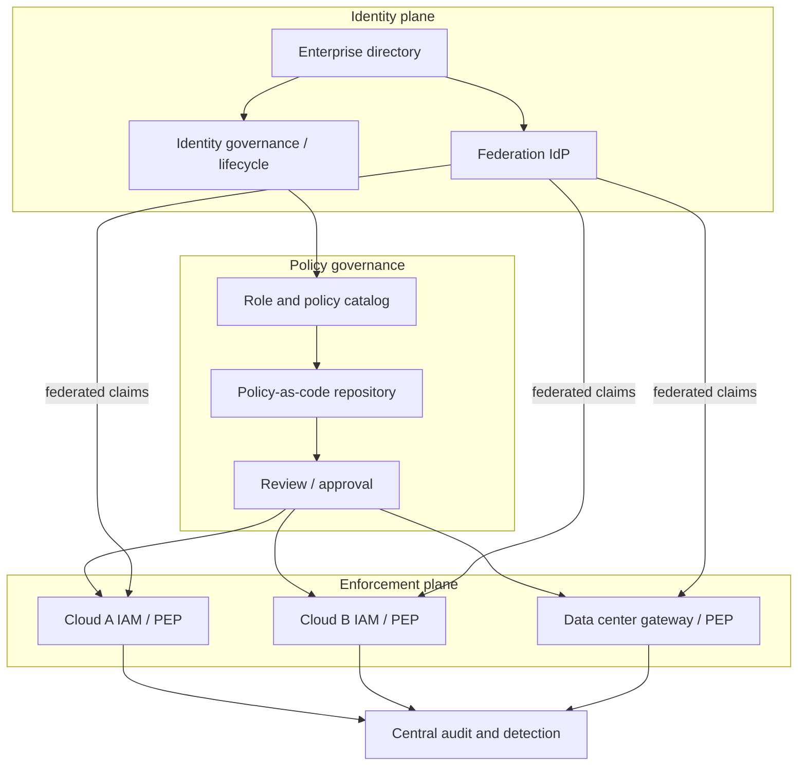

# Liên kết danh tính và quản lý chính sách xuyên nền tảng

Trong kiến trúc hybrid và multi-cloud, một nhân viên có thể đăng nhập qua identity provider của doanh nghiệp rồi truy cập console ở cloud công cộng, data center, SaaS và công cụ vận hành. Một workload cũng có thể cần gọi API ở nền tảng khác mà không sử dụng password hoặc access key lưu lâu dài. Nếu mỗi môi trường có user, role và policy riêng, tổ chức sẽ khó kiểm soát vòng đời tài khoản, quyền truy cập, audit và phản ứng khi một identity bị compromise.

**Liên kết danh tính (identity federation)** cho phép một nền tảng tin cậy danh tính hoặc assertion do hệ thống identity khác phát hành theo trust relationship đã cấu hình. **Quản lý chính sách xuyên nền tảng** giúp tổ chức biểu đạt và kiểm tra yêu cầu truy cập nhất quán giữa nhiều môi trường, trong khi quyền thực tế vẫn phải được ánh xạ và thực thi theo cơ chế của từng nền tảng.

Trong module **CLOUD_ARCHITECTURE**, chủ đề này kết nối IAM, network, workload identity, Kubernetes, CI/CD, secrets, audit và governance. Ví dụ xuyên suốt là nền tảng cho thuê thiết bị vận hành ở private data center và hai cloud provider: nhân viên truy cập console, Booking API gọi Inventory Service, và pipeline triển khai workload. Protocol, role và thời hạn token trong bài là ví dụ; cấu hình production phải dựa trên khả năng thật của identity provider, cloud, protocol version và tiêu chuẩn tổ chức.

## 1. Vì sao cần identity federation?

Khi số lượng môi trường tăng, mỗi nền tảng có thể tạo một tập user, service account, group, role và credential riêng. Nếu quản lý thủ công:

- Nhân viên chuyển nhóm nhưng quyền ở cloud cũ không bị thu hồi.
- Contractor nghỉ hợp đồng nhưng API key vẫn còn hiệu lực.
- Developer dùng chung account ở nhiều môi trường, khó truy nguyên hành động.
- Workload dùng static key được copy vào secret store hoặc CI log.
- Role tên giống nhau nhưng có phạm vi khác nhau giữa các provider.
- Incident response phải thu hồi token và credential theo các quy trình không đồng nhất.

Federation giảm nhu cầu tạo và quản lý password riêng ở từng nền tảng. Người dùng xác thực với identity provider được tổ chức kiểm soát; nền tảng đích xác minh assertion/token, sau đó ánh xạ subject, group hoặc claim sang role cục bộ.

### Federation không tự động tạo authorization

Federation trả lời “identity này đến từ đâu và có được tin cậy không?”. Authorization trả lời “identity này được làm gì trên resource cụ thể?”. User đã đăng nhập hợp lệ vẫn có thể không được phép đọc payment ledger hoặc sửa production firewall.


## 2. Các thành phần trong mô hình identity

| Thành phần | Vai trò | Ví dụ |
| --- | --- | --- |
| Identity | Đối tượng cần nhận diện | Nhân viên, workload, service account |
| Identity provider (IdP) | Xác thực và phát hành thông tin danh tính | Corporate directory/SSO |
| Service provider/relying party | Tin cậy assertion/token và cung cấp dịch vụ | Cloud console, SaaS |
| Federation trust | Quy tắc tin cậy giữa issuer và consumer | Trusted issuer, audience, signing key |
| Subject | Định danh principal trong token/assertion | Immutable user ID hoặc workload subject |
| Claims/attributes | Thuộc tính về identity/context | Group, department, tenant, auth time |
| Role/group | Tập quyền hoặc nhóm thành viên | booking-readonly, platform-operator |
| Policy decision point (PDP) | Đánh giá quyết định truy cập | Policy engine |
| Policy enforcement point (PEP) | Thực thi quyết định | API gateway, cloud IAM, service |
| Audit system | Ghi lại xác thực, quyết định và hành động | Cloud audit log/SIEM |

Một identity có thể có nhiều tên trong các hệ thống. Nên dùng immutable identifier làm khóa liên kết thay vì email hoặc display name có thể đổi hoặc tái sử dụng.

## 3. Phân biệt SAML, OpenID Connect và OAuth 2.0

Các giao thức này liên quan nhưng không thay thế lẫn nhau.

| Công nghệ | Mục đích chính | Dữ liệu điển hình | Use case |
| --- | --- | --- | --- |
| **SAML 2.0** | Federation cho web SSO | XML assertion | Nhân viên đăng nhập SaaS hoặc cloud console |
| **OpenID Connect (OIDC)** | Authentication layer trên OAuth 2.0 | ID token dạng JWT cùng claims | Web/mobile login, workforce federation, workload federation |
| **OAuth 2.0** | Delegated authorization | Access token | Client gọi API với scope được cấp |

OAuth 2.0 tự nó không phải protocol xác thực user. Nếu ứng dụng cần biết user đã đăng nhập là ai, OIDC bổ sung identity layer trên OAuth 2.0. SAML và OIDC cũng không quy định toàn bộ authorization model trong cloud; nền tảng đích vẫn cần map identity sang permission.

### 3.1. SAML SSO flow

1. User truy cập service provider.
2. SP chuyển browser tới IdP với authentication request.
3. IdP xác thực user và có thể áp MFA/conditional access.
4. IdP phát hành assertion đã ký, chứa subject và attributes.
5. Browser chuyển assertion về ACS endpoint của SP.
6. SP xác minh signature, issuer, audience, destination, time condition và replay protection.
7. SP tạo session và áp role mapping cục bộ.

SAML thường dùng cho workforce SSO và enterprise SaaS. Việc xác minh assertion phải kiểm tra đúng certificate/key, audience và thời hạn; chỉ giải mã XML rồi tin nội dung là không đủ.

### 3.2. OIDC authorization code flow

Flow phổ biến cho ứng dụng tương tác:

1. Client redirect user tới authorization endpoint.
2. User xác thực tại IdP.
3. IdP redirect authorization code về client.
4. Client đổi code tại token endpoint theo cơ chế client phù hợp.
5. Client xác minh ID token theo OIDC rules.
6. Client dùng access token gọi API theo scope/resource audience tương ứng.

Với public client như mobile/SPA, dùng Authorization Code Flow với PKCE; không nhúng client secret cố định vào ứng dụng phân phối cho người dùng.

### 3.3. ID token và access token

- **ID token:** thông tin xác thực về người dùng và phiên đăng nhập dành cho client OIDC.
- **Access token:** credential được resource server/API chấp nhận để authorize request theo audience, scope và policy.
- **Refresh token:** có thể dùng lấy access token mới theo policy; phải được bảo vệ nghiêm ngặt và có rotation/reuse detection khi provider hỗ trợ.

Không gửi ID token tới API như thể nó là access token. Resource server cần kiểm tra token được phát hành cho chính API đó, không chỉ xác thực signature chung.

## 4. Trust relationship phải xác minh điều gì?

Federation tạo trust boundary mới. Nền tảng đích cần giới hạn:

- **Issuer:** token/assertion do IdP được chỉ định phát hành.
- **Audience:** token được phát hành cho đúng relying party/resource.
- **Subject:** định danh principal theo namespace và format đã biết.
- **Signature:** chữ ký hợp lệ theo key/certificate được tin cậy.
- **Time:** exp, nbf, iat và clock skew trong giới hạn.
- **Nonce/state:** chống replay/CSRF trong flow thích hợp.
- **Authentication context:** MFA/assurance method khi yêu cầu.
- **Token type:** ID token, access token hay SAML assertion đúng ngữ cảnh.
- **Algorithm/key lifecycle:** chỉ chấp nhận thuật toán/key được phép, xử lý rotation và revoke.

Không tin bất kỳ token chỉ vì nó được ký bởi một IdP hợp lệ. Token có thể được phát hành cho audience khác hoặc chứa claims không được phép dùng để cấp quyền tại resource hiện tại.

### Trust theo từng relying party

Không nên tạo một trust policy rộng cho toàn organization nếu mỗi workload chỉ cần một nhóm subject. Giới hạn theo issuer, audience, subject condition, repository/branch/environment hoặc workload namespace khi nền tảng hỗ trợ.

## 5. Identity lifecycle xuyên nền tảng

Một mô hình IAM cần quản lý đầy đủ vòng đời:

1. **Joiner:** tạo identity, xác minh danh tính và gán nhóm theo công việc.
2. **Mover:** cập nhật group/role khi đổi team, project hoặc trách nhiệm.
3. **Leaver:** disable/revoke phiên và credential, xóa membership và kiểm tra identity phụ.
4. **Periodic review:** owner xác nhận quyền còn cần thiết.
5. **Exception:** quyền ngoại lệ có sponsor, scope, expiry và risk acceptance.

### Authoritative source

Tổ chức nên chỉ định nguồn chuẩn cho employee ID, employment status, department và manager. Các cloud group/role được đồng bộ hoặc tạo theo workflow từ nguồn này. Tránh để nhiều nền tảng tự sửa thuộc tính gốc dẫn tới trạng thái xung đột.

### Provisioning và deprovisioning

SCIM là giao thức phổ biến để tự động provision/deprovision user/group giữa identity system và ứng dụng hỗ trợ. Tuy nhiên, SCIM không tự đảm bảo mọi role mapping hoặc permission đã được thu hồi trong tất cả resource; cần kiểm tra group membership, session, API key, service account và credential độc lập.

Khi leaver event xảy ra, quy trình cần thu hồi session/refresh token theo khả năng provider, disable identity, xóa group membership, revoke local key và kiểm tra automation/ownership do identity đó tạo.

## 6. Ánh xạ subject và claims sang role

Token thường mang claims như subject, tenant, group, department hoặc authentication context. Nền tảng đích ánh xạ claims được cho phép thành role cục bộ.

| Claim | Mapping target | Scope |
| --- | --- | --- |
| sub = employee-1042 | Named principal | Identity ổn định |
| groups = booking-analyst | BookingDataReader | Curated booking views |
| groups = cloud-ops-oncall | ProductionOperatorJIT | Role tạm theo approval |
| department = finance | Finance data access policy | Không tự động cấp quyền mọi payment data |
| auth_strength = mfa | Điều kiện cho sensitive action | Chỉ là một điều kiện trong policy |

Không nên dùng email làm principal key duy nhất nếu email có thể thay đổi hoặc được tái cấp. Không ánh xạ group chung employees thành quyền đọc mọi dữ liệu.

### Group claim explosion

Một user thuộc quá nhiều group có thể làm token vượt kích thước giới hạn hoặc khiến role mapping khó quản lý. Có thể dùng group/role có phạm vi, query entitlement theo cơ chế an toàn hoặc phát hành claim rút gọn. Không giải quyết bằng cách bỏ kiểm tra quyền.

### Attribute trust

Chỉ dùng claims đến từ issuer và flow đã xác minh. Không tin header như X-User-Role do client gửi trực tiếp nếu API gateway không xóa và ghi lại header đó từ nguồn xác thực đáng tin.

## 7. RBAC, ABAC và policy theo ngữ cảnh

### Role-Based Access Control (RBAC)

RBAC gán permission cho role, sau đó gán user/workload vào role. Cách này dễ quản lý khi công việc tương đối ổn định:

- BookingReadOnly: đọc thông tin reservation đã được phép.
- BookingOperator: thao tác vận hành giới hạn.
- PlatformAdmin: quản trị platform trong scope được xác định.

Rủi ro là role phình to theo thời gian hoặc một role có quyền cho nhiều môi trường không liên quan.

### Attribute-Based Access Control (ABAC)

ABAC quyết định dựa trên thuộc tính principal, resource, action và context:

- Principal: team, employment status, assurance level.
- Resource: owner, classification, tenant, environment.
- Action: read, write, approve, delete.
- Context: network zone, device posture, time, incident state.

Ví dụ: chỉ cho phép nhân viên thuộc nhóm Finance đọc view payment đã mask của tenant được phân công, từ thiết bị đạt policy, với MFA gần đây.

### Kết hợp RBAC và ABAC

RBAC xác định tập quyền nền; ABAC giới hạn theo resource/context. Không đưa mọi điều kiện động vào role name; đặt chúng trong policy để dễ audit và review.

## 8. Quản lý policy xuyên nền tảng

Multi-cloud có nhiều policy engine và permission model. Một policy catalog trung tâm có thể định nghĩa intent, nhưng cần adapter/mapping sang từng nền tảng.

| Lớp | Ví dụ | Cách thực thi |
| --- | --- | --- |
| Enterprise identity | MFA cho admin, leaver revoke | IdP/IGA/PAM |
| Organization guardrail | Cấm public storage, bắt buộc encryption | Cloud organization policy/config rule |
| Workload authorization | Service A chỉ gọi API B | IAM workload role, service mesh hoặc gateway |
| Data access | Analyst đọc curated view | Database policy, catalog, ABAC |
| Network | Chỉ private path giữa service | Firewall, route, security group, network policy |
| Change governance | Production change cần approval | CI/CD gate, policy engine, SoD workflow |
| Audit/retention | Log security lưu theo policy | Logging platform, immutable storage |

### Policy intent và provider implementation

Một policy intent có thể là “Production runtime chỉ được đọc bucket của service mình”. Trong mỗi cloud, resource naming, action, wildcard, condition và evaluation order khác nhau. Không thể copy một policy JSON sang mọi provider và kỳ vọng semantics giống nhau.

Hãy quản lý policy intent có owner/rationale, mapping tới provider-native policy, test case allow/deny, version/approval/rollout, drift detection, exception có expiry và evidence cho audit.

## 9. Policy-as-code và centralized governance

Policy-as-code cho phép viết guardrail thành mã, review qua version control và kiểm thử trước khi áp dụng.

```text
policy production-workload-identity:
  deny if principal.type == human_user
  deny if credential.type == long_lived_static_key
  allow if principal.federated == true
        and principal.environment == resource.environment
        and action in resource.approved_actions
        and principal.owner == resource.service_owner
```

Đây là pseudocode thể hiện intent, không phải ngôn ngữ của provider cụ thể.

### Central policy, local enforcement

1. Central governance team định nghĩa baseline và control intent.
2. Platform team triển khai policy bằng công cụ native của từng cloud.
3. Product team dùng module/template đã được phê duyệt.
4. CI kiểm tra policy drift và resource configuration.
5. Runtime enforcement ở IAM, gateway, database và network.
6. Audit/SIEM tập hợp evidence và vi phạm.

Central team không nên trở thành điểm duyệt thủ công cho mọi request nhỏ. Guardrail có thể được tự động hóa; chỉ exception hoặc thay đổi rủi ro cao mới cần review độc lập.

## 10. Workload identity và federation cho service-to-service

Workload không nên dùng account cá nhân hoặc static key lâu dài để gọi cloud API. Thay vào đó, workload identity cung cấp principal có thể xác minh dựa trên runtime/platform identity.

Ví dụ:

- Kubernetes service account được ánh xạ tới cloud IAM role.
- CI/CD workload lấy token OIDC ngắn hạn để assume deployment role.
- VM/container dùng managed identity/instance identity.
- On-prem workload dùng federation qua identity gateway có kiểm soát.

Một workload có thể nhận token từ runtime issuer, rồi exchange token lấy credential tạm ở cloud đích. Trust policy cần kiểm tra issuer, audience và subject. Ví dụ CI job chỉ được assume deployment role khi chạy từ repository, branch và environment được phê duyệt.

Không cấp trust cho mọi token từ một issuer nếu chỉ một vài repository hoặc namespace cần truy cập.

### Audience và subject restriction

Audience giới hạn token dành cho resource/trust cụ thể. Subject restriction có thể ràng buộc Kubernetes namespace/service account, repository/branch/environment hoặc workload ID. Đây là cách giảm nguy cơ token bị dùng ở nơi khác.

## 11. Secrets, certificates và key management

Federation giảm nhu cầu static credential nhưng không loại bỏ mọi secret:

- API key bên thứ ba.
- Database password trong hệ thống legacy chưa hỗ trợ federation.
- Private key/certificate cho mTLS.
- Signing key và encryption key.
- Client credential của service không hỗ trợ workload identity.

Nguyên tắc:

- Lưu secret trong secret manager/vault, không trong source code, image hoặc log.
- Cấp quyền đọc secret theo workload identity và resource scope.
- Dùng short-lived credential hoặc dynamic secret khi khả thi.
- Rotation có overlap và verification để tránh downtime.
- Không dùng một key cho nhiều service hoặc environment.
- Audit secret access và alert truy cập bất thường.
- Revocation/recovery được diễn tập.

Chứng chỉ TLS/mTLS cũng có vòng đời riêng: issuance, trust chain, expiry, rotation, revocation và certificate authority governance. Federation token không thay thế chứng chỉ xác thực service-to-service ở tầng transport.

## 12. Quản lý session, token và revocation

Identity federation có thể tạo token/session tồn tại sau khi user bị disable. Cần quản lý access token TTL, refresh token rotation/revocation, SSO session lifetime, session termination, cached authorization, signing key rotation và token audience/scope.

### Revocation không phải lúc nào cũng tức thời

JWT self-contained có thể được resource server xác minh offline tới khi hết hạn, trừ khi có revocation list/introspection hoặc cơ chế bổ sung. Disable account tại IdP không nhất thiết lập tức vô hiệu mọi access token ở nền tảng đích.

Thiết kế cần cân bằng:

- Token ngắn hạn giảm cửa sổ sử dụng khi bị đánh cắp nhưng tăng phụ thuộc issuer/refresh flow.
- Introspection/revocation check tăng khả năng thu hồi tức thời nhưng thêm latency và dependency.
- Local cache tăng resilience nhưng tạo khoảng trễ policy propagation.

Định nghĩa revocation objective theo mức nhạy cảm; admin session cần thu hồi nhanh hơn session đọc dashboard ít nhạy cảm.

## 13. Zero Trust và conditional access

Federation là một thành phần trong Zero Trust, không phải bằng chứng request đã an toàn. Mỗi lần truy cập cần xem identity, device, workload, resource, action và context.

Conditional access có thể đánh giá MFA/authentication age, device compliance, network/location risk, user risk, workload attestation và resource classification.

Không tin cậy network nội bộ chỉ vì request đến từ private subnet. Workload đã bị compromise có thể dùng network path hợp lệ nhưng vẫn không nên có quyền đọc mọi service.

## 14. Cross-cloud role mapping: tránh quyền tương đương giả tạo

Role ở các provider không giống nhau. Một role tên Contributor hoặc Editor có thể có tập action và scope khác nhau.

| Enterprise role intent | Platform A | Platform B | Data center |
| --- | --- | --- | --- |
| Booking read-only | Read role trên booking views | Read role trên dataset tương ứng | DB view SELECT |
| Booking operator | Scoped operational role | Scoped project role | Runbook command allowlist |
| Security auditor | Audit read role | Log viewer role | SIEM read role |
| Break-glass admin | Emergency role có approval | Emergency role có TTL | Bastion emergency account |

Mapping phải dựa trên action/resource thực tế, không dựa trên tên role. Dùng permission diff để phát hiện provider role mới có quyền rộng hơn hoặc quyền nhạy cảm vừa được thêm.

### Deny và allow semantics

Các IAM engine có quy tắc evaluation khác nhau: explicit deny, implicit deny, policy inheritance, resource policy, boundary, condition và organization guardrail. Policy intent chỉ được coi là triển khai đúng sau khi test trên engine đích.

## 15. Multi-cloud authorization architecture

Một kiến trúc tham khảo tách identity plane, policy governance và enforcement:



Central governance giữ chuẩn và visibility. Local enforcement quyết định trên resource cụ thể. Nếu chỉ có central policy catalog mà resource không thực thi hoặc không phát audit, policy vẫn chỉ tồn tại trên tài liệu.

## 16. Kubernetes và federation

Kubernetes có nhiều lớp identity: human identity truy cập Kubernetes API; service account cho pod; node identity cho kubelet/cloud integration; external identity cho CI/CD; application identity cho API/service.

### Human access

IdP có thể phát OIDC token cho Kubernetes API server. Authorization sau authentication thường dùng Kubernetes RBAC hoặc authorizer bổ sung. RoleBinding/ClusterRoleBinding phải giới hạn namespace và verb/resource; không gán cluster-admin cho toàn bộ group nhân viên.

### Workload access

Cloud workload identity có thể liên kết service account trong cluster với role ở cloud. Scope trust cần ràng buộc cluster issuer, namespace và service account. Không dùng một service account shared cho mọi pod.

### Admission policy

Admission controller/policy engine có thể ngăn pod chạy privileged, mount hostPath không được phép, dùng image không ký hoặc thiếu resource limit. Đây là policy của workload platform; không thay thế IAM permission khi pod gọi cloud API.

## 17. CI/CD federation và software supply chain

Pipeline cần deploy production thường là workload có quyền cao. Static cloud key trong repository hoặc CI secret tạo rủi ro nếu log, runner hay forked job bị compromise.

1. CI runner có identity/token issuer được xác định.
2. Cloud trust policy chỉ chấp nhận issuer và subject của repository/branch/environment được phép.
3. Job lấy credential tạm đúng role.
4. Policy yêu cầu approval cho production environment và artifact đã ký.
5. Deploy identity chỉ có action cần thiết.
6. Audit ghi repository, commit, workflow run, actor và target.

Không trust mọi branch hoặc mọi pull request từ repository công khai. Kiểm tra fork, reusable workflow, runner isolation và khả năng exfiltrate token trong job untrusted.

## 18. Audit, detection và identity observability

| Signal | Ý nghĩa/rủi ro |
| --- | --- |
| Failed login/MFA fatigue | Brute force hoặc identity attack |
| New federation trust/provider | Có thể tạo đường trust trái phép |
| Issuer/audience/signing key change | Thay đổi nền tảng tin cậy |
| Group membership/admin role increase | Privilege escalation |
| Token exchange bất thường | Workload credential bị lạm dụng |
| Cross-account role assumption | Access ngoài pattern |
| Secret read spike | Exfiltration hoặc compromise |
| Long-lived key creation | Bypass workload federation |
| Break-glass use | Emergency access cần review |
| Deprovision failure | Leaver vẫn có thể truy cập |
| Policy drift | Native permission không còn khớp baseline |

Log nên liên kết principal ID, issuer, subject, target role, source workload, audience, auth context, action, resource và correlation ID khi có thể. Không log raw token, assertion, password hoặc secret.

### Identity metrics

- Tỷ lệ human access dùng SSO/federation.
- Số static key active và tuổi key.
- Thời gian từ leaver event tới revoke toàn bộ access.
- Số role/group không có owner.
- Privileged session có MFA/JIT coverage.
- Federation failure/latency và token exchange error.
- Policy drift và exception overdue.
- Break-glass frequency và post-review completion.

Metric cần có owner và target; tỷ lệ federation cao không chứng minh role mapping an toàn.

## 19. Availability và failure mode của IdP

Nếu IdP ngừng hoạt động, user có thể không đăng nhập mới hoặc refresh token. Workload token exchange cũng có thể lỗi nếu phụ thuộc issuer. Thiết kế cần xem:

- IdP availability/SLA và regional resilience.
- Cached session/token có TTL phù hợp.
- Workload có thể tiếp tục bằng credential đã cấp trong thời hạn nào?
- Token endpoint có rate limit và capacity đủ peak?
- Signing key rotation khi issuer incident ra sao?
- Có recovery/break-glass cho operator không?
- Failover IdP có giữ issuer/subject/trust semantics?

Không tạo bypass rộng “cho phép mọi người đăng nhập khi IdP lỗi”. Emergency access cần identity riêng được kiểm soát, alert, scope tối thiểu và review sau sự kiện.

### Dependency budget

API runtime thường không nên gọi IdP cho mọi request nếu token có thể xác minh cục bộ an toàn. Local validation cần key cache, rotation handling và revocation objective. Cache quá dài có thể giữ key cũ hoặc quyền đã thu hồi; cache quá ngắn có thể làm dependency outage ảnh hưởng mọi request.

## 20. Cross-platform policy testing

Policy phải test cả allow và deny case trên từng nền tảng:

- Identity hợp lệ, audience sai.
- Issuer đúng nhưng subject ngoài allowlist.
- Token hết hạn hoặc chưa có hiệu lực.
- User đã deprovision nhưng còn session/token.
- Group claim bị thiếu hoặc thay đổi.
- Workload từ namespace/repository khác.
- Resource thuộc tenant khác.
- Action nhạy cảm khi MFA/authentication age không đạt.
- Role mapping có permission ngoài catalog.
- Policy native drift hoặc explicit deny precedence.

### Conformance test

Một bộ test chung có thể mô tả intent và expected decision. Adapter chuyển input sang provider-specific test; thu kết quả rồi so với expected. Không giả định một policy document chạy giống nhau ở các cloud và data center.

## 21. Triển khai theo từng giai đoạn

### Giai đoạn 1: inventory và baseline

- Inventory IdP, directory, cloud account, SaaS và data center.
- Liệt kê human/workload identities, groups, roles, keys và owners.
- Xác định source of truth và lifecycle.
- Phân loại data/resource theo sensitivity và criticality.
- Ghi nhận trust relationships hiện có.

### Giai đoạn 2: chuẩn hóa identity

- Chọn immutable subject identifier.
- Chuẩn hóa group/attribute naming.
- Thiết lập joiner/mover/leaver automation.
- Bật MFA/conditional access theo risk.
- Loại shared human account.

### Giai đoạn 3: federation và role mapping

- Thiết lập SAML/OIDC trust theo service.
- Kiểm tra issuer, audience, key, time và subject.
- Tạo role catalog intent.
- Map role tới provider-specific permissions.
- Test allow/deny và privilege escalation.

### Giai đoạn 4: workload identity

- Chuyển CI/CD và workload khỏi static key.
- Ràng buộc trust theo namespace/repository/branch/environment.
- Cấp role scoped và token ngắn hạn.
- Rotation/revocation và monitoring.

### Giai đoạn 5: policy governance và operations

- Policy-as-code, review và conformance test.
- Drift detection và exception workflow.
- Audit/SIEM correlation.
- Break-glass và IdP outage drill.
- Access certification định kỳ.

Không migrate tất cả hệ thống cùng lúc. Chọn một workload có owner, ít dependency và business impact có thể kiểm soát để pilot; sau đó chuẩn hóa pattern trước khi mở rộng.

## 22. RACI và governance ownership

| Hoạt động | Identity team | Cloud/platform | Security | Data/service owner |
| --- | --- | --- | --- | --- |
| IdP và directory | A/R | C | C | I |
| Federation trust | R | R | A/C | I |
| Role/permission mapping | C | R | C | A |
| Data access policy | C | C | C | A/R |
| Workload identity | C | A/R | C | C |
| Policy-as-code baseline | C | R | A | C |
| Access review | R | C | C | A |
| Incident/revocation | R | R | A | C |
| Exception/risk acceptance | C | C | R | A |

RACI cần xác định accountable owner cho mỗi quyết định. Identity team không tự quyết data entitlement; cloud team không tự phê duyệt mọi quyền production mà thiếu data/security owner.

## 23. Các anti-pattern thường gặp

1. **Federation đồng nghĩa admin ở mọi nơi.** Một group doanh nghiệp được map sang role quá rộng.
2. **Dùng email làm immutable subject.** Mapping hỏng khi email đổi hoặc được tái sử dụng.
3. **Trust issuer mà không kiểm tra audience.** Token dành cho ứng dụng khác được chấp nhận.
4. **Dùng ID token gọi API.** Resource server nhận sai loại token.
5. **OAuth được xem là authentication.** Ứng dụng thiếu identity layer đúng nghĩa.
6. **Static key trong CI/CD.** Credential có thể bị lộ và tồn tại lâu.
7. **Một service account cho nhiều workload.** Không cô lập blast radius.
8. **Group claim cấp quyền trực tiếp không review.** Membership drift tạo quyền quá mức.
9. **Role mapping theo tên.** Không đối chiếu action/resource giữa provider.
10. **IdP outage thì bypass mọi policy.** Emergency path trở thành backdoor.
11. **Disable user nhưng bỏ session/API key.** Revocation không hoàn tất.
12. **Central policy nhưng local enforcement không được kiểm thử.** Baseline tồn tại trên giấy.

## 24. Case study: nền tảng cho thuê thiết bị hybrid/multi-cloud

### Bối cảnh

Nền tảng chạy Booking API ở Cloud A, analytics ở Cloud B và Inventory Service trong private data center. Nhân viên dùng corporate SSO; CI/CD triển khai workload qua nhiều môi trường.

### Human access

- Corporate IdP xác thực nhân viên qua OIDC/SAML tùy dịch vụ hỗ trợ.
- Group booking-analyst map tới read-only curated view.
- Group platform-oncall chỉ đủ điều kiện yêu cầu JIT operator role.
- Data owner xác nhận quyền đọc payment/PII theo dataset.
- Leaver event tự động disable principal và mở kiểm tra session/key còn lại.

### Workload access

- Booking API dùng workload identity tại Cloud A.
- Để gọi Inventory ở data center, service lấy token audience dành riêng cho Inventory gateway hoặc dùng mTLS identity theo trust design.
- Analytics pipeline ở Cloud B dùng federated CI/job identity lấy quyền đọc event bucket đúng phạm vi.
- Không dùng shared admin key giữa ba môi trường.

### Policy governance

- Baseline yêu cầu encryption, audit, private data path và workload identity.
- Policy intent được lưu version-control.
- Mapping cloud-native IAM, firewall và Kubernetes policy được test riêng.
- Exception mở cross-cloud data path có owner, expiry và approval.

### Incident scenario

Một credential của CI runner bị nghi compromise:

1. Disable/restrict runner identity và revoke token theo khả năng provider.
2. Dừng workflow chưa tin cậy; kiểm tra repository/branch/run history.
3. Kiểm tra role assumption ở Cloud A/B và data center gateway.
4. Tìm API action, data access và secret read trong audit.
5. Rotate/revoke credential phụ thuộc.
6. Chuyển pipeline sang runner/workload identity sạch.
7. Re-test trust condition, policy và supply-chain guardrail.

Sự cố cho thấy central IdP không tự bảo vệ workload nếu trust policy ở từng cloud chấp nhận subject quá rộng.

## 25. Đánh đổi và trade-off

| Quyết định | Lợi ích | Đánh đổi |
| --- | --- | --- |
| Central IdP | Lifecycle và authentication nhất quán | IdP trở thành dependency quan trọng |
| Local accounts độc lập | Có thể vận hành khi federation lỗi | Identity sprawl và khó revoke |
| Short-lived token | Giảm cửa sổ lạm dụng credential | Tăng phụ thuộc issuance/refresh |
| Local JWT validation | Giảm latency và dependency runtime | Revocation không tức thời, cần key rotation |
| Central policy catalog | Chuẩn hóa intent | Cần adapter và mapping provider-specific |
| RBAC | Đơn giản, dễ review | Role sprawl và quyền thừa |
| ABAC | Linh hoạt theo resource/context | Policy phức tạp, debug khó |
| Strict federation conditions | Thu hẹp trust | Cấu hình sai có thể làm gián đoạn deployment |

Thiết kế tốt không phải centralize tất cả quyết định. Hãy tập trung quản trị identity lifecycle và policy intent, còn enforcement cần gần resource và hiểu semantics của nền tảng.

## 26. Áp dụng theo Well-Architected

| Trụ cột | Thiết kế hỗ trợ | Đánh đổi/rủi ro | Câu hỏi kiểm chứng |
| --- | --- | --- | --- |
| **Operational excellence** | Identity lifecycle, IaC, policy test, access review và runbook | Nhiều trust/provider cần owner và automation | Có thể truy nguyên và revoke identity xuyên mọi môi trường? |
| **Security** | MFA, short-lived token, least privilege, workload identity, ABAC | Trust mapping sai tạo privilege escalation | Issuer, audience, subject và role scope đã kiểm tra chưa? |
| **Reliability** | IdP resilience, local validation, break-glass có kiểm soát | Central IdP outage có thể chặn access mới | Có vận hành/khôi phục an toàn khi IdP lỗi? |
| **Performance efficiency** | Token validation cục bộ, cache có giới hạn | Cache/revocation trade-off | Latency và revocation objective có cân bằng? |
| **Cost optimization** | Giảm static secret, shared identity tooling, automation | IdP/PAM/SIEM và integration có chi phí | Chi phí quản trị identity thấp hơn toil/risk hiện tại? |
| **Sustainability** | Tái sử dụng platform, giảm secret rotation thủ công và duplicate identity store | Central service cần capacity và retention | Có loại bỏ identity store dư thừa mà vẫn giữ resilience? |

## 27. Checklist review trước production

- Có source of truth rõ cho user, group và employment status?
- Human identity và workload identity được phân biệt?
- Federation protocol được chọn đúng use case: SAML, OIDC hay OAuth?
- Issuer, audience, subject, signature, time và replay condition được kiểm tra?
- ID token và access token được dùng đúng mục đích?
- Group/claim mapping có immutable identifier và scope phù hợp?
- RBAC/ABAC policy có owner, rationale và test case?
- Provider role mapping dựa trên action/resource thay vì tên role?
- Workload federation giới hạn namespace/repository/branch/environment?
- Static key có được loại bỏ hoặc exception có expiry?
- Joiner/mover/leaver revoke group, session, token và key?
- Token TTL, refresh, key rotation và revocation objective được xác định?
- IdP outage và break-glass đã được diễn tập?
- Policy-as-code có allow/deny conformance test cho từng nền tảng?
- Audit log có principal, issuer, audience, target role, action và resource?
- Exception có owner, approval, expiry và compensating control?
- CI/CD runner và service identity có least privilege?
- Access review và drift detection có cadence/owner?

## 28. Bài tập thực hành

### Bài tập A — Token đúng chữ ký nhưng sai audience

Cloud A nhận JWT được ký bởi corporate IdP nhưng token có audience dành cho ứng dụng nội bộ khác.

**Câu hỏi:** có nên chấp nhận token không?

**Gợi ý:** không. Resource/trust phải kiểm tra audience chính xác cùng issuer, signature, thời hạn, subject và token type.

### Bài tập B — Leaver vẫn truy cập được

Một nhân viên đã bị disable trong directory nhưng vẫn đọc object ở Cloud B bằng phiên cũ.

**Câu hỏi:** cần kiểm tra những lớp nào?

**Gợi ý:** access token TTL, refresh token, local session, cloud role session, cached group mapping, access key độc lập và revocation/introspection behavior.

### Bài tập C — CI runner static key

Một pipeline dùng access key chung cho dev và production, được lưu trong secret variable.

**Câu hỏi:** thiết kế lại ra sao?

**Gợi ý:** workload federation/OIDC, subject condition theo repository/branch/environment, short-lived role, protected production approval, runner isolation và audit run identity.

### Bài tập D — Role mapping không tương đương

Role Editor ở hai cloud có permission khác nhau; một role cho phép sửa network policy còn role kia không.

**Câu hỏi:** làm sao chuẩn hóa?

**Gợi ý:** enterprise permission intent, provider-specific mapping, action/resource diff, deny tests, owner và periodic review. Không dựa vào role name.

### Bài tập E — IdP outage

IdP chính không khả dụng trong khi on-call cần truy cập để xử lý sự cố production.

**Câu hỏi:** làm sao vừa giữ access an toàn vừa phục hồi dịch vụ?

**Gợi ý:** emergency identity được bảo vệ độc lập, MFA, scope/time limit, audit out-of-band, alert và post-incident review; không bypass mọi policy.

### Bài tập F — Group claim quá lớn

Một user thuộc hàng trăm group, token vượt kích thước header và một số gateway từ chối request.

**Câu hỏi:** xử lý kiến trúc thế nào?

**Gợi ý:** thu gọn entitlement claim, dùng group phù hợp theo scope hoặc entitlement lookup có kiểm soát, kiểm tra gateway/token limits và vẫn giữ policy deny khi thiếu dữ liệu.

### Tiêu chí tự đánh giá

| Năng lực | Bằng chứng cần có |
| --- | --- |
| Federation | Trust config, issuer/audience/subject validation |
| Identity lifecycle | Joiner/mover/leaver và deprovision evidence |
| Authorization | Role catalog, RBAC/ABAC và provider mapping |
| Workload identity | Token exchange, scoped trust và short-lived role |
| Policy governance | Policy-as-code, conformance tests và exception workflow |
| Secrets/session | TTL, rotation, revocation và key lifecycle |
| Operations | IdP outage/break-glass drill, audit và access review |

Federation tạo một đường tin cậy giữa các nền tảng; policy quyết định identity được làm gì trên resource cụ thể. Khi tách rõ authentication, authorization và enforcement, dùng subject ổn định, giới hạn issuer/audience, cấp quyền tối thiểu, tự động hóa lifecycle và kiểm thử mapping theo từng provider, tổ chức có thể vận hành hybrid/multi-cloud với trách nhiệm và bằng chứng truy cập nhất quán. Thành công không nằm ở một lần đăng nhập SSO, mà ở khả năng quản lý quyền xuyên suốt từ lúc identity được tạo đến khi bị thu hồi, kể cả khi một nền tảng hoặc identity provider gặp sự cố.
