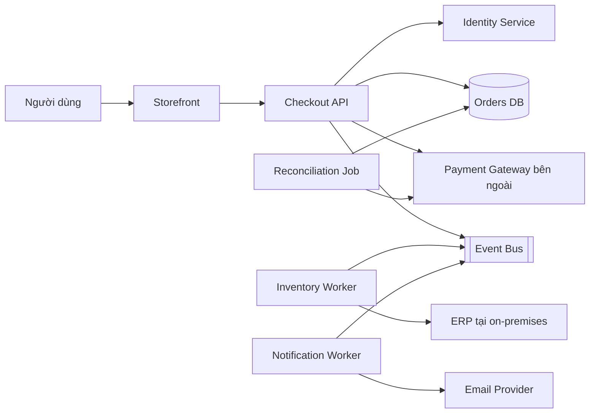

# Khảo sát danh mục ứng dụng và lập bản đồ phụ thuộc

## 1. Vì sao phải khảo sát trước khi di chuyển lên đám mây?

Một kế hoạch di chuyển (migration) có thể thất bại dù từng máy chủ đã được chuyển thành công. Nguyên nhân thường nằm ở những mối liên hệ chưa được phát hiện: dịch vụ đặt hàng vẫn truy cập cơ sở dữ liệu tại trung tâm dữ liệu cũ, tác vụ đối soát chỉ chạy cuối tháng, ứng dụng phụ thuộc hệ thống xác thực nội bộ hoặc một API của đối tác chỉ cho phép địa chỉ IP cố định.

Vì vậy, trước khi chọn máy ảo, container, dịch vụ cơ sở dữ liệu hay chiến lược hiện đại hóa, kiến trúc sư cần trả lời hai câu hỏi:

1. **Chúng ta đang vận hành những ứng dụng và workload nào, phục vụ năng lực nghiệp vụ gì?**
2. **Các thành phần đó phụ thuộc vào nhau ra sao, và điều gì sẽ xảy ra nếu một thành phần thay đổi vị trí, phiên bản hoặc ngừng hoạt động?**

**Khảo sát danh mục ứng dụng** (*application portfolio assessment*) tạo ra bức tranh có cấu trúc về ứng dụng, chủ sở hữu, giá trị nghiệp vụ, hiện trạng kỹ thuật, dữ liệu và ràng buộc vận hành. **Lập bản đồ phụ thuộc** (*dependency mapping*) bổ sung các quan hệ giữa ứng dụng, dịch vụ, dữ liệu, nền tảng và bên ngoài tổ chức. Hai hoạt động này là đầu vào trực tiếp của việc chọn phương án migration, thiết kế kiến trúc đích, ước lượng chi phí, phân chia đợt chuyển đổi (*migration wave*) và xây dựng kế hoạch chuyển mạch (*cutover*).

Trong phạm vi **CLOUD_ARCHITECTURE**, chúng ta sử dụng kết quả khảo sát để cân bằng các thuộc tính kiến trúc: **độ tin cậy, bảo mật, hiệu năng, khả năng mở rộng, chi phí và khả năng vận hành** theo tư duy Well-Architected. Không có danh mục và bản đồ phụ thuộc đáng tin cậy, các quyết định về mạng, compute, dữ liệu và mô hình triển khai chỉ là giả định.

### Kết quả học tập

Sau bài này, bạn có thể:

- Thiết kế bộ trường thông tin để kiểm kê ứng dụng theo góc nhìn nghiệp vụ và kỹ thuật.
- Tìm kiếm, mô tả và kiểm chứng các phụ thuộc đồng bộ, bất đồng bộ, dữ liệu, bảo mật, mạng và vận hành.
- Biểu diễn phụ thuộc thành đồ thị có hướng với mức độ quan trọng, nguồn bằng chứng và độ tin cậy.
- Phát hiện rủi ro di chuyển, nhóm thành phần cần phối hợp và đề xuất trình tự migration có căn cứ.
- Đánh giá mức độ hoàn chỉnh của khảo sát, quản lý những thông tin còn chưa chắc chắn.

## 2. Xác định đúng đối tượng cần kiểm kê

Các thuật ngữ sau liên quan nhưng không đồng nghĩa:

| Đối tượng | Ý nghĩa | Ví dụ |
|---|---|---|
| **Năng lực nghiệp vụ** (*business capability*) | Kết quả mà tổ chức cần tạo ra | Quản lý đơn hàng, xử lý thanh toán |
| **Ứng dụng** (*application*) | Sản phẩm phần mềm đáp ứng một hay nhiều nhu cầu nghiệp vụ | Hệ thống bán hàng trực tuyến |
| **Dịch vụ/thành phần** (*service/component*) | Đơn vị chức năng hoặc triển khai nằm trong hay dùng chung giữa ứng dụng | Checkout API, Identity Service |
| **Workload** | Tập tài nguyên và tiến trình thực hiện một công việc | Cụm web, tác vụ xử lý sự kiện, batch đối soát |
| **Tài sản hạ tầng/dữ liệu** | Tài nguyên mà workload sử dụng | VM, cluster, cơ sở dữ liệu, storage, load balancer |
| **Phụ thuộc** (*dependency*) | Quan hệ mà một thành phần cần thành phần khác để hoàn thành chức năng hoặc vận hành | Checkout gọi Payment API |

Một ứng dụng có thể gồm nhiều workload, một workload có thể dùng nhiều tài sản, và nhiều ứng dụng có thể dùng chung dịch vụ xác thực hoặc cơ sở dữ liệu. Nếu chỉ đếm máy chủ, đội dự án dễ bỏ sót SaaS, serverless, tác vụ định kỳ, kết nối đối tác và các phụ thuộc phi máy chủ.

**Đơn vị quản lý chính** trong danh mục nên là ứng dụng hoặc sản phẩm nghiệp vụ, có mã định danh ổn định. Ở lớp bản đồ phụ thuộc có thể phân rã sâu xuống dịch vụ, database, hàng đợi, job và endpoint. Mức độ chi tiết cần phục vụ quyết định migration, không nhất thiết vẽ đến từng process hoặc từng packet.

## 3. Thiết kế danh mục ứng dụng có thể dùng để ra quyết định

Một danh mục có giá trị phải nối được **người chịu trách nhiệm → chức năng nghiệp vụ → nền tảng kỹ thuật → yêu cầu phi chức năng → lựa chọn chuyển đổi**.

### 3.1. Bộ trường thông tin tối thiểu

| Nhóm | Trường nên thu thập | Câu hỏi được giải đáp |
|---|---|---|
| Nhận dạng | Application ID, tên, mô tả, môi trường, trạng thái sử dụng | Đây là ứng dụng nào? Production hay thử nghiệm? |
| Nghiệp vụ | Năng lực phục vụ, quy trình chính, số lượng người dùng, mức độ quan trọng, thời điểm cao điểm | Gián đoạn tác động đến ai và khi nào? |
| Trách nhiệm | Business owner, technical owner, đội vận hành, nhà cung cấp | Ai xác nhận thông tin và chấp thuận thay đổi? |
| Kiến trúc | Ngôn ngữ/runtime, phiên bản, cách triển khai, OS, middleware, compute, topology | Có thể rehost hay cần thay đổi kỹ thuật? |
| Dữ liệu | Kho dữ liệu, dung lượng, tăng trưởng, nơi lưu, phân loại dữ liệu, chủ sở hữu dữ liệu | Dữ liệu nằm ở đâu, nhạy cảm tới mức nào? |
| Tích hợp | API vào/ra, queue/topic, file transfer, batch, DNS, cổng/protocol, đối tác | Ứng dụng giao tiếp với ai và bằng cách nào? |
| Phi chức năng | SLO/SLA, lưu lượng và đỉnh tải, độ trễ, RTO, RPO, giờ bảo trì | Mức tin cậy và hiệu năng bắt buộc là gì? |
| Bảo mật/tuân thủ | IAM, tài khoản dịch vụ, secret, chứng chỉ, kiểm soát truy cập, yêu cầu vị trí lưu dữ liệu | Có ràng buộc nào ngăn việc đổi môi trường? |
| Vận hành | Logging, monitoring, tracing, backup/restore, runbook, CI/CD, sự cố từng gặp | Có đủ khả năng quan sát và phục hồi sau di chuyển? |
| Kinh tế/vòng đời | Chi phí hạ tầng và license, hợp đồng, tình trạng hỗ trợ, nợ kỹ thuật, kế hoạch thay thế | Nên đầu tư hiện đại hóa hay loại bỏ? |
| Đánh giá sơ bộ | Độ phức tạp, rủi ro, phương án dự kiến, mức sẵn sàng, việc còn thiếu | Ứng dụng phù hợp đợt migration nào? |

**RTO** (*Recovery Time Objective*) là khoảng thời gian tối đa chấp nhận được để khôi phục dịch vụ sau gián đoạn. **RPO** (*Recovery Point Objective*) là lượng dữ liệu mất tối đa có thể chấp nhận, thường biểu diễn theo thời gian. Ví dụ, `RTO = 2 giờ`, `RPO = 15 phút` là hai yêu cầu khác nhau; không thể dùng RTO thay cho RPO.

Nên phân biệt **yêu cầu mục tiêu** với **năng lực thực tế**. Một ứng dụng có thể yêu cầu RPO 15 phút nhưng hiện chỉ backup mỗi 24 giờ. Chênh lệch đó là rủi ro cần ghi lại, không được làm biến mất trong quá trình tổng hợp.

### 3.2. Ví dụ một dòng danh mục

| Trường | Giá trị minh họa |
|---|---|
| Application ID | `APP-014` |
| Tên | Cổng bán hàng |
| Business owner / Technical owner | Trưởng kênh số / Đội thương mại điện tử |
| Mức quan trọng | Cao: tác động trực tiếp đến doanh thu |
| Thành phần | Web frontend, Checkout API, worker xử lý đơn hàng |
| Hiện trạng | VM tại trung tâm dữ liệu, cơ sở dữ liệu quan hệ dùng riêng |
| Lưu lượng | Tăng mạnh vào các đợt khuyến mại |
| RTO / RPO yêu cầu | 2 giờ / 15 phút |
| Phụ thuộc nổi bật | Identity Service, Orders DB, Payment Gateway, Event Bus |
| Rủi ro chưa giải quyết | Chưa xác nhận lịch batch cuối tháng; đối tác thanh toán áp dụng IP allowlist |
| Trạng thái khảo sát | Chưa hoàn tất, có các điểm cần xác minh |

Các giá trị trên chỉ để minh họa cách điền. Trong dự án thật, mỗi bản ghi cần liên kết được với cấu hình, kết quả phỏng vấn hoặc dữ liệu vận hành xác thực.

### 3.3. Chuẩn hóa và quản lý nguồn tin

Danh mục thường thu thập từ nhiều nơi, vì vậy cần áp dụng các quy tắc:

- Một ứng dụng có **mã định danh duy nhất**, bất kể tên khác nhau trong CMDB, tài chính và nhóm phát triển.
- Ghi rõ **môi trường** (`prod`, `staging`, `dev`); một endpoint test không được tự động coi là phụ thuộc production.
- Ghi **ngày quan sát/cập nhật**, **nguồn chứng cứ**, **người xác nhận** và **mức tin cậy** của thông tin quan trọng.
- Phân biệt `không có phụ thuộc` với `chưa tìm thấy phụ thuộc`. Hai trạng thái có mức rủi ro khác nhau.
- Thể hiện chủ sở hữu chưa xác định bằng `Unknown` và đưa vào danh sách xử lý, thay vì đoán người chịu trách nhiệm.
- Giữ lịch sử thay đổi để truy vết vì danh mục là tài sản vận hành sống, không chỉ là biểu mẫu sử dụng một lần.

## 4. Nhận diện đầy đủ các loại phụ thuộc

Một mũi tên `A → B` được quy ước là **A cần hoặc sử dụng B**. Khi B ngừng hoạt động hay thay đổi, A có thể chịu ảnh hưởng. Một đường truyền hai chiều có thể bao gồm hai mối phụ thuộc có hướng với tính chất khác nhau.

| Loại phụ thuộc | Ví dụ thực tế | Rủi ro khi migration |
|---|---|---|
| Đồng bộ (*synchronous*) | Checkout gọi REST API xác thực để lấy quyết định cho phép | Thêm độ trễ, timeout, retry dồn tải, lệ thuộc đường mạng |
| Bất đồng bộ (*asynchronous*) | Order Service phát sự kiện vào queue để worker xử lý | Mất hoặc trùng thông điệp, sai thứ tự, consumer lag, yêu cầu idempotency |
| Dữ liệu | Report Service truy cập cùng database hoặc đọc file chia sẻ | Tách môi trường làm phát sinh độ trễ, nhất quán dữ liệu, xung đột ghi |
| Danh tính/bảo mật | Dịch vụ dùng IdP, secret store, KMS hoặc chứng chỉ nội bộ | Không xác thực được, token không hợp lệ, không giải mã được dữ liệu |
| Mạng và định tuyến | DNS nội bộ, firewall rule, proxy, VPN, IP allowlist | Mất phân giải tên, sai route, không truy cập được endpoint |
| Nền tảng/vận hành | Scheduler, monitoring agent, backup server, artifact registry | Job không chạy, mất quan sát, không thể khôi phục hay triển khai |
| Bên ngoài tổ chức | Payment Gateway, ERP đối tác, email/SMS provider | Giới hạn hợp đồng, quota, hỗ trợ API, thay đổi IP nguồn hoặc vùng địa lý |
| Quy trình và con người | Tác vụ đối soát bằng tay, phê duyệt triển khai, cửa sổ bảo trì | Không thể cutover đúng thời điểm hoặc thiếu người xử lý sự cố |

Không phải mọi phụ thuộc đều phải chuyển đi cùng nhau. Một dịch vụ SaaS bên ngoài có thể được **giữ nguyên** và chỉ cập nhật kết nối. Một database được nhiều ứng dụng chia sẻ có thể cần **tách dữ liệu hoặc tạo giao diện truy cập** trước khi di chuyển riêng từng ứng dụng. Vì vậy, bản đồ mô tả quan hệ thực tế; quyết định đóng gói migration là một bước phân tích tiếp theo.

## 5. Quy trình khảo sát và phát hiện phụ thuộc

### Bước 1: Chốt phạm vi và tiêu chí thành công

Xác định đơn vị kinh doanh, ứng dụng, môi trường, vị trí triển khai và thời hạn khảo sát. Nêu rõ phạm vi gồm những thành phần **nội bộ, đám mây, SaaS, đối tác, on-premises và hệ thống dùng chung** nào. Chỉ định business owner, application owner, data owner, nhóm bảo mật/mạng và nhóm vận hành tham gia xác nhận.

Một số câu hỏi mở đầu:

- Có bao nhiêu ứng dụng đang phục vụ sản xuất và bao nhiêu ứng dụng có thể ngừng sử dụng?
- Dịch vụ nào có thể chịu gián đoạn, dịch vụ nào gần như không thể ngừng?
- Có yêu cầu về vị trí lưu trữ, kiểm soát dữ liệu, chứng chỉ hoặc phần mềm chỉ hỗ trợ một môi trường cụ thể không?
- Kết quả khảo sát dùng để chọn đợt di chuyển, tính ngân sách, lập kiến trúc đích hay cả ba?

Định nghĩa rõ mức chi tiết cần đạt. Ví dụ: với ứng dụng mức quan trọng cao, phải xác nhận từng API, database, queue, đường đi xác thực và tác vụ theo lịch; với ứng dụng đã ngừng sử dụng, có thể chỉ cần chủ sở hữu và bằng chứng để decommission.

### Bước 2: Tạo danh sách ứng dụng và tài sản ban đầu

Kết hợp thông tin từ CMDB, sơ đồ hệ thống, tài sản cloud/on-premises, inventory máy ảo và container, repository, CI/CD, DNS, load balancer, chi phí/license và phỏng vấn chủ ứng dụng. Hợp nhất những bản ghi trùng tên, gán ID, đối chiếu môi trường và xác định chủ sở hữu.

Không dùng riêng CMDB làm nguồn chân lý tuyệt đối: CMDB có thể bị thiếu hoặc không cập nhật. Ngược lại, quét hạ tầng chỉ thấy tài nguyên đang chạy, chưa giải thích được chúng phục vụ quy trình nghiệp vụ gì.

### Bước 3: Kết hợp phát hiện từ trên xuống và từ dưới lên

**Từ trên xuống (top-down):** phỏng vấn owner và người vận hành, đọc tài liệu kiến trúc, sơ đồ luồng nghiệp vụ, lịch batch, hợp đồng đối tác và phương án khôi phục. Cách này tìm được quan hệ hiếm xảy ra, nghiệp vụ ngoại lệ và tác vụ thủ công.

**Từ dưới lên (bottom-up):** đối chiếu cấu hình ứng dụng, environment variables được quản lý an toàn, DNS, API gateway, service mesh, distributed traces, access logs, network flow logs, database audit logs, queue metrics, job scheduler và bản ghi kết nối. Cách này phát hiện lưu lượng hoặc endpoint mà sơ đồ cũ không thể hiện.

| Nguồn phát hiện | Phát hiện tốt | Giới hạn cần lưu ý |
|---|---|---|
| Phỏng vấn owner/đội vận hành | Quy trình, sự kiện hiếm, thao tác thủ công | Dễ bỏ sót phụ thuộc đã hình thành theo thời gian |
| Cấu hình, IaC, CI/CD | Endpoint, network rule, tích hợp dự kiến | Có thể chứa cấu hình cũ hoặc chỉ dành cho test |
| Distributed tracing/APM | Chuỗi request, độ trễ, lỗi, caller/callee | Không phải dịch vụ nào cũng được instrument |
| Flow logs, firewall, DNS | Các điểm giao tiếp và đường mạng | Không phải lưu lượng nào cũng cho biết ứng dụng hoặc mục đích |
| Database/queue/job telemetry | Truy cập dữ liệu, consumer, job định kỳ | Thiếu quyền quan sát hoặc chỉ thấy một phần thời gian |
| Tài liệu hợp đồng và đối tác | IP allowlist, endpoint, quota, maintenance window | Chưa chắc phản ánh cấu hình đang sử dụng |

**Không thu thập mật khẩu, khóa API, private key hay nội dung dữ liệu nhạy cảm vào danh mục.** Chỉ ghi tên hệ thống quản lý secret, cơ chế xác thực và đầu mối chịu trách nhiệm. Khi thu thập trace/log phải tuân thủ quyền truy cập, thời hạn lưu và biện pháp che dữ liệu phù hợp.

### Bước 4: Quan sát đủ các chu kỳ hoạt động

Tìm phụ thuộc vào cả giờ cao điểm, giờ thấp điểm, cuối tuần, đợt khuyến mại, ngày kết sổ và kỳ đối soát. Nếu hệ thống có batch hàng tháng, vài giờ quan sát lưu lượng không đủ để kết luận không có kết nối.

Với từng phát hiện, xác định đây là **traffic cần thiết**, traffic dư thừa, kết nối thử nghiệm hay tàn dư từ hệ thống cũ. Phân biệt “không quan sát thấy” và “đã chứng minh không tồn tại”. Duy trì danh sách nghi vấn để owner xác nhận.

### Bước 5: Mô hình hóa quan hệ bằng đồ thị có hướng

Mỗi **nút** là ứng dụng, dịch vụ, kho dữ liệu hoặc điểm tích hợp quan trọng. Mỗi **cạnh** là một phụ thuộc có hướng và có ngữ cảnh. Tối thiểu nên lưu:

| Thuộc tính cạnh | Diễn giải hoặc giá trị ví dụ |
|---|---|
| `source`, `target` | `Checkout API` → `Orders DB` |
| `environment` | `prod` |
| `dependency_type` | `data`, `sync-api`, `async-event`, `identity`, `network`, ... |
| `protocol / interface` | HTTPS:443, JDBC/TLS, AMQP, SFTP, ... |
| `criticality` | `blocking`, `degraded`, `optional` |
| `performance` | Tần suất gọi, p95/p99 latency, throughput hoặc độ trễ tiêu thụ queue |
| `failure_behavior` | Timeout 2 giây; retry tối đa 2 lần; circuit breaker nếu có |
| `data / security` | Loại dữ liệu, yêu cầu mã hóa, quyền truy cập |
| `evidence` | Trace, log, tài liệu, ticket hoặc người xác nhận |
| `confidence`, `observed_at` | `verified`, `inferred`, `unknown`; thời điểm kiểm tra |

Một phụ thuộc có thể **bắt buộc cho một chức năng** nhưng không bắt buộc cho toàn ứng dụng. Ví dụ Payment Gateway là bắt buộc để thanh toán thành công, còn Email Service có thể chỉ ảnh hưởng khả năng gửi xác nhận. Đánh dấu theo *luồng nghiệp vụ* giúp tránh đánh giá quá mức hoặc bỏ sót tác động.

### Bước 6: Xác minh chéo với người chịu trách nhiệm

Tổ chức buổi xem bản đồ với chủ ứng dụng, data owner, đội mạng, bảo mật và vận hành. Mỗi mối phụ thuộc quan trọng nên có ít nhất một bằng chứng kỹ thuật phù hợp và sự xác nhận của người hiểu luồng nghiệp vụ; khi hai nguồn mâu thuẫn, giữ trạng thái `cần điều tra`.

Ví dụ, cấu hình chứa hostname database cũ chưa đủ chứng minh ứng dụng vẫn dùng nó. Nhưng trace production có truy cập liên tục tới hostname đó là bằng chứng mạnh hơn. Ngược lại, không thấy truy cập trong thời gian quan sát ngắn cũng chưa chứng minh database không còn được sử dụng.

### Bước 7: Chuyển dữ liệu khảo sát thành quyết định kiến trúc

Sau khi đủ độ tin cậy, liên kết đồ thị với yêu cầu nghiệp vụ và ràng buộc kỹ thuật để đưa ra: nhóm migration dự kiến, các phụ thuộc giữ lại tại chỗ, hạng mục nền tảng cần chuẩn bị, kiến trúc đích, kế hoạch kiểm thử và thứ tự cutover.

## 6. Ví dụ: hệ thống bán hàng trực tuyến

Giả sử một doanh nghiệp muốn di chuyển nền tảng bán hàng từ hạ tầng tự quản lý lên đám mây. Khảo sát ban đầu cho thấy:

- `Storefront` nhận yêu cầu người dùng và gọi `Checkout API`.
- `Checkout API` cần `Identity Service` để xác minh người dùng, `Orders DB` để lưu đơn và `Payment Gateway` của đối tác để thu tiền.
- Sau khi ghi nhận đơn, Checkout phát sự kiện vào `Event Bus`; `Inventory Worker` cập nhật tồn kho, `Notification Worker` gửi xác nhận.
- `Inventory Worker` còn gọi `ERP` tại trung tâm dữ liệu cũ.
- Một `Reconciliation Job` chạy theo kỳ đọc dữ liệu đơn hàng để đối soát thanh toán; nhóm phát triển ban đầu chưa liệt kê job này.

Sơ đồ dùng hướng **thành phần tiêu thụ → thành phần được sử dụng**, không biểu diễn trực tiếp hướng di chuyển của packet hay thứ tự toàn bộ request:



Vì worker **tiêu thụ** Event Bus, cạnh `Inventory Worker → Event Bus` và `Notification Worker → Event Bus` thể hiện sự lệ thuộc vận hành của worker vào bus. Nếu cần phân tích đường lan truyền dữ liệu, nên vẽ thêm một sơ đồ luồng sự kiện với mũi tên `Event Bus → Worker`. Cần ghi rõ quy ước thay vì trộn hai ý nghĩa trong cùng một loại cạnh.

### 6.1. Bảng phụ thuộc minh họa

| Bên sử dụng → Bên được sử dụng | Hình thức | Tác động khi đứt kết nối | Kiểm tra trước migration |
|---|---|---|---|
| Checkout → Identity | HTTPS đồng bộ | Không thể xác thực cho luồng checkout | Đường mạng, token/JWKS, TTL cache, timeout |
| Checkout → Orders DB | Truy cập dữ liệu | Không thể ghi đơn | Kết nối, nhất quán dữ liệu, backup, RPO |
| Checkout → Payment Gateway | HTTPS đối tác | Không thể thanh toán | IP allowlist, TLS, quota, callback/webhook |
| Checkout → Event Bus | Publish sự kiện | Đơn có thể lưu nhưng xử lý sau đặt hàng bị gián đoạn | Cơ chế retry, outbox, idempotency, dead-letter queue |
| Inventory Worker → Event Bus | Subscribe sự kiện | Chậm cập nhật tồn kho | Consumer offset, backlog, cơ chế replay |
| Inventory Worker → ERP | API qua mạng lai | Không đồng bộ tồn kho với ERP | Kết nối hybrid, latency, route, cửa sổ bảo trì ERP |
| Reconciliation Job → Orders DB | Batch theo kỳ | Sai lệch hoặc chậm đối soát | Lịch chạy thực tế, quyền truy cập, dữ liệu lịch sử |

### 6.2. Những điều đồ thị tiết lộ

**Một, không thể đánh giá Checkout chỉ bằng CPU/RAM của máy chủ.** Checkout phụ thuộc database, xác thực, thanh toán và bus. Khi đặt Checkout trên cloud nhưng giữ database ở on-premises, mỗi giao dịch có thể đi qua mạng lai nhiều lần. Điều này ảnh hưởng độ trễ, độ sẵn sàng và chi phí truyền dữ liệu.

**Hai, `Orders DB` có nhiều bên tiêu thụ.** Nếu di chuyển database mà chỉ kiểm thử Checkout, job đối soát có thể thất bại vào cuối tháng. Bản đồ phụ thuộc giúp xác định đầy đủ bên dùng dữ liệu, thời điểm chạy và cơ chế chuyển kết nối.

**Ba, ranh giới nhà cung cấp tạo rủi ro riêng.** Payment Gateway có thể cần thêm IP nguồn cloud vào allowlist, cập nhật callback URL và kiểm tra giới hạn giao dịch. Không thể tự giả định hạ tầng mới có thể truy cập đối tác.

**Bốn, luồng bất đồng bộ cần kiểm tra tính đúng đắn ngoài khả năng kết nối.** Sau cutover có thể tồn tại event trùng, event đến muộn, consumer lag hoặc sai thứ tự. Phải xác định khả năng xử lý idempotent, theo dõi backlog và quy trình replay phù hợp.

**Năm, một bản đồ chỉ dựa trên traffic thường xuyên có thể bỏ sót batch.** Để bảo đảm chất lượng đối soát, phải bổ sung lịch công việc và người xác nhận nghiệp vụ.

## 7. Từ đồ thị phụ thuộc đến nhóm và đợt migration

### 7.1. Phân tích tác động và mối liên kết

Quan sát đồ thị theo những câu hỏi cụ thể:

1. **Nút dùng chung:** Dịch vụ nào được nhiều ứng dụng sử dụng (IdP, DNS, message broker, shared database)? Thay đổi nút đó có phạm vi tác động lớn.
2. **Phụ thuộc xuyên ranh giới:** Những cạnh nào đi qua on-premises ↔ cloud, vùng mạng, tài khoản, khu vực địa lý hoặc đối tác? Chúng cần kiểm thử kết nối, độ trễ và chính sách truy cập.
3. **Vòng phụ thuộc:** Các chu trình như `Service A → Service B → Service A` có thể làm việc chuyển từng thành phần trở nên khó khăn. Phân tích nhóm liên thông mạnh (*strongly connected components*) có thể gợi ý các ứng viên chuyển phối hợp, nhưng không tự động buộc chúng phải cùng một đợt.
4. **Điểm lỗi tập trung:** Một database hay IdP được dùng rộng rãi có thể trở thành điểm lỗi đơn hoặc yếu tố khuếch đại sự cố; cần xem khả năng dự phòng và phương án phục hồi.
5. **Điều kiện vận hành:** Ai có quyền thay đổi firewall, DNS, chứng chỉ, secret, license, pipeline và job scheduler? Những phụ thuộc quản trị này cũng quyết định lịch triển khai.

Đối với hệ thống quan trọng, cần xem thêm **chuỗi phụ thuộc bắc cầu**: Checkout có thể không gọi trực tiếp ERP nhưng vẫn phụ thuộc vào ERP ở chức năng đồng bộ tồn kho thông qua Inventory Worker. Khi đánh giá *blast radius*, phải tính cả đường ảnh hưởng gián tiếp và khả năng phục hồi tại từng bước.

### 7.2. Đánh giá mức độ sẵn sàng

Có thể chấm theo thang minh họa `1` (thuận lợi) đến `5` (khó/rủi ro cao) ở các chiều:

| Chiều đánh giá | Gợi ý khi cho điểm cao |
|---|---|
| Giá trị và mức quan trọng nghiệp vụ | Gián đoạn tác động lớn đến doanh thu, an toàn hoặc khách hàng |
| Độ phức tạp phụ thuộc | Nhiều hệ thống dùng chung, nhiều giao tiếp đồng bộ hoặc vòng phụ thuộc |
| Dữ liệu và tuân thủ | Dữ liệu nhạy cảm, dung lượng lớn, khó đồng bộ, yêu cầu cư trú dữ liệu |
| Khả năng chuyển đổi kỹ thuật | Runtime hết hỗ trợ, license giới hạn, phần mềm phụ thuộc phần cứng |
| Yêu cầu phi chức năng | RTO/RPO chặt, độ trễ thấp, gần như không có cửa sổ gián đoạn |
| Khả năng kiểm chứng | Thiếu owner, thiếu logs, không có môi trường thử nghiệm hoặc runbook |

Điểm số chỉ là **công cụ ưu tiên và thảo luận**, không thay thế phân tích chi tiết. Không nên cộng cơ học tất cả điểm rồi cho rằng số thấp luôn phải đi trước: một thành phần dùng chung có thể cần được chuẩn bị sớm dù bản thân nó có rủi ro cao.

### 7.3. Phác thảo đợt migration

Với ví dụ bán hàng, một trình tự *tham khảo* là:

| Giai đoạn | Công việc | Điều kiện để tiếp tục |
|---|---|---|
| Chuẩn bị nền tảng | Thiết lập landing zone, danh tính, mạng lai, DNS, quan sát, backup và quản lý khóa/secret | Có kết nối, quyền truy cập và cơ chế khôi phục đã kiểm tra |
| Thử nghiệm tích hợp | Dựng môi trường đích; thử gọi IdP, Payment Gateway, ERP; kiểm tra bus và job | Các luồng trọng yếu và ngoại lệ hoạt động đúng |
| Di chuyển dữ liệu và dịch vụ liên quan | Xác định cách đồng bộ/cutover Orders DB, đường truy cập của Checkout và Reconciliation Job | Đạt yêu cầu toàn vẹn dữ liệu, RTO/RPO và phương án quay lui |
| Chuyển traffic ứng dụng | Di chuyển hoặc triển khai Storefront/Checkout/worker; chuyển DNS/route theo chiến lược đã chọn | Đo được lỗi, độ trễ, thông lượng và backlog; không mất đơn |
| Ổn định và tối ưu | Kiểm tra đối soát, chi phí, SLO, phân quyền, autoscaling; dừng tài nguyên cũ khi đủ điều kiện | Owner ký xác nhận, không còn phụ thuộc ngầm vào hệ thống cũ |

Đây là **trình tự hoạt động**, không phải quy định tất cả thành phần phải di chuyển một lúc. Tùy ràng buộc, có thể giữ ERP ở on-premises, thay Payment Gateway bằng kết nối tương thích hoặc tái cấu trúc dần shared database. Cần chọn giữa **rehost, replatform, refactor, repurchase, retain, retire** theo mục tiêu và bằng chứng của từng ứng dụng.

Nếu áp dụng dual-write hay đồng bộ dữ liệu hai chiều trong giai đoạn chuyển đổi, phải thiết kế rõ quy tắc xung đột, thứ tự sự kiện, nơi ghi dữ liệu chính và cách đối soát. Không nên mặc định dual-write luôn an toàn hơn phương án tạm dừng ghi có kiểm soát.

### 7.4. Ràng buộc kiến trúc đích theo Well-Architected

| Trụ cột/quan tâm | Dữ liệu khảo sát giúp quyết định gì? |
|---|---|
| Độ tin cậy | Điểm lỗi chung, HA, backup, failover, DR, RTO/RPO theo chuỗi phụ thuộc |
| Bảo mật | Luồng truy cập, phân đoạn mạng, quyền tối thiểu, secret, mã hóa và phạm vi dữ liệu nhạy cảm |
| Hiệu quả hiệu năng | Độ trễ giao tiếp, vị trí dữ liệu, throughput, connection pool, giới hạn API, queue lag |
| Tối ưu chi phí | Workload nhàn rỗi, lưu lượng truyền dữ liệu qua mạng lai/giữa vùng, license và tài sản có thể nghỉ hưu |
| Vận hành | Runbook, observability, ownership, CI/CD, thay đổi cấu hình, diễn tập sự cố |
| Bền vững (nếu xét trong khung đánh giá) | Tránh tài nguyên dư thừa, tối ưu công suất và loại bỏ workload không còn giá trị |

Đặc biệt, **phụ thuộc không tự biến mất khi chuyển môi trường**. Kiến trúc đích phải chỉ rõ vị trí của mỗi thành phần, giao tiếp đi qua đâu, ai quản lý và kiểm chứng cách ứng dụng hoạt động trong tình huống lỗi.

## 8. Bộ sản phẩm đầu ra nên bàn giao

Để dự án migration có thể sử dụng ngay, một lần khảo sát nên tạo bốn sản phẩm có liên kết với nhau:

| Sản phẩm | Thành phần bắt buộc | Người dùng chính |
|---|---|---|
| **Application inventory** | ID, chức năng, owner, môi trường, công nghệ, dữ liệu, SLO/RTO/RPO, chi phí, vòng đời, trạng thái xác minh | Business owner, kiến trúc sư, quản lý chương trình |
| **Dependency map & edge register** | Đồ thị và danh sách cạnh có hướng, loại giao tiếp, mức quan trọng, nguồn chứng cứ, ngày xác minh | Kỹ thuật ứng dụng, mạng, bảo mật, vận hành |
| **Risk/unknown register** | Giả định chưa xác nhận, tác động, mức ưu tiên, người phụ trách, hạn xử lý, bằng chứng cần thu thập | Quản lý rủi ro, nhóm migration |
| **Wave & cutover proposal** | Nhóm hệ thống, thứ tự, điều kiện tiên quyết, test, rollback, điểm chấp thuận | Kiến trúc sư, vận hành, quản lý thay đổi |

Một mục trong *risk/unknown register* có thể viết:

> `R-07`: Chưa xác định Reconciliation Job có đọc trực tiếp Orders DB vào ngày cuối tháng hay không. **Tác động:** có thể mất khả năng đối soát sau khi đổi endpoint DB. **Owner:** đội tài chính và ứng dụng. **Hành động:** đối chiếu scheduler, log truy cập DB và chạy thử kỳ đối soát trước cutover. **Trạng thái:** chưa xác minh.

### Mẫu bảng cạnh có thể đưa vào công cụ quản lý

```csv
source_id,target_id,environment,type,criticality,evidence,confidence,owner
Checkout,OrdersDB,prod,data,blocking,db-audit-2026-10,verified,OrderTeam
Checkout,PaymentGateway,prod,sync-api,blocking,apm-trace-2026-10,verified,CheckoutTeam
InventoryWorker,ERP,prod,sync-api,degraded,owner-interview,inferred,InventoryTeam
ReconciliationJob,OrdersDB,prod,batch,blocking,monthly-schedule,inferred,FinanceTeam
```

Các tên và bằng chứng trong CSV là **giả định phục vụ bài học**. Trong dự án thật, đường dẫn đến hệ thống lưu bằng chứng cần bảo đảm người được cấp quyền có thể tra cứu mà không làm rò rỉ thông tin nhạy cảm.

### Tiêu chí hoàn thành khảo sát

Không có một ngưỡng tỷ lệ chung phù hợp với mọi tổ chức. Hãy thống nhất trước các tiêu chí và ưu tiên theo tác động; ví dụ:

- Tất cả ứng dụng production nằm trong phạm vi có ID, business owner hoặc mục `Unknown` được giao người xử lý; các ứng dụng quan trọng đã có owner xác nhận.
- Các luồng quan trọng (đăng nhập, ghi giao dịch, thanh toán, đối soát, backup/restore) có danh sách phụ thuộc và cách kiểm chứng rõ ràng.
- Mọi cạnh trọng yếu có môi trường, loại quan hệ, tác động khi lỗi, bằng chứng và trạng thái `verified`/`inferred`/`unknown`.
- Đã xem xét chu kỳ theo lịch và thời điểm cao tải phù hợp với từng ứng dụng.
- Các kết nối xuyên môi trường, dịch vụ dùng chung và phụ thuộc đối tác đã có người phụ trách kiểm thử.
- Mọi thông tin chưa xác minh có mức ưu tiên, owner và hành động; không chấp thuận cutover nếu các điểm chưa xác minh có thể gây rủi ro không được chấp nhận.
- Có đường liên kết từ inventory/graph đến kế hoạch wave, test case, tiêu chí rollback và biên bản xác nhận.

## 9. Những lỗi thường gặp và cách tránh

| Lỗi | Hệ quả | Cách khắc phục |
|---|---|---|
| Chỉ lập danh sách VM hoặc địa chỉ IP | Không thấy ứng dụng SaaS, business owner, batch hay phụ thuộc dữ liệu | Duy trì lớp ứng dụng và lớp workload, liên kết bằng ID |
| Chỉ dựa vào sơ đồ do nhóm phát triển cung cấp | Bỏ sót kết nối phát sinh trong production | Đối chiếu trace/log/cấu hình và phỏng vấn vận hành |
| Dùng lưu lượng ngắn hạn để kết luận không có phụ thuộc | Bỏ lỡ kết nối cuối kỳ hoặc sự kiện hiếm | Quan sát theo chu kỳ và kiểm tra lịch batch |
| Vẽ mũi tên không thống nhất ý nghĩa | Phân tích sai chiều tác động và thứ tự di chuyển | Công bố quy ước hướng cạnh, tách sơ đồ phụ thuộc và luồng dữ liệu |
| Bỏ qua phụ thuộc dùng chung | Di chuyển một ứng dụng làm hỏng nhiều ứng dụng khác | Phân tích nút có nhiều consumer và phạm vi ảnh hưởng |
| Không lưu bằng chứng và mức tin cậy | Quyết định dựa trên thông tin cũ, khó kiểm toán | Đính evidence, ngày xác minh, owner, trạng thái nghi vấn |
| Coi mapping là công việc chỉ thực hiện một lần | Bản đồ nhanh lỗi thời sau khi triển khai thay đổi | Cập nhật từ CI/CD, CMDB, telemetry và quy trình quản lý thay đổi |
| Chỉ kiểm thử request thành công | Bỏ sót timeout, retry, bảo mật, failover và xử lý sự kiện | Kiểm thử lỗi, phục hồi, độ trễ, quyền truy cập và đối soát |

## 10. Bài thực hành: chọn ranh giới di chuyển

**Bối cảnh.** Một hệ thống quản lý đặt lịch gồm `Booking Web`, `Booking API`, `Booking DB`, `Identity Service`, `SMS Provider` và `Nightly Report`. Booking API gọi Identity Service và Booking DB theo HTTP/database connection; sau khi đặt lịch, API gửi sự kiện để worker gửi SMS. Nightly Report chạy lúc 01:00 mỗi ngày, truy vấn trực tiếp Booking DB và tạo báo cáo cho bộ phận vận hành. Doanh nghiệp muốn đưa `Booking Web` và `Booking API` lên cloud trước, tạm giữ `Booking DB` và Identity Service tại on-premises.

**Yêu cầu:**

1. Vẽ sơ đồ phụ thuộc có hướng theo quy ước “bên sử dụng → bên được sử dụng”, chỉ ra các thành phần còn ở on-premises.
2. Chỉ ra ít nhất bốn kiểm tra bắt buộc trước khi chuyển traffic production.
3. Chọn một rủi ro chưa thể xác minh chỉ bằng thông số máy chủ; nêu cách thu thập bằng chứng.
4. Đề xuất một điều kiện rollback đủ cụ thể để đội vận hành theo dõi.

**Gợi ý đánh giá lời giải:**

- Đồ thị phải có `Booking Web → Booking API`, `Booking API → Identity Service`, `Booking API → Booking DB`, `Nightly Report → Booking DB`; với SMS cần thể hiện rõ publisher, broker nếu có và consumer gửi SMS thay vì giả định API gọi SMS đồng bộ.
- Những kiểm tra quan trọng gồm đường mạng lai và DNS, token/xác thực, độ trễ truy cập DB, bảo mật kết nối, log/trace và tính sẵn sàng của Nightly Report. Nếu DB hoặc IdP lỗi, cần xác định ứng dụng chịu tác động thế nào.
- Rủi ro có thể là báo cáo 01:00 vẫn trỏ endpoint DB cũ: kiểm tra lịch job, cấu hình và log DB trong các kỳ chạy.
- Một điều kiện rollback minh họa là: “Trong 10 phút sau cutover, tỷ lệ request đặt lịch lỗi vượt ngưỡng SLO đã được phê duyệt hoặc không ghi được giao dịch thành công; chuyển route về môi trường cũ theo runbook, đồng thời đối soát dữ liệu phát sinh”. Giá trị ngưỡng cụ thể phải dựa trên SLO, năng lực quan sát và phương án dữ liệu thực tế.

## 11. Ghi nhớ

Khảo sát danh mục trả lời **có những ứng dụng nào, quan trọng với ai, ràng buộc ra sao**. Bản đồ phụ thuộc trả lời **thành phần nào cần thành phần nào, thông qua cơ chế gì, khi lỗi ảnh hưởng đến đâu**. Kết hợp hai kết quả với bằng chứng vận hành và yêu cầu nghiệp vụ mới có thể lập phương án di chuyển và hiện đại hóa có cơ sở, kiểm soát được rủi ro và kiểm chứng được sau cutover.
