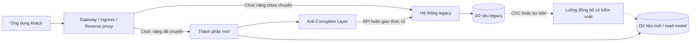

# Strangler Fig, Anti-Corruption Layer và chuyển đổi từng phần

## 1. Bài toán: hiện đại hóa hệ thống mà vẫn duy trì hoạt động

Trong kiến trúc ứng dụng đám mây, **di chuyển (migration)** có thể chỉ là chuyển nơi chạy ứng dụng, còn **hiện đại hóa (modernization)** thay đổi cách tổ chức thành phần, dữ liệu, triển khai và vận hành để đáp ứng yêu cầu mới. Nhiều hệ thống lâu năm vẫn xử lý nghiệp vụ quan trọng nên việc thay thế toàn bộ trong một lần (*big-bang replacement*) thường có rủi ro cao: hành vi ẩn chưa được tài liệu hóa, dữ liệu khó tách, quá nhiều bên tích hợp và thời gian ngừng dịch vụ khó chấp nhận.

Ba khái niệm giúp giảm rủi ro của một lộ trình thay thế có kiểm soát:

- **Strangler Fig pattern**: cho hệ thống cũ và mới cùng tồn tại, chuyển từng nhóm chức năng hoặc tuyến truy cập sang phần mới, rồi loại bỏ phần cũ khi không còn phụ thuộc.
- **Anti-Corruption Layer (ACL)**: đặt lớp chuyển đổi tại ranh giới miền nghiệp vụ để mô hình và quy tắc của hệ thống cũ không lan vào thiết kế mới.
- **Chuyển đổi từng phần (incremental migration)**: chia công việc thành các lát cắt có thể đo lường, phát hành, xác minh và xử lý sự cố độc lập.

Cả ba không đồng nghĩa với việc phải dùng microservices. Đích đến có thể là một **modular monolith**, một tập dịch vụ hoặc một kiến trúc hỗn hợp. Mục tiêu là cải thiện độ tin cậy, bảo mật, hiệu năng, khả năng mở rộng, chi phí và năng lực vận hành **theo yêu cầu nghiệp vụ thực tế**.

### Khi nào vấn đề xuất hiện?

Xét hệ thống bán hàng đã vận hành nhiều năm. Một ứng dụng nguyên khối quản lý danh mục, giỏ hàng, đặt hàng, thanh toán và báo cáo; các màn hình khách hàng, hệ thống kho và bộ phận chăm sóc khách hàng đều sử dụng API của nó. Doanh nghiệp muốn mở rộng đọc trạng thái đơn hàng trong các đợt khuyến mại và phát hành chức năng mới thường xuyên hơn.

Thay thế nguyên khối ngay lập tức đặt toàn bộ giao dịch vào một lần chuyển đổi. Cách tiếp cận từng phần có thể bắt đầu từ **tra cứu đơn hàng**, trong khi **tạo đơn, thanh toán và hoàn tiền** tiếp tục ở hệ thống cũ cho đến khi đội ngũ xác minh được luồng dữ liệu và các bất biến nghiệp vụ.

## 2. Phân biệt ba khái niệm

| Khái niệm | Giải quyết vấn đề gì? | Đặt ở đâu? | Dấu hiệu triển khai đúng |
|---|---|---|---|
| Strangler Fig | Thay thế dần chức năng mà vẫn phục vụ người dùng liên tục | Ranh giới yêu cầu và các thành phần thay thế | Có thể chọn tuyến cũ/mới theo chức năng, phân khúc người dùng hoặc cờ tính năng |
| Anti-Corruption Layer | Ngăn mô hình cũ chi phối mô hình miền mới | Biên tích hợp giữa thành phần mới và hệ thống cũ | Thành phần mới hiểu khái niệm nghiệp vụ của chính nó; chi tiết cũ chỉ tồn tại trong adapter |
| Chuyển đổi từng phần | Giảm phạm vi sự cố và kiểm soát tiến độ | Chiến lược tổ chức công việc, phát hành, dữ liệu và vận hành | Mỗi lát cắt có tiêu chí đạt, số đo, người sở hữu và phương án xử lý sự cố |

**Strangler Fig là chiến lược thay thế**, **ACL là cơ chế bảo vệ ranh giới mô hình**, còn **chuyển đổi từng phần là cách triển khai và quản trị tiến trình**. Chúng bổ trợ nhau nhưng không bắt buộc xuất hiện cùng lúc.

Ví dụ: chỉ chuyển một API đọc sang dịch vụ mới nhưng vẫn dùng trực tiếp cấu trúc bảng và mã trạng thái nội bộ của ứng dụng cũ có thể là Strangler Fig ở cấp định tuyến, song chưa tạo được ranh giới miền tốt. Ngược lại, có thể dùng ACL để tích hợp hai hệ thống tồn tại lâu dài mà không có kế hoạch loại bỏ hệ thống cũ.

## 3. Cơ chế của Strangler Fig

Tên mẫu kiến trúc gợi hình ảnh một cây mới dần bao quanh cây cũ. Trong phần mềm, một **điểm vào ổn định** tiếp nhận yêu cầu và quyết định chức năng nào được xử lý ở hệ thống cũ, chức năng nào ở thành phần mới.



*Sơ đồ minh họa một giai đoạn quá độ, không quy định rằng mọi dự án đều cần cả ACL lẫn CDC. Mũi tên nét đứt thể hiện phương án đồng bộ dữ liệu khi có nhu cầu.*

Các yếu tố thiết yếu:

1. **Điểm vào chung**: giữ API công khai ổn định khi dịch vụ phía sau thay đổi; có thể là API Gateway, ingress controller, reverse proxy hoặc lớp điều phối ứng dụng.
2. **Quy tắc phân tuyến**: xác định đơn vị chuyển đổi rõ ràng, chẳng hạn `GET /orders/{id}` hoặc nhóm khách hàng thử nghiệm. Không nên phân tuyến ngẫu nhiên khiến một khách hàng thấy dữ liệu không nhất quán giữa các yêu cầu liên tiếp.
3. **Khả năng cùng tồn tại**: cho phép cả hai phía chạy trong thời gian chuyển đổi; cần giám sát luồng phụ thuộc cũ/mới và lập kế hoạch loại bỏ phụ thuộc sau cùng.
4. **Quan sát xuyên ranh giới**: mang theo correlation ID/trace ID, đo tỷ lệ lỗi và độ trễ theo tuyến, theo phiên bản và theo phân khúc.
5. **Điều kiện thoát**: chỉ tắt thành phần cũ khi luồng người dùng, công việc nền, tích hợp và dữ liệu của phần đó đã có nơi thay thế hoặc được loại bỏ có chủ đích.

### Phân tuyến theo thao tác và nhóm người dùng

Giả sử chỉ muốn chuyển API đọc trạng thái đơn hàng sang một dịch vụ mới; các yêu cầu tạo/sửa đơn hàng vẫn thuộc ứng dụng cũ:

```text
request = { method, path, tenantId, traceId }

if method == "GET"
   and path khớp "/api/orders/{id}"
   and featureFlag.enabled("orders.read.v2", tenantId):
       forward request -> order-query-service
else:
       forward request -> legacy-application
```

Đây là **mã giả** cho lớp định tuyến, không phải cấu hình cố định của một nhà cung cấp. Dùng `tenantId` ổn định để đưa cùng một khách hàng vào cùng nhóm thử nghiệm; bảo đảm xác thực, phân quyền và trace context được giữ nguyên ở cả hai tuyến. Khi API mới không đạt tiêu chí, có thể tắt cờ để trả **lưu lượng đọc** về hệ thống cũ nếu đường đọc cũ còn tương thích và dữ liệu vẫn đầy đủ.

Lưu ý: đảo tuyến thường dễ hơn **đảo quyền ghi dữ liệu**. Sau khi chuyển quyền tạo/sửa đơn hàng sang thành phần mới, tắt một cờ định tuyến không tự làm dữ liệu mới xuất hiện chính xác ở hệ thống cũ.

### Chọn lát cắt nghiệp vụ

Một lát cắt tốt nên có ranh giới dễ nhận biết, hành vi đủ nhỏ để kiểm chứng và giá trị đo được. Có thể chọn:

- Theo **tác vụ**: tra cứu đơn hàng trước, tạo đơn hàng sau.
- Theo **năng lực nghiệp vụ**: thông báo hoặc danh mục sản phẩm trước, thanh toán sau.
- Theo **kênh/đối tượng**: người dùng nội bộ trước, nhóm khách hàng thử nghiệm sau.
- Theo **địa bàn/tenant**: một thị trường hoặc tenant đủ độc lập, khi dữ liệu và các tích hợp cho phép.

Không nhất thiết chọn phần dễ viết code nhất. Cần xét cả mức độ gắn kết dữ liệu, giao dịch, lưu lượng, độ nhạy cảm, phụ thuộc ẩn và tác động khi sự cố xảy ra.

## 4. Anti-Corruption Layer: bảo vệ mô hình miền mới

Một lỗi thường gặp khi hiện đại hóa là bê nguyên những tên bảng, trường dữ liệu, mã trạng thái và quy tắc đặc thù của legacy sang hệ thống mới. Khi đó, phần mới tuy được triển khai trên container hoặc dịch vụ đám mây nhưng vẫn bị ràng buộc chặt vào các quyết định thiết kế cũ.

**ACL** chuyển đổi ngữ nghĩa giữa hai mô hình. Nó có thể bao gồm:

- **Adapter** để gọi API, hàng đợi, tệp hoặc giao thức legacy.
- **Translator/mapper** để đổi kiểu dữ liệu, mã trạng thái, đơn vị tiền tệ, định danh và ý nghĩa nghiệp vụ.
- **Facade** để cung cấp một giao diện ổn định cho miền mới, che giấu các bước tích hợp.
- **Chính sách lỗi** đối với dữ liệu không hợp lệ, trạng thái chưa biết, timeout và thay đổi hợp đồng phía cũ.

Ví dụ hệ thống cũ biểu diễn trạng thái đơn bằng `N`, `S`, `X`; ứng dụng mới sử dụng `PENDING`, `SHIPPED`, `CANCELLED`. Hệ thống cũ lưu tiền ở **đơn vị tiền nhỏ nhất** nhưng miền mới cần biểu diễn số tiền theo loại tiền tệ. ACL thực hiện chuyển đổi tập trung:

```java
import java.math.BigDecimal;
import java.util.Currency;

enum OrderState { PENDING, SHIPPED, CANCELLED }

record LegacyOrder(
    String id, String statusCode, long totalMinor, String currencyCode
) {}

record OrderSummary(
    String id, OrderState state, BigDecimal total, String currencyCode
) {}

interface LegacyOrdersApi {
    LegacyOrder getById(String id);
}

final class LegacyOrderAcl {
    private final LegacyOrdersApi legacy;

    LegacyOrderAcl(LegacyOrdersApi legacy) {
        this.legacy = legacy;
    }

    OrderSummary load(String orderId) {
        LegacyOrder source = legacy.getById(orderId);
        Currency currency = Currency.getInstance(source.currencyCode());
        int digits = currency.getDefaultFractionDigits();
        if (digits < 0) {
            throw new IllegalStateException("Unsupported currency");
        }

        OrderState state = switch (source.statusCode()) {
            case "N" -> OrderState.PENDING;
            case "S" -> OrderState.SHIPPED;
            case "X" -> OrderState.CANCELLED;
            default -> throw new IllegalStateException(
                "Unknown legacy order status"
            );
        };

        return new OrderSummary(
            source.id(),
            state,
            BigDecimal.valueOf(source.totalMinor(), digits),
            currency.getCurrencyCode()
        );
    }
}
```

Đoạn Java trên mang tính minh họa cho **ranh giới chuyển đổi**. Trong sản phẩm thật cần bổ sung kiểm tra trường null/thiếu, xác thực mã tiền, timeout, kiểm soát truy cập, log an toàn, kiểm thử hợp đồng và cách xử lý trạng thái mới phát sinh. Hàm `Currency.getDefaultFractionDigits()` giúp tránh giả định mọi loại tiền đều có hai chữ số thập phân (ví dụ VND và JPY thường dùng 0).

**Quy tắc thiết kế:** lớp miền mới gọi `LegacyOrderAcl.load()` và làm việc với `OrderSummary`; nó không phụ thuộc vào `LegacyOrder`, mã trạng thái một ký tự, tên bảng hay SDK đặc thù phía legacy.

ACL **không đồng nghĩa với API Gateway**: Gateway chủ yếu xử lý lưu lượng, xác thực và chính sách ở biên; ACL xử lý **dịch ngữ nghĩa nghiệp vụ**. ACL có thể nằm trong dịch vụ mới, thư viện tích hợp riêng hoặc một dịch vụ trung gian nếu có lý do rõ ràng. Tách nó thành dịch vụ mạng chỉ vì muốn có "một microservice ACL" có thể làm tăng độ trễ và điểm lỗi.

### Các tình huống ACL cần xử lý rõ ràng

| Tình huống | Cách xử lý nên cân nhắc |
|---|---|
| Trạng thái legacy chưa được ánh xạ | Từ chối hoặc chuyển vào luồng xử lý ngoại lệ, tạo cảnh báo; tránh tự động gán một trạng thái nghiệp vụ sai |
| Định danh khác nhau giữa hai hệ thống | Duy trì bảng ánh xạ có chủ sở hữu và quy tắc duy nhất, lưu provenance |
| Cấu trúc dữ liệu thiếu trường mới | Định nghĩa giá trị mặc định khi hợp lệ về nghiệp vụ; nếu không, trả lỗi có thể nhận biết |
| Legacy phản hồi chậm | Timeout, giới hạn đồng thời, circuit breaker; chỉ retry có kiểm soát khi thao tác an toàn hoặc có idempotency key |
| Quy tắc tính tiền/thuế khác nhau | Chỉ định nguồn quy tắc có thẩm quyền, kiểm thử các trường hợp biên và dữ liệu lịch sử |
| Mô hình cũ thay đổi | Dùng contract test, versioning và theo dõi lỗi chuyển đổi thay vì để thay đổi âm thầm lan ra toàn hệ thống |

## 5. Dữ liệu là phần khó nhất của chuyển đổi từng phần

Việc chuyển một endpoint có thể hoàn tất nhanh, nhưng **dữ liệu và giao dịch** quyết định phần mới đã thực sự độc lập hay chưa. Câu hỏi đầu tiên với mỗi thực thể là: **hệ thống nào có quyền ghi chính thức (system of record / source of truth)?**

### Ba trạng thái chuyển tiếp thường gặp

| Trạng thái | Quyền ghi | Quyền đọc | Điều kiện để đi tiếp |
|---|---|---|---|
| **A — Legacy sở hữu** | Legacy xử lý ghi đơn hàng | Legacy đọc; có thể tạo read model ở phía mới | Đo được độ trễ đồng bộ, dữ liệu đối soát và mức phù hợp của API mới |
| **B — Chuyển dần lượt đọc** | Legacy vẫn là nguồn ghi chính | Một phần người dùng đọc từ projection mới; số còn lại đọc legacy | Đạt SLO đọc, đối soát đủ tin cậy, có cơ chế cô lập lỗi và quay về tuyến cũ |
| **C — Chuyển quyền ghi** | Dịch vụ mới trở thành nguồn ghi chính cho phạm vi đã định | Dịch vụ mới xử lý luồng chính; legacy chỉ còn các nhu cầu tương thích được xác định | Tất cả bên tiêu thụ quan trọng đã được chuyển hoặc được cấp dữ liệu tương thích; có quy trình khôi phục được diễn tập |

Một mô hình dữ liệu chuyển tiếp có thể dùng **backfill** cho bản ghi lịch sử và **CDC (change data capture)** hoặc **domain event** cho thay đổi mới. Khi dùng event, cần tính đến gửi lặp, thứ tự theo khóa nghiệp vụ, độ trễ, lỗi tạm thời, xử lý lại và đối soát. Trong các hệ thống giao dịch, **transactional outbox** thường giúp ghi thay đổi nghiệp vụ và bản ghi sự kiện trong cùng giao dịch cơ sở dữ liệu; một tiến trình khác phát sự kiện về sau. Outbox không tự đảm bảo mỗi sự kiện chỉ được xử lý đúng một lần: consumer vẫn cần **idempotency**.

Ví dụ:

```text
Legacy DB --backfill--> Order read model mới
     |
     +--CDC / outbox event--> cập nhật read model
                                   |
                                   +--> GET /orders/{id} ở dịch vụ mới
```

Lúc này API mới có thể mở rộng lượt đọc nhưng trạng thái đơn hàng vẫn có thể **trễ so với nguồn ghi**. Nếu yêu cầu nghiệp vụ cần *read-your-writes* ngay sau khi đặt hàng, phải thiết kế riêng: có thể định tuyến lượt đọc ngay sau ghi về nguồn chính, cung cấp version/watermark để chờ projection, hoặc chuyển toàn bộ giao dịch sang cùng một chủ sở hữu dữ liệu. Không được mặc định eventual consistency luôn chấp nhận được.

### Vì sao tránh dual-write trực tiếp?

Giả sử thao tác tạo đơn hàng lần lượt ghi vào cơ sở dữ liệu cũ và mới. Nếu giao dịch ghi thứ nhất thành công nhưng ghi thứ hai lỗi, hai hệ thống bất đồng. Một giao dịch ACID cục bộ không tự bao phủ hai cơ sở dữ liệu độc lập. Cố xây đồng bộ hai chiều cũng dễ gây vòng lặp, ghi đè và tranh chấp phiên bản.

Thực hành an toàn hơn là:

1. Xác định **một chủ sở hữu quyền ghi** cho mỗi thực thể hoặc phạm vi nghiệp vụ tại từng thời điểm.
2. Phân phối sự kiện/thay đổi sang bản sao đọc hoặc hệ thống tương thích theo chiều có chủ đích.
3. Dùng idempotency key, version/sequence, retry có giới hạn và dead-letter/replay khi cần.
4. Đối soát định kỳ theo bản ghi, số lượng, tổng tiền và các bất biến nghiệp vụ, thay vì chỉ kiểm tra số lượng sự kiện.
5. Khi chuyển quyền ghi, chặn hoặc định tuyến lại mọi đường ghi cũ, bao gồm tác vụ nền, batch và công cụ quản trị.

Nếu bắt buộc có giai đoạn cùng ghi, cần giao thức hòa giải xung đột, giới hạn phạm vi, thử nghiệm lỗi và trách nhiệm rõ ràng. **Đây là một quyết định kiến trúc phải được đánh giá**, không phải hành vi mặc định của Strangler Fig.

### Chuyển quyền ghi ảnh hưởng đến rollback

Khi legacy vẫn sở hữu dữ liệu, quay lại tuyến đọc cũ thường tương đối đơn giản. Sau khi dịch vụ mới nhận đơn hàng, thanh toán hoặc cập nhật tồn kho, muốn quay về đường ghi cũ cần biết legacy đã nhận đủ thay đổi hay chưa, thứ tự sự kiện có đúng không và các thao tác có còn hợp lệ không. Phương án xử lý có thể là tạm dừng ghi, đồng bộ ngược có kiểm soát, khôi phục từ bản sao thích hợp hoặc thực hiện **giao dịch bù (compensation)**. Không được mô tả việc đổi lại route là một rollback đầy đủ cho trạng thái này.

## 6. Quy trình triển khai theo từng lát cắt

Một quá trình có thể được tổ chức thành các chặng sau. Các chặng có thể lặp lại cho từng năng lực nghiệp vụ, thay vì chờ toàn bộ hệ thống hoàn tất.

| Chặng | Công việc chính | Bằng chứng để chuyển chặng |
|---|---|---|
| **1. Khảo sát và đo baseline** | Lập bản đồ luồng người dùng, API, batch, tích hợp, dữ liệu, phụ thuộc ẩn; đo lỗi, latency, chi phí và yêu cầu tuân thủ | Danh sách phụ thuộc, SLO và ràng buộc nghiệp vụ được xác nhận |
| **2. Chọn lát cắt và xác định quyền sở hữu** | Chọn nhóm chức năng, trách nhiệm dữ liệu, hợp đồng API/event, đường đọc/ghi và điều kiện thoát | Có thiết kế ranh giới miền, chủ sở hữu và kịch bản thất bại |
| **3. Thiết lập điểm vào và quan sát** | Cấu hình route/cờ tính năng, trace, dashboard, phân biệt tuyến cũ/mới, xác thực và giới hạn tải | Có thể chứng minh từng yêu cầu được xử lý ở đâu; tuyến cũ còn hoạt động |
| **4. Triển khai thành phần mới và ACL** | Thiết kế miền mới, adapter với legacy, test hợp đồng và chuyển đổi dữ liệu | Đủ chức năng cho lát cắt, xử lý được mã/trạng thái ngoại lệ |
| **5. Đồng bộ và đối soát dữ liệu** | Backfill, CDC/outbox khi cần, idempotency, replay, kiểm tra chênh lệch | Đạt ngưỡng về độ đầy đủ, độ mới và tính nhất quán |
| **6. Thử nghiệm và canary** | Kiểm thử tích hợp, tải, bảo mật; mở dần theo tenant/tỷ lệ lưu lượng, theo dõi SLO | Không vượt ngưỡng lỗi/độ trễ/sai lệch; diễn tập trả lưu lượng đọc |
| **7. Chuyển quyền ghi nếu nằm trong phạm vi** | Chặn đường ghi cũ, chuyển logic giao dịch, theo dõi xử lý bất đồng và khả năng khôi phục | Chứng minh một chủ sở hữu ghi, các phụ thuộc đã được cập nhật |
| **8. Loại bỏ phần cũ** | Di dời batch, tác vụ quản trị, consumer; lưu trữ dữ liệu, thu hồi quyền và tài nguyên | Không còn traffic/phụ thuộc hợp lệ; có chứng cứ sao lưu, lưu trữ và chấp thuận vận hành |

Đối với từng chặng, tài liệu quyết định kiến trúc (**ADR**) nên ghi lý do chọn ranh giới, phương án bị loại, mức chấp nhận nhất quán, mục tiêu SLO, chi phí vận hành song song và điều kiện chuyển tiếp/khôi phục.

### Ví dụ triển khai cho hệ thống bán hàng

**Giai đoạn đầu — tra cứu đơn hàng.** Legacy tiếp tục nhận `POST /orders`. Đội ngũ tạo `order-query-service` với mô hình truy vấn phù hợp, nạp lịch sử qua backfill và cập nhật từ luồng thay đổi. Gateway đưa một số tenant vào `GET /orders/{id}` mới; ACL được dùng nếu query service còn phải hỏi legacy về trạng thái hoặc dữ liệu chưa chuyển.

**Giai đoạn mở rộng — các tính năng đọc khác.** Chuyển danh sách đơn hàng, bộ lọc và màn hình chăm sóc khách hàng khi data model mới đáp ứng quyền truy cập và tính nhất quán. Lưu ý chỉ số latency tốt nhưng dữ liệu trả sai là thất bại; cần đối soát trạng thái, số tiền, quyền sở hữu đơn và ẩn dữ liệu nhạy cảm.

**Giai đoạn sau — thao tác ghi.** Chỉ khi đã tách các bất biến như giữ tồn kho, hạn mức, thanh toán và hoàn tiền, mới xem xét chuyển quyền tạo/đổi trạng thái đơn. Những giao dịch nhiều bước có thể cần orchestration hoặc saga với thao tác bù, nhưng không nên dùng saga nếu một giao dịch ACID trong một chủ sở hữu vẫn giải quyết được vấn đề đơn giản hơn.

**Giai đoạn kết thúc.** Gỡ API và worker cũ khi không còn consumer; loại bỏ đường đồng bộ tạm thời và lớp ACL không còn cần dùng. Chạy kiểm tra sau ngừng dịch vụ để chắc chắn không có batch chạy hàng tháng hoặc tích hợp bên thứ ba bị bỏ sót.

## 7. Kiểm soát phát hành, độ tin cậy và bảo mật

### SLO và tiêu chí canary

Các chỉ tiêu cần dựa trên baseline và cam kết nghiệp vụ. Bảng dưới chỉ là **ví dụ cách thiết lập điều kiện**, không phải ngưỡng chung cho mọi hệ thống.

| Tín hiệu | Cách quan sát | Ví dụ điều kiện đánh giá |
|---|---|---|
| Khả dụng / lỗi | Tỷ lệ 5xx, timeout, lỗi theo thao tác và tenant; so sánh cũ/mới | Không vượt error budget của SLO đã thống nhất |
| Hiệu năng | p50/p95/p99 end-to-end, tải gateway, độ trễ ACL, DB và hàng đợi | p95 của nhóm canary không tệ hơn mức được phê duyệt |
| Chính xác dữ liệu | Đối soát định danh, trạng thái, số tiền, quyền truy cập | Không có chênh lệch ở các bất biến tài chính quan trọng |
| Độ mới của projection | CDC lag, tuổi sự kiện cuối, backlog và sự kiện lỗi | Không vượt độ trễ tối đa mà hành trình người dùng chấp nhận |
| Độ an toàn vận hành | Cảnh báo, trace, thao tác replay và hướng dẫn xử lý | Đã diễn tập tình huống lỗi kết nối/đồng bộ và chuyển tuyến đọc |
| Chi phí | Chi phí chạy đôi, lưu trữ hai phía, egress và công sức vận hành | Chi phí chuyển tiếp nằm trong ngân sách, có mốc ngừng phần cũ |

Khi thử nghiệm với *shadow traffic*, chỉ nhân bản lưu lượng đọc hoặc thao tác được bảo đảm **không tạo tác dụng phụ**. Không phát lại yêu cầu thanh toán, gửi email, đặt hàng hoặc thay đổi tồn kho vào cả hai hệ thống; việc đó có thể tạo giao dịch trùng.

### Rủi ro thường gặp và biện pháp thiết kế

- **Cascade failure**: dịch vụ mới gọi đồng bộ legacy qua ACL, làm tăng độ trễ và chuỗi phụ thuộc. Dùng timeout, giới hạn số kết nối, circuit breaker và bulkhead; chỉ cache khi phù hợp mức độ mới của dữ liệu.
- **Mất khả năng truy vết**: request ID không được truyền qua gateway, service, message và legacy. Chuẩn hóa trace context, log cấu trúc, metric theo tuyến và xử lý dữ liệu cá nhân trong log.
- **Lỗ hổng quyền truy cập**: endpoint mới bỏ qua quy tắc phân quyền theo chủ đơn hàng/tenant. Kiểm tra cả authentication và authorization ở biên lẫn tại dịch vụ; dùng quyền tối thiểu giữa các thành phần, mã hóa khi truyền và quản lý bí mật tập trung.
- **Thay đổi hợp đồng gây lỗi dây chuyền**: schema/event mới thiếu backward compatibility. Kiểm thử phía consumer, versioning, rollout tuần tự và giới hạn thời gian duy trì hai hợp đồng.
- **Tắc nghẽn dữ liệu**: backfill tranh tài nguyên với giao dịch sản xuất, CDC tụt hậu hoặc consumer xử lý lặp. Giới hạn tốc độ backfill, theo dõi lag, dùng checkpoint và kiểm thử replay.
- **Không thể quay lại**: chuyển quyền ghi mà không có kế hoạch đồng bộ hoặc bù dữ liệu. Ghi rõ mức rollback khả thi ở từng trạng thái, diễn tập khôi phục và định nghĩa điểm dừng an toàn.

## 8. Đánh giá theo các trụ cột Well-Architected

Một quyết định hiện đại hóa cần được đánh giá đa chiều. Bảng sau dùng sáu trụ cột quen thuộc của Well-Architected để đặt câu hỏi; từng nền tảng đám mây có thể có cách diễn đạt hoặc dịch vụ hỗ trợ khác nhau.

| Trụ cột | Câu hỏi khi áp dụng Strangler Fig và ACL |
|---|---|
| **Operational Excellence — Vận hành** | Đội nào sở hữu từng lát cắt? Có dashboard, playbook, ADR, phân tích sau sự cố và cách đóng công việc chuyển đổi chưa? |
| **Security — Bảo mật** | Luồng xác thực/phân quyền có xuyên suốt route cũ/mới? ACL có che giấu dữ liệu nhạy cảm, kiểm tra input và bảo vệ bí mật không? |
| **Reliability — Độ tin cậy** | Phụ thuộc đồng bộ vào legacy có điểm lỗi đơn? Có kiểm soát retry, idempotency, lỗi dữ liệu và kịch bản khôi phục sau chuyển quyền ghi không? |
| **Performance Efficiency — Hiệu năng** | Thêm gateway/ACL có tạo hop tốn độ trễ? Read model có đáp ứng peak traffic mà không gây áp lực lên cơ sở dữ liệu legacy? |
| **Cost Optimization — Chi phí** | Thời gian chạy song song là bao lâu? CDC, egress, log, hai môi trường và vận hành có làm chi phí vượt lợi ích kỳ vọng? |
| **Sustainability — Bền vững** | Khi hoàn thành, có tắt tài nguyên legacy, pipeline trung gian và lưu trữ trùng lặp không? Có đo mức sử dụng tài nguyên thực tế? |

Không có cấu trúc nào tối ưu mọi trụ cột cùng lúc. Chẳng hạn đọc qua projection mới có thể mở rộng tốt và giảm tải DB cũ, nhưng tạo thêm hạ tầng đồng bộ và độ trễ nhất quán. Bản quyết định cần ghi rõ **đánh đổi nào được chấp nhận, vì sao và được đo bằng gì**.

## 9. Các phản mẫu cần tránh

| Phản mẫu | Hậu quả | Hướng sửa |
|---|---|---|
| **Phân tán nguyên khối**: tách nhiều dịch vụ nhưng vẫn cùng ghi vào một schema dữ liệu | Triển khai bị ràng buộc, khó xác định trách nhiệm, thay đổi schema có phạm vi lỗi lớn | Xác định boundary và quyền sở hữu dữ liệu trước khi tách thành phần |
| **ACL chỉ đổi tên trường** | Quy tắc legacy vẫn lọt vào mọi nơi, phát sinh các điều kiện đặc thù nằm rải rác | Ánh xạ cả ý nghĩa nghiệp vụ, trạng thái, lỗi và bất biến |
| **Đặt mọi thứ qua ACL vĩnh viễn** | Tăng hop mạng, phụ thuộc và chi phí; không đạt mục tiêu loại bỏ legacy | Gắn mỗi adapter tạm thời với kế hoạch gỡ bỏ và người chịu trách nhiệm |
| **Chuyển lưu lượng trước khi đo chất lượng dữ liệu** | API mới nhanh nhưng trả thông tin sai hoặc cũ | Hoàn tất đối soát, đo độ trễ dữ liệu và quy tắc read-your-writes trước canary |
| **Dual-write vô điều kiện** | Mất đồng nhất và khó rollback khi có lỗi một phía | Chỉ định một writer, dùng outbox/CDC và quy trình kiểm tra chênh lệch |
| **Mở rộng canary theo cảm giác** | Không biết thời điểm chuyển có an toàn hay không | Dựa trên SLO, error budget, kiểm thử tải và điều kiện dừng rõ ràng |
| **Giữ hệ thống cũ vô hạn** | Chi phí vận hành song song trở thành trạng thái vĩnh viễn | Theo dõi phụ thuộc còn lại và đưa tiêu chí decommission vào định nghĩa hoàn thành |

## 10. Khi nào phù hợp, khi nào cần cách khác?

**Ưu tiên Strangler Fig** khi hệ thống vẫn cần phục vụ liên tục, có thể xác định một số boundary chức năng, đủ khả năng đặt điểm vào chung và cần giảm rủi ro thay thế theo thời gian. Cách này đặc biệt hữu ích khi chưa thể hiểu toàn bộ hành vi legacy nhưng có thể đo và xác minh từng lát cắt.

**Cân nhắc phương án khác** trong những trường hợp sau:

- Ứng dụng rất nhỏ, ít phụ thuộc, có thể ngừng ngắn và thay thế toàn bộ đã được kiểm chứng: chuyển một lần có thể ít tốn kém hơn thời gian vận hành hai hệ thống.
- Mục tiêu chỉ là thay hạ tầng chạy mà chưa cần thay đổi thiết kế: **rehost/replatform** có thể đáp ứng mục tiêu trước mắt.
- Các thành phần chia sẻ dữ liệu và giao dịch quá chặt, chưa tìm được ranh giới đúng: ưu tiên **đơn thể mô-đun hóa bên trong**, xác lập interface và ownership trước.
- Không có năng lực giám sát, đối soát hoặc ứng phó lỗi: cần đầu tư nền tảng vận hành và khả năng truy vết trước khi chuyển các giao dịch có rủi ro cao.
- Quy định lưu trữ, hợp đồng bên thứ ba hoặc tính nhất quán không cho phép hai đường chạy song song: cần thiết kế cách cắt chuyển phù hợp và kiểm soát được thời gian dừng.

Không cần thiết kế một hệ thống phân tán phức tạp chỉ để áp dụng tên gọi của một mẫu kiến trúc. Lát cắt phải có lợi ích và tiêu chí thành công cụ thể.

## 11. Checklist quyết định cho một lát cắt

Trước khi phê duyệt mở lưu lượng vào thành phần mới, kiến trúc sư và đội vận hành nên trả lời được các câu hỏi sau:

1. **Phạm vi**: hành trình người dùng, API, batch và sự kiện nào nằm trong lát cắt; phụ thuộc nào vẫn còn ở legacy?
2. **Mô hình miền**: dữ liệu và quy tắc nào cần ACL; có trường nào đang vô tình lộ khái niệm legacy vào miền mới?
3. **Quyền ghi**: nguồn dữ liệu chính ở từng chặng là ai; làm thế nào ngăn hai nơi cùng nhận ghi không kiểm soát?
4. **Tính nhất quán**: yêu cầu đọc sau ghi, thứ tự sự kiện, độ trễ đồng bộ và quy trình đối soát là gì?
5. **Khả năng quan sát**: có thể phân biệt lỗi của gateway, ACL, legacy, dịch vụ mới và pipeline dữ liệu trong một trace hay không?
6. **An toàn phát hành**: nhóm canary, điều kiện mở rộng/dừng, quyền điều khiển cờ và quy trình khôi phục có được diễn tập không?
7. **Bảo mật**: xác thực, phân quyền tenant, bí mật, dữ liệu cá nhân và audit có tương đương hoặc tốt hơn đường cũ không?
8. **Đánh đổi**: p95/p99, SLO, RTO/RPO, chi phí chạy song song và nguồn lực vận hành có còn đáp ứng mục tiêu không?
9. **Hoàn tất**: phụ thuộc nào sẽ bị xóa, khi nào bỏ ACL tạm thời, lưu trữ dữ liệu cũ ra sao và ai phê duyệt tắt tài nguyên?

Một lát cắt được xem là **hoàn thành** khi hành vi nghiệp vụ và dữ liệu đã đạt tiêu chí, đội vận hành kiểm soát được sự cố, và các thành phần/phụ thuộc cũ trong phạm vi ấy đã được xử lý. Chỉ chạy được một endpoint mới chưa đủ để kết luận hiện đại hóa thành công.

## 12. Ghi nhớ cốt lõi

Strangler Fig giúp **thay thế dần theo ranh giới có thể định tuyến**; ACL giữ **mô hình miền mới độc lập với ngữ nghĩa legacy**; chuyển đổi từng phần bổ sung **nhịp phát hành, đo lường và quản lý rủi ro**. Trên môi trường đám mây, thành công phụ thuộc nhiều vào **quyền sở hữu dữ liệu, tính nhất quán, quan sát, bảo mật và khả năng khôi phục** hơn là lựa chọn công nghệ triển khai cụ thể.

Hai nguyên tắc cần giữ xuyên suốt: **mỗi lát cắt phải có bằng chứng đạt yêu cầu trước khi mở rộng** và **mỗi trạng thái chuyển đổi phải có mô tả chính xác về điều gì có thể quay lại, điều gì cần khôi phục dữ liệu hoặc giao dịch bù**.
