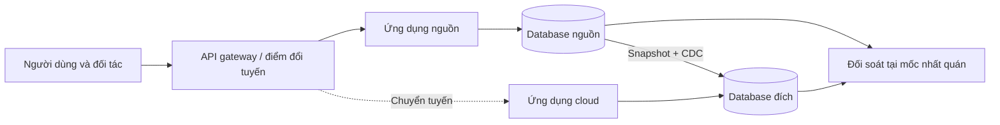

# Thiết kế cutover, đối soát và phương án quay lại

Di chuyển một ứng dụng lên đám mây không kết thúc khi đã tạo đủ máy chủ, dịch vụ mạng và cơ sở dữ liệu ở môi trường mới. Rủi ro lớn nhất thường xuất hiện ở thời điểm chuyển lưu lượng thật: yêu cầu có thể đến cả hai nơi, bản ghi có thể thiếu hoặc được xử lý hai lần, hệ thống bên ngoài vẫn gọi địa chỉ cũ, còn phương án quay lại có thể làm mất dữ liệu phát sinh sau chuyển đổi.

Bài này hướng dẫn thiết kế **cutover** (chuyển vận hành sang hệ thống đích), **reconciliation** (đối soát tính đầy đủ và đúng đắn) và **rollback/failback** (quay lại môi trường trước đó) như một kế hoạch kiến trúc có tiêu chí định lượng, người chịu trách nhiệm và bằng chứng kiểm chứng. Đây là một phần cốt lõi của hiện đại hóa ứng dụng trên cloud: các lựa chọn mạng, compute, dữ liệu và mô hình triển khai phải được đánh giá đồng thời theo độ tin cậy, bảo mật, khả năng mở rộng, chi phí và năng lực vận hành, phù hợp tinh thần Well-Architected.

## 1. Phân biệt ba công việc và xác định mục tiêu

| Khái niệm | Câu hỏi cần trả lời | Kết quả mong đợi |
| --- | --- | --- |
| **Cutover** | Khi nào và bằng cách nào chuyển người dùng, tiến trình nền và tích hợp sang môi trường mới? | Chỉ một đường xử lý ghi có thẩm quyền tại một thời điểm, chuyển lưu lượng có kiểm soát. |
| **Đối soát** | Bằng chứng nào chứng minh dữ liệu và kết quả nghiệp vụ không bị mất, nhân đôi hoặc sai lệch? | Báo cáo so sánh theo cùng mốc nhất quán, danh sách sai lệch và cách xử lý. |
| **Rollback/failback** | Khi chuyển đổi thất bại, quay về trạng thái phục vụ an toàn bằng cách nào? | Runbook khôi phục đã diễn tập, bảo toàn các giao dịch được xác nhận. |
| **Roll-forward** | Nếu quay lại không còn an toàn, sửa lỗi ngay tại môi trường mới ra sao? | Cơ chế khôi phục tiến lên mà vẫn thỏa cam kết dữ liệu và thời gian gián đoạn. |

Ví dụ xuyên suốt: một hệ thống đặt hàng đang chạy tại trung tâm dữ liệu riêng được chuyển lên cloud, sử dụng dịch vụ chạy ứng dụng được quản lý và cơ sở dữ liệu quan hệ được quản lý. Ứng dụng có API, cơ sở dữ liệu đơn hàng, hàng đợi sự kiện và tích hợp thanh toán. Các con số sau đây **chỉ là giả định để minh họa**, không phải ngưỡng áp dụng cho mọi hệ thống:

- Đơn hàng đã xác nhận phải có **RPO = 0**: không chấp nhận mất giao dịch đã báo thành công cho khách hàng.
- **RTO = 30 phút** cho sự cố chuyển đổi: cần đưa chức năng cốt lõi trở lại trong giới hạn đó, bao gồm phát hiện, quyết định, thực thi và xác minh.
- Có cửa sổ bảo trì dự kiến 15 phút, nhưng thời gian thực tế phải được đo và thương lượng với nghiệp vụ.
- Có thể sao chép dữ liệu trước bằng snapshot và cập nhật dần bằng **CDC** (*Change Data Capture*), với điều kiện công cụ hỗ trợ đúng loại thay đổi, thứ tự giao dịch và lược đồ đang sử dụng.

RPO, RTO và thời gian bảo trì là ba ràng buộc khác nhau. Một hệ thống chuyển lại sau 5 phút nhưng đánh rơi 20 đơn hàng đã xác nhận vẫn vi phạm RPO = 0. Ngược lại, giữ toàn bộ dữ liệu mà mất hàng giờ mới phục vụ lại có thể vi phạm RTO.

## 2. Xác định ranh giới chuyển đổi và các bất biến

Trước khi chọn chiến lược, phải xác định **đơn vị chuyển đổi**: toàn ứng dụng, một nhóm khách hàng/tenant, một chức năng, hay chỉ lớp chạy ứng dụng. Di chuyển compute nhưng tiếp tục dùng cùng cơ sở dữ liệu khác về căn bản với di chuyển đồng thời compute và dữ liệu.

Lập sơ đồ đường đi thực tế của một giao dịch, không chỉ sơ đồ triển khai:

| Thành phần | Cần kiểm tra trước cutover | Rủi ro khi bỏ sót |
| --- | --- | --- |
| DNS, CDN, load balancer, API gateway | Điểm đổi tuyến, TTL, kết nối giữ lâu, cơ chế vô hiệu hóa cache và health check | Một phần khách hàng còn gọi hệ thống cũ. |
| API và phiên người dùng | Tương thích hợp đồng API, session/token, khóa idempotency, connection pool | Đăng nhập lỗi, gửi lặp đơn hàng, lỗi kết nối sau đổi tuyến. |
| Cơ sở dữ liệu và object storage | Lược đồ, khóa, phiên bản bản ghi, tệp đính kèm, quyền truy cập, mã hóa | Thiếu dữ liệu, tham chiếu gãy, dữ liệu hai bên phân kỳ. |
| Queue, event bus, batch, scheduler | Consumer group, offset, retry, dead-letter queue, lịch chạy, outbox | Chạy hai lần tác vụ hoặc không xử lý sự kiện. |
| Đối tác và hệ thống phụ thuộc | Webhook, IP allowlist, chứng thư, endpoint callback, timeout | Thanh toán hoặc xác nhận đơn hàng bị treo. |
| Vận hành và bảo mật | IAM, secrets, KMS, giám sát, nhật ký truy cập, backup, trực sự cố | Không quan sát được lỗi hoặc không khôi phục được. |

Các **bất biến kiến trúc** cần chốt thành tiêu chí kiểm thử:

1. **Một nguồn ghi có thẩm quyền:** với mỗi tập dữ liệu tại một thời điểm, chỉ một hệ thống được phép chấp nhận ghi; nếu chia theo tenant thì quy tắc phân vùng phải rõ ràng. Chỉ đổi DNS không đảm bảo điều này.
2. **Không mất kết quả đã xác nhận:** một yêu cầu được trả thành công phải tồn tại ở hệ thống có thẩm quyền và không biến mất sau failback.
3. **Tác dụng phụ không nhân đôi:** thanh toán, gửi thông báo và xuất hóa đơn cần khóa idempotency, trạng thái xử lý và quy tắc retry rõ ràng.
4. **Có bằng chứng tại cùng mốc dữ liệu:** số liệu hai bên chỉ có ý nghĩa khi cùng biểu diễn một tập giao dịch/phiên bản nhất quán.
5. **Có quyền dừng và quyết định:** chỉ huy cutover, người phụ trách dữ liệu, ứng dụng, mạng, bảo mật và đại diện nghiệp vụ biết ai được tuyên bố *GO*, *NO-GO* hoặc *ROLLBACK*.

## 3. Chọn chiến lược cutover theo trạng thái dữ liệu

| Chiến lược | Cách thực hiện | Lợi thế | Điều kiện và đánh đổi |
| --- | --- | --- | --- |
| **Big bang** | Dừng ghi, chuyển dữ liệu cuối, đổi toàn bộ lưu lượng một lần. | Trình tự đơn giản, một thời điểm chuyển rõ ràng. | Cần cửa sổ gián đoạn; quá trình quay lại phải tính đến ghi mới. |
| **Blue/green** | Dựng sẵn hai môi trường ứng dụng và chuyển ingress sang *green*. | Dễ kiểm thử và đảo tuyến phần compute. | Nếu hai môi trường dùng dữ liệu khác nhau, đảo tuyến ứng dụng **không đồng nghĩa** rollback dữ liệu. |
| **Canary** | Chuyển một tỷ lệ nhỏ lưu lượng để đo lỗi trước khi tăng dần. | Giảm phạm vi ảnh hưởng và kiểm chứng chất lượng. | Chỉ an toàn cho luồng ghi khi cùng dùng một nguồn dữ liệu có thẩm quyền hoặc có phân vùng ghi được cô lập. |
| **Strangler theo chức năng/tenant** | Chuyển từng miền nghiệp vụ hay nhóm tenant qua tuyến điều phối. | Giảm kích thước từng đợt; dễ kiểm tra theo phạm vi. | Cần xử lý quan hệ chéo giữa các miền và phiên bản giao diện. |
| **Active/active** | Hai nơi phục vụ đồng thời với cơ chế giải quyết xung đột. | Khả năng sẵn sàng cao nếu thiết kế đúng. | Rất phức tạp về nhất quán, định tuyến và xung đột; không nên mặc định chọn chỉ để tránh downtime. |

Với ví dụ di chuyển cả ứng dụng lẫn database, phương án thực tế thường là **chuẩn bị blue/green cho compute + snapshot/CDC cho dữ liệu + cutover ghi tại một mốc rõ ràng**. Trước mốc đó có thể kiểm thử *green* bằng dữ liệu giả hoặc yêu cầu chỉ đọc; sau khi chuyển quyền ghi mới cân nhắc mở lại lưu lượng thật.



**Điểm dễ nhầm:** hình trên mô tả giai đoạn chuẩn bị. Khi cắt chuyển, hệ thống phải có cơ chế khóa/fence đường ghi cũ và xác nhận đường ghi mới là duy nhất. Nếu vẫn cho cả hai ứng dụng ghi vào hai database riêng biệt, trạng thái sẽ phân kỳ ngay cả khi tốc độ replication rất nhanh.

### Chuẩn bị tương thích trước khi chuyển

- Dùng thay đổi lược đồ theo kiểu **expand–migrate–contract**: thêm trường/bảng tương thích, triển khai mã đọc được cả phiên bản cũ và mới, chuyển dữ liệu, rồi mới loại bỏ cấu trúc cũ sau khi hết cửa sổ rollback.
- Giữ đường ingress ổn định nếu có thể (gateway/load balancer), thay vì phụ thuộc hoàn toàn vào TTL DNS. Kết nối dài, cache DNS của client và webhook đối tác vẫn có thể giữ tuyến cũ.
- Di chuyển secrets và quyền truy cập theo nguyên tắc tối thiểu; kiểm tra chứng thư, kết nối riêng, ACL, mã hóa truyền tải và mã hóa lưu trữ từ trước.
- Xác minh backup có thể **khôi phục thực sự**, không chỉ có trạng thái “backup succeeded”. Đóng băng các thay đổi triển khai không liên quan trong cửa sổ cutover.

## 4. Thiết kế điểm cắt dữ liệu và trình tự thực thi

Một cutover có dữ liệu thay đổi liên tục cần một **mốc logic**. Mốc này có thể là transaction log position/LSN, SCN, binlog offset, checkpoint hoặc watermark tương đương tùy công nghệ. Cần biết chắc *giao dịch nào đã commit ở nguồn* và *đã được áp dụng đầy đủ ở đích*. Thời gian đồng hồ của hai máy chủ không đủ để chứng minh điều đó.

### Trước giờ chuyển

1. Khởi tạo đích từ snapshot nhất quán; xác nhận cách CDC bắt đầu tại snapshot đó để không có khoảng trống giao dịch.
2. Tải dữ liệu lịch sử, tệp đính kèm, tham chiếu và cấu hình cần thiết; thực hiện đối soát sơ bộ theo phân vùng.
3. Theo dõi CDC lag, lỗi apply, dung lượng log, tốc độ sao chép, nợ hàng đợi và rủi ro DDL. Không suy ra “đã đồng bộ” chỉ từ việc tiến trình replication đang chạy.
4. Thử *dry run* với lượng dữ liệu đại diện, tải gần thật và bài kiểm thử nghiệp vụ; đo thời gian từng bước và diễn tập đường quay lại.
5. Ghi một bản runbook có người thực hiện, lệnh hoặc thao tác đã được duyệt, kết quả mong đợi, tín hiệu dừng và cách xử lý khi bước đó thất bại.

### Tại mốc cutover

1. **Dừng tiếp nhận ghi mới ở nguồn** bằng chế độ bảo trì, gateway policy hoặc cơ chế fencing đủ mạnh. Đưa các giao dịch đang chạy đến trạng thái kết thúc có kiểm soát; không cắt giữa lúc đã thu tiền nhưng chưa lưu đơn hàng.
2. **Kiểm soát xử lý bất đồng bộ:** tạm dừng producer/consumer hoặc bảo đảm chúng chỉ chạy ở một phía; ghi nhận offset, sự kiện đang xử lý, DLQ và các tác vụ lịch. Không khởi động đồng thời cron của hai môi trường.
3. **Chốt mốc `W`:** sau khi các giao dịch nguồn còn tồn đọng được commit/hủy, ghi nhận vị trí log bền vững. Đợi CDC ở đích áp dụng xong **đến ít nhất `W`** và xác minh không có lỗi apply hoặc transaction treo.
4. **Đối soát tại `W`:** kiểm tra các dữ liệu trọng yếu theo cùng phiên bản nhất quán; sai lệch ở dữ liệu tài chính hoặc đơn đã xác nhận là điều kiện *NO-GO*.
5. **Chuyển quyền ghi và định tuyến:** vô hiệu hóa dứt khoát ghi ở nguồn, cập nhật gateway/route, kích hoạt dịch vụ đích, scheduler/consumer đích và bảo đảm mọi đường vào cũ không còn nhận ghi. Nếu dùng DNS, xét đến client vẫn giữ địa chỉ cũ.
6. **Smoke test có kiểm soát:** xác nhận đăng nhập, đọc đơn, tạo đơn thử ở môi trường thích hợp, xử lý event và truy vấn theo khóa; kiểm tra cả response lẫn trạng thái lưu trữ/tác dụng phụ.
7. **Mở lưu lượng theo kế hoạch, theo dõi và ghi bằng chứng.** Nếu cần tăng dần lưu lượng, phải giữ bất biến single-writer ở từng giai đoạn; chỉ chuyển tỷ lệ request không tự làm cho database an toàn.

Đối với ứng dụng không thể tạm dừng ghi, phải thiết kế và chứng minh một giao thức chuyển quyền ghi khác (chẳng hạn chuyển theo tenant độc lập, dùng shared database hoặc hàng đợi bền vững làm điểm nhận lệnh duy nhất). **Dual-write tự phát** từ ứng dụng đến hai database không đảm bảo nguyên tử: một bên thành công, bên còn lại lỗi, retry có thể tạo trùng hoặc thứ tự khác nhau.

## 5. Đối soát: kiểm tra đúng dữ liệu và đúng kết quả nghiệp vụ

Đối soát không phải thao tác “hai bên đều có khoảng hai triệu bản ghi”. Cần thiết kế câu trả lời cho từng loại bất thường: thiếu, dư, trùng, sai nội dung, sai quan hệ, xử lý lệch hoặc tác dụng phụ lặp.

### 5.1. Chốt tập dữ liệu có thể so sánh

Để so sánh có ý nghĩa, chọn cùng một tập khóa nghiệp vụ và cùng mốc `W`:

- Nếu nguồn đã tạm dừng ghi, có thể dùng snapshot đọc nhất quán ở nguồn và trạng thái đích đã áp dụng đến `W`.
- Nếu tiếp tục nhận ghi, cần khả năng tái tạo trạng thái tại cùng log offset/phiên bản hoặc đối soát trên tập giao dịch có watermark ổn định; so sánh hai bảng “live” ở hai thời điểm khác nhau sẽ gây *false positive*.
- Với dữ liệu phân vùng/tenant, ghi rõ tập khóa, thời điểm, schema version, filter, bản ghi xóa (*tombstone*) và quy tắc chuyển đổi dữ liệu. Không loại bỏ sai lệch bằng cách tùy tiện bỏ qua cột.

### 5.2. Nhiều tầng đối soát

| Tầng | Kiểm tra mẫu | Mức chấp nhận minh họa |
| --- | --- | --- |
| **Cấu trúc** | Bảng, index, ràng buộc, kiểu dữ liệu, timezone, encoding, khóa ngoại, quyền | Mọi khác biệt ảnh hưởng nghiệp vụ phải được xử lý trước *GO*. |
| **Bao phủ dữ liệu** | Tập khóa chính/khóa nghiệp vụ, số bản ghi theo tenant/ngày/trạng thái, bản ghi bị xóa | Không thiếu hoặc dư đơn hàng đã xác nhận tại `W`. |
| **Nội dung** | So sánh hash chuẩn hóa của bản ghi hoặc so sánh trường trọng yếu theo khóa | Sai lệch trường tiền, chủ sở hữu, trạng thái đơn: 0. |
| **Tổng hợp nghiệp vụ** | Số đơn đã thanh toán, tổng tiền theo đơn vị nhỏ nhất, tổng hoàn tiền, cân đối sổ cái | Chênh lệch tài chính: 0. |
| **Quan hệ và tác dụng phụ** | Đơn ↔ thanh toán ↔ hóa đơn, tệp đính kèm, event đã phát, xử lý idempotency | Không có xác nhận thanh toán không gắn với đơn hợp lệ. |
| **Bất đồng bộ** | Consumer offsets, outbox, retry, DLQ, giao dịch đang chờ | Phân biệt chờ hợp lệ với thất lạc; mọi tồn đọng có chủ và hạn xử lý. |

Ví dụ truy vấn tổng hợp chạy **trên hai bản dữ liệu đã được đóng tại cùng mốc** (cú pháp SQL điều chỉnh theo engine):

```sql
SELECT tenant_id,
       status,
       COUNT(*) AS order_count,
       SUM(total_minor_units) AS total_amount_minor
FROM orders
GROUP BY tenant_id, status
ORDER BY tenant_id, status;
```

So sánh cả `order_count` và `total_amount_minor` theo từng nhóm. Dùng số nguyên theo đơn vị tiền nhỏ nhất hoặc kiểu số thập phân chính xác; tránh sai số `FLOAT` khi đối soát tiền. Tuy vậy, hai tổng bằng nhau **không chứng minh** từng đơn đều đúng: một đơn thiếu và một đơn dư có thể triệt tiêu nhau. Do đó cần so tập khóa, so trường quan trọng và kiểm tra chi tiết mọi nhóm bất thường.

Với tập dữ liệu lớn, có thể so sánh theo phân vùng ổn định (tenant, khoảng ID, ngày nghiệp vụ), tính hash của **biểu diễn đã chuẩn hóa theo thứ tự xác định**, rồi truy xuống phân vùng lệch để so từng khóa. Việc chuẩn hóa phải xử lý định dạng timestamp, `NULL`, số thập phân, encoding và thứ tự trường. Đối soát full scan gây tải đọc và chi phí I/O; hãy đo trước, dùng bản sao/snapshot phù hợp và lập lịch tránh ảnh hưởng production.

### 5.3. Đối soát liên tục sau cutover

Sau `W`, hệ thống đích bắt đầu có giao dịch mới nên trạng thái của nguồn không còn là ảnh phản chiếu đúng theo mặc định. Các báo cáo sau cutover cần có mốc và nguồn sự thật rõ ràng:

- **Ngay trước GO:** xác minh tập lịch sử đến `W`, đặc biệt đơn đã xác nhận và số dư.
- **Ngay sau mở lưu lượng:** đối chiếu yêu cầu đã nhận với kết quả ở database, outbox, thanh toán, hóa đơn và DLQ theo correlation ID; kiểm tra có yêu cầu đi vào tuyến cũ không.
- **Sau giai đoạn ổn định:** đối soát ngày nghiệp vụ, kiểm tra những job trễ, retry, webhook và báo cáo cuối ngày; lưu mã lần chạy, watermark, số lượng, sai lệch, bằng chứng xử lý và người xác nhận.

Đặt ngưỡng theo **mức độ nghiêm trọng của dữ liệu**, không áp một ngưỡng phần trăm chung. Ví dụ, dữ liệu báo cáo phân tích trễ vài phút có thể chấp nhận theo SLA, nhưng một đơn hàng đã thông báo thành công mà không còn tồn tại là lỗi chặn chuyển đổi. Tránh ghi dữ liệu nhạy cảm nguyên văn vào log đối soát; nên dùng ID được phân quyền, che/mã hóa trường nhạy cảm và quản lý thời hạn lưu bằng chứng.

## 6. Thiết kế rollback trước khi nhấn GO

Rollback là một **đường chuyển trạng thái dữ liệu có điều kiện**. Khả năng chuyển gateway từ cloud về on-prem chỉ chứng minh được đảo tuyến mạng; nó chưa chứng minh có thể giữ lại đơn hàng được tạo sau cutover.

### 6.1. Phân loại thời điểm và đường quay lại

| Trạng thái | Hệ thống đang có dữ liệu nào? | Phương án an toàn |
| --- | --- | --- |
| **A. Chưa mở ghi tại đích** | Nguồn còn là nơi có thẩm quyền; đích đã đồng bộ đến `W`. | Giữ/khôi phục tuyến nguồn, mở lại ghi nguồn sau khi xác nhận đường mới đã bị khóa. Đây là cửa sổ rollback đơn giản nhất. |
| **B. Đích đã nhận ghi mới, có reverse replication được chứng minh** | Đích chứa các giao dịch phát sinh sau `W`. | Dừng/fence ghi đích, đồng bộ **ngược** các thay đổi hợp lệ về nguồn đến mốc mới `W2`, đối soát, rồi mới chuyển quyền ghi về nguồn. |
| **C. Đích đã nhận ghi mới nhưng không có đường đồng bộ ngược an toàn** | Nguồn đã lạc hậu; quay thẳng về sẽ mất hoặc ghi đè giao dịch mới. | Không đảo tuyến ghi một cách mù quáng. Cần sửa tiến lên (*roll-forward*), khôi phục dịch vụ có kiểm soát hoặc dùng quy trình phục hồi dữ liệu chuyên biệt đã được đánh giá với nghiệp vụ. |

**Point of no return** cần được định nghĩa bằng khả năng bảo toàn dữ liệu thực tế, không chỉ bằng thời gian. Nếu không có reverse replication và RPO = 0, thời điểm đích xác nhận giao dịch mới đầu tiên là lúc rollback đơn giản về nguồn không còn hợp lệ. Việc khôi phục snapshot cũ ở nguồn sẽ loại bỏ các giao dịch mới đó nếu không có cơ chế phát lại và kiểm chứng.

### 6.2. Trigger và runbook rollback

Ngưỡng bên dưới là ví dụ để diễn tập; khi áp dụng phải điều chỉnh theo SLO, traffic baseline và giới hạn được chấp thuận:

- *NO-GO trước chuyển:* replication chưa bắt kịp `W`, checksum/tập khóa trọng yếu lệch, không thể khóa ghi nguồn, bài smoke test chính thất bại, hoặc không còn đủ thời gian để quay lại trong cửa sổ đã duyệt.
- *Cân nhắc ROLLBACK sau chuyển:* lỗi 5xx vượt 2% liên tục 5 phút **với lưu lượng mẫu đủ lớn**, luồng xác nhận đơn/thanh toán lỗi ở mức nghiêm trọng, hoặc không bảo toàn invariant single-writer. Đừng đợi đủ 5 phút nếu đã phát hiện mất/nhân đôi giao dịch xác nhận.
- *Quyết định ROLL-FORWARD:* sau khi có ghi mới, đường đồng bộ ngược chưa được diễn tập hoặc không thể hoàn thành trong RTO/RPO; tổ điều hành chọn phương án phục hồi có nguy cơ mất dữ liệu thấp hơn và báo rõ tình trạng dịch vụ.

Runbook rollback khi vẫn còn điều kiện an toàn:

1. Chỉ huy sự cố tuyên bố quyết định và ghi mốc thời gian; tạm khóa nhận ghi ở phía đang hoạt động.
2. Xác nhận không còn request, worker, cron hoặc webhook có thể ghi vào nơi sắp mất quyền. Dùng fencing/version hoặc quyền ghi ở lớp dữ liệu nếu cần; đừng chỉ dựa vào thay đổi cấu hình frontend.
3. Ghi nhận các giao dịch đã xác nhận, offset và trạng thái tác vụ phụ; nếu cần quay về nguồn sau khi đích đã ghi, đồng bộ ngược toàn bộ phạm vi phát sinh và xác minh thứ tự/tính toàn vẹn.
4. Chạy đối soát tại mốc quay lại, xác nhận RPO và phụ thuộc ngoài (thanh toán, message broker, hệ thống đối tác).
5. Chuyển tuyến, mở **duy nhất** một bên nhận ghi, thực hiện smoke test, theo dõi và thông báo tình trạng cho người liên quan.
6. Giữ nguyên hiện trường log/metric và bằng chứng để điều tra; lập kế hoạch thử cutover lại sau khi nguyên nhân được xử lý.

Đo thời gian rollback bằng tổng **phát hiện + phân loại + ra quyết định + đồng bộ/đổi tuyến + xác minh**. Một thao tác bấm nút 30 giây không có nghĩa toàn quy trình đáp ứng RTO 30 phút.

## 7. Runbook mẫu và tiêu chí quyết định

| Thời điểm tham khảo | Chủ trì | Thao tác và bằng chứng cần lưu | Cổng quyết định |
| --- | --- | --- | --- |
| **T−7 ngày** | Kiến trúc sư, SRE, DBA, nghiệp vụ | Diễn tập full flow, restore backup, đo throughput CDC và thời gian rollback; xử lý lỗi nghiêm trọng. | Chỉ chốt lịch khi rehearsal đáp ứng RTO/RPO. |
| **T−24 giờ** | Release lead, bảo mật | Khóa phạm vi thay đổi, kiểm tra IAM/secrets/cert, thông báo đối tác, xác nhận trực chiến và kênh liên lạc. | Không còn blocker chưa có chủ xử lý. |
| **T−60 phút** | SRE, DBA | Snapshot/checkpoint, CDC health, replication lag, queue depth, baseline lỗi/latency, dung lượng và trạng thái đích. | Có quyền tiến vào cửa sổ bảo trì. |
| **T0** | Incident commander/cutover lead | Chặn ghi nguồn, drain xử lý, ghi `W`, đợi CDC áp dụng xong, chạy đối soát. | **GO/NO-GO** dựa trên dữ liệu và an toàn ghi. |
| **T+ vài phút** | Network/app lead | Đổi tuyến, mở ghi đích, chạy smoke test và kiểm tra tuyến cũ không còn nhận ghi. | Mở tiếp lưu lượng hoặc dừng/khôi phục. |
| **T+15 đến 60 phút** | SRE, DBA, chủ nghiệp vụ | Đọc SLI, xác nhận đơn/thanh toán, event và DLQ, đối soát sau chuyển; cập nhật quyết định. | Tiếp tục quan sát, rollback có điều kiện hoặc roll-forward. |
| **T+24 giờ và sau chu kỳ nghiệp vụ** | Chủ hệ thống, dữ liệu | Đối soát báo cáo, batch/webhook trễ, xác nhận trách nhiệm vận hành, giữ nguồn trong thời hạn đã duyệt. | Chỉ decommission nguồn sau khi đạt các gate và hết thời hạn quay lại. |

Một phiếu *GO/NO-GO* nên ghi: mã phiên cutover, phiên bản triển khai/IaC, mốc `W`, tập dữ liệu kiểm, kết quả kiểm tra, số liệu lag, điểm khôi phục, tiêu chí SLO, danh sách người trực và chữ ký/chấp thuận của người có quyền. Khi bước vận hành bị trễ, cập nhật thời gian còn lại để đảm bảo vẫn có thể dừng hoặc khôi phục trong giới hạn.

## 8. Ví dụ quyết định đối soát và rollback

Giả sử tại `W` nguồn có **2.000.000 đơn hàng**, trong đó tập đơn đã xác nhận có tổng giá trị đúng bằng tập báo cáo tài chính. Đích chỉ có **1.999.998 đơn** vì hai bản ghi chưa được CDC áp dụng. Dù chênh lệch chỉ `0,0001%`, kết quả vẫn là **NO-GO** nếu hai bản ghi thuộc tập đơn đã xác nhận. Nhóm dữ liệu phải xác định log position và nguyên nhân, áp dụng đủ thay đổi rồi chạy lại kiểm tra khóa, trạng thái và tiền trước khi mở ghi ở đích.

Sau khi chuyển thành công, giả sử cloud tiếp nhận **300 đơn mới**. Nguồn on-prem không tự có 300 đơn này. Nếu một sự cố compute xuất hiện và đội vận hành chỉ trỏ gateway về on-prem, khách hàng có thể thấy 300 đơn đã xác nhận biến mất. Để thỏa RPO = 0, hoặc phải có cơ chế đồng bộ ngược được kiểm chứng cùng bảo vệ khỏi ghi đồng thời, hoặc giữ nguồn không nhận ghi và xử lý lỗi tại cloud theo phương án roll-forward.

Ví dụ này cho thấy hai quyết định tách biệt: **GO** chứng minh dữ liệu lịch sử đã chuyển đúng tại `W`; **ROLLBACK** sau `W` phải chứng minh cả dữ liệu mới cũng được giữ nguyên.

## 9. Đánh giá theo các trụ cột Well-Architected

| Trụ cột | Câu hỏi đánh giá kiến trúc cutover | Thực hành cần có |
| --- | --- | --- |
| **Reliability** | Khi CDC lỗi hoặc traffic còn gọi nguồn, có mất giao dịch hay split-brain không? | Single-writer/fencing, RPO/RTO, backup restore, diễn tập rollback và khả năng roll-forward. |
| **Security** | Quyền, secrets, dữ liệu nhạy cảm và đường kết nối có đổi an toàn không? | Least privilege, mã hóa, audit trail, thu hồi quyền tạm sau chuyển, bảo vệ báo cáo đối soát. |
| **Performance efficiency** | Đích chịu được tải thật và backlog phát sinh khi mở traffic không? | Load test, capacity headroom, latency p95/p99, giới hạn kết nối, kiểm soát retry storm. |
| **Cost optimization** | Bao lâu phải chạy song song hai môi trường, CDC và bản sao dữ liệu? | Dự toán chi phí giai đoạn song song, ngân sách egress/log/I/O, mốc decommission rõ ràng. |
| **Operational excellence** | Ai bấm GO, ai quan sát, ai có quyền dừng, bằng chứng nằm ở đâu? | Runbook phiên bản hóa, dashboard và alert, diễn tập, nhật ký quyết định và postmortem. |
| **Sustainability** | Giai đoạn hai môi trường tồn tại kéo dài có cần thiết không? | Dọn tài nguyên tạm có kiểm soát sau khi đủ điều kiện và hết cửa sổ khôi phục. |

Không tối ưu một trụ cột bằng cách bỏ qua các trụ cột khác: rút ngắn thời gian chạy song song có thể giảm chi phí nhưng làm mất khả năng đối soát hoặc phục hồi; bật CDC và log toàn phần quá lâu lại gây chi phí và tải tài nguyên. Quyết định nên dựa trên mục tiêu nghiệp vụ, thử nghiệm thực tế và rủi ro có chủ sở hữu.

## 10. Bài thực hành thiết kế

Một ứng dụng quản lý đăng ký có 500.000 tài khoản, bảng giao dịch thanh toán, job gửi email và webhook đối tác. Do yêu cầu bảo trì, nghiệp vụ cho phép gián đoạn tối đa 10 phút; các giao dịch thanh toán đã xác nhận phải có RPO = 0. Nhóm kỹ thuật đề xuất chạy hai cụm ứng dụng và hai database, dùng DNS để chuyển 10% lưu lượng sang cloud rồi tăng dần lên 100%.

Hãy chuẩn bị một bản thiết kế gồm:

1. Vẽ các đường ghi, đường đọc, hàng đợi và webhook; chỉ ra vì sao chia 10% traffic giữa **hai database ghi riêng** có nguy cơ phân kỳ.
2. Chọn phương pháp chuyển quyền ghi, cách tạo/chốt watermark `W`, và phương án xử lý những request đến địa chỉ cũ.
3. Đề xuất ba cổng *GO/NO-GO* có thể đo được, trong đó đối soát giao dịch thanh toán phải kiểm tra cả khóa và giá trị, không chỉ tổng số dòng.
4. Viết hai đường xử lý sự cố: một trường hợp chưa có ghi mới ở cloud; một trường hợp đã có 100 giao dịch được xác nhận ở cloud nhưng chưa có reverse replication.
5. Tính ngân sách thời gian cho phát hiện, quyết định, đổi tuyến và xác minh; kiểm tra xem phương án có thực sự đáp ứng 10 phút hay không.

**Tiêu chí hoàn thành:** thiết kế phải chỉ ra *ai* có quyền quyết định, *điều kiện nào* cho phép chuyển hoặc quay lại, *bằng chứng dữ liệu nào* xác nhận đúng đắn, và *làm thế nào* giữ nguyên giao dịch đã cam kết kể cả khi phương án ban đầu thất bại.
