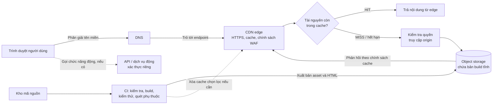
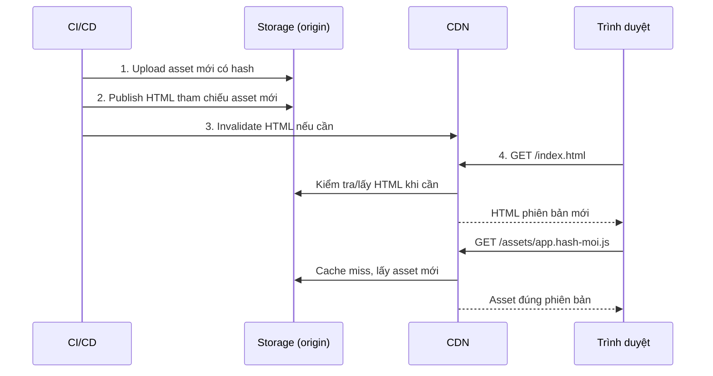

# Website tĩnh và nội dung phân phối qua CDN

> **Module:** CLOUD_ARCHITECTURE — Thiết kế kiến trúc ứng dụng trên đám mây từ yêu cầu nghiệp vụ đến lựa chọn mạng, compute, dữ liệu và mô hình triển khai.  
> **Chương:** Mẫu kiến trúc tham chiếu.  
> **Trọng tâm bài học:** Thiết kế, triển khai và đánh giá website tĩnh có CDN theo các đánh đổi về độ tin cậy, bảo mật, hiệu năng, khả năng mở rộng, chi phí và vận hành.

## 1. Bài toán và kết quả cần đạt

Một tổ chức cần vận hành website giới thiệu sản phẩm, trang tài liệu, landing page hoặc phần giao diện của ứng dụng web. Người truy cập ở nhiều khu vực địa lý; tải trang phải nhanh, chịu được lưu lượng tăng đột biến và việc cập nhật nội dung phải có thể kiểm soát. Phần lớn nội dung được tạo trước khi người dùng gửi yêu cầu, vì vậy không cần máy chủ ứng dụng tạo HTML cho từng lượt xem.

**Website tĩnh** gồm các tệp HTML, CSS, JavaScript, hình ảnh, font và các tài nguyên khác được tạo trước rồi phân phối qua HTTP(S). “Tĩnh” mô tả **cách cung cấp tài nguyên**, không nhất thiết mô tả trải nghiệm: JavaScript phía trình duyệt vẫn có thể gọi API, đăng nhập hoặc tương tác thời gian thực. Các chức năng đó có thêm dịch vụ động, với mô hình dữ liệu và bảo mật riêng.

**Content Delivery Network (CDN)** là mạng điểm hiện diện phân tán (*point of presence*, PoP/edge), có thể lưu bản sao tài nguyên gần người dùng. Khi tài nguyên có trong cache hợp lệ, edge trả trực tiếp; khi thiếu hoặc hết hạn, CDN lấy từ **origin** theo chính sách đã cấu hình.

Sau bài này, người học có thể:

1. Quyết định khi nào nên dùng kiến trúc website tĩnh + CDN và khi nào cần thành phần động.
2. Vẽ luồng phân phối từ DNS, TLS, CDN đến nơi lưu tệp gốc.
3. Thiết kế cache, phân phối phiên bản mới và rollback mà không làm vỡ trang đang mở.
4. Bảo vệ origin, tên miền và các tài nguyên công khai; phân biệt bảo mật CDN với bảo mật API.
5. Đề xuất đo lường, ứng phó sự cố và đánh giá kiến trúc theo các trụ cột Well-Architected.

## 2. Kiến trúc tham chiếu



Trong sơ đồ:

| Thành phần | Trách nhiệm chính | Quyết định kiến trúc |
|---|---|---|
| DNS | Ánh xạ tên miền tới endpoint phân phối | Quyền quản trị zone, bản ghi phù hợp, TTL DNS và phương án xử lý sự cố |
| Chứng chỉ TLS và HTTPS | Mã hóa kết nối trình duyệt tới điểm nhận yêu cầu | Cấp mới, gia hạn, tên miền hợp lệ và chuyển hướng HTTP sang HTTPS |
| CDN | Trả cache tại edge, kết nối origin khi cần, hỗ trợ chính sách truy cập | Cache key, TTL, xử lý lỗi, nén, logging, vùng phủ và giá egress |
| WAF / chống bot (tùy rủi ro) | Lọc các yêu cầu bất thường trước khi tới origin/API | Luật chặn, rate limit, giám sát false positive; WAF không thay thế xác thực |
| Object storage | Lưu bản build đã kiểm soát phiên bản | Quyền đọc origin, versioning, mã hóa, cách phát hành và phục hồi |
| CI/CD | Tạo và phân phối artifact có thể tái lập | Chất lượng build, thứ tự phát hành, secret, kiểm thử và rollback |
| API / identity provider (nếu có) | Xử lý dữ liệu, đăng nhập hoặc thao tác nghiệp vụ | Phân tách cache và phân quyền dữ liệu cá nhân |

**Ranh giới tin cậy quan trọng:** trình duyệt là môi trường không đáng tin cậy; nội dung đã phát hành qua CDN có thể được xem hoặc sao chép. Không nhúng khóa bí mật, mật khẩu, token máy chủ hay dữ liệu riêng tư vào JavaScript, HTML hoặc source map công khai.

### 2.1. Luồng đọc tài nguyên

1. Trình duyệt phân giải `www.example.com` thành endpoint CDN và thực hiện bắt tay TLS.
2. CDN áp chính sách bảo vệ, chuẩn hóa yêu cầu và xác định **cache key** (thường gồm host, path cùng một tập query/header cho phép).
3. Với **cache hit**, CDN trả tài nguyên từ edge; thời gian đến origin được loại bỏ khỏi lượt yêu cầu này.
4. Với **cache miss** hoặc cần kiểm tra tính mới, CDN lấy tài nguyên từ origin; phản hồi có thể được lưu lại theo chỉ dẫn cache và chính sách CDN.
5. Trình duyệt áp dụng cache phía client, tải các asset phụ và chỉ gọi API nếu trang có chức năng động.

Cache hit là điều kiện giúp giảm tải và độ trễ; nó **không được bảo đảm** cho mọi yêu cầu. Edge mới, tài nguyên ít được truy cập, phiên bản vừa triển khai hoặc nội dung bị loại khỏi cache đều có thể tạo cache miss.

### 2.2. Luồng cập nhật nội dung

Từ thay đổi mã nguồn, pipeline chạy kiểm thử, tạo bản build, tải tài nguyên mới lên storage, công bố điểm vào HTML và sau đó cập nhật cache HTML nếu cần. Các file có tên gắn mã băm được dùng để nhiều phiên bản HTML cùng tham chiếu an toàn đến bộ asset tương ứng.

Ví dụ cấu trúc build:

```text
site/
├── index.html
├── docs/index.html
├── assets/app.4f82c1.js
├── assets/main.90ac2e.css
├── assets/logo.122ad4.svg
└── robots.txt
```

## 3. Khi nào phù hợp, khi nào cần kiến trúc khác?

| Nhu cầu | Đánh giá | Gợi ý |
|---|---|---|
| Trang giới thiệu, tài liệu, blog được build trước | Rất phù hợp | Object storage + CDN + build tự động |
| Ứng dụng SPA có API dữ liệu | Phù hợp cho lớp giao diện | CDN cấp file tĩnh; API và cơ chế xác thực chạy riêng |
| Website cần SEO, nội dung cá nhân hóa theo từng request | Cần xem xét | Static Site Generation nếu nội dung xuất bản trước; SSR/edge rendering cho phần buộc phải tạo động |
| Nội dung nhạy cảm, mỗi người có quyền xem khác nhau | Không thể chỉ dựa vào URL công khai | Dùng xác thực/ủy quyền ở lớp phân phối hoặc backend; cấu hình cache theo danh tính hoặc bỏ cache chia sẻ |
| Lưu lượng toàn cầu hoặc có spike trong chiến dịch | Đặc biệt có ích | Kiểm tra khả năng mở rộng của origin khi cache miss, cấu hình bảo vệ và chi phí phân phối |
| Website rất ít truy cập, chỉ dùng nội bộ | Có thể vẫn phù hợp | So sánh lợi ích CDN với độ phức tạp, chi phí tối thiểu và yêu cầu truy cập riêng |

Một landing page có biểu mẫu liên hệ vẫn có thể là website tĩnh nếu biểu mẫu gửi tới dịch vụ API được bảo vệ. Một trang hiển thị số dư tài khoản không trở thành “tĩnh” chỉ vì HTML ban đầu giống nhau: nội dung số dư là dữ liệu riêng tư, phải do thành phần động trả về và không được cache công khai.

## 4. Thiết kế cache và tính nhất quán khi phát hành

Cache là quyết định kiến trúc quan trọng nhất của mẫu này. Cần phân biệt:

- **Browser cache:** bản sao trên thiết bị người dùng, chịu ảnh hưởng của `Cache-Control` và trạng thái cache của trình duyệt.
- **CDN/shared cache:** bản sao dùng chung tại edge; có thể tuân theo `s-maxage`, chính sách CDN hoặc yêu cầu kiểm tra lại với origin.
- **Origin:** nguồn được phát hành có kiểm soát; là điểm lấy lại nội dung khi cache không đủ.

### 4.1. Chính sách tiêu biểu

| Loại tài nguyên | Ví dụ header HTTP | Lý do |
|---|---|---|
| Asset có tên chứa content hash | `Cache-Control: public, max-age=31536000, immutable` | Nội dung tại URL đó không thay đổi; tận dụng cache trình duyệt và CDN lâu dài |
| HTML điểm vào | `Cache-Control: public, max-age=0, s-maxage=60, stale-while-revalidate=300` | Trình duyệt kiểm tra lại; shared cache có thể giữ ngắn và phục vụ bản cũ tạm thời khi làm mới, nếu CDN hỗ trợ |
| Tệp cấu hình công khai thường thay đổi | `Cache-Control: public, max-age=300` | Giảm yêu cầu lặp nhưng cập nhật tương đối nhanh |
| Phản hồi chứa thông tin cá nhân | `Cache-Control: private, no-store` (tùy yêu cầu bảo mật) | Không lưu vào shared cache; `no-store` yêu cầu cache không lưu phản hồi |

Các TTL là **giá trị minh họa**; phải chọn dựa trên yêu cầu cập nhật thực tế. Không đặt `immutable` cho `index.html` nếu URL của HTML không đổi. `s-maxage` áp dụng cho cache chia sẻ; cơ chế `stale-while-revalidate` chỉ hữu ích khi lớp cache thực sự hỗ trợ và cho phép phản hồi cũ trong khoảng đã định.

Nếu origin cung cấp `ETag` hoặc `Last-Modified`, CDN hoặc trình duyệt có thể thực hiện yêu cầu điều kiện và nhận `304 Not Modified`. `304` tiết kiệm băng thông truyền nội dung, nhưng vẫn cần một lượt xác thực với phía nguồn ở tầng liên quan.

### 4.2. Cache key: lưu cái gì, theo yếu tố nào?

CDN cần dùng một khóa xác định biến thể phản hồi. Với tệp có nội dung giống hệt cho mọi người, thường chỉ cần host và path; với ảnh theo kích thước, ngôn ngữ hoặc định dạng, có thể cần một tập query/header được kiểm soát.

Ví dụ:

- `/assets/logo.svg?utm_source=email`: tham số theo dõi thường **không** làm thay đổi nội dung, nên không nên tạo nhiều bản cache khác nhau.
- `/image?id=42&width=640`: tham số `width` có thể làm thay đổi ảnh, nên phải nằm trong cache key nếu CDN dùng nó để chọn biến thể.
- Phản hồi phụ thuộc vào cookie đăng nhập hoặc `Authorization`: không được đưa vào cache công khai mặc định. Cần chiến lược tách origin, tách endpoint hoặc vô hiệu hóa shared cache.

Bẫy thường gặp là **cache poisoning**: CDN lưu phản hồi bị ảnh hưởng bởi input nhưng input đó lại không nằm trong cache key. Cần đồng nhất logic của CDN, origin, header `Vary` và cách chuẩn hóa query; chỉ cho phép các biến thể thật sự cần thiết.

### 4.3. Quy trình phát hành không làm vỡ phiên bản cũ



**Vì sao upload asset trước HTML?** Nếu HTML mới xuất hiện trước mà JS/CSS mới chưa có, người dùng nhận lỗi 404. **Vì sao không xóa ngay asset cũ?** Người dùng còn giữ HTML cũ trong tab hoặc cache và vẫn cần file cũ. Để rollback, có thể phát hành lại HTML của phiên bản trước nếu những asset tương ứng vẫn tồn tại.

Cần lưu ý:

- Invalidation chỉ tác động đến cache của CDN được chỉ định; không bảo đảm xóa ngay cache trình duyệt, service worker hoặc mọi proxy.
- Nếu dùng service worker/PWA, phải kiểm soát riêng vòng đời cache và cơ chế cập nhật ứng dụng.
- CDN có thể cache lỗi 404/5xx theo chính sách. Nên kiểm tra **negative caching** để tránh kéo dài lỗi sau khi đã khắc phục.
- Với nhiều tệp HTML liên quan nhau, cân nhắc chiến lược phiên bản hóa release và kiểm thử trang trọng yếu sau khi publish.

## 5. Định tuyến, SEO và tối ưu tải trang

Có hai kiểu cần phân biệt:

1. **Website tĩnh nhiều trang (MPA/SSG):** origin có `/docs/index.html`, `/pricing/index.html`, v.v. Server hoặc CDN ánh xạ URL tới đúng file.
2. **Single Page Application (SPA):** thường chỉ có `index.html`; việc điều hướng `/dashboard` được router JavaScript xử lý sau khi HTML được trả về.

Với SPA, truy cập trực tiếp `/dashboard` có thể dẫn tới 404 ở origin. Giải pháp là cấu hình **fallback tới `/index.html` cho đường dẫn điều hướng của ứng dụng**. Không được fallback tất cả đường dẫn một cách mù quáng: `/assets/app.js` không tồn tại phải trả lỗi đúng thay vì HTML mã 200, nếu không trình duyệt báo lỗi MIME và việc giám sát trở nên sai lệch.

Đối với SEO và chia sẻ liên kết, trang cần metadata thích hợp, sitemap, canonical URL khi cần, và đảm bảo nội dung cần lập chỉ mục hiển thị theo chiến lược render đã chọn. Một SPA phụ thuộc hoàn toàn vào dữ liệu tải sau có thể gặp giới hạn ở các trình thu thập; SSG hoặc SSR phù hợp hơn khi cần HTML đầy đủ từ phản hồi đầu tiên.

Các tối ưu thường có giá trị:

- Tối ưu kích thước ảnh và chọn định dạng phù hợp, dùng `srcset` và lazy loading cho ảnh ngoài màn hình.
- Nén Brotli/Gzip cho tài nguyên dạng text; đảm bảo cache xử lý đúng biến thể `Accept-Encoding`.
- Chia nhỏ bundle JavaScript, chỉ tải mã cần thiết, giảm script bên thứ ba.
- Đặt font, CSS thiết yếu và tài nguyên đầu trang hợp lý; tránh preload quá nhiều.
- Dùng HTTP/2 hoặc HTTP/3 nếu dịch vụ CDN hỗ trợ; đo hiệu quả thực tế trên mạng di động và từng khu vực.

**CDN không tự làm website nhanh** nếu ảnh quá lớn, JavaScript chặn render hoặc API động chậm. Cần đo cả hiệu năng mạng và trải nghiệm người dùng.

## 6. Thiết kế bảo mật theo lớp

### 6.1. Bảo vệ origin

Mẫu triển khai thường ưu tiên một **bucket/container origin riêng tư**, với CDN là thực thể duy nhất được phép đọc bản build qua cơ chế truy cập origin do nhà cung cấp hỗ trợ (ví dụ signed origin request, identity hoặc kết nối riêng). Khi dịch vụ hoặc loại origin không hỗ trợ cách này, phải thiết kế phương án kiểm soát truy cập phù hợp và nhận diện rủi ro truy cập trực tiếp.

Các kiểm soát nên có:

- Bật mã hóa lưu trữ và HTTPS giữa CDN với origin nếu có kết nối HTTPS.
- Quyền ghi dành cho tài khoản CI/CD với phạm vi nhỏ nhất; môi trường staging không dùng chung quyền sản xuất.
- Hạn chế việc truy cập bypass CDN vào origin để các chính sách phân phối không bị bỏ qua.
- Bật versioning hoặc lưu artifact phát hành để có dữ liệu rollback đáng tin cậy.
- Quản lý quyền sửa DNS, CDN, chứng chỉ và pipeline; ghi audit log cho thay đổi cấu hình.

**Cần phân biệt:** “origin private” không có nghĩa website trở thành private đối với người dùng; các tệp CDN phục vụ công khai vẫn có thể truy cập qua tên miền công khai.

### 6.2. Bảo vệ đường phân phối và trình duyệt

- Chỉ phục vụ HTTPS, duy trì chứng chỉ hợp lệ và kế hoạch gia hạn. HSTS chỉ bật với phạm vi phù hợp sau khi xác minh các subdomain liên quan đều sẵn sàng dùng HTTPS.
- Dùng header như `Content-Security-Policy`, `X-Content-Type-Options: nosniff`, `Referrer-Policy` và `Permissions-Policy` phù hợp ứng dụng.
- Ưu tiên không có inline script; nếu có, thiết kế CSP dựa trên nonce/hash thay vì nới rộng bằng `unsafe-inline`.
- Dùng kiểm tra phụ thuộc, kiểm tra license, nguồn script bên thứ ba và Subresource Integrity nếu phù hợp với tài nguyên ngoài.
- Thiết kế WAF và rate limit theo mối đe dọa; kiểm soát bot được cân bằng với rủi ro chặn nhầm người dùng.
- Không coi CORS là phân quyền. CORS hạn chế cách script trình duyệt đọc response xuyên origin; tài nguyên cần bảo vệ vẫn phải có kiểm tra quyền ở máy chủ.

Ví dụ CSP cho **website hoàn toàn tự phục vụ tài nguyên** (cần điều chỉnh nếu có API, ảnh/CDN bên thứ ba, iframe, analytics):

```http
Content-Security-Policy: default-src 'self'; object-src 'none'; base-uri 'self'; frame-ancestors 'none'
X-Content-Type-Options: nosniff
Referrer-Policy: strict-origin-when-cross-origin
```

Không đưa token API có quyền nhạy cảm, khóa truy cập cloud, mật khẩu hoặc bí mật nghiệp vụ vào biến môi trường được đóng gói sang frontend. Mọi thông tin trong bundle JavaScript đều có thể bị người truy cập đọc.

### 6.3. Nếu website có API và đăng nhập

Nên tách hai tuyến:

```text
https://www.example.com/*       -> CDN -> static origin (cache có kiểm soát)
https://api.example.com/*       -> API gateway/load balancer -> backend
```

API chịu trách nhiệm xác thực và phân quyền theo đối tượng dữ liệu; phản hồi cá nhân hóa cần chính sách `Cache-Control` thích hợp. Nếu dùng cookie, cần quan tâm `Secure`, `HttpOnly`, `SameSite`, CSRF và phạm vi domain. Nếu dùng token ở trình duyệt, cần chọn cơ chế lưu và làm mới token phù hợp threat model. WAF/CDN bổ trợ, không thay logic phân quyền của API.

## 7. Tin cậy, khả năng mở rộng và khôi phục

Khi nội dung được cache hợp lệ, nhiều lượt truy cập có thể phục vụ mà không cần origin, giúp chịu spike và giảm phụ thuộc vào một điểm lấy dữ liệu. Tuy nhiên, CDN có nhiều edge **không đồng nghĩa** với toàn bộ hệ thống tự động multi-region hoặc luôn sẵn sàng khi origin gặp lỗi.

Các tình huống cần phân tích:

| Sự cố | Ảnh hưởng có thể xảy ra | Biện pháp thiết kế |
|---|---|---|
| Origin tạm thời không truy cập được | Cache hit vẫn có thể hoạt động; cache miss có nguy cơ lỗi | Giảm phụ thuộc origin nhờ TTL hợp lý, cơ chế stale khi được hỗ trợ, phục hồi origin và cân nhắc origin thứ hai nếu yêu cầu |
| Deploy HTML trước asset | Người dùng tải trang nhưng thiếu JS/CSS | Upload asset trước, giữ phiên bản cũ, smoke test sau phát hành |
| Sai DNS hoặc chứng chỉ hết hạn | Trình duyệt không thiết lập được kết nối phù hợp | Quản lý thay đổi DNS, cảnh báo hết hạn, tự động gia hạn và diễn tập chuyển đổi |
| Cache key sai | Phục vụ sai biến thể hoặc có nguy cơ rò rỉ dữ liệu | Kiểm thử query/header/cookie, không cache phản hồi cá nhân hóa ở cache chung |
| WAF chặn nhầm hoặc cấu hình CDN sai | Người dùng hợp lệ bị lỗi 403/5xx | Phát hành cấu hình theo giai đoạn, giám sát, có cấu hình rollback |
| Lưu lượng tăng nhanh, nhiều cache miss | Chi phí và tải origin tăng | Chuẩn hóa URL, tối ưu asset, request collapsing/origin shield nếu hỗ trợ, giới hạn lạm dụng |
| API động bị lỗi | Giao diện tải được nhưng tính năng nghiệp vụ không hoạt động | Giám sát riêng API, hiển thị trạng thái lỗi, retry có giới hạn và graceful degradation |

Nên chốt các mục tiêu trước khi chọn dịch vụ: vùng người dùng chính, mức sẵn sàng, thời gian phục hồi mục tiêu (**RTO**), điểm khôi phục dữ liệu mục tiêu (**RPO**) và mức độ chấp nhận nội dung cũ. Với website tĩnh, RPO thường gắn với khả năng phục hồi **artifact/cấu hình phát hành**, còn dữ liệu ghi từ biểu mẫu/API thuộc hệ thống động và cần RPO riêng.

Nếu doanh nghiệp yêu cầu hoạt động khi cả một vùng cloud gặp sự cố, có thể đánh giá sao lưu artifact sang vùng khác, multi-origin/failover và quy trình chuyển đổi. Phải kiểm thử thực tế: không phải CDN nào cũng tự chuyển origin, và chuyển origin không tự giải quyết lỗi DNS, chứng chỉ, cấu hình hay dữ liệu của API.

## 8. Pipeline triển khai và chiến lược rollback

Một chu trình phát hành mẫu:

```text
Commit/PR
   |
   v
Lint + kiểm thử + kiểm tra bảo mật phụ thuộc
   |
   v
Build tĩnh, tạo asset có hash
   |
   v
Kiểm tra link, route, header và dung lượng bundle
   |
   v
Upload asset mới vào origin
   |
   v
Publish HTML + manifest theo release
   |
   v
Invalidate HTML chọn lọc (nếu cần)
   |
   v
Smoke test từ URL công khai + quan sát metric
```

Nên triển khai cấu hình hạ tầng bằng Infrastructure as Code nếu đội ngũ vận hành nhiều môi trường: DNS, chứng chỉ, bucket, CDN, WAF, policy, logging và cảnh báo đều được review. Với các thao tác ghi ra production, sử dụng quyền pipeline riêng, điều kiện phê duyệt phù hợp và audit trail.

**Rollback thực tế:** giữ artifact của ít nhất các release cần phục hồi; khi release mới gây lỗi, publish lại HTML/manifest của release trước rồi làm mới cache HTML. Nếu đã xóa hoặc ghi đè JS/CSS được tham chiếu bởi release cũ, rollback HTML một mình sẽ không đủ. Khi có thay đổi API hoặc định dạng dữ liệu, cần kiểm tra tương thích ngược giữa phiên bản frontend và backend.

Ví dụ kiểm tra sau deploy (giả mã, không gắn với nhà cung cấp):

```text
GET /                 => 200, Content-Type: text/html
GET /assets/app.HASH.js => 200, Content-Type: application/javascript
GET /assets/missing.js  => 404 (không trả HTML)
GET /docs/             => 200 nếu trang tồn tại
HEAD /                => kiểm tra TLS, Cache-Control và header bảo mật
Kiểm tra phiên bản release hiện tại, link chính, tương tác API và console lỗi
```

## 9. Quan sát hệ thống và vận hành

Cần giám sát riêng ba góc nhìn: **trình duyệt**, **CDN** và **origin/API**. Chỉ đo số lượng request tại origin sẽ bỏ sót phần lớn lưu lượng khi CDN cache tốt.

| Chỉ số/tín hiệu | Câu hỏi cần trả lời | Cách sử dụng |
|---|---|---|
| p50/p95/p99 latency và Time to First Byte theo địa lý | Người dùng thực sự nhận byte đầu nhanh không? | Phân tích theo vùng, mạng và loại tài nguyên |
| LCP, INP, CLS theo dữ liệu người dùng thật | Trang có tải và phản hồi mượt không? | Tối ưu ảnh, font, CSS, JavaScript và tác vụ chính |
| Cache hit ratio **theo request và theo byte** | CDN có giảm origin traffic như dự kiến? | Phân biệt nhiều request nhỏ với ít file lớn |
| CDN 4xx/5xx so với origin 4xx/5xx | Lỗi đến từ routing, edge, chính sách hay origin? | Cảnh báo và khoanh vùng sự cố |
| Origin requests và egress | Cache miss làm tăng tải/chi phí đến mức nào? | Kiểm soát cache key, TTL, bot và chính sách upload |
| Tình trạng TLS, DNS, phát hành | Có lỗi chứng chỉ, cấu hình hay release không? | Monitor chủ động từ nhiều vị trí |
| Chi phí CDN, WAF, logging, lưu trữ, build | Chi phí tăng do traffic hay cấu hình? | Dự báo ngân sách, phát hiện bất thường |

Log CDN có thể chứa địa chỉ IP, đường dẫn và thông tin query; phải hạn chế thu thập dữ liệu nhạy cảm, kiểm soát quyền truy cập và thời gian lưu theo quy định áp dụng. Không ghi token vào URL vì chúng dễ lọt vào access log và lịch sử trình duyệt.

Tối thiểu nên có synthetic check định kỳ tại các tuyến chính, cảnh báo tỷ lệ lỗi bất thường, cảnh báo chứng chỉ sắp hết hạn và hướng dẫn xử lý sự cố (runbook) cho deploy lỗi, origin lỗi và WAF chặn nhầm.

## 10. Ví dụ thiết kế cho một chiến dịch toàn quốc

**Yêu cầu minh họa:** doanh nghiệp ra mắt website chiến dịch tại `www.example.com`. Nội dung gồm 12 trang, ảnh và video thumbnail; có liên kết đến một API gửi thông tin đăng ký. Người xem tập trung tại Việt Nam nhưng có thể tăng đột biến khi quảng cáo chạy; trang cần cập nhật banner trong vài phút.

**Phương án tham chiếu:**

1. Dùng trình tạo website tĩnh/SSG để xuất HTML và asset; ảnh được tối ưu theo kích thước hiển thị.
2. Lưu bản build trong object storage; phân phối qua CDN có HTTPS và vùng phủ phù hợp người dùng.
3. Bật quyền origin phù hợp, giới hạn quyền upload cho CI/CD và bật ghi log thay đổi cấu hình.
4. Các asset có content hash giữ cache dài; HTML có TTL ngắn hoặc cơ chế revalidate, đáp ứng yêu cầu banner cập nhật trong vài phút.
5. Form đăng ký gửi tới API riêng có xác thực/giới hạn lưu lượng, kiểm tra dữ liệu đầu vào và chính sách không lưu cache phản hồi.
6. Pipeline upload asset trước HTML; kiểm thử tuyến chính, theo dõi 4xx/5xx, LCP và tỷ lệ cache hit sau deploy.
7. Có sẵn rollback release trước và cảnh báo chi phí bất thường trong thời gian chạy chiến dịch.

### 10.1. Tính dung lượng truyền để ước lượng chi phí

Giả sử **một triệu lượt xem/tháng**, trung bình **1 MB tệp được truyền đến người dùng trên mỗi lượt** (sau tác động của cache trình duyệt), tổng truyền từ CDN đến client xấp xỉ:

```text
1.000.000 lượt xem × 1 MB/lượt ≈ 1.000.000 MB ≈ 1 TB/tháng
```

Nếu **byte hit ratio** tại CDN là **90%**, lượng byte CDN cần lấy từ origin để phục vụ phần nội dung này xấp xỉ:

```text
Origin transfer ≈ 1 TB × (1 − 0,90) ≈ 100 GB/tháng
```

Đây là **mô hình xấp xỉ để đặt câu hỏi thiết kế**, không phải bảng giá: còn có request charges, lưu trữ, API, TLS/WAF, log, cache invalidation (nếu tính phí), lưu lượng do bot, thay đổi tỷ lệ hit và đặc tính giá theo khu vực. Nếu người dùng cache tốt trên thiết bị, byte truyền thực tế có thể thấp hơn giả định 1 MB/lượt; nếu trang chứa video nặng, chi phí có thể cao hơn nhiều. Báo giá thực tế phải dùng đơn giá và điều khoản của dịch vụ sẽ triển khai tại thời điểm thiết kế.

### 10.2. Những quyết định phải chốt trước production

| Quyết định | Phương án mặc định trong ví dụ | Điều kiện đổi phương án |
|---|---|---|
| Nguồn phân phối | Object storage + CDN | Chỉ cần mạng nội bộ, có yêu cầu pháp lý đặc biệt hoặc nhà cung cấp giới hạn tính năng |
| Cập nhật HTML | TTL ngắn + invalidation chọn lọc | Cần đổi nội dung gần tức thì hoặc quy trình release có nhiều cấp cache |
| Bảo vệ origin | Chỉ cho CDN truy cập bằng cơ chế được hỗ trợ | Origin loại khác hoặc yêu cầu triển khai riêng |
| Tài nguyên tĩnh | Tên có hash, cache dài, không ghi đè | File buộc giữ URL cố định và có quy trình invalidation rõ |
| Nội dung biểu mẫu | API độc lập, không cache phản hồi cá nhân | Nghiệp vụ hoàn toàn không có dữ liệu người dùng |
| Khôi phục | Giữ release cũ + rollback HTML | Cần chịu thảm họa vùng, khi đó thiết kế dự phòng origin và kiểm thử chuyển đổi |

## 11. Đánh giá theo Well-Architected

Các nguyên tắc Well-Architected giúp xem xét cả vòng đời thiết kế, không chỉ sơ đồ chạy được.

| Trụ cột | Câu hỏi đánh giá | Cách thực hiện trong mẫu |
|---|---|---|
| **Operational Excellence – Vận hành xuất sắc** | Có thể tái lập, giám sát và đảo ngược một bản phát hành? | CI/CD, IaC, release artifact, smoke test, runbook và audit |
| **Security – Bảo mật** | Origin có thể bị truy cập bỏ qua CDN? Có lộ dữ liệu trong bundle/cache? | Quyền tối thiểu, HTTPS, CSP, kiểm tra dependency, API auth và cache policy |
| **Reliability – Tin cậy** | Cache miss khi origin hỏng thì sao? Có phục hồi được release? | TTL/stale phù hợp, versioning, backup artifact, mục tiêu RTO/RPO, kiểm thử khôi phục |
| **Performance Efficiency – Hiệu quả hiệu năng** | Người dùng vùng xa có thực sự tải nhanh? | CDN vùng phủ phù hợp, nén, ảnh tối ưu, bundle nhỏ, đo RUM/Core Web Vitals |
| **Cost Optimization – Tối ưu chi phí** | Byte egress và lượng request tăng do yếu tố nào? | Cache đúng, tối ưu asset, theo dõi request/byte hit ratio, dự báo theo traffic |
| **Sustainability – Bền vững** | Có đang truyền và xử lý nhiều dữ liệu không cần thiết? | Giảm kích thước tài nguyên, tránh tải trùng, chọn TTL và pipeline hiệu quả |

Không có một cấu hình cache, WAF hay dự phòng nào “tốt nhất” cho mọi website. Ví dụ, TTL rất dài giảm tải origin nhưng làm nội dung chậm cập nhật nếu URL không đổi; TTL quá ngắn tăng độ mới nhưng tăng request và phụ thuộc origin. Dùng hai origin đa vùng có thể tăng khả năng phục hồi, đồng thời tăng chi phí, công sức kiểm thử và nguy cơ không đồng bộ phiên bản.

## 12. Checklist thiết kế và tình huống tự đánh giá

Trước khi chấp nhận bản kiến trúc, kiểm tra:

- [ ] Đã nhận diện nội dung công khai, dữ liệu riêng tư và yêu cầu động.
- [ ] DNS, TLS và cơ chế gia hạn chứng chỉ có chủ sở hữu, có cảnh báo.
- [ ] Origin được bảo vệ bằng cơ chế truy cập phù hợp; quyền ghi production có giới hạn.
- [ ] Cache key, TTL, HTML và asset có hash được mô tả; đã kiểm thử biến thể query/header.
- [ ] Deep link SPA, 404 asset, MIME type và SEO hoạt động như mong muốn.
- [ ] Quy trình deploy upload asset trước HTML, giữ đủ release để rollback.
- [ ] Có log/metric ở CDN và origin, synthetic checks, cảnh báo và runbook.
- [ ] Đã ước lượng egress, request, cache miss, chi phí WAF/logging và tải API.
- [ ] Đã xác định mức độ chấp nhận nội dung cũ, RTO/RPO, sự cố vùng và yêu cầu khôi phục.
- [ ] Các quyết định được xem xét theo trụ cột Well-Architected và ghi rõ đánh đổi.

**Bài tập tình huống A — CSS không cập nhật:** trang đã deploy CSS mới nhưng một nhóm người dùng vẫn nhìn thấy giao diện cũ. Hãy phân biệt cache trình duyệt, cache CDN, tên file và service worker; đề xuất cách kiểm tra từng tầng. Nếu CSS sử dụng tên chứa hash nhưng HTML trỏ tới tên cũ, việc invalidation CSS liệu có giải quyết nguyên nhân không?

**Bài tập tình huống B — CDN trả dữ liệu sai người dùng:** một API trả dữ liệu hồ sơ theo cookie, nhưng tuyến API được thêm vào CDN với cấu hình cache công khai. Hãy xác định ranh giới tin cậy bị vi phạm, cách xử lý khẩn cấp và chính sách lâu dài cho phản hồi riêng tư.

**Bài tập tình huống C — Đợt truy cập đột biến:** cache hit ratio giảm từ 95% xuống 40% khi chiến dịch được quảng bá; origin bắt đầu bị quá tải. Hãy kiểm tra phân mảnh cache key do query tracking, asset có hash, TTL, request bất thường, kích thước tài nguyên và khả năng bật các cơ chế bảo vệ origin. Phân biệt cache hit ratio theo request và theo byte khi lập luận.

### Ghi nhớ

Mẫu kiến trúc **website tĩnh + object storage + CDN** tận dụng việc tạo nội dung trước để giảm nhu cầu chạy máy chủ ứng dụng trên mỗi lượt xem. Chất lượng thực tế phụ thuộc vào **chính sách cache, cách phát hành có phiên bản, bảo vệ origin, ranh giới dữ liệu động và khả năng quan sát**. Khi lựa chọn, cần diễn giải đánh đổi giữa độ mới của nội dung, hiệu năng toàn cầu, tin cậy khi cache miss, chi phí và gánh nặng vận hành theo yêu cầu nghiệp vụ cụ thể.
