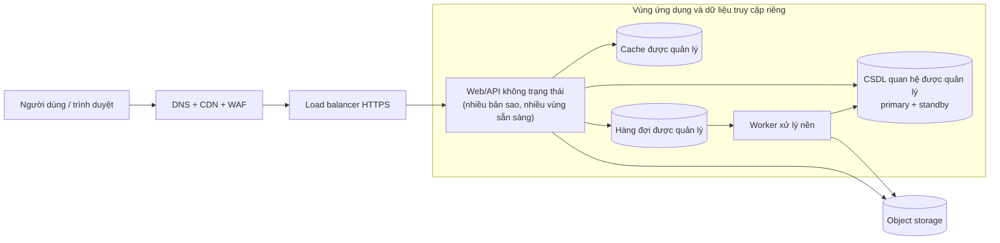

# Ứng dụng web nhiều tầng với dịch vụ và cơ sở dữ liệu được quản lý

## 1. Bài toán kiến trúc

Một ứng dụng web thường bắt đầu bằng yêu cầu nghiệp vụ rất cụ thể: người dùng cần truy cập trang web, đăng nhập, tra cứu dữ liệu và thực hiện giao dịch. Kiến trúc sư đám mây phải chuyển các yêu cầu đó thành thiết kế có thể triển khai, vận hành và mở rộng. Quyết định không chỉ là chọn máy chủ hay cơ sở dữ liệu, mà còn là xác định thành phần nào được phép truy cập Internet, dữ liệu được bảo vệ thế nào, hệ thống phản ứng ra sao khi có lỗi và chi phí tăng theo tải như thế nào.

**Mẫu kiến trúc tham chiếu** trong bài này là ứng dụng web nhiều tầng, chạy trên nền tảng tính toán được quản lý, sử dụng cơ sở dữ liệu được quản lý và các dịch vụ bổ trợ khi có nhu cầu. Đây là một mẫu phổ biến cho cổng khách hàng, hệ thống đặt hàng, ứng dụng quản trị và nhiều sản phẩm SaaS.

Mục tiêu sau bài học:

- Phân biệt các tầng **giao diện**, **ứng dụng/nghiệp vụ** và **dữ liệu**; hiểu rằng tách tầng logic không bắt buộc phải tách thành nhiều máy chủ vật lý.
- Vẽ luồng yêu cầu từ người dùng đến ứng dụng và cơ sở dữ liệu, đồng thời xác định ranh giới mạng và quyền truy cập.
- Chọn dịch vụ tính toán, lưu trữ, hàng đợi, cache và cơ sở dữ liệu được quản lý theo yêu cầu nghiệp vụ.
- Đánh giá các đánh đổi về độ tin cậy, bảo mật, hiệu năng, chi phí và vận hành theo tinh thần **Well-Architected**.
- Lập kế hoạch triển khai, quan sát, mở rộng, sao lưu và khôi phục có thể kiểm chứng.

### Ví dụ xuyên suốt

Xét một hệ thống đặt hàng trực tuyến có trang giới thiệu sản phẩm, API tạo đơn hàng và cơ sở dữ liệu giao dịch. Các giả định dưới đây chỉ là **đầu vào minh họa**, cần được xác nhận với chủ sản phẩm trước khi thiết kế thực tế:

| Yêu cầu | Giả định cho ví dụ | Ảnh hưởng đến kiến trúc |
| --- | --- | --- |
| Lưu lượng | Đỉnh 300 yêu cầu/giây; 80% đọc, 20% ghi | Cần đánh giá tải ứng dụng, truy vấn DB và cách mở rộng |
| Trải nghiệm | Thời gian phản hồi p95 dưới 500 ms cho API chính | Cần đo từ đầu cuối, kiểm soát truy vấn chậm |
| Sẵn sàng | SLO 99,9% theo tháng | Cần loại bỏ các điểm lỗi đơn khi hợp lý với ngân sách |
| Mất dữ liệu chấp nhận được | RPO tối đa 15 phút trong kịch bản thảm họa đã xác định | Cần chính sách sao lưu/nhân bản và kiểm chứng khôi phục |
| Thời gian phục hồi | RTO tối đa 60 phút trong kịch bản đó | Cần quy trình và hạ tầng phục hồi khả thi |
| Bảo mật | Có thông tin cá nhân và đơn hàng | Phân quyền, mã hóa, kiểm toán, chính sách lưu giữ |
| Tài chính | Có ngân sách vận hành hằng tháng | Phải xét cả chi phí cố định lẫn chi phí theo mức sử dụng |

**SLO** là mục tiêu mức dịch vụ; **p95** là ngưỡng mà 95% mẫu đo nằm ở hoặc thấp hơn; **RPO** là lượng dữ liệu tối đa có thể mất tính theo thời gian; **RTO** là thời gian tối đa dự kiến để phục hồi dịch vụ sau sự cố thuộc phạm vi đã xác định. Với tháng 30 ngày, SLO sẵn sàng 99,9% tương ứng khoảng 43,2 phút không sẵn sàng, nếu tính theo thời gian và không có ngoại lệ trong cách đo. Một con số SLO không tự quyết định được RPO hoặc RTO.

## 2. Tách tầng để quản lý trách nhiệm

Kiến trúc ba tầng thường được mô tả như sau:

| Tầng | Trách nhiệm chính | Ví dụ thành phần | Nguyên tắc |
| --- | --- | --- | --- |
| **Trình bày (presentation)** | Hiển thị giao diện, nhận tương tác người dùng | HTML/CSS/JavaScript tĩnh trên CDN; frontend dựng phía máy chủ | Không cho trình duyệt truy cập trực tiếp DB |
| **Ứng dụng (application/business)** | Xác thực, phân quyền, kiểm tra dữ liệu, thực thi quy tắc nghiệp vụ, cung cấp API | PaaS web app, container được quản lý, hàm serverless | Không tin dữ liệu từ client; giữ trạng thái bền vững ở dịch vụ ngoài tiến trình |
| **Dữ liệu (data)** | Lưu trữ nhất quán, truy vấn, sao lưu và khôi phục | CSDL quan hệ được quản lý, object storage | Chỉ các thực thể được cấp quyền mới truy cập |

Không nên hiểu “ba tầng” là “bắt buộc phải có ba máy chủ”. Một ứng dụng nhỏ có thể đặt frontend và API trong cùng một đơn vị triển khai nhưng vẫn tách trách nhiệm trong mã nguồn. Ngược lại, API có thể được mở rộng thành nhiều dịch vụ; dữ liệu cũng có thể gồm DB, cache và object storage. **Tách trách nhiệm** giúp thay đổi, bảo vệ và mở rộng từng phần dễ hơn; mức độ tách triển khai cần phù hợp với độ phức tạp thực tế.

Các dịch vụ hỗ trợ thường được bổ sung khi có lý do rõ ràng:

- **CDN** lưu bản sao nội dung tĩnh gần người dùng, giảm độ trễ và tải gốc.
- **Load balancer L7** phân phối kết nối HTTP(S), kiểm tra sức khỏe và định tuyến đến ứng dụng.
- **Cache được quản lý** tăng tốc dữ liệu đọc thường xuyên; cần chiến lược hết hạn và làm mới.
- **Hàng đợi và worker** đưa các tác vụ có thể làm chậm sang xử lý bất đồng bộ.
- **Object storage** lưu ảnh, tài liệu và tệp tải lên; DB chỉ giữ metadata và tham chiếu khi thích hợp.
- **Quản lý bí mật, khóa mã hóa và danh tính workload** kiểm soát quyền truy cập dịch vụ.
- **Giám sát, log, trace, cảnh báo** cung cấp khả năng phát hiện lỗi và truy nguyên.

## 3. Sơ đồ tham chiếu và ranh giới mạng



Sơ đồ thể hiện **luồng logic**, không phải bản thiết kế subnet hay danh sách tài nguyên bắt buộc. Trong triển khai điển hình, điểm vào Internet là CDN/WAF và load balancer. Các bản sao ứng dụng chạy ở mạng riêng; DB và cache không có địa chỉ truy cập công khai. Object storage và hàng đợi có thể là dịch vụ khu vực nằm ngoài VPC/VNet về mặt hạ tầng nhà cung cấp nhưng được truy cập bằng endpoint riêng, chính sách danh tính và kết nối được kiểm soát.

Để chịu được lỗi của một **availability zone (AZ)**, có thể bố trí bản sao ứng dụng qua ít nhất hai AZ và chọn DB hỗ trợ HA liên AZ. Một region có thể chứa nhiều AZ; **đa AZ không đồng nghĩa đa region**. Đặc tính thực tế của standby, failover và endpoint phụ thuộc loại dịch vụ được chọn.

### Kiểm soát kết nối theo chiều tối thiểu

| Nguồn → đích | Kết nối cần có | Chính sách gợi ý |
| --- | --- | --- |
| Internet → CDN/WAF/load balancer | HTTPS công khai | Chứng chỉ hợp lệ, giới hạn lưu lượng và quy tắc WAF phù hợp |
| Load balancer → web/API | Cổng ứng dụng được phê duyệt | Chỉ chấp nhận lưu lượng từ load balancer; health check riêng |
| Web/API → DB | Giao thức/cổng DB | Chỉ danh tính và nhóm mạng ứng dụng được phép truy cập |
| Web/API → cache/queue/object storage | Giao thức dịch vụ tương ứng | Quyền truy cập theo tác vụ, mã hóa khi truyền |
| Worker → DB/object storage | Quyền tối thiểu cho tác vụ nền | Không cấp quyền quản trị toàn bộ hạ tầng |
| Thành phần vận hành → môi trường | Kênh quản trị được kiểm soát | SSO, MFA, nhật ký kiểm toán; tránh mở cổng quản trị trực tiếp ra Internet |

Việc dùng subnet riêng, security group/firewall, private endpoint, route table và kiểm soát egress cần được đối chiếu với khả năng của nhà cung cấp. NAT gateway chỉ cần nếu workload riêng phải đi ra ngoài bằng đường mạng yêu cầu NAT; chi phí NAT và lưu lượng qua mạng có thể đáng kể. Tính “riêng” của một subnet **không thay thế** xác thực và phân quyền ở lớp dịch vụ.

## 4. Hai luồng xử lý cần hiểu rõ

### 4.1. Truy vấn danh sách sản phẩm

1. Trình duyệt tải tài nguyên tĩnh qua CDN và gọi API bằng HTTPS.
2. WAF áp dụng quy tắc bảo vệ; load balancer chuyển yêu cầu tới một bản sao API đang khỏe.
3. API xác thực yêu cầu nếu tài nguyên cần đăng nhập, kiểm tra quyền và tham số.
4. API thử đọc dữ liệu phù hợp từ cache. Nếu cache miss, API truy vấn DB, trả dữ liệu và có thể ghi cache với TTL.
5. API trả mã trạng thái, dữ liệu và thông tin theo dõi yêu cầu; hệ thống ghi metrics, log và trace.

Cache giúp giảm lượng đọc tới DB nhưng tạo thêm bài toán dữ liệu cũ. Cần chọn **TTL**, quy tắc vô hiệu hóa và cách xử lý cache lỗi. Không cache dữ liệu riêng tư giữa các người dùng bằng khóa cache chung; không coi cache là nguồn dữ liệu chính thức của giao dịch.

### 4.2. Tạo đơn hàng và xử lý nền

1. Client gửi yêu cầu tạo đơn hàng có thông tin xác thực và **idempotency key** để việc gửi lại không tạo đơn trùng.
2. API kiểm tra quyền, dữ liệu đầu vào, tồn kho và điều kiện nghiệp vụ.
3. API ghi đơn hàng trong giao dịch DB. Nếu cần phát sự kiện nghiệp vụ đáng tin cậy, API ghi một bản ghi **outbox** trong cùng giao dịch.
4. Một tiến trình phát sự kiện đọc outbox, đưa tác vụ vào queue; worker xử lý thông báo hoặc các công việc không nằm trên đường phản hồi chính.
5. Worker có cơ chế khử trùng lặp và retry có giới hạn; tác vụ thất bại kéo dài được đưa sang **dead-letter queue (DLQ)** hoặc quy trình xử lý thủ công.

Ví dụ giả mã cho bước ghi dữ liệu:

```text
BEGIN TRANSACTION
  tìm đơn theo (customer_id, idempotency_key)
  nếu đã tồn tại: trả về kết quả của đơn trước đó

  kiểm tra và cập nhật dữ liệu nghiệp vụ cần tính nhất quán
  tạo order
  tạo outbox_event(order_created) trong cùng transaction
COMMIT

tiến trình riêng: outbox_event -> queue -> worker xử lý idempotent
```

Phải có ràng buộc duy nhất phù hợp trong DB để chống hai yêu cầu đồng thời cùng vượt qua bước “tìm đơn”. Hàng đợi phổ biến cung cấp cơ chế xử lý **at least once**: tác vụ có thể được giao lại, vì vậy worker phải an toàn khi chạy lặp. Outbox giúp tránh tình huống DB đã commit nhưng sự kiện bị mất khi gửi queue thất bại. Không phải mọi ứng dụng đều cần outbox; lựa chọn này có chi phí vận hành và mã nguồn.

## 5. Chọn dịch vụ được quản lý theo nhu cầu

**Dịch vụ được quản lý (managed service)** có nghĩa nhà cung cấp đảm nhiệm một phần công việc như cấp phát hạ tầng, vá nền tảng, sao lưu hoặc failover theo hợp đồng dịch vụ. Đội phát triển vẫn chịu trách nhiệm về mã ứng dụng, cấu hình, phân quyền, dữ liệu, hiệu năng truy vấn và kiểm chứng khả năng phục hồi.

| Quyết định | Lựa chọn điển hình | Khi phù hợp | Đánh đổi và câu hỏi cần kiểm tra |
| --- | --- | --- | --- |
| Chạy web/API | PaaS web app; container được quản lý; serverless | PaaS đơn giản cho web truyền thống; container khi cần runtime/triển khai linh hoạt; serverless khi tải dao động và tác vụ ngắn | Thời gian khởi động, giới hạn thời gian chạy, kết nối DB, autoscaling, mức kiểm soát và tính di động |
| Lưu giao dịch | CSDL quan hệ được quản lý | Đơn hàng, thanh toán nội bộ, quan hệ dữ liệu và giao dịch ACID | Chi phí HA, giới hạn kết nối, chuyển đổi schema, failover và mức độ tương thích |
| Lưu ảnh/tệp | Object storage | Nội dung không cấu trúc, dung lượng lớn | Chính sách truy cập, vòng đời, versioning, chi phí request và egress |
| Tăng tốc đọc | Cache được quản lý | Có dữ liệu đọc lặp lại và đo được DB là nút thắt | Mất cache, TTL, dữ liệu cũ, cache stampede, chi phí một cụm chạy thường trực |
| Xử lý nền | Queue + worker | Gửi email, xử lý ảnh, đồng bộ dịch vụ ngoài | Độ trễ chấp nhận được, retry, thứ tự, trùng lặp, DLQ |
| Vận hành | Quản lý secret, observability, IaC, CI/CD | Cần triển khai lặp lại, theo dõi và kiểm toán | Phí lưu log, quyền truy cập, bảo trì quy trình và quản lý cấu hình |

Không có lựa chọn “tốt nhất” cho mọi tải. Ví dụ, serverless có thể tối ưu chi phí khi lưu lượng thấp và không đều, nhưng cần quản lý concurrency và pool kết nối DB. Một PaaS đơn giản thường đủ cho ứng dụng nhỏ; container orchestration mạnh hơn nhưng tăng số cấu hình, tài nguyên và kỹ năng vận hành cần có. DB quan hệ được quản lý hợp lý cho đơn hàng vì tính giao dịch; NoSQL chỉ nên chọn nếu mô hình truy cập và yêu cầu nhất quán thật sự phù hợp.

### Quyết định về trạng thái ứng dụng

Các bản sao web/API nên **không giữ trạng thái phiên quan trọng trong bộ nhớ cục bộ**. Nếu cần phiên đăng nhập phía máy chủ, lưu trong kho trạng thái chung hoặc dùng cơ chế phiên phù hợp, bảo mật. Tệp người dùng phải được lưu bền vững ngoài filesystem tạm của instance. Nhờ vậy, load balancer có thể chuyển yêu cầu sang bản sao khác khi deploy, autoscale hoặc instance gặp lỗi. “Stateless” không có nghĩa hệ thống không có trạng thái: trạng thái được chuyển sang những dịch vụ có chiến lược bền vững và sao lưu rõ ràng.

## 6. Thiết kế độ tin cậy và phục hồi

Độ tin cậy được xây dựng bằng cách xác định **lỗi cần chịu đựng** và kiểm tra xem thiết kế có xử lý được từng lỗi hay không.

| Tình huống | Biện pháp dự kiến | Điều vẫn có thể xảy ra |
| --- | --- | --- |
| Một instance API lỗi | Health check loại instance; còn bản sao khác phục vụ | Giảm công suất; autoscaling có độ trễ |
| Một AZ mất kết nối | Ứng dụng đa AZ; DB HA liên AZ nếu có | Cần đủ capacity ở AZ còn lại; failover DB có thể gián đoạn kết nối |
| DB primary lỗi | DB được quản lý hỗ trợ tự động failover sang standby | Có khoảng gián đoạn; ứng dụng phải tái kết nối và retry có kiểm soát |
| DB quá tải hoặc hết kết nối | Tối ưu truy vấn, index, connection pooling, giới hạn concurrency, cache đọc phù hợp | Thêm instance API có thể làm DB quá tải hơn |
| Queue/worker ngừng tạm thời | Queue giữ công việc, retry, cảnh báo độ tuổi thông điệp và DLQ | Xử lý nền chậm; cần giới hạn tăng trưởng backlog |
| Bản phát hành có lỗi | Triển khai dần, health check, rollback ứng dụng | Migration dữ liệu không tương thích có thể ngăn rollback |
| Xóa dữ liệu hoặc lỗi logic | Backup, point-in-time restore (nếu hỗ trợ), kiểm thử khôi phục | HA/replica có thể nhân bản cả lỗi xóa dữ liệu |
| Mất cả region | Thiết kế DR đa region khi yêu cầu buộc phải có | Tăng mạnh chi phí và độ phức tạp đồng bộ dữ liệu, chuyển DNS và vận hành |

Ba khái niệm thường bị nhầm lẫn:

- **High availability (HA)** giảm gián đoạn khi hạ tầng hay thành phần gặp lỗi, chẳng hạn tự động chuyển DB primary sang standby.
- **Backup và restore** giúp phục hồi dữ liệu sau xóa nhầm, hỏng logic hoặc thảm họa theo các điểm phục hồi có sẵn.
- **Disaster recovery (DR)** là kế hoạch phục hồi toàn bộ năng lực dịch vụ sau sự kiện lớn; có thể cần vùng/region thứ hai, quy trình chuyển hướng và kiểm tra định kỳ.

Không thể suy ra RPO/RTO chỉ từ nhãn “managed”, “multi-AZ” hay “auto failover”. Phải xem các cam kết dịch vụ, tính năng bản sao/sao lưu, độ trễ nhân bản và **đo thời gian diễn tập** trên kịch bản cụ thể. Nếu chỉ triển khai trong một region, không nên tuyên bố chịu được thảm họa mất cả region.

### Quy tắc retry, timeout và quá tải

Ứng dụng phải đặt timeout cho kết nối DB và dịch vụ phụ thuộc; retry với **exponential backoff có jitter**, số lần tối đa và chỉ khi thao tác an toàn để lặp lại. Với thao tác ghi, cần idempotency để không tạo hiệu ứng kép. Giới hạn concurrency và sử dụng circuit breaker hoặc load shedding khi phù hợp để tránh biến lỗi một dịch vụ thành lỗi dây chuyền. Kiểm tra sức khỏe nên phân biệt liveness (tiến trình còn chạy) và readiness (có thể nhận việc); không cấu hình health check quá nhạy khiến cả cụm bị thay thế đồng loạt khi DB chậm.

## 7. Bảo mật theo nhiều lớp

Bảo mật cần bắt đầu từ dữ liệu và luồng truy cập, không chỉ từ firewall:

1. **Danh tính người dùng:** chọn cơ chế xác thực phù hợp (ví dụ OIDC), dùng MFA cho tài khoản quản trị và kiểm tra phân quyền tại API trên từng tài nguyên.
2. **Danh tính workload:** cấp quyền cho web/API và worker theo vai trò riêng; ưu tiên danh tính ngắn hạn của nền tảng thay vì khóa truy cập tĩnh.
3. **Mạng:** chỉ mở endpoint công khai thật sự cần thiết; DB/cache nằm sau ranh giới riêng; kiểm soát luồng ra Internet.
4. **Mã hóa:** HTTPS/TLS khi truyền, mã hóa dữ liệu và bản sao lưu khi lưu trữ, quản lý vòng đời khóa và chứng chỉ.
5. **Secrets:** lưu mật khẩu DB, token và khóa trong secret manager; cấp quyền đọc giới hạn, hỗ trợ xoay vòng; không đưa secrets vào repository, image hoặc log.
6. **Ứng dụng:** kiểm tra đầu vào, chống SQL injection bằng truy vấn tham số hóa, chống XSS/CSRF theo loại ứng dụng, hạn chế request và quản lý dependency.
7. **Kiểm toán:** ghi sự kiện đăng nhập đặc quyền, đổi cấu hình, truy cập dữ liệu quan trọng; kiểm soát thời gian lưu giữ và che thông tin nhạy cảm.

WAF, private subnet và mã hóa đều là các **lớp bổ sung**, không thể thay cho phân quyền đúng. Việc lưu dữ liệu cá nhân còn phụ thuộc yêu cầu pháp lý về vị trí lưu trữ, thời hạn giữ dữ liệu, xóa dữ liệu và kiểm soát truy cập trong phạm vi tổ chức.

## 8. Mở rộng và tối ưu hiệu năng

Khi số người dùng tăng, không nên chỉ tăng số instance API. Cần xác định **nút thắt thực tế** bằng đo lường.

### Ước lượng ban đầu từ tải nghiệp vụ

Trong ví dụ đỉnh 300 yêu cầu/giây, nếu 80% là đọc thì có khoảng 240 yêu cầu đọc/giây và 60 yêu cầu ghi/giây. Giả sử chỉ có các request đọc phù hợp được cache và tỷ lệ cache hit là 75%, lượng request đọc cần truy cập DB giảm từ khoảng 240 xuống 60 request/giây.

Theo giả định rất đơn giản rằng mỗi request còn lại tạo đúng một lần truy cập DB, tổng sẽ là khoảng:

```text
DB request-equivalents/giây
  = 300 × [0,8 × (1 - 0,75) + 0,2]
  = 120
```

**120 không phải số truy vấn SQL/giây được bảo đảm.** Trong thực tế một request có thể tạo nhiều query, transaction kéo dài, join nặng hoặc cache miss đồng loạt. Mục đích của phép tính là chỉ ra những giả định phải đo bằng load test và thống kê truy vấn.

Nếu thời gian xử lý trung bình của một yêu cầu ở mức 200 ms tại tải ổn định, định luật Little cho ước lượng khoảng `300 × 0,2 = 60` yêu cầu đang xử lý đồng thời trong phạm vi hệ thống được đo. Con số này không phải số thread/CPU cần cấp phát; còn phải xét CPU, I/O, hàng đợi, giới hạn pool và đặc tính runtime.

### Các nút thắt thường gặp

| Nút thắt | Dấu hiệu | Hành động ưu tiên |
| --- | --- | --- |
| CPU hoặc bộ nhớ web/API | p95 tăng cùng utilization, nhiều lỗi timeout | Profiling, tối ưu mã, scale out có ngưỡng và giới hạn |
| DB query | Slow query, I/O cao, lock wait | Phân tích execution plan, index đúng, truy vấn theo trang, tránh N+1 |
| Kết nối DB | Hết pool, connection spikes khi autoscale | Pooling, giới hạn concurrency, cân nhắc proxy kết nối |
| Đọc dữ liệu lặp lại | Cùng khóa được truy vấn dày đặc | Cache với TTL/invalidation và kiểm soát cache stampede |
| Đọc báo cáo ảnh hưởng giao dịch | Query đọc dài ảnh hưởng ghi | Tách workload báo cáo; read replica nếu chịu được replication lag |
| Tác vụ chậm | API chờ email/xử lý ảnh | Queue và worker với chỉ số queue age/backlog |

Read replica thường có **độ trễ nhân bản**, vì vậy không thích hợp cho những lần đọc bắt buộc nhìn thấy ngay dữ liệu vừa ghi nếu không có cơ chế bảo đảm nhất quán. Bổ sung cache hoặc replica trước khi đo còn có thể tăng chi phí và độ phức tạp mà không giải quyết vấn đề chính.

## 9. Triển khai và vận hành liên tục

Một kiến trúc chỉ hoàn chỉnh khi đội ngũ có thể tái tạo môi trường, triển khai an toàn và phát hiện sự cố.

### Quy trình triển khai tham chiếu

1. **Infrastructure as Code (IaC):** mô tả network, quyền truy cập, compute, DB, quan sát và chính sách sao lưu bằng cấu hình có version và review.
2. **Tách môi trường:** dev/staging/prod có ranh giới truy cập và dữ liệu rõ ràng; không dùng dữ liệu khách hàng thật cho thử nghiệm nếu chưa được cho phép và bảo vệ đúng mức.
3. **CI:** build, kiểm tra mã, kiểm thử phù hợp và quét dependency/image trước khi phát hành.
4. **CD:** triển khai rolling, canary hoặc blue/green tùy nền tảng; chỉ tăng lưu lượng khi health check và chỉ số thực tế đạt điều kiện.
5. **Thay đổi schema:** ưu tiên **expand–migrate–contract** để phiên bản API mới và cũ có thể hoạt động trong giai đoạn chuyển tiếp.
6. **Khôi phục:** có lệnh rollback ứng dụng, runbook phục hồi DB và bản sao lưu đã được thử restore.

Không coi rollback mã nguồn là rollback dữ liệu. Một migration xóa cột hoặc biến đổi dữ liệu không đảo ngược có thể làm phiên bản cũ không chạy được; vì vậy phải thiết kế compatibility và phương án khắc phục từ trước.

### Quan sát và cảnh báo

| Nhóm | Chỉ số nên theo dõi | Ví dụ câu hỏi vận hành |
| --- | --- | --- |
| Trải nghiệm người dùng | Request rate, error rate, latency p50/p95/p99, availability theo SLO | Người dùng có đang gặp lỗi hay chậm không? |
| Web/API | CPU, memory, số bản sao, restart, saturation, tỷ lệ timeout | Autoscaling có theo kịp tải không? |
| DB | Query latency, slow queries, connection count, lock wait, storage, replication lag | DB có phải nút thắt hoặc đang gần giới hạn không? |
| Queue | Backlog, oldest message age, retries, DLQ | Công việc nền có bị tồn đọng không? |
| Bảo mật | Đăng nhập bất thường, thay đổi IAM/firewall, truy cập bí mật, sự kiện WAF | Có hành vi bất thường cần điều tra không? |
| Chi phí | Chi phí theo dịch vụ/môi trường, egress, log ingestion, backup, quota | Thành phần nào tăng chi phí khác dự kiến? |

Sử dụng trace/correlation ID xuyên qua CDN/load balancer, API và worker khi nền tảng hỗ trợ. Log nên có cấu trúc và trường đủ để chẩn đoán, đồng thời **loại bỏ mật khẩu, token và dữ liệu cá nhân không cần thiết**. Cảnh báo ưu tiên các tín hiệu ảnh hưởng người dùng, khả năng cạn tài nguyên và vi phạm SLO, thay vì chỉ cảnh báo CPU đơn lẻ.

## 10. Chi phí và đánh đổi kiến trúc

Tổng chi phí vận hành không dừng ở giá của web instance và DB. Một mô hình sơ bộ có thể viết:

```text
Chi phí tháng ≈ compute + managed DB/HA + storage/backup
              + cache/queue + load balancer + NAT/private endpoints
              + băng thông/egress + logs/metrics/traces
              + các dịch vụ bảo mật và chi phí vận hành liên quan
```

Những khoản thường bị bỏ sót là instance dự phòng, lưu lượng liên AZ, data egress qua Internet, NAT, lưu log có retention quá dài, DB provision cao hơn nhu cầu và chi phí duy trì môi trường staging. Cách tính phí khác nhau giữa nhà cung cấp; cần dùng pricing calculator và dữ liệu đo được ở khu vực triển khai.

| Quyết định | Lợi ích | Cái giá / giới hạn |
| --- | --- | --- |
| Web/API nhiều AZ | Giảm rủi ro mất một AZ | Tốn baseline capacity, cân bằng tải và vận hành |
| DB managed HA | Giảm công việc tự quản trị và hỗ trợ failover | Phí cao hơn cấu hình đơn AZ; vẫn cần kiểm thử khôi phục |
| Serverless cho tải không đều | Có thể tránh cấp phát capacity nhàn rỗi | Rủi ro cold start, giới hạn runtime, DB connection bursts |
| Cache riêng | Giảm DB reads, cải thiện độ trễ | Chi phí dịch vụ, invalidation và dữ liệu cũ |
| Queue/worker | Hấp thụ đỉnh tải, cô lập tác vụ chậm | Độ trễ xử lý, trùng lặp và công việc giám sát |
| Multi-region DR | Chống rủi ro mất cả region theo thiết kế | Chi phí lớn, độ phức tạp dữ liệu và diễn tập |

**Quy tắc thiết kế:** chỉ thêm thành phần sau khi chỉ ra được yêu cầu nó giải quyết và cách đo hiệu quả. Ví dụ, một cổng nội bộ nhỏ có thể bắt đầu bằng PaaS và DB managed đơn giản với backup/restore rõ ràng; hệ thống giao dịch có SLO nghiêm ngặt cần HA và kiểm tra failover sớm hơn.

## 11. Rà soát theo Well-Architected

Các trụ cột Well-Architected cung cấp câu hỏi kiểm tra có hệ thống cho mẫu kiến trúc này:

| Trụ cột | Câu hỏi đánh giá | Bằng chứng nên có |
| --- | --- | --- |
| **Operational excellence – Vận hành** | Có thể triển khai, theo dõi, xử lý sự cố và học từ sự cố không? | IaC, pipeline, runbook, dashboard, diễn tập |
| **Security – Bảo mật** | Ai được truy cập từng thành phần và dữ liệu? | IAM, sơ đồ data flow, đánh giá quyền, audit log, secret rotation |
| **Reliability – Tin cậy** | Khi instance/AZ/DB lỗi, dịch vụ còn đáp ứng SLO không? | Failure test, restore test, RPO/RTO đo được, capacity reserve |
| **Performance efficiency – Hiệu năng** | Dịch vụ và tài nguyên có phù hợp đặc tính tải? | Load test, p95, query plan, scaling test, chỉ số saturation |
| **Cost optimization – Chi phí** | Chi phí tăng thế nào khi tải gấp đôi, khi giữ dữ liệu lâu hơn? | Cost breakdown, tagging, ngân sách và cảnh báo |
| **Sustainability – Bền vững** | Có giảm tài nguyên nhàn rỗi và dữ liệu giữ không cần thiết? | Autoscaling phù hợp, lifecycle policy, right sizing |

Không nên dùng checklist thay thế lập luận thiết kế. Mỗi lựa chọn phải gắn với mục tiêu nghiệp vụ, mức rủi ro chấp nhận được, chi phí và người chịu trách nhiệm vận hành.

## 12. Bài thực hành thiết kế và thẩm định

Giả sử nhóm phụ trách hệ thống đặt hàng đã xác nhận: đỉnh 300 request/giây, p95 API dưới 500 ms, SLO 99,9%, có dữ liệu cá nhân, RPO tối đa 15 phút và RTO tối đa 60 phút **đối với sự cố được xác định trong phạm vi DR**. Hãy lập một thiết kế bước đầu và nêu rõ các giả định còn thiếu.

### Một phương án khởi đầu có thể bảo vệ được

| Khía cạnh | Phương án ban đầu | Cần đo/xác minh trước khi chốt |
| --- | --- | --- |
| Điểm vào | DNS, CDN/WAF, HTTPS load balancer | Lưu lượng quốc tế/nội địa, mức cache, bảo vệ bot |
| Compute | Web/API stateless trên PaaS hoặc managed containers; ít nhất hai bản sao phân bố nhiều AZ | Capacity khi mất một AZ, startup time, giới hạn autoscale |
| DB | Managed relational DB có HA liên AZ, mã hóa và backup/PITR phù hợp | Failover thực tế, restore time, DB throughput, khả năng đạt RPO/RTO |
| Dữ liệu phụ | Object storage cho ảnh/tệp; cache chỉ khi đo thấy lợi ích | Phân quyền bucket, TTL, chi phí request/egress |
| Bất đồng bộ | Queue + worker cho gửi thông báo và xử lý chậm | Tính idempotent, DLQ, độ trễ công việc cho phép |
| Bảo mật | Private connectivity, workload identity, secret manager, TLS, RBAC | Data residency, quy trình quản trị, kiểm toán |
| Vận hành | IaC, CI/CD, dashboard SLO, cảnh báo, backup/restore drills | Quy trình on-call, cách rollback DB migration |

Phương án trên **chưa đủ để khẳng định đáp ứng RPO/RTO khi mất cả region**. Cần làm rõ kịch bản thảm họa, địa điểm lưu backup, khả năng restore region khác và thời gian thực tế. Khi doanh nghiệp yêu cầu chịu lỗi toàn region trong 60 phút, phương án có thể phải bổ sung hạ tầng DR, nhân bản dữ liệu và bài diễn tập chuyển vùng.

### Kiểm thử chấp nhận kiến trúc

1. **Load test:** tạo tải tương đương 300 request/giây theo tỷ lệ đọc/ghi đã giả định, đánh giá p95, error rate, DB connection và saturation; có bước tăng vượt đỉnh để tìm giới hạn.
2. **Lỗi instance/AZ:** ngắt một bản sao hoặc mô phỏng mất một AZ; xác nhận hệ thống còn capacity và cách cân bằng lại tải.
3. **Failover DB:** mô phỏng chuyển primary theo quy trình được hỗ trợ; đo thời gian lỗi, reconnect và kiểm tra có giao dịch nào bị lặp/mất.
4. **Restore drill:** khôi phục bản sao lưu vào môi trường kiểm thử, xác minh dữ liệu và đo RPO/RTO theo kịch bản.
5. **Deploy/rollback:** phát hành có migration tương thích; gây lỗi có kiểm soát và đo thời gian rollback.
6. **Kiểm tra bảo mật:** xác nhận DB không thể truy cập từ Internet, workload chỉ có quyền cần thiết, log không lộ secret và tài nguyên được mã hóa.
7. **Kiểm tra chi phí:** chạy mẫu tải, đối chiếu chi phí dự kiến theo dịch vụ; kiểm tra cả chi phí khi scale và khi không có traffic.

### Ghi lại quyết định kiến trúc (ADR)

Mỗi quyết định quan trọng nên có một bản ghi ngắn. Ví dụ:

```text
ADR-01 — Sử dụng CSDL quan hệ được quản lý với HA liên AZ
Ngữ cảnh: Đơn hàng cần transaction; đội vận hành nhỏ; SLO 99,9%.
Quyết định: Chọn managed relational DB, bật HA và backup/PITR theo chính sách.
Lựa chọn đã cân nhắc: Tự quản lý DB trên VM; managed DB đơn AZ.
Đánh đổi: Chi phí cao hơn đơn AZ, ít kiểm soát hạ tầng DB;
          failover không bảo đảm không gián đoạn.
Điều kiện xác minh: Load test, failover test, restore drill đạt mục tiêu.
Chủ sở hữu: Nhóm nền tảng và nhóm ứng dụng.
```

## 13. Những sai lầm dễ gặp

- **Đưa DB ra Internet cho tiện kết nối:** mở rộng bề mặt tấn công; thay bằng private connectivity và kênh vận hành được cấp quyền.
- **Giữ session hoặc tệp người dùng trên một instance:** làm mất trạng thái khi autoscale hoặc failover; chuyển sang kho phù hợp ngoài instance.
- **Chọn multi-AZ rồi bỏ qua backup:** HA không phục hồi được xóa nhầm hay lỗi logic; phải có restore test.
- **Scale API vô hạn trong khi DB có giới hạn:** tạo bão kết nối; cần giới hạn, pooling và đánh giá năng lực DB.
- **Dùng queue nhưng giả định tác vụ chỉ chạy một lần:** retry có thể tạo trùng đơn/ thông báo; thiết kế idempotency và DLQ.
- **Dùng read replica cho mọi lần đọc ngay sau ghi:** dữ liệu có thể chưa đồng bộ; cần đường đọc bảo đảm tính nhất quán khi nghiệp vụ đòi hỏi.
- **Triển khai schema phá tương thích:** rollback ứng dụng thất bại; dùng expand–migrate–contract.
- **Bật mọi dịch vụ bổ trợ ngay từ đầu:** tăng phí và số điểm phải vận hành; chọn theo bằng chứng đo được.

## 14. Câu hỏi tự kiểm tra

1. Vì sao có thể nói một hệ thống là “ba tầng” ngay cả khi frontend và API được triển khai chung?
2. Trong sơ đồ tham chiếu, thành phần nào được công khai Internet và thành phần nào nên chỉ truy cập qua mạng/quyền riêng?
3. Khi API p95 tăng nhưng CPU web còn thấp, bạn sẽ kiểm tra DB, cache, queue và dependency theo thứ tự nào? Vì sao?
4. Vì sao DB HA liên AZ chưa đủ để kết luận hệ thống đạt RPO 15 phút, RTO 60 phút trước thảm họa mất region?
5. Khi tăng số replica API từ 2 lên 20, điều gì có thể xảy ra với số kết nối DB? Làm cách nào giới hạn rủi ro?
6. Khi queue phát lại cùng một thông điệp, nguyên tắc nào ngăn worker tạo hai hiệu ứng nghiệp vụ?
7. Khi nào nên dùng cache hoặc read replica? Khi nào hai giải pháp đó làm sai kỳ vọng nhất quán dữ liệu?
8. Bạn sẽ dùng những phép đo nào để chứng minh một phương án nhiều tầng đáp ứng yêu cầu độ tin cậy, bảo mật, hiệu năng và chi phí?

**Điểm cần ghi nhớ:** kiến trúc tham chiếu là điểm xuất phát cho tư duy thiết kế, không phải cấu hình bất biến. Thiết kế tốt thể hiện đường đi của dữ liệu, ranh giới trách nhiệm, các tình huống hỏng hóc, chi phí và bằng chứng kiểm thử. Một lựa chọn chỉ được xem là phù hợp khi những đánh đổi của nó đáp ứng yêu cầu nghiệp vụ đã được xác nhận.
