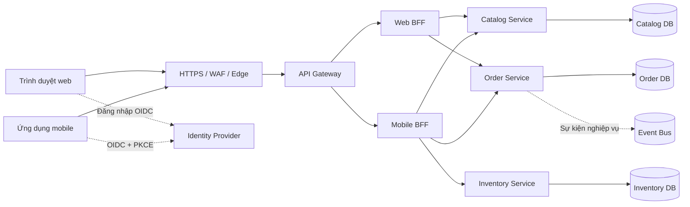
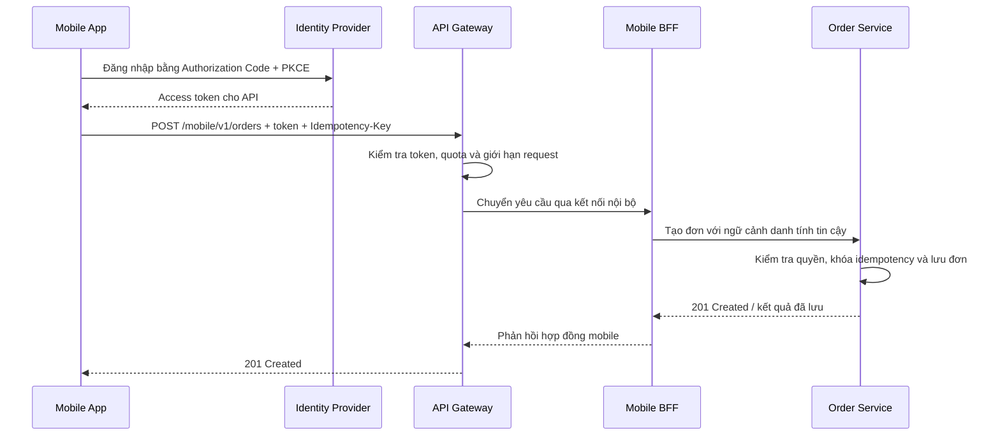

# Cổng API cho ứng dụng web và thiết bị di động

Một sản phẩm có giao diện web và ứng dụng di động thường dùng chung dữ liệu khách hàng, đơn hàng và danh mục sản phẩm, nhưng khác nhau về cách đăng nhập, kích thước màn hình, băng thông, nhịp cập nhật phiên bản và hành vi khi mất kết nối. Nếu từng ứng dụng truy cập trực tiếp mọi dịch vụ phía sau, mỗi nhóm giao diện phải tự quản lý nhiều địa chỉ API, chính sách bảo mật và tình huống lỗi. Khi số dịch vụ tăng, hệ thống khó thay đổi mà không ảnh hưởng tới ứng dụng đã phát hành.

Mẫu **API Gateway kết hợp Backend for Frontend (BFF) khi cần** tạo ra một điểm vào được quản trị thống nhất cho các ứng dụng, đồng thời cho phép thiết kế API phù hợp từng kênh. Đây là một **mẫu kiến trúc tham chiếu**: quyết định sử dụng thành phần nào phải xuất phát từ yêu cầu nghiệp vụ, độ tin cậy, bảo mật, khả năng mở rộng, chi phí và khả năng vận hành. Mục tiêu không phải đặt thật nhiều lớp trung gian vào mọi hệ thống.

## 1. Bài toán kiến trúc và yêu cầu đầu vào

Giả sử một nền tảng bán hàng cung cấp các chức năng tìm sản phẩm, xem tồn kho, đặt hàng và theo dõi giao hàng qua hai kênh:

- **Web:** người dùng thường mở nhiều trang, cần SEO cho nội dung công khai, có thể sử dụng phiên đăng nhập dựa trên cookie và yêu cầu tổng hợp dữ liệu cho màn hình quản trị.
- **Mobile:** cần phản hồi gọn để tiết kiệm băng thông và pin, hoạt động trên mạng di động không ổn định, phải hỗ trợ phiên bản ứng dụng cũ và đăng nhập an toàn cho một ứng dụng công khai không giữ được client secret.
- **Hệ thống phía sau:** các dịch vụ Catalog, Inventory, Order và Customer có thể được triển khai, mở rộng và bảo trì độc lập; mỗi dịch vụ tự sở hữu dữ liệu nghiệp vụ của mình.

Trước khi vẽ kiến trúc, cần thống nhất các yêu cầu có thể đo được:

| Nhóm yêu cầu | Câu hỏi cần trả lời | Ví dụ tiêu chí chấp nhận |
|---|---|---|
| Nghiệp vụ | Hai kênh cần chức năng nào, dữ liệu nào khác nhau? | Mobile chỉ cần tóm tắt sản phẩm; web cần thông tin quản trị chi tiết. |
| Hiệu năng | Bao nhiêu yêu cầu/giây và thời gian phản hồi ở phân vị nào? | P95 của API đọc chính dưới 500 ms trong bài kiểm thử tải đã định. |
| Độ tin cậy | Khi một dịch vụ phụ lỗi, luồng nào vẫn phải hoạt động? | Lỗi gợi ý sản phẩm không ngăn khách xem giỏ hàng. |
| Bảo mật | Ai được gọi API nào và truy cập tài nguyên của ai? | Người dùng A không đọc hoặc sửa đơn hàng của người dùng B. |
| Tương thích | Ứng dụng di động cũ được hỗ trợ trong bao lâu? | Có chính sách ngừng phiên bản và đo lượng người dùng còn sử dụng. |
| Vận hành | Ai chịu trách nhiệm lỗi tại gateway, BFF và dịch vụ? | Có dashboard, cảnh báo, dấu vết yêu cầu xuyên suốt. |
| Chi phí | Lưu lượng, băng thông ra Internet và số lần gọi nội bộ là bao nhiêu? | Theo dõi chi phí trên mỗi 1.000 yêu cầu hoàn thành. |

Các con số trong bài là **giả định minh họa**, không phải ngưỡng phù hợp cho mọi hệ thống.

## 2. Kiến trúc tham chiếu



Sơ đồ thể hiện **một phương án có hai BFF**. Nếu web và mobile cần cùng một hợp đồng API, có thể đi từ gateway đến dịch vụ dùng chung mà không cần BFF. Các đường nối từ BFF đến dịch vụ là kết nối nội bộ được bảo vệ; cơ sở dữ liệu không công khai ra Internet.

Vai trò của từng lớp:

| Thành phần | Trách nhiệm chính | Không nên gánh thay |
|---|---|---|
| Edge, CDN, WAF | Kết thúc HTTPS theo thiết kế, lọc lưu lượng bất thường, phân phối tài nguyên tĩnh/nội dung cache công khai. | Quyết định quyền truy cập từng đơn hàng. |
| API Gateway | Định tuyến, giới hạn tốc độ, xác minh token nếu phù hợp, thực thi chính sách truy cập chung, giám sát tại điểm vào. | Tính toán nghiệp vụ, sở hữu cơ sở dữ liệu, phối hợp giao dịch dài. |
| Web BFF | Quản lý phiên web nếu dùng mô hình session, tổng hợp dữ liệu và tạo phản hồi đúng nhu cầu giao diện web. | Thay thế toàn bộ các dịch vụ miền nghiệp vụ. |
| Mobile BFF | Tạo payload tối ưu cho mobile, tổng hợp lời gọi, hỗ trợ tương thích phiên bản client. | Tin vào thông tin danh tính do mobile tự khai báo. |
| Identity Provider (IdP) | Đăng nhập, cấp token theo giao thức và chính sách danh tính. | Cấp quyền sở hữu tài nguyên chi tiết thay các dịch vụ nghiệp vụ. |
| Dịch vụ nghiệp vụ | Xác thực ngữ cảnh đã được truyền an toàn, **phân quyền trên tài nguyên**, xử lý nghiệp vụ và quản lý dữ liệu. | Phụ thuộc vào cấu trúc giao diện của từng kênh. |
| Event Bus / hàng đợi | Truyền sự kiện bất đồng bộ cho tác vụ không cần hoàn tất trước phản hồi. | Biến mọi thao tác cần kết quả tức thì thành tác vụ bất đồng bộ. |

Gateway là **điểm vào logic thống nhất**, không có nghĩa chỉ có một máy chủ vật lý. Triển khai thực tế cần nhiều bản sao hoặc dịch vụ quản lý có khả năng sẵn sàng cao, tránh gateway trở thành điểm lỗi duy nhất.

## 3. Chọn mẫu truy cập phù hợp

Ba cách phổ biến đều hợp lệ trong những điều kiện khác nhau:

| Phương án | Phù hợp khi | Ưu điểm | Đánh đổi |
|---|---|---|---|
| **Client → Gateway → API dùng chung** | Web/mobile có nhu cầu dữ liệu tương tự, số dịch vụ ít, hợp đồng ổn định. | Ít thành phần; triển khai và vận hành đơn giản. | Client có thể phải gọi nhiều API để dựng một màn hình. |
| **Client → Gateway → BFF theo kênh → Services** | Nhu cầu dữ liệu và hành vi xác thực hai kênh khác biệt đáng kể. | Tổng hợp phản hồi, ẩn cấu trúc dịch vụ, phát triển trải nghiệm kênh độc lập. | Tốn thêm tài nguyên, tăng hop mạng và chi phí bảo trì. |
| **Gateway → API dùng chung và BFF cho một số màn hình** | Chỉ một phần chức năng cần tổng hợp dữ liệu. | Chỉ bổ sung độ phức tạp nơi mang lại lợi ích. | Cần quy ước rõ API nào thuộc BFF, API nào thuộc miền dùng chung. |

**Cách quyết định:** bắt đầu bằng bản đồ các hành trình người dùng và số lời gọi mạng của từng màn hình. Nếu màn hình mobile cần gọi năm dịch vụ rồi tự ghép dữ liệu, BFF có thể giảm số round-trip qua mạng di động. Ngược lại, nếu màn hình chỉ gọi một API ổn định, đi qua BFF chỉ để chuyển tiếp nguyên trạng sẽ tạo thêm độ trễ mà ít giá trị.

Không nên biến BFF thành một dịch vụ “siêu nghiệp vụ”. Quy tắc tính giá, giữ hàng, kiểm tra hạn mức và ghi đơn phải nằm ở dịch vụ sở hữu miền tương ứng để hai kênh có cùng kết quả.

## 4. Hai luồng xác thực: web và mobile

### 4.1. Web có BFF quản lý phiên

Một cách thiết kế mạnh cho web là dùng **OpenID Connect (OIDC) Authorization Code Flow** ở phía BFF. BFF xử lý trao đổi mã ủy quyền với IdP, lưu thông tin phiên ở phía máy chủ và đặt cookie có thuộc tính `HttpOnly`, `Secure`, `SameSite` phù hợp. Trình duyệt gửi cookie phiên đến Web BFF qua gateway; access token không cần xuất hiện trong JavaScript của trang.

Luồng cơ bản:

1. Trình duyệt truy cập một tài nguyên cần đăng nhập; Web BFF chuyển hướng người dùng tới IdP.
2. Sau khi xác thực, IdP trả mã ủy quyền về callback đã đăng ký; BFF kiểm tra `state`, `nonce` khi áp dụng và đổi mã lấy token qua kênh máy chủ.
3. BFF tạo phiên và trả cookie an toàn; yêu cầu tiếp theo của web mang cookie này.
4. BFF kiểm tra phiên, sau đó gọi dịch vụ nội bộ bằng cơ chế danh tính và ủy quyền giữa các dịch vụ đã được thiết kế; dịch vụ cuối vẫn kiểm tra quyền trên dữ liệu.

Do cookie được trình duyệt tự động gửi, cần kiểm soát **CSRF** cho thao tác thay đổi trạng thái, chẳng hạn bằng CSRF token và kiểm tra `Origin`; `SameSite` hỗ trợ giảm rủi ro nhưng không nên là lớp bảo vệ duy nhất trong mọi kịch bản. Cần cấu hình CORS đúng origin nếu giao diện và API ở các origin khác nhau. **CORS không phải cơ chế xác thực hoặc phân quyền.**

Một SPA cũng có thể sử dụng Authorization Code + PKCE để tự nhận access token, nhưng khi đó phải đánh giá kỹ rủi ro XSS, lưu trữ token và refresh token. Không có một cách đăng nhập phù hợp mọi web app; lựa chọn phụ thuộc mô hình frontend, hạ tầng và rủi ro chấp nhận được.

### 4.2. Ứng dụng mobile là public client

Ứng dụng mobile nên dùng **Authorization Code + PKCE** qua trình duyệt hệ thống theo khuyến nghị dành cho native app. Không nhúng client secret vào ứng dụng, vì gói cài đặt có thể bị phân tích. Nếu phải lưu token, dùng cơ chế lưu trữ bảo mật của hệ điều hành; tránh log token hoặc đưa token vào URL.

Một yêu cầu API điển hình:

1. Mobile đăng nhập tại IdP với PKCE và nhận access token dành cho API đã xác định.
2. Mobile gọi endpoint HTTPS công khai, gửi `Authorization: Bearer ...`.
3. Gateway xác minh chữ ký token hoặc introspection tùy loại token, đồng thời kiểm tra `issuer`, `audience`, thời hạn và các scope cần thiết; khóa xác minh từ IdP có thể được cache và làm mới an toàn.
4. Gateway áp dụng quota/rate limit, sau đó chuyển yêu cầu đã được kiểm tra tới Mobile BFF qua mạng nội bộ tin cậy.
5. BFF gọi dịch vụ nghiệp vụ; dịch vụ xác minh ngữ cảnh người dùng/tenant được truyền qua kênh tin cậy và quyết định có cho phép thao tác với tài nguyên cụ thể hay không.

**Phân biệt xác thực và phân quyền:** token hợp lệ chứng minh ngữ cảnh đăng nhập và quyền tổng quát, nhưng không chứng minh người dùng có quyền sửa đơn hàng `order-123`. Order Service phải đối chiếu chủ sở hữu/tenant và trạng thái đơn. Không lấy `X-User-ID` hoặc `tenantId` từ header/JSON do client tự cung cấp làm nguồn sự thật. Khi chuyển danh tính giữa các dịch vụ, dùng token nội bộ có kiểm chứng hoặc cơ chế ủy quyền được bảo vệ, cùng TLS/mTLS và quyền dịch vụ tối thiểu.

### 4.3. Các lớp kiểm soát không thể bỏ qua

| Nguy cơ | Kiểm soát gợi ý |
|---|---|
| Token bị giả mạo, phát hành cho API khác hoặc đã hết hạn | Kiểm tra chữ ký/thuật toán được phép, `iss`, `aud`, `exp`, `nbf` và chính sách thu hồi/phiên phù hợp. |
| Người dùng truy cập dữ liệu của tenant khác | Kiểm tra quyền truy cập theo đối tượng ở dịch vụ; truy vấn dữ liệu phải giới hạn đúng tenant. |
| DDoS, bot, vét cạn mật khẩu, spam API | WAF/DDoS protection, quota theo danh tính/tenant, giới hạn theo IP cho lưu lượng chưa xác thực, chống bot tại điểm phù hợp. |
| Lộ dữ liệu trong log hoặc cache | Không ghi token, mật khẩu, dữ liệu nhạy cảm; quy định redaction và tránh cache công khai cho phản hồi cá nhân. |
| Lạm dụng CORS, cookie hoặc chuyển hướng đăng nhập | Allowlist origin/redirect URI; cookie bảo mật, CSRF protection và kiểm tra state/nonce trong luồng OIDC. |
| Kết nối nội bộ hoặc quyền vận hành quá rộng | Private networking, TLS/mTLS nơi cần, IAM tối thiểu, secret manager và xoay vòng khóa. |

## 5. Thiết kế hợp đồng API theo trải nghiệm người dùng

Trong kiến trúc minh họa, các đường dẫn bên ngoài có thể được tách như sau:

| Endpoint công khai | Client | Cách xác thực | Bên xử lý |
|---|---|---|---|
| `GET /web/v1/home` | Browser | Cookie phiên | Web BFF tổng hợp dữ liệu màn hình web. |
| `GET /mobile/v1/home` | Mobile | Bearer access token | Mobile BFF trả payload ít trường, có thể phân trang. |
| `POST /mobile/v1/orders` | Mobile | Bearer access token và scope phù hợp | Mobile BFF chuyển lệnh đến Order Service. |

Chẳng hạn, Web BFF có thể trả danh mục, gợi ý mua hàng và thống kê cá nhân trong một phản hồi. Mobile BFF chỉ trả ảnh thu nhỏ, giá, tình trạng còn hàng và cursor cho trang tiếp theo. **Số lần gọi từ BFF đến các dịch vụ vẫn tồn tại**: giảm số round-trip qua Internet không có nghĩa đã giảm tải backend. Nếu BFF gọi quá nhiều dịch vụ theo chuỗi, độ trễ và khả năng lỗi sẽ tăng.

Một yêu cầu tạo đơn từ mobile:

```http
POST /mobile/v1/orders HTTP/1.1
Host: api.example.com
Authorization: Bearer <access_token>
Content-Type: application/json
Idempotency-Key: 5dc5de81-0b9d-4d1a-91e5-614c57ef74d0

{
  "items": [{"sku": "SKU-101", "quantity": 2}],
  "shippingAddressId": "addr-42"
}
```

```http
HTTP/1.1 201 Created
Content-Type: application/json
Location: /mobile/v1/orders/ord-901

{
  "id": "ord-901",
  "status": "PENDING_PAYMENT",
  "total": {"amount": 240000, "currency": "VND"}
}
```

`Idempotency-Key` giúp xử lý tình huống mobile gửi lại yêu cầu vì mất mạng sau khi server đã tạo đơn. Dịch vụ sở hữu đơn hàng cần lưu kết quả theo phạm vi an toàn (ví dụ tenant, người dùng, thao tác và khóa), kiểm tra payload có trùng hay không, xử lý các yêu cầu đồng thời và có chính sách hết hạn. **Chỉ thêm header ở gateway không tự làm thao tác ghi trở nên idempotent.** Với khóa đã dùng cho nội dung khác, dịch vụ cần trả lỗi xung đột phù hợp thay vì tạo đơn mới.

Một phản hồi giới hạn tốc độ có thể theo dạng **Problem Details**:

```http
HTTP/1.1 429 Too Many Requests
Content-Type: application/problem+json
Retry-After: 3

{
  "type": "https://api.example.com/problems/rate-limit",
  "title": "Too Many Requests",
  "status": 429,
  "detail": "Giới hạn số yêu cầu tạm thời đã đạt."
}
```

Client chỉ nên thử lại theo `Retry-After` hoặc backoff có jitter, tránh tạo bão retry. Một số quy ước API cần được thống nhất ngay từ đầu:

- Dùng phương thức HTTP đúng ý nghĩa (`GET` đọc, `POST` tạo/thực hiện lệnh, `PUT`/`PATCH` cập nhật phù hợp), mã trạng thái nhất quán, ID tài nguyên ổn định và thông báo lỗi có cấu trúc.
- Phân trang bằng cursor cho tập dữ liệu lớn hoặc thay đổi nhanh; giới hạn kích thước trang và payload. Cache GET bằng `ETag`/`If-None-Match` khi phù hợp, tách rõ cache công khai và cache theo người dùng.
- Đặt timeout và giới hạn kích thước request/response; chỉ chấp nhận định dạng nội dung cần thiết. Không đưa thông tin nhạy cảm vào query string vì URL thường xuất hiện trong log và lịch sử.
- Quản lý phiên bản và tương thích ngược: có thể dùng `/v1`, nhưng đổi phiên bản đường dẫn không thay thế cho quy trình thay đổi hợp đồng, theo dõi client cũ và thông báo thời điểm kết thúc hỗ trợ.
- Phân biệt lỗi: `401` chưa xác thực hợp lệ, `403` không đủ quyền, `404` không tìm thấy/không tiết lộ tài nguyên, `409` xung đột trạng thái, `429` quá hạn mức, `502` upstream phản hồi lỗi không hợp lệ, `503` tạm không sẵn sàng, `504` upstream quá thời gian.

## 6. Luồng gọi và ranh giới trách nhiệm



Trong thực tế, người dùng thường đã đăng nhập trước khi tạo đơn. Bước đăng nhập ở sơ đồ chỉ minh họa nguồn gốc token; **không đăng nhập lại cho mỗi request**. Nếu xử lý thanh toán kéo dài, Order Service có thể tạo đơn `PENDING_PAYMENT`, phát sự kiện qua outbox và trả trạng thái để client tra cứu. Event Bus không được dùng để che giấu việc chưa có chính sách nhất quán dữ liệu, xử lý trùng sự kiện và hoàn tác nghiệp vụ.

## 7. Khả năng mở rộng, độ trễ và phục hồi lỗi

**Ước lượng năng lực từ hành vi thực tế.** Giả sử có 400.000 người dùng hoạt động mỗi ngày, trung bình 30 yêu cầu API/người/ngày:

```text
Tổng yêu cầu/ngày         = 400.000 × 30 = 12.000.000
Lưu lượng trung bình      = 12.000.000 / 86.400 ≈ 139 request/giây
Giả định đỉnh gấp 12 lần = khoảng 1.667 request/giây
Dự phòng 30% trên đỉnh    = khoảng 2.167 request/giây
```

Đây chỉ là **điểm bắt đầu để lập kế hoạch tải**; lưu lượng thật có thể dồn vào vài phút khuyến mãi, có bot hoặc lệch múi giờ. Nếu mỗi yêu cầu mobile kéo theo bốn lời gọi dịch vụ qua BFF, 2.167 yêu cầu/giây bên ngoài có thể tạo nhiều nghìn lời gọi/giây bên trong. Cần đo hệ số fan-out, độ trễ và điểm nghẽn của database, pool kết nối, cache và hàng đợi.

Với một hành trình cần phản hồi dưới khoảng 500 ms, có thể thử **phân bổ ngân sách độ trễ** cho mạng khách hàng, edge/gateway, BFF, lời gọi dịch vụ và phần dự phòng. Việc cộng các chỉ tiêu P95 của từng thành phần không suy ra P95 của toàn hành trình; phải đo end-to-end bằng tải đại diện, gồm cả thiết bị và điều kiện mạng cần hỗ trợ.

Các biện pháp bảo vệ cần phối hợp:

| Vấn đề | Thiết kế và phép kiểm tra |
|---|---|
| Gateway/BFF bị quá tải | Mở rộng ngang nhiều instance hoặc dùng dịch vụ gateway quản lý; kiểm thử autoscaling, connection pool, tài nguyên CPU/bộ nhớ. |
| Một vùng sẵn sàng lỗi | Phân bố instance qua nhiều availability zone, health check và chuyển tuyến tới instance khỏe; kiểm tra cả phụ thuộc dữ liệu. |
| Upstream chậm hoặc treo | Timeout hữu hạn theo ngân sách, circuit breaker, bulkhead; không chờ vô hạn. |
| Retry làm tăng tải khi lỗi | Retry có giới hạn, exponential backoff + jitter; ưu tiên thao tác đọc hoặc ghi đã có cơ chế idempotency. |
| Một dịch vụ phụ hỏng | Cho phép phản hồi suy giảm có kiểm soát, ví dụ bỏ phần gợi ý nhưng vẫn hiển thị giỏ; không giả mạo dữ liệu tồn kho hay thanh toán. |
| Lưu lượng công khai tăng đột biến | Rate limit theo principal/tenant và IP theo từng tình huống; quota toàn cục cần có hành vi rõ khi bộ đếm phân tán gặp sự cố. |
| Mạng mobile chập chờn | Phản hồi gọn, cache hợp lệ, cơ chế đồng bộ lại, hiển thị trạng thái đang xử lý và chống gửi trùng khi kết nối phục hồi. |

Không retry vô điều kiện mọi `5xx` hoặc mọi `POST`. Timeout có thể xảy ra **sau khi server đã ghi dữ liệu thành công**; retry không có idempotency có thể tạo đơn hoặc thanh toán hai lần. Cũng không để gateway retry lặp nhiều lần trong khi BFF và service cùng retry, vì số yêu cầu tăng theo cấp số nhân.

Để xác định độ tin cậy, đặt **SLI/SLO** cho hành trình quan trọng, chẳng hạn tỷ lệ yêu cầu tạo đơn thành công và độ trễ P95 theo ngữ cảnh đo. SLO khả dụng 99,9% trên 30 ngày tương đương khoảng 43,2 phút lỗi toàn phần nếu quy đổi đơn giản theo thời gian; error budget thực tế thường tính theo tỷ lệ yêu cầu hợp lệ. Cần định nghĩa rõ lỗi phía client (`4xx`), lỗi hạn mức (`429`) và lỗi hệ thống (`5xx`) được tính thế nào vào từng SLI.

## 8. Vận hành, quan sát và triển khai thay đổi

Một hệ thống có nhiều lớp trung gian chỉ dễ vận hành khi theo dõi được **một yêu cầu từ mobile/web đến dịch vụ cuối**:

- **Metrics:** lưu lượng theo route và phiên bản client, tỷ lệ `5xx`, `429`, `401/403`, P50/P95/P99 latency, số yêu cầu đang xử lý, độ bão hòa của gateway/BFF và upstream.
- **Distributed tracing:** truyền `traceparent`/correlation ID xuyên gateway, BFF và services; phân biệt thời gian chờ mạng, thời gian xử lý và fan-out đến từng dependency.
- **Structured logging:** có request ID, route, kết quả và mã lỗi kỹ thuật; che thông tin cá nhân và tuyệt đối không ghi token/secret vào log. Tránh label có cardinality quá cao như user ID trong metrics.
- **Cảnh báo:** dựa trên burn rate SLO, lỗi chức năng cốt lõi và tăng độ trễ; có người trực, runbook và khả năng rollback.
- **Triển khai:** dùng cấu hình gateway được quản lý như mã nguồn, kiểm tra hợp đồng API, canary/blue-green, kiểm thử phiên bản app cũ và giám sát sau phát hành.

Ví dụ khi `GET /mobile/v1/home` chậm, trace có thể chỉ ra gateway mất 15 ms, BFF dành 10 ms xử lý nhưng chờ Inventory 700 ms. Tăng CPU của gateway sẽ không giải quyết được điểm nghẽn ở Inventory. Cần so sánh thông tin từ hệ thống giám sát với log thay đổi cấu hình và các lần triển khai gần nhất để xác định nguyên nhân.

## 9. Chi phí và những đánh đổi của các lớp trung gian

Một thiết kế gateway/BFF thường phát sinh các nhóm chi phí sau:

```text
Tổng chi phí xấp xỉ = phí gateway theo số request/dung lượng
                     + compute BFF và dịch vụ nghiệp vụ
                     + lưu lượng truyền ra Internet và liên vùng
                     + WAF/CDN, logs/traces/metrics, cache, dữ liệu
                     + chi phí vận hành và mức dự phòng HA/DR
```

Thêm BFF có thể tăng compute và chi phí vận hành, nhưng cũng có thể giảm payload, số round-trip Internet và việc phát triển lặp lại trên nhiều client. Không thể kết luận phương án nào rẻ hơn chỉ dựa vào số thành phần; cần đo ở một đơn vị có ý nghĩa như **chi phí trên 1.000 hành trình mua hàng thành công**.

Các cách tối ưu có điều kiện: cache nội dung công khai qua CDN; dùng `ETag` cho tài nguyên phù hợp; nén phản hồi văn bản; giới hạn fan-out; chọn mức sampling trace hợp lý; điều chỉnh thời gian lưu log; autoscale theo tải thực. Không cache công khai dữ liệu cá nhân hoặc phản hồi có `Authorization` nếu chưa chứng minh được chính sách cache an toàn. Xét cả chi phí truyền dữ liệu giữa các zone/region và chi phí tăng độ phức tạp khi triển khai đa vùng.

## 10. Đánh giá theo tư duy Well-Architected

| Trụ cột | Câu hỏi đánh giá | Bằng chứng nên có |
|---|---|---|
| **Operational Excellence — Vận hành** | Khi gateway tăng lỗi, đội ngũ biết tìm nguyên nhân và rollback ra sao? | Dashboard, trace, runbook, quy trình canary. |
| **Security — Bảo mật** | Web và mobile đăng nhập đúng mô hình? Mỗi dịch vụ có kiểm tra quyền dữ liệu? | Threat model, kiểm thử IDOR/BOLA, cấu hình IdP, kiểm toán quyền. |
| **Reliability — Tin cậy** | Gateway/BFF có HA? Mất một upstream có làm sập toàn bộ giao diện? | Kết quả thử nghiệm lỗi và phục hồi; SLO/error budget. |
| **Performance Efficiency — Hiệu năng** | BFF giảm round-trip bao nhiêu? Điểm nghẽn nằm ở đâu? | Load test, trace fan-out, P95/P99 theo hành trình. |
| **Cost Optimization — Chi phí** | API nào tạo phần lớn chi phí mỗi request hoặc mỗi hành trình? | Báo cáo theo route, egress, gateway, compute, log. |
| **Sustainability — Bền vững** | Có đang truyền payload dư hoặc giữ nhiều tài nguyên nhàn rỗi? | Tỷ lệ cache hit, payload trung bình, mức sử dụng compute. |

Mục tiêu của đánh giá là ghi nhận **bằng chứng và đánh đổi**, không chỉ chấm tích “đã có API Gateway”. Một hệ thống chỉ có gateway nhưng vẫn để lộ API nội bộ, thiếu ủy quyền dữ liệu hoặc không có khả năng khôi phục lỗi chưa thể xem là kiến trúc tốt.

## 11. Bài tập thiết kế: từ yêu cầu đến quyết định kiến trúc

Cho tình huống: web có trang quản trị đơn hàng; mobile cần trang chủ và tạo đơn; trong giờ cao điểm có khuyến mãi, Inventory đôi lúc chậm 2 giây và mạng mobile thường mất kết nối. Hãy triển khai một bản thiết kế có thể kiểm chứng theo các bước:

1. **Vẽ luồng:** đánh dấu điểm vào Internet, vùng private, IdP, gateway, BFF (nếu chọn), các service và database. Chỉ ra nơi danh tính được xác minh và nơi quyền đối với đơn hàng được quyết định.
2. **Chọn phương án:** so sánh dùng chung API hay tách BFF. Đếm số request qua mạng mobile cho trang chủ, thời gian xử lý và hệ số fan-out dự kiến.
3. **Định hợp đồng:** thiết kế `GET /mobile/v1/home` và `POST /mobile/v1/orders`; xác định cách phân trang, lỗi, idempotency và tương thích mobile phiên bản cũ.
4. **Thử sự cố:** giả lập Inventory timeout, token hết hạn, nhiều yêu cầu vượt quota, nhấn “Đặt hàng” hai lần và một instance gateway bị lỗi. Định nghĩa kết quả an toàn cho từng trường hợp.
5. **Đo và điều chỉnh:** kiểm thử tải ở mức trung bình, đỉnh và đỉnh dự phòng; thu P95, tỷ lệ lỗi, fan-out, tỷ lệ cache hit và chi phí. Điều chỉnh kiến trúc theo số đo.
6. **Ghi ADR (Architecture Decision Record):** lưu quyết định, bối cảnh, các phương án đã cân nhắc, lý do chọn, hệ quả và thời điểm đánh giá lại.

Một ADR ngắn có thể là:

> **Quyết định:** dùng Mobile BFF cho trang chủ vì client phải tổng hợp nhiều dịch vụ qua mạng di động; các quy tắc giữ hàng và tạo đơn ở Order Service. **Hệ quả:** thêm một dịch vụ cần triển khai, giám sát và autoscale; đổi lại giảm số round-trip và cô lập hợp đồng mobile khỏi thay đổi nội bộ. **Đánh giá lại:** khi lưu lượng, chi phí hoặc nhu cầu hai kênh thay đổi đáng kể.

### Tình huống kiểm thử tối thiểu

| Tình huống | Kết quả mong đợi |
|---|---|
| Access token mobile hết hạn | Trả `401`, không tạo đơn; client có luồng làm mới/đăng nhập lại hợp lệ. |
| Người dùng cố lấy đơn của tài khoản khác | Dịch vụ từ chối theo chính sách (`403` hoặc `404`), không rò rỉ dữ liệu. |
| Hai lần POST cùng idempotency key và cùng payload | Trả lại cùng kết quả nghiệp vụ theo chính sách; chỉ có một đơn được ghi. |
| Hai lần POST cùng key nhưng payload khác | Từ chối xung đột, không âm thầm ghi thêm đơn. |
| Inventory timeout ở trang chủ | Thành phần phụ có thể suy giảm có kiểm soát; không báo sai trạng thái tồn kho. |
| Một instance gateway/BFF ngừng hoạt động | Health check chuyển lưu lượng; mức lỗi và thời gian phục hồi nằm trong SLO. |

## 12. Những lỗi thiết kế thường gặp

- **Gateway làm mọi thứ:** đặt logic nghiệp vụ, truy vấn database và tổng hợp phức tạp trong chính sách gateway khiến khó kiểm thử, khó thay đổi và khó mở rộng. Đưa nghiệp vụ về dịch vụ sở hữu miền; tổng hợp giao diện về BFF khi cần.
- **BFF chỉ chuyển tiếp nguyên trạng:** tăng một lớp mạng mà không giảm round-trip, payload hay phụ thuộc client. Xóa lớp thừa hoặc làm rõ lợi ích đo được.
- **Chỉ kiểm tra token ở gateway:** dịch vụ tin mọi tài nguyên có `userId` trong request. Luôn kiểm tra quyền ở nơi sở hữu dữ liệu và bảo vệ ngữ cảnh danh tính nội bộ.
- **Một bộ quota cho tất cả người dùng:** người dùng sau cùng một địa chỉ NAT có thể bị ảnh hưởng lẫn nhau. Thiết kế giới hạn riêng cho anonymous IP, authenticated user, client app, tenant và endpoint quan trọng.
- **Retry vô hạn:** sự cố upstream tạo bão request và giao dịch bị lặp. Quy định timeout, retry budget, backoff và idempotency end-to-end.
- **Chỉ đo gateway:** dashboard gateway xanh nhưng Order Service đã quá tải hoặc trả sai dữ liệu. Theo dõi SLI theo hành trình nghiệp vụ và trace xuyên dịch vụ.
- **Không có kế hoạch tương thích mobile:** phát hành backend làm client cũ hỏng dù người dùng chưa cập nhật app. Dùng contract test, telemetry phiên bản và chính sách deprecation rõ ràng.

## 13. Checklist trước khi đưa vào vận hành

- [ ] Luồng web và mobile, ranh giới public/private, danh tính và quyền truy cập tài nguyên đã được mô tả rõ.
- [ ] Lý do sử dụng hoặc không sử dụng BFF có số đo về round-trip, độ trễ và chi phí.
- [ ] IdP, OAuth2/OIDC, PKCE, phiên web/cookie, CSRF, CORS và quản lý secret được cấu hình đúng mô hình client.
- [ ] Gateway và dịch vụ nghiệp vụ có chính sách quota, timeout, retry và idempotency phù hợp.
- [ ] API có hợp đồng/versioning, thông báo lỗi, phân trang, giới hạn kích thước và kế hoạch hỗ trợ mobile cũ.
- [ ] Gateway/BFF phân bố đủ vùng sẵn sàng; đã diễn tập upstream chậm, đột biến lưu lượng và mất instance.
- [ ] Có metrics, tracing, log an toàn, cảnh báo theo SLO, runbook và quy trình rollback.
- [ ] Đã đo tải từ thiết bị qua gateway tới dịch vụ, fan-out nội bộ, chi phí thực và các đánh đổi Well-Architected.

**Điểm cần nhớ:** API Gateway là biên thực thi chính sách và định tuyến; BFF là công cụ tùy chọn để tối ưu trải nghiệm từng loại client; dịch vụ nghiệp vụ vẫn chịu trách nhiệm dữ liệu, quyền truy cập và tính đúng đắn của thao tác. Kiến trúc tốt là kiến trúc đã chứng minh được các lựa chọn này bằng yêu cầu cụ thể, phép đo và thử nghiệm sự cố.
