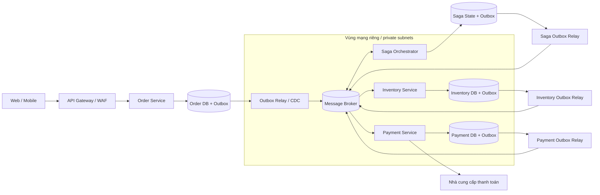
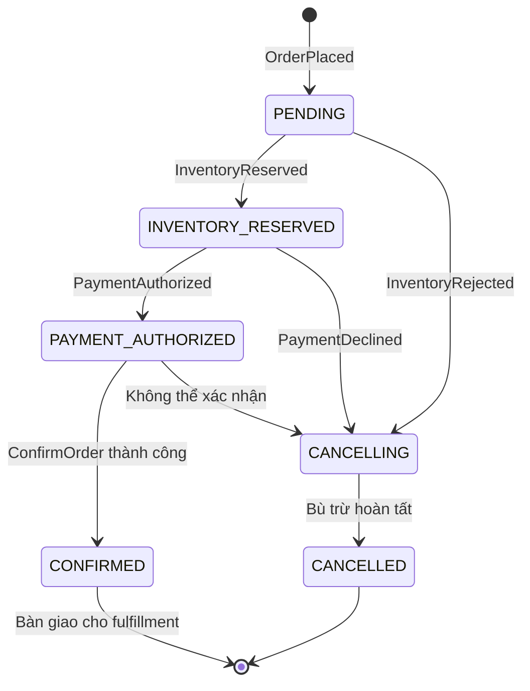
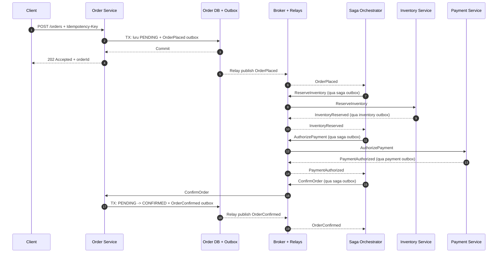

# Hệ thống đơn hàng với Saga và Transactional Outbox

## 1. Bài toán kiến trúc

Giả sử một nền tảng thương mại điện tử chạy trên đám mây có ba miền nghiệp vụ chính:

- **Order Service** tạo đơn hàng, quản lý trạng thái và cung cấp API cho khách hàng.
- **Inventory Service** giữ chỗ hoặc giải phóng số lượng hàng có thể bán.
- **Payment Service** làm việc với cổng thanh toán để ủy quyền (authorize), hủy ủy quyền (void) và thu tiền (capture).

Một đơn hàng chỉ được xác nhận khi tồn kho đã được giữ chỗ và khoản thanh toán đã được ủy quyền hợp lệ. Tuy nhiên, mỗi dịch vụ có cơ sở dữ liệu riêng; cổng thanh toán lại là hệ thống bên ngoài. Không có một giao dịch cơ sở dữ liệu thông thường nào bao trùm cả ba.

Hệ thống cần giải quyết đồng thời hai vấn đề:

1. **Điều phối giao dịch nghiệp vụ phân tán:** Nếu đã giữ hàng nhưng không thể ủy quyền thanh toán, hệ thống phải trả lại lượng hàng đã giữ. Đây là nhiệm vụ của **Saga**.
2. **Không làm mất sự kiện khi lưu trạng thái:** Khi Order Service đã lưu đơn hàng, sự kiện `OrderPlaced` phải có khả năng được phát đi ngay cả khi ứng dụng hoặc message broker gặp sự cố. Đây là nhiệm vụ của **Transactional Outbox**.

Hai mẫu này bổ trợ nhau: Saga quyết định **bước nghiệp vụ nào diễn ra tiếp theo và bù trừ ra sao**; Outbox đảm bảo **thay đổi dữ liệu cục bộ và ý định phát thông điệp được ghi cùng một giao dịch**.

### Mục tiêu và bất biến nghiệp vụ

| Mã | Bất biến cần duy trì | Cách bảo vệ |
| --- | --- | --- |
| B1 | Cùng một yêu cầu đặt hàng được gửi lại không tạo nhiều đơn hàng | `Idempotency-Key` và ràng buộc duy nhất trong Order DB |
| B2 | Không giữ vượt số lượng tồn có thể bán | Cập nhật tồn kho có điều kiện, nguyên tử trong Inventory DB |
| B3 | Đơn hàng chỉ chuyển sang `CONFIRMED` khi có xác nhận giữ hàng và ủy quyền thanh toán còn hiệu lực | Saga kiểm tra kết quả các bước và điều kiện chuyển trạng thái |
| B4 | Một bước hoặc sự kiện được gửi lại không gây trừ tồn/thu tiền hai lần | Khóa định danh cho từng lệnh, inbox/deduplication và idempotency phía cổng thanh toán |
| B5 | Nếu một thay đổi trạng thái cục bộ yêu cầu phát sự kiện, bản ghi outbox của nó được commit cùng lúc | Một giao dịch ACID trên cùng database |
| B6 | Không giao hàng trước khi có kết quả thu tiền phù hợp chính sách | Tách quyền xác nhận đơn với điều kiện thực hiện fulfillment |

**Giả định của ví dụ:** Trình tự đặt hàng là *giữ tồn kho → ủy quyền thanh toán → xác nhận đơn*. Bước *thu tiền* được thực hiện khi đủ điều kiện fulfillment và phải hoàn thành trước khi giao hàng. Đây là một lựa chọn nghiệp vụ; hệ thống khác có thể thu tiền sớm rồi dùng hoàn tiền làm hành động bù trừ, nhưng hoàn tiền không phải thao tác đảo ngược tức thời.

## 2. Vì sao không dùng một transaction chung?

Một transaction ACID chỉ đảm bảo tính nguyên tử đối với dữ liệu nằm trong phạm vi giao dịch của database đó. Nếu Order Service thực hiện:

1. Commit đơn hàng trong Order DB.
2. Gửi `OrderPlaced` trực tiếp đến broker.

thì có một khoảng hở giữa hai thao tác. Ví dụ, database đã commit nhưng ứng dụng chết trước khi publish: đơn hàng tồn tại, còn dịch vụ downstream không nhận được sự kiện. Đảo thứ tự thành “publish trước, commit sau” lại tạo nguy cơ downstream xử lý một đơn hàng mà database đã rollback.

Mô hình **distributed transaction/two-phase commit (2PC)** có thể điều phối một số tài nguyên hỗ trợ giao thức đó, nhưng thường không khả thi khi đi qua broker, cổng thanh toán hoặc các dịch vụ độc lập. Nó còn kéo theo sự phụ thuộc về tính sẵn sàng và chi phí khóa tài nguyên. Saga chấp nhận **nhất quán cuối cùng (eventual consistency)** giữa các dịch vụ và dùng hành động nghiệp vụ để xử lý thất bại.

Điểm cần phân biệt:

- **Local transaction:** nguyên tử trong một database, ví dụ cập nhật trạng thái đơn hàng và thêm một dòng outbox.
- **Saga:** chuỗi local transaction có trạng thái và hành động bù trừ, không bảo đảm cô lập hay rollback toàn cục như một transaction ACID.
- **Transactional Outbox:** kỹ thuật tránh ghi song song vào database và broker; tự nó không bảo đảm message chỉ được giao đúng một lần.
- **Idempotent consumer:** xử lý lặp an toàn trong điều kiện message có thể được giao lại.

## 3. Kiến trúc tham chiếu trên đám mây



Các đường nối đến broker trong hình đại diện cho việc gửi/nhận **lệnh (command)** hoặc **sự kiện (event)**, không hàm ý một transaction trải qua mọi thành phần. Mỗi service quản lý database và outbox riêng. Saga Orchestrator cũng cần lưu trạng thái tiến trình và lệnh cần gửi một cách bền vững.

| Thành phần | Vai trò | Gợi ý triển khai cloud |
| --- | --- | --- |
| API Gateway | Xác thực, giới hạn tốc độ, nhận `Idempotency-Key`, trả mã tra cứu đơn | Gateway/Load Balancer được quản lý, WAF |
| Order Service | Kiểm tra yêu cầu, lưu đơn `PENDING`, xử lý xác nhận/hủy | Containers hoặc serverless stateless |
| Saga Orchestrator | Lưu trạng thái saga, phát lệnh, xử lý timeout và bù trừ | Worker/service cùng database bền vững hoặc workflow engine hỗ trợ state |
| Message Broker | Tách rời producer/consumer, lưu hàng đợi, retry, DLQ | Queue hoặc event-stream được quản lý |
| Outbox Relay | Đọc bản ghi outbox, publish, theo dõi kết quả | Worker polling hoặc CDC từ transaction log |
| Inventory Service | Giữ/trả hàng với ràng buộc tồn kho trong local transaction | Service + database quan hệ/transactional store |
| Payment Service | Gọi nhà cung cấp thanh toán và đối soát kết quả | Service riêng, credentials trong secrets manager |
| Cơ sở dữ liệu | Duy trì order, reservation, payment operation, saga state, outbox/inbox | Database managed, backup, multi-zone và kiểm tra phục hồi |

Không bắt buộc dùng microservices ngay từ đầu: nếu quy mô và tổ chức chưa cần tách, các miền nghiệp vụ có thể nằm trong modular monolith. Điều cốt lõi là nhận diện **ranh giới giao dịch** và trách nhiệm phát sự kiện.

## 4. Thiết kế Saga cho vòng đời đặt hàng

### 4.1. Các bước và hành động bù trừ

Ví dụ sử dụng **orchestration saga**: coordinator giữ trạng thái tổng thể và gửi command đến từng dịch vụ.

| Bước | Command / xử lý cục bộ | Thành công | Thất bại cần xử lý |
| --- | --- | --- | --- |
| 0. Tạo đơn | Order DB lưu `PENDING` + outbox `OrderPlaced` | Bắt đầu saga | Lỗi local transaction: không tạo đơn |
| 1. Giữ hàng | `ReserveInventory` | `InventoryReserved` | `InventoryRejected` → hủy đơn |
| 2. Ủy quyền tiền | `AuthorizePayment` | `PaymentAuthorized` | `PaymentDeclined` → `ReleaseInventory`, rồi hủy đơn |
| 3. Xác nhận đơn | `ConfirmOrder` với điều kiện dữ liệu/phiên bản hợp lệ | `OrderConfirmed` | Nếu không thể hoàn thành: `VoidAuthorization` và `ReleaseInventory`, đánh dấu kết quả phù hợp |
| 4. Fulfillment | Capture tiền theo chính sách, sau đó mới cho phép xuất/giao hàng | `PaymentCaptured` | Retry/đối soát; nếu không thể thu tiền, kích hoạt luồng hủy sau xác nhận theo chính sách |

Một saga có thể dùng `sagaId = orderId`. Mỗi command nên có `commandId` và `stepId` ổn định qua các lần retry. Inventory lưu `reservationId`; Payment lưu `paymentOperationId` và khóa idempotency tương ứng khi gọi cổng thanh toán.



Sơ đồ là **trạng thái logic của saga**; trạng thái Order DB có thể chỉ gồm `PENDING`, `CONFIRMED`, `CANCELLING`, `CANCELLED`. Không nên sao chép tất cả trạng thái nội bộ của từng dịch vụ vào bảng order nếu không có nhu cầu truy vấn nghiệp vụ rõ ràng.

### 4.2. Luồng thành công



HTTP `202 Accepted` nghĩa là hệ thống **đã tiếp nhận** yêu cầu, chưa chắc đơn đã được xác nhận. Client có thể truy vấn `GET /orders/{orderId}` hoặc nhận cập nhật qua push/webhook sau khi saga hoàn tất. Trạng thái `PENDING` có thể kéo dài vài giây hoặc lâu hơn khi downstream bị gián đoạn.

### 4.3. Từ chối, timeout và kết quả không rõ ràng

- **Tồn kho từ chối:** order chuyển sang `CANCELLED`; không cần gọi Payment Service.
- **Thanh toán từ chối rõ ràng:** giải phóng đúng `reservationId`, chờ xác nhận `InventoryReleased`, sau đó hoàn tất trạng thái hủy.
- **Thanh toán timeout:** **không đồng nhất timeout với thất bại**. PSP có thể đã cấp ủy quyền nhưng phản hồi bị mất. Payment Service phải tra cứu operation theo khóa idempotency hoặc đối soát webhook/PSP trước khi quyết định void/retry.
- **Sự kiện thành công đến muộn sau khi bắt đầu hủy:** coordinator dựa trên trạng thái saga và phiên bản để không xác nhận đơn; nếu một reservation/authorization mới xuất hiện muộn, phát lệnh bù trừ tương ứng.
- **Bù trừ không thành công:** saga ở trạng thái `COMPENSATION_PENDING` hoặc `MANUAL_REVIEW`, tiếp tục retry có kiểm soát và báo động. Không ghi `CANCELLED` như thể tài nguyên đã được trả xong.
- **Ủy quyền hết hạn trước khi capture:** phải gia hạn hoặc ủy quyền lại theo quy tắc của PSP; không mặc định authorization luôn còn hiệu lực.

Bù trừ là **thao tác nghiệp vụ mới**. `ReleaseInventory` có thể trả hàng đã giữ, `VoidAuthorization` có thể hủy khoản ủy quyền chưa capture; nếu tiền đã capture, `RefundPayment` phát sinh độ trễ và phí, không khôi phục trạng thái thế giới về thời điểm trước đó.

### 4.4. Orchestration và choreography

| Tiêu chí | Orchestration | Choreography |
| --- | --- | --- |
| Điểm quyết định bước tiếp theo | Coordinator trung tâm | Các service phản ứng với event |
| Theo dõi saga và timeout | Tập trung, dễ xem trạng thái | Phân tán, cần correlation tốt |
| Mức phụ thuộc | Phụ thuộc logic vào coordinator | Phụ thuộc vào hợp đồng sự kiện giữa các service |
| Phù hợp | Quy trình nhiều nhánh, bù trừ phức tạp | Quy trình ít bước, tương tác đơn giản |

Ví dụ đặt hàng có nhiều bước, timeout và thanh toán bên ngoài nên **orchestration** giúp người vận hành truy được lý do đơn hàng đang chờ. Coordinator cần chạy nhiều instance an toàn bằng khóa/lease hoặc optimistic concurrency, tránh hai worker cùng phát lệnh cho một bước.

## 5. Transactional Outbox: ghi dữ liệu và ý định phát sự kiện

### 5.1. Nguyên tắc

Khi tạo đơn hàng, Order Service thực hiện **một local transaction** gồm:

1. Insert bản ghi `orders` trạng thái `PENDING`.
2. Insert bản ghi `outbox_events` mang event `OrderPlaced`.
3. Commit cả hai hoặc rollback cả hai.

Relay sẽ publish những event chưa được xác nhận phát thành công. Nếu broker tạm thời không sẵn sàng, event vẫn còn trong database để gửi lại. Nếu ứng dụng chết ngay sau commit, relay chạy độc lập vẫn đọc được event.

### 5.2. Ví dụ schema với PostgreSQL

```sql
CREATE TABLE orders (
    order_id         uuid PRIMARY KEY,
    customer_id      uuid NOT NULL,
    idempotency_key  text NOT NULL,
    status           text NOT NULL
                     CHECK (status IN ('PENDING', 'CONFIRMED',
                                      'CANCELLING', 'CANCELLED')),
    amount           numeric(18, 2) NOT NULL CHECK (amount >= 0),
    currency         char(3) NOT NULL,
    version          bigint NOT NULL DEFAULT 1,
    created_at       timestamptz NOT NULL DEFAULT now(),
    UNIQUE (customer_id, idempotency_key)
);

CREATE TABLE outbox_events (
    event_id          uuid PRIMARY KEY,
    aggregate_type    text NOT NULL,
    aggregate_id      uuid NOT NULL,
    aggregate_version bigint NOT NULL,
    event_type        text NOT NULL,
    payload           jsonb NOT NULL,
    created_at        timestamptz NOT NULL DEFAULT now(),
    published_at      timestamptz
);

CREATE INDEX outbox_unpublished_idx
    ON outbox_events (created_at, event_id)
    WHERE published_at IS NULL;
```

Ví dụ transaction dưới đây dùng tham số `:` do tầng ứng dụng truyền vào; `gen_random_uuid()` cần hỗ trợ UUID phù hợp trên phiên bản PostgreSQL đang sử dụng:

```sql
BEGIN;

INSERT INTO orders
    (order_id, customer_id, idempotency_key,
     status, amount, currency)
VALUES
    (:order_id, :customer_id, :idempotency_key,
     'PENDING', :amount, :currency);

INSERT INTO outbox_events
    (event_id, aggregate_type, aggregate_id,
     aggregate_version, event_type, payload)
VALUES
    (gen_random_uuid(), 'Order', :order_id, 1,
     'OrderPlaced',
     jsonb_build_object(
         'orderId', :order_id,
         'sagaId', :order_id,
         'customerId', :customer_id
     ));

COMMIT;
```

Ví dụ được rút gọn để minh họa tính nguyên tử. Trong ứng dụng thực tế còn cần kiểm tra nội dung request khi một `Idempotency-Key` đã tồn tại: nếu payload trùng thì trả đơn đã tạo; nếu khác thì trả lỗi xung đột. Không tự động đổi `orderId` theo mỗi lần retry.

Envelope message nên có thêm `eventId`, `eventType`, `schemaVersion`, `aggregateId`, `aggregateVersion`, `occurredAt`, `correlationId` và `causationId`. Giá trị `correlationId` nối toàn bộ hành trình đơn hàng; `eventId` dùng để khử trùng lặp. Không đưa số thẻ, token bí mật hoặc dữ liệu cá nhân không cần thiết vào payload.

### 5.3. Outbox Relay: polling hoặc CDC

**Polling relay** định kỳ chọn những bản ghi `published_at IS NULL`, gửi đến broker và chỉ đánh dấu đã publish **sau khi broker xác nhận**. Khi có nhiều relay, cần cơ chế claim/lease hoặc phân vùng công việc để giảm đụng độ; thao tác claim nên có transaction ngắn. Dùng `FOR UPDATE SKIP LOCKED` có thể hỗ trợ claim trong PostgreSQL, nhưng không nên giữ transaction/database lock mở lâu trong lúc chờ mạng.

**Change Data Capture (CDC)** đọc transaction log/WAL rồi chuyển các insert của outbox sang broker. CDC giảm polling liên tục và có thể hạ độ trễ; đổi lại cần quản lý replication slot, retention log, connector, checkpoint và phục hồi sau sự cố.

| Tiêu chí | Polling | CDC |
| --- | --- | --- |
| Độ đơn giản ban đầu | Thường dễ triển khai | Cần hạ tầng và cấu hình connector |
| Độ trễ | Phụ thuộc chu kỳ quét và backlog | Thường thấp, phụ thuộc pipeline |
| Tải lên database | Truy vấn liên tục nếu polling dày | Tải log/replication và tài nguyên connector |
| Vận hành | Quản lý lease, batch và retry | Quản lý WAL/offset, snapshot, connector |
| Thứ tự sự kiện | Phải thiết kế khóa phân vùng và thứ tự xử lý | Cần kiểm tra thứ tự theo aggregate qua pipeline |

**Không có bảo đảm exactly-once end-to-end mặc định.** Nếu broker đã nhận event nhưng relay chết trước khi đánh dấu `published_at`, lần chạy tiếp theo sẽ phát lại. Do đó, thiết kế mặc định là **at-least-once delivery + xử lý idempotent**. Cần có quy tắc duy trì thứ tự **theo một aggregate** (ví dụ key theo `orderId`, dùng `aggregateVersion`); không giả định broker bảo đảm thứ tự toàn cục giữa các phân vùng.

Outbox cần chính sách lưu trữ: archive/xóa bản ghi đã publish đủ lâu theo nhu cầu audit, retention và khả năng replay. Việc dọn dẹp không được xóa event chưa phát thành công.

## 6. Consumer idempotent, inbox và kiểm soát cạnh tranh

Giả sử Inventory Service nhận lại command `ReserveInventory` nhiều lần. Nếu mỗi lần đều trừ `available`, một đơn sẽ giữ hàng nhiều lần. Cách an toàn:

1. Nhận `commandId`/`eventId` ổn định giữa các retry.
2. Trong **cùng local transaction**, thêm bản ghi inbox có khóa duy nhất theo tên consumer và message ID; nếu đã tồn tại thì bỏ qua phần thay đổi nghiệp vụ.
3. Nếu message mới, kiểm tra trạng thái reservation, cập nhật tồn kho có điều kiện, lưu event kết quả vào outbox, rồi commit.
4. Chỉ ack broker sau khi transaction commit. Nếu tiến trình chết trước ack, việc giao lại được inbox xử lý an toàn.

```sql
CREATE TABLE inbox_messages (
    consumer_name text NOT NULL,
    message_id    uuid NOT NULL,
    processed_at  timestamptz NOT NULL DEFAULT now(),
    PRIMARY KEY (consumer_name, message_id)
);

-- Trong transaction giữ hàng, chỉ chạy các bước nghiệp vụ
-- khi INSERT dưới đây thực sự tạo ra một dòng mới:
INSERT INTO inbox_messages (consumer_name, message_id)
VALUES ('inventory-reserve-handler', :command_id)
ON CONFLICT DO NOTHING
RETURNING message_id;

-- Phải có điều kiện tồn kho; số dòng UPDATE = 0 nghĩa là không đủ hàng.
UPDATE inventory
SET available = available - :qty,
    reserved  = reserved + :qty
WHERE sku = :sku
  AND available >= :qty;
```

Đoạn SQL minh họa hai cơ chế quan trọng; ứng dụng phải kiểm tra kết quả `RETURNING` và số dòng `UPDATE`, lưu reservation cùng outbox, rồi commit/rollback như **một** transaction. Nếu cần giữ nhiều SKU, phải xác định chiến lược khóa và thứ tự khóa cố định để tránh deadlock, hoặc bù trừ khi một phần không giữ được.

**Inbox trong database không đủ để chống gọi PSP hai lần.** Với tác động bên ngoài, Payment Service phải truyền khóa idempotency do nghiệp vụ sinh ra cho PSP, lưu `paymentOperationId`, xử lý webhook có kiểm chứng và đối soát trạng thái. Nếu PSP báo timeout sau khi thực thi thành công, retry phải mang **cùng khóa** thay vì tạo một khoản thanh toán mới. Kiểm tra giới hạn và thời hạn idempotency theo hợp đồng cụ thể của nhà cung cấp.

**Race condition khi xử lý event:** Hai worker có thể cùng nhìn thấy saga đang `INVENTORY_RESERVED`. Coordinator cần cập nhật trạng thái có điều kiện, chẳng hạn `UPDATE saga_state SET state = 'PAYMENT_AUTHORIZING', version = version + 1 WHERE saga_id = :id AND state = 'INVENTORY_RESERVED' AND version = :expected_version`. Chỉ worker thắng được phép ghi command tiếp theo vào outbox trong cùng transaction. Bản ghi event đến muộn, không đúng bước hoặc có phiên bản cũ cần được bỏ qua hoặc đưa vào luồng sửa sai rõ ràng.

## 7. Phân tích tình huống lỗi

| Thời điểm sự cố | Điều có thể xảy ra | Cơ chế xử lý |
| --- | --- | --- |
| Order DB rollback trước commit | Không có đơn hàng và không có outbox event | API trả lỗi phù hợp, client retry với cùng idempotency key |
| Order DB commit, ứng dụng chết trước publish | Có đơn `PENDING` và event outbox chưa publish | Relay phục hồi và publish |
| Broker nhận event, relay chết trước khi đánh dấu đã publish | Message có thể được phát lại | Inbox/idempotency xử lý duplicate |
| Inventory đã commit reservation nhưng consumer chưa ack | Broker gửi lại command | Reservation ID và inbox ngăn trừ tồn lần hai |
| PSP đã ủy quyền nhưng phản hồi HTTP thất lạc | Trạng thái thanh toán chưa rõ | Tra cứu/đối soát theo operation ID, tuyệt đối tránh tạo auth mới vô ý |
| Payment bị từ chối | Hàng đang bị giữ | Saga gửi `ReleaseInventory`, chờ kết quả trước khi kết thúc hủy |
| Orchestrator restart | Saga dở dang | Đọc trạng thái bền vững, reschedule timeout, tiếp tục bước an toàn |
| Event thành công đến sau khi saga bắt đầu hủy | Có thể phát sinh reservation/auth muộn | Kiểm tra trạng thái và phát bù trừ đúng tài nguyên |
| Broker hoặc service downstream gián đoạn lâu | Queue backlog, saga mắc kẹt | Retry có backoff/jitter, circuit breaker, DLQ, cảnh báo và công cụ replay |
| Tác vụ bù trừ liên tục thất bại | Đơn chưa thể kết thúc đúng nghiệp vụ | Dừng tại `COMPENSATION_PENDING`, đối soát và xử lý vận hành |

Retry nên **có giới hạn**, có exponential backoff và jitter để không khuếch đại sự cố. Dead-letter queue (DLQ) chứa các message không thể xử lý sau số lần thử hợp lý; DLQ phải có người/quy trình điều tra, sửa nguyên nhân và replay có kiểm soát. Không dùng DLQ như cơ chế tự động coi đơn hàng đã hủy.

Một luồng **reconciliation** định kỳ so sánh đơn `PENDING` quá lâu, reservation chưa giải phóng, authorization chưa đối soát và saga không tiến triển. Nó là lớp bảo vệ bổ sung khi message, webhook hay timer bị lỗi, không thay thế cơ chế chính.

## 8. Thiết kế trải nghiệm API và hợp đồng sự kiện

Đề xuất API tạo đơn:

```http
POST /orders
Idempotency-Key: 3f7e7b4e-... 
Content-Type: application/json

{"items":[{"sku":"SKU-01","quantity":2}],"currency":"VND"}
```

Phản hồi khi nhận thành công:

```json
{
  "orderId": "d3b0c2f1-...",
  "status": "PENDING",
  "statusUrl": "/orders/d3b0c2f1-..."
}
```

Phản hồi HTTP có thể là `202 Accepted`. API tra cứu trả trạng thái rõ ràng, thời điểm cập nhật và lý do lỗi ở mức phù hợp để khách hàng quyết định thử lại hay chọn phương thức khác. Đừng hiển thị `CONFIRMED` ngay sau khi `OrderPlaced` được commit.

Các event cần **schema versioning** và quy tắc tương thích khi thêm/bớt field. Command thể hiện yêu cầu thực hiện hành động (`ReserveInventory`); event nêu một sự thật đã xảy ra (`InventoryReserved`). Khi schema không tương thích, triển khai producer và consumer theo thứ tự nâng cấp đã thỏa thuận, tránh làm hỏng hàng đợi đang tồn tại.

Đưa `tenantId` vào khóa/kiểm tra quyền nếu hệ thống đa tenant, tách tenant trong các query nghiệp vụ và idempotency key; không tin cậy tenant ID do client tự truyền mà chưa xác thực.

## 9. Đánh đổi theo Well-Architected

| Trụ cột | Quyết định kiến trúc | Rủi ro/đánh đổi cần quản lý |
| --- | --- | --- |
| **Operational Excellence** (vận hành) | Trace theo `orderId`/`sagaId`, dashboard saga, replay có kiểm soát, runbook | Nhiều trạng thái trung gian và công cụ vận hành hơn một API đồng bộ |
| **Reliability** (độ tin cậy) | Outbox/inbox, retry, compensation, backup, multi-zone, reconciliation | Eventual consistency; cần thử tình huống duplicate và mất kết nối |
| **Security** (bảo mật) | IAM tối thiểu, mTLS/TLS, secret manager, encryption, tokenization, webhook signature | Event payload bị nhân bản qua nhiều thành phần; cần giới hạn dữ liệu nhạy cảm |
| **Performance Efficiency** (hiệu năng) | Scale worker theo queue lag, partition theo aggregate, batch relay, index hợp lý | Hot partition, khóa tồn kho trên SKU bán chạy, chi phí database contention |
| **Cost Optimization** (chi phí) | Chọn queue thay cho streaming nếu không cần replay lớn; điều chỉnh polling/batch/retention | Broker, DB I/O, CDC và số lượng event gây chi phí theo tải |
| **Sustainability** (bền vững) | Batch hợp lý, tự động scale xuống, giảm polling vô ích và event dư thừa | Batch quá lớn có thể tăng độ trễ xử lý |

### Mạng và bảo mật

- Đặt các service và database trong mạng riêng; chỉ gateway/load balancer cần lộ cổng công khai. Kiểm soát đường ra đến PSP qua firewall/NAT hoặc cơ chế outbound phù hợp.
- Tách danh tính dịch vụ và quyền truy cập: Order không được ghi trực tiếp Inventory DB; relay chỉ đọc outbox và cập nhật trạng thái publish cần thiết; coordinator chỉ sở hữu saga state.
- Mã hóa dữ liệu khi truyền và khi lưu; dùng secret manager và xoay khóa. Không lưu thông tin thẻ nhạy cảm trong event, log hoặc bảng payment nếu có thể dùng token của PSP; đánh giá phạm vi PCI DSS phù hợp.
- Xác thực chữ ký và thời gian webhook thanh toán; chống replay và xử lý webhook lặp. Thông tin khách hàng trong trace/log phải được che hoặc giới hạn.

### Khả năng mở rộng và chi phí

Cho `R` là số đơn mỗi giây, `E` là số event/command bình quân mỗi đơn, thì tải message gần đúng là `R × E` message/giây, **chưa tính retry, timeout và bù trừ**. Kiểm tra kích thước payload, retention và tải IO để ước tính broker và outbox. Các dịch vụ có thể scale độc lập theo CPU, độ trễ queue và tỷ lệ xử lý; tồn kho trên một SKU có thể là điểm tranh chấp dữ liệu dù đã scale ứng dụng.

Một queue managed đơn giản có thể phù hợp khi chỉ cần giao lệnh tin cậy; một event stream phù hợp hơn nếu có nhiều consumer độc lập, cần retention/replay và throughput cao. Chọn theo yêu cầu thứ tự, lưu trữ, chi phí vận hành và năng lực nhóm, không theo tên công nghệ phổ biến.

## 10. Quan sát, SLO và khả năng phục hồi

**Log và trace:** Mỗi request, command và event nên mang `traceId`, `correlationId`, `sagaId`, `orderId`, `messageId`, `attempt`, `schemaVersion`; log có cấu trúc và tránh dữ liệu nhạy cảm. Trace phân tán nối API → outbox relay → broker → coordinator → service, đồng thời phải chấp nhận rằng trace qua async có thể bị đứt và cần correlation bổ sung.

**Các metric nên theo dõi:**

- Tuổi của event outbox chưa được publish lâu nhất và số outbox đang chờ.
- Queue lag, số retry, số message trong DLQ, độ trễ từ publish đến xử lý.
- Số saga ở từng trạng thái; số saga `PENDING`, `COMPENSATION_PENDING` quá ngưỡng.
- Tỷ lệ đơn xác nhận/hủy, tỷ lệ timeout PSP, số lần đối soát phát hiện lệch.
- Độ trễ p50/p95/p99 từ `OrderPlaced` đến `OrderConfirmed` hoặc `CANCELLED`.
- Số lần duplicate bị inbox chặn, lỗi optimistic concurrency và số reservation hết hạn.

SLO nên bám vào **kết quả nghiệp vụ** (ví dụ phần trăm đơn nhận được trạng thái cuối trong khoảng thời gian mục tiêu), chứ không chỉ uptime API. Ngưỡng cụ thể phải lấy từ yêu cầu thực tế; một API trả `202` nhanh vẫn có thể đi kèm saga mắc kẹt hàng giờ.

**Khôi phục sự cố:** Backup và kiểm thử restore riêng cho Order DB, Inventory DB, Payment DB và Saga DB; xác định RPO/RTO theo mức mất dữ liệu và thời gian gián đoạn chấp nhận được. Multi-zone giảm nguy cơ lỗi vùng sẵn sàng nhưng không thay thế backup hoặc phương án khôi phục sau lỗi logic. Sau restore, có thể cần replay event và đối soát PSP để xử lý khác biệt giữa database đã khôi phục và thế giới bên ngoài.

## 11. Thực hành đánh giá kiến trúc

### Tình huống: thanh toán đã thành công nhưng client thấy timeout

Giả sử Inventory Service đã phát `InventoryReserved`; Payment Service gọi PSP với khóa idempotency `payment-auth:{orderId}`. PSP đã ủy quyền nhưng phản hồi HTTP mất trên đường về.

1. Payment Service lưu trạng thái `AUTHORIZATION_UNKNOWN` (hoặc trạng thái tương đương) và không tự khẳng định `PaymentDeclined`.
2. Coordinator chờ kết quả hoặc phát yêu cầu đối soát; không cho Order Service chuyển `CONFIRMED` khi chưa có chứng cứ.
3. Payment Service tra cứu PSP bằng operation ID/khóa idempotency, hoặc nhận webhook đã xác minh.
4. Nếu xác nhận có authorization còn hiệu lực, lưu `AUTHORIZED` và event `PaymentAuthorized` trong cùng transaction; saga tiếp tục xác nhận đơn nếu reservation còn hiệu lực.
5. Nếu reservation đã hết hạn hoặc saga đã hủy, saga yêu cầu `VoidAuthorization` và kiểm tra kết quả, không quay lại xác nhận đơn.
6. Nếu kết quả vẫn không thể xác định, chuyển sang xử lý đối soát có cảnh báo, tránh retry tạo giao dịch tài chính mới.

Tình huống này kiểm tra được cả tính bền vững của outbox, tính idempotent tại biên PSP, quản lý timeout của saga và quá trình điều hành khi trạng thái chưa rõ ràng.

### Bộ kiểm thử lỗi tối thiểu

| Thử nghiệm | Tiêu chí đạt |
| --- | --- |
| Kill Order Service ngay sau commit | Có đơn và relay cuối cùng publish `OrderPlaced` |
| Kill relay sau broker ack nhưng trước update outbox | Có thể duplicate; downstream chỉ xử lý tác động nghiệp vụ một lần |
| Gửi cùng `ReserveInventory` 2–10 lần | Một reservation và một lần thay đổi tồn |
| Cắt kết nối PSP sau khi PSP đã authorize | Không tạo authorization thứ hai; saga đối soát được |
| Gửi `PaymentAuthorized` trễ sau lệnh hủy | Không xác nhận đơn sai; authorization được xử lý bù trừ |
| Restart orchestrator giữa saga | Tiếp tục từ trạng thái lưu bền vững |
| Broker ngưng rồi hoạt động trở lại | Outbox backlog được xử lý, không mất event |
| Bù trừ lỗi kéo dài | Saga vẫn ở trạng thái cần can thiệp, có alert và runbook |
| Gửi hai request cùng idempotency key khác payload | Trả xung đột thay vì tạo hoặc sửa đơn âm thầm |

### Câu hỏi review trước khi triển khai

1. Bất biến nào được database bảo vệ bằng unique constraint/conditional update? Bất biến nào chỉ được bảo vệ ở coordinator?
2. Điều gì xảy ra nếu **bất kỳ** message hoặc webhook nào đến hai lần, đến muộn hoặc đảo thứ tự?
3. Mọi local transition quan trọng đã ghi event/command cùng outbox trong **một transaction** chưa?
4. Khi timeout thanh toán, hệ thống xác minh trạng thái thực tế như thế nào? Ai chịu trách nhiệm đối soát?
5. Saga tồn tại ở đâu nếu worker restart, broker dừng hoặc database được restore từ backup?
6. Những trạng thái nào cho phép hủy, void, refund hoặc chuyển sang xử lý thủ công?
7. Người vận hành truy một `orderId` để thấy bước hiện tại, lỗi, số lần thử và tác động bù trừ bằng cách nào?
8. Đã đo thử queue lag, outbox lag, độ trễ hoàn tất đơn và chi phí ở tải cao điểm chưa?

## 12. Kết luận

**Saga** giúp hệ thống thực hiện nhiều bước nghiệp vụ trên các service độc lập và xử lý thất bại bằng hành động bù trừ; **Transactional Outbox** loại bỏ khoảng hở giữa commit dữ liệu cục bộ và lưu ý định phát sự kiện. Chúng tạo ra một kiến trúc đơn hàng có thể phục hồi sau sự cố tốt hơn khi kết hợp với **inbox/idempotency, trạng thái saga bền vững, đối soát thanh toán, giám sát và quy trình vận hành**.

Đánh đổi lớn nhất là chấp nhận nhất quán cuối cùng, các trạng thái trung gian và công sức vận hành bổ sung. Một thiết kế đúng phải chỉ rõ **kết quả nghiệp vụ được phép**, **điều kiện chuyển trạng thái**, **hành vi khi timeout/duplicate** và **cách khôi phục sau sự cố** trước khi chọn broker, workflow engine hay nền tảng cloud cụ thể.
