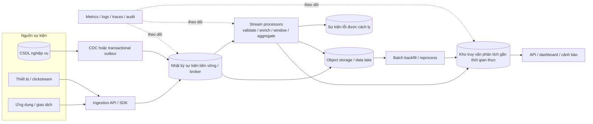
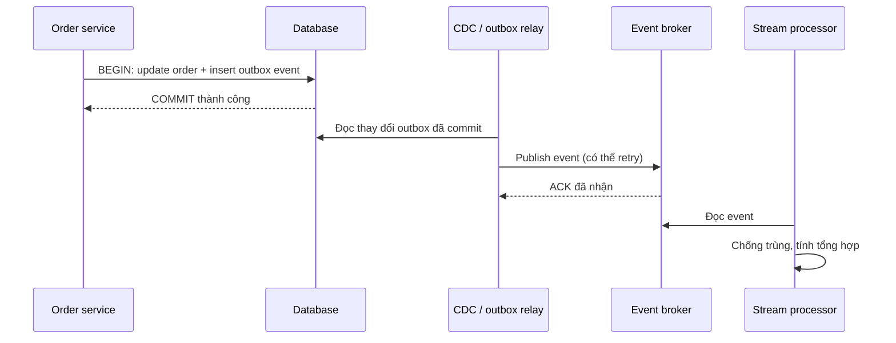

# Xử lý luồng dữ liệu và phân tích gần thời gian thực

> **Chương:** Mẫu kiến trúc tham chiếu  
> **Module:** `CLOUD_ARCHITECTURE` — học cách thiết kế kiến trúc ứng dụng trên đám mây từ yêu cầu nghiệp vụ đến mạng, compute, dữ liệu và mô hình triển khai; đánh giá các đánh đổi về độ tin cậy, bảo mật, mở rộng, chi phí và vận hành theo nguyên tắc Well-Architected.

Một sàn thương mại điện tử muốn nhìn thấy doanh thu, số đơn thanh toán thất bại và dấu hiệu gian lận chỉ vài giây sau khi giao dịch phát sinh. Việc chờ công việc ETL chạy mỗi giờ không đáp ứng yêu cầu này. Thay vì định kỳ đọc toàn bộ dữ liệu, hệ thống có thể **nhận sự kiện liên tục, xử lý tăng dần và cập nhật kết quả truy vấn ngay khi dữ liệu đến**. Đây là ý tưởng cốt lõi của kiến trúc **xử lý luồng dữ liệu (stream processing)** và **phân tích gần thời gian thực (near-real-time analytics)**.

Kiến trúc không chỉ gồm một hệ thống message broker và một dashboard. Nó còn phải giải quyết sự kiện đến muộn, trùng lặp, mất thứ tự, hỏng kết nối, dữ liệu nhạy cảm, quá tải, tái xử lý và cách kiểm chứng kết quả phân tích. Bài học này hướng dẫn xây dựng một **mẫu kiến trúc tham chiếu** có thể điều chỉnh cho phân tích giao dịch, clickstream, IoT, log quan sát và các luồng thay đổi dữ liệu nghiệp vụ.

## Mục tiêu học tập

Sau khi học, bạn có thể:

1. Phân biệt batch, micro-batch và streaming; biến yêu cầu “gần thời gian thực” thành độ trễ đo được.
2. Thiết kế luồng từ producer, ingestion, broker, stream processor đến kho phân tích và API/dashboard.
3. Lựa chọn partition, khóa sự kiện, window, event time, watermark, chiến lược xử lý dữ liệu đến muộn và trùng lặp.
4. Giải thích ranh giới của các bảo đảm *at-most-once*, *at-least-once* và *exactly-once* trong thực tế.
5. Tính toán sơ bộ thông lượng, dung lượng lưu giữ, độ trễ và năng lực phục hồi khi backlog tăng.
6. Thiết kế đường phát lại, đối soát, kiểm soát truy cập, quan sát, cảnh báo và kiểm soát chi phí.

## 1. Streaming khác gì batch và “thời gian thực”?

**Sự kiện (event)** diễn tả điều đã xảy ra: `OrderPaid`, `ProductViewed`, nhiệt độ cảm biến đo được hoặc một thay đổi hàng trong database. **Luồng (stream)** là chuỗi sự kiện được sinh liên tục; tốc độ đến có thể thay đổi mạnh theo thời gian. **Stream processing** biến đổi, lọc, kết hợp và tổng hợp sự kiện khi chúng đến, thường duy trì trạng thái để tính kết quả tăng dần.

| Cách xử lý | Cách hoạt động | Độ trễ điển hình về mặt thiết kế | Ví dụ phù hợp | Đánh đổi chính |
| --- | --- | --- | --- | --- |
| **Batch** | Thu thập dữ liệu rồi xử lý theo lịch. | Phút, giờ hoặc ngày, tùy lịch. | Báo cáo cuối ngày, đối soát toàn bộ lịch sử. | Dễ kiểm soát và tối ưu chi phí theo lô, nhưng dữ liệu mới xuất hiện muộn. |
| **Micro-batch** | Gom lượng dữ liệu nhỏ theo chu kỳ ngắn rồi xử lý. | Vài giây đến vài phút, tùy chu kỳ và tải. | Dashboard cập nhật theo khoảng ngắn, pipeline ETL gia tăng. | Dễ kết nối với mô hình batch nhưng có độ trễ theo chu kỳ và thời gian chạy. |
| **Continuous streaming** | Xử lý khi sự kiện đến, duy trì trạng thái và checkpoint. | Từ mili giây đến giây hoặc hơn, tùy hệ thống và truy vấn. | Cảnh báo gian lận, dữ liệu cảm biến, chỉ số hoạt động trực tiếp. | Cần quản trị thứ tự, state, late events, retry và vận hành liên tục. |

“**Gần thời gian thực**” không phải một mốc cố định. Với dashboard vận hành, **dữ liệu xuất hiện trong 10–30 giây** có thể là đủ; với cảnh báo bảo mật, **dưới 2 giây** có thể cần thiết. Hai con số chỉ là ví dụ yêu cầu sản phẩm, không phải khả năng mặc định của một dịch vụ đám mây.

Phải định nghĩa **điểm đầu và điểm cuối của độ trễ**. Chẳng hạn:

\[
L_{\text{e2e}} = t_{\text{visible}} - t_{\text{occurred}}
\]

Trong đó `t_occurred` là thời điểm nghiệp vụ xảy ra theo nguồn thời gian đáng tin cậy, còn `t_visible` là lúc bản ghi đã có mặt trong kết quả người dùng có thể truy vấn. Nếu chỉ đo thời gian từ broker đến processor, ta có thể bỏ sót hàng chục giây ở khâu ingest, ghi index hoặc làm mới cache của dashboard. Đồng hồ các hệ thống có thể lệch; dùng timestamp được đồng bộ và phân biệt latency đo theo thời gian thực với chênh lệch timestamp có sai số đồng hồ.

Hãy đặt yêu cầu theo SLI/SLO, chẳng hạn: **99% sự kiện thanh toán hợp lệ có mặt trong chỉ số doanh thu trong vòng 15 giây, đo trên cửa sổ 30 ngày**, với quy tắc rõ ràng cho sự kiện nhận muộn do nguồn ngoại tuyến. KPI “dashboard nhanh” không đủ để chọn kiến trúc.

## 2. Kiến trúc tham chiếu đầu cuối

Một kiến trúc phân tích luồng thường có hai đường: **đường nhanh (hot path)** đưa kết quả cập nhật đến người dùng, và **đường lưu trữ/tái xử lý (cold or replay path)** giữ dữ liệu bền vững để kiểm tra và tính lại khi thay đổi logic.



Đây là **sơ đồ logic**, không bắt buộc từng khối phải là một sản phẩm độc lập. Một dịch vụ managed có thể gộp ingest, stream processing hoặc storage. Quan trọng là làm rõ **trách nhiệm và ranh giới lỗi** của từng khối:

| Khối | Trách nhiệm | Quyết định thiết kế cần chốt |
| --- | --- | --- |
| **Producer / nguồn dữ liệu** | Tạo sự kiện có ý nghĩa nghiệp vụ và định danh nhất quán. | Khi nào sự kiện được coi là đã xảy ra? Ai sở hữu schema và event ID? |
| **Ingestion** | Xác thực, giới hạn tốc độ, kiểm tra sơ bộ, ghi nhận tiếp nhận. | Chấp nhận mất dữ liệu hay cần lưu bền vững trước khi trả ACK? Có retry và chống gửi trùng không? |
| **Broker / durable log** | Lưu sự kiện có thứ tự trong partition, tách producer khỏi consumer, cho phép đọc lại. | Partition key, retention, số bản sao, hạn ngạch, mã hóa, sức chịu tải và cách replay? |
| **Stream processor** | Chuẩn hóa, lọc, nối, tính toán window, giữ state và phát kết quả. | Thời gian theo event hay processing? Window đóng khi nào? Cơ chế checkpoint và lỗi? |
| **Serving storage** | Phục vụ truy vấn nhanh theo chiều dữ liệu đã chuẩn bị. | Truy vấn theo thời gian/tenant ra sao? Có hỗ trợ upsert, xóa/đính chính và concurrency không? |
| **Archive / replay** | Lưu raw event/biến đổi và chạy lại khi cần. | Độ bền, retention, định dạng, phân vùng, lineage, version của logic? |
| **API / dashboard / alerting** | Trình bày chỉ số và đưa ra quyết định. | Cache freshness, quyền truy cập, nhãn “dữ liệu đang cập nhật” và ngưỡng cảnh báo? |

Một producer không nên chờ dashboard phản hồi để hoàn thành giao dịch. Broker tạo vùng đệm tách tốc độ phát sinh sự kiện khỏi tốc độ xử lý, giúp ứng dụng nghiệp vụ tiếp tục chạy khi tầng phân tích chậm. Tuy nhiên, broker có giới hạn dung lượng và retention; nếu downstream ngừng quá lâu, backlog sẽ vượt khả năng giữ dữ liệu.

### Các công nghệ có thể đảm nhiệm từng vai trò

- **Broker/stream:** Apache Kafka, Amazon Kinesis Data Streams, Google Cloud Pub/Sub, Azure Event Hubs hoặc dịch vụ tương đương. Mô hình partition, replay, ordering và quota khác nhau; không coi chúng là thay thế trực tiếp với cấu hình y hệt.
- **Processing:** Apache Flink, Spark Structured Streaming, Kafka Streams hoặc dịch vụ stream SQL/managed tương đương. Chọn theo event-time, stateful processing, checkpoint, window và kiến thức vận hành của đội ngũ.
- **Serving:** kho OLAP hỗ trợ ingest nhanh, cơ sở dữ liệu tìm kiếm/time-series, hoặc materialized view/aggregate table có cập nhật liên tục. Data warehouse truyền thống cũng phù hợp nếu độ trễ ingest và truy vấn đạt SLO.
- **Archive:** object storage và bảng phân tích trong data lake, cho phép ghi append theo định dạng có schema và tái xử lý kiểm toán.

Lựa chọn công nghệ là hệ quả của bài toán về độ trễ, dữ liệu, mô hình truy vấn và vận hành. Không cần triển khai tất cả các loại cơ sở dữ liệu chỉ vì chúng có mặt trên sơ đồ tham chiếu.

## 3. Bắt đầu từ hợp đồng sự kiện

Chất lượng của pipeline phụ thuộc vào **event contract**. Ví dụ sự kiện thanh toán thành công:

```json
{
  "event_id": "evt_9c31c5",
  "event_type": "OrderPaid",
  "schema_version": 2,
  "event_time": "2026-11-18T08:15:20.120Z",
  "order_id": "ord_4821",
  "tenant_id": "shop_vn_12",
  "region": "ap-southeast-1",
  "currency": "VND",
  "amount_minor": 1250000,
  "trace_id": "trace_8f42"
}
```

Các giá trị ID và khu vực trong ví dụ là minh họa. `amount_minor` phải có định nghĩa rõ theo tiền tệ và quy ước lưu trữ; không tự áp dụng một số chữ số thập phân chung cho mọi đồng tiền. `event_time` là lúc thanh toán được xác nhận ở nguồn có thẩm quyền, **không nhất thiết là lúc sự kiện đến broker**.

Một hợp đồng tốt cần có:

1. **ID để chống trùng:** `event_id` ổn định qua retry, có phạm vi duy nhất được thỏa thuận. Đối với nghiệp vụ, `order_id` hoặc `payment_id` có thể cần khóa idempotency riêng.
2. **Khóa phân vùng:** thường là `order_id`, `device_id` hoặc `tenant_id`, tùy yêu cầu thứ tự. Event cùng khóa nên đi cùng partition khi cần thứ tự tương đối.
3. **Timestamp và nguồn đồng hồ:** phân biệt `event_time`, `ingest_time`, `processed_time`, công bố timezone/UTC và xử lý clock skew.
4. **Schema có phiên bản:** định nghĩa kiểu, bắt buộc/tùy chọn, thay đổi tương thích và quyền sở hữu. Tránh tự ý đổi nghĩa trường dữ liệu mà không đổi hợp đồng.
5. **Ngữ nghĩa nghiệp vụ:** `OrderPaid` là “đã thu tiền thành công”, không phải “đã gửi yêu cầu thu tiền”; xử lý refund, điều chỉnh và hủy dưới dạng sự kiện có định nghĩa riêng.
6. **Phân loại dữ liệu:** chỉ đưa các trường thật sự cần thiết vào luồng; không truyền token, mật khẩu hoặc thông tin cá nhân thô vào các topic phân tích nếu không có lý do và kiểm soát phù hợp.

### Tạo sự kiện từ database: CDC và transactional outbox

Nếu ứng dụng ghi `orders` thành công rồi mới publish sự kiện, có hai thao tác độc lập: database commit có thể thành công trong khi publish thất bại, làm mất `OrderPaid`. Đảo thứ tự lại thì có thể phát sự kiện dù giao dịch database rollback.

**Transactional outbox** giải quyết cửa sổ lỗi này bằng cách ghi thay đổi nghiệp vụ và hàng `outbox` trong **cùng một giao dịch cơ sở dữ liệu**, sau đó một relay/CDC đọc outbox và chuyển đến broker. Phần chuyển tiếp vẫn có thể gửi trùng khi retry; consumer phải idempotent.



CDC trực tiếp từ bảng nghiệp vụ cũng hữu ích để đưa thay đổi database vào pipeline. Tuy nhiên, thay đổi của một hàng không tự động chứa đầy đủ **ý nghĩa sự kiện nghiệp vụ**. Cần quyết định khi nào dùng CDC trạng thái dữ liệu, khi nào dùng outbox chứa event cấp miền; đồng thời xử lý snapshot ban đầu và thay đổi schema.

## 4. Partition, thứ tự và khả năng mở rộng

Phần lớn hệ thống stream mở rộng nhờ **chia partition** và xử lý các partition song song. Sự kiện có cùng partition key thường được xử lý theo thứ tự trong *chính partition đó*, nhưng **không có thứ tự toàn cục** giữa các partition hoặc nguồn độc lập. Khả năng giữ thứ tự thực tế còn phụ thuộc cơ chế producer retry và cấu hình broker/consumer.

| Khóa phân vùng | Ưu điểm | Rủi ro |
| --- | --- | --- |
| `order_id` | Dễ giữ sự kiện của cùng đơn theo thứ tự. | Rất nhiều key; các phép tính theo tenant cần bước tổng hợp tiếp theo. |
| `tenant_id` | Thuận tiện cho phân tích riêng từng tenant. | Tenant lớn có thể trở thành **hot partition** và giới hạn throughput. |
| `device_id` | Dễ tính trạng thái chuỗi đo của một thiết bị. | Nếu cần tổng hợp toàn khu vực, phải gom dữ liệu từ nhiều partition. |
| Random hoặc round-robin | Phân phối tải đều khi sự kiện độc lập. | Mất bảo đảm thứ tự cho một đối tượng nghiệp vụ. |

**Hot key** xuất hiện khi một khóa chiếm lượng sự kiện quá lớn khiến worker phụ trách partition đó bị nghẽn dù các worker khác rảnh. Giải pháp có thể là phân tán key thành các shard, tính tổng hợp hai tầng (partial aggregate rồi merge), hoặc chọn chiến lược phân vùng khác. Phân mảnh khóa có thể đánh đổi khả năng giữ thứ tự; không dùng nó khi nghiệp vụ yêu cầu tất cả cập nhật của một đối tượng phải được tuần tự hóa.

Độ song song hiệu dụng phụ thuộc số partition, năng lực worker, tốc độ xử lý mỗi event, chi phí state và băng thông. Thêm worker khi số partition không tăng hoặc khi nghẽn nằm ở serving database có thể không cải thiện throughput.

## 5. Event time, processing time, window và watermark

Một sự kiện có thể xảy ra lúc 10:00:01 nhưng đến processor lúc 10:00:20 do thiết bị offline, mạng chậm hoặc broker tồn backlog. Vì vậy cần phân biệt:

- **Event time:** thời điểm sự kiện thực sự phát sinh theo ngữ nghĩa nghiệp vụ.
- **Ingestion time:** thời điểm nền tảng nhận được sự kiện.
- **Processing time:** thời điểm tác vụ xử lý sự kiện.

Giả sử cần tính doanh thu theo từng phút. Nếu dùng *processing time*, giao dịch xảy ra trong phút 10:00 nhưng đến trễ lúc 10:01 sẽ bị tính vào phút 10:01. Nếu yêu cầu báo cáo theo thời điểm thanh toán, dùng **event-time window** sẽ đúng với nghiệp vụ hơn.

### Các loại window thông dụng

| Window | Ý tưởng | Ví dụ |
| --- | --- | --- |
| **Tumbling** | Chia thời gian thành các khoảng không chồng lấp. | Tổng đơn mỗi phút `[10:00,10:01)`, `[10:01,10:02)`. |
| **Hopping/sliding** | Các khoảng có thể chồng lấp, cập nhật liên tục theo bước trượt. | Doanh thu 5 phút gần nhất, cập nhật mỗi 30 giây. |
| **Session** | Nhóm sự kiện thành phiên, kết thúc khi im lặng quá ngưỡng. | Gom các lần click của người dùng cách nhau dưới 15 phút. |

### Watermark và dữ liệu đến muộn

**Watermark** là ước lượng tiến độ thời gian sự kiện mà processor đã nhìn thấy. Một watermark ví dụ cho biết hệ thống dự kiến phần lớn sự kiện trước `10:00:58` đã đến; nhờ vậy có thể đóng hoặc phát kết quả cho window tương ứng. Watermark **không chứng minh** tất cả sự kiện cũ đã đến. Thiết kế phải quy định cách xử lý event trễ hơn watermark.

Ví dụ xử lý window một phút với độ trễ chấp nhận 2 phút:

```text
Sự kiện phát sinh       10:00:40   OrderPaid 100.000 VND
Đến stream processor    10:00:42   Tính vào window [10:00, 10:01)

Sự kiện phát sinh       10:00:50   OrderPaid 200.000 VND
Đến stream processor    10:01:20   Vẫn tính vào window [10:00, 10:01)

Sự kiện phát sinh       10:00:55   OrderPaid 300.000 VND
Đến stream processor    10:04:10   Có thể đã vượt watermark + thời gian cho phép
```

Với dòng cuối, hệ thống phải có chính sách: **cập nhật lại kết quả cũ**, ghi vào **luồng late events** để tính bù, hay chấp nhận loại khỏi dashboard nhanh nhưng đưa vào bảng đối soát. Sự kiện quá hạn không có nghĩa là vô giá trị; các chỉ số tài chính cần đường đính chính có kiểm toán. Tùy engine, một window có thể phát kết quả sớm rồi cập nhật nhiều lần trước khi chốt.

### Tổng hợp theo window có cập nhật

Mã giả độc lập nền tảng dưới đây biểu diễn nghiệp vụ; tên hàm là khái niệm, không phải API có thể chạy trực tiếp:

```text
for each event in stream("OrderPaid"):
    validate_schema(event)
    if dedup_key_seen(event.event_id):
        continue

    minute = floor_to_minute(event.event_time)
    key = (event.tenant_id, minute, event.currency)
    state[key].revenue_minor += event.amount_minor
    state[key].paid_orders += 1
    emit_upsert("revenue_by_minute", key, state[key])

when watermark passes window_end + allowed_lateness:
    finalize_or_retain_for_correction(key)
```

Kết quả ở serving store phải có khóa duy nhất, chẳng hạn `(tenant_id, minute, currency)`, và hỗ trợ **upsert** nếu window được tính lại. Nếu mỗi bản cập nhật bị append như một bản ghi doanh thu mới, dashboard sẽ cộng trùng. State dùng cho chống trùng và window phải có chiến lược hết hạn phù hợp với thời gian retry, thời gian đến muộn và chi phí lưu trữ.

## 6. Bảo đảm xử lý: at-most-once, at-least-once, exactly-once

Trong môi trường phân tán, consumer có thể xử lý xong event nhưng mất kết nối trước khi ghi checkpoint hoặc ACK. Khi phục hồi, hệ thống có thể nhận lại sự kiện đã xử lý. Các cách tiếp cận có ý nghĩa khác nhau:

| Ngữ nghĩa | Điều đảm bảo | Ảnh hưởng thường thấy |
| --- | --- | --- |
| **At-most-once** | Mỗi event được thử xử lý tối đa một lần; có thể mất sự kiện khi lỗi. | Hợp lý với telemetry không quan trọng nếu ưu tiên chi phí/độ đơn giản. |
| **At-least-once** | Event không mất trong phạm vi giả định về độ bền, retention và recovery, nhưng có thể xử lý lại. | Cần dedup/idempotent sink để tránh cộng trùng. |
| **Exactly-once processing semantics** | Một engine có thể phối hợp đọc, state và output trong một phạm vi giao dịch/checkpoint xác định để tránh hiệu ứng lặp bên trong phạm vi đó. | Không tự động đảm bảo side effect bên ngoài như gửi email, gọi payment API hay ghi sang database không hỗ trợ giao dịch tương thích. |

Nói “Kafka/Flink có exactly-once nên mọi hệ thống đều không trùng” là suy luận sai. **Exactly-once end-to-end** đòi hỏi kiểm tra toàn bộ chuỗi: nguồn phát, broker, state backend, sink, retry và các side effect. Với nhiều hệ thống, lựa chọn thực tế là **at-least-once + idempotency + đối soát**.

Các kỹ thuật phổ biến:

- Tạo `event_id` ổn định khi producer retry, tránh sinh ID mới cho cùng sự kiện logic.
- Dùng **upsert theo business key và version** hoặc khóa duy nhất trong serving storage.
- Với thao tác đòi hỏi chỉ thực hiện một lần, dùng idempotency key hoặc unique constraint ở hệ thống có thẩm quyền.
- Ghi checkpoint/offset theo cách nhất quán với state và commit output, để khi khôi phục có thể replay an toàn.
- Thiết kế event có ý nghĩa rõ với hành động chỉnh sửa/hủy: dùng compensation hoặc event đảo, không xóa lặng lẽ lịch sử.
- Xác minh thường xuyên bằng đối soát với nguồn dữ liệu nghiệp vụ, thay vì chỉ tin vào số event đã xử lý.

### Lỗi dữ liệu và dead-letter queue

Lỗi dữ liệu không hợp lệ khác với lỗi hạ tầng tạm thời. Với schema sai hoặc giá trị không thể xử lý, retry vô hạn có thể chặn cả partition. Hãy phân loại:

1. **Transient:** timeout, giới hạn tốc độ, đích tạm unavailable → retry có backoff, giới hạn số lần và không làm quá tải phụ thuộc.
2. **Permanent:** thiếu trường bắt buộc, phiên bản schema chưa hỗ trợ, định dạng sai → cách ly trong **DLQ/quarantine** kèm nguyên nhân, thời điểm, topic/partition/offset và correlation ID.
3. **Đòi hỏi nghiệp vụ:** refund, đơn bị hủy, giao dịch tranh chấp → quy trình đối soát hoặc compensation có kiểm soát.

Không để DLQ trở thành “thùng rác” quên kiểm tra. Phải có owner, SLO xử lý, quyền truy cập và chính sách replay; nội dung lỗi có thể chứa dữ liệu nhạy cảm cần mã hóa/ẩn thông tin.

## 7. Chọn nơi lưu và phục vụ truy vấn

**Broker không phải kho phục vụ dashboard tùy ý.** Broker phù hợp lưu chuỗi sự kiện theo offset và retention, còn dashboard thường hỏi “doanh thu theo phút của 500 cửa hàng trong 24 giờ, lọc khu vực và loại thiết bị”. Cần kho tối ưu theo kiểu truy vấn:

| Kiểu truy vấn | Mẫu serving phù hợp | Cần lưu ý |
| --- | --- | --- |
| Đếm/tổng hợp theo phút, tenant, region | Bảng aggregate, materialized view, OLAP ingest nhanh. | Upsert theo khóa window, giới hạn cardinality và giữ lịch sử sửa số liệu. |
| Tra cứu chuỗi trạng thái của một đối tượng | Key-value/document store hoặc bảng truy vấn theo ID. | Đảm bảo thứ tự, version và TTL thích hợp. |
| Phân tích log, sự kiện có nhiều thuộc tính tự do | Search/analytics index. | Chi phí index và schema/cardinality cao. |
| Báo cáo đối soát lịch sử, query ad hoc nhiều tháng | Warehouse/lakehouse trên archive. | Có độ trễ lớn hơn đường hot nhưng kiểm toán và tái xử lý linh hoạt. |
| Cảnh báo tức thời | Processor sinh alert đến hệ thống cảnh báo/quy tắc. | Rate limit, chống cảnh báo trùng và luồng xác nhận xử lý. |

Một sản phẩm có thể sử dụng **hot store** cho 7 ngày gần nhất và **archive** cho báo cáo dài hạn. Dashboard nên công bố thời điểm dữ liệu mới nhất (`data_as_of`), thời điểm watermark và trạng thái pipeline, để người dùng biết số liệu có thể được đính chính. Với doanh thu, tách “ước tính cập nhật nhanh” và “số đối soát cuối cùng” nếu nghiệp vụ yêu cầu.

**Khi nào cần Kappa hoặc Lambda?** Trong kiến trúc **Kappa**, ưu tiên một luồng xử lý và replay event log cho tính toán lại. Trong **Lambda**, thường có đường speed và batch độc lập tạo các kết quả cần hợp nhất. Kappa giảm logic trùng lặp nếu replay và state xử lý được; Lambda có thể hữu ích khi batch lịch sử cần thuật toán khác, nhưng tăng nguy cơ hai đường tính ra số khác nhau. Hãy bắt đầu từ một pipeline có đường sửa sai rõ ràng rồi bổ sung batch khi yêu cầu lịch sử và kiểm toán đòi hỏi.

## 8. Sizing: thông lượng, retention, độ trễ và backlog

Kiến trúc cần thiết kế theo **lưu lượng đỉnh**, không chỉ trung bình ngày. Giả sử hệ thống nhận trung bình **1.000 sự kiện/giây**, kích thước mỗi sự kiện sau mã hóa là **1 KiB**, hệ số đỉnh gấp **5 lần**, và broker giữ dữ liệu **3 ngày**.

### Tính lưu lượng đầu vào và dung lượng thô

Với giả định tính theo kibibyte (1 KiB = 1.024 byte):

\[
R_{\text{bytes/s}} = R_{\text{events/s}} \times S_{\text{bytes/event}}
\]

- Trung bình: `1.000 × 1.024` = **1.024.000 byte/giây**, xấp xỉ **0,98 MiB/giây**.
- Đỉnh: `5.000 × 1.024` = **5.120.000 byte/giây**, xấp xỉ **4,88 MiB/giây**.
- Lưu lượng logic thô mỗi ngày: `1.024.000 × 86.400` = **88.473.600.000 byte**, khoảng **82,4 GiB/ngày**.
- Lưu lượng logic thô giữ 3 ngày: khoảng **247,2 GiB**, *chưa tính* bản sao, index, metadata, message overhead, nén, storage overhead hoặc dữ liệu đầu ra.

Với broker có **3 replica** và không xét tối ưu nén, chỉ riêng dữ liệu sao chép đã có thể cần bậc khoảng **741,6 GiB** dung lượng vật lý cho 3 ngày; cơ chế lưu, quota và chi phí thực tế phụ thuộc dịch vụ. Không coi phép nhân này là dự báo hóa đơn chính xác.

Nếu một worker xử lý bền vững **1.000 sự kiện/giây** trong thử nghiệm tải thực tế, tải đỉnh 5.000 sự kiện/giây có thể cần **ít nhất 5 đơn vị xử lý tương đương** trước khi cộng headroom, chi phí join/window và giới hạn partition. Nên có vùng dự phòng để phục hồi sau một worker hỏng, tăng tải đột biến và checkpoint/rebalance.

### Backlog và thời gian bắt kịp

Giả sử dòng vào 1.000 event/s, processor ngừng 10 phút:

\[
N_{\text{backlog}} = 1.000 \times 600 = 600.000\ \text{events}
\]

Sau khi phục hồi, nếu processor xử lý được 1.500 event/s trong khi producer tiếp tục gửi 1.000 event/s, tốc độ giảm backlog là **500 event/s**, nên cần tối thiểu:

\[
T_{\text{catch-up}} = \frac{600.000}{1.500-1.000} = 1.200\ \text{s} = 20\ \text{phút}
\]

Phép tính giả định lưu lượng và tốc độ đều ổn định, không có retry hay checkpoint tốn thời gian. Nếu tốc độ xử lý **không lớn hơn** tốc độ vào, backlog không thể tự giảm; tăng retention chỉ kéo dài thời gian chịu đựng, không giải quyết nghẽn. Cần theo dõi **consumer lag theo thời gian**, không chỉ số bản ghi tồn đọng, vì message có kích thước và tốc độ đến khác nhau.

### Phân bổ ngân sách độ trễ

Nếu SLO yêu cầu 99% dữ liệu xuất hiện trong 15 giây, đội ngũ có thể đặt các **mục tiêu điều hành sơ bộ** cho từng đoạn: nhận event 2 giây, broker 2 giây, xử lý 4 giây, ghi serving 3 giây và truy vấn/hiển thị 2 giây, dành phần còn lại cho dao động. Đây là ngân sách quản trị, **không có nghĩa cộng p99 của từng đoạn sẽ cho ra p99 đầu cuối**. Sự phụ thuộc giữa các đoạn và phân phối độ trễ khiến cần đo trace hoặc mốc thời gian đầu cuối trên từng event thực tế.

## 9. Độ tin cậy và xử lý lỗi theo nguyên tắc Well-Architected

| Tình huống | Rủi ro | Thiết kế ứng phó |
| --- | --- | --- |
| Một worker dừng đột ngột | Mất state chưa checkpoint, phân vùng tạm không được xử lý. | State bền vững/checkpoint, tự phục hồi, rebalance, kiểm tra idempotency sau replay. |
| Broker quá tải hoặc mất một AZ | Producer timeout, consumer lag tăng, có thể vượt retention. | Khả năng chịu lỗi đa AZ phù hợp, retry có backoff, buffer và giới hạn tốc độ ở producer, kế hoạch điều tiết tải. |
| Serving database chậm | Processor bị backpressure hoặc ghi lỗi, dashboard stale. | Capacity planning, batch/upsert tối ưu, circuit breaker và giám sát độ tươi dữ liệu. |
| Producer đẩy schema không tương thích | Event lỗi đồng loạt, pipeline dừng hoặc bỏ qua dữ liệu. | Schema compatibility check trong CI/CD, kiểm thử hợp đồng và cách ly event không hợp lệ. |
| Replay chạy song song với luồng live | Ghi đè kết quả mới, double-count, tăng đột biến tải. | Đặt output theo version/run, idempotent upsert, phân tách tài nguyên và cutover có kiểm soát. |
| Mất một region | Giảm năng lực ingest/processing; dữ liệu có thể chưa sao chép. | Xác định RTO/RPO, năng lực region dự phòng, replication strategy và quy định cư trú dữ liệu; diễn tập failover. |
| Khóa/secret hoặc cấu hình chung sai | Nhiều pipeline ngừng cùng lúc. | Phân quyền tối thiểu, luân chuyển có kiểm soát, audit, hạn chế phụ thuộc control plane trên đường xử lý sống. |

**Khả dụng của pipeline** và **độ đúng của chỉ số** là hai mục tiêu khác nhau. Một processor vẫn chạy và xuất metric nhưng tính doanh thu gấp đôi là thất bại nghiệp vụ. Khi đánh giá reliability, cần chứng minh tính đúng qua mẫu đối soát, đặc biệt với giao dịch tiền, tồn kho và dữ liệu dùng để kích hoạt hành động tự động.

### Chọn triển khai một region hay đa region

Nhiều dịch vụ streaming được triển khai **đa AZ trong một region** để chịu sự cố máy hoặc vùng sẵn sàng. **Đa region** nâng mức chịu lỗi địa lý nhưng tăng chi phí dữ liệu xuyên vùng, trùng lặp, thứ tự event, checkpoint/replay và độ phức tạp bảo mật. Với streaming, không thể mặc định di chuyển producer sang region B sẽ giữ nguyên offset, ID hoặc state của region A. Thiết kế phải quy định rõ luồng failover, khoảng dữ liệu có thể mất, cách chống trùng khi nhập lại và cách đối soát sau khi failback.

Ở nơi có yêu cầu dữ liệu cư trú trong quốc gia/khu vực, có thể **xử lý dữ liệu chi tiết tại region nguồn** rồi chuyển sang vùng phân tích chung dưới dạng kết quả tổng hợp đã được phép. Quyết định này đòi hỏi xác nhận chính sách pháp lý và kỹ thuật cụ thể, không chỉ đổi cấu hình broker.

## 10. Bảo mật, quyền riêng tư và quản trị dữ liệu

Hệ thống stream thường nhận dữ liệu từ nhiều nguồn nên bề mặt tấn công và nguy cơ rò rỉ tăng theo số topic, consumer và bản sao lưu. Tối thiểu cần:

- **Xác thực và phân quyền:** producer chỉ được ghi topic cần thiết, consumer chỉ được đọc phần phù hợp; sử dụng danh tính dịch vụ và quyền tối thiểu, tránh chung credential toàn hệ thống.
- **Mã hóa:** TLS trên đường truyền, mã hóa lưu trữ, quản lý khóa và chính sách luân chuyển secret; tránh đưa token vào event, log, DLQ và debug trace.
- **Quản lý schema và dữ liệu cá nhân:** phân loại trường nhạy cảm, chỉ lưu dữ liệu cần cho mục tiêu phân tích, che hoặc băm/pseudonymize khi phù hợp và được phép.
- **Retention và xóa dữ liệu:** áp dụng chính sách theo topic, archive, serving store, backup và DLQ; khi phải xóa dữ liệu cá nhân, cần xác định cả bản sao trong log bất biến và lịch sử replay.
- **Kiểm soát chất lượng:** xác thực phạm vi giá trị, tính hợp lệ của event type, version, thời gian, currency, lượng event trùng và dữ liệu thiếu.
- **Audit và lineage:** biết producer nào phát event, processor phiên bản nào tính kết quả, source offset/checkpoint nào và ai đã truy cập/thay đổi pipeline.
- **Bảo vệ consumer công cộng:** dashboard/API phải kiểm soát theo tenant, tránh trả aggregate hoặc truy vấn xuyên tenant do cấu hình filter sai.

Không giữ toàn bộ event thô vô hạn chỉ vì broker hỗ trợ replay. **Replay khả thi** có thể đạt được bằng lưu archive có chính sách, phiên bản schema và bảo vệ dữ liệu phù hợp; thời gian lưu phải dựa trên nhu cầu kiểm toán, khôi phục và nghĩa vụ dữ liệu.

## 11. Quan sát và vận hành pipeline

Một dashboard hạ tầng chỉ có CPU và số message không đủ. Nên giám sát các lớp sau:

| Chỉ số | Diễn giải | Tín hiệu vấn đề |
| --- | --- | --- |
| **Ingest rate & error rate** | Event/s và tỷ lệ bị từ chối hoặc lỗi ở nguồn/ingestion. | Bất ngờ giảm về 0 hoặc tăng vọt; nguồn có thể đã ngừng phát, không chỉ pipeline khỏe. |
| **End-to-end freshness** | Độ tuổi event thực sự đã hiển thị ở serving/query so với lúc phát sinh. | Dashboard trả lời nhanh nhưng dữ liệu đã cũ. |
| **Consumer lag (offset/time)** | Khoảng cách giữa nguồn và tiến độ consumer. | Lag tăng liên tục, processor không bắt kịp nguồn. |
| **Watermark lag** | Độ chậm của watermark so với thời gian hiện tại hoặc event-time phân phối. | Window không chốt, state tăng, một partition idle làm chậm toàn bộ kết quả. |
| **Processing throughput & backpressure** | Tốc độ xử lý thực tế và thời gian bị chặn bởi downstream. | Worker đủ CPU nhưng sink quá chậm. |
| **Checkpoint health** | Tần suất, thời lượng, lỗi checkpoint, thời gian khôi phục state. | Khó phục hồi nhất quán, nguy cơ replay lớn. |
| **DLQ, retry, duplicates, late events** | Tỷ lệ trường hợp bất thường theo schema và tenant. | Mất độ đúng dữ liệu dù dịch vụ vẫn trả 200. |
| **Data reconciliation drift** | Chênh lệch aggregate với dữ liệu nghiệp vụ có thẩm quyền. | Tính sai hoặc bỏ sót âm thầm. |
| **Serving query latency & freshness** | p95/p99 latency, lỗi truy vấn, lag giữa sink và index. | Người dùng nhìn thấy kết quả chậm hoặc stale. |
| **Cost per event / per query** | Chi phí nhận, xử lý, lưu và truy vấn theo lưu lượng. | Tăng chi phí do hot key, retry, replication hoặc indexing quá mức. |

Nên gắn nhãn theo `environment`, `region`, `pipeline`, `topic`, `processor_version` và những chiều có giá trị vận hành. **Tránh gắn `event_id` hoặc `user_id` làm metric label** vì cardinality cực cao; dùng log/trace bảo vệ phù hợp để điều tra từng sự kiện.

Thiết lập cảnh báo dựa trên **SLO và khả năng khôi phục**: ví dụ chỉ số freshness vượt ngưỡng nhiều phút, backlog dự kiến vượt retention, DLQ tăng đột biến hoặc đối soát lệch. Không chỉ báo động vì CPU 80% nếu pipeline vẫn đạt SLO. Với luồng có chu kỳ im lặng tự nhiên, định nghĩa tín hiệu nguồn có dữ liệu dự kiến để phân biệt “không có sự kiện” với “mất ingest”.

### Runbook cơ bản khi kết quả phân tích bị chậm

1. **Xác minh sự cố người dùng:** truy vấn thời điểm event mới nhất được hiển thị, phân biệt API chậm với dữ liệu stale.
2. **Lần ngược pipeline:** nguồn có phát sự kiện không → ingestion có lỗi không → broker retention/lag ra sao → processor có backpressure/checkpoint lỗi không → sink/index có bị nghẽn không.
3. **Chặn nguy cơ mất dữ liệu:** giảm tốc độ nguồn nếu nghiệp vụ cho phép, tăng retention/buffer theo nguồn lực, tránh để backlog vượt giới hạn trước khi xử lý được.
4. **Phục hồi có kiểm soát:** tăng tài nguyên đúng nút nghẽn, khởi động lại từ checkpoint hợp lệ; tránh “skip offset” chỉ để biến lag về 0 vì có thể làm mất dữ liệu phân tích.
5. **Kiểm tra đúng đắn:** đối soát số event/bản ghi, dedup, late events và các window chưa hoàn chỉnh, tính lại phần bị ảnh hưởng khi cần.
6. **Kết thúc sự cố:** xác minh freshness và các nghiệp vụ quan trọng đã phục hồi, cập nhật capacity plan, cảnh báo và bài học vận hành.

## 12. Phát hành thay đổi và tái xử lý an toàn

Với streaming chạy liên tục, thay một hàm aggregate có thể thay đổi ý nghĩa mọi kết quả sau thời điểm triển khai. Nếu state trong processor có schema hoặc serialization khác, bản mới có thể không khôi phục được checkpoint của bản cũ. Do đó, phát hành pipeline cần có quy trình riêng:

1. **Kiểm thử hợp đồng:** producer và consumer cùng tương thích với schema mới; có sample event và dữ liệu sai/đến muộn.
2. **Kiểm thử state và window:** xác minh kết quả sau restart, replay, thứ tự thay đổi, duplicate và watermark ở ranh giới window.
3. **Canary/shadow:** chạy phiên bản mới trên luồng sao chép hoặc tập nguồn được phân tách; so kết quả với phiên bản hiện tại nhưng không để hai phiên bản cùng ghi vào cùng aggregate production thiếu kiểm soát.
4. **Quy định đường nâng cấp state:** dùng migration, savepoint/checkpoint tương thích hoặc xây lại state từ sự kiện đã lưu; dự tính thời gian và chi phí khi state lớn.
5. **Cutover có kiểm soát:** chuyển quyền ghi vào serving store theo phiên bản/run ID, lưu đường rollback cho code và tuyến dữ liệu.
6. **Đối soát sau thay đổi:** kiểm tra dữ liệu tại các điểm biên, event bị trễ và số liệu aggregate theo nguồn có thẩm quyền.

**Backfill/replay** không đơn giản là đẩy lại toàn bộ dữ liệu vào topic production. Cách làm an toàn thường ghi kết quả sang bảng hoặc namespace theo phiên bản, so sánh với bản hiện hành, rồi thực hiện **atomic/safe cutover** ở tầng truy vấn khi đạt tiêu chí. Khi replay cùng live stream, cần mốc offset/thời gian nhất quán để tránh bỏ sót hoặc áp dụng trùng. Nếu làm lại chỉ một khoảng lịch sử, phải định nghĩa cách cập nhật các window chịu tác động ngoài khoảng đó.

## 13. Tình huống thiết kế: dashboard doanh thu đa cửa hàng

**Bối cảnh:** nền tảng có 3.000 cửa hàng. Hệ thống giao dịch phát các event `OrderPaid`, `OrderRefunded` và `OrderCancelled`. Mục tiêu là người quản lý xem doanh thu gần thời gian thực theo cửa hàng và khu vực; đội chống gian lận nhận cảnh báo khi số giao dịch bất thường tăng. Dữ liệu có thể đến trễ vì provider thanh toán gửi webhook muộn. Tại giờ cao điểm, lưu lượng gấp nhiều lần mức trung bình.

**Yêu cầu được diễn giải thành quyết định kiến trúc:**

| Yêu cầu | Thiết kế đề xuất | Kiểm chứng |
| --- | --- | --- |
| Dashboard cập nhật trong 15 giây cho phần lớn sự kiện | Outbox/CDC → broker bền vững → processor event-time → aggregate serving → API. | Theo dõi p99 end-to-end freshness theo tenant/region và tỷ lệ đạt ngưỡng. |
| Không cộng trùng doanh thu | Stable event ID, idempotent upsert, phân biệt payment với refund, đối soát. | Replay một event 2–3 lần không làm đổi tổng cuối cùng; đối chiếu sổ giao dịch. |
| Có sự kiện đến muộn | Watermark, allowed lateness, điều chỉnh kết quả theo window; đường sửa dữ liệu. | Gửi event trễ trước và sau ngưỡng, kiểm tra dashboard và bảng đối soát. |
| Chịu được đỉnh traffic | Partition theo khóa thích hợp, capacity headroom, kiểm tra hot tenant, autoscaling phù hợp state. | Load test ở đỉnh và đo tốc độ giảm backlog sau gián đoạn. |
| Nhiều tenant có quyền truy cập riêng | Áp chính sách authn/authz tại API và data layer, giảm thông tin nhạy cảm trong event. | Tenant A không truy vấn hoặc suy ra chi tiết của tenant B. |
| Báo cáo lịch sử phải giải thích được | Lưu event đủ lâu theo chính sách, version processor, replay và đối soát với nguồn nghiệp vụ. | Tính lại một ngày quá khứ và giải thích mọi chênh lệch. |

### Luồng nghiệp vụ mẫu

1. Order service ghi thanh toán thành công và outbox event `OrderPaid` trong cùng transaction.
2. Outbox relay publish lên broker. Partition theo `order_id` để dễ giữ thứ tự nghiệp vụ của một đơn. Retry có thể làm event xuất hiện nhiều lần.
3. Processor kiểm tra schema, `event_id`, chuẩn hóa currency và định tuyến event đến phép tính doanh thu theo cửa hàng, currency và minute window. Nếu cần quy đổi tiền tệ, phải định nghĩa nguồn tỷ giá và thời điểm áp dụng; không cộng trực tiếp số tiền khác đơn vị.
4. Processor phát **upsert** vào aggregate serving. API trả `revenue_minor`, `currency`, `window_start`, `data_as_of` và trạng thái có thể còn sửa.
5. Các event refund/cancel được đưa vào luồng điều chỉnh có khóa tham chiếu giao dịch gốc. Phân biệt doanh thu gộp, hoàn tiền và doanh thu ròng để không tạo công thức nhập nhằng.
6. Bản sự kiện gốc hoặc bản đã được chuẩn hóa phù hợp được lưu archive. Một công việc đối soát theo lịch so sánh với ledger chính thức và tạo bút toán điều chỉnh khi phát hiện lệch.

### Một lỗi thực tế để diễn tập

Sau khi ra mắt phiên bản processor mới, chỉ số doanh thu tăng bất thường trong khi số `OrderPaid` duy nhất không tăng. Kiểm tra cho thấy mỗi lần processor retry ghi **một dòng aggregate mới** thay vì upsert theo khóa `(tenant, minute, currency)`. Thao tác khôi phục gồm dừng triển khai, khóa đường ghi sai, đưa processor về bản ổn định, tái dựng các window bị ảnh hưởng từ nguồn sự kiện có thể kiểm toán rồi chuyển dashboard sang bảng kết quả đúng. Chỉ báo “consumer lag gần bằng 0” hoàn toàn không giúp phát hiện lỗi này; đối soát và kiểm tra tính duy nhất mới là guardrail quan trọng.

### Đánh đổi theo Well-Architected

- **Reliability:** broker bền vững, checkpoint, DLQ và replay làm tăng khả năng khôi phục, nhưng không thay thế đối soát nghiệp vụ.
- **Performance efficiency:** streaming với state và serving index đạt độ tươi cao; phải chấp nhận chi phí compute liên tục và kỹ thuật partition/window phức tạp hơn batch.
- **Security:** xác thực, mã hóa, cô lập tenant và retention giúp kiểm soát luồng có nhiều bản sao dữ liệu.
- **Cost optimization:** đặt retention phù hợp, chọn managed service nếu giảm công vận hành, tránh index mọi thuộc tính và tận dụng batch cho truy vấn lịch sử không cần cập nhật giây.
- **Operational excellence:** SLO freshness, runbook, schema checks, canary, replay thử nghiệm và truy vết dữ liệu là phần của sản phẩm, không phải công việc phụ sau triển khai.

## 14. Các sai lầm thường gặp

| Sai lầm | Hệ quả | Cách khắc phục |
| --- | --- | --- |
| Nói “real time” mà không định nghĩa điểm đo | Không thể chọn công nghệ hoặc xác nhận đã đạt yêu cầu. | Đặt SLO đo từ thời điểm event đến lúc kết quả truy vấn được. |
| Dùng processing time cho dữ liệu có thể đến muộn | Tổng hợp theo thời gian nghiệp vụ sai lệch. | Dùng event-time window, watermark và chính sách late data. |
| Tin rằng broker có thứ tự toàn cục | Sự kiện khác partition bị hiểu sai quan hệ trước/sau. | Thiết kế partition key, version và ranh giới ordering rõ. |
| Thấy “exactly-once” là bỏ idempotency | Retry tại sink/API vẫn tạo hiệu ứng trùng. | Kiểm tra bảo đảm end-to-end và thiết kế idempotent side effects. |
| Coi broker là kho dữ liệu duy nhất | Retention kết thúc khiến không thể tái xử lý quá khứ. | Lưu archive/nguồn dữ liệu có chính sách và khả năng replay. |
| Thêm worker nhưng hot partition hoặc sink vẫn nghẽn | Chi phí tăng mà lag không giảm. | Đo đúng nút nghẽn, cải thiện partitioning/state/serving. |
| Không có đối soát với nguồn chính thức | Kết quả sai âm thầm trong thời gian dài. | Tổ chức reconciliation và đường sửa dữ liệu. |
| Dùng ID người dùng làm nhãn metrics | Cardinality bùng nổ, chi phí và hiệu năng giám sát xấu. | Chỉ dùng các chiều đủ hữu ích, truy vết chi tiết bằng log/trace bảo vệ. |
| Replay trực tiếp đè kết quả đang phục vụ | Số liệu dao động, ghi đè phiên bản mới hoặc cộng trùng. | Reprocess theo namespace phiên bản, kiểm chứng rồi cutover an toàn. |

## 15. Checklist đánh giá và bài thực hành

Trước khi chọn mẫu kiến trúc này, hãy kiểm tra:

- [ ] Có use case cần cập nhật theo giây/phút; đã chứng minh batch hoặc micro-batch thuần túy không đáp ứng SLO hay tính năng cần thiết.
- [ ] Có event contract, owner, schema version, event ID, business key và định nghĩa thời gian rõ.
- [ ] Biết nguồn sự kiện, cơ chế phát đáng tin cậy, điểm ACK, retry và khả năng gửi trùng.
- [ ] Đã xác định partition key, mức song song, nguy cơ hot key và trật tự sự kiện cần giữ.
- [ ] Có cách xử lý event-time, watermark, window, late events, cập nhật lại kết quả và bù dữ liệu.
- [ ] Có mô tả chính xác độ bền/checkpoint/idempotency cho cả broker, state và sink; không khẳng định exactly-once vượt phạm vi hỗ trợ.
- [ ] Sizing theo trung bình, đỉnh, retention, replica, thời gian catch-up và khả năng mở rộng của serving store.
- [ ] Có SLO về freshness, correctness, error/DLQ, lag, query latency và quy trình đối soát.
- [ ] Có đường archive/replay/backfill và quy trình nâng cấp state/processor có thể kiểm thử.
- [ ] Có phân quyền theo producer/consumer/tenant, kiểm soát PII, retention, mã hóa, audit và lưu trú dữ liệu.
- [ ] Có runbook ngừng/khôi phục theo failure domain, khả năng chuyển vùng nếu cần, kiểm soát chi phí và người chịu trách nhiệm vận hành.

### Bài thực hành

Bạn được giao thiết kế nền tảng nhận **8.000 sự kiện/giây** trung bình, **đỉnh gấp 4**, mỗi sự kiện **2 KiB**, cần hiển thị số thiết bị lỗi theo khu vực trong **10 giây** cho **99% sự kiện**. Thiết bị có thể offline đến **5 phút** rồi gửi bù; một số thiết bị gửi trùng khi retry. Nguồn dữ liệu chi tiết của một số khách hàng phải ở lại region chỉ định.

Hãy trình bày một thiết kế gồm: sơ đồ producer → ingest → broker → processor → serving/archive; partition key; tumbling hoặc hopping window; watermark và chính sách late event; chống trùng; lượng raw data phát sinh mỗi ngày, lưu 48 giờ trước replica; khả năng xử lý backlog khi một consumer ngừng 15 phút; bốn chỉ số SLO/alert quan trọng và phương án phát hành phiên bản processor mới an toàn. Chỉ rõ giả định nào cần đo trong load test và cách đáp ứng hạn chế lưu trú dữ liệu.

**Gợi ý kiểm tra phép tính:** ở mức trung bình, `8.000 × 2 KiB = 16.000 KiB/s` (xấp xỉ 15,625 MiB/s), tương đương khoảng **1,288 TiB/ngày** dữ liệu logic trước overhead; giữ 48 giờ cần khoảng **2,575 TiB** trước replication, compression và metadata. Khả năng đáp ứng SLO còn phụ thuộc backpressure, thời gian offline và watermark: không thể bảo đảm mọi event offline 5 phút sẽ xuất hiện trên dashboard trong 10 giây tính từ lúc sự kiện xảy ra. Vì vậy, cần **định nghĩa rõ tập sự kiện đủ điều kiện đo SLO**, đồng thời báo cáo riêng độ trễ ingest đối với thiết bị offline.

Một kiến trúc streaming hiệu quả là kiến trúc chứng minh được **dữ liệu đến đủ nhanh, tính đúng, khôi phục được và có chi phí chấp nhận được**; tốc độ xử lý cao một mình chưa đủ để tạo ra phân tích đáng tin cậy.
