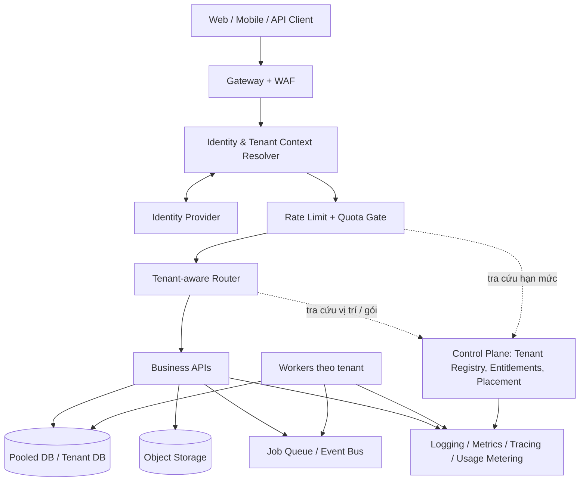
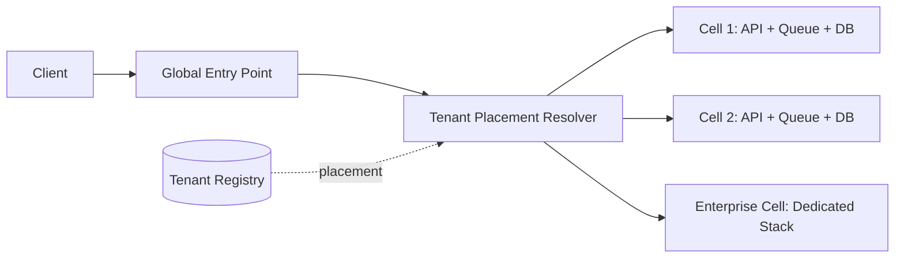
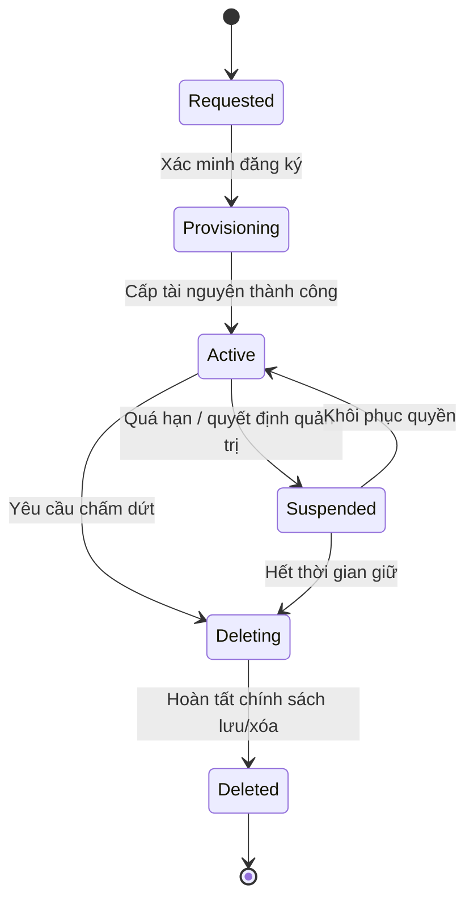

# Nền tảng SaaS đa tenant có cách ly dữ liệu và hạn mức

## 1. Bài toán kiến trúc và mục tiêu học tập

Một sản phẩm **Software as a Service (SaaS)** có thể cung cấp cùng một ứng dụng cho hàng trăm hoặc hàng nghìn khách hàng tổ chức. Các khách hàng dùng chung một phần hệ thống nhưng mong đợi dữ liệu, quyền truy cập và trải nghiệm của mình không bị ảnh hưởng bởi khách hàng khác. Đây là bài toán **đa tenant (multi-tenancy)**.

Trong bài này, **tenant** là ranh giới khách hàng mà hệ thống dùng để quản lý định danh, dữ liệu, cấu hình, quyền lợi dịch vụ, tài nguyên và hóa đơn. Một tenant thường đại diện cho một doanh nghiệp; tenant có thể có nhiều người dùng, nhóm, workspace hoặc dự án. Người dùng có thể thuộc nhiều tenant, nhưng quyền ở tenant này không tự động áp dụng cho tenant khác.

Ví dụ, một nền tảng SaaS quản lý dự án phục vụ ba doanh nghiệp A, B và C. Khi người dùng của A xem danh sách dự án, hệ thống chỉ trả dữ liệu của A; khi B gửi nhiều yêu cầu API, B không được làm dịch vụ của A chậm đến mức không đạt mục tiêu vận hành; khi C nâng cấp gói, giới hạn số công việc đồng thời của C được thay đổi mà không sửa cấu hình toàn hệ thống.

Thiết kế SaaS đa tenant cần giải quyết đồng thời:

1. **Cách ly bảo mật và dữ liệu:** ngăn truy cập chéo tenant, kể cả trong truy vấn, bộ nhớ đệm, hàng đợi, lưu trữ tệp, sao lưu, nhật ký và công cụ quản trị.
2. **Cách ly mức sử dụng:** kiểm soát tốc độ yêu cầu, số tác vụ đồng thời, dung lượng và mức tiêu thụ để giảm tác động của hiện tượng *noisy neighbor* (tenant sử dụng quá nhiều tài nguyên dùng chung).
3. **Mở rộng và độ tin cậy:** đáp ứng tăng trưởng tenant và lưu lượng cao điểm mà vẫn đạt SLO về độ trễ, khả dụng và phục hồi.
4. **Chi phí và vận hành:** tận dụng hiệu quả tài nguyên dùng chung, đo chi phí theo tenant, triển khai và quan sát được toàn bộ nền tảng.
5. **Linh hoạt sản phẩm:** hỗ trợ các gói dịch vụ, tính năng, vùng triển khai, yêu cầu tuân thủ và mức cách ly khác nhau.

Sau bài học, bạn có thể phân biệt các mô hình **pool, silo và bridge**, thiết kế kiến trúc SaaS có **control plane** và **data plane**, áp dụng nguyên tắc cách ly theo tenant ở nhiều lớp, xác định cơ chế **quota/rate limit**, và phân tích các đánh đổi theo tư duy **Well-Architected**.

> **Nguyên tắc cốt lõi:** Một dịch vụ là multi-tenant không chỉ vì bảng dữ liệu có cột `tenant_id`. Ranh giới tenant phải được kiểm soát nhất quán từ yêu cầu đầu vào cho đến dữ liệu, tác vụ nền, tài nguyên và vận hành.

## 2. Xác định yêu cầu nghiệp vụ và phi chức năng

Trước khi chọn database, compute hay mô hình triển khai, hãy xác định **ai cần cách ly khỏi ai**, cách ly ở mức nào, trong điều kiện tải nào, và chi phí mà khách hàng sẵn sàng trả.

Giả sử nền tảng quản lý công việc `WorkHub` có ba gói. Các số sau **chỉ là giả định minh họa**, không phải hạn mức chuẩn cho mọi SaaS:

| Yêu cầu | Standard | Business | Enterprise |
|---|---:|---:|---:|
| Số request API tối đa/phút/tenant | 600 | 3.000 | Theo hợp đồng |
| Tác vụ xử lý đồng thời/tenant | 3 | 15 | Theo hợp đồng |
| Dung lượng lưu trữ/tenant | 20 GiB | 200 GiB | Theo hợp đồng |
| Kiểu cách ly dữ liệu mục tiêu | Pooled, có kiểm soát tenant | Pooled hoặc phân vùng chuyên biệt | Có thể database/cell riêng |
| Yêu cầu vị trí dữ liệu | Theo vùng triển khai sản phẩm | Theo vùng đã chọn | Theo điều khoản hợp đồng |

Các số trong bảng phải đi kèm đặc tả rõ ràng: request nào được tính, có bao gồm request lỗi không, giới hạn tính trên cửa sổ trượt hay cửa sổ cố định, dung lượng tính trước hay sau nén, thay đổi gói có hiệu lực lúc nào, và tài nguyên bị xử lý ra sao khi vượt hạn mức.

Ngoài bảng gói, cần khảo sát những tiêu chí sau:

| Nhóm | Câu hỏi kiến trúc |
|---|---|
| Mô hình khách hàng | Một người dùng có thể thuộc nhiều tenant? Tenant có workspace con? |
| Bảo mật | Dữ liệu nào nhạy cảm? Ai có thể truy cập? Có yêu cầu mã hóa bằng khóa riêng của khách hàng? |
| Dữ liệu và tuân thủ | Dữ liệu phải ở vùng nào? Có yêu cầu xóa, xuất dữ liệu, lưu trữ bằng chứng kiểm toán? |
| Tải | Bao nhiêu tenant, request/giây, job/giờ, tốc độ tăng trưởng, tenant lớn nhất chiếm bao nhiêu phần tải? |
| SLO | p95/p99 độ trễ, tỷ lệ thành công, thời gian phục hồi, điểm phục hồi dữ liệu? |
| Vận hành | Đăng ký và cấu hình tenant tự động đến đâu? Quy trình xử lý sự cố và hỗ trợ khách hàng? |
| Tài chính | Giá gói, chi phí cố định/tenant, biên lợi nhuận, tiêu chí áp dụng hạ tầng riêng? |

**SLO** (*Service Level Objective*) mô tả mục tiêu đo lường hoạt động, chẳng hạn tỷ lệ yêu cầu hợp lệ thành công hoặc độ trễ p95 trong kỳ. **RTO** là thời gian tối đa chấp nhận để khôi phục, còn **RPO** là lượng dữ liệu mất tối đa có thể chấp nhận, thường biểu diễn theo thời gian. Chúng phải được thỏa thuận theo chức năng và gói dịch vụ trước khi thiết kế HA/DR.

## 3. Chọn mô hình multi-tenancy: pool, silo và bridge

Các mô hình dưới đây mô tả **mức chia sẻ tài nguyên**, không phải tên một dịch vụ cloud cụ thể.

| Mô hình | Cách triển khai | Điểm mạnh | Điểm cần đánh đổi | Khi phù hợp |
|---|---|---|---|---|
| **Pool** | Nhiều tenant dùng chung compute và thường dùng chung database; dữ liệu được phân biệt logic | Hiệu quả sử dụng tài nguyên, triển khai nhanh, chi phí thấp/tenant | Phải kiểm soát truy cập dữ liệu nghiêm ngặt, chống noisy neighbor, khó khôi phục riêng một tenant | Nhiều tenant nhỏ hoặc vừa, yêu cầu cách ly logic có thể đáp ứng |
| **Silo** | Mỗi tenant có database, workload hoặc toàn bộ stack riêng | Ranh giới tài nguyên rõ, dễ cấu hình/khôi phục riêng, đáp ứng yêu cầu đặc thù | Chi phí cố định cao, nhiều tài nguyên phải quản lý, nâng cấp hàng loạt phức tạp | Tenant lớn, ràng buộc bảo mật/vùng dữ liệu hoặc cam kết chuyên biệt |
| **Bridge (hybrid)** | Một số lớp dùng chung, một số lớp tách riêng theo tenant hoặc nhóm tenant | Cân bằng chi phí và yêu cầu cách ly, có lộ trình nâng cấp từng tenant | Định tuyến, quan sát, vận hành và quản lý cấu hình phức tạp hơn | SaaS nhiều gói, tenant có quy mô hoặc yêu cầu khác nhau |

Phạm vi pool/silo có thể khác nhau giữa các lớp:

- **Compute:** cùng service/process, cùng cụm nhưng tách namespace, hoặc cụm riêng.
- **Database:** chung bảng có `tenant_id` (*shared tables*), chung instance nhưng tách schema/database, hoặc instance riêng.
- **Storage:** bucket dùng chung có prefix và chính sách bảo vệ, bucket riêng, hoặc tài khoản/vùng riêng.
- **Mạng và mã hóa:** chính sách dùng chung, phân đoạn riêng, khóa dữ liệu riêng hoặc hạ tầng riêng theo yêu cầu.

Không nên mặc định **schema riêng** hay **database riêng** tương đương cách ly hoàn toàn; tài khoản truy cập, IAM, compute, bộ nhớ đệm, backup, logging và kênh quản trị vẫn có thể dùng chung. Ngược lại, pooled model có thể đáp ứng nhiều yêu cầu bảo mật khi thiết kế, kiểm thử và vận hành đúng. Mức cách ly cần dựa trên phân tích đe dọa, hợp đồng và mức độ chấp nhận rủi ro.

### 3.1. Cách chọn theo từng lớp

Trong tình huống WorkHub, một lựa chọn tham khảo là:

1. Dùng **frontend và API stateless dùng chung**, tận dụng autoscaling theo tải.
2. Dùng **database pooled** cho phần lớn tenant, có chính sách chặn truy vấn chéo và chỉ mục theo `tenant_id`.
3. Dành **database hoặc cell riêng** cho một số tenant có tải cao, yêu cầu cư trú dữ liệu hoặc cam kết riêng.
4. Dùng **control plane chung** để lưu thông tin tenant, gói dịch vụ và vị trí triển khai; data plane tra cứu để định tuyến đến đúng tài nguyên.

Thiết kế này không phải phương án duy nhất: nếu hợp đồng yêu cầu cách ly hạ tầng nghiêm ngặt, tài nguyên silo có thể là điều kiện bắt buộc từ đầu.

## 4. Kiến trúc tham chiếu: control plane và data plane

Kiến trúc SaaS thuận tiện quản trị khi tách hai trách nhiệm:

- **Control plane:** đăng ký tenant, xác minh trạng thái, subscription/entitlement, quản lý cấu hình, chính sách cấp phát, ánh xạ tenant → vùng/cell/database, sử dụng và thanh toán, quy trình chuyển gói hoặc di chuyển tenant.
- **Data plane:** phục vụ traffic nghiệp vụ của tenant, kiểm tra quyền, xử lý giao dịch, đọc/ghi dữ liệu và thực thi job.

Sơ đồ sau là **mẫu logic**; các hộp không bắt buộc tương ứng 1:1 với dịch vụ cloud hay deployment thực tế.



Trong sơ đồ, mũi tên `RES ↔ IDP` biểu thị hoạt động xác minh định danh theo cơ chế áp dụng (ví dụ kiểm tra chữ ký JWT bằng khóa đã lấy trước hoặc gọi endpoint của IdP). Đường tới control plane là **tương tác logic**: thực tế nên dùng cache có TTL, chính sách làm mới và cơ chế xử lý khi control plane không khả dụng; không nhất thiết gọi trực tiếp control plane trên mọi request.

### 4.1. Trình tự xử lý một yêu cầu

1. Gateway xác thực kết nối, áp dụng bộ lọc đầu vào và chuyển yêu cầu đến lớp xác minh danh tính.
2. Hệ thống kiểm tra token/session: chữ ký, issuer, audience, thời hạn và trạng thái cần thiết.
3. Ứng dụng xác định **tenant đang hoạt động** và **xác minh người dùng hoặc service principal có quyền trên tenant đó**. Tenant có thể được chọn từ URL hoặc session, nhưng giá trị client gửi không tự tạo ra quyền.
4. Lấy trạng thái tenant, gói dịch vụ, hạn mức và vị trí đặt tài nguyên từ registry đã được xác thực hoặc từ cache hợp lệ.
5. Áp dụng rate limit/quota và định tuyến đến đúng data plane theo ánh xạ tenant.
6. Ở business API, tiếp tục kiểm tra quyền theo **hành động và tài nguyên**; truy vấn dữ liệu dưới ngữ cảnh tenant đã được hệ thống xác thực.
7. Ghi usage, trace và audit event với định danh tenant phù hợp; không ghi thông tin bí mật hoặc payload nhạy cảm không cần thiết.

**Ranh giới tin cậy:** `X-Tenant-Id`, URL path hoặc JSON body do client cung cấp chỉ là **đề xuất tenant cần thao tác**. Ứng dụng phải đối chiếu nó với danh tính và quan hệ membership được quản lý phía máy chủ. Không lấy nguyên giá trị header để lọc database hoặc quyết định quyền.

### 4.2. Trình tự xử lý tác vụ nền

Job bất đồng bộ không có request HTTP gốc tại thời điểm thực thi. Vì vậy, một job cần metadata như `tenant_id`, `job_id`, loại hành động, yêu cầu xử lý, phiên bản cấu hình; message phải đến từ nhà sản xuất được tin cậy và worker phải xác minh phạm vi được phép thực thi. Worker không thể bỏ qua kiểm tra tenant chỉ vì queue là dịch vụ nội bộ.

Khi chạy job, hệ thống áp dụng lại hạn mức/concurrency của tenant, lựa chọn đúng kho dữ liệu và cập nhật usage theo cơ chế chống đếm trùng. Nếu một tenant có hàng triệu job, việc chia hàng đợi, định tuyến và điều phối công bằng trở thành một phần bắt buộc của kiến trúc.

## 5. Cách ly tenant từ định danh đến dữ liệu

### 5.1. Các lớp cần bảo vệ

| Lớp | Biện pháp thiết kế | Lỗi thường gặp |
|---|---|---|
| Định danh | Xác thực token/session; ánh xạ người dùng ↔ tenant; service identity có phạm vi rõ | Cho phép dùng `tenant_id` bất kỳ trong header |
| Phân quyền | Kiểm tra tenant, vai trò và quyền trên **từng tài nguyên**; nguyên tắc ít quyền | Kiểm tra tenant khi login nhưng quên kiểm tra ở endpoint download |
| Business API | Tenant context bất biến trong một request, xác thực ở entrypoint và dùng xuyên suốt | Lấy tenant từ tham số truy vấn ở bước sâu bên trong |
| Database | Row-level security hoặc database/schema riêng, khóa ngoại theo tenant, kiểm thử chéo tenant | Query thiếu predicate `tenant_id`, join làm lộ bản ghi |
| Cache | Cache key gồm tenant và quyền khi cần, TTL/invalidation rõ | Key `project:123` được dùng chung giữa tenant A/B |
| Object storage | Namespace theo tenant, IAM, signed URL ngắn hạn và kiểm tra quyền phát hành | Trả trực tiếp object URL của tenant khác |
| Search/analytics | Filter tenant tại nguồn dữ liệu và truy vấn, kiểm soát dataset/index | Một truy vấn search không truyền bộ lọc tenant |
| Queue/job | Tenant metadata đáng tin cậy, quyền của worker, phân luồng và xử lý retry | Job của A chạy dưới DB context còn sót lại từ B |
| Logging/backup | Giới hạn dữ liệu log, kiểm soát xuất/restore, audit hoạt động quản trị | File export và backup nằm trong đường dẫn công khai |
| Quản trị/hỗ trợ | Phân quyền support, xác thực bổ sung, truy cập có lý do, audit và thời hạn | Tài khoản hỗ trợ có quyền đọc tất cả tenant không kiểm soát |

Không có lớp kiểm soát đơn lẻ nào thay thế toàn bộ các lớp còn lại. Trong mô hình pooled, cách ly dữ liệu về bản chất là **cách ly logic dựa trên kiểm soát**; cần bảo vệ cả đường truy cập thường ngày lẫn đường quản trị và khôi phục sự cố.

### 5.2. Thiết kế khóa dữ liệu theo tenant

Ở database dùng chung, mỗi bảng chứa dữ liệu riêng tenant nên có `tenant_id` và các chỉ mục phù hợp. Khi thiết kế quan hệ, khóa chính hoặc khóa duy nhất có thể bao gồm `tenant_id` để tránh tham chiếu chéo.

Ví dụ PostgreSQL:

```sql
CREATE TABLE projects (
    tenant_id   uuid NOT NULL,
    project_id  uuid NOT NULL,
    name        text NOT NULL,
    PRIMARY KEY (tenant_id, project_id)
);

CREATE TABLE tasks (
    tenant_id   uuid NOT NULL,
    task_id     uuid NOT NULL,
    project_id  uuid NOT NULL,
    title       text NOT NULL,
    PRIMARY KEY (tenant_id, task_id),
    FOREIGN KEY (tenant_id, project_id)
        REFERENCES projects (tenant_id, project_id)
);

CREATE INDEX tasks_by_tenant_project
    ON tasks (tenant_id, project_id);
```

Khóa ngoại tổng hợp `(tenant_id, project_id)` giúp database từ chối một task thuộc tenant A nhưng tham chiếu project của tenant B. Cách này bổ sung cho kiểm soát quyền ứng dụng, không thay thế nó. Với bảng không có tính chất tenant-specific như danh mục mã quốc gia, có thể dùng mô hình dữ liệu chung được kiểm soát riêng.

### 5.3. Ví dụ row-level security (RLS)

PostgreSQL hỗ trợ **row-level security** để kiểm soát hàng nào có thể đọc, sửa hoặc thêm. Ví dụ sau giả định ứng dụng đã xác minh tenant tại tầng API và dùng một DB role có quyền vừa đủ:

```sql
ALTER TABLE projects ENABLE ROW LEVEL SECURITY;
ALTER TABLE projects FORCE ROW LEVEL SECURITY;

CREATE POLICY projects_tenant_policy ON projects
  USING (
    tenant_id = NULLIF(current_setting('app.tenant_id', true), '')::uuid
  )
  WITH CHECK (
    tenant_id = NULLIF(current_setting('app.tenant_id', true), '')::uuid
  );
```

`USING` kiểm soát các hàng được phép nhìn thấy hoặc thao tác; `WITH CHECK` kiểm soát hàng được thêm/sửa. Khi chưa có ngữ cảnh tenant hợp lệ, biểu thức không khớp tenant và truy cập bị từ chối trong các tình huống áp dụng chính sách. Cần thiết lập chính sách tương tự cho **mọi bảng chứa dữ liệu tenant**, kể cả bảng phụ và bảng báo cáo.

Ứng dụng phải thiết lập tenant trong **cùng transaction** với các câu SQL và dùng tham số an toàn, ví dụ luồng giả mã:

```text
tenant = authorizeTenant(authenticatedPrincipal, requestedTenant)

transaction(dbConnection, tx => {
    // Gọi SELECT set_config('app.tenant_id', $1, true)
    // với tenant.id là bind parameter; true = phạm vi transaction.
    tx.setLocalTenant(tenant.id)
    return tx.queryWithBoundParameters(
        "SELECT project_id, name FROM projects WHERE tenant_id = $1",
        [tenant.id]
    )
})
```

`SET LOCAL` hoặc `set_config(..., true)` giúp tránh để tenant context tồn tại ngoài transaction, nhất là khi dùng connection pool. Ở truy vấn ví dụ vẫn có predicate tenant để thể hiện ý định và hỗ trợ chọn chỉ mục; RLS đóng vai trò phòng vệ bổ sung.

**Các điều kiện bắt buộc khi dùng RLS:**

- DB role phục vụ request không được có `BYPASSRLS`, không chạy bằng superuser; kiểm tra quyền owner và `FORCE ROW LEVEL SECURITY` phù hợp.
- Không để truy vấn của tenant chạy bằng tài khoản đặc quyền dùng cho migration/backup.
- `app.tenant_id` là session setting mà ứng dụng có thể đặt; nếu có SQL injection hoặc code không đáng tin cậy được chạy trong cùng DB role, chỉ RLS với setting này **không tạo ranh giới độc lập chắc chắn**. Vẫn cần truy vấn tham số hóa, hạn chế quyền DB và cô lập đường thực thi nguy hiểm.
- Transaction, connection pool, stored procedure, view, job nền và luồng hỗ trợ phải được kiểm thử; không giả định `FORCE` xử lý mọi đường vượt chính sách.
- Với RLS nhiều bảng, tạo kiểm thử: A không thể `SELECT`, `UPDATE`, `DELETE`, `INSERT` dữ liệu của B; thao tác không có tenant context bị chặn; các join và batch không lộ dữ liệu.

### 5.4. Cache, object storage và mã hóa

Ví dụ cache key nên chứa đủ tenant và ngữ cảnh quyền khi nội dung khác nhau theo quyền:

```text
SAI:    project:42
ĐÚNG:   tenant:{tenant_id}:project:{project_id}

NẾU phụ thuộc vai trò/quyền:
        tenant:{tenant_id}:user:{user_id}:project:{project_id}:view
```

Cache dùng chung phải kiểm soát cả invalidation và thông tin nhạy cảm; tránh cache phản hồi cá nhân hóa tại CDN khi không có chiến lược phân biệt tenant/người dùng đúng.

Với object storage, đường dẫn `tenants/{tenant_id}/...` là cách tổ chức thuận tiện nhưng **không tự tạo quyền truy cập**. Hệ thống cần kiểm tra authorization trước khi cấp signed URL, giới hạn thời hạn và thao tác, áp dụng policy/IAM phù hợp, và bảo đảm worker/export không ghi sai namespace. Sao lưu, snapshot, dữ liệu phân tích và log cũng cần được phân vùng và giới hạn quyền.

**Mã hóa** khi truyền và khi lưu là nền tảng; per-tenant key hoặc customer-managed key có thể tăng quyền kiểm soát theo hợp đồng. Tuy nhiên, khóa riêng không ngăn rò dữ liệu nếu API ứng dụng đã có quyền giải mã và trả nhầm bản ghi. Mô hình quản lý khóa phải xem xét rotate, revoke, restore và khả năng mất quyền giải mã khi khóa bị vô hiệu hóa.

## 6. Hạn mức, giới hạn tốc độ và công bằng tài nguyên

Ba khái niệm cần phân biệt:

- **Entitlement:** quyền mà gói dịch vụ cho phép, ví dụ dùng tính năng báo cáo nâng cao, tối đa 50 user hoặc được triển khai tại vùng riêng.
- **Quota:** tổng lượng tài nguyên hoặc mức tiêu thụ được cấp trong một kỳ/trạng thái, ví dụ 200 GiB storage, 100.000 tác vụ/tháng, 1.000 project/tenant.
- **Rate limit / concurrency limit:** giới hạn tốc độ hoặc số thao tác đồng thời, ví dụ 3.000 request/phút/tenant, tối đa 15 job đang chạy. Chúng giảm số đỉnh tải có thể làm ảnh hưởng các tenant khác.

Billing/metering ghi nhận lượng sử dụng thực tế; số ghi nhận này có thể dùng để tính phí hoặc điều chỉnh gói nhưng **không tự động** là cơ chế chặn tải theo thời gian thực.

### 6.1. Những lớp cần thực thi hạn mức

| Vị trí | Loại kiểm soát | Vì sao cần ở đây? |
|---|---|---|
| API Gateway | Số request theo tenant, IP hoặc client; chống burst lớn | Chặn sớm trước khi đốt compute |
| API/Business Service | Entitlement, số entity, giới hạn đặc thù nghiệp vụ | Gateway không hiểu đủ ngữ nghĩa nghiệp vụ |
| Worker/Scheduler | Job đồng thời, hàng đợi, CPU/memory budget | Ngăn background jobs chiếm toàn bộ worker |
| Database/Storage | Connection pool, query cost, storage bytes, phân vùng dữ liệu | Chặn tenant tạo tải quá lớn ở tài nguyên gốc |
| Control Plane/Billing | Gói, thời hạn, thay đổi quota, usage aggregation | Duy trì chính sách, đo đếm và giải trình |

Ví dụ tenant A có giới hạn 600 request/phút. Khi vượt ngưỡng, API có thể trả **HTTP 429 Too Many Requests** cùng `Retry-After` nếu hệ thống xác định được thời điểm thử lại. Client cần exponential backoff có jitter, không gửi lại đồng loạt. Lỗi vượt quyền gói/tính năng thường cần phản hồi khác, chẳng hạn `403 Forbidden`; hệ thống quá tải chung có thể trả `503 Service Unavailable`, không nên làm người dùng hiểu nhầm rằng họ đã vượt quota cá nhân.

### 6.2. Thuật toán giới hạn tốc độ

**Token bucket** là lựa chọn phổ biến để cho phép lưu lượng đều và burst ngắn:

- Mỗi tenant có một bucket chứa tối đa `capacity` token.
- Token được bổ sung với tốc độ `refill_rate` theo thời gian.
- Mỗi yêu cầu tiêu thụ một số token; nếu không đủ, từ chối hoặc xếp hàng tùy loại thao tác.
- Trong triển khai phân tán, thao tác kiểm tra và trừ token phải **nguyên tử** trên một trạng thái chung; kiểm tra bằng `GET` rồi `SET` riêng lẻ dễ vượt hạn mức khi nhiều instance xử lý đồng thời.

```text
tenant = resolveAndAuthorizeTenant(request)
policy = cachedEntitlements(tenant.id)

decision = distributedLimiter.consumeAtomically(
    key = (tenant.id, "api.standard"),
    capacity = policy.burstCapacity,
    refillRate = policy.refillPerSecond,
    cost = requestCost(request)
)

if decision.denied:
    return HTTP_429(retryAfter = decision.retryAfter)

return processAuthorizedRequest(tenant, request)
```

Đây là giả mã thuật toán, không phải mã production đã xử lý đầy đủ lỗi mạng. Khi bộ giới hạn không khả dụng, cần có **chính sách đã định trước** theo độ quan trọng: ví dụ cho phép một mức nhỏ có kiểm soát, giới hạn cục bộ tạm thời, hoặc từ chối lưu lượng có khả năng gây tốn tài nguyên cao. Chọn *fail-open* hay *fail-closed* tùy rủi ro của chức năng; không để lỗi limiter tự động mở vô hạn quyền dùng tài nguyên.

### 6.3. Quota dung lượng và số lượng entity

Không đủ để đọc `usage < quota` rồi tạo entity: hai request đồng thời có thể cùng vượt qua kiểm tra. Cần dùng **cập nhật nguyên tử** hoặc **reservation** trong transaction phù hợp, kèm cơ chế giải phóng reservation khi thao tác thất bại.

Ví dụ quy trình upload:

1. Xác thực tenant, kiểm tra entitlement và quyền upload.
2. Dự trù dung lượng bằng reservation có khóa theo tenant, xử lý cạnh tranh đồng thời.
3. Upload dữ liệu, xác minh kích thước thực tế và định danh object.
4. Commit usage thực tế hoặc hoàn trả reservation khi lỗi.
5. Đối soát định kỳ giữa usage counter và object storage để xử lý trường hợp sự cố xảy ra giữa các bước.

Usage dùng để thanh toán phải có định danh sự kiện duy nhất, cơ chế **idempotency/deduplication**, xử lý đến muộn và truy vết sửa sai. Không giả định queue chỉ giao sự kiện đúng một lần.

### 6.4. Bảo vệ trước noisy neighbor

Giới hạn request đơn thuần chưa bảo đảm công bằng: một request báo cáo có thể tiêu thụ hàng chục giây CPU trong khi request đọc dữ liệu chỉ mất vài mili giây. Vì vậy nên kết hợp:

- **Weighted cost/rate limit:** tính chi phí theo loại API, kích thước truy vấn hoặc độ phức tạp đã định nghĩa.
- **Concurrency limit:** hạn chế số truy vấn hoặc job đắt đỏ cùng chạy cho một tenant.
- **Queue fairness:** hàng đợi theo tenant, weighted fair scheduling hoặc vòng lặp công bằng; tránh một tenant chiếm hết worker.
- **Bulkhead/cell:** phân nhóm tenant vào các cell tài nguyên để giảm phạm vi ảnh hưởng khi quá tải/sự cố.
- **Autoscaling có giới hạn:** mở rộng dựa trên queue lag, CPU, độ trễ nhưng không bỏ qua ngân sách, quota nhà cung cấp hay tác động lên database.
- **Admission control và timeout:** từ chối công việc mới khi tài nguyên cận ngưỡng, kết hợp retry có backoff để tránh khuếch đại tải.

Các kiểm soát này phải có chính sách ưu tiên rõ ràng. Tenant lớn có thể cần nhiều tài nguyên hơn, nhưng không được chiếm tài nguyên đã cam kết cho tenant khác nếu sản phẩm hứa hẹn sự công bằng hoặc SLO riêng.

## 7. Cell-based architecture và vị trí dữ liệu

Khi quy mô phát triển, một pool duy nhất có thể tạo ra miền lỗi quá rộng. **Cell-based architecture** chia tenant thành nhiều nhóm tài nguyên tương đối độc lập (cell), ví dụ mỗi cell có API workers, queue và database riêng. Tenant registry ánh xạ `tenant_id → region → cell → database/storage`.



Lợi ích là giảm *blast radius*, tăng khả năng nâng cấp hoặc mở rộng theo nhóm và hỗ trợ tenant đặc thù. Đổi lại, hệ thống phải giải quyết định tuyến tenant, quản lý schema/version giữa các cell, capacity planning, cân bằng tenant và quy trình **di chuyển một tenant giữa các cell**.

Khi chuyển tenant từ cell A sang B, phải thiết kế khóa hoặc kiểm soát ghi, sao chép và đối soát dữ liệu, thứ tự event, cập nhật placement version, chuyển tuyến, rollback và xử lý yêu cầu đang chạy. Registry nên có phiên bản/epoch để tránh request mới và job nền truy cập vị trí cũ trong quá trình chuyển.

**Yêu cầu cư trú dữ liệu** (*data residency*) phải được xét trên tất cả các bản sao và đường dẫn dữ liệu, gồm database, storage, backup, audit logs, phân tích và xử lý hỗ trợ. Chọn region cho database nhưng gửi log hoặc bản sao ra vùng không phù hợp có thể vẫn vi phạm yêu cầu khách hàng. Nên phân biệt rõ *data residency*, *data sovereignty* và quy định tuân thủ cụ thể của tổ chức; không tự suy diễn quy tắc pháp lý chỉ từ tên quốc gia.

## 8. Vòng đời tenant và vận hành nền tảng

### 8.1. Vòng đời điển hình



Các trạng thái là minh họa. Hành động thực tế cần kiểm tra hợp đồng, yêu cầu pháp lý, khả năng thanh toán và thời hạn lưu dữ liệu. **Suspend** thường nghĩa là dừng truy cập hoặc tính năng theo chính sách; nó không nhất thiết đồng nghĩa xóa dữ liệu ngay lập tức.

**Onboarding:** xác minh tenant, tạo ID bất biến, cấu hình domain/SSO nếu có, tạo quyền và gói, gán region/cell, cấp namespace dữ liệu, khóa và policy, thử nghiệm smoke test, ghi nhận audit.

**Thay đổi gói:** cập nhật entitlement theo phiên bản; thống nhất hiệu lực, xử lý request/job đang chạy, tăng/giảm quota và cách thông báo vượt giới hạn. Không được hạ quota bất ngờ làm mất dữ liệu đã tồn tại; với storage có thể chuyển sang trạng thái chỉ đọc hoặc chặn ghi mới theo chính sách.

**Offboarding:** xác thực yêu cầu, đóng phiên truy cập, ngừng job và webhook, cung cấp export nếu hợp đồng yêu cầu, chờ kỳ lưu trữ đúng quy định, xóa dữ liệu ở các kho liên quan và lưu bằng chứng xử lý. Việc xóa khỏi database chính chưa chứng minh dữ liệu đã biến mất khỏi backup, cache, search index hay hệ thống phân tích; mỗi kho phải có chính sách vòng đời và cam kết khôi phục/xóa phù hợp.

### 8.2. Telemetry theo tenant

Những tín hiệu hữu ích gồm:

| Tín hiệu | Mục đích |
|---|---|
| `requests`, `errors`, `p95_latency` theo gói/cell và nhóm tenant cần quan sát | Theo dõi SLO và phát hiện tenant bị ảnh hưởng |
| `rate_limited_requests`, `quota_remaining` | Tìm nguyên nhân 429, dự báo nhu cầu nâng gói |
| `active_jobs`, `queue_wait`, `oldest_job_age` | Phát hiện tenant chiếm hàng đợi hoặc thiếu worker |
| `db_connections`, query latency, hot partitions | Nhận diện tắc nghẽn database |
| `tenant_region`, `cell`, deployment version | Khoanh vùng ảnh hưởng khi phát hành hoặc sự cố |
| `usage_events`, storage bytes, cost allocation | Đối soát hóa đơn, lập ngân sách và tối ưu chi phí |
| Audit events: truy cập, đổi quyền, export, hỗ trợ khách hàng | Điều tra và chứng minh thao tác quản trị |

Chú ý **cardinality**: đưa hàng trăm nghìn `tenant_id` vào nhãn mọi metric có thể làm tăng mạnh chi phí và tải hệ thống giám sát. Có thể đo metric tổng hợp theo cell/gói và top tenant, còn tra cứu chi tiết theo tenant trong log/trace hoặc hệ thống analytics có quản lý quyền. Không gắn dữ liệu cá nhân và secret vào telemetry chỉ để dễ debug.

### 8.3. Vận hành sự cố

Runbook nên có khả năng trả lời: tenant nào bị ảnh hưởng, thuộc cell/vùng nào, lỗi do auth, limit, job, DB hay mạng, có tenant khác bị ảnh hưởng không, cần rollback deployment hay chuyển cell, và cách liên hệ tenant bị tác động.

Trong pooled model, **khôi phục dữ liệu riêng một tenant** có thể khó hơn khôi phục toàn database. Phải diễn tập quy trình point-in-time restore vào môi trường tạm, lọc dữ liệu đúng tenant, kiểm tra toàn vẹn tham chiếu và nhập trở lại một cách an toàn, thay vì giả định restore cả database là đủ.

## 9. Phân tích theo Well-Architected

Lựa chọn kiến trúc SaaS đa tenant là sự cân bằng liên tục giữa yêu cầu nghiệp vụ, bảo mật, độ tin cậy, khả năng mở rộng, chi phí và vận hành.

| Quan tâm kiến trúc | Quyết định quan trọng | Phương pháp đánh giá |
|---|---|---|
| **Bảo mật** | Tenant-aware authorization, RLS, IAM, mã hóa, audit, quyền support | Cross-tenant tests, threat modeling, review quyền và chính sách |
| **Độ tin cậy** | Cell, multi-AZ, queue retry, backup/restore, failover | Failure injection, diễn tập RTO/RPO, đo blast radius |
| **Hiệu quả hiệu năng/khả năng mở rộng** | Autoscaling, partition key, fair queue, concurrency limit | Kiểm thử tải nhiều tenant, tenant lớn và truy vấn đắt đỏ |
| **Tối ưu chi phí** | Chia sẻ tài nguyên, right-sizing, cost per tenant, data transfer | Đo unit economics và phân tích ngưỡng chuyển pool → silo |
| **Vận hành** | Provisioning tự động, IaC, deployment theo cell, observability, runbook | Theo dõi thời gian cấp tenant, lỗi triển khai và MTTR |
| **Bền vững** | Tránh tài nguyên nhàn rỗi, tối ưu sử dụng compute/storage | Đo hiệu suất dùng tài nguyên và loại bỏ dữ liệu/compute dư thừa |

Ví dụ một workload báo cáo tiêu thụ nhiều CPU: nếu dồn vào một cluster API dùng chung, hệ thống có thể có chi phí ban đầu thấp nhưng tăng độ trễ cho tất cả tenant. Chuyển báo cáo sang worker pool riêng, giới hạn concurrency và đưa kết quả vào cache có thể vừa cải thiện SLO vừa giảm nhu cầu tăng quy mô cluster chính. Đây là quyết định phải kiểm chứng bằng đo đạc thay vì chỉ dựa trên sơ đồ.

### 9.1. Ước lượng chi phí theo tenant

Chi phí SaaS gồm **chi phí dùng chung** (gateway, control plane, cluster, observability, vận hành) và **chi phí biến đổi** theo usage (compute, storage, database I/O, data transfer, job). Có thể bắt đầu với mô hình đơn giản:

\[
\text{CostPerTenant} \approx \text{AllocatedSharedCost} + \text{MeasuredVariableCost}
\]

Trong đó phân bổ chi phí dùng chung cần có nguyên tắc minh bạch, ví dụ theo request đã chuẩn hóa bằng chi phí xử lý, dung lượng, thời gian CPU hoặc gói dịch vụ. Không nên phân đều chi phí nếu có tenant sử dụng nhiều hơn đáng kể; song cũng không nên xem số tiền phân bổ là chi phí biên thực tế của việc thêm một tenant.

**Ngưỡng chuyển sang silo** nên xét không chỉ giá VM/database riêng mà còn chi phí nhân lực vận hành, quota cloud, backup, bảo mật, khả năng phục hồi và rủi ro shared infrastructure. Có thể dùng cell/bridge như bước trung gian.

## 10. Tình huống thiết kế: một tenant tạo tải gấp 20 lần

WorkHub đang có 800 tenant trong pooled model. Tenant `T-Enterprise` nhập dữ liệu lớn và chạy đồng thời hàng nghìn báo cáo; CPU worker báo cáo tăng lên 100%, queue của các tenant khác chậm xử lý, API chính vẫn có CPU thấp nhưng người dùng bắt đầu thấy kết quả báo cáo trễ.

### 10.1. Phân tích nguyên nhân

Vấn đề không chỉ ở tổng compute mà nằm ở **không có kiểm soát công bằng ở tầng job**. Rate limit tại gateway vẫn có thể hoạt động đúng, vì hàng nghìn công việc đến từ vài request nhập liệu. Queue và workers cần phân biệt tenant; metric trung bình toàn hệ thống có thể che giấu việc tenant nhỏ phải đợi lâu.

### 10.2. Phương án kiến trúc

1. Áp dụng quota về số job được nhận và concurrency về số job đang chạy, có thể đặt trọng số theo gói.
2. Chia queue hoặc thêm scheduler tenant-aware để bảo đảm tenant khác luôn có phần năng lực xử lý tối thiểu.
3. Tách workers cho báo cáo khỏi API transactional; hạn chế truy vấn nặng và dùng read replica/materialized view khi phù hợp với yêu cầu nhất quán.
4. Đo queue wait, job completion time, error và chi phí theo tenant, không chỉ CPU chung.
5. Nếu tải kéo dài và hợp đồng yêu cầu, chuyển tenant lớn sang cell hoặc compute pool riêng; vẫn giữ policy, metering và triển khai thống nhất từ control plane.

**Đánh đổi:** giới hạn quá thấp sẽ làm tenant lớn không dùng hết tài nguyên mà họ đã mua; dành phần tài nguyên quá lớn cho một tenant làm giảm hiệu suất nền tảng. Nên quyết định theo SLO và quyền lợi từng gói, đồng thời có cơ chế tăng quota có kiểm soát.

### 10.3. Chấp nhận kiến trúc bằng thử nghiệm

Một bộ bài kiểm tra có thể đặt ra các giả định sau, được điều chỉnh theo SLO thực tế:

- Sinh lưu lượng đồng thời từ 100 tenant vừa và 1 tenant lớn; tenant lớn chạy job nặng trong thời gian kéo dài.
- Xác minh p95 latency của API và thời gian chờ job của nhóm tenant vừa vẫn đạt SLO đã định.
- Thử cùng một project ID và object key ở hai tenant; xác minh không có đọc hoặc ghi chéo qua API, truy vấn, cache, export và worker.
- Thử vượt rate limit và quota; phản hồi đúng, usage không âm hoặc tăng trùng, không thể vượt giới hạn bởi nhiều request song song.
- Cố tình làm gián đoạn cache/limiter/queue hoặc một cell; kiểm tra hành vi khi quá tải, cơ chế phục hồi và phạm vi ảnh hưởng.
- Diễn tập backup, khôi phục và hủy tenant theo chính sách dữ liệu; đo RTO/RPO thực tế nếu đó là cam kết.

Không kết luận “đạt cách ly” chỉ dựa trên một bài kiểm thử bảo mật hoặc một lần load test. Cần bổ sung kiểm tra tự động vào CI/CD và đánh giá thay đổi khi thêm endpoint, bảng dữ liệu, job hoặc đường xuất dữ liệu mới.

## 11. Anti-pattern và cách khắc phục

| Anti-pattern | Hệ quả | Cách khắc phục |
|---|---|---|
| Tin `tenant_id` do client gửi | Người dùng có thể chọn ID của tenant khác | Xác thực danh tính và xác minh membership trên tenant đã chọn |
| Chỉ lọc tenant tại API | Job, export, SQL tùy biến hoặc admin tool có thể truy cập chéo | Kiểm soát ở nhiều lớp, database policy và kiểm thử end-to-end |
| Cache key thiếu tenant hoặc quyền | Trả dữ liệu của tenant/người dùng khác | Namespace key và invalidation theo tenant, kiểm tra CDN |
| Một queue FIFO cho mọi workload | Tenant lớn chiếm worker, làm tăng thời gian chờ toàn hệ thống | Scheduler tenant-aware, concurrency limit, queue/worker pool phù hợp |
| Rate limit theo IP là đủ | Nhiều tenant dùng chung NAT; một tenant có nhiều IP | Kết hợp tenant ID đã xác thực, client ID, IP và hành vi |
| Counter quota kiểu read-then-write | Nhiều request đồng thời vượt ngưỡng | Atomic reservation/counter và đối soát usage |
| Dùng role database đặc quyền cho request | RLS có thể bị vượt và sự cố có phạm vi lớn | Least privilege, quyền riêng cho migration/admin, kiểm chứng role |
| Mọi tenant nằm một vùng/cell không có kế hoạch mở rộng | Một lỗi ảnh hưởng toàn bộ khách hàng | Cell/region theo nhu cầu, capacity và kế hoạch phục hồi |
| Gắn tenant ID vào mọi nhãn metric | Bùng nổ cardinality và chi phí observability | Tổng hợp metric có chọn lọc, tra cứu tenant chi tiết qua log/trace |
| Xóa dữ liệu trong bảng chính là hoàn tất offboarding | Còn bản sao ở cache, search, backup, analytics | Lập bản đồ kho dữ liệu và chính sách lưu/xóa từng hệ thống |

## 12. Bài thực hành thiết kế kiến trúc SaaS

**Đề bài.** Một startup cung cấp SaaS quản lý tài liệu cho 1.200 doanh nghiệp. Phần lớn tenant có dưới 30 người dùng, nhưng 15 tenant có hàng chục nghìn tài liệu và nhu cầu tìm kiếm lớn. Dữ liệu gồm tài liệu nội bộ, metadata và chỉ mục tìm kiếm. Doanh nghiệp muốn bán gói Standard giá thấp và Enterprise với lựa chọn vùng lưu trữ riêng; có tác vụ tạo bản xem trước và lập chỉ mục bất đồng bộ. Nhóm vận hành còn ít người.

Hãy thiết kế kiến trúc ở mức logic, nêu và giải thích:

1. Mô hình pool/silo/bridge nào áp dụng cho API, database, object storage, search index và workers? Vì sao?
2. Cơ chế xác minh tenant khi một người dùng thuộc hai công ty; cách phòng tránh `tenant_id` giả mạo, rò qua cache và truy vấn tìm kiếm?
3. Các quota hoặc rate limit nào cần có cho API, dung lượng tài liệu, indexing và số job đồng thời? Điều gì phải kiểm soát nguyên tử?
4. Làm sao bảo đảm 15 tenant lớn không khiến tenant nhỏ chờ indexing quá lâu?
5. Nếu Enterprise yêu cầu dữ liệu ở một vùng cụ thể, những bản sao và thành phần xử lý nào phải rà soát?
6. Ba phép thử bảo mật, ba phép thử độ tin cậy/hiệu năng và hai chỉ số chi phí nào chứng minh phương án phù hợp?

### Gợi ý đáp án và tiêu chí chấm

Một thiết kế có cơ sở có thể chọn API stateless dùng chung, pooled database cho nhiều tenant nhỏ, tenant-aware search và object storage, kết hợp queue fairness. Với tenant lớn hoặc có yêu cầu cách ly đặc thù, gán cell/database/search index riêng theo placement registry; control plane duy trì tenant ID, gói, entitlement, vị trí và lifecycle.

Yêu cầu tối thiểu của lời giải:

- Mỗi lần chọn tenant phải kiểm tra membership và quyền trên tài liệu, kể cả download, search và export.
- Namespace cache, index, object và mọi job phải có tenant context đáng tin cậy; đường truy cập đặc quyền được kiểm soát và audit.
- Quota storage dùng reservation nguyên tử; indexing dùng concurrency limit và cơ chế phân phối worker công bằng. Usage event dùng idempotency để tránh đếm trùng.
- Kế hoạch dữ liệu bao gồm bản chính, replica, backup, log, index, các luồng export và xử lý bên thứ ba trong phạm vi vùng/cam kết.
- Kiểm thử cross-tenant read/write, giả mạo tenant và rò cache; thử tải tenant lớn, failure injection, phục hồi và đánh giá chi phí mỗi tenant/job/GiB.

Không có một lời giải hạ tầng cố định cho mọi trường hợp. Điểm quan trọng là phải chứng minh cách thiết kế **đạt yêu cầu cách ly, hạn mức, SLO và ngân sách** bằng kiểm thử và số liệu đo được.

## 13. Checklist đánh giá trước khi đưa SaaS vào production

- [ ] Tenant ID ổn định, quan hệ user/service ↔ tenant được xác minh ở mọi entrypoint.
- [ ] Các thao tác CRUD, search, export, cache, file và job đều có kiểm soát truy cập theo tenant; có test chéo tenant.
- [ ] Database schema, role, RLS/policy, khóa ngoại và các quyền quản trị được rà soát phù hợp mô hình dữ liệu.
- [ ] Có chính sách riêng cho rate limit, concurrency, storage quota, entitlement và các trường hợp limiter không khả dụng.
- [ ] Counter/usage chịu được concurrency, retry, duplicate event và có thể đối soát phục vụ billing.
- [ ] Hệ thống xác định vị trí tenant, vùng dữ liệu, cell, khóa mã hóa và các bản sao theo hợp đồng.
- [ ] Có kiểm thử noisy neighbor với nhiều tenant đồng thời; đã đo p95/p99, queue lag và SLO theo gói/cell.
- [ ] Backup/restore, tenant onboarding, nâng/hạ gói, suspend, export, delete và tenant migration có runbook và audit.
- [ ] Có cost allocation, capacity planning và giới hạn chi phí để kiểm soát biên lợi nhuận.
- [ ] Mọi thay đổi schema, endpoint hoặc worker mới đi qua kiểm thử bảo mật, tenant isolation và quan sát vận hành.

## 14. Ghi nhớ

Kiến trúc SaaS đa tenant là một hệ thống của **các ranh giới tin cậy và tài nguyên có chủ đích**. **Pool** tối ưu chia sẻ, **silo** tối ưu cách ly chuyên biệt, còn **bridge/cell** cho phép cân bằng theo gói và quy mô. Control plane quản lý vòng đời và vị trí tenant; data plane xử lý traffic theo ngữ cảnh tenant đã xác thực. Quota, rate limit, công bằng tài nguyên và usage metering phải được thực thi ở đúng lớp, đặc biệt tại database, queue và worker. Quyết định tốt là quyết định được kiểm tra bằng dữ liệu thực về an toàn, SLO, khả năng mở rộng, chi phí và vận hành.
