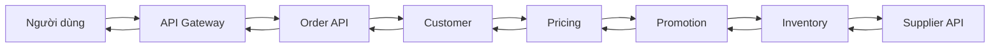
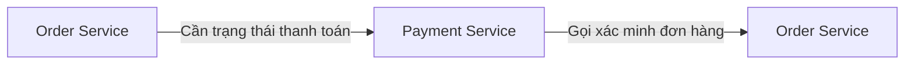
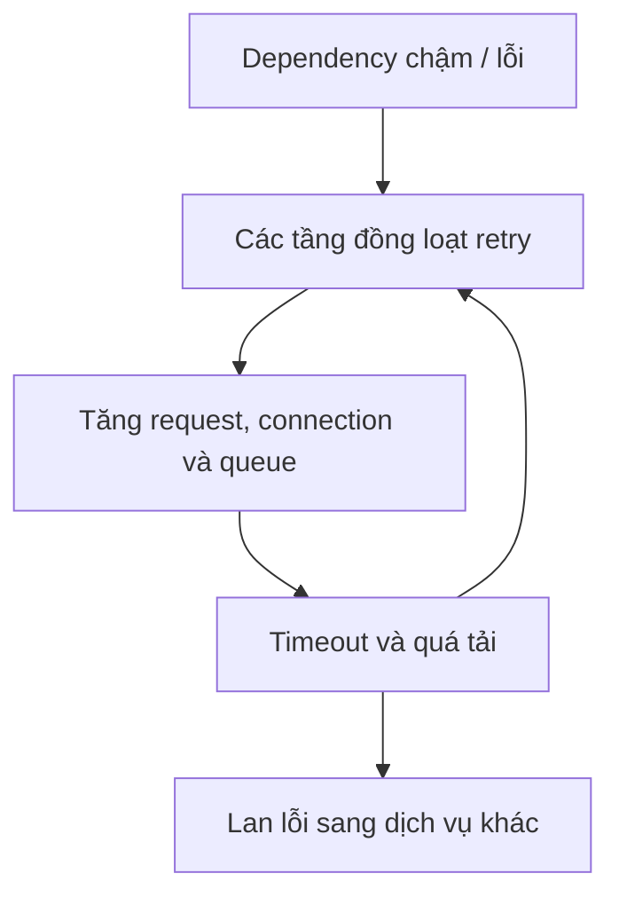
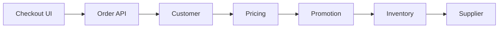
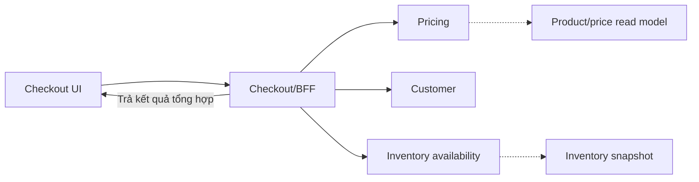
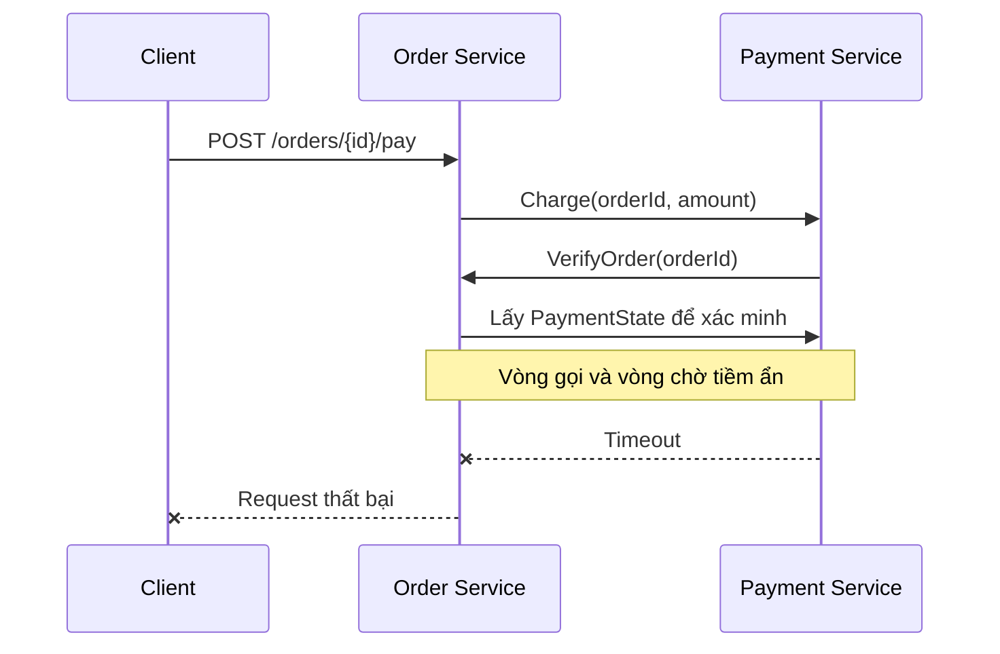
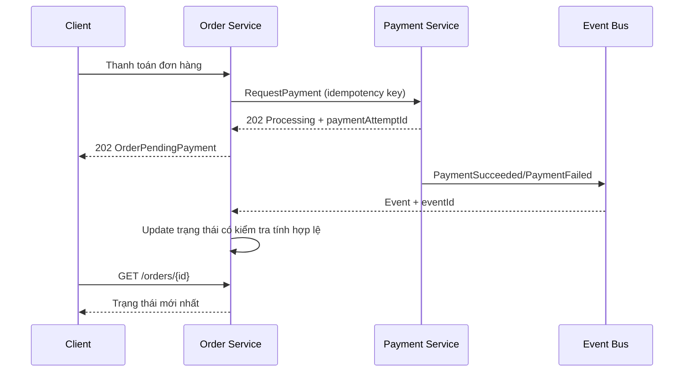
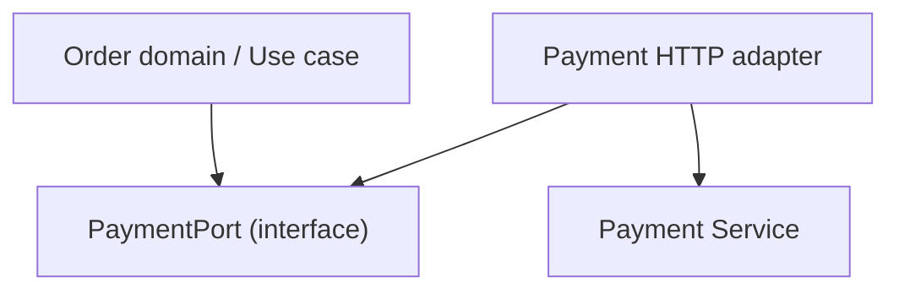

# Chuỗi gọi đồng bộ dài và phụ thuộc vòng

> **Module:** CLOUD_ARCHITECTURE — học cách thiết kế kiến trúc ứng dụng trên đám mây từ yêu cầu nghiệp vụ tới lựa chọn mạng, compute, dữ liệu và mô hình triển khai; cân nhắc độ tin cậy, bảo mật, khả năng mở rộng, chi phí, vận hành và đánh giá theo nguyên tắc Well-Architected.  
> **Chương:** Phản mẫu kiến trúc (*architecture antipatterns*).  
> **Phạm vi:** Nhận diện, đo lường và cải tiến chuỗi gọi đồng bộ quá dài (*long synchronous call chain*) và phụ thuộc vòng (*circular dependency*) giữa các dịch vụ, module hoặc tài nguyên hạ tầng.

## 1. Vì sao đây là phản mẫu kiến trúc?

Trong hệ thống cloud, việc một dịch vụ gọi một dịch vụ khác là bình thường. Rủi ro xuất hiện khi **một yêu cầu của người dùng phải đi tuần tự qua quá nhiều dịch vụ**, hoặc khi **các thành phần phụ thuộc ngược trở lại lẫn nhau**. Khi đó, một thao tác tưởng đơn giản có thể phụ thuộc vào thời gian phản hồi, quyền truy cập, trạng thái và khả năng hoạt động của nhiều hệ thống khác.

Ví dụ, thao tác xem đơn hàng tưởng chỉ cần đọc dữ liệu nhưng lại phải gọi lần lượt dịch vụ khách hàng, danh mục, định giá, khuyến mãi và tồn kho. Nếu từng lần gọi chậm một chút, người dùng phải chờ toàn bộ chuỗi. Một dịch vụ lỗi có thể khiến cả hành trình thất bại dù các dịch vụ còn lại vẫn khỏe mạnh.

Phụ thuộc vòng gây một nhóm vấn đề khác: dịch vụ A cần B khởi động hoặc trả dữ liệu, trong khi B lại cần A. Trong trường hợp xấu, hai bên chờ nhau, tạo đệ quy vô hạn hoặc không thể triển khai độc lập.

**Mục tiêu bài học:** sau khi học, bạn có thể:

1. Phân biệt chuỗi đồng bộ dài, fan-out và phụ thuộc vòng ở các tầng code, service, dữ liệu, triển khai.
2. Giải thích tác động tới độ trễ, thông lượng, độ sẵn sàng và phạm vi sự cố (*blast radius*).
3. Dùng sơ đồ phụ thuộc và distributed tracing để nhận diện nút thắt, vòng lặp và sự khuếch đại retry.
4. Thiết kế lại với ranh giới domain hợp lý, gọi song song có kiểm soát, read model, sự kiện và workflow bất đồng bộ.
5. Thiết lập timeout, deadline, circuit breaker, bulkhead, idempotency, quan sát và tiêu chí chọn phương án theo Well-Architected.

## 2. Nhận diện đúng hai phản mẫu

### 2.1. Chuỗi gọi đồng bộ dài (*long synchronous chain*)

Ở lời gọi đồng bộ, bên gọi **chờ kết quả** từ bên được gọi trước khi hoàn thành công việc tiếp theo. Nếu các lời gọi nằm trong nhánh nối tiếp của một request, độ trễ tích lũy và sự cố ở cuối chuỗi có thể lan ngược về đầu.



*Sơ đồ minh họa đường đi tuần tự; các mũi tên quay lại biểu thị phản hồi của request, không tự thân chứng minh phụ thuộc vòng.*

Những dấu hiệu thường gặp:

- Một trace của thao tác đơn giản có độ sâu RPC/HTTP nhiều tầng; số lượng service có mặt trên đường tới hạn tăng dần.
- p95/p99 end-to-end tăng mạnh trong khi CPU tại dịch vụ nhận request vẫn thấp vì các worker đang chờ I/O.
- Một thành phần ở tầng sâu chậm khiến nhiều endpoint ở tầng trên cùng chậm hoặc lỗi.
- Quy tắc nghiệp vụ đơn giản bị phân tán qua nhiều dịch vụ “chuyển tiếp” mà ít xử lý thực chất.
- Mỗi dịch vụ áp retry và timeout riêng, thiếu ngân sách deadline chung.
- Nhiều team phải cùng deploy hoặc điều phối thay đổi contract để hoàn thành một tính năng nhỏ.

**Không có quy tắc “hơn N hop là sai”.** Một chuỗi ngắn cũng có thể nguy hiểm nếu một hop nằm ngoài vùng kiểm soát, phải chịu giới hạn rate hoặc không có timeout. Đánh giá dựa trên SLO, độ trễ đường tới hạn, độ sẵn sàng của dependency, khả năng tách lỗi và mức cần thiết của từng hop.

### 2.2. Phụ thuộc vòng (*circular dependency*)

Phụ thuộc vòng tồn tại khi có đường đi có hướng từ một thành phần quay trở lại chính nó trong **đồ thị phụ thuộc**:



Ở mức đồ thị, một chu trình có thể gồm nhiều nút: `A → B → C → A`. Nhưng cần phân biệt các loại:

| Tầng | Biểu hiện | Hậu quả có thể xảy ra |
|---|---|---|
| **Code/module** | Gói A import B, B import A; dependency injection cần tạo A trước B và ngược lại | Khó biên dịch, khởi tạo hoặc kiểm thử, ranh giới code bị trộn |
| **Runtime/service** | Trong một hoặc nhiều luồng nghiệp vụ, A gọi B và B gọi lại A | Gắn chặt độ sẵn sàng, dễ tạo vòng gọi đệ quy, timeout dây chuyền |
| **Dữ liệu/ownership** | Service A đọc trực tiếp database của B, trong khi B phụ thuộc schema hoặc dữ liệu của A | Khó thay đổi schema, khó phân quyền và triển khai độc lập |
| **Hạ tầng/triển khai** | Tài nguyên A chỉ tạo được khi B đã có, còn B tham chiếu đầu ra của A | Lỗi dependency graph IaC, deadlock bootstrap, thứ tự deploy không rõ |
| **Workflow/sự kiện** | A phát event làm B phát event, rồi B lại kích hoạt A vô điều kiện | Lặp sự kiện, xử lý trùng, chi phí và hàng đợi tăng |

Một **request–response bình thường** gồm A gọi B và B trả lời A là cạnh logic A phụ thuộc B, không phải hai chiều phụ thuộc. B chỉ thực sự phụ thuộc A nếu B **chủ động cần gọi ngược** hoặc cần contract/khả năng hoạt động của A để hoàn tất công việc. Tương tự, A gọi B ở nghiệp vụ X còn B gọi A ở nghiệp vụ Y tạo phụ thuộc vận hành hai chiều, nhưng không nhất thiết có đệ quy trong cùng một request; vẫn cần đánh giá khả năng triển khai và blast radius.

## 3. Cơ chế gây chậm, giảm độ sẵn sàng và tăng chi phí

### 3.1. Độ trễ tích lũy trên đường tới hạn

Với một chuỗi **tuần tự**, thời gian phản hồi gần đúng:

\[
T_{\text{request}} \approx T_{\text{ingress}} + \sum_{i=1}^{n} (T_{\text{network},i} + T_{\text{service},i} + T_{\text{queue},i}) + T_{\text{egress}}
\]

Giả sử một request qua 5 dịch vụ con, mỗi hop cộng khoảng 40 ms xử lý và mạng trong điều kiện thông thường. Chỉ phần đó đã khoảng 200 ms, chưa tính truyền qua client–gateway, xếp hàng, TLS, serialization và các độ trễ bất thường. Nếu hop cuối thỉnh thoảng mất 1,5 giây, người dùng có thể thấy gần như toàn bộ phần trễ này.

Các percentile không cộng được theo cách tùy tiện: **p99 của tổng không nhất thiết bằng tổng p99 từng dịch vụ**. Muốn đánh giá chính xác, phải đo phân phối end-to-end và đường tới hạn trên trace thực tế. Với các lời gọi **song song**, độ trễ có thể gần với thời gian nhánh chậm nhất cộng overhead thay vì tổng các nhánh, nhưng việc gọi song song có thể tăng tải tức thời và số dependency bắt buộc thành công.

### 3.2. Độ sẵn sàng bị ràng buộc bởi các dependency bắt buộc

Nếu mọi dịch vụ trên chuỗi đều bắt buộc phải thành công, xác suất thành công end-to-end không thể vượt điều kiện của các nút phụ thuộc. Với giả định **độc lập**, một ước lượng đơn giản là:

\[
A_{\text{end-to-end}} \approx \prod_{i=1}^{n} A_i
\]

Ví dụ, sáu dependency bắt buộc, mỗi dependency sẵn sàng 99,9% ở cùng cửa sổ đo lường, cho ra `0,999^6 ≈ 99,4%`. Đây chỉ là ví dụ toán học: lỗi ngoài thực tế **có tương quan** (cùng mạng, DNS, vùng cloud, IAM, deployment, nhà cung cấp). Mức độ sẵn sàng của hành trình cũng còn phụ thuộc vào failover, cache, fallback và việc request có thực sự cần đi qua đủ sáu dịch vụ hay không.

Trong SLO, hãy đo **tỷ lệ request hoàn thành đúng yêu cầu nghiệp vụ** thay vì nhân các tỷ lệ uptime rồi coi đó là cam kết thực tế.

### 3.3. Khuếch đại retry và hàng đợi

Giả sử ba tầng liên tiếp đều áp tối đa **3 lần thử** trên cùng một thao tác. Trong trường hợp xấu, có thể xuất hiện tới `3 × 3 × 3 = 27` lần thử tới tầng sâu nhất cho một thao tác người dùng. Nếu nhiều client đồng thời retry khi dependency đang quá tải, tải tăng mạnh đúng lúc cần giảm tải.



Các timeout cũng có thể **kéo dài hơn thời gian tối đa cho phép của request** nếu mỗi hop tự đặt 2 giây và các lần retry không chia sẻ deadline. Ngoài ra, request đã timeout ở đầu chuỗi có thể vẫn tiếp tục chạy ở tầng dưới nếu cancellation không được truyền xuống, tiêu tốn tài nguyên vô ích.

### 3.4. Phụ thuộc vòng làm giảm tính độc lập

Trong một vòng phụ thuộc A–B:

- Lỗi hoặc deploy của A có thể làm B không phục vụ được ngay cả khi B chỉ cần một tính năng nhỏ từ A.
- Contract và lịch deploy của các team khó độc lập.
- Trong vòng gọi đồng bộ tái nhập cùng hành trình, thời gian chờ hoặc số lượng lời gọi có thể tăng tới timeout, hết thread/connection.
- Trong hệ thống quản lý lock và giao dịch phân tán, hai bên giữ tài nguyên và chờ tài nguyên của nhau có thể dẫn tới deadlock.
- Khi sự kiện tự kích hoạt qua lại, queue và chi phí tăng liên tục trừ khi có cơ chế dừng.

Không phải mọi tương tác hai chiều đều bị cấm. Vấn đề là **chu trình phụ thuộc bắt buộc để hoàn tất hoạt động hoặc khởi tạo**, thiếu ownership rõ ràng, và ranh giới lỗi chồng lấn.

## 4. Tìm phản mẫu trong hệ thống đang chạy

### 4.1. Vẽ hai đồ thị khác nhau

1. **Đồ thị service dependency:** nút là service; cạnh A → B nghĩa là A cần contract hoặc khả năng hoạt động của B. Gắn nhãn theo endpoint, đồng bộ/bất đồng bộ, *required/optional*, mục đích nghiệp vụ và chủ sở hữu.
2. **Đồ thị request/trace:** biểu diễn **thứ tự thực tế**, các span cha–con, thời gian chờ, retry và chỗ gọi song song. Một dependency có thể tồn tại trong đồ thị tổng thể nhưng không xuất hiện trên đường của request cụ thể.

Nhìn riêng sơ đồ component có thể không thấy rủi ro latency; nhìn riêng một trace có thể bỏ sót phụ thuộc vòng được dùng ở request khác. Cần cả hai.

**Quy trình kiểm tra:**

- Chọn 3–5 hành trình quan trọng theo nghiệp vụ: đăng nhập, tra cứu, đặt hàng, thanh toán, cập nhật hồ sơ.
- Bật/kiểm tra distributed tracing và truyền trace context qua HTTP/RPC/message với chính sách sampling phù hợp.
- Dùng trace của các request chậm để xác định **critical path**; phân biệt thời gian xử lý, xếp hàng, retry và call lặp.
- Gắn nhãn các dependency bắt buộc và không bắt buộc; đánh dấu dependency bên ngoài và shared infrastructure.
- Tìm chu trình trong đồ thị có hướng bằng phương pháp duyệt đồ thị hoặc thuật toán **strongly connected components (SCC)**; sau đó xét ngữ nghĩa từng cạnh thay vì kết luận chỉ từ sơ đồ.
- Đối chiếu endpoint thường xuyên cùng fail, log timeout, số connection/thread đang chờ, độ sâu queue và phiên bản deploy.

### 4.2. Tín hiệu định lượng

| Tín hiệu | Gợi ý nghi vấn | Điều cần kiểm chứng |
|---|---|---|
| p95/p99 endpoint tăng theo chiều sâu service | Nhiều hop đồng bộ trên đường tới hạn | Có hop nào chỉ chuyển tiếp dữ liệu? Có thể bỏ hoặc gọi song song? |
| Span «client RPC» lớn nhưng CPU thấp | Chờ network, dependency hoặc queue | Timeout, connection pool và latency của downstream |
| Retry rate tăng cùng 5xx và queue depth | Retry storm/khuếch đại yêu cầu | Layer nào đang retry? Có backoff/jitter? |
| Một outage làm nhiều service cùng lỗi | Coupling và blast radius lớn | Service nào là bắt buộc? Có fallback hợp lệ? |
| Deployment thường cần thay đổi đồng thời A và B | Contract hoặc dữ liệu bị ràng buộc | Ownership domain và chiến lược tương thích ngược |
| Cặp A↔B xuất hiện trên dependency graph | Có chu trình cấu trúc | Có vòng chờ thật sự hay chỉ tương tác độc lập ở hai use case? |
| Task IaC báo cycle hoặc startup chờ lẫn nhau | Phụ thuộc vòng lúc provisioning | Có thể tách bước bootstrap hoặc chuyển sang tham chiếu trễ? |

Tránh dùng số hop cố định làm KPI độc lập. Một kết nối tới payment provider có thể cần độ tin cậy cao hơn nhiều so với nhiều cache hit nội vùng. Đo **critical path, SLO, dependency failure contribution và chi phí** cùng nhau.

## 5. Ví dụ 1 — Chuỗi gọi đồng bộ quá dài trong checkout

### 5.1. Thiết kế ban đầu

Người dùng chọn “Xem tóm tắt đơn hàng”:



Vấn đề đáng chú ý:

- Để tính tổng tiền, mỗi dịch vụ **kéo thêm dependency** không bắt buộc thuộc ownership của mình.
- Kiểm tra tồn kho phải gọi supplier bên ngoài trên **đường đồng bộ** dù UX chỉ cần hiển thị trạng thái tạm thời.
- Mọi hop đều có retry; nếu supplier chậm, toàn bộ checkout chậm.
- Chỉ một lần deploy của Pricing có thể ảnh hưởng tóm tắt đơn, khuyến mãi và tồn kho theo cách khó dự đoán.

### 5.2. Làm rõ yêu cầu nghiệp vụ trước khi sửa

Phân tách:

- **Bắt buộc ngay lúc xem:** thông tin sản phẩm, đơn giá hiện hành, khuyến mãi có hiệu lực và phép tính tổng.
- **Cần đúng lúc đặt hàng/commit:** kiểm tra tồn kho và điều kiện thanh toán theo chính sách giao dịch.
- **Có thể cập nhật trễ:** gợi ý sản phẩm, thông tin vận chuyển tham khảo, thống kê khuyến mãi.
- **Không thể cache chung:** giá riêng theo khách hàng hoặc dữ liệu nhạy cảm nếu chính sách không cho phép.

Việc tách này giúp quyết định mô hình phù hợp; không được thay đổi lời hứa nghiệp vụ về giá hoặc tồn kho chỉ để tối ưu latency.

### 5.3. Thiết kế đề xuất: đường đi ngắn và fan-out có kiểm soát



Mục tiêu:

1. BFF/Checkout điều phối các **lời gọi độc lập** có thể chạy song song và tổng hợp dữ liệu; không biến BFF thành một dịch vụ sở hữu toàn bộ nghiệp vụ.
2. Pricing chịu trách nhiệm tính giá; có thể đọc dữ liệu thuộc quyền kiểm soát của nó hoặc read model được cấp dữ liệu theo cơ chế có hợp đồng rõ ràng.
3. Inventory cung cấp thông tin *availability* có mức độ mới được công bố; thao tác giữ/chốt tồn kho ở bước đặt hàng thực hiện riêng theo quy tắc nhất quán.
4. Nếu dữ liệu như gợi ý hoặc địa chỉ gợi ý không cần thiết, API có thể trả phần bắt buộc trước, phần không bắt buộc tải sau.
5. Request không chờ supplier từ bên thứ ba trừ khi quyết định nghiệp vụ thực sự cần kết quả đồng bộ đó.

**Cẩn trọng với fan-out:** gọi song song có thể giảm *latency critical path*, nhưng nếu 1 request tạo 10 lời gọi bắt buộc thì vẫn tăng tổng tải và nhiều điểm có thể làm request lỗi. Thiết lập giới hạn concurrency, timeout, admission control và đánh giá công suất cho từng dependency.

### 5.4. Mã giả điều phối theo deadline

```text
deadline = now + 1200ms       // ngân sách toàn bộ request từ ingress
priceFuture    = requestPricing(deadline, retries=0)
customerFuture = requestCustomer(deadline, retries=0)
stockFuture    = requestAvailability(deadline, retries=0)

price    = await priceFuture
customer = await customerFuture
stock    = await stockFuture

if price.failed:
    return error("Không thể xác định giá")
if customer.failed:
    return error("Không thể xác thực điều kiện mua")
if stock.failed:
    return responseWithStatus("Tồn kho chưa xác nhận") // chỉ nếu UX cho phép

return checkoutSummary(price, customer, stock)
```

Đây là **giả mã mô tả lựa chọn**; triển khai thực tế cần future có cancellation, deadline truyền xuống downstream, giới hạn số lời gọi song song, xử lý lỗi rõ ràng và logic nghiệp vụ xác định phần nào được phép thiếu. Không tùy ý trả trạng thái “còn hàng” nếu tồn kho chưa được xác nhận.

## 6. Ví dụ 2 — Phụ thuộc vòng giữa Order và Payment

### 6.1. Hiện trạng



Ở ví dụ này, Payment không thể hoàn tất Charge nếu không gọi Order, còn Order đang chờ Payment trước khi trả lời. Nếu VerifyOrder lại cần hỏi PaymentState thì phát sinh chu trình ngay trong một request. Nếu không có đệ quy thật, phụ thuộc hai chiều vẫn làm triển khai, phục hồi và phân tách quyền sở hữu khó khăn.

### 6.2. Tách trách nhiệm và lựa chọn luồng

- **Order Service** sở hữu đơn hàng và trạng thái đặt hàng.
- **Payment Service** sở hữu giao dịch thanh toán, idempotency key và trạng thái xử lý với nhà cung cấp thanh toán.
- Contract yêu cầu thanh toán mang đủ thông tin đã được xác thực cần thiết (ví dụ orderId, amount, currency, paymentAttemptId). Payment không tùy ý tin giá trị do client gửi.
- Nếu cần quyết định ngay, một dịch vụ điều phối đã có đủ ngữ cảnh thực hiện call **một chiều**, có deadline; Payment trả kết quả hoặc trạng thái đang xử lý.
- Nếu xử lý có thể kéo dài, Payment phát sự kiện về kết quả, Order cập nhật qua consumer, tránh Payment gọi ngược Order đồng bộ.



*202 là ví dụ cho nghiệp vụ chấp nhận xử lý bất đồng bộ; không có nghĩa thanh toán đã thành công. Sự kiện có thể đến chậm, đến trùng hoặc thất lạc tạm thời; workflow phải có cơ chế phục hồi.*

### 6.3. Đảm bảo tính đúng khi thay call bằng event

Event-driven giúp tách chờ đợi đồng bộ, nhưng đổi lấy **eventual consistency** và trách nhiệm xử lý dữ liệu:

1. **Transactional outbox:** trong cùng giao dịch ghi trạng thái Payment, ghi bản ghi sự kiện cần phát hành; worker chuyển bản ghi từ outbox ra broker. Cách này giảm rủi ro cập nhật dữ liệu xong nhưng quên phát event.
2. **At-least-once + idempotent consumer:** giả định event có thể được nhận nhiều lần. Order ghi nhận `eventId` hoặc sử dụng khóa nghiệp vụ và state transition để bỏ qua trùng lặp.
3. **Ordering/version:** nếu một payment có các trạng thái Processing → Succeeded/Failed, consumer phải từ chối chuyển lùi trạng thái sai; dùng version hoặc quy tắc chuyển trạng thái.
4. **Reconciliation:** job kiểm tra payment chưa có kết quả cuối cùng, đối chiếu với provider và phát cảnh báo/khôi phục an toàn.
5. **Compensation:** với workflow gồm nhiều bước không thể thực hiện trong một transaction ACID liên dịch vụ, thiết kế **Saga** và hành động bù tương ứng. Bù không phải lúc nào cũng đảo ngược mọi tác động; phải định nghĩa nghiệp vụ.
6. **Quyền truy cập và dữ liệu:** event chỉ chứa dữ liệu cần thiết; áp IAM theo topic, mã hóa phù hợp và schema versioning.

Không nên biến mọi query thành event. Với thao tác nhỏ, cần kết quả ngay và dependency có SLO tốt, **gọi đồng bộ một chiều** vẫn là lựa chọn hợp lý.

## 7. Cắt vòng phụ thuộc: bốn kỹ thuật chính

### 7.1. Đặt ownership của domain rõ ràng

Hỏi ai là nguồn sự thật (*source of truth*) cho từng khái niệm. Hai dịch vụ cùng sở hữu trạng thái Order là tín hiệu thiết kế ranh giới sai. Quy tắc và dữ liệu nên nằm trong service sở hữu, được công bố qua API hoặc event có contract.

Trong một monolith, chuyển logic chung sang module đúng tầng hoặc dịch vụ domain phù hợp có thể loại vòng import. Không tạo một thư viện “shared” quá lớn chỉ để làm biến mất lỗi build trong khi các ràng buộc runtime vẫn còn.

### 7.2. Đảo chiều phụ thuộc ở mức code/contract

Tầng nghiệp vụ chỉ phụ thuộc vào interface/port do nó sở hữu; adapter phụ thuộc vào interface và thực hiện kết nối ra ngoài.



Lưu ý: Dependency Inversion giúp giảm vòng **tầng code**, nhưng không tự xóa vòng **gọi service** nếu Payment Service vẫn gọi ngược Order. Cần sửa cả hợp đồng runtime khi có chu trình.

### 7.3. Sự kiện nghiệp vụ và dữ liệu đọc được sao chép có kiểm soát

Thay vì B gọi A để lấy lại một trường dữ liệu ở mỗi request, A có thể công bố event thay đổi trạng thái; B duy trì read model đủ thông tin để tự quyết định trong giới hạn nhất quán được phép. Kỹ thuật này giảm phụ thuộc thời gian chạy nhưng có thêm độ trễ đồng bộ và quy trình backfill/rebuild.

Ví dụ Inventory phát `StockChanged`; Checkout đọc snapshot có timestamp. Nếu nghiệp vụ bán vượt tồn kho không được chấp nhận, bước **commit/reserve** vẫn phải kiểm tra và ghi nhất quán ở dịch vụ sở hữu tồn kho, thay vì tin snapshot.

### 7.4. Orchestrator/Saga cho workflow liên dịch vụ

Một thành phần điều phối có thể sở hữu **trình tự quy trình**, trong khi từng service sở hữu nghiệp vụ và dữ liệu riêng. Tránh để orchestrator trở thành nơi chứa mọi quy tắc domain. Dùng queue/workflow engine nếu các bước dài, cần retry bền vững, trạng thái chờ hoặc recovery sau restart.

Không tạo vòng sự kiện mới kiểu `OrderCreated → PaymentRequested → OrderUpdated → PaymentRequested`. Mỗi event handler phải có điều kiện trạng thái đầu vào, mục đích và terminal state rõ ràng.

## 8. Cơ chế bảo vệ bắt buộc khi còn dependency đồng bộ

Không thể và không cần loại bỏ mọi lời gọi đồng bộ. Điều quan trọng là **giới hạn tác động lỗi**.

### 8.1. Deadline và timeout có ngân sách chung

Thiết kế theo **deadline end-to-end** thay vì cộng nhiều timeout độc lập. Ví dụ API có hạn 1.200 ms từ ingress, bao gồm định tuyến, queue, mã hóa dữ liệu, backend và buffer trả kết quả.

```text
Client request  --(deadline còn 1200ms)--> Gateway
Gateway         --(deadline còn 1100ms)--> Order
Order           --(deadline còn 850ms) --> Pricing
Pricing         --(deadline còn 650ms) --> Dependency
... timeout ở từng tầng phải <= thời gian còn lại
```

Những con số minh họa cho **thời gian còn lại**, không phải các timeout cộng thêm. Bên nhận cần ngừng xử lý khi deadline hết và truyền cancellation khi thư viện/runtime hỗ trợ. Đặt network connect timeout, response timeout, queue timeout riêng phù hợp với deadline.

### 8.2. Retry có chọn lọc, backoff và jitter

- Retry chỉ khi lỗi có khả năng tạm thời, thao tác an toàn để thử lại, còn deadline và còn ngân sách retry.
- Dùng exponential backoff kèm **jitter** để tránh request đồng loạt.
- Giới hạn tổng số lần thử cho **toàn bộ hành trình**, tránh retry lồng nhiều tầng. Cân nhắc đặt retry tại một tầng phù hợp.
- POST thanh toán hoặc tạo đơn cần **idempotency key** và kiểm tra idempotent ở backend, không suy luận an toàn chỉ vì client gửi lại cùng payload.
- Tôn trọng `Retry-After` khi phù hợp. Không retry các lỗi nghiệp vụ không thể thành công chỉ bằng thử lại.

### 8.3. Circuit breaker, bulkhead và load shedding

| Cơ chế | Vai trò | Cảnh báo khi áp dụng |
|---|---|---|
| **Circuit breaker** | Ngừng gửi tạm thời tới dependency có dấu hiệu hỏng; cho phép thử lại có kiểm soát | Nếu threshold quá nhạy sẽ chặn cả traffic hợp lệ |
| **Bulkhead** | Tách connection pool, thread pool hoặc concurrency quota giữa các dependency | Cần capacity planning; cô lập không có nghĩa tăng tổng tài nguyên vô hạn |
| **Rate limit / admission control** | Giữ lưu lượng không vượt công suất; từ chối sớm khi quá tải | Trả lỗi có ngữ nghĩa, định nghĩa chính sách ưu tiên và công bằng |
| **Graceful degradation** | Bỏ bớt tính năng không bắt buộc trong sự cố | Tuyệt đối không bỏ bước xác thực, phân quyền, tính tiền hoặc quy tắc an toàn |
| **Cache/read model** | Giảm số lần gọi cho dữ liệu có độ mới cho phép | Chọn TTL, invalidation, dữ liệu theo người dùng và chính sách nhất quán |

Giảm lỗi dây chuyền còn cần cấu hình pool, connection lifetime, queue bound, DNS/service discovery, TLS và quyền IAM phù hợp. Cơ chế bảo vệ ở application không cứu được hệ thống nếu shared database, message broker hoặc network là điểm hỏng chung không có phương án phục hồi.

## 9. Mô hình đồng bộ, song song và bất đồng bộ: chọn theo yêu cầu

| Tiêu chí | Đồng bộ tuần tự | Đồng bộ song song | Bất đồng bộ qua queue/event |
|---|---|---|---|
| Kết quả lúc trả HTTP | Có thể có ngay nếu các bước thành công | Có thể có ngay sau nhánh chậm nhất | Thường trả jobId/trạng thái xử lý, kết quả đến sau |
| Độ trễ đường tới hạn | Tổng các chặng nối tiếp | Gần nhánh chậm nhất + overhead | Ngắn ở bước nhận; thời gian hoàn tất workflow có thể dài hơn |
| Phụ thuộc availability tại thời điểm request | Cao nếu tất cả hop bắt buộc | Vẫn cao nếu mọi nhánh bắt buộc | Giảm coupling thời gian chạy, phụ thuộc broker và worker cho xử lý sau |
| Tính nhất quán | Có thể dễ trả quyết định nhất quán ngay nếu transaction phạm vi một service | Phải tổng hợp và kiểm soát trạng thái dữ liệu giữa nhánh | Cần chấp nhận eventual consistency, idempotency, replay |
| Độ phức tạp vận hành | Trace và timeout tương đối quen thuộc | Thêm concurrency limit và tổng hợp lỗi | Thêm queue, DLQ, outbox, lag, versioning, reconciliation |
| Hợp với tình huống | Lời gọi nhỏ, bắt buộc, cần kết quả ngay | Dữ liệu độc lập cho trang tổng hợp | Gửi email, xử lý batch, xác nhận thanh toán chậm, nghiệp vụ nhiều bước |

**Quy tắc chọn:** bắt đầu từ yêu cầu **tính đúng, độ mới, phản hồi người dùng và SLO**. Nếu không thể trả kết quả khi thiếu một dependency thì vẫn có coupling dù chuyển sang song song. Nếu bắt buộc xác nhận giao dịch theo thời gian thực, có thể giữ một đoạn đồng bộ ngắn với timeout hợp lý và chuyển phần hậu xử lý sang bất đồng bộ.

## 10. Thực hành refactor an toàn theo từng giai đoạn

Tránh “đập đi viết lại” đồ thị service trong một lần. Một kế hoạch có thể kiểm chứng:

### Giai đoạn 1 — Chụp hiện trạng

- Công bố danh sách hành trình quan trọng cùng SLO latency/availability, tỷ lệ lỗi theo endpoint.
- Trích trace theo request và lỗi để vẽ đồ thị, critical path, retry amplification và điểm nghẽn.
- Tìm SCC trên dependency graph; xác thực xem cạnh nào tạo cycle thực trong runtime hoặc deploy.
- Gắn ownership từng dữ liệu, interface và luồng nghiệp vụ.

### Giai đoạn 2 — Giảm rủi ro tức thời

- Áp request deadline, timeout phân tầng, retry budget và jitter.
- Giới hạn concurrency/queue; bổ sung circuit breaker cho dependency dễ quá tải.
- Phân loại dependency bắt buộc và tùy chọn; chỉ áp fallback khi nghiệp vụ cho phép.
- Thêm cảnh báo và runbook trước khi thay đổi luồng; không dỡ bỏ kiểm soát bảo mật để giảm latency.

### Giai đoạn 3 — Rút ngắn critical path

- Loại các “pass-through service” hoặc chuyển logic nhỏ về đúng domain owner.
- Gom dữ liệu đọc dưới dạng read model/denormalized view nếu chấp nhận eventual consistency.
- Gọi song song các nhánh độc lập với giới hạn concurrency.
- Tách background work khỏi request/response; áp queue/workflow khi cần độ bền.

### Giai đoạn 4 — Phá vòng có kiểm soát

- Định nghĩa dependency một chiều và contract/API/event có version.
- Nếu có workflow nhiều bước, chỉ định orchestrator hoặc sự kiện nghiệp vụ với terminal state.
- Tạo outbox, idempotent consumer, replay/reconciliation, chính sách DLQ và quyền truy cập.
- Dùng **strangler pattern** hoặc canary/phát hành theo tỷ lệ để chuyển từng endpoint, quan sát cả tính đúng nghiệp vụ và latency.
- Loại code và đường gọi cũ sau khi chứng minh không còn traffic cần phục vụ.

### Giai đoạn 5 — Xác nhận kết quả

So sánh trước/sau trong điều kiện tải tương đương: latency p50/p95/p99, tỷ lệ thành công end-to-end, số hop trên critical path, số dependency bắt buộc, tải tầng sâu, retry rate, saturation, chi phí request/egress/queue, thời gian deploy độc lập và số sự cố lan truyền. Kiểm thử lỗi có chủ đích (*fault injection*) trong môi trường phù hợp để xác nhận circuit breaker, timeout, cancellation và xử lý event trùng.

## 11. Ví dụ vận hành: một dịch vụ chậm tạo sự cố diện rộng

**Bối cảnh:** endpoint đặt hàng có hạn phản hồi 2 giây. `Order API` gọi đồng bộ `Customer → Pricing → Inventory → Shipping Rate API`. Dịch vụ báo giá vận chuyển bên ngoài chậm từ 100 ms lên 4 giây. Các tầng retry lần lượt 3 lần, làm connection pool Order và Pricing đầy.

**Triệu chứng:** p99 checkout tăng, request mới xếp hàng, các chức năng không liên quan dùng chung worker/pool bắt đầu lỗi. Giám sát CPU có thể vẫn thấp vì thời gian chủ yếu nằm ở chờ I/O.

**Xử lý trong sự cố:**

1. Xác định request nào đang chờ Shipping Rate qua trace và metric của connection pool; tạm giảm retry lồng, chặn lưu lượng quá tải bằng cơ chế sẵn có.
2. Nếu nghiệp vụ cho phép, trả “chưa có báo giá vận chuyển” và cho người dùng tính phí trước khi chốt đơn; không âm thầm đặt cước về 0.
3. Bảo vệ API khác bằng bulkhead và capacity limit; giữ nguyên kiểm tra bảo mật và điều kiện thanh toán.
4. Theo dõi lỗi downstream, queue depth, deadline exceeded và successful checkout rate cho tới khi phục hồi.

**Sửa lâu dài:** để Shipping Rate là thông tin độc lập trên trang tham khảo hoặc tính bất đồng bộ trước bước xác nhận thanh toán, tùy yêu cầu giá cuối cùng. Bổ sung deadline và khả năng lưu cache bảng phí nếu nhà vận chuyển cho phép; dùng fallback chỉ với quy tắc rõ ràng và hiển thị trạng thái thiếu dữ liệu.

**Rủi ro mới sau refactor:** snapshot phí vận chuyển có thể cũ; workflow bất đồng bộ cần xử lý event tới trễ, thanh toán đã thực hiện nhưng đơn hàng chưa cập nhật, và chi phí queue/logging. Do đó, mọi đề xuất giảm latency phải nêu cùng lúc yêu cầu **tính đúng, UX và độ tin cậy**.

## 12. Đánh giá qua các trụ cột Well-Architected

| Trụ cột | Tác động của phản mẫu | Quyết định / kiểm soát kiến trúc |
|---|---|---|
| **Operational Excellence – Vận hành xuất sắc** | Khó debug, nhiều team phụ thuộc release, khó phục hồi | Distributed tracing, dependency catalog, runbook, contract versioning, deploy độc lập |
| **Security – Bảo mật** | Dữ liệu và quyền tràn qua quá nhiều service, token được truyền/ghi log ở nhiều hop | IAM tối thiểu, mTLS hoặc auth giữa service khi cần, phân quyền theo domain, audit, giảm truyền dữ liệu nhạy cảm |
| **Reliability – Tin cậy** | Một lỗi downstream lan rộng, retry storm, vòng chờ, khó giới hạn blast radius | Deadline, retry budget, breaker, bulkhead, idempotency, workflow bền vững, kiểm thử lỗi |
| **Performance Efficiency – Hiệu quả hiệu năng** | Tăng độ trễ tuần tự, xếp hàng, giữ thread/connection trong lúc chờ | Giảm critical path, fan-out hợp lý, read model, cache, tối ưu access pattern |
| **Cost Optimization – Tối ưu chi phí** | RPC, request, network egress, tính toán và queue/log thừa do retry | Giảm round-trip, loại call không cần, theo dõi cost per successful operation, tránh retry quá nhiều |
| **Sustainability – Bền vững** | Lặp request và xử lý không tạo giá trị tiêu tốn compute/network | Giảm call và payload thừa, chọn độ mới dữ liệu phù hợp, batch event đúng nhu cầu |

**Đánh đổi bắt buộc phải ghi nhận:**

- Đồng bộ ngắn, dễ hiểu và có thể cần cho quyết định nhất quán ngay; bỏ đồng bộ có thể khiến dữ liệu tạm thời không đồng nhất.
- Gọi song song giảm latency, nhưng có thể tăng fan-out và tổng tải.
- Event/queue giảm phụ thuộc vào khả năng hoạt động đồng thời, nhưng cần broker, consumer, outbox, idempotency và theo dõi trạng thái.
- Cache/read model cải thiện khả năng chịu lỗi và hiệu năng nhưng tạo rủi ro dữ liệu cũ và yêu cầu quản lý phân quyền.
- Bulkhead và circuit breaker làm rõ ranh giới lỗi, song có thể từ chối request hợp lệ nếu cấu hình quá chặt.

Điểm mấu chốt của việc đánh giá không phải số lượng microservice hay việc có sử dụng message broker, mà là **hành trình nghiệp vụ có đạt mục tiêu độ trễ, tính đúng, độ tin cậy và chi phí với mức phức tạp vận hành chấp nhận được hay không**.

## 13. Checklist khi review thiết kế

- [ ] Có bản đồ service dependency theo hướng gọi và đánh dấu cạnh bắt buộc/tùy chọn.
- [ ] Có bản đồ critical path từ distributed trace của các hành trình quan trọng.
- [ ] Mỗi service có ownership dữ liệu và contract rõ ràng; không truy cập chéo database tùy tiện.
- [ ] Không tồn tại vòng gọi đệ quy hoặc vòng chờ không có điều kiện dừng; các SCC đã được phân tích.
- [ ] Mỗi request có deadline end-to-end, timeout còn lại và cancellation khi có thể.
- [ ] Retry có ngân sách, backoff/jitter, giới hạn ở tầng hợp lý và idempotency đối với thao tác ghi.
- [ ] Concurrency, connection pool và queue có giới hạn; lỗi một dependency không chiếm hết tài nguyên chung.
- [ ] Các fallback/giảm chức năng chỉ áp dụng cho dữ liệu và nghiệp vụ được phép thiếu.
- [ ] Đường event có outbox/idempotency hoặc cơ chế đảm bảo tương đương, trạng thái kết thúc, DLQ và đối soát.
- [ ] Dữ liệu riêng tư được kiểm tra quyền ở service sở hữu, không bị cache hoặc phát event bừa bãi.
- [ ] Có SLO, dashboard, cảnh báo, runbook, kiểm thử lỗi và cách so sánh trước/sau cải tiến.
- [ ] Mọi tối ưu ghi rõ tác động tới tính nhất quán, bảo mật, chi phí và khả năng vận hành.

## 14. Tình huống tự luyện

### Tình huống A — Sửa chuỗi gọi

Một endpoint đọc tổng quan tài khoản có chuỗi `Gateway → Profile → Loyalty → Recommendation → Ads`. Người dùng chỉ cần số điểm loyalty để tiếp tục, còn quảng cáo và gợi ý là phần bổ sung. Hãy:

1. Chỉ ra chặng nào nằm trên critical path, chặng nào nên tách.
2. Đề xuất kiến trúc có kết quả loyalty đúng hạn và các thành phần optional có timeout riêng.
3. Giải thích vì sao gọi song song mọi dịch vụ chưa chắc cải thiện availability.
4. Xác định metric để chứng minh thay đổi đạt SLO.

### Tình huống B — Tìm vòng

Service A quản lý đơn hàng gọi B để tính thanh toán; B gọi C để kiểm tra gian lận; C lại gọi A để lấy thông tin khách hàng. Hãy:

1. Vẽ đồ thị có hướng và xác định chu trình.
2. Phân biệt trường hợp C đọc A trong **cùng một request** với C chỉ phụ thuộc A ở một luồng nghiệp vụ khác.
3. Đề xuất contract dữ liệu và event/read model hoặc orchestrator phù hợp.
4. Nêu quy tắc cập nhật trạng thái để tránh vòng event và xử lý trùng lặp.

### Tình huống C — Retry storm

Một request phải đi qua ba boundary, mỗi boundary được cấu hình ba lần thử. Dependency sâu nhất thường xuyên timeout. Hãy:

1. Tính số lần thử lý thuyết tối đa tới dependency sâu nhất trong trường hợp retry lồng xấu nhất.
2. Đề xuất một retry budget cho toàn hành trình và backoff có jitter.
3. Phân biệt lỗi có thể thử lại với lỗi nghiệp vụ hoặc thao tác ghi không idempotent.
4. Định nghĩa các chỉ số để phát hiện retry amplification.

### Tình huống D — Kiến trúc và SLO

Một tác vụ tạo báo cáo mất vài phút nhưng web UI phải phản hồi trong một giây. Hãy chọn giữa một HTTP request chờ tới khi xong và một API nhận job trả trạng thái xử lý, sau đó có worker làm nền. Nêu cách truy vấn trạng thái, đảm bảo không chạy trùng job, phục hồi sau worker restart và các đánh đổi về trải nghiệm người dùng.

## 15. Ghi nhớ

**Chuỗi gọi đồng bộ dài** tạo sự phụ thuộc trên đường tới hạn, làm độ trễ và rủi ro lỗi tích lũy; **phụ thuộc vòng** khiến thành phần khó triển khai, kiểm thử và phục hồi độc lập, thậm chí tạo vòng chờ hoặc vòng sự kiện. Cách khắc phục bắt đầu từ việc xác định đúng yêu cầu nghiệp vụ, ranh giới ownership và đường đi thực tế, sau đó kết hợp lời gọi ngắn có deadline, song song có kiểm soát, cache/read model hoặc workflow bất đồng bộ khi phù hợp.

Kiến trúc tốt phải được kiểm chứng bằng **latency end-to-end, tỷ lệ thành công nghiệp vụ, blast radius, chi phí và khả năng vận hành**, đồng thời đánh giá rõ hệ quả của tính nhất quán, bảo mật và xử lý thất bại theo Well-Architected.
