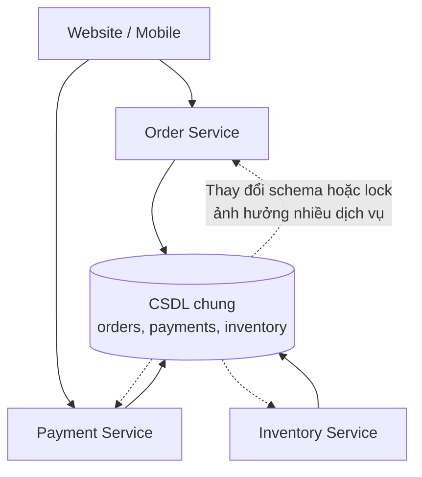
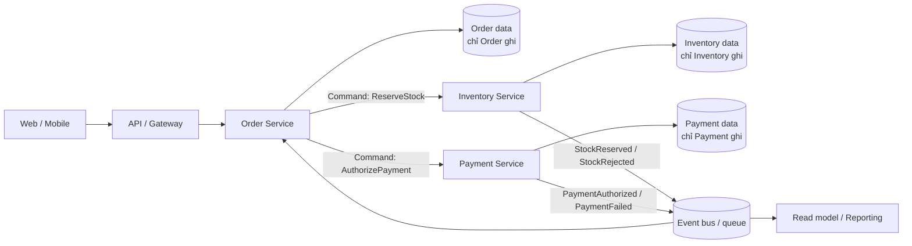
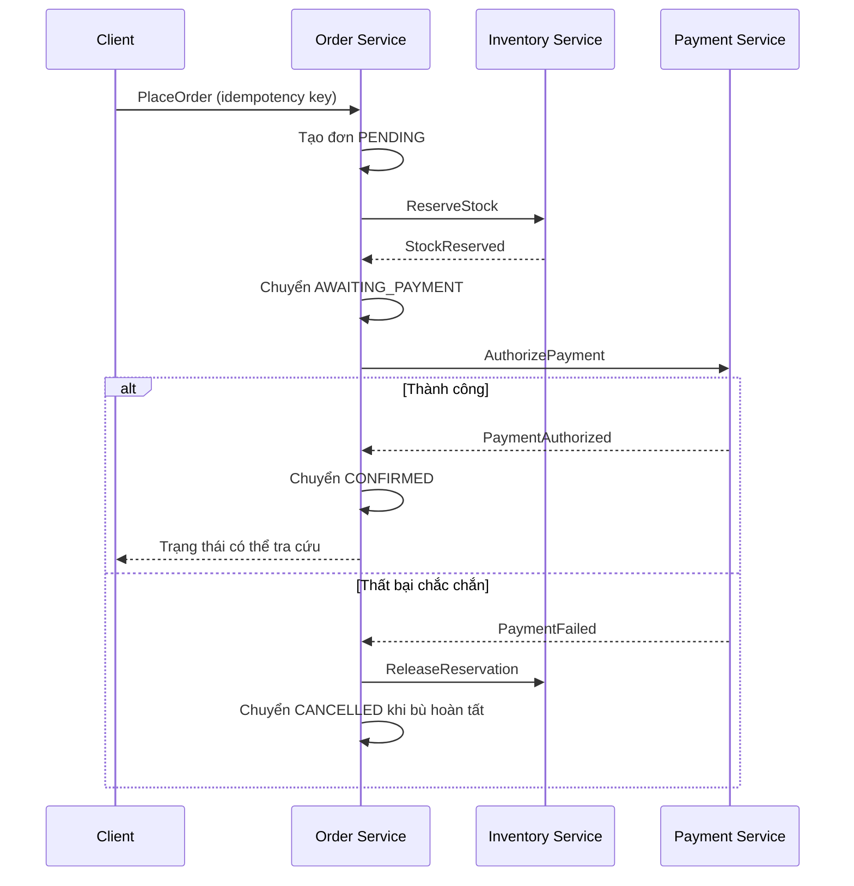

# Nhiều dịch vụ cùng ghi một cơ sở dữ liệu không có quyền sở hữu rõ ràng

## 1. Bối cảnh và mục tiêu

Khi thiết kế kiến trúc ứng dụng trên đám mây, nhóm phát triển thường tách một hệ thống thành nhiều dịch vụ để triển khai độc lập, mở rộng theo tải và giao trách nhiệm cho từng nhóm. Tuy nhiên, nếu các dịch vụ vẫn **tự ý ghi trực tiếp vào cùng các bảng hoặc trường dữ liệu** mà không xác định ai là chủ sở hữu, chúng có thể trở thành một hệ thống liên kết chặt chẽ qua cơ sở dữ liệu (CSDL).

Đây là **phản mẫu kiến trúc** (*architecture antipattern*) được đề cập trong bài: **nhiều dịch vụ cùng ghi một CSDL không có quyền sở hữu rõ ràng**. Vấn đề cốt lõi không phải số lượng CSDL hay việc nhiều dịch vụ dùng chung một máy chủ CSDL, mà là **quyền thay đổi trạng thái nghiệp vụ bị phân tán, thiếu hợp đồng và thiếu nơi chịu trách nhiệm cuối cùng**.

Bài học thuộc phần **Phản mẫu kiến trúc** của `CLOUD_ARCHITECTURE`: học cách chuyển yêu cầu nghiệp vụ thành thiết kế mạng, compute, dữ liệu và mô hình triển khai trên đám mây; nhận diện đánh đổi về độ tin cậy, bảo mật, khả năng mở rộng, chi phí, vận hành; và đánh giá theo các nguyên tắc Well-Architected.

Sau bài này, bạn cần có thể:

- Nhận diện khác biệt giữa **chia sẻ hạ tầng CSDL** và **chia sẻ quyền ghi dữ liệu nghiệp vụ**.
- Giải thích các lỗi đồng thời, thay đổi schema, mất ranh giới bảo mật và sự cố vận hành phát sinh khi nhiều dịch vụ cùng làm chủ một bản ghi.
- Xác định **nguồn dữ liệu chuẩn** (*source of truth*), **quyền sở hữu dữ liệu** (*data ownership*) và nơi bảo vệ các bất biến nghiệp vụ (*business invariants*).
- So sánh gọi API đồng bộ, trao đổi sự kiện, bản sao dữ liệu chỉ đọc và phối hợp quy trình đa dịch vụ.
- Đề xuất lộ trình chuyển đổi hệ thống đang vận hành mà không phải thay toàn bộ CSDL ngay lập tức.

## 2. Khi nào được coi là phản mẫu?

Giả sử hệ thống bán hàng có ba dịch vụ:

| Dịch vụ | Nhiệm vụ mong muốn | Điều đang xảy ra |
| --- | --- | --- |
| Order Service | Tạo đơn, quản lý trạng thái đơn | Ghi `orders.status`, `orders.total_amount` |
| Inventory Service | Quản lý tồn kho, đặt giữ hàng | Ghi `inventory.available_qty` **và** sửa `orders.status` |
| Payment Service | Xử lý kết quả thanh toán | Ghi `payments.status` **và** sửa `orders.status`, `orders.total_amount` |

Ba dịch vụ có thể chạy trên các nền tảng compute độc lập: container được quản lý, PaaS hay serverless. Nhưng nếu cả ba dùng tài khoản CSDL có quyền `UPDATE` rộng trên bảng `orders`, chúng cùng phụ thuộc vào cấu trúc và quy tắc ghi của nhau. Có lỗi xảy ra thì nhóm nào phải điều tra, sửa dữ liệu và quyết định trạng thái đúng?

Ví dụ, Inventory Service đặt `orders.status = 'RESERVED'` trong lúc Payment Service đặt `orders.status = 'PAID'`. Hai cập nhật có thể lần lượt thành công nhưng giá trị cuối cùng chỉ phản ánh tác vụ chạy sau. Nếu hệ thống không có quy tắc chuyển trạng thái, một đơn đã thanh toán có thể bị hiển thị quay về trạng thái giữ hàng.

### Phân biệt ba tình huống

| Tình huống | Đánh giá |
| --- | --- |
| Nhiều dịch vụ dùng **cùng một cụm CSDL vật lý**, nhưng mỗi miền nghiệp vụ có schema, tài khoản và quyền ghi riêng | Có thể chấp nhận; vẫn cần đánh giá cô lập tài nguyên và quyền truy cập |
| Nhiều dịch vụ **đọc** dữ liệu qua API, sự kiện hoặc read model được quản lý | Có thể là tích hợp hợp lý; cần xác định độ trễ cập nhật và chính sách dữ liệu |
| Nhiều dịch vụ cùng **sửa bảng/cột** của một miền nghiệp vụ, không có chủ sở hữu, quy tắc chuyển trạng thái và cơ chế điều phối | Phản mẫu cần ưu tiên xử lý |

**Quyền sở hữu dữ liệu không nhất thiết bằng việc sở hữu máy chủ CSDL.** Một nhóm có thể làm chủ một tập bảng và các bất biến liên quan, ngay cả khi hạ tầng CSDL được chia sẻ vì lý do ngân sách. Ngược lại, tách CSDL vật lý thành hai máy nhưng cho các dịch vụ ghi chéo tùy ý qua kết nối vẫn không giải quyết được nguyên nhân gốc.

## 3. Sơ đồ phản mẫu: các đường ghi đi vòng qua chủ sở hữu



Điểm nguy hiểm là **tất cả cùng có đường ghi** vào dữ liệu mà người khác cũng được thay đổi. Trong code, tín hiệu thường thấy là:

```sql
-- Inventory Service tự thay trạng thái đơn hàng
UPDATE orders
SET status = 'RESERVED'
WHERE order_id = :order_id;

-- Payment Service cũng tự thay trạng thái đơn hàng
UPDATE orders
SET status = 'PAID'
WHERE order_id = :order_id;
```

Các câu lệnh ở trên chỉ minh họa cách gây lỗi. Trong hệ thống thực, truy vấn cần tham số hóa bằng cơ chế của driver/ORM; không được nối chuỗi trực tiếp từ dữ liệu người dùng. Ngay cả khi mỗi câu `UPDATE` là một transaction hợp lệ, chúng vẫn có thể vi phạm **ý nghĩa trạng thái của đơn hàng**.

### “Có transaction ACID” vì sao vẫn chưa đủ?

ACID giúp bảo vệ những thuộc tính của một transaction CSDL: tính nguyên tử, nhất quán theo các ràng buộc thực thi được, cô lập và bền vững. Nhưng CSDL không tự biết quy tắc nghiệp vụ như:

> “Một đơn đã thanh toán không được quay về trạng thái chờ giữ hàng; chỉ Order Service quyết định vòng đời đơn dựa trên kết quả từ Inventory và Payment.”

Nếu quy tắc này không được mã hóa thành một nơi kiểm soát chuyển trạng thái và kiểm soát quyền ghi, transaction hợp lệ vẫn có thể tạo ra kết quả nghiệp vụ sai. Cơ chế khóa, độ cô lập cao hơn hoặc optimistic locking giảm một số lỗi cạnh tranh; chúng **không xác định thay cho tổ chức** dịch vụ nào có quyền ra quyết định.

## 4. Những dạng hư hại thường gặp

| Triệu chứng | Nguyên nhân liên quan đến ghi chung | Hậu quả |
| --- | --- | --- |
| **Lost update / trạng thái bị ghi đè** | Các dịch vụ cập nhật cùng trường theo logic độc lập | Trạng thái đơn sai, tác vụ bị bỏ sót |
| **Quy tắc nghiệp vụ lệch nhau** | Mỗi dịch vụ tự kiểm tra điều kiện trước khi ghi | Bất biến không được bảo vệ nhất quán |
| **Schema coupling** | Nhiều codebase phụ thuộc trực tiếp tên bảng/cột và kiểu dữ liệu | Đổi schema phải phối hợp phát hành nhiều dịch vụ |
| **Khóa và tranh chấp** | Transaction của dịch vụ này giữ row lock hoặc chạy truy vấn nặng | Độ trễ và timeout lan sang dịch vụ khác |
| **Quyền truy cập quá rộng** | Dùng chung DB credential hoặc quyền `UPDATE` toàn schema | Một lỗi cấu hình có thể sửa dữ liệu vượt phạm vi |
| **Khó kiểm toán và truy trách nhiệm** | Nhiều đường ghi, ít correlation ID và audit log | Khó trả lời ai sửa gì, khi nào, theo yêu cầu nào |
| **Khó thay đổi quy mô** | Mọi dịch vụ đẩy tải ghi vào cùng DB/primary | Scale compute không giải quyết được giới hạn DB |
| **Khó sao lưu/khôi phục chọn lọc** | Dữ liệu nhiều miền trộn trong một nơi và cùng phụ thuộc transaction | Restore một miền có thể ảnh hưởng tính nhất quán các miền khác |
| **Triển khai độc lập trên danh nghĩa** | Code ứng dụng khác nhau nhưng schema và trình tự cập nhật dùng chung | Một migration nhỏ có thể gây downtime diện rộng |

### Tình huống chạy đua cụ thể

Ví dụ có các bước diễn ra gần đồng thời:

1. Payment Service đọc `orders.status = 'PENDING'`.
2. Inventory Service cũng đọc `orders.status = 'PENDING'`.
3. Payment Service ghi `PAID`.
4. Inventory Service ghi `RESERVED`, dù kết quả thanh toán đã xảy ra.
5. Giao diện đọc trạng thái `RESERVED`; báo cáo và nghiệp vụ hoàn tiền diễn giải sai.

Một cột `version` với điều kiện `WHERE version = :old_version` có thể giúp nhận diện xung đột ghi và buộc retry hay báo lỗi. Tuy nhiên, nếu hai dịch vụ vẫn có quyền quyết định giá trị `status` theo các mô hình khác nhau, sau khi retry chúng vẫn có thể đưa ra trạng thái sai. **Kiểm soát đồng thời** và **quyền sở hữu nghiệp vụ** là hai vấn đề liên quan nhưng khác nhau.

## 5. Xác định ranh giới sở hữu: ai giữ nguồn dữ liệu chuẩn?

Thiết kế tốt bắt đầu từ **năng lực nghiệp vụ** và bất biến dữ liệu, không bắt đầu bằng cách phân chia bảng theo tên hoặc chia đều số bảng cho các nhóm.

Với hệ thống bán hàng:

| Miền nghiệp vụ | Chủ sở hữu gợi ý | Dữ liệu chuẩn | Các dịch vụ khác được làm gì? |
| --- | --- | --- | --- |
| Đơn hàng | Order Service | `orders`, `order_items`, vòng đời đơn | Gửi lệnh nghiệp vụ được hỗ trợ; nhận sự kiện; đọc qua API/read model |
| Tồn kho | Inventory Service | `stock`, `reservations` | Yêu cầu giữ/giải phóng hàng qua hợp đồng nghiệp vụ |
| Thanh toán | Payment Service | `payment_attempts`, `payment_transactions` | Yêu cầu thanh toán, nhận kết quả; không tự ghi trạng thái đơn |
| Gửi thông báo | Notification Service | Trạng thái gửi, retry, kênh liên hệ theo quyền | Nhận sự kiện; không chỉnh sửa trực tiếp đơn hàng |

Một dịch vụ sở hữu dữ liệu nghĩa là dịch vụ đó:

- Có trách nhiệm định nghĩa schema, ràng buộc và vòng đời dữ liệu trong phạm vi của mình.
- Là **điểm ghi chính thức** cho các thay đổi nghiệp vụ; có quyền từ chối lệnh không hợp lệ.
- Công bố cách các bên khác tích hợp: API/command, sự kiện, hoặc bản sao chỉ đọc với điều kiện sử dụng.
- Sở hữu quy tắc xử lý lỗi, thử lại, giám sát, lưu giữ và khôi phục tương ứng.
- Duy trì hợp đồng tương thích khi phải nâng cấp phiên bản.

Các thực thể nghiệp vụ có thể liên quan đến nhau nhưng mỗi phần thông tin cần một nguồn chuẩn rõ ràng. Ví dụ, trạng thái thanh toán chuẩn thuộc Payment Service; Order Service có thể lưu trạng thái thanh toán **đã được đồng bộ để quyết định vòng đời đơn**, nhưng không tự nhận quyền sửa sổ cái giao dịch thanh toán. Một bản sao phục vụ hiển thị phải được nhận diện là **projection/read model** và có chính sách cập nhật.

### Ranh giới giao dịch và bất biến

Những bất biến phải được thực thi nguyên tử nên đặt trong cùng ranh giới giao dịch khi có thể. Ví dụ, “không đặt giữ nhiều hơn số lượng có sẵn” cần được Inventory Service thực thi bằng transaction, điều kiện cập nhật hoặc cơ chế đồng thời phù hợp trong dữ liệu do dịch vụ này quản lý. Order Service không nên kiểm tra tồn kho rồi tự `UPDATE inventory` vì khoảng trống giữa kiểm tra và ghi có thể tạo oversell.

Nếu một thao tác nghiệp vụ liên quan nhiều chủ sở hữu, phải thiết kế cách **phối hợp giữa các dịch vụ** với trạng thái trung gian, thông điệp và hành động bù. Đừng cố che giấu việc phân tán bằng những câu lệnh SQL ghi chéo.

## 6. Sơ đồ mục tiêu: ghi qua chủ sở hữu



Sơ đồ thể hiện quyền sở hữu logic, **không bắt buộc ba CSDL vật lý riêng biệt**. Các kho dữ liệu có thể dùng cùng một nền tảng managed DB với schema/account riêng trong giai đoạn đầu, hoặc tách instance/cluster để đạt mức cô lập hiệu năng, bảo mật và khôi phục cao hơn khi cần.

Những nguyên tắc vận hành đi kèm:

1. Mỗi miền nghiệp vụ có một **writer được ủy quyền** và ràng buộc dữ liệu rõ ràng.
2. Dịch vụ cần thay đổi dữ liệu ngoài miền của mình phải gửi **lệnh nghiệp vụ**, không trực tiếp sửa bảng.
3. Dịch vụ sở hữu dữ liệu công bố **sự kiện đã xảy ra** để các bên khác cập nhật read model hoặc tiến trình của mình.
4. Mỗi thay đổi quan trọng có thể lần theo bằng request ID, trace ID, event ID và audit log.
5. Cơ chế IAM và quyền DB phải củng cố ranh giới logic: không chỉ viết “quy ước” trong tài liệu.

### API, command và event khác nhau thế nào?

| Cơ chế | Ý nghĩa | Hợp khi | Cần lưu ý |
| --- | --- | --- | --- |
| **API đồng bộ** | Hỏi/lệnh cho dịch vụ đang online, nhận kết quả ngay | Client cần phản hồi tức thời; tra cứu cần dữ liệu mới nhất | Timeout, circuit breaker, availability coupling, rate limit |
| **Command bất đồng bộ** | Yêu cầu một chủ sở hữu thực hiện hành động | Tác vụ có thể chờ; cần hấp thụ đỉnh tải | Xác nhận đã nhận không đồng nghĩa đã thực hiện thành công |
| **Domain event** | Thông báo sự kiện nghiệp vụ **đã xảy ra** | Đồng bộ projection, thông báo, tích hợp nhiều bên | Có thể trễ/trùng/lệch thứ tự; cần version và idempotency |
| **Read model / projection** | Bản sao dữ liệu phục vụ truy vấn | Dashboard, tổng hợp từ nhiều miền | Có độ trễ; không phải nguồn chuẩn để ra quyết định ghi |

Tên event nên diễn tả sự thật đã commit, ví dụ `InventoryReserved`, thay vì mơ hồ như `UpdateOrder`. Một command có thể bị từ chối; một event không nên được dùng như lệnh để các dịch vụ khác tự ý sửa dữ liệu nguồn.

## 7. Ví dụ triển khai hợp đồng và quy tắc ghi

### 7.1. Giữ hàng do Inventory Service làm chủ

Order Service cần giữ 2 sản phẩm trước khi xác nhận đơn. Thay vì thao tác SQL trên bảng `inventory`, nó gửi command có cấu trúc như sau:

```json
{
  "command_id": "cmd-8371",
  "order_id": "ord-205",
  "action": "ReserveStock",
  "items": [
    { "sku": "SKU-27", "quantity": 2 }
  ]
}
```

Inventory Service kiểm tra dữ liệu và thực thi transaction trong kho của mình. Ví dụ SQL minh họa cho một SKU:

```sql
BEGIN;

-- Chỉ trừ tồn nếu vẫn đủ số lượng.
UPDATE inventory
SET available_qty = available_qty - :quantity,
    reserved_qty  = reserved_qty + :quantity
WHERE sku = :sku
  AND available_qty >= :quantity;

-- Nếu số dòng thay đổi = 0: ROLLBACK và trả StockRejected.
-- Nếu thành công: ghi reservation có UNIQUE(order_id, sku)
-- và ghi sự kiện outbox trong cùng transaction.
COMMIT;
```

Mã minh họa chưa phải giải pháp hoàn chỉnh cho nhiều SKU: cần xác định thứ tự khóa, xử lý hết hàng từng phần, tính nhất quán của mọi dòng hàng, uniqueness, retry và thời hạn reservation. Đặc biệt, để chống gọi lại làm trừ tồn lần thứ hai, Inventory Service phải kiểm tra **idempotency key** hoặc ràng buộc duy nhất trong cùng transaction; việc chỉ thêm `UNIQUE(order_id, sku)` sau khi đã trừ tồn mà không kiểm soát lỗi và rollback đúng cách là chưa đủ.

### 7.2. Order Service quản lý vòng đời đơn

Order Service là nơi duy nhất quyết định chuyển trạng thái đơn. Ví dụ mô hình đơn giản:

```text
PENDING
  |-- InventoryReserved --> AWAITING_PAYMENT
  |-- StockRejected -----> REJECTED

AWAITING_PAYMENT
  |-- PaymentAuthorized -> CONFIRMED
  |-- PaymentFailed -----> CANCELLED (+ ReleaseReservation)

CONFIRMED
  |-- CancelRequested ---> CANCELLING -> CANCELLED
                         (tùy chính sách nghiệp vụ)
```

Các trạng thái trên chỉ là một **ví dụ**, không phải sơ đồ phù hợp mọi nghiệp vụ. Thanh toán có thể yêu cầu capture sau khi giao hàng, reservation có thể hết hạn, và hủy đơn đã thanh toán có thể cần hoàn tiền. Điều quan trọng là Order Service kiểm tra **điều kiện chuyển trạng thái** trước khi cập nhật và không nhận mọi event theo kiểu “event nào tới sau thì ghi đè”.

Một cập nhật có kiểm soát phiên bản có thể trông như:

```sql
UPDATE orders
SET status = 'CONFIRMED',
    version = version + 1
WHERE order_id = :order_id
  AND status = 'AWAITING_PAYMENT'
  AND version = :expected_version;
```

Nếu không có dòng nào được cập nhật, Order Service phải xác định trạng thái đã đổi, event bị lặp, đến sai thứ tự hay có lỗi khác. Không nên retry vô hạn hoặc bỏ qua lặng lẽ.

### 7.3. Tránh mất sự kiện sau khi ghi DB

Một triển khai dễ mắc lỗi:

```text
1. COMMIT order trong DB
2. Publish OrderCreated vào broker
```

Nếu tiến trình chết giữa hai bước, đơn đã được tạo nhưng sự kiện chưa phát. **Transactional outbox** là một lựa chọn: ghi thay đổi trạng thái và bản ghi sự kiện vào cùng transaction trong CSDL của chủ sở hữu; tiến trình riêng lấy outbox và gửi broker. Cách này giảm nguy cơ mất sự kiện giữa DB và broker, nhưng có thể phát lại sự kiện khi retry. Consumer vẫn phải **idempotent**, ví dụ lưu `event_id` đã xử lý hoặc bảo đảm cập nhật có điều kiện.

Outbox không tự tạo “exactly once” cho toàn bộ luồng từ DB đến các hiệu ứng bên ngoài. Gửi email hoặc gọi hệ thống thanh toán vẫn phải có chính sách chống thực hiện trùng; việc một broker quảng cáo “exactly once” cũng không tự bảo đảm hiệu ứng bên ngoài chỉ xảy ra một lần.

## 8. Quy trình nhiều dịch vụ và eventual consistency

Khi tách quyền sở hữu, một transaction ACID thường không còn bao trùm cả Order, Inventory và Payment nếu dữ liệu nằm ở các kho khác nhau. Kiến trúc phải thừa nhận **nhất quán cuối cùng** (*eventual consistency*) tại những điểm phù hợp và thiết kế cách theo dõi trạng thái trung gian.

### Saga minh họa



Trong thực tế lệnh/sự kiện có thể đi qua queue, nhận phản hồi trễ hoặc mất kết nối; sơ đồ thể hiện ý nghĩa nghiệp vụ, không bảo đảm thứ tự mạng thực tế. Nếu gọi thanh toán timeout thì **chưa biết** thanh toán đã thành công hay thất bại. Không được tự động xem timeout là thất bại rồi hoàn nguyên tùy tiện; cần dùng idempotency key, truy vấn trạng thái hoặc cơ chế đối soát của Payment Service.

**Saga** là chuỗi giao dịch cục bộ và bước bù khi cần; bước bù không nhất thiết “undo” chính xác như rollback CSDL. Ví dụ hoàn tiền khác với giao dịch thanh toán chưa từng xảy ra; mọi sự kiện cần được ghi nhận để kiểm toán. Có hai kiểu phối hợp thường gặp:

- **Orchestration:** một thành phần điều phối nắm trạng thái quy trình và gửi command; dễ nhìn tổng thể, nhưng thành phần điều phối phải đủ tin cậy và có thể trở thành điểm phụ thuộc tập trung.
- **Choreography:** dịch vụ phản ứng với domain event; giảm điều phối tập trung, nhưng luồng dài khó theo dõi và có nguy cơ tạo vòng lặp phụ thuộc.

Không nên đưa mọi trường hợp dùng chung CSDL vào saga một cách máy móc. Nếu một nhóm sở hữu cả quy trình và các bất biến đòi hỏi commit nguyên tử, **modular monolith** với ranh giới module rõ ràng có thể đơn giản và an toàn hơn việc tách dịch vụ quá sớm.

### Quy tắc bắt buộc cho thông điệp và tác vụ

1. Mỗi command/event có định danh và phiên bản hợp đồng; ghi rõ `occurred_at` và nguồn phát khi cần.
2. Consumer xử lý lặp an toàn; dùng ràng buộc dữ liệu hoặc bảng lưu event đã xử lý trong transaction phù hợp.
3. Có retry giới hạn, exponential backoff với jitter, dead-letter queue và người chịu trách nhiệm xử lý thông điệp lỗi.
4. Không giả định luôn có thứ tự toàn cục giữa các partition, producer hay dịch vụ; dùng version/sequence theo thực thể khi yêu cầu.
5. Có timeout nghiệp vụ, trạng thái chờ và cơ chế hòa giải cho các giao dịch treo.
6. Xác định rõ dữ liệu nào cần **đọc ngay sau ghi**: lấy từ chủ sở hữu thay vì projection có thể trễ.

## 9. Đọc dữ liệu xuyên miền mà không ghi chéo

Một báo cáo cần kết hợp đơn hàng, tồn kho và trạng thái thanh toán. Nếu mọi trang báo cáo tự join bảng ở các miền và được cấp quyền ghi rộng, thay đổi của một miền sẽ kéo theo tác động khó kiểm soát.

Các phương án có thể chọn:

| Phương án | Phù hợp | Đánh đổi |
| --- | --- | --- |
| API composition | Số miền và lượng dữ liệu nhỏ, cần dữ liệu mới | Thêm độ trễ mạng, có thể tạo fan-out và lỗi từng phần |
| Read model từ sự kiện | Dashboard tìm kiếm, thống kê truy vấn dày | Dữ liệu có độ trễ, cần rebuild và kiểm soát schema event |
| CDC (change data capture) | Chuyển tiếp các thay đổi CSDL sang hệ thống khác mà không sửa ngay toàn bộ publisher | Phụ thuộc schema nguồn, cần quản trị replay, thứ tự, quyền đọc và dữ liệu nhạy cảm |
| ETL/ELT vào kho phân tích | Báo cáo theo lô, BI và phân tích lịch sử | Độ trễ phút/giờ, chi phí pipeline và lưu trữ |
| View/read replica chỉ đọc có kiểm soát | Giai đoạn chuyển tiếp khi còn ràng buộc legacy | Vẫn coupling với schema, replica lag và tải đọc; không thay thế quyền sở hữu |

**Dữ liệu dùng để ra quyết định ghi phải có chính sách nhất quán rõ ràng.** Ví dụ một màn hình tra cứu có thể chấp nhận giá trị tồn kho chậm vài giây, nhưng bước đặt giữ hàng phải do Inventory Service kiểm tra với dữ liệu chuẩn. Không dùng số lượng hiển thị từ read model làm bằng chứng chắc chắn rằng có thể bán.

Để quản lý hợp đồng dữ liệu:

- Định nghĩa trường công khai, ngữ nghĩa, version và thời hạn tương thích.
- Không phát event chứa toàn bộ bản ghi có dữ liệu cá nhân không cần thiết.
- Duy trì phép chuyển đổi schema theo hướng tương thích trước; có kế hoạch loại bỏ field cũ.
- Có công cụ phát lại và dựng lại read model; đo độ trễ dữ liệu ở consumer.

## 10. Những ngoại lệ hợp lý và ranh giới quyết định

Phản mẫu này dễ bị hiểu quá mức thành khẩu hiệu “mỗi microservice bắt buộc phải có một DB riêng”. Quy tắc đó không đúng cho mọi hệ thống.

| Kiến trúc đang xét | Có thể chấp nhận khi | Khi nào thành rủi ro |
| --- | --- | --- |
| **Modular monolith, chung DB** | Một đơn vị triển khai, module có API nội bộ, chủ sở hữu bảng và transaction rõ ràng | Mọi module ghi tự do vào mọi bảng, quy tắc nghiệp vụ rải rác |
| **Nhiều dịch vụ, cùng DB instance** | Phân schema/role rõ ràng, chỉ owner ghi; có kế hoạch capacity/backup | Dùng chung credential, cross-schema write và migration gây lỗi dây chuyền |
| **Nhiều dịch vụ, DB tách biệt** | Mỗi owner độc lập, tích hợp qua hợp đồng rõ | Vẫn truy cập/ghi chéo DB của nhau bằng kết nối trực tiếp |
| **Batch migration hoặc công cụ quản trị** | Có quyền tạm thời được phê duyệt, quy trình migration, audit, giới hạn phạm vi | Script ghi ngoài hợp đồng thường xuyên mà không có chủ sở hữu |
| **Reporting truy vấn chung** | Chỉ đọc, có read replica/warehouse và hợp đồng dữ liệu | Báo cáo tạo lock/tải lớn trên primary, phụ thuộc schema không kiểm soát |

Mục tiêu là **ranh giới trách nhiệm đủ rõ để thay đổi và vận hành an toàn**, không phải tối đa hóa số dịch vụ hoặc số cụm CSDL. Hệ thống nhỏ có thể chọn một DB managed với schema tách biệt để giảm chi phí; khi tải hoặc yêu cầu phục hồi khác nhau, có thể tách DB sau.

## 11. Lộ trình sửa phản mẫu trong hệ thống đang chạy

Việc thay tất cả truy vấn SQL bằng API trong một đợt lớn thường có rủi ro cao. Một lộ trình tiến hóa theo từng miền giúp quan sát và kiểm soát tác động.

### Bước 1 — Kiểm kê người ghi và các bất biến

Lập danh sách bảng/cột, dịch vụ và tác vụ có quyền INSERT/UPDATE/DELETE; đối chiếu DB logs, thông tin kết nối, code và lịch chạy batch nếu được phép. Xác định trường nào là nguồn chuẩn, nhóm chịu trách nhiệm, các quy tắc không được vi phạm và quy trình xử lý sự cố. Lưu ý truy vấn có thể đến từ ORM, trigger, stored procedure và job ngoài ứng dụng.

Ví dụ bảng kiểm kê:

| Tài nguyên | Người đang ghi | Chủ sở hữu đích | Bất biến quan trọng | Độ ưu tiên |
| --- | --- | --- | --- | --- |
| `orders.status` | Order, Inventory, Payment | Order | Chuyển trạng thái đúng; không lùi trạng thái trái phép | Cao |
| `inventory.available_qty` | Order, Inventory | Inventory | Không âm; giữ hàng không trùng | Cao |
| `payment_transactions` | Payment, batch đối soát | Payment | Không hạch toán trùng; có audit trail | Rất cao |
| `order_report` | Reporting | Reporting (projection) | Có thể dựng lại từ nguồn chuẩn | Trung bình |

### Bước 2 — Chốt hợp đồng và khóa quyền sở hữu ở mức thiết kế

Thống nhất API/command cho các thay đổi thường gặp và domain event tương ứng. Viết ADR (*Architecture Decision Record*) nêu lý do chọn ranh giới, các bất biến, phạm vi eventual consistency, giới hạn latency, chủ sở hữu và kế hoạch phục hồi. Định nghĩa cả các trường hợp thất bại, trùng lặp và chuyển trạng thái không hợp lệ.

### Bước 3 — Tạo đường ghi mới, chuyển từng caller

Triển khai command/API ở dịch vụ chủ sở hữu; ghi sự kiện qua outbox nếu cần phát đáng tin cậy. Chuyển từng caller đang `UPDATE` trực tiếp sang lệnh có hợp đồng. Với caller được chuyển, theo dõi tỷ lệ lỗi, độ trễ, số xung đột version, sự kiện trễ và độ lệch dữ liệu. Có thể dùng **shadow read**, đối chiếu kết quả và traffic canary để giảm rủi ro, nhưng không cho hai đường độc lập cùng ghi dữ liệu chuẩn trong một giai đoạn mà không có cơ chế chống xung đột được chứng minh.

### Bước 4 — Củng cố quyền DB và tách phạm vi schema

Sau khi đã chuyển toàn bộ caller ghi của một bảng/cột, thu hồi dần `INSERT/UPDATE/DELETE` ở tài khoản không phải owner. Tách credential cho từng workload, giới hạn role theo bảng/schema, bật audit phù hợp. Kiểm tra ứng dụng, job batch và công cụ vận hành để tránh cắt quyền nhầm; thử trong staging trước khi áp dụng production.

### Bước 5 — Tách lưu trữ nếu có lợi ích rõ ràng

Khi cần mức độc lập cao hơn, chuyển dữ liệu owner sang DB/schema riêng bằng kế hoạch migration có kiểm chứng: snapshot/baseline, đồng bộ thay đổi, so sánh dữ liệu, cutover có kiểm soát, dừng đường ghi cũ và theo dõi sau chuyển. Với dữ liệu lớn, có thể dùng CDC hoặc migration tool; phải hiểu thứ tự và thời gian trễ khi sao chép. **Không tuyên bố hai DB nhất quán tuyệt đối** khi đang dùng cơ chế bất đồng bộ nếu không có bảo đảm như vậy.

### Bước 6 — Loại bỏ đường cũ và diễn tập khôi phục

Xóa query/role ghi chéo, trigger hay đường cập nhật đã lỗi thời sau khi có bằng chứng không còn sử dụng. Cập nhật runbook, dashboard, cảnh báo và quyền on-call. Thực hành phục hồi: nếu service owner down, nếu queue tồn backlog, nếu một sự kiện bị phát lại, nếu cutover thất bại, hệ thống hành xử thế nào?

### Rollback và tính tương thích

Ở mỗi giai đoạn, ghi rõ **điểm quay lui an toàn**. Rollback mã triển khai dễ hơn rollback dữ liệu đã chuyển đổi. Thay đổi schema nên dùng chiến lược **expand–migrate–contract**: thêm cấu trúc tương thích, chuyển caller/dữ liệu, rồi mới loại bỏ cột hoặc bảng cũ. Nếu cần phát hành hai phiên bản cùng tồn tại, cả hai phải tương thích với hợp đồng dữ liệu trong khoảng chuyển tiếp.

## 12. Đánh đổi theo yêu cầu nghiệp vụ và Well-Architected

Khi chữa phản mẫu, độ độc lập cao hơn có thể đi kèm số lời gọi mạng và thành phần vận hành tăng. Cần đánh giá theo mục tiêu đã xác nhận, không chọn phương án chỉ vì “đúng microservices”.

| Trụ cột Well-Architected | Tác động của ghi chung thiếu owner | Câu hỏi đánh giá phương án cải tiến |
| --- | --- | --- |
| **Operational excellence** | Nhiều nhóm cùng sửa schema, khó xác định trách nhiệm | Có ADR, migration plan, rollback, runbook và chủ sở hữu on-call không? |
| **Security** | Credential quyền rộng, thiếu ranh giới dữ liệu cá nhân | Có quyền tối thiểu, danh tính workload riêng, log kiểm toán và quản lý secrets không? |
| **Reliability** | Một lock, migration hoặc DB sự cố ảnh hưởng mọi dịch vụ | Đã đo lỗi dây chuyền, retry, idempotency, khôi phục DB và backlog chưa? |
| **Performance efficiency** | Mọi dịch vụ dồn tải vào primary và truy vấn phụ thuộc schema | Có đo query, connection, p95, throughput, giới hạn pool và replication lag không? |
| **Cost optimization** | DB chung có thể rẻ ban đầu nhưng tạo chi phí sự cố, phối hợp | Tách DB/API/event bus đem lại lợi ích có thể đo hay làm tăng chi phí vô ích? |
| **Sustainability** | Overprovision DB để chịu tải hỗn hợp và truy vấn thừa | Có tối ưu query, giảm bản sao không cần thiết và right-size theo tải thực không? |

### Độ tin cậy

Nếu chuyển cập nhật trực tiếp thành chuỗi gọi đồng bộ giữa nhiều dịch vụ, số điểm thất bại tăng. Chọn đường đồng bộ chỉ khi cần phản hồi tức thời và có timeout, retry phù hợp. Với quy trình có thể kéo dài, hàng đợi, state machine và điều phối có thể giảm coupling về availability. Không quên rằng event bus, outbox processor và read model cũng là thành phần phải giám sát.

DB managed với HA giúp giảm rủi ro hạ tầng, nhưng không tự bảo vệ trước lỗi logic ghi chung. Backup/point-in-time restore giúp phục hồi dữ liệu, song việc restore các miền có liên hệ trong nhiều DB đòi hỏi kế hoạch nhất quán nghiệp vụ và đối soát. RPO/RTO phải được xác định theo kịch bản và **đo bằng diễn tập**, không suy ra chỉ từ dịch vụ được quản lý.

### Bảo mật

Network segmentation, private endpoint và TLS bảo vệ đường kết nối nhưng **không đủ** nếu mọi dịch vụ đều giữ cùng tài khoản DB toàn quyền. Trước khi tách DB vật lý, có thể giảm rủi ro mạnh bằng danh tính riêng, role chỉ ghi vào schema của owner, quản lý secrets và audit log.

### Hiệu năng và mở rộng

Tách owner tạo khả năng tối ưu riêng: Inventory cần cập nhật đồng thời chính xác, Order cần truy vấn theo người dùng, Reporting cần xử lý tổng hợp. Nhưng gọi API quá nhiều lần cho một trang có thể làm tăng độ trễ và chi phí mạng; cân nhắc API composition có giới hạn fan-out, read model hoặc tổng hợp phù hợp.

### Chi phí và vận hành

Không phải mọi hệ thống cần ba DB managed HA, ba queue và nhiều lớp orchestration ngay từ đầu. So sánh **tổng chi phí sở hữu**: phí compute/DB/broker/băng thông/logs/backup, công sức phát triển, số ca trực và thiệt hại khi deploy gây lỗi. Có thể giải quyết phần lớn phản mẫu với **một DB, schema/role phân quyền rõ và API chính thức**, sau đó tách hạ tầng khi tải, quyền truy cập hoặc mục tiêu phục hồi buộc phải có.

## 13. Bài thực hành: sửa hệ thống bán hàng đang triển khai trên cloud

Nhóm sản phẩm đưa ra yêu cầu giả định:

- Hệ thống phục vụ đơn hàng trực tuyến, có Order, Inventory và Payment Service.
- Hiện cả ba dịch vụ có tài khoản DB toàn quyền và đều có thể cập nhật `orders.status`.
- Sau một bản triển khai Payment Service, một số đơn đã thanh toán hiển thị `PENDING` hoặc `RESERVED`.
- Mục tiêu: giảm lỗi trạng thái, vẫn cho phép các nhóm phát hành độc lập và tránh gián đoạn giao dịch.
- Giả định nghiệp vụ: một đơn chỉ được đánh dấu `CONFIRMED` khi đã giữ hàng và có kết quả thanh toán hợp lệ. Các chi tiết về capture/refund, tồn kho cuối cùng và thời điểm xác nhận cần được chủ sản phẩm làm rõ.

### Nhiệm vụ 1: chỉ ra quyền sở hữu

Đề xuất bảng ownership sau và giải thích:

| Dữ liệu / hành động | Owner | Truy cập từ các dịch vụ khác |
| --- | --- | --- |
| `orders.status` và chuyển trạng thái đơn | Order Service | Command/event/API; cấm `UPDATE` trực tiếp |
| `inventory.available_qty`, `reservations` | Inventory Service | `ReserveStock`, `ReleaseReservation`; sự kiện kết quả |
| Kết quả ủy quyền thanh toán, transaction ID | Payment Service | `AuthorizePayment`, truy vấn trạng thái, `PaymentAuthorized/Failed` |
| Dashboard tổng hợp đơn và thanh toán | Reporting/read model | Subscribe event hoặc pipeline được quản trị, chỉ đọc |

### Nhiệm vụ 2: thiết kế xử lý lỗi

Lập bảng cho ít nhất năm trường hợp:

| Tình huống | Hành vi mong đợi |
| --- | --- |
| Hai lệnh giữ hàng trùng `command_id` | Không trừ tồn hai lần; trả lại kết quả đã xử lý |
| Payment timeout nhưng giao dịch thực tế đã thành công | Trạng thái `PAYMENT_PENDING_RECONCILIATION` hoặc tương đương; truy vấn/đối soát; không tự xác nhận thất bại |
| Event `PaymentAuthorized` đến hai lần | Order Service chỉ áp dụng một lần; có event ID và điều kiện chuyển trạng thái |
| Order Service nhận event trước `StockReserved` | Duy trì trạng thái hợp lệ/chờ dữ kiện; xử lý event sai thứ tự theo version hoặc state machine |
| Inventory Service ngừng 5 phút | Queue/command tồn đọng được giám sát; có timeout nghiệp vụ, cảnh báo và phương án thất bại có kiểm soát |
| Một migration đổi tên cột | Triển khai tương thích qua các phiên bản; không cắt cột trước khi caller đã chuyển |

### Nhiệm vụ 3: lập kế hoạch migration tối thiểu

Một kế hoạch khả thi là:

1. Kiểm kê và đo truy vấn ghi vào `orders.status`, lập owner matrix, ghi nhận các bất biến.
2. Bổ sung API/command chính thức cho Order Service và kiểm tra idempotency.
3. Chuyển Inventory Service sang `StockReserved`/ `StockRejected` thay cho sửa đơn trực tiếp; chuyển Payment Service sang kết quả thanh toán có định danh.
4. Kiểm thử chạy đồng thời và các tình huống lỗi, so sánh trạng thái trước/sau.
5. Thu hồi quyền `UPDATE orders` khỏi tài khoản Inventory/Payment sau khi mọi caller đã chuyển.
6. Xác minh không còn đường ghi chéo; cập nhật dashboard vận hành và runbook.

### Nhiệm vụ 4: đề xuất kiểm chứng

Thiết kế kiểm thử và chỉ số có thể quan sát:

| Chỉ số / bài kiểm thử | Điều cần chứng minh |
| --- | --- |
| Stress test tạo đơn, giữ hàng, thanh toán đồng thời | Không có trạng thái không hợp lệ, không oversell, không thanh toán/giữ hàng trùng |
| Test event trùng, trễ, sai thứ tự | Consumer idempotent; state machine hoạt động; có cơ chế hòa giải |
| Test tắt Payment/Inventory và khôi phục | Không mất yêu cầu; timeout và backlog được xử lý |
| DB audit/privilege test | Inventory/Payment bị từ chối khi thử `UPDATE orders` |
| Contract test khi đổi schema/API | Phiên bản đang phục vụ tiếp tục hoạt động trong giai đoạn chuyển tiếp |
| Dashboard & alert | Đo được số giao dịch treo, queue age, DLQ, p95, DB locks và lỗi theo dịch vụ |
| Restore drill | Dữ liệu sau restore có quy trình đối soát với sự kiện/transaction đã phát sinh |

Mốc chấp nhận phải được gắn với SLO, RPO/RTO và ngân sách do tổ chức xác định. Ví dụ, “không có hai đơn trùng với cùng idempotency key trong kiểm thử cạnh tranh” là tiêu chí kiểm chứng cụ thể; còn “hệ thống đã đáng tin cậy” là nhận xét quá chung chung.

## 14. Câu hỏi tự kiểm tra

1. Tại sao ba dịch vụ dùng chung một DB instance chưa đủ để kết luận kiến trúc có phản mẫu?
2. Điều gì khác nhau giữa **quyền ghi dữ liệu** và **quyền triển khai hạ tầng CSDL**?
3. Vì sao thêm transaction và mức cô lập `SERIALIZABLE` không tự giải quyết việc hai dịch vụ định nghĩa trạng thái đơn khác nhau?
4. Nếu Order Service cần biết đã giữ hàng thành công, nó nên yêu cầu dữ liệu qua API, nhận event hay truy vấn DB của Inventory? Bạn chọn theo điều kiện nào?
5. Khi message đến trùng hoặc sai thứ tự, những cơ chế nào phải có để không tạo hiệu ứng nghiệp vụ lặp?
6. Khi Payment Service timeout, vì sao không nên tự động kết luận thanh toán thất bại?
7. Có thể dùng cùng managed database cho Order và Inventory mà vẫn có ranh giới owner rõ không? Cần những biện pháp nào?
8. Khi xây báo cáo kết hợp nhiều miền, đâu là những đánh đổi giữa API composition, read model và CDC?
9. Nếu phải chuyển hệ thống đang chạy, tại sao nên thu hồi quyền ghi **sau khi** các caller đã chuyển và được kiểm chứng?
10. Bạn sẽ dùng bằng chứng nào để đánh giá thiết kế mới về bảo mật, độ tin cậy, hiệu năng, chi phí và vận hành theo Well-Architected?

**Điểm cần ghi nhớ:** dịch vụ độc lập về code và deploy chưa chắc độc lập về dữ liệu. Phản mẫu xuất hiện khi nhiều dịch vụ có quyền sửa cùng trạng thái nghiệp vụ mà không có owner và hợp đồng thống nhất. Hãy xác định nguồn dữ liệu chuẩn, đưa các thay đổi qua đúng dịch vụ sở hữu, củng cố quyền DB, thiết kế tính nhất quán và xử lý lỗi, rồi chọn mức tách hạ tầng phù hợp với yêu cầu đã được đo và kiểm chứng.
