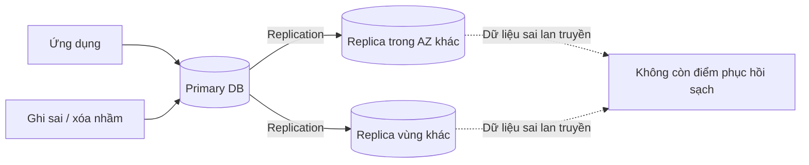
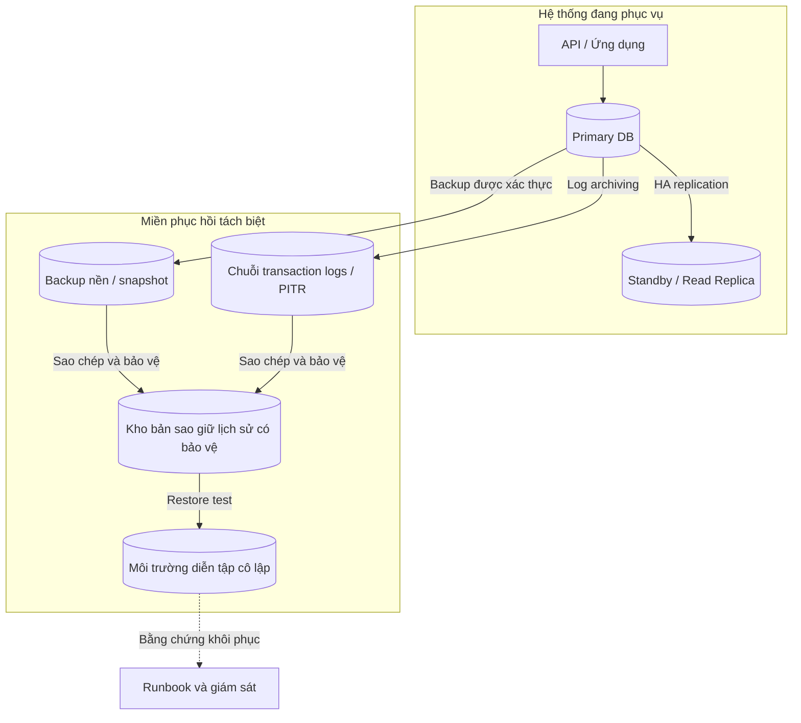

# Coi bản sao dữ liệu là bản sao lưu và bỏ qua diễn tập phục hồi

Trong kiến trúc đám mây, **replica (bản sao phục vụ tính sẵn sàng hoặc đọc dữ liệu)** và **backup (bản sao phục vụ khôi phục dữ liệu)** giải quyết hai nhóm sự cố khác nhau. Replica thường giúp hệ thống tiếp tục phục vụ khi một nút lỗi, giảm độ trễ đọc hoặc hỗ trợ chuyển đổi vai trò. Backup tạo ra điểm phục hồi đủ độc lập để quay về trạng thái dữ liệu còn đúng sau khi hệ thống chính bị hỏng, bị xóa nhầm hoặc bị tấn công.

Phản mẫu xuất hiện khi nhóm thiết kế kết luận: “Cơ sở dữ liệu đã chạy đa vùng sẵn sàng và có bản sao khác vùng, nên không cần backup”; hoặc “Nền tảng đã tự động backup, nên chắc chắn khôi phục được”. Cả hai kết luận đều bỏ sót câu hỏi quan trọng: **sau một sự cố dữ liệu cụ thể, có thể khôi phục trạng thái đúng trong thời gian nghiệp vụ cho phép hay không?**

Đây là một **phản mẫu kiến trúc** cần nhận diện khi thiết kế ứng dụng đám mây từ yêu cầu nghiệp vụ đến mạng, compute, dữ liệu và triển khai. Nó liên quan trực tiếp đến độ tin cậy, bảo mật, khả năng mở rộng, chi phí, vận hành và quá trình đánh giá theo các nguyên tắc Well-Architected.

## 1. Tình huống thực tế: hệ thống vẫn chạy nhưng dữ liệu đã sai

Một hệ thống thương mại điện tử có:

- Cơ sở dữ liệu đơn hàng chính (primary database) và một replica dự phòng có thể nhận vai trò primary.
- Một replica đọc đặt ở vùng địa lý khác để giảm độ trễ.
- Ứng dụng và API chạy nhiều instance, được giám sát sức khỏe và tự chuyển tuyến khi instance lỗi.
- Nhóm vận hành chưa từng thử khôi phục từ backup trên môi trường tách biệt.

Lúc 10:00, một bản migration chạy nhầm câu lệnh xóa đơn hàng chưa thanh toán trong phạm vi rộng hơn dự kiến. Thay đổi được ghi thành công trên primary rồi được lan truyền tới các replica. Lúc 10:18, người dùng và bộ phận chăm sóc khách hàng mới phát hiện nhiều đơn hàng biến mất.

Trong tình huống này, **replica khỏe về hạ tầng vẫn chứa dữ liệu sai về nghiệp vụ**. Chuyển sang replica không sửa được dữ liệu. Nếu có backup, nhóm phải biết điểm khôi phục còn sạch, phương pháp phục hồi, cách xác minh và cách xử lý các đơn hàng hợp lệ phát sinh sau 10:00. Nếu chưa từng diễn tập, việc tìm ra các bước này trong lúc sự cố đang diễn ra có thể khiến mục tiêu khôi phục thất bại.

## 2. Phân biệt các cơ chế trước khi chọn kiến trúc

| Cơ chế | Mục tiêu chính | Điểm mạnh | Giới hạn quan trọng |
|---|---|---|---|
| **Đồng bộ/bất đồng bộ giữa primary và replica** | Tính sẵn sàng, tăng khả năng đọc hoặc chuyển vùng | Bản sao gần trạng thái hiện tại, có thể hỗ trợ failover nhanh | Xóa nhầm, ghi sai, mã độc hoặc thay đổi schema có thể lan truyền sang replica; replica bất đồng bộ còn có độ trễ. |
| **High availability (HA) nhiều nút / nhiều AZ** | Giảm gián đoạn khi nút hoặc AZ lỗi | Tự chuyển vai trò và duy trì đường phục vụ | Không đưa dữ liệu về trạng thái hợp lệ trong quá khứ. |
| **Snapshot/backup định kỳ** | Lưu một trạng thái có thể dùng để phục hồi | Có điểm khôi phục không phụ thuộc trực tiếp vào dữ liệu hiện tại | Có khoảng trống dữ liệu giữa các bản; phải xác minh tính nhất quán, khả năng giải mã và khôi phục được. |
| **Point-in-time recovery (PITR)** | Khôi phục về thời điểm cụ thể trong cửa sổ lưu giữ | Có thể quay về ngay trước thao tác gây hỏng nếu log và bản nền đầy đủ | Phụ thuộc vào chuỗi log/backup, thời gian lưu giữ, công cụ và khả năng xác định đúng thời điểm. |
| **Backup bất biến và tách biệt** | Chống xóa/sửa backup do lỗi vận hành hoặc tài khoản bị chiếm quyền | Giảm rủi ro sự cố lan sang nơi lưu bản khôi phục | Vẫn phải bảo vệ khóa mã hóa, thông tin truy cập, cấu hình lưu giữ và thử phục hồi. |
| **Disaster recovery (DR) với failover vùng** | Khôi phục dịch vụ khi vùng chính gián đoạn | Có thể rút ngắn thời gian ngừng phục vụ | Bản sao dữ liệu ở vùng khác không mặc nhiên bảo vệ khỏi lỗi logic đã được nhân bản. |

**Replication là phương pháp truyền trạng thái; backup là khả năng quay lại một điểm phục hồi có kiểm chứng.** Một dịch vụ quản lý có thể tích hợp HA, snapshots, PITR và cross-region backup trong cùng sản phẩm, nhưng cần bật, cấu hình và đánh giá từng năng lực riêng.

### 2.1. Đồng bộ và bất đồng bộ không thay đổi bản chất lỗi logic

Với replication **đồng bộ**, giao dịch có thể chỉ được xác nhận khi dữ liệu đáp ứng điều kiện ghi bền vững ở các nút theo thiết kế. Điều này có thể cải thiện khả năng chịu lỗi nút nhưng cũng đồng bộ **thao tác sai**. Với replication **bất đồng bộ**, replica có thể chậm một khoảng thời gian và bị mất các giao dịch chưa kịp truyền khi failover; độ trễ này đôi lúc tình cờ giữ lại trạng thái chưa bị hỏng, nhưng **không phải chính sách backup có thể dựa vào**. Không được giả định replica luôn còn đủ lâu trước khi lỗi lan tới.

Đọc replica để xuất dữ liệu theo lịch cũng chưa đủ nếu file xuất nằm cùng tài khoản, cùng quyền xóa và không được kiểm tra độc lập. Mục tiêu phải là giữ được các điểm phục hồi có lịch sử và ranh giới an toàn riêng.

### 2.2. Snapshot không đồng nghĩa ảnh chụp nghiệp vụ nhất quán

Snapshot của một ổ đĩa có thể chỉ **crash-consistent**: sau phục hồi, hệ thống file và database phải chạy recovery từ transaction log. Trong ứng dụng nhiều database hoặc nhiều dịch vụ, việc chụp từng nơi ở các thời điểm khác nhau có thể tạo trạng thái nghiệp vụ không nhất quán, chẳng hạn Order đã ghi đơn nhưng Payment chưa ghi trạng thái.

Tùy đặc tính hệ thống, cần snapshot có hỗ trợ database, phối hợp quiesce, transaction-log backup, điểm cắt (checkpoint) hoặc chiến lược phục hồi nhất quán giữa các thành phần. Kể cả backup **application-consistent** cũng cần thử một quy trình khôi phục hoàn chỉnh để xác nhận các ràng buộc nghiệp vụ.

### 2.3. Object replication và versioning cũng có giới hạn

Với object storage, việc tự động sao chép object sang bucket khác có thể sao chép cả các thao tác xóa hoặc phiên bản không mong muốn, tùy cấu hình. Versioning cho phép giữ nhiều phiên bản trong một số trường hợp nhưng không thay thế hoàn toàn backup khi quyền xóa phiên bản, chính sách vòng đời và quyền quản trị vẫn có thể phá hủy lịch sử. Muốn dùng chúng như một phần chiến lược phục hồi, phải kiểm chứng quy tắc replication, giữ phiên bản, khóa bất biến, tách quyền và quy trình restore.

## 3. Vì sao phản mẫu xảy ra?

Các giả định sai thường xuất hiện trong quá trình tối ưu độ sẵn sàng hoặc chi phí:

1. **Nhầm failover với restore:** thấy database tự chuyển primary khi một nút hỏng thì cho rằng hệ thống đã có khả năng quay về trước khi ghi dữ liệu sai.
2. **Nhầm trạng thái “backup job thành công” với khả năng khôi phục:** job có thể hoàn tất nhưng bản sao hỏng, thiếu khóa, thiếu log, không đúng retention hoặc thời gian restore vượt quá RTO.
3. **Chỉ cân nhắc lỗi phần cứng:** thiết kế đa AZ, đa vùng nhưng bỏ qua thao tác nhầm, migration lỗi, quyền bị lạm dụng, ransomware và dữ liệu bị sửa dần không được phát hiện.
4. **Không có chủ sở hữu DR:** đội database nghĩ đội hạ tầng sẽ restore; đội hạ tầng lại chờ ứng dụng quyết định khôi phục tới thời điểm nào.
5. **Không tính chi phí phục hồi:** đưa HA vào ngân sách vận hành nhưng coi lưu trữ backup, truy xuất log, môi trường diễn tập và nhân lực phục hồi là chi phí có thể cắt bỏ.
6. **Sợ ảnh hưởng production khi diễn tập:** vì chưa có môi trường cô lập và quy trình an toàn, nhóm trì hoãn restore test đến khi xảy ra sự cố thật.

Những tín hiệu dễ quan sát: chỉ có sơ đồ replication, không có lịch sử restore test; dashboard theo dõi lag của replica nhưng không theo dõi tuổi điểm phục hồi; backup dùng chung quyền quản trị với production; chưa ai biết khi nào cần PITR hoặc ai có quyền ra quyết định cutover.

## 4. Sơ đồ phản mẫu và kiến trúc sửa đổi

### 4.1. Phản mẫu: mọi bản sao cùng nhận trạng thái mới nhất



Replica có thể giảm gián đoạn dịch vụ do lỗi hạ tầng nhưng **cùng nằm trong miền lỗi logic**: một thao tác hợp lệ về mặt kỹ thuật nhưng sai về nghiệp vụ sẽ theo luồng replication đến các bản còn lại.

### 4.2. Thiết kế có HA và đường khôi phục độc lập



Sơ đồ mô tả **mục tiêu logic**; bản lưu thật có thể nằm trong dịch vụ backup quản lý, kho object bất biến hoặc vault chuyên dụng. Với ứng dụng nhiều dịch vụ, phải xem xét cả bản sao của cấu hình, bí mật, khóa mã hóa, hạ tầng dưới dạng mã, dữ liệu object và các phụ thuộc cần thiết để chạy lại hệ thống.

Đường phục hồi nên có các đặc tính:

- **Tách biệt miền lỗi:** khi vùng chính, tài khoản hoặc quyền của workload bị ảnh hưởng, vẫn còn ít nhất một đường phục hồi mà tác nhân đó không dễ xóa hoặc sửa.
- **Giữ lịch sử đúng nhu cầu:** backup định kỳ, transaction logs và retention bao phủ cả độ trễ phát hiện lỗi dữ liệu.
- **Có chính sách chống sửa/xóa:** immutable retention, versioning, vault lock hoặc WORM tùy nền tảng, kết hợp quyền tối thiểu và chống xóa nhầm.
- **Đủ vật tư để restore:** dữ liệu, metadata, schema, cấu hình, lịch sử migration, khóa giải mã và quyền sử dụng khóa đều còn khả dụng.
- **Có thể thử an toàn:** khôi phục vào môi trường cô lập, chặn truy cập tới cổng thanh toán, email và các hệ thống bên ngoài để không tạo tác dụng phụ.

Lưu ý: backup ở tài khoản khác nhưng dùng cùng một danh tính quản trị toàn quyền hoặc cùng khóa mã hóa dễ bị xóa vẫn chưa đạt mục tiêu cô lập rủi ro.

## 5. Chuyển yêu cầu nghiệp vụ thành RPO, RTO và chính sách lưu giữ

Hai đại lượng cần phân biệt:

- **RPO (Recovery Point Objective):** lượng dữ liệu hoặc khoảng thời gian mất dữ liệu tối đa có thể chấp nhận, tính theo cam kết nghiệp vụ trong kịch bản sự cố đã định. Một RPO 5 phút có nghĩa tổ chức chấp nhận tối đa khoảng 5 phút dữ liệu bị mất trong loại sự cố được xét, không bảo đảm mọi hình thức lỗi đều đáp ứng.
- **RTO (Recovery Time Objective):** thời gian tối đa được phép để đưa chức năng trở lại mức dịch vụ được định nghĩa, tính từ mốc sự cố được thống nhất. RTO phải bao gồm phát hiện, quyết định, cấp tài nguyên, restore, xác minh và chuyển tuyến; không chỉ thời gian chạy lệnh restore.

**Retention (thời gian lưu bản phục hồi)** là một quyết định khác. RPO 5 phút không tự quyết định phải giữ backup trong 7, 30 hay 90 ngày. Một lỗi dữ liệu âm thầm có thể được phát hiện muộn hơn nhiều ngày; cần cửa sổ phục hồi đủ dài cho loại lỗi đó, đồng thời cân nhắc pháp lý, riêng tư và chi phí.

### 5.1. Phân loại theo tác động nghiệp vụ

| Dữ liệu/hệ thống | Ví dụ yêu cầu | Chiến lược khởi đầu | Điểm cần chứng minh |
|---|---|---|---|
| Thanh toán và đơn hàng | RPO 5 phút, RTO 60 phút | HA + backup nền + log liên tục/PITR + chứng từ đối soát | Không ghi trùng thanh toán; phục hồi được quan hệ đơn hàng và giao dịch. |
| Giỏ hàng chưa thanh toán | RPO 30 phút, RTO 2 giờ | Backup và cơ chế khôi phục theo tính chất dữ liệu | Khách không thấy giỏ sai hoặc của người khác. |
| Danh mục có nguồn dữ liệu gốc khác | RPO vài giờ, RTO 4 giờ | Snapshot, export hoặc tái tạo có kiểm thử | Có thể tái dựng chỉ mục và xác minh tổng số bản ghi. |
| Analytics có thể tính lại | RPO 24 giờ, RTO 24 giờ | Lưu nguồn dữ liệu, workflow tái xử lý và metadata | Thực sự tái chạy được pipeline trong giới hạn. |

Tất cả thời gian trên là **giả định minh họa để thảo luận**; SLA/SLO thực tế phải được thống nhất với nghiệp vụ và kiểm chứng bằng diễn tập.

### 5.2. Đo RTO trên toàn hành trình phục hồi

Giả sử RTO mục tiêu của dịch vụ đơn hàng là 60 phút. Trong một lần diễn tập:

```text
Phát hiện và xác nhận sự cố      8 phút
Chọn điểm phục hồi, phê duyệt    7 phút
Cấp tài nguyên, mạng, quyền     15 phút
Restore dữ liệu + replay log    25 phút
Xác minh dữ liệu và chức năng   12 phút
Chuyển tuyến / mở lại dịch vụ   10 phút
---------------------------------------
RTO đo được                    77 phút
```

Kết quả **77 phút > 60 phút** cho thấy thiết kế và runbook chưa đáp ứng mục tiêu, dù tác vụ “restore database” riêng lẻ chỉ mất 25 phút. Cần xử lý phần lớn thời gian ở bước nào, có thể chuẩn bị trước hạ tầng, tự động hóa thao tác lặp lại, tăng tốc restore hoặc điều chỉnh yêu cầu đã thống nhất.

Khi báo cáo thời gian, ghi rõ mốc bắt đầu, mốc kết thúc và tiêu chuẩn “đã phục hồi” (ví dụ: API tạo đơn hoạt động, dữ liệu được xác minh, nhận lưu lượng thực). Không tính thành công khi database vừa khởi động nhưng ứng dụng chưa đọc/ghi được.

### 5.3. Bẫy RPO khi dữ liệu bị hỏng về logic

Một hệ thống có log archiving mỗi phút có thể khôi phục tới 09:59:59, ngay trước khi migration sai chạy lúc 10:00. Tuy nhiên, lỗi chỉ được phát hiện lúc 10:18; các giao dịch hợp lệ từ 10:00 đến 10:18 đã đi vào primary cũng có thể không còn trong trạng thái được restore về 09:59:59.

Vì vậy, **tần suất lưu log 1 phút không tự đảm bảo RPO thực tế 1 phút khi lỗi logic được phát hiện muộn**. Để đáp ứng mục tiêu nghiệp vụ, có thể cần dựng bản phục hồi riêng, trích xuất bản ghi đã mất, tái áp dụng có chọn lọc những giao dịch sạch, đối soát với payment/event log hoặc chấp nhận mất dữ liệu sau khi đánh giá hậu quả. Mọi thao tác hợp nhất phải xử lý trùng ID, thứ tự sự kiện, tính toàn vẹn và quyền truy cập.

## 6. Thiết kế chính sách backup: độ sâu, phạm vi và cô lập

Một chính sách có thể bắt đầu từ nguyên tắc **nhiều bản sao, trên các miền lỗi khác nhau, với ít nhất một bản tách biệt đủ an toàn**. Quy tắc “3-2-1” (ba bản dữ liệu, hai loại phương tiện, một bản ngoài hệ thống) là gợi ý hữu ích từ môi trường truyền thống, nhưng áp dụng vào cloud cần diễn giải theo tài khoản, region, quyền quản trị, loại lưu trữ và đường khôi phục, thay vì chỉ đếm số replica.

Các quyết định cần ghi thành tài liệu:

| Thuộc tính | Câu hỏi thiết kế |
|---|---|
| **Phạm vi** | Những database, bucket, volume, queue state, secrets, cấu hình, khóa và metadata nào phải được bảo vệ? |
| **Lịch sử** | Dùng backup nền, incremental backup, log/WAL archiving, snapshot hay export có nhất quán? |
| **Tần suất** | Khoảng cách tối đa giữa các điểm phục hồi đủ bền vững và đo được là bao nhiêu? |
| **Lưu giữ** | Bao lâu để phát hiện lỗi âm thầm? Có yêu cầu giữ/xóa theo pháp lý và quyền riêng tư không? |
| **Vị trí** | Cần bản khác AZ, khác region, khác tài khoản hoặc hệ quản trị riêng không? |
| **Quyền** | Ai được tạo, xem, restore, sửa retention, xóa backup và quản lý khóa mã hóa? |
| **Bất biến** | Retention lock có chống được cả xóa bởi danh tính bị chiếm quyền không? Có chế độ quản trị đặc biệt nào? |
| **Mã hóa và khóa** | Ai kiểm soát KMS key? Nếu primary account/region không hoạt động, có thể giải mã backup không? |
| **Kiểm thử** | Tần suất restore test, người chịu trách nhiệm, điều kiện đạt và nơi lưu bằng chứng? |
| **Chi phí** | Dung lượng tăng theo churn, phí xuất dữ liệu liên vùng, restore requests, môi trường DR và diễn tập? |

Một **mẫu chính sách mô tả** (không phải cấu hình áp dụng trực tiếp cho nhà cung cấp cụ thể):

```yaml
workload: order-service
data_classification: confidential
recovery_objectives:
  rpo_minutes: 5
  rto_minutes: 60
backup_policy:
  consistent_base_backup: daily
  transaction_log_archiving: continuous
  pitr_retention_days: 14
  longer_term_retention_days: 35
  isolated_copy: separate_security_boundary
  immutability: enabled_with_approved_retention
  encryption: enabled_with_tested_key_access
  restore_test: monthly_plus_after_major_changes
ownership:
  data_owner: order-service-team
  recovery_operator: platform-oncall
  incident_decision_owner: incident-commander
```

Chính sách minh họa này **chưa chứng minh đáp ứng RPO/RTO**. Cần đo độ trễ truyền log, độ khả dụng của backup, tốc độ restore trên kích thước dữ liệu thực và mức độ tự động hóa. Mức lưu giữ ngắn/dài cần căn cứ vào phân loại dữ liệu, khả năng phát hiện lỗi và yêu cầu tổ chức.

### 6.1. Backup cho nhiều tài nguyên thuộc cùng giao dịch nghiệp vụ

Một đơn hàng có thể tham chiếu tới tồn kho, thanh toán, hóa đơn và object đính kèm. Phục hồi một database độc lập có thể làm trạng thái các hệ thống không còn phù hợp. Vì thế:

1. Xác định **nguồn sự thật** của từng miền dữ liệu và mốc phục hồi tối thiểu phải tương thích.
2. Ghi nhận các transaction ID, event ID, version hoặc audit log giúp đối soát khi tái dựng.
3. Định nghĩa thứ tự phục hồi và thứ tự mở lại consumers/queues để tránh phát lại side effects.
4. Nếu có event-driven workflows, yêu cầu event handler xử lý idempotent và có phương án replay hoặc bù trừ giao dịch.
5. Đảm bảo backup không tự phát sinh giao dịch nghiệp vụ khi phục hồi trong môi trường diễn tập.

Không mặc định một snapshot chung là đủ cho toàn bộ ứng dụng phân tán. Mô hình nhất quán cần được thiết kế theo từng ranh giới nghiệp vụ.

## 7. Phân biệt các loại sự cố và phương án xử lý

| Kịch bản | Replica giúp được gì? | Backup/DR cần làm gì? |
|---|---|---|
| Một node database bị lỗi phần cứng | Failover sang node khỏe; có thể phát sinh gián đoạn ngắn. | Theo dõi RPO/RTO của failover; backup vẫn duy trì bảo vệ lịch sử. |
| Một availability zone mất kết nối | Replica vùng khác/AZ khác có thể duy trì dịch vụ nếu được cấu hình. | Xác minh tính sẵn sàng của dependency, mạng, DNS và các khóa để restore nếu failover không đủ. |
| Xóa bảng hoặc chạy migration sai | Thường lan truyền xóa/sửa sai. | PITR tới trước lỗi, sau đó đối soát và khôi phục giao dịch sạch sau mốc. |
| Dữ liệu bị sửa sai âm thầm trong nhiều ngày | Cả primary/replica có thể cùng sai. | Giữ cửa sổ lịch sử đủ dài, kiểm tra tính đúng đắn và chọn mốc phục hồi. |
| Ransomware/tài khoản quản trị bị chiếm | Các bản có cùng quyền có thể bị phá hủy hoặc mã hóa. | Kho backup bất biến, quyền độc lập, khóa còn truy cập được, quy trình khôi phục trong môi trường sạch. |
| Cả region chính không khả dụng | Cross-region replica có thể hỗ trợ nếu control plane và phụ thuộc vùng khác sẵn sàng. | Khôi phục sang vùng thay thế với cấu hình mạng, compute, danh tính và dữ liệu đã được thử. |
| Lỗi xóa mất khóa mã hóa | Replica hoặc backup đã mã hóa có thể không giải mã được. | Bảo vệ vòng đời khóa, kiểm thử giải mã tại môi trường dự phòng, quy trình quản lý khóa khẩn cấp. |
| Backup thiếu transaction log hoặc bị hỏng | Không ảnh hưởng ngay đến lưu lượng đang chạy. | Kiểm tra liên tục tính toàn vẹn chuỗi backup/log, báo động và khôi phục thử từ bản độc lập. |

**Không dùng failover để chữa dữ liệu hỏng logic.** Khi nghi có lỗi logic đang lan truyền, incident team phải cân nhắc khoanh vùng quá trình ghi, giữ bằng chứng, xác định phạm vi và bảo vệ các điểm phục hồi sạch trước khi thực hiện thao tác thay đổi vai trò.

## 8. Diễn tập phục hồi: bài kiểm tra năng lực, không phải thủ tục hình thức

Diễn tập định kỳ biến một thiết kế trên giấy thành khả năng phục hồi có thể đo được. Không nên chỉ kiểm tra rằng file backup tải xuống được hoặc database đã khởi động; yêu cầu là **ứng dụng trở lại trạng thái phục vụ đúng và an toàn**.

### 8.1. Phạm vi và mức độ của bài diễn tập

| Mức độ | Nội dung | Kết quả cần xác nhận |
|---|---|---|
| Kiểm tra tự động hằng ngày | Backup job, chuỗi log, lag của điểm khôi phục, checksum nếu công cụ hỗ trợ, cảnh báo retention/quota. | Phát hiện sớm mất điểm phục hồi; không được coi là thay thế restore test. |
| Restore test trong môi trường cô lập | Tạo tài nguyên mới từ backup/PITR, xác minh dữ liệu và ứng dụng. | Khóa giải mã hoạt động, dữ liệu nhất quán, runbook có thể thực hiện. |
| Game day giả lập lỗi logic | Xóa nhầm dữ liệu thử nghiệm, phát hiện, chọn PITR, đối soát giao dịch sạch. | Đo RPO thực tế, mức độ mất dữ liệu và năng lực quyết định của nhóm. |
| Game day mất AZ/region | Mô phỏng failover và/hoặc khôi phục ở nơi khác, kiểm tra phụ thuộc mạng/danh tính. | Đo RTO từ đầu đến khi nghiệp vụ hoạt động. |
| Diễn tập đa nhóm sau thay đổi lớn | Chạy với developer, SRE, security, support và đại diện nghiệp vụ. | Kiểm chứng ownership, giao tiếp, cutover, rollback, failback và hậu kiểm. |

Tần suất phải theo mức độ quan trọng và biến động: dịch vụ trọng yếu có thể kiểm thử hằng tháng hoặc sau thay đổi lớn; dịch vụ ít quan trọng có thể theo chu kỳ khác. Tần suất không tự đủ: nếu tháng nào cũng restore một backup nhỏ vào cùng môi trường quen thuộc, vẫn chưa biết hệ thống có khôi phục được dữ liệu thật khi mất cả region hay không.

### 8.2. Runbook diễn tập mẫu: PITR cho Order Service

**Tiền điều kiện:** có bộ dữ liệu thử nghiệm đại diện, môi trường phục hồi cô lập, quyền backup read-only phù hợp, khóa mã hóa đã kiểm tra, baseline số lượng bản ghi và các giao dịch nghiệp vụ mẫu. Không chạy thao tác phá hủy trên production để tập luyện; khi cần thử failover thật phải có kế hoạch thay đổi và phương án rollback được phê duyệt theo quy trình tổ chức.

1. **Công bố giả định sự cố:** ví dụ migration sai lúc 10:00 khiến xóa nhầm đơn chưa thanh toán; xác định mốc thời gian bằng log, trace, audit trail và thông tin database.
2. **Khoanh vùng lỗi:** tạm dừng tác nhân gây hỏng, kiểm soát các luồng ghi bị ảnh hưởng, bảo toàn log và bằng chứng. Đánh giá ảnh hưởng tới event consumers và dịch vụ bên ngoài.
3. **Chọn recovery point:** kiểm tra backup nền còn sạch, chuỗi transaction logs đủ liên tục, xác nhận mốc ngay trước giao dịch hỏng và khả năng giải mã.
4. **Cấp môi trường riêng:** dựng database và tài nguyên liên quan ở mạng cách ly; sử dụng danh tính restore có quyền tối thiểu, cấm gửi email/thanh toán thực và không dùng cùng endpoint với production.
5. **Thực hiện restore:** dùng quy trình chính thức của database/backup provider để khôi phục backup nền và áp dụng log tới recovery point; ghi nhận từng mốc thời gian và lỗi.
6. **Xác minh kỹ thuật:** kiểm tra trạng thái database, schema, constraints, indexes, số bản ghi, transaction log position và khả năng kết nối từ ứng dụng.
7. **Xác minh nghiệp vụ:** đối chiếu một tập đơn hàng được biết là tồn tại trước 10:00; kiểm tra quyền theo tenant và trạng thái thanh toán, tồn kho; so sánh dữ liệu với audit/event records.
8. **Đối soát sau mốc khôi phục:** thu thập các giao dịch hợp lệ từ 10:00 tới lúc khoanh vùng, đề xuất tái áp dụng theo thứ tự phù hợp, dùng idempotency để chống tạo trùng và ghi nhận phần không phục hồi được.
9. **Kiểm tra ứng dụng:** triển khai/cấu hình API trỏ vào môi trường restore, kiểm tra đọc, ghi thử an toàn, auth, secret và giới hạn mạng; chỉ chuyển traffic khi tiêu chí được chấp nhận.
10. **Ghi nhận kết quả:** thời gian phát hiện, quyết định, cấp tài nguyên, restore, xác minh và cutover; dữ liệu mất thực tế, vấn đề thủ công và hành động cải tiến.

Tại thời điểm chuyển tuyến thật sau sự cố, cần kiểm soát **split-brain**: không để hai primary cùng nhận ghi độc lập. Nếu chuyển traffic bằng DNS hoặc cấu hình service discovery, tính đến TTL, connection pooling và client giữ kết nối cũ. Khi failback về vùng chính, phải có kế hoạch đồng bộ trạng thái, tránh ghi đè dữ liệu mới từ vùng đã phục hồi.

### 8.3. Phép kiểm tra dữ liệu mẫu

Các truy vấn dưới đây chỉ minh họa kiểm tra trên **môi trường phục hồi đã cô lập**; cần thay tên bảng và điều kiện theo schema thực tế.

```sql
-- Kiểm tra số lượng đơn hàng theo trạng thái.
SELECT status, COUNT(*) AS total
FROM orders
GROUP BY status
ORDER BY status;

-- Kiểm tra một tập đơn đã biết trước thời điểm lỗi.
SELECT order_id, customer_id, status, total_amount
FROM orders
WHERE order_id IN ('ORD-1001', 'ORD-1002', 'ORD-1003');
```

Đếm bản ghi không đủ để chứng minh tính đúng đắn. Các bước kiểm tra quan trọng khác: tổng tiền/đơn vị tiền tệ, quan hệ foreign key, tính duy nhất của giao dịch thanh toán, đơn hàng thuộc đúng tenant, trạng thái xử lý event và khả năng dùng được của dữ liệu object. Các giá trị baseline cần lấy từ bằng chứng độc lập, tránh so sánh hai nguồn cùng bị lỗi.

### 8.4. Tiêu chí đạt và bằng chứng

Một bài diễn tập nên có **bảng kết quả có thể kiểm toán**:

| Tiêu chí | Ví dụ cách đo |
|---|---|
| Điểm phục hồi | Timestamp/LSN cuối được khôi phục thành công; tuổi điểm phục hồi; tính liên tục backup/log. |
| Mất dữ liệu thực tế | Số giao dịch hợp lệ mất hoặc cần bù; khoảng thời gian không được bảo toàn. |
| RTO | Từ mốc sự cố đã quy ước đến khi API xử lý giao dịch đúng và được phép nhận lưu lượng. |
| Toàn vẹn dữ liệu | Kết quả constraint check, đối soát đơn hàng/thanh toán, tiêu chí nghiệp vụ. |
| An toàn và quyền | Chứng minh khóa giải mã truy cập được qua boundary dự phòng; môi trường restore không phát side effects. |
| Khả năng lặp lại | Runbook, phiên bản cấu hình, người thực hiện, lệnh/nhật ký được lưu an toàn, lỗi gặp phải và cách xử lý. |

Nếu một tiêu chí không đạt, cần ghi rõ nguyên nhân, mức rủi ro và người sở hữu hành động sửa. Đừng đánh dấu “DR test thành công” khi chỉ restore được database nhưng không phục hồi được API hoặc chưa kiểm tra dữ liệu nghiệp vụ.

## 9. Bảo mật cho backup và đường phục hồi

Backup thường chứa dữ liệu nhạy cảm gần như production và có thể bị nhắm tới khi kẻ tấn công đã chiếm được quyền quản trị. Cần thiết kế bảo vệ theo chiều sâu:

- **Phân quyền tách biệt:** tài khoản dịch vụ production không có quyền xóa hoặc rút ngắn retention của bản sao phục hồi bảo vệ; thao tác nhạy cảm cần danh tính riêng và cơ chế phê duyệt phù hợp.
- **Kho bất biến:** khóa giữ bản trong thời hạn đã chọn; hiểu rõ chức năng governance/compliance mode, quyền quản trị và các ngoại lệ của dịch vụ đang dùng.
- **Khóa mã hóa:** có kế hoạch cho khóa trong vùng/tài khoản dự phòng; kiểm thử giải mã; bảo vệ vòng đời KMS key để không tự làm mất khả năng restore.
- **Mạng phục hồi:** môi trường restore nằm trong mạng kiểm soát, không mở cổng database công khai; secrets được cấp tạm, ghi log thao tác và thu hồi khi kết thúc.
- **Giới hạn dữ liệu thử nghiệm:** nếu dùng dữ liệu thật trong rehearsal, kiểm soát truy cập, masking/anonymization khi khả thi, thời hạn lưu và xóa an toàn sau diễn tập.
- **Theo dõi hành vi nguy hiểm:** cảnh báo khi có thay đổi chính sách retention, backup job bị tắt, quyền xóa được cấp mới hoặc khóa mã hóa bị vô hiệu hóa.

Backup bất biến không giải quyết mọi vấn đề nếu dữ liệu trước khi backup đã bị sửa âm thầm hoặc khóa giải mã không còn. Cần kết hợp bảo vệ lịch sử, phát hiện bất thường, kiểm tra toàn vẹn và diễn tập chọn đúng recovery point.

## 10. Chi phí và các đánh đổi thực tế

Tối ưu chi phí backup phải xét **thiệt hại do không khôi phục được** thay vì chỉ nhìn hóa đơn lưu trữ.

```text
Tổng chi phí phục hồi ≈ lưu trữ backup và log
                     + nhân bản liên vùng / lưu lượng truyền
                     + mã hóa, giám sát, kiểm tra tính toàn vẹn
                     + tài nguyên dựng môi trường restore/DR
                     + nhân lực và thời gian diễn tập
                     + chi phí duy trì khả năng chuyển tuyến
```

Sử dụng incremental backup, phân tầng lưu trữ, retention theo phân loại dữ liệu và diễn tập trong môi trường tạm có thể tiết kiệm đáng kể. Nhưng cần xác minh việc giảm tần suất, rút ngắn retention hay chuyển bản sang storage lớp lạnh có làm tăng RPO, RTO hoặc thời gian truy xuất dữ liệu lúc sự cố hay không.

**Ví dụ đánh đổi:** một bộ dữ liệu lớn có backup trên storage lạnh với chi phí thấp nhưng phải chờ nhiều giờ để truy xuất, trong khi nghiệp vụ yêu cầu RTO 60 phút. Giải pháp này có thể phù hợp lưu trữ pháp lý dài hạn, nhưng không đủ làm điểm phục hồi vận hành duy nhất. Nên cân nhắc một lớp backup sẵn sàng phục hồi nhanh và một lớp lưu dài hạn rẻ hơn.

Đối với kiến trúc nhiều vùng, cần đánh giá thêm chi phí replication, network egress, sự phụ thuộc vào dịch vụ danh tính/khóa và khả năng khôi phục khi control plane của vùng chính không hoạt động. **Cross-region replica** có thể hỗ trợ DR về thời gian phục vụ; **cross-region backup độc lập** giúp mở rộng lựa chọn phục hồi khi lỗi logic hoặc xóa nhầm lan truyền.

## 11. Đánh giá theo Well-Architected

| Trụ cột | Câu hỏi xem xét | Bằng chứng cần có |
|---|---|---|
| **Operational Excellence — Vận hành xuất sắc** | Ai khởi động DR, ai phê duyệt recovery point và ai xác nhận đã phục hồi? | Runbook được phiên bản hóa, lịch và biên bản diễn tập, phân công trực. |
| **Security — Bảo mật** | Kẻ có quyền production có thể xóa mọi bản backup hay vô hiệu hóa khóa giải mã? | Rà soát IAM, backup immutability, kiểm thử restore từ ranh giới bảo mật riêng. |
| **Reliability — Độ tin cậy** | Mất node, lỗi logic và mất region có những đường phục hồi riêng? | RPO/RTO theo kịch bản, kết quả failover và restore test, cảnh báo mất điểm khôi phục. |
| **Performance Efficiency — Hiệu năng** | Khôi phục dữ liệu dung lượng lớn có hoàn thành trong RTO không? | Số liệu throughput restore, warm-up cache, latency API sau cutover. |
| **Cost Optimization — Chi phí** | Retention và lớp lưu trữ có phù hợp tác động nghiệp vụ không? | Chi phí backup/restore, phép so sánh với rủi ro mất dữ liệu và gián đoạn. |
| **Sustainability — Bền vững** | Bản sao được giữ đúng thời gian cần thiết và tài nguyên diễn tập được dọn sau sử dụng? | Chính sách vòng đời phù hợp, đo dung lượng và tự động hóa thu hồi môi trường. |

Một đánh giá tốt phải tách bạch câu “chúng ta có replica” với “chúng ta đã khôi phục thành công từ backup cô lập và đo được giới hạn mất dữ liệu”. Chỉ tiêu HA cao không tự chứng minh phục hồi được dữ liệu.

## 12. Bài tập thiết kế: cứu dữ liệu sau migration sai

### Đề bài

Một ứng dụng đặt lịch có database chính 2 TB, một standby cùng region và một read replica khác region. Giao dịch đặt lịch liên tục cả ngày. Do migration, 80.000 lịch hẹn bị sửa sai lúc 14:05; đến 14:42 mới được phát hiện. Nghiệp vụ yêu cầu RPO tối đa 10 phút, RTO tối đa 90 phút cho sự cố dữ liệu, và cần giữ lịch sử 30 ngày. Hệ thống hiện chỉ có snapshot mỗi đêm, chưa có PITR, tất cả snapshot nằm trong cùng tài khoản cloud của ứng dụng.

Hãy trả lời và giải thích:

1. Replica khác region có cho phép quay lại trước 14:05 không? Có đủ bằng chứng để giả định điều đó không?
2. Nếu snapshot gần nhất lúc 02:00, lượng dữ liệu hợp lệ có thể bị mất khi restore thẳng từ snapshot là bao nhiêu? RPO 10 phút có được đáp ứng không?
3. Cần thay đổi backup/log archiving, retention, ranh giới quyền và mã hóa như thế nào?
4. Cần quy trình nào để giữ hoặc tái áp dụng các lịch hẹn hợp lệ tạo từ 14:05 đến 14:42?
5. Hãy lập một runbook có timeline, các kiểm tra toàn vẹn, điều kiện cutover và cách đo RTO.

### Hướng dẫn phân tích

- **Câu 1:** Không có bảo đảm. Replication thường truyền cả cập nhật sai, nên read replica có thể đã bị sửa như primary. Phải kiểm tra thực tế trạng thái và giới hạn replication nếu muốn coi nó là nguồn trích xuất dữ liệu tạm thời.
- **Câu 2:** Snapshot 02:00 có thể làm mất các giao dịch từ sau 02:00 đến thời điểm khôi phục; chỉ tính đến 14:05 đã là **12 giờ 5 phút**, vượt xa 10 phút. Độ mất thực tế còn phụ thuộc luồng ghi sau đó và cách đối soát. Đây là khoảng cách thời gian tiềm ẩn, không phải số bản ghi đã xác định.
- **Câu 3:** Thiết kế backup nhất quán cho database, log archiving/PITR với cửa sổ đủ dài, bản sao tách tài khoản và có bảo vệ bất biến, chính sách mã hóa/khóa và kiểm tra restore độc lập. Không được hứa đạt RPO khi chưa đo độ bền vững điểm phục hồi.
- **Câu 4:** PITR về trước 14:05 giúp loại cập nhật sai nhưng cũng loại các cập nhật hợp lệ sau mốc đó. Cần bảo toàn audit/event logs, phân loại thay đổi tốt/xấu, replay hoặc merge an toàn và đối soát với những hệ thống liên quan. Việc khôi phục dữ liệu không thể chỉ là “chạy PITR”.
- **Câu 5:** Đo toàn bộ chu kỳ phát hiện, quyết định, dựng tài nguyên, restore, kiểm tra booking, khôi phục giao dịch hợp lệ và chuyển tuyến. Nếu thời gian đã trôi từ 14:05 đến 14:42 được tính trong RTO theo thỏa thuận, đã dùng 37 phút của ngân sách 90 phút trước khi bắt đầu restore.

Hãy thử sửa kế hoạch lần lượt theo hai kịch bản: **(a)** có đủ backup/PITR nhưng thao tác hủy dữ liệu bị phát hiện sau 20 ngày; **(b)** kho backup trong tài khoản chính bị xóa cùng lúc tài khoản bị chiếm quyền. Hai kịch bản sẽ cho thấy vì sao retention và độc lập quyền truy cập quan trọng ngang với tần suất backup.

## 13. Checklist rà soát kiến trúc và dấu hiệu hoàn tất

- [ ] Có danh mục tài nguyên dữ liệu quan trọng và phân loại mức độ mất dữ liệu/gián đoạn chấp nhận được theo nghiệp vụ.
- [ ] RPO, RTO, retention và “dịch vụ đã phục hồi” được định nghĩa cho từng loại sự cố, bao gồm cả lỗi logic và mất vùng.
- [ ] Sơ đồ chỉ rõ **HA/replication** và **backup/PITR** là hai đường bảo vệ khác nhau.
- [ ] Backup nền nhất quán; transaction logs/PITR đầy đủ; có giám sát tuổi điểm phục hồi và cảnh báo chuỗi log bị đứt.
- [ ] Bản sao khôi phục được bảo vệ trước rủi ro vùng/tài khoản, quyền xóa nhầm, mã độc và mất khóa giải mã.
- [ ] Có runbook để chọn mốc phục hồi, dựng môi trường cô lập, kiểm tra dữ liệu, đối soát sự kiện và chuyển tuyến an toàn.
- [ ] Đã diễn tập restore với dữ liệu/kích thước đại diện; đo RPO/RTO thực tế và lưu bằng chứng đạt/không đạt.
- [ ] Có người chịu trách nhiệm thực hiện, người quyết định nghiệp vụ, lịch tập lại và thời hạn xử lý phát hiện.
- [ ] Đã cân nhắc chi phí lưu trữ, truy xuất, kiểm thử và khả năng đáp ứng SLA/SLO thay vì chỉ tối ưu dung lượng.
- [ ] Đã kiểm tra cutover/failback, phụ thuộc mạng, compute, secret, IAM, DNS và sự nhất quán liên dịch vụ.

**Điểm cần nhớ:** replica bảo vệ đường phục vụ khỏi một số lỗi hạ tầng; backup và lịch sử thay đổi giúp phục hồi dữ liệu đúng khi lỗi logic xảy ra. Chỉ **một quy trình khôi phục đã được diễn tập, đo RPO/RTO và chứng minh toàn vẹn nghiệp vụ** mới cho thấy chiến lược bảo vệ dữ liệu có hoạt động trong tình huống thực tế.
