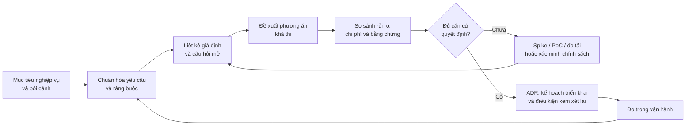
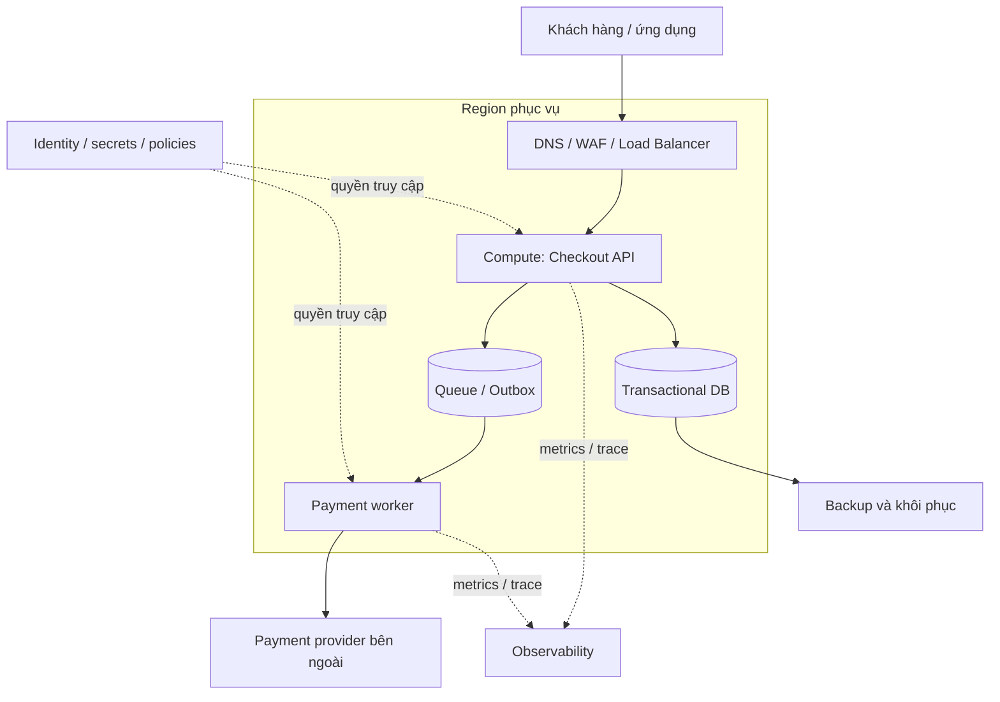

# Rà soát yêu cầu, giả định và phương án thay thế

> **Chương:** Đánh giá kiến trúc  
> **Module:** `CLOUD_ARCHITECTURE` — học cách thiết kế kiến trúc ứng dụng trên đám mây từ yêu cầu nghiệp vụ đến lựa chọn mạng, compute, dữ liệu và mô hình triển khai; phân tích đánh đổi giữa độ tin cậy, bảo mật, khả năng mở rộng, chi phí và vận hành theo nguyên tắc Well-Architected.

Một bản vẽ kiến trúc có thể trông hợp lý nhưng vẫn giải quyết sai bài toán: hệ thống được thiết kế cho một triệu người dùng đồng thời trong khi nhu cầu thực tế là vài nghìn, hoặc chọn cơ sở dữ liệu rất nhanh nhưng không đáp ứng yêu cầu lưu trú dữ liệu. Trước khi chốt một giải pháp đám mây, người thiết kế cần **rà soát yêu cầu**, **đưa giả định ra ánh sáng**, và **so sánh những phương án thay thế khả thi dựa trên bằng chứng**.

Hoạt động này diễn ra cả trước khi xây dựng hệ thống, trong các lần thay đổi lớn và sau khi có dữ liệu vận hành mới. Mục tiêu không phải chọn công nghệ “tốt nhất” một cách tuyệt đối; mục tiêu là tìm phương án **đáp ứng yêu cầu bắt buộc, chấp nhận được rủi ro còn lại và phù hợp với năng lực tổ chức**.

## Mục tiêu học tập

Sau bài học, bạn có thể:

1. Phân biệt yêu cầu nghiệp vụ, yêu cầu chức năng, thuộc tính chất lượng, ràng buộc, giả định, rủi ro và quyết định kiến trúc.
2. Chuyển các mục tiêu mơ hồ thành yêu cầu có tiêu chí đo và kiểm chứng được.
3. Tổ chức buổi review với đúng bên liên quan và truy vết yêu cầu đến phương án thiết kế, kiểm thử và trách nhiệm vận hành.
4. Lập sổ đăng ký giả định, ưu tiên kiểm chứng những giả định có thể làm thay đổi quyết định.
5. Đề xuất các phương án thay thế hợp lý và so sánh bằng điều kiện loại trừ, bảng đánh đổi, độ nhạy và bằng chứng thử nghiệm.
6. Ghi lại quyết định bằng Architecture Decision Record (ADR), xác định rủi ro tồn đọng và điều kiện phải xem xét lại.

## 1. Đánh giá kiến trúc bắt đầu từ bài toán, không phải sơ đồ

Một yêu cầu “hệ thống phải mở rộng tốt” có thể dẫn đến nhiều giải pháp: tăng kích thước máy chủ, autoscaling ứng dụng stateless, dùng hàng đợi cho công việc bất đồng bộ, tối ưu truy vấn hay phân vùng dữ liệu. Chưa thể chọn trước khi biết **tải nào tăng, tăng bao nhiêu, trong bao lâu và kết quả kinh doanh cần được bảo vệ là gì**.

Một vòng đánh giá kiến trúc có cấu trúc thường diễn ra như sau:



Đây là **vòng lặp**: một giả định được chứng minh sai có thể khiến phương án từng thắng không còn phù hợp.

### Bảy loại thông tin cần phân biệt

| Loại | Câu hỏi | Ví dụ trong ứng dụng đặt hàng | Sản phẩm đầu ra |
| --- | --- | --- | --- |
| **Mục tiêu nghiệp vụ** | Vì sao cần hệ thống? | Giảm số đơn bỏ dở và mở rộng sang thị trường mới. | Mục tiêu, KPI, đối tượng hưởng lợi. |
| **Yêu cầu chức năng** | Hệ thống phải làm gì? | Tạo đơn, thanh toán, hoàn tiền, tra cứu trạng thái. | Luồng nghiệp vụ, tiêu chí chấp nhận. |
| **Thuộc tính chất lượng (NFR)** | Phải hoạt động tốt đến mức nào? | 99,9% yêu cầu checkout hợp lệ thành công trong tháng. | SLI/SLO, kịch bản chất lượng và phép đo. |
| **Ràng buộc** | Điều gì không được vi phạm? | Dữ liệu cá nhân của một nhóm khách hàng phải nằm trong vùng được phép. | Điều kiện loại trừ hoặc bắt buộc. |
| **Giả định** | Điều gì đang tạm cho là đúng? | Lưu lượng đỉnh chỉ gấp bốn lần trung bình. | Assumption register, kế hoạch kiểm chứng. |
| **Rủi ro** | Điều gì có thể xảy ra và ảnh hưởng gì? | Database quá tải khi chiến dịch bán hàng bắt đầu. | Risk register, owner, biện pháp giảm thiểu. |
| **Quyết định** | Chọn cách nào, dựa trên chứng cứ nào? | Sử dụng managed relational database và compute autoscaling. | ADR, kiến trúc cập nhật, điều kiện xem xét lại. |

**Giả định** không đồng nghĩa với **yêu cầu**. “Có lẽ chỉ có 3.000 request/giây” là giả định cho đến khi được đo hoặc thống nhất như một giới hạn tải cần đáp ứng. “Phải chịu được 3.000 request/giây tại đỉnh, với p95 dưới 300 ms” có thể là yêu cầu sau khi được chủ sản phẩm và đội kỹ thuật phê duyệt.

## 2. Thu thập đúng bên liên quan và bối cảnh

Một kiến trúc có thể đáp ứng yêu cầu của nhóm phát triển nhưng thất bại khi triển khai vì bỏ qua pháp lý, an ninh, vận hành hay khách hàng doanh nghiệp. Cần xác định ai **đặt yêu cầu**, ai **chịu hậu quả khi yêu cầu không đạt** và ai **xác minh kết quả**.

| Nhóm liên quan | Điều cần làm rõ | Bằng chứng hữu ích |
| --- | --- | --- |
| Chủ sản phẩm / kinh doanh | Luồng kiếm doanh thu, thời hạn, thị trường, mức chấp nhận gián đoạn. | KPI, quy trình nghiệp vụ, dữ liệu chuyển đổi. |
| Người dùng / chăm sóc khách hàng | Thời gian chờ chấp nhận được, tác động khi lỗi, hành trình quan trọng. | User journey, phản hồi, tỷ lệ bỏ dở. |
| Dev / kiến trúc sư | Phụ thuộc hệ thống, hợp đồng API, vòng đời thay đổi, dữ liệu. | Sơ đồ thực tế, repository, lỗi từng gặp, prototype. |
| SRE / vận hành | SLO, on-call, giới hạn năng lực, phục hồi, khả năng quan sát. | Telemetry, incident history, kết quả diễn tập. |
| Security / privacy / compliance | Danh tính, bí mật, phân vùng dữ liệu, lưu trú, audit, retention. | Chính sách được phê duyệt, threat model, data inventory. |
| Finance / procurement | Ngân sách, hạn mức, cam kết nhà cung cấp, chi phí vận hành. | Cost baseline, bảng giá và báo cáo chi phí. |
| Đối tác / nhà cung cấp phụ thuộc | Rate limit, SLA, timeout, vùng hỗ trợ, giới hạn tích hợp. | Hợp đồng, tài liệu kỹ thuật, dữ liệu thử nghiệm. |

Các câu hỏi hiệu quả là **câu hỏi về tình huống cụ thể**:

- Điều gì xảy ra nếu thanh toán thành công nhưng người dùng mất kết nối trước khi nhận xác nhận?
- Khi chiến dịch bán hàng tăng tải gấp năm, chức năng nào bắt buộc phải tiếp tục, chức năng nào có thể tạm giảm chất lượng?
- Nếu một region không còn phục vụ, yêu cầu khôi phục là bao lâu? Dữ liệu của giao dịch đã xác nhận được phép mất đến mức nào?
- Nếu nhà cung cấp thanh toán chậm 30 giây, hệ thống có được phép nhận đơn ở trạng thái “đang xử lý” không?
- Những loại dữ liệu nào bị giới hạn về nơi lưu và nơi xử lý? Ai có thẩm quyền xác nhận?

Tránh hỏi chỉ “có cần bảo mật/có cần mở rộng không?” vì câu trả lời gần như luôn là “có” nhưng không đủ để ra quyết định.

## 3. Chuẩn hóa yêu cầu thành điều kiện kiểm chứng

Một yêu cầu có thể được ghi theo cấu trúc:

> **Trong [bối cảnh và tải], [thành phần/hành trình] phải đạt [kết quả có số đo] trong [khoảng quan sát], nếu không sẽ [tác động]; [người sở hữu] xác nhận bằng [phương pháp].**

Ví dụ:

- Chưa đủ rõ: “API thanh toán phải nhanh.”
- Có thể kiểm chứng: “Ở tải ổn định 800 yêu cầu/giây với cơ cấu request đã xác định, **p95 độ trễ từ API nhận đến phản hồi** không vượt 400 ms, không tính thời gian khách hàng ở bước xác thực ngoài; đo bằng load test và trace production, do owner dịch vụ thanh toán duyệt.”

Một **kịch bản thuộc tính chất lượng** nên có: nguồn kích thích, kích thích, môi trường, thành phần chịu tác động, phản ứng mong đợi và thước đo. Ví dụ: *Region A không phục vụ được* (kích thích) *trong giờ cao điểm* (môi trường), *bộ điều hướng và cụm B* (thành phần) phải *tiếp nhận giao dịch mới có kiểm soát* (phản ứng) *trong 30 phút* (thước đo).

### Từ mục tiêu đến chỉ số

| Mục tiêu nói chung | Cần hỏi rõ | Ví dụ tiêu chí kiểm chứng |
| --- | --- | --- |
| “Luôn hoạt động” | Hành trình nào? Khoảng thời gian nào? Có ngoại lệ bảo trì không? | Checkout availability SLO 99,9%/30 ngày, tính trên yêu cầu hợp lệ được định nghĩa. |
| “Nhanh” | p50, p95 hay p99? Đo ở client, API hay database? Tải nào? | p95 end-to-end checkout dưới 2 giây ở lưu lượng mục tiêu. |
| “Mở rộng” | Tải trung bình/đỉnh, read/write ratio, dữ liệu tăng bao nhiêu? | Xử lý đỉnh 3.000 request/giây 20 phút với lỗi dưới ngưỡng. |
| “Không mất dữ liệu” | Loại dữ liệu nào, sau khi xác nhận ở bước nào? | Giao dịch đã xác nhận không được mất theo hợp đồng nghiệp vụ; cần cơ chế ghi và đối soát tương ứng. |
| “Bảo mật” | Ai được truy cập, tài sản nhạy cảm nào, mối đe dọa nào? | Chỉ dịch vụ thanh toán được quyền đọc token đã mã hóa; truy cập phải audit được. |
| “Chi phí thấp” | Tối ưu giá đỉnh hay TCO toàn năm? Kể nhân lực không? | Chi phí hằng tháng ở ba mức tải trong ngân sách được phê duyệt; có theo dõi cost/unit. |
| “Dễ triển khai” | Đội vận hành có bao nhiêu người? Tần suất phát hành? | Triển khai không gián đoạn đường chính, có rollback theo vùng và bằng chứng thử nghiệm. |

SLO nên gắn với **trải nghiệm có ý nghĩa đối với người dùng**, không chỉ độ khỏe của máy chủ. Hệ thống trả HTTP 200 cho yêu cầu tạo đơn nhưng không ghi được đơn là thất bại nghiệp vụ.

### SLI, SLO và error budget

- **SLI** là số đo thực tế, ví dụ tỷ lệ yêu cầu thanh toán hợp lệ thành công.
- **SLO** là mục tiêu cho SLI trong khoảng xác định, ví dụ 99,9% trong 30 ngày.
- **Error budget** là phần không đạt mục tiêu được phép trong khoảng đó; nếu dùng tỷ lệ request thì ngân sách 0,1% là 1.000 trên một triệu yêu cầu hợp lệ.

Không nhầm với SLA mang tính hợp đồng. Một SLO availability 99,9% tương đương tối đa khoảng **43,2 phút** không khả dụng trong tháng 30 ngày **chỉ khi** được định nghĩa theo tỷ lệ thời gian và gián đoạn hoàn toàn. Với SLO tính theo request, không thể trực tiếp đổi thành số phút nếu lưu lượng thay đổi.

### Khả năng phục hồi: phân biệt RTO và RPO

- **RTO (Recovery Time Objective):** thời gian tối đa mục tiêu để khôi phục chức năng sau sự cố.
- **RPO (Recovery Point Objective):** mức dữ liệu/độ lùi thời điểm dữ liệu có thể chấp nhận khi phục hồi.

Ví dụ: hệ thống báo cáo có thể chấp nhận RPO 15 phút; sổ giao dịch tiền đã xác nhận có thể yêu cầu **không mất bản ghi đã cam kết**. Điều đó không có nghĩa chỉ cần cấu hình RPO bằng 0 trên giấy là đạt: phải chứng minh cơ chế commit, replication, durable log, retry và đối soát thực sự đáp ứng yêu cầu.

## 4. Phân loại ưu tiên, phụ thuộc và ràng buộc

Không phải tất cả yêu cầu có mức bắt buộc như nhau. Một cách phân loại là:

1. **Hard constraints / must-have:** vi phạm thì phương án bị loại dù điểm hiệu năng hoặc chi phí rất tốt.
2. **Mục tiêu chất lượng có ngưỡng:** phải kiểm chứng; có thể được chấp nhận ngoại lệ bởi người sở hữu rủi ro nếu quy trình cho phép.
3. **Điểm ưu tiên tối ưu hóa:** hiệu năng cao hơn, chi phí thấp hơn, ít vận hành hơn sau khi đã đạt mức bắt buộc.
4. **Mong muốn tương lai:** có thể ảnh hưởng tính mở rộng thiết kế nhưng chưa nhất thiết phải làm ngay.

Ví dụ: “không lưu PII ngoài vùng được phép” là ràng buộc nếu đã có chính sách được xác minh; “dùng Kubernetes” có thể chỉ là **lựa chọn giải pháp được đề xuất**, không phải yêu cầu nghiệp vụ. Hãy hỏi **động cơ phía sau**: cần khả năng di chuyển giữa môi trường, một chuẩn vận hành chung, hay vì đội ngũ đã quen công cụ?

### Ma trận truy vết yêu cầu

| ID | Yêu cầu | Thành phần / quyết định liên quan | Phép chứng minh | Owner | Trạng thái |
| --- | --- | --- | --- | --- | --- |
| REQ-01 | API checkout p95 dưới 2 giây ở tải đỉnh đã chọn. | Compute autoscaling, cache, database/index. | Load test; tracing p95 theo route. | Tech lead | Cần đo. |
| REQ-02 | Không tạo hai khoản thu cho một payment key. | Payment adapter, idempotency store, webhook consumer. | Test retry/timeout, đối soát ledger. | Payment owner | Đang thiết kế. |
| REQ-03 | Dữ liệu cá nhân phải ở vị trí được phê duyệt. | Region placement, backup, logging, analytics. | Data flow review và xác nhận compliance. | Security/privacy | Chưa xác nhận. |
| REQ-04 | Khôi phục checkout trong 30 phút khi mất region chính. | Failover, routing, capacity và database. | Diễn tập mất region, đo RTO/RPO. | SRE | Chưa kiểm chứng. |
| REQ-05 | Vận hành được với quy mô đội hiện tại. | Managed services, IaC, on-call. | Thử deploy, diễn tập sự cố, ước tính runbook. | Engineering manager | Cần định lượng. |

Các trạng thái trong bảng chỉ để minh họa. Mỗi yêu cầu cần có **ID ổn định**, nguồn, mức ưu tiên, người duyệt và ngày xác nhận; khi thay đổi, cập nhật thiết kế, test và ADR có liên quan.

## 5. Rà soát giả định: điều gì đang được coi là đúng?

**Giả định (assumption)** là tiền đề chưa được chứng minh đầy đủ mà một quyết định đang dựa vào. Giả định không xấu; giả định **không được nói ra, không có người kiểm tra hoặc không có thời hạn** mới nguy hiểm.

Một sổ đăng ký giả định nên có các trường tối thiểu:

| Trường | Ý nghĩa |
| --- | --- |
| ID / phát biểu | Diễn đạt điều tạm tin là đúng; đủ cụ thể để bác bỏ được. |
| Nguồn và owner | Ai đưa ra thông tin; ai chịu trách nhiệm kiểm chứng. |
| Mức độ tin cậy | Thấp, trung bình, cao; dựa trên dữ liệu đo, kinh nghiệm hay ý kiến. |
| Tác động nếu sai | Quyết định kiến trúc, SLO, chi phí, compliance nào bị ảnh hưởng. |
| Cách kiểm chứng | Đo traffic, PoC, hợp đồng nhà cung cấp, xác minh chính sách, phỏng vấn... |
| Thời hạn và trạng thái | Trước quyết định, trước go-live hay sau khi theo dõi production. |
| Kế hoạch dự phòng | Đổi phương án, giới hạn phát hành hoặc giảm tính năng nào nếu sai. |

Ví dụ:

| ID | Giả định cần kiểm chứng | Rủi ro nếu sai | Bằng chứng / phép kiểm tra | Owner và hạn |
| --- | --- | --- | --- | --- |
| A-01 | Traffic đỉnh trong 12 tháng đầu không vượt 3.000 req/s. | Compute, DB và network bị quá tải. | Telemetry hiện tại, dự báo chiến dịch, load test 1×–2× dự báo. | SRE, trước chốt capacity. |
| A-02 | 95% yêu cầu đọc có thể chấp nhận cache tối đa 30 giây. | Số liệu hiển thị sai hoặc không nhất quán. | Phân loại màn hình, trao đổi product và test hành trình. | Product, trước thiết kế cache. |
| A-03 | Đội vận hành có thể hỗ trợ hệ thống container 24/7. | Tăng MTTR, rủi ro phát hành và gánh nặng trực sự cố. | Roster, kinh nghiệm, diễn tập sự cố và đánh giá kỹ năng. | Engineering manager, trước chọn nền tảng. |
| A-04 | Database managed hỗ trợ kiểu failover cần thiết ở vùng đã phê duyệt. | Không đạt RTO/RPO hoặc vi phạm vị trí dữ liệu. | Xác minh dịch vụ/vùng/quota thực tế và diễn tập. | Platform, trước ADR. |
| A-05 | Chi phí egress xuyên vùng dưới 10% tổng chi phí dữ liệu. | Vượt ngân sách dù compute rẻ. | Ước tính traffic theo chiều, báo giá và đo thử. | FinOps, trước duyệt TCO. |

### Phân biệt giả định, câu hỏi chưa trả lời và rủi ro

- **Giả định:** “Khách hàng có thể chờ kết quả thanh toán bất đồng bộ tối đa 30 giây.”
- **Câu hỏi mở:** “Quy trình chăm sóc khách hàng sẽ xử lý trạng thái đang chờ như thế nào?”
- **Rủi ro:** “Nếu bên thanh toán chậm quá 30 giây, khách hàng có thể gửi lại và tạo yêu cầu trùng.”
- **Giảm thiểu:** “Có payment ID/idempotency key, trạng thái giao dịch bền vững và thông báo kết quả khi hoàn tất.”

Một giả định có thể dẫn đến nhiều rủi ro; một rủi ro có thể xuất phát từ nhiều giả định. Nên liên kết các bản ghi bằng ID nhưng không nhập chúng thành một danh sách mơ hồ.

### Ưu tiên kiểm chứng theo tác động lên quyết định

Không cần kiểm chứng mọi giả định với cùng mức công sức. Ưu tiên giả định có **tác động lớn nếu sai**, **độ tin cậy thấp** và **có thể đảo ngược lựa chọn kiến trúc**. Ví dụ, “hệ thống có cần lưu trú dữ liệu trong nước hay không?” thường quan trọng hơn việc chọn kích cỡ cache ban đầu, vì nó quyết định cả vùng triển khai và chiến lược dự phòng.

Có thể dùng mức độ ảnh hưởng × khả năng sai để **xếp thứ tự tương đối**, nhưng đừng xem tích hai điểm chủ quan là xác suất thiệt hại chính xác. Với rủi ro pháp lý hoặc mất dữ liệu nghiêm trọng, chỉ điểm trung bình thấp vẫn không đủ để chấp nhận.

## 6. Rà soát hiện trạng và xác định ranh giới hệ thống

Không thể đánh giá phương án thay thế nếu không biết cái gì **đã có**, cái gì **phải tích hợp**, và lỗi ở đâu có thể lan rộng.

Các góc nhìn cần rà soát:

- **Context:** người dùng, đối tác, hệ thống thanh toán, định danh, CRM, analytics; dữ liệu và mức tin cậy của từng giao diện.
- **Compute:** trạng thái phiên làm việc, khả năng scale ngang, startup time, runtime, deadline request và batch jobs.
- **Network:** ingress, egress, kết nối riêng/từ internet, DNS/load balancer, latency giữa vùng, rate limit và các điểm lỗi đơn.
- **Data:** hệ thống ghi có thẩm quyền, giao dịch, schema, backup, replication, dữ liệu nhạy cảm, retention và hành trình xóa dữ liệu.
- **Security:** trust boundary, quyền service-to-service, mã hóa, audit, phân chia tenant và các thành phần bên thứ ba.
- **Operations:** CI/CD, IaC, quan sát, alert, on-call, rollback, restore, quota và năng lực xử lý sự cố.
- **Cost:** tài nguyên nền, chi phí biến đổi theo tải, lưu trữ, egress, license, nhân lực và chi phí di chuyển.



Sơ đồ chỉ là một ví dụ để đặt câu hỏi: nếu queue đầy thì checkout có tiếp tục được không; nếu payment provider timeout thì request có bị giữ quá lâu; nếu mất region, database và worker sẽ khôi phục ra sao; logs/backup có chứa dữ liệu bị giới hạn vị trí hay không?

Cần ghi cả **dữ liệu chuyển qua ranh giới tin cậy** và **failure domain**. Sơ đồ thiếu đường ghi database, luồng event hoặc dịch vụ dùng chung rất dễ cho cảm giác chịu lỗi giả tạo.

## 7. Xây dựng các phương án thay thế thực sự khả thi

Đề xuất ít nhất hai phương án có thể đáp ứng mục tiêu; nếu mọi phương án đều vi phạm ràng buộc bắt buộc, đó là dấu hiệu **cần sửa yêu cầu hoặc thay đổi phạm vi**, không phải lý do chọn phương án “ít sai nhất”.

Ví dụ với API đặt hàng có traffic biến động và cần relational transactions:

| Phương án | Mô hình chính | Điểm mạnh tiềm năng | Điểm cần kiểm chứng |
| --- | --- | --- | --- |
| **A — Managed containers + managed relational DB** | Stateless API trong nền tảng container được quản lý; worker bất đồng bộ; DB có backup/failover. | Kiểm soát runtime và networking; khả năng mở rộng có cấu hình rõ; phù hợp đội quen container. | Chi phí nền, cold capacity, vận hành deployment, autoscaling và năng lực DB. |
| **B — Serverless compute + managed relational DB** | Function/serverless handler, queue worker, DB managed; hạn chế kết nối tới DB. | Tự động mở rộng compute theo biến động; ít quản lý máy chủ; phù hợp workload không đều. | Giới hạn thời lượng/concurrency, thời gian khởi động, connection pressure, quan sát và chi phí ở tải duy trì. |
| **C — VMs + managed relational DB** | Nhóm máy ảo có autoscaling, load balancer và cơ chế deploy. | Linh hoạt ở OS/runtime, dễ di chuyển một số ứng dụng cũ. | Công vá lỗi, image, scaling, sức chứa dự phòng và trách nhiệm vận hành tăng. |

Đây là phương án **kiến trúc** để xem xét, không phải khẳng định một công nghệ luôn nhanh hơn, rẻ hơn hoặc an toàn hơn. Cả A, B, C đều có thể dùng database managed; khác biệt chính nằm ở compute, cách phát hành và gánh nặng vận hành.

Đừng tạo đối thủ yếu giả tạo, chẳng hạn so sánh phương án được tối ưu kỹ lưỡng với một phương án không autoscaling, không backup rồi tuyên bố thắng. Hãy nêu **cùng mức SLO, bảo mật, khối lượng tải và ranh giới trách nhiệm** cho mọi phương án.

### Không nhất thiết thay toàn bộ hệ thống

Một **phương án thay thế** có thể nhỏ hơn việc thay nền tảng:

- Chọn **đọc cache** hay tối ưu query/index để đạt p95.
- Chọn **async queue** hay xử lý đồng bộ cho công việc không cần phản hồi tức thì.
- Chọn **single writer** hay multi-writer theo yêu cầu nhất quán.
- Chọn **single region đa AZ** hay **đa region** khi xét RTO/RPO và chi phí.
- Chọn **managed service** hay tự vận hành khi đội ngũ thiếu chuyên gia trực 24/7.

Tránh thiết kế lại thành microservices, event sourcing hoặc đa region chỉ vì cần thêm một dashboard hay một nút nghẽn hiệu năng cục bộ. Độ phức tạp là chi phí cần có lý do nghiệp vụ.

## 8. So sánh bằng ràng buộc, bằng chứng và đánh đổi

Một quy trình so sánh hiệu quả gồm ba lớp:

**Lớp 1 — Điều kiện bắt buộc.** Loại phương án không đáp ứng ràng buộc về dữ liệu, bảo mật, địa điểm triển khai, license hoặc nhu cầu phục hồi mà không có kế hoạch khả thi. Nếu chưa xác minh, đánh dấu **unknown** và giữ quyết định ở trạng thái có điều kiện.

**Lớp 2 — Tiêu chí kiểm chứng.** So sánh kết quả tải, chi phí ước tính, khả năng vận hành, thời gian triển khai, hành vi khi lỗi, độ ổn định và mức tích hợp. Đính kèm giả định và chất lượng bằng chứng.

**Lớp 3 — Ưu tiên đánh đổi.** Chấm điểm có trọng số khi các phương án đã qua điều kiện bắt buộc, kiểm tra độ nhạy và giải thích vì sao tổ chức chấp nhận hạn chế của phương án được chọn.

### Ma trận quyết định minh họa

Giả sử cả ba phương án đều **tạm vượt qua các điều kiện bắt buộc**, nhưng vẫn cần PoC. Điểm 1–5 chỉ là **ước lượng của nhóm review**, không phải số đo được khẳng định. Trọng số phải được chủ sở hữu yêu cầu phê duyệt.

| Tiêu chí | Trọng số | A: Managed containers | B: Serverless | C: VMs |
| --- | ---: | ---: | ---: | ---: |
| Reliability / khôi phục | 30% | 4 | 4 | 4 |
| Security / compliance | 20% | 4 | 4 | 3 |
| Hiệu năng theo tải yêu cầu | 20% | 4 | 3 | 4 |
| Vận hành / tốc độ thay đổi | 15% | 4 | 5 | 2 |
| TCO dự kiến | 15% | 3 | 4 | 2 |
| **Tổng có trọng số** | **100%** | **3,85** | **3,95** | **3,20** |

Công thức:

\[
S_j = \sum_{i=1}^{n} w_i s_{ij},
\quad \sum_i w_i = 1
\]

Với phương án B: \(S_B = 0{,}30(4) + 0{,}20(4) + 0{,}20(3) + 0{,}15(5) + 0{,}15(4) = 3{,}95\).

**B chỉ nhỉnh hơn A 0,10 điểm trên thang 5**, chênh lệch nhỏ hơn mức bất định của nhiều điểm đánh giá. Không nên xem đây là chiến thắng khách quan. Nếu chuyển **10 điểm phần trăm trọng số** từ “vận hành” sang “hiệu năng”, điểm A vẫn **3,85**, còn điểm B giảm thành **3,75**; thứ hạng đảo chiều. Đây là **phân tích độ nhạy** cho thấy quyết định phụ thuộc ưu tiên của tổ chức.

Nếu B **không chứng minh được** p95 của luồng thanh toán ở tải đỉnh hoặc vi phạm yêu cầu nơi đặt dữ liệu thì điểm 3,95 **không cứu được phương án**. Điểm số chỉ hỗ trợ hội thoại, không thay thế điều kiện loại trừ và bằng chứng.

### Nên ghi mức tin cậy bên cạnh điểm số

| Đánh giá | Chất lượng bằng chứng | Hành động |
| --- | --- | --- |
| A đạt p95 mục tiêu | Đã đo trên hệ thống có cấu hình, traffic mix tương tự. | Chuyển thành bằng chứng có đường dẫn và ngày đo. |
| B sẽ rẻ hơn A | Dựa trên bảng giá và ước tính tải trung bình. | Chạy mô hình chi phí cho tải đỉnh, traffic đều và burst. |
| C an toàn hơn vì có toàn quyền OS | Ý kiến chưa đi kèm threat model. | Kiểm chứng trách nhiệm vá lỗi, IAM, audit, cấu hình và scan. |

Có thể bổ sung confidence “cao/trung bình/thấp” cho từng dòng; tránh cộng điểm như thể mọi thông tin chính xác ngang nhau.

## 9. Đánh giá chi phí vòng đời và khả năng thay đổi

**TCO (Total Cost of Ownership)** bao gồm nhiều hơn hóa đơn compute:

\[
C_{\text{TCO}} =
C_{\text{compute}} +
C_{\text{database}} +
C_{\text{storage}} +
C_{\text{network}} +
C_{\text{observability}} +
C_{\text{security}} +
C_{\text{license}} +
C_{\text{operations}} +
C_{\text{migration}}
\]

Với kiến trúc đám mây, phải kiểm tra:

- **Tải nền và tải đỉnh:** serverless có thể hấp dẫn với workload không đều; tài nguyên giữ nóng/đặt sẵn hoặc xử lý kéo dài làm thay đổi bức tranh.
- **Dữ liệu và egress:** replication đa region, truy vấn analytic và giao tiếp giữa dịch vụ có thể tăng chi phí mạnh.
- **Kho lưu và bản sao:** backup, archive, log, index, retention và môi trường staging không miễn phí.
- **Nhân lực:** vận hành control plane, trực sự cố, vá OS, quản trị bí mật, nâng cấp database, thực hiện audit.
- **Chi phí thay đổi:** migration một lần, đào tạo, giảm năng suất chuyển nền tảng, khả năng lock-in và kế hoạch thoát.
- **Chi phí độ tin cậy:** tăng dự phòng, nhân bản AZ/region, capacity headroom, diễn tập phục hồi và giá trị giảm sự cố.

Không cần con số chính xác tuyệt đối mới ra quyết định, nhưng phải **công bố giả định**: mô hình 12 tháng, traffic theo từng tháng, tăng trưởng dữ liệu, vị trí triển khai, giá tham chiếu và thời điểm ước tính.

### Kiểm tra ba kịch bản

| Kịch bản | Input cần thay | Câu hỏi quyết định |
| --- | --- | --- |
| **Thấp** | 50% lưu lượng dự báo, tăng trưởng dữ liệu chậm. | Chi phí cố định có vượt lợi ích của phương án không? |
| **Cơ sở** | Mức tải và mô hình request được các owner thống nhất. | Đạt SLO với ngân sách dự kiến không? |
| **Cao / stress** | 200–300% tải dự báo, chiến dịch kéo dài, một AZ mất năng lực. | Có degrade có kiểm soát, autoscale và còn đủ ngân sách không? |

Các mức 50% và 200–300% chỉ là ví dụ phân tích, không phải hệ số chuẩn cho mọi hệ thống. Phân biệt **cost per request/đơn thành công** với tổng chi phí tháng: chi phí thấp nhưng tỷ lệ thất bại cao không phải tối ưu.

## 10. Dùng thử nghiệm để giảm bất định trước quyết định

Khi hai phương án có mức điểm gần nhau, **một thí nghiệm được thiết kế tốt thường có giá trị hơn tranh luận thêm về sở thích công nghệ**.

### Kiểm chứng có mục tiêu

| Câu hỏi chưa chắc chắn | Cách kiểm chứng | Tiêu chí hoàn thành |
| --- | --- | --- |
| Serverless có vượt giới hạn concurrency hoặc làm tăng latency ở burst không? | PoC cùng traffic mix, cold/warm starts, giới hạn kết nối DB và retry. | p95/p99, error rate và chi phí trong ngưỡng. |
| Multi-AZ database có đáp ứng nhu cầu failover không? | Diễn tập mất instance/AZ theo môi trường và quyền cho phép. | Đo thời gian phục hồi, mất dữ liệu thực tế, lỗi kết nối và thao tác khôi phục. |
| Phân vùng data có giảm hotspot không? | Benchmark với dữ liệu phân phối lệch giống production. | Tỷ lệ lỗi/latency và mức sử dụng partition tại peak phù hợp. |
| Có thể vận hành an toàn không? | Thử release, rollback, rotate secret, restore backup và xử lý alert. | Người trực thực hiện theo runbook trong mục tiêu thời gian. |
| Dữ liệu có tuân thủ chính sách nơi lưu không? | Data-flow mapping, kiểm tra cấu hình vùng, backup/log và xác minh security. | Owner compliance phê duyệt bằng chứng. |

### Cấu trúc một phiếu thử nghiệm

```yaml
experiment_id: POC-CHECKOUT-01
question: "Phương án B có đáp ứng p95 checkout ở peak không?"
alternatives: ["A", "B"]
traffic_profile:
  steady_rps: 800
  burst_rps: 3000
  burst_duration_minutes: 20
  read_write_mix: "Dùng phân phối đo từ hành trình thực tế"
environment: "Cấu hình và dữ liệu đại diện; nêu khác biệt với production"
measure:
  - client_to_api_p95_ms
  - client_to_api_p99_ms
  - checkout_success_rate
  - db_connection_pressure
  - cost_per_successful_checkout
pass_conditions:
  - "Đạt SLO đã phê duyệt ở tải đại diện"
  - "Không trùng payment sau timeout/retry"
  - "Còn năng lực phục hồi khi một thành phần lỗi"
owner: "Platform + Payment + SRE"
evidence: "Link tới dashboard, raw test result, cấu hình và ngày chạy"
```

Đây là **mẫu tài liệu thử nghiệm minh họa**, không phải cấu hình của công cụ load test cụ thể. Nếu thí nghiệm chưa chạy, kết quả phải là **chưa có bằng chứng**; không suy từ tính năng được quảng cáo của nền tảng thành SLO đã đạt.

Một PoC tốt phải chỉ rõ giới hạn: kết quả trên dữ liệu 1 GB chưa nói gì về database sẽ có 2 TB; thử nghiệm vào giờ ít tải không đại diện cho đỉnh; kết quả từ một region không chứng minh khả năng failover sang region khác.

## 11. Đánh giá theo các trụ cột Well-Architected

Các bộ khung Well-Architected khác nhau ở chi tiết, nhưng thường khuyến khích rà soát hệ thống một cách có cấu trúc theo nhiều chiều. Dùng các câu hỏi dưới đây như **lăng kính đánh giá**, không coi một checklist là chứng nhận tuân thủ:

| Góc nhìn | Câu hỏi review thực hành | Bằng chứng |
| --- | --- | --- |
| **Operational excellence** | Ai nhận cảnh báo? Có triển khai/rollback, runbook, audit và học từ sự cố không? | Diễn tập, pipeline, alert và log thay đổi. |
| **Security** | Dữ liệu, danh tính, quyền tối thiểu, mã hóa, phân đoạn mạng và threat model đã rõ chưa? | Data-flow, IAM review, scan, audit và kiểm tra chính sách. |
| **Reliability** | Thành phần nào lỗi được, độ lan rộng là bao nhiêu, khôi phục và mất dữ liệu ra sao? | Failure-mode review, RTO/RPO test, backup restore. |
| **Performance efficiency** | Đường request chính, tải đỉnh, p95/p99, hotspot và autoscaling được đo chưa? | Load test, trace, query plan, capacity model. |
| **Cost optimization** | Biết các cost driver, mức tải, chi phí dự phòng và cost per unit chưa? | Dự báo TCO, tag, báo cáo sử dụng, scenario model. |
| **Sustainability (khi áp dụng)** | Tài nguyên nhàn rỗi, retention và xử lý thừa có thể giảm không? | Utilization, autoscaling, lưu trữ và lịch sử công việc. |

**Đánh đổi liên trụ cột** cần được nêu trực tiếp. Ví dụ:

- Thêm region dự phòng cải thiện khả năng chịu lỗi địa lý nhưng tăng chi phí, replication và độ phức tạp vận hành.
- Cache giảm latency/DB load nhưng tạo nguy cơ dữ liệu cũ và tăng diện tích cần bảo vệ.
- Chọn managed database giảm gánh nặng quản trị một số lớp hạ tầng nhưng tổ chức vẫn chịu trách nhiệm schema, quyền, sao lưu logic và phục hồi nghiệp vụ.
- Tách microservices cho phép scale từng phần nhưng tăng giao tiếp mạng, giao dịch phân tán, tracing và chi phí on-call.

Đừng chấm từng trụ cột độc lập rồi quên điều kiện nghiệp vụ. Ví dụ, đổi sang eventual consistency có thể tăng availability nhưng không phù hợp với nghiệp vụ không cho phép hai lần trừ tồn kho.

## 12. Ghi lại quyết định bằng Architecture Decision Record

Một quyết định kiến trúc cần còn có thể giải thích được **sau sáu tháng**, khi người đề xuất đã chuyển dự án hoặc nhu cầu thay đổi. ADR là bản ghi ngắn gọn về bối cảnh, các phương án, bằng chứng, đánh đổi và kết quả.

### Mẫu ADR thực hành

```markdown
# ADR-012 — Chọn nền tảng compute cho checkout API

Status: PROPOSED
Date: YYYY-MM-DD
Decision owner: Tech lead / Engineering manager
Stakeholders: Product, SRE, Security, Finance

## Bối cảnh
- Traffic bình thường, đỉnh, mức tăng trưởng và dữ liệu liên quan.
- Yêu cầu REQ-01, REQ-02, REQ-03, REQ-04 và ràng buộc khác.
- Vấn đề tồn tại với thiết kế hiện tại.

## Các phương án
A. Managed containers + managed relational DB.
B. Serverless compute + managed relational DB.
C. Autoscaled VMs + managed relational DB.

## Tiêu chí và bằng chứng
- Hard constraints đã xác minh.
- Load-test/PoC; chi phí nhiều kịch bản; năng lực vận hành.
- Giả định còn mở: A-01, A-03, A-04.

## Quyết định
- Phương án được chọn, phạm vi áp dụng và ngày hiệu lực.
- Tại sao đáp ứng các yêu cầu quan trọng hơn những phương án khác.

## Hệ quả và rủi ro tồn đọng
- Ưu điểm được kỳ vọng; hạn chế cần quản lý.
- Cảnh báo, trách nhiệm trực sự cố, phương án rollback.
- Điều kiện xem xét lại nếu tải/SLO/chính sách thay đổi.
```

Mẫu trên là Markdown minh họa. Một ADR đã **ACCEPTED** nên liên kết bằng chứng tương ứng, tránh các câu như “công nghệ X tốt nhất” không có bối cảnh. Khi điều kiện thay đổi, ghi ADR mới thay thế hoặc cập nhật trạng thái có lịch sử, thay vì xóa dấu vết quyết định cũ.

### Quyết định có điều kiện

Không phải lúc nào review cũng đủ dữ liệu cho câu trả lời “chốt”. Trạng thái kết luận có thể là:

- **Chấp nhận:** điều kiện bắt buộc đạt; có bằng chứng; rủi ro còn lại được owner chấp thuận.
- **Chấp nhận có điều kiện:** phải hoàn thành thử nghiệm hay xác minh cụ thể trước khi phát hành production.
- **Cần thêm bằng chứng:** kết quả phụ thuộc giả định có tác động cao đang chưa được xác minh.
- **Không chấp nhận:** vi phạm ràng buộc không thể thương lượng hoặc không có phương án giảm thiểu khả thi.

Đối với dữ liệu có yêu cầu pháp lý, không dùng “chấp nhận có điều kiện” như một cách đưa hệ thống vào hoạt động trước khi xác minh tuân thủ.

## 13. Tình huống xuyên suốt: đánh giá hệ thống checkout trên đám mây

**Bối cảnh:** một nền tảng bán hàng muốn mở rộng từ một thị trường sang ba thị trường. API checkout hiện chạy trên các VM cố định; database là nguồn ghi đơn hàng; đối tác thanh toán đôi khi timeout. Đội ngũ muốn giảm công vận hành và chuẩn bị cho chiến dịch bán hàng lớn.

### Bước 1 — Chuẩn hóa đề bài

| Mã | Thông tin được giao | Tính chất | Cần xác minh |
| --- | --- | --- | --- |
| BR-01 | Hoàn tất thanh toán tin cậy và hạn chế đơn bị bỏ. | Mục tiêu nghiệp vụ. | Tỷ lệ hoàn tất hiện tại và mục tiêu tăng. |
| FR-01 | Có trạng thái `PENDING`, `PAID`, `FAILED` và xử lý webhook retry. | Chức năng. | Luồng trạng thái và hệ thống có thẩm quyền. |
| NFR-01 | 99,9% request checkout hợp lệ thành công trong 30 ngày. | SLO minh họa. | Định nghĩa request hợp lệ và phép đo chính thức. |
| NFR-02 | p95 phản hồi API dưới 400 ms ở 800 RPS ổn định. | SLO hiệu năng minh họa. | API có chờ payment provider không? |
| NFR-03 | Có thể tiếp nhận đỉnh 3.000 RPS trong 20 phút. | Capacity goal minh họa. | Cơ cấu giao dịch và tốc độ tăng DB writes. |
| NFR-04 | RTO 30 phút khi hỏng một region; dữ liệu thanh toán đã xác nhận phải được bảo toàn. | Yêu cầu phục hồi. | Điểm commit, cơ chế lưu, kịch bản failover và đối soát. |
| CON-01 | Dữ liệu cá nhân có giới hạn vị trí theo thị trường. | Ràng buộc tiềm năng. | Vùng hợp lệ chính xác theo chính sách được phê duyệt. |
| OPS-01 | Đội trực sự cố nhỏ, không muốn tự vá máy chủ hàng tuần. | Ràng buộc nguồn lực. | Kỹ năng, on-call capacity, thay đổi tổ chức. |

Các con số trong tình huống là **giả định của bài tập**, không phải thông số chung của mọi hệ thống thương mại điện tử.

### Bước 2 — Đặt các câu hỏi khó trước khi so sánh

1. **Ngữ nghĩa thành công:** khi PSP timeout nhưng thực ra đã thu tiền, có được trả `FAILED` ngay không? Nên thiết kế trạng thái chờ, idempotency và reconciliation.
2. **Đường ghi:** mọi giao dịch đã được xác nhận có thể đối soát từ ledger/outbox không? Nếu database primary hỏng, có quy trình chứng minh bản ghi đã commit không mất không?
3. **Độ trễ:** 400 ms áp cho xác nhận API nhận yêu cầu hay toàn bộ bước thanh toán gồm 3-D Secure? Hai tiêu chí này dẫn đến thiết kế khác nhau.
4. **Ràng buộc vùng:** PII có được chuyển qua vùng dự phòng hoặc log tập trung không? Region cụ thể nào đang được pháp lý chấp thuận?
5. **Tải:** mức 3.000 RPS gồm bao nhiêu write? Có hot tenant hoặc nguồn đối tác bị rate limit không?

### Bước 3 — Chọn phương án để thử

Nhóm đưa ra A (managed containers), B (serverless) và C (VM autoscaling). Phương án B có điểm sơ bộ nhỉnh hơn nhưng nhóm phát hiện **giả định chưa kiểm chứng về độ trễ lúc burst và áp lực connection lên database**. Nhóm thực hiện PoC A và B với cùng đường nghiệp vụ, cùng DB schema, cùng tập dữ liệu và traffic mix. Không tự tuyên bố B thắng trước khi có kết quả.

Song song, nhóm security xác minh region được phép lưu PII; đội SRE thử restore/failover và đo RTO/RPO. Nếu chính sách chỉ cho phép xử lý tại một region, thiết kế đa region phải được xem xét lại thay vì mặc định chuyển dữ liệu sang nơi không được phép.

### Bước 4 — Kết luận có thể bảo vệ được

Giả sử kết quả thử nghiệm **minh họa** cho thấy:

- A đạt SLO p95 và error rate tại đỉnh, có đường deploy/rollback đã thử; chi phí nền cao hơn nhưng trong ngân sách.
- B cũng đạt SLO sau khi điều chỉnh concurrency và connection pooling, nhưng TCO ở peak kéo dài cao hơn dự kiến.
- C có rủi ro vận hành lớn hơn với đội trực hiện tại, dù có thể đáp ứng tải về mặt kỹ thuật.
- RTO khi mất region vẫn chưa có bằng chứng vì diễn tập chưa hoàn tất.

Một kết luận phù hợp có thể là **ưu tiên A có điều kiện**, với phạm vi production giới hạn theo những gì đã kiểm chứng; việc công bố khả năng khôi phục đa region phụ thuộc kết quả diễn tập và phê duyệt xử lý dữ liệu. Nếu PoC đo được số khác, kết luận phải đổi theo chứng cứ. Kết quả không nên bị điều chỉnh để khớp lựa chọn công nghệ có sẵn.

### Bước 5 — Rủi ro và điều kiện xem xét lại

| Rủi ro còn lại | Người xử lý | Phương án giảm thiểu | Điều kiện xem xét lại quyết định |
| --- | --- | --- | --- |
| DB ghi trở thành bottleneck. | Data/platform owner. | Load test write-heavy, index review, connection limit, capacity alert. | p95 DB vượt guardrail hoặc tốc độ tăng dữ liệu nhanh hơn dự báo. |
| Tăng chi phí qua mạng và lưu trữ vùng dự phòng. | FinOps/platform. | Mô hình cost/tenant và egress; lifecycle dữ liệu. | Chi phí thực tế vượt ngân sách theo đơn hàng. |
| Không đáp ứng RTO khi region chính hỏng. | SRE. | Diễn tập failover, runbook và capacity vùng đích. | Diễn tập thất bại hoặc RTO yêu cầu thay đổi. |
| Lỗi thanh toán trùng khi PSP timeout. | Payment owner. | Durable idempotency, webhook dedup, reconcile. | Có bất kỳ trường hợp thu trùng được xác nhận. |

Tài liệu review hoàn chỉnh sẽ gồm **requirements + traceability, assumption register, phương án và tradeoff matrix, bằng chứng PoC, risk register, ADR và hành động sau review**.

## 14. Cách tổ chức buổi review hiệu quả

Một buổi họp chỉ để trình chiếu sơ đồ thường khó kết thúc bằng quyết định. Có thể tổ chức theo nhịp:

1. **Trước buổi họp:** gửi trước bối cảnh, yêu cầu ưu tiên, các sơ đồ và phương án; đánh dấu câu hỏi cần quyết định và dữ liệu còn thiếu.
2. **Xác nhận yêu cầu và ràng buộc:** mỗi owner phản hồi phần họ chịu trách nhiệm; ghi mâu thuẫn thay vì lờ đi.
3. **Đi qua các failure scenario:** mất database, mất AZ/region, lỗi identity, lỗi PSP, tăng tải, triển khai lỗi, dữ liệu đến muộn hoặc sai.
4. **So sánh các phương án:** chỉ nêu điểm khác biệt có liên quan đến yêu cầu; chỉ rõ bằng chứng nào đo được và bằng chứng nào chưa có.
5. **Thảo luận giả định ảnh hưởng lớn:** chọn vài câu hỏi mà câu trả lời có thể đảo quyết định; giao owner và hạn.
6. **Chốt trạng thái:** chấp nhận, chấp nhận có điều kiện, cần kiểm chứng thêm hoặc loại; ghi ADR và hành động.
7. **Theo dõi sau review:** kết nối hành động vào backlog; đo trong môi trường thực; mở lại ADR khi điều kiện thay đổi.

Đánh giá có chất lượng không có nghĩa là mọi người đều đồng ý ngay. Điều quan trọng là **bất đồng được chuyển thành tiêu chí và thử nghiệm có thể kiểm tra**, có người chịu trách nhiệm đưa ra quyết định.

### Điều kiện dừng review

Đừng kéo dài phân tích vô hạn. Có thể dừng khi:

- Các ràng buộc bắt buộc đã được xác minh hoặc có kế hoạch chặn triển khai cho tới khi xác minh.
- Những giả định có thể đảo ngược quyết định đã được thử hoặc đã thành rủi ro được owner chấp nhận phù hợp.
- Phương án được chọn đạt yêu cầu trong mức bằng chứng tương xứng với rủi ro.
- Các việc chưa xong có owner, hạn và điều kiện go/no-go rõ.
- Chi phí của việc tiếp tục phân tích lớn hơn giá trị thông tin dự kiến, với điều kiện không bỏ qua kiểm soát bắt buộc.

Khái niệm **reversibility** cũng quan trọng: cấu hình autoscaling có thể thay dễ hơn quyết định dùng schema/partition key khiến nhiều terabyte dữ liệu phải di chuyển. Với quyết định khó đảo ngược, đòi hỏi bằng chứng mạnh hơn và kế hoạch chuyển đổi ngay từ đầu.

## 15. Những sai lầm thường gặp

| Sai lầm | Hệ quả | Cách cải thiện |
| --- | --- | --- |
| Nhận “cần nhanh và ổn định” như yêu cầu hoàn chỉnh. | Không có tiêu chí chọn hay kiểm thử phương án. | Viết SLI/SLO gắn với hành trình, tải và cửa sổ đo. |
| Nhầm yêu cầu nghiệp vụ với lựa chọn công nghệ (“phải dùng microservices”). | Khóa chặt hướng thiết kế quá sớm. | Hỏi mục tiêu và constraint dẫn đến lựa chọn đó. |
| Giả định không có owner hoặc hạn xác minh. | Kiến trúc phụ thuộc thông tin có thể sai trong nhiều tháng. | Dùng assumption register, đo hoặc thử đúng hạn. |
| Chỉ so sánh giá compute. | Bỏ sót DB, egress, bảo mật, vận hành và migration. | TCO nhiều kịch bản và cost/unit. |
| Chấm điểm trọng số mà không kiểm tra ràng buộc bắt buộc. | Phương án bị cấm có thể thắng điểm số. | Hard gates trước; score chỉ sau khi qua điều kiện loại trừ. |
| Không ghi chất lượng bằng chứng. | Ý kiến chủ quan trông giống kết quả benchmark. | Đính kèm test, nguồn, ngày đo, môi trường và confidence. |
| Chỉ xem tình huống bình thường. | Không biết hệ thống phản ứng khi region/DB/PSP hỏng. | Review failure modes, restore, failover và dữ liệu sai. |
| Chọn công nghệ được ưa thích trước rồi tạo ma trận hợp thức hóa. | Đánh giá thiên lệch, bỏ phương án có giá trị. | Định nghĩa tiêu chí trước khi chấm, dùng chủ sở hữu đa chức năng. |
| Không xem xét độ nhạy trọng số. | Một chênh lệch rất nhỏ bị coi là kết luận chắc chắn. | Thử thay trọng số, giả định tải/chi phí và đo các biến quan trọng. |
| Chốt ADR nhưng không có trigger mở lại. | Kiến trúc lỗi thời khi nhu cầu thay đổi. | Ghi KPI, điều kiện review lại và lịch kiểm tra. |

## 16. Checklist trước khi chấp nhận một phương án

- [ ] Có mục tiêu nghiệp vụ và hành trình người dùng quan trọng được owner xác nhận.
- [ ] Yêu cầu chức năng, NFR, hard constraints, giả định và rủi ro đã được phân biệt.
- [ ] SLI/SLO nêu cụ thể **đo cái gì, ở đâu, với tải nào, trong bao lâu**; có cách kiểm chứng.
- [ ] RTO/RPO được định nghĩa cho từng loại dữ liệu và chức năng quan trọng.
- [ ] Đã rà soát data flow, trust boundary, mạng, compute, database, phụ thuộc và failure domains.
- [ ] Có ma trận truy vết yêu cầu → thành phần/ADR → bằng chứng/test → owner.
- [ ] Các giả định quan trọng có confidence, impact, người xác minh, hạn và dự phòng.
- [ ] Có ít nhất hai phương án thực sự khả thi hoặc lý do được ghi rõ nếu chỉ có một.
- [ ] Đã áp hard constraints trước khi chấm điểm các thuộc tính chất lượng.
- [ ] TCO có tải thấp/cơ sở/cao, bao gồm chi phí triển khai, vận hành, dữ liệu và thay đổi.
- [ ] Có test/PoC/threat review/failover drill tương xứng rủi ro, nêu rõ giới hạn bằng chứng.
- [ ] Đã rà soát góc nhìn operational excellence, security, reliability, performance, cost và sustainability nếu phù hợp.
- [ ] Có ADR ghi quyết định, phương án bị loại, lý do, giới hạn và hệ quả.
- [ ] Rủi ro tồn đọng được owner chấp nhận; có kế hoạch xử lý và trigger xem xét lại.
- [ ] Có kết luận go/no-go cho phạm vi triển khai và điều kiện dừng khi chưa đủ chứng cứ.

### Bài thực hành

Bạn là kiến trúc sư của nền tảng quản lý đặt vé đang chuyển từ hạ tầng nội bộ lên cloud. Nhóm kinh doanh yêu cầu “**xử lý 10 lần lượng giao dịch**” trong mùa cao điểm; đội hỗ trợ yêu cầu “**không để hai người cùng giữ một ghế**”; nhóm vận hành có ba kỹ sư trực luân phiên; một số khách hàng doanh nghiệp yêu cầu dữ liệu chỉ được xử lý ở region đã được phê duyệt.

Hãy thực hiện:

1. Viết **năm yêu cầu kiểm chứng được**, gồm thông lượng, p95, tính nhất quán giữ ghế, phục hồi và vị trí dữ liệu. Chỉ ra thông tin còn thiếu để định lượng từng yêu cầu.
2. Lập **ít nhất năm giả định** và chọn hai giả định có khả năng làm thay đổi hoàn toàn lựa chọn database/compute để kiểm chứng trước.
3. Vẽ sơ đồ context và các ranh giới lỗi/tin cậy của một phương án cloud.
4. Đề xuất **hai hoặc ba phương án** giải quyết việc giữ ghế, compute autoscaling và dữ liệu; so sánh theo reliability, security, performance, cost, operations.
5. Xây dựng **hard gates**, ma trận có trọng số, một phân tích độ nhạy và một PoC với tiêu chí đạt/trượt rõ.
6. Viết một ADR ngắn nêu **quyết định có điều kiện**, trách nhiệm kiểm chứng và trigger xem xét lại.

**Gợi ý tư duy:** yêu cầu “10 lần” chỉ có ý nghĩa khi biết mức nền, thời gian burst và read/write mix. Chống giữ trùng ghế có thể đòi hỏi ràng buộc duy nhất, transaction hoặc mô hình đặt chỗ có thời hạn tại nguồn dữ liệu có thẩm quyền; cache và message queue không tự bảo đảm tính duy nhất. Đáp ứng một SLO ở giờ thường cũng chưa chứng minh hệ thống chịu được mùa cao điểm.

Chất lượng của một cuộc đánh giá kiến trúc được thể hiện ở **yêu cầu rõ, giả định có thể kiểm tra, các phương án được đối chiếu công bằng và quyết định có căn cứ**. Kết quả tốt nhất không nhất thiết là sơ đồ phức tạp nhất, mà là thiết kế có thể giải thích vì sao nó đủ phù hợp với nhu cầu và có cách nhận biết khi nào cần thay đổi.
