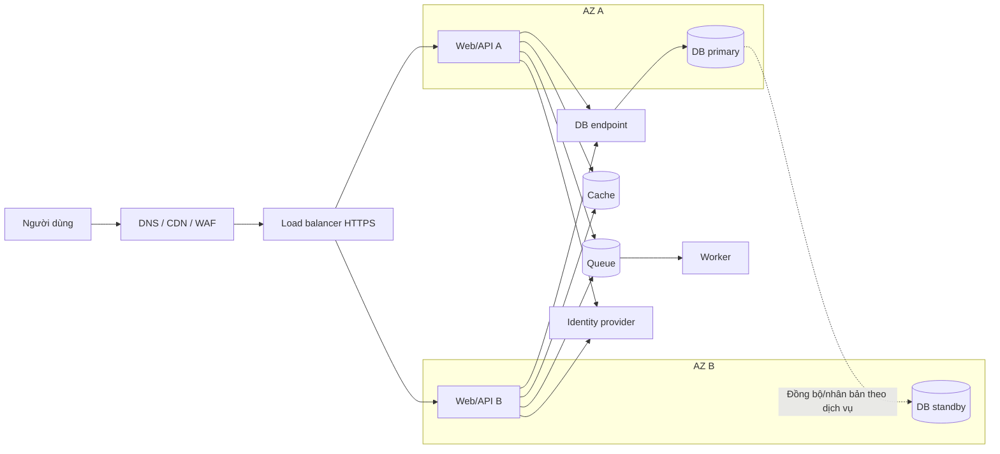
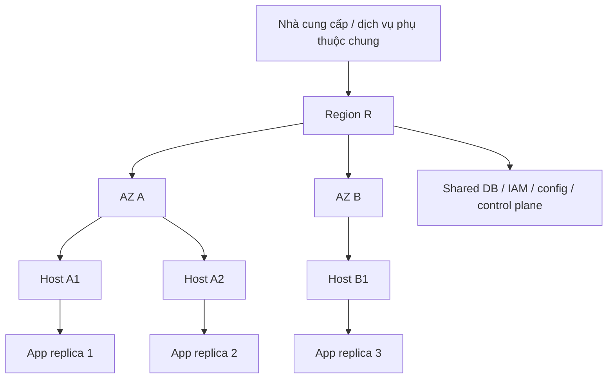
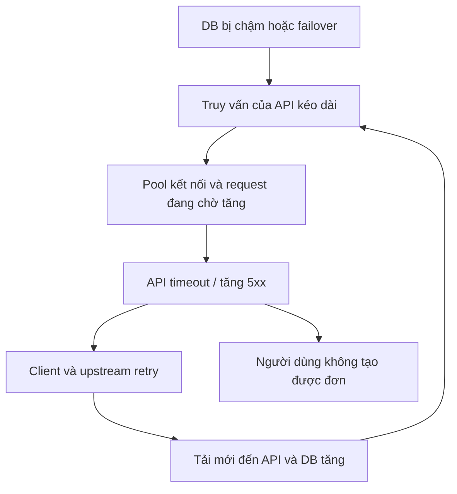
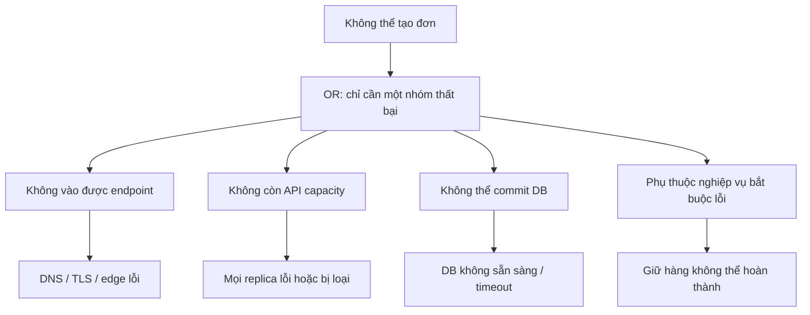

# Phân tích điểm lỗi đơn, miền lỗi và luồng lỗi

## 1. Vì sao cần phân tích lỗi khi đánh giá kiến trúc?

Một sơ đồ kiến trúc đám mây thường mô tả trạng thái **khi mọi thành phần đều hoạt động**: người dùng truy cập qua CDN, yêu cầu đi vào API, API đọc cơ sở dữ liệu, worker xử lý sự kiện. Nhưng câu hỏi quan trọng hơn khi đánh giá độ tin cậy là: **nếu một thành phần hỏng, điều gì xảy ra tiếp theo, bao nhiêu người dùng bị ảnh hưởng, và hệ thống phục hồi bằng cách nào?**

Bài này thuộc phần **Đánh giá kiến trúc** của học phần `CLOUD_ARCHITECTURE`: chuyển yêu cầu nghiệp vụ thành lựa chọn mạng, compute, dữ liệu và mô hình triển khai; cân nhắc độ tin cậy, bảo mật, khả năng mở rộng, chi phí và vận hành theo cách tiếp cận Well-Architected.

Ba góc nhìn bổ sung cho nhau:

1. **Điểm lỗi đơn** (*Single Point of Failure – SPOF*): thành phần hoặc phụ thuộc mà lỗi của nó đủ khiến một năng lực quan trọng ngừng hoạt động, dù các thành phần khác vẫn tốt.
2. **Miền lỗi** (*fault domain*): phạm vi các tài nguyên có thể cùng hỏng vì một nguyên nhân chung, chẳng hạn cùng host, cùng availability zone, cùng region, cùng hệ thống xác thực hay cùng cấu hình triển khai.
3. **Luồng lỗi** (*failure flow/propagation*): chuỗi sự kiện từ lỗi ban đầu qua các phụ thuộc đến triệu chứng của người dùng và quá trình hồi phục; bao gồm cả lỗi dây chuyền (*cascading failure*).

Mục tiêu học tập:

- Xác định SPOF tương ứng với **một chức năng nghiệp vụ và một kịch bản lỗi**, thay vì chỉ đếm số máy chủ.
- Vẽ ranh giới miền lỗi để nhận biết những bản sao tưởng độc lập nhưng có cùng nguyên nhân hỏng.
- Lập bản đồ phụ thuộc và mô tả luồng lan truyền lỗi từ nguyên nhân đến tác động.
- Đánh giá khả năng tiếp tục phục vụ, suy giảm có kiểm soát, phục hồi và phát hiện sự cố bằng bằng chứng.
- Đề xuất biện pháp giảm rủi ro có cân nhắc chi phí, hiệu năng, vận hành và bảo mật.

## 2. Chuẩn hóa các khái niệm trước khi đánh giá

| Thuật ngữ | Diễn giải | Ví dụ trong ứng dụng web |
| --- | --- | --- |
| **Fault** (lỗi) | Nguyên nhân hoặc điều kiện bất thường tại một thành phần | Một host mất nguồn; cấu hình firewall sai |
| **Error** (trạng thái sai) | Trạng thái nội bộ lệch khỏi kỳ vọng do fault gây ra | Pool kết nối DB cạn; transaction bị treo |
| **Failure** (hỏng chức năng) | Hành vi dịch vụ quan sát được không đáp ứng hợp đồng | API tạo đơn trả 5xx hoặc timeout |
| **SPOF** | Một thành phần/phụ thuộc có thể làm hỏng chức năng mục tiêu | Chỉ có một DB primary mà không có đường phục hồi đủ nhanh |
| **Fault domain** | Nhóm tài nguyên chịu cùng nguồn rủi ro | Hai VM trong cùng một AZ; hai service cùng dùng một DB |
| **Blast radius** | Mức độ ảnh hưởng của một sự cố | Một tenant, một API, một AZ, hay toàn bộ khách hàng |
| **Redundancy** | Có nhiều thành phần/đường phục vụ thay thế | Nhiều API replica phía sau load balancer |
| **Failover** | Chuyển phục vụ sang thành phần dự phòng khi thành phần chính lỗi | DB managed chuyển primary sang standby |
| **Graceful degradation** | Giữ chức năng cốt lõi, tạm giảm tính năng phụ khi phụ thuộc lỗi | Cho phép đặt hàng dù dịch vụ gợi ý sản phẩm ngừng |
| **Recovery** | Khôi phục năng lực hoặc dữ liệu theo mục tiêu đặt ra | Đưa API về SLO, restore dữ liệu từ backup |

Các thuật ngữ có quan hệ nhưng không đồng nhất. Một thành phần **có dự phòng** vẫn có thể là SPOF nếu đường chuyển đổi không hoạt động hoặc mọi bản sao cùng phụ thuộc vào một dịch vụ yếu. Hai container chạy song song trên cùng host không tạo ra khả năng chịu lỗi host. Hai region dùng chung một khóa mã hóa hoặc cấu hình sai được phát hành đồng thời vẫn có rủi ro hỏng tương quan.

Một SPOF luôn gắn với **phạm vi chức năng**. Nếu hệ thống gợi ý sản phẩm chỉ có một instance, lỗi instance đó là SPOF cho tính năng gợi ý; nhưng không nhất thiết là SPOF cho quy trình thanh toán nếu checkout không phụ thuộc bắt buộc vào gợi ý.

## 3. Tình huống xuyên suốt: ứng dụng đặt hàng trên cloud

Giả sử doanh nghiệp vận hành hệ thống đặt hàng có các thành phần:

- DNS, CDN/WAF và load balancer cho truy cập HTTPS.
- Web/API chạy dưới dạng container hoặc PaaS, có hai bản sao ở hai availability zone (AZ).
- Một cơ sở dữ liệu quan hệ được quản lý, cấu hình primary và standby liên AZ.
- Cache dùng cho thông tin sản phẩm, queue và worker gửi thông báo sau giao dịch.
- Dịch vụ định danh để xác thực người dùng; secrets/key management để kết nối dịch vụ.
- Monitoring, log, trace, CI/CD và Infrastructure as Code phục vụ vận hành.

Đây là **giả định minh họa**, không phải cấu hình mặc định của mọi nhà cung cấp. Cấu hình thực tế phải được đối chiếu tài liệu dịch vụ và thử nghiệm.

### Yêu cầu nghiệp vụ mẫu

| Yêu cầu | Mức ví dụ | Câu hỏi kiểm chứng |
| --- | --- | --- |
| Sẵn sàng API đặt hàng | SLO 99,9% theo tháng | Cách tính request thành công, vùng đo và ngoại lệ là gì? |
| Độ trễ | p95 dưới 500 ms ở tải đỉnh được xác nhận | Có bao gồm thời gian của identity, DB và downstream không? |
| Lưu lượng | Tối đa 400 request/giây trong đợt khuyến mại | Tỷ lệ đọc/ghi, số transaction/giây và mức burst ra sao? |
| Khả năng chịu lỗi | Chịu được mất một instance hoặc một AZ | AZ còn lại có đủ tài nguyên và dữ liệu không? |
| Khôi phục dữ liệu | RPO tối đa 15 phút cho kịch bản DR được thống nhất | Dữ liệu tại thời điểm nào có thể khôi phục? |
| Khôi phục dịch vụ | RTO tối đa 60 phút cho kịch bản DR đó | Ai kích hoạt, phục hồi những phụ thuộc nào, đã diễn tập chưa? |
| Bảo vệ dữ liệu | Dữ liệu cá nhân và giao dịch có kiểm soát quyền | Failure mode có làm lộ dữ liệu hoặc bỏ qua xác thực không? |

**RPO** là lượng dữ liệu tối đa có thể mất, quy đổi ra khoảng thời gian tính từ thời điểm sự cố; **RTO** là khoảng thời gian tối đa để phục hồi năng lực theo kịch bản đã định. **SLO** diễn tả mục tiêu dịch vụ trong cửa sổ đo. Chúng là các mục tiêu khác nhau; một DB “multi-AZ” không tự đảm bảo toàn bộ RTO/RPO của hệ thống.

### Sơ đồ đường đi chính và đường đi phụ



Sơ đồ này **không phải bằng chứng rằng hệ thống đã chịu lỗi**. Cần kiểm tra: DB endpoint có thật sự chuyển tới standby được không, load balancer loại instance lỗi nhanh đến đâu, cache hỏng có chặn API không, identity provider có nằm trên đường xử lý mỗi request không, queue có còn nhận được sự kiện khi DB vừa failover không?

## 4. Cách tìm SPOF theo chức năng nghiệp vụ

Đừng chỉ nhìn hình rồi khoanh tròn tài nguyên có một biểu tượng. Hãy bắt đầu từ đường đi để hoàn thành một **nhiệm vụ có ý nghĩa với người dùng**.

Ví dụ, yêu cầu “xác nhận đơn hàng” có thể cần:

1. Truy cập được hostname và endpoint HTTPS.
2. API sẵn sàng nhận yêu cầu.
3. Có cơ chế xác thực hợp lệ và kiểm tra quyền.
4. DB có thể ghi transaction.
5. Phụ thuộc bắt buộc cho việc giữ hàng/thanh toán hoạt động theo hợp đồng.
6. API trả kết quả hoặc trạng thái xử lý rõ ràng mà không gây trùng đơn.

Nếu một phần tử trên đường đi bắt buộc ngừng và **không có cách thay thế hợp lệ trong thời hạn chấp nhận**, phần tử đó là một ứng viên SPOF cho xác nhận đơn. Thành phần phụ như gửi email thường không nên nằm trên đường đồng bộ bắt buộc nếu doanh nghiệp chấp nhận giao email trễ.

### Danh mục SPOF cần rà soát

| Lớp | Ứng viên SPOF | Vì sao đáng nghi? | Bằng chứng cần tìm |
| --- | --- | --- | --- |
| Edge/network | Một LB, một tuyến mạng, một NAT gateway dùng chung | Mất đường vào/ra hoặc timeout các kết nối | Topology, SLA dịch vụ, AZ mapping, routing và failover test |
| Compute | Một instance, mọi replica cùng host/AZ hoặc chung một autoscaling policy sai | Mất một host/AZ làm toàn API dừng | Placement, health checks, capacity sau lỗi |
| Data | DB primary không có failover; một storage volume; chỉ có một nguồn dữ liệu bền vững | Không ghi/đọc được dữ liệu cốt lõi | DB HA, replication, backup/restore, thử failover |
| Cache | API bắt buộc cache hoạt động nhưng cache chỉ có một node | Cache lỗi làm mất cả đường đọc | Fallback/timeout, cache failover, retry behavior |
| Messaging | Queue/broker đơn không có đường phục hồi phù hợp | Tác vụ quan trọng không được ghi hoặc xử lý | Durability, ACK, backlog, DLQ, replay |
| Identity/secrets | Một IdP/secret/key endpoint mà mọi request bắt buộc gọi trực tiếp | Mọi dịch vụ bị chặn dù ứng dụng và DB khỏe | Token validation strategy, cache chính sách, phụ thuộc runtime |
| Deploy/configuration | Một pipeline/secret/config lỗi áp dụng đồng thời tới mọi replica | Lỗi hệ thống tương quan do thay đổi chung | Rollout theo đợt, quyền deploy, khả năng rollback |
| DNS/certificate | Một vùng DNS cấu hình sai, chứng chỉ hết hạn, thao tác cập nhật đồng loạt | Không truy cập được dù backend khỏe | Quản lý TTL, cảnh báo hết hạn, kiểm chứng thay đổi |
| Con người/vận hành | Chỉ một người giữ quyền cứu hộ, runbook thiếu, backup không thử | Không thể khôi phục trong RTO khi người đó vắng | On-call rotation, break-glass, restore drill |

Lưu ý: một dịch vụ được quản lý có thể triển khai nội bộ trên nhiều host nhưng vẫn là **phụ thuộc logic chung** đối với ứng dụng. Cần xem failure mode và cam kết cung cấp thực tế, không tự kết luận chỉ từ tên “managed”.

### Ba câu hỏi phát hiện SPOF tiềm ẩn

- **Nếu tôi chủ động ngắt thành phần này trong 10 phút, nghiệp vụ nào thất bại?** Câu hỏi này xác định phạm vi tác động.
- **Nếu bản sao dự phòng cũng cần cùng DB, network, secret hoặc quyền truy cập, chúng độc lập đến đâu?** Câu hỏi này xác định rủi ro tương quan.
- **Nếu thành phần dự phòng sẵn có nhưng chưa được kích hoạt, việc chuyển đổi có đạt mục tiêu phục hồi không?** Câu hỏi này phân biệt redundancy trên giấy với failover thực tế.

## 5. Phân tích miền lỗi: độc lập ở cấp độ nào?

Miền lỗi là công cụ xác định **ranh giới lỗi có nguyên nhân chung**. Một tài nguyên có thể đồng thời thuộc nhiều miền lỗi lồng nhau.



Trong sơ đồ, các replica phân bố trên host và AZ khác nhau giúp giảm rủi ro từ lỗi host hoặc lỗi một AZ. Tuy nhiên, chúng vẫn có thể cùng phụ thuộc một region hoặc thành phần chia sẻ như DB, danh tính, khóa mã hóa, pipeline triển khai. Ranh giới quản trị như tài khoản cloud, tenant, cluster, namespace và repository cũng có thể tạo **miền lỗi do cấu hình hoặc quyền truy cập**.

### Ma trận miền lỗi và phạm vi ảnh hưởng

| Miền lỗi | Nguyên nhân điển hình | Cách giới hạn blast radius | Giới hạn còn lại |
| --- | --- | --- | --- |
| Process/container | Crash, OOM, lỗi runtime | Nhiều replica, health check, restart | Cùng bug có thể khiến mọi replica crash |
| Host/node | Mất nguồn, kernel lỗi, hỏng NIC | Anti-affinity/placement qua host | Replica cùng AZ vẫn bị ảnh hưởng bởi lỗi AZ |
| Rack/power/network segment | Thiết bị chia sẻ gặp lỗi | Phân bố theo topology được nền tảng hỗ trợ | Không phải cloud nào cho kiểm soát rack chi tiết |
| Availability zone | Mất một khu vực hạ tầng trong region | Replica và dữ liệu HA qua AZ, đủ capacity dự phòng | Dịch vụ khu vực, quota và dependency vẫn có thể ảnh hưởng |
| Region | Sự cố hạ tầng/cấp mạng diện rộng | DR đa region, replicated data, routing và runbook | Chi phí, độ trễ nhân bản và rủi ro chung nhà cung cấp |
| Shared service | DB, cache, IdP, KMS, queue chung | HA riêng, giới hạn phụ thuộc cứng, fallback hợp lệ | Có thể là rủi ro tương quan ở nhiều AZ/region |
| Deployment/config | Bug, schema migration, secrets bị xoay sai | Canary, blast radius theo đợt, feature flags, rollback | Rollout quá nhanh có thể vượt mọi miền hạ tầng |
| Identity/security domain | Tài khoản/role bị khóa hoặc lộ, chính sách sai | Quyền tối thiểu, tách tài khoản, break-glass có kiểm toán | Quy trình cứu hộ phải không phá kiểm soát bảo mật |
| Dữ liệu logic | Xóa nhầm, ghi hỏng, dữ liệu lỗi lan qua replica | Backup, PITR, versioning, khôi phục và đối soát | Replication HA có thể nhân bản cả lỗi logic |

**Multi-AZ không tương đương multi-region.** Tương tự, **multi-region không tự đồng nghĩa độc lập** nếu cả hai nơi dùng chung quy trình deploy, phụ thuộc danh tính hoặc dữ liệu quan trọng chưa được nhân bản thích hợp.

### Miền lỗi vật lý và miền lỗi logic

Hai dịch vụ trên hai AZ khác nhau có thể chết cùng lúc vì cấu hình DNS sai. Ngược lại, hai module trên cùng một DB nhưng có quyền ghi và quy tắc rollback tách biệt có thể chịu được một số lỗi logic ở cấp module. Vì vậy cần vẽ **cả topology hạ tầng lẫn topology phụ thuộc**, và kiểm tra những điểm giao nhau.

Các câu hỏi thực tế gồm: một thay đổi IAM ảnh hưởng bao nhiêu workload? Một lỗi schema migration khiến bao nhiêu phiên bản API thất bại? Nếu một tenant tạo tải bất thường, tenant khác bị nghẽn connection pool hoặc quota không?

## 6. Vẽ đồ thị phụ thuộc và luồng lỗi

Một hệ thống có thể được mô hình hóa thành **đồ thị có hướng**: đỉnh là các dịch vụ/tài nguyên, cạnh biểu diễn phụ thuộc. Từ góc nhìn request, cạnh `API → DB` có nghĩa API cần DB. Khi DB hỏng, ảnh hưởng **lan ngược** đến API và người dùng. Khi API retry quá mức, tải bất thường lại **lan xuôi** vào DB, tạo vòng khuếch đại.

Khi lập bản đồ phụ thuộc, đánh dấu rõ:

- **Bắt buộc / không bắt buộc:** thất bại ở cạnh này có nhất thiết làm hỏng chức năng chính?
- **Đồng bộ / bất đồng bộ:** caller phải chờ ngay hay có thể tiếp tục trong trạng thái chờ?
- **Thời gian tối đa:** timeout, deadline, TTL của cache và thời hạn chấp nhận kết quả.
- **Chính sách lỗi:** retry, backoff, fallback, circuit breaker, queue, manual intervention.
- **Ranh giới quyền:** kết nối có quyền gì và khi lỗi có rơi vào chế độ thiếu an toàn không?
- **Nơi quan sát:** metric, log, trace, sự kiện audit và cảnh báo theo từng cạnh.

### Ví dụ: DB chậm dẫn tới lỗi dây chuyền



Lỗi ban đầu ở DB có thể chỉ kéo dài 20 giây, nhưng request treo, connection pool cạn và retry đồng loạt có thể khiến hệ thống mất nhiều phút để ổn định. Đây là **cascading failure** và có thể dẫn tới **retry storm**.

Các biện pháp cần đi cùng nhau:

1. Thiết lập **deadline toàn bộ yêu cầu** và timeout ngắn hơn cho từng phụ thuộc.
2. **Giới hạn số retry**, dùng exponential backoff có jitter; chỉ retry thao tác an toàn hoặc có idempotency key.
3. Áp dụng **concurrency limit, connection pool limit, bulkhead** để một đường lỗi không chiếm hết tài nguyên.
4. Dùng **circuit breaker** hoặc load shedding cho phụ thuộc đang lỗi, nhưng xác định rõ điều kiện đóng/mở và cách hồi phục.
5. Với tác vụ không cần phản hồi ngay, dùng queue/bộ đệm có giới hạn và giám sát backlog.
6. Kiểm tra **readiness** để load balancer không gửi thêm yêu cầu vào instance không sẵn sàng.

Không nên gọi retry là “cơ chế tăng độ tin cậy” nếu chưa đo tải bổ sung và tính đúng đắn khi lặp. Retry không giới hạn có thể biến một sự cố nhỏ thành sự cố toàn cụm.

## 7. Những luồng lỗi điển hình cần diễn tập

### 7.1. Một instance API ngừng hoạt động

**Lỗi khởi phát:** process crash hoặc container OOM tại AZ A.

**Luồng lỗi:** instance không đáp ứng health check → load balancer ngừng định tuyến đến instance → request đang chạy có thể thất bại → replica còn lại nhận tải tăng → autoscaler bổ sung capacity nếu đủ quota.

**Điều kiện thành công:** replica còn lại đủ năng lực cho mức tải tại thời điểm đó; health check đủ nhanh nhưng không quá nhạy; request ghi có idempotency để client retry an toàn. Nếu toàn bộ session được lưu cục bộ ở instance chết, vẫn có thể xảy ra mất phiên.

### 7.2. Mất cả một AZ

**Lỗi khởi phát:** AZ A ngừng phục vụ network/compute.

**Luồng lỗi:** mọi replica AZ A biến mất → load balancer dồn traffic sang AZ B → DB primary nếu đặt ở AZ A cần failover → API kết nối lại endpoint DB → tải tập trung trên AZ B và pool DB.

**Điều kiện thành công:** AZ B đủ capacity hoặc có thể scale nhanh trong giới hạn; DB có cơ chế HA liên AZ; routing, quota, subnet và các dependency liên quan còn hoạt động. Nếu hai AZ mỗi bên chạy ở 50% công suất tối đa, khi mất một AZ và tải không đổi, AZ còn lại có thể lên 100% ngay cả trước khi tạo thêm pod; **hai AZ trên sơ đồ chưa bảo đảm headroom**.

### 7.3. Queue hoặc worker dừng xử lý

**Lỗi khởi phát:** worker crash hoặc không kết nối được downstream.

**Luồng lỗi:** queue vẫn nhận message → số message chưa xử lý tăng → tuổi message cũ nhất tăng → thông báo/hóa đơn bị chậm → nếu retention hết hoặc cơ chế retry sai, tác vụ có thể thất bại lâu dài.

**Điều kiện thành công:** message được lưu bền vững theo khả năng dịch vụ; worker idempotent; có retry giới hạn, DLQ, giới hạn backlog và cảnh báo trước khi vượt thời hạn nghiệp vụ. Nếu API đặt hàng coi gửi email là yêu cầu bắt buộc trước khi commit, queue/worker có thể trở thành SPOF của checkout dù lẽ ra chỉ là tính năng phụ.

### 7.4. DNS, chứng chỉ hoặc xác thực gặp lỗi

**Lỗi khởi phát:** chứng chỉ hết hạn, DNS record bị sửa sai, identity provider hoặc endpoint phát khóa xác thực ngừng.

**Luồng lỗi:** trình duyệt không kết nối được HTTPS hoặc API không xác thực được request → 4xx/5xx tăng dù compute, DB và mạng nội bộ khỏe.

**Điều kiện thành công:** có theo dõi chứng chỉ/DNS, kiểm soát thay đổi, phương án khôi phục cấu hình; chiến lược xác minh token sử dụng cache khóa công khai còn hợp lệ trong giới hạn an toàn và có kế hoạch ứng phó khi IdP ngừng. Với thao tác nhạy cảm, **không được “fail open” bằng cách bỏ kiểm tra quyền** để giữ availability.

### 7.5. Xóa nhầm dữ liệu hoặc triển khai schema không tương thích

**Lỗi khởi phát:** một lệnh migration xóa trường đang được sử dụng, hoặc thao tác quản trị xóa dữ liệu.

**Luồng lỗi:** thay đổi dữ liệu/schema được nhân bản → mọi API cùng lỗi truy vấn hoặc đọc dữ liệu sai → hệ thống có thể vẫn “healthy” ở lớp HTTP nhưng nghiệp vụ không còn đúng.

**Điều kiện thành công:** deploy theo giai đoạn và kiểm tra nghiệp vụ; migration kiểu expand–migrate–contract; backup/PITR, restore drill, kiểm tra toàn vẹn và quy trình đối soát sau phục hồi. **Replica HA thường sao chép cả lỗi logic**, vì vậy HA không thể thay thế backup.

## 8. Fault tree: suy luận từ tác động ngược về nguyên nhân

Ngoài luồng lỗi đi xuôi từ nguyên nhân, có thể dựng **cây lỗi** (*fault tree*) bắt đầu từ sự kiện không mong muốn: “Người dùng không thể tạo đơn”.



Đây là mô hình **logic đơn giản**: cổng OR cho biết chỉ một nhánh đủ làm sự kiện đỉnh xảy ra; với chức năng cần tất cả các điều kiện, ta có thể mô hình hóa cấu trúc phụ thuộc bằng cổng AND khi phù hợp. Đừng đồng nhất cây lỗi với sơ đồ hạ tầng. Sự kiện “mọi replica API lỗi” có thể cần phân rã thêm:

- Một **lỗi chung** (bug phát hành tới toàn bộ replica, dependency chung ngừng).
- **Hoặc** các lỗi độc lập đủ làm mất mọi replica khi không có failover/capacity bổ sung.

Mục đích của fault tree là lộ ra **minimal cut set**: tập nhỏ nhất các sự cố đủ gây ra sự kiện đỉnh theo giả định. Một nhánh đơn là dấu hiệu có thể có SPOF; một tập gồm hai sự cố cho biết hệ thống chỉ hỏng khi cả hai điều kiện xảy ra. Cần xác minh giả định qua kiến trúc và thử nghiệm.

## 9. Đánh giá định lượng: availability, capacity và rủi ro tương quan

Các phép tính sơ bộ giúp đặt câu hỏi đúng, nhưng không thay thế đo lường thực tế hoặc SLA nhà cung cấp.

### 9.1. Availability và ngân sách lỗi

Với cửa sổ 30 ngày và SLO availability 99,9%, ngân sách không sẵn sàng là:

```text
30 ngày × 24 giờ × 60 phút × (1 - 0,999)
= 43,2 phút / 30 ngày
```

Nếu SLI đo theo tỷ lệ request thành công thay vì thời gian, cần tính **error budget theo request** và phương pháp đo cụ thể; không được mặc nhiên quy đổi toàn bộ sang phút downtime. Sự cố 15 phút có thể gây ra tỷ lệ lỗi khác nhau tùy traffic và phạm vi người dùng.

### 9.2. Nhiều thành phần nối tiếp

Giả sử ba thành phần **đều bắt buộc**, availability mỗi thành phần độc lập lý tưởng là 99,95%, và hệ thống thành công khi cả ba thành công. Phép ước lượng đơn giản:

```text
A_hệ_thống ≈ A_1 × A_2 × A_3
            = 0,9995³
            ≈ 0,998501  (99,8501%)
```

Ngay cả những thành phần có availability khá cao vẫn làm đường đi nối tiếp có mức sẵn sàng thấp hơn. Tuy nhiên, đây **không phải dự báo SLA thực tế**: lỗi tương quan, failover, sự khác nhau giữa uptime và thành công của request, cache/fallback đều làm mô hình phức tạp hơn.

### 9.3. Hai bản sao song song

Nếu hai replica **hoàn toàn độc lập**, mỗi replica có availability 99% và chỉ cần một replica khỏe để phục vụ, mô hình lý tưởng:

```text
A_song_song = 1 - (1 - A_1) × (1 - A_2)
             = 1 - 0,01 × 0,01
             = 0,9999  (99,99%)
```

Kết quả này **không được sử dụng như cam kết** nếu hai replica cùng AZ, cùng DB, cùng đường network hoặc cùng lỗi cấu hình. Nó còn giả định load balancer phát hiện, chuyển traffic và replica sống đủ capacity mà không gây gián đoạn đáng kể.

### 9.4. Năng lực sau khi mất một miền lỗi

Giả sử hệ thống có hai AZ, mỗi AZ phục vụ tối đa 250 request/giây và tổng tải đỉnh là 400 request/giây:

```text
Capacity bình thường = 250 + 250 = 500 req/s
Tải đỉnh             = 400 req/s
Mất một AZ           = 250 req/s còn lại
Thiếu capacity        = 400 - 250 = 150 req/s
```

Hệ thống có thể mất phần lớn lưu lượng dù “deploy đa AZ”. Có thể giải bằng dự phòng capacity đủ lớn, scale nhanh vào AZ còn lại (nếu quota và startup time cho phép), xử lý ưu tiên, rate limiting hoặc giảm tính năng không cốt lõi. Khi đánh giá, cần ghi rõ **headroom N-1**: sau khi mất một miền lỗi đã chọn, năng lực còn lại có đạt tải yêu cầu không?

## 10. Chấm mức rủi ro bằng bảng FMEA đơn giản

Một cách tổ chức review là **Failure Modes and Effects Analysis (FMEA)**. Với mỗi failure mode, ghi hậu quả và khả năng phát hiện. Có thể đặt điểm tương đối cho:

- **Severity (S):** mức độ nghiêm trọng của tác động, ví dụ từ 1 (nhỏ) đến 5 (rất lớn).
- **Occurrence (O):** mức độ khả dĩ xảy ra theo dữ liệu và giả định, ví dụ 1 đến 5.
- **Detection (D):** khó phát hiện trước khi gây hậu quả, ví dụ 1 (dễ) đến 5 (khó).

Một chỉ số sàng lọc thường dùng là `RPN = S × O × D`. **RPN là công cụ ưu tiên tương đối**, không phải xác suất định lượng và không nên thay thế đánh giá riêng đối với hậu quả nghiêm trọng.

| Failure mode | S | O | D | RPN minh họa | Kiểm soát ưu tiên |
| --- | ---: | ---: | ---: | ---: | --- |
| DB primary lỗi, failover chưa được thử | 5 | 3 | 3 | 45 | Diễn tập failover, sửa timeout/reconnect |
| API bị mất một AZ, AZ còn lại thiếu capacity | 4 | 3 | 2 | 24 | N-1 capacity test, quota và autoscale |
| Certificate hết hạn đồng thời trên edge | 5 | 2 | 4 | 40 | Tự động gia hạn, giám sát ngoài hệ thống |
| Worker gửi email bị dừng | 2 | 3 | 2 | 12 | Queue age alert, retry/DLQ |
| Deploy sai IAM role cho mọi replica | 5 | 3 | 4 | 60 | Canary, policy test, rollback |

Các điểm số trên **được đặt ra để minh họa phương pháp**, không phải dữ liệu thống kê của nhà cung cấp. Khi làm thật, cần định nghĩa rõ từng mức, sử dụng incident history, đo kiểm và người sở hữu rủi ro. Trường hợp mức độ thiệt hại cực lớn phải được xử lý dù RPN thấp.

### Phân biệt phát hiện và ngăn ngừa

Một cảnh báo tốt không loại bỏ SPOF; nó chỉ rút ngắn thời gian phát hiện (MTTD). Runbook và failover giảm thời gian phục hồi (MTTR/RTO thực tế), trong khi redundancy và phân miền lỗi giảm xác suất gián đoạn trong các kịch bản được bao phủ. Cần ghi riêng **biện pháp phòng ngừa**, **cơ chế phát hiện** và **khả năng khôi phục**.

## 11. Thiết kế biện pháp giảm lỗi mà không tạo SPOF mới

| Rủi ro được xác nhận | Lựa chọn thiết kế | Điều phải kiểm chứng | Đánh đổi |
| --- | --- | --- | --- |
| Một API replica lỗi | Nhiều stateless replica, LB health check, autoscaling | Request đang chạy, phiên và capacity khi một replica mất | Chi phí capacity dự phòng |
| Mất AZ | Phân tán compute/DB HA qua AZ, N-1 capacity | DB failover, routing, quota và latency | Phí HA, tài nguyên nhàn rỗi, chuyển dữ liệu AZ |
| DB chậm làm nghẽn API | Timeout, pooling, bounded concurrency, backoff, idempotency | Load test khi DB giảm công suất, retry storm | Logic lỗi phức tạp, có thể từ chối bớt request |
| Cache không sẵn sàng | Cache là tối ưu, có fallback đọc nguồn trong giới hạn | Khi cache chết, DB còn capacity không? | Độ trễ tăng, rủi ro cache stampede |
| Dịch vụ gợi ý sản phẩm lỗi | Cô lập request với timeout/bulkhead, hiển thị nội dung mặc định | Checkout vẫn đáp ứng SLO? | Chức năng phụ suy giảm |
| Queue/worker lỗi | Durable queue, idempotent consumer, DLQ, replay | Message retention, age, xử lý trùng | Chi phí broker, độ trễ và vận hành |
| Xóa nhầm dữ liệu | Backup/PITR, phân quyền xóa, restore test | RPO/RTO theo từng kịch bản | Phí backup, quy trình đối soát |
| Deploy/cấu hình sai | Canary/blue-green, IaC review, policy-as-code, staged rollout | Có chặn rollout khi error rate tăng? rollback có tương thích dữ liệu? | Pipeline phức tạp hơn |
| Sự cố region | DR đa region khi yêu cầu buộc có | Restore/replication, routing, keys, dependencies ở region khác | Chi phí cao và độ phức tạp dữ liệu |

### Tránh các “biện pháp” gây hệ quả xấu

- **Bật retry không giới hạn:** tăng quá tải và thời gian chờ.
- **Đặt cache thành nguồn chân lý duy nhất:** lỗi cache biến thành mất dữ liệu/trạng thái.
- **Dùng fallback thiếu kiểm tra quyền:** hy sinh bảo mật để giữ availability.
- **Scale API mà không giới hạn kết nối DB:** biến một đợt tăng traffic thành cạn kết nối DB.
- **Tự động failover sang dữ liệu replica trễ mà không rõ RPO:** có thể làm mất cập nhật gần nhất.
- **Chuyển toàn bộ hệ thống sang đa region ngay:** tăng chi phí, rủi ro cấu hình và nhất quán trước khi có nhu cầu nghiệp vụ tương ứng.

Một thiết kế tốt phải mô tả **chế độ suy giảm được chấp nhận**. Ví dụ, hệ thống vẫn cho xem sản phẩm khi cache lỗi nhưng có thể giới hạn tốc độ; vẫn tạo đơn khi dịch vụ gửi email lỗi nhưng giữ sự kiện cần gửi; không tự phê duyệt thanh toán khi dịch vụ chống gian lận không có phản hồi nếu chính sách yêu cầu kiểm tra bắt buộc.

## 12. Quan sát luồng lỗi trong thực tế

Chỉ đo CPU hay tình trạng “instance đang chạy” là chưa đủ. Cần tín hiệu từ góc nhìn người dùng và phụ thuộc.

| Đối tượng | Tín hiệu quan sát | Câu hỏi điều tra |
| --- | --- | --- |
| API đầu vào | Request rate, 4xx/5xx, latency p50/p95/p99, SLI theo hành trình người dùng | Người dùng không thể làm thao tác nào, từ khi nào? |
| Load balancer | Healthy backend, connection errors, reset, backend response time | Có chỉ còn một AZ/instance? |
| Compute | CPU, RAM, restart, concurrency, queueing, autoscale delay | Có đủ headroom khi mất instance không? |
| DB | Connection utilization, slow queries, lock waits, failover events, replication lag | Lỗi bắt đầu từ DB hay do retry từ ứng dụng? |
| Queue | Backlog, oldest message age, retries, DLQ, consumer throughput | Tác vụ có vượt thời hạn nghiệp vụ không? |
| DNS/TLS/IdP | Synthetic probe bên ngoài, certificate expiry, auth failure rate | Có lỗi trước khi request chạm API không? |
| Data integrity | Reconciliation, transaction count, mất/trùng đơn, restore verification | Chức năng có đúng ngay cả khi HTTP thành công? |
| Cloud resources | Quota, network errors, egress, số tài nguyên theo AZ, cost | Có hết quota hoặc giới hạn mạng khi scale/failover không? |

### Sử dụng trace để khôi phục chuỗi nguyên nhân

Ví dụ một yêu cầu tạo đơn có `trace_id` và các span: `edge → API → inventory → DB`. Khi DB trở nên chậm, trace cho biết span nào kéo dài; metrics DB cho thấy lock wait, còn log của API ghi timeout. Kết hợp chúng giúp phân biệt nguyên nhân ban đầu với triệu chứng. Đừng mặc nhiên coi thành phần ghi log lỗi đầu tiên là nơi khởi phát sự cố.

**Synthetic monitoring** từ nhiều điểm đo giúp phát hiện DNS, TLS hoặc edge lỗi mà metric trong cluster có thể không nhìn thấy. Hãy tránh ghi token, secret hoặc dữ liệu cá nhân nhạy cảm vào log và trace. Thiết lập correlation ID xuyên request và event để nối đường đi đồng bộ với tác vụ bất đồng bộ.

### Cảnh báo theo tác động

Một cảnh báo tốt có điều kiện và người nhận xử lý:

```text
ALERT: Checkout error rate > 2% trong 5 phút
PHẠM VI: production, tất cả AZ, endpoint POST /orders
NGỮ CẢNH: p95 tăng, DB connection utilization 95%,
          một DB failover event vừa xảy ra
HÀNH ĐỘNG: điều tra DB failover + ứng dụng retry;
           nếu cần giới hạn concurrency theo runbook
```

Ngưỡng chỉ là ví dụ. Trong sản phẩm thực, nên liên hệ với SLO/error budget, tránh alert trùng lặp và xác định on-call; chỉ số cảnh báo phải được hiệu chỉnh bằng dữ liệu thực tế.

## 13. Quy trình đánh giá kiến trúc theo các bước

Để tránh chỉ thảo luận cảm tính, hãy thực hiện review theo thứ tự sau:

1. **Xác định chức năng quan trọng:** ví dụ đăng nhập, tạo đơn, thanh toán, truy cập lịch sử. Gắn SLO, RTO, RPO và yêu cầu bảo mật; xác nhận phạm vi lỗi cần chịu đựng.
2. **Vẽ luồng thành công (happy path):** người dùng → edge → API → các phụ thuộc bắt buộc → dữ liệu. Ghi cả những nhiệm vụ bất đồng bộ.
3. **Lập inventory và dependency graph:** mỗi thành phần dùng region/AZ/cluster/instance nào, IAM role nào, queue/DB/secret nào, phụ thuộc managed service nào.
4. **Khoanh miền lỗi chung:** host, AZ, region, tài khoản, dữ liệu, quyền, DNS, pipeline, phiên bản ứng dụng, đối tác bên ngoài.
5. **Liệt kê failure modes:** process crash, mất AZ, DB failover, network partition, quota, deploy lỗi, dữ liệu sai, provider outage, vận hành sai.
6. **Truy vết luồng lỗi:** mỗi lỗi dẫn đến timeout, retry, backlog, saturation, sai dữ liệu hoặc lỗi người dùng thế nào? Có vòng khuếch đại không?
7. **Đo ảnh hưởng và khả năng chịu lỗi:** phạm vi người dùng, tỉ lệ lỗi, p95, capacity N-1, RPO/RTO, MTTD/MTTR; phân biệt số đo và giả định.
8. **Ưu tiên biện pháp:** dùng severity, likelihood, detection, chi phí và ràng buộc nghiệp vụ; ghi quyết định kiến trúc (ADR).
9. **Kiểm chứng:** load test, fault injection, failover test, restore drill và kiểm tra bảo mật trong phạm vi được phê duyệt.
10. **Giám sát liên tục:** cập nhật bản đồ phụ thuộc khi có service, region, feature, quyền IAM hoặc pipeline mới; đưa bài học sự cố vào backlog.

### Mẫu hồ sơ một kịch bản lỗi

```yaml
scenario_id: AZ-LOSS-01
business_capability: "Tạo đơn hàng"
assumption: "Mất AZ A, AZ B còn hoạt động"
fault_domain: "AZ"
initiating_event: "Compute và DB primary ở AZ A không khả dụng"
expected_flow:
  - "LB loại backend ở AZ A"
  - "DB managed failover sang standby ở AZ B"
  - "API reconnect DB có timeout và backoff"
  - "Tải chuyển sang AZ B, autoscaling nếu có thể"
user_impact_to_measure:
  - "Tỷ lệ yêu cầu lỗi"
  - "p95 latency"
  - "Đơn tạo trùng hoặc mất"
  - "Thời gian quay lại SLO"
required_evidence:
  - "N-1 load test"
  - "DB failover logs"
  - "Trace và dashboard SLO"
owner: "Nhóm nền tảng + nhóm ứng dụng"
status: "Chưa kiểm chứng"
```

Mẫu này là dữ liệu minh họa cho một review, không phải cấu hình để chạy công cụ tự động. Khi lưu vào hồ sơ dự án, cần bổ sung kết quả thực đo, phiên bản kiến trúc và ngày kiểm tra.

## 14. Kiểm thử lỗi có kiểm soát và diễn tập phục hồi

### Những thử nghiệm nên tiến hành

| Thử nghiệm | Tiền điều kiện | Điều cần chứng minh |
| --- | --- | --- |
| Kill một API replica | LB có nhiều replica, có metric nền | Request thất bại được giới hạn; traffic chuyển và không vượt SLO |
| Mô phỏng mất một AZ | Môi trường đủ giống production; có kế hoạch dừng | Replica/DB ở AZ khác còn capacity, route và dữ liệu |
| DB failover được hỗ trợ | Backup, giám sát DB, runbook | Reconnect, latency, timeout, idempotency; tổng thời gian hồi phục |
| Tăng độ trễ DB | Fault injection giới hạn phạm vi | Retry/backoff, pool limit và circuit breaker ngăn cascading failure |
| Tắt worker | Queue có retention và metrics | Không mất tác vụ, backlog tăng có kiểm soát và xử lý được khi hồi phục |
| Làm hỏng một bản cấu hình staging | Có rollback và review | Canary ngăn lỗi lan toàn bộ; lịch sử thay đổi dễ truy |
| Restore từ backup | Kho backup và môi trường kiểm thử | Khôi phục đúng điểm dữ liệu, đo RPO/RTO, kiểm tra consistency |
| Mô phỏng IdP không sẵn sàng | Có chính sách xác thực rõ ràng | Không bypass authorization; xác định đường đi hợp lệ của người dùng hiện tại |

Trước fault injection ở môi trường có khách hàng, cần xác định phạm vi blast radius, lịch thực hiện, người chỉ huy, điều kiện dừng, phương án khôi phục, cách đo và các nhóm liên quan. Có thể bắt đầu tại staging hoặc canary ít rủi ro, sau đó tăng phạm vi khi có bằng chứng đủ tốt.

Một bài test thành công **không chỉ là “hệ thống tự lên lại”**. Phải kiểm tra dữ liệu có mất/trùng không, SLO bị vượt bao lâu, nhiệm vụ nền có hoàn tất không, cảnh báo có đến đúng người không và runbook có thể được người khác thực hiện lại hay không.

### Mẫu timeline một lần diễn tập

```text
T+00:00  Bắt đầu fault injection: API A ngừng
T+00:06  LB ngừng gửi request đến API A
T+00:08  Error rate giảm dần, API B tăng tải
T+00:30  Autoscaler tạo replica thay thế (nếu cần)
T+01:10  p95 trở lại ngưỡng mục tiêu
T+05:00  Đối soát đơn tạo mới, không phát hiện tạo trùng
```

Các thời điểm trên là **ví dụ cách ghi nhận**, không phải thời gian mặc định hay bảo đảm của cloud. Nên ghi dữ liệu thực đo theo UTC và timezone được thống nhất, kèm event ID/log/trace làm bằng chứng.

## 15. Đánh giá theo Well-Architected

| Trụ cột | Câu hỏi review đối với SPOF/miền lỗi/luồng lỗi | Bằng chứng mong đợi |
| --- | --- | --- |
| **Reliability** | Những failure mode đã chọn có được cô lập và phục hồi theo mục tiêu không? | Dependency graph, N-1 tests, failover test, RTO/RPO |
| **Security** | Khi một dependency lỗi, hệ thống vẫn từ chối truy cập trái phép và giữ bí mật dữ liệu chứ? | IAM, test fail-closed, audit log, secret rotation, phương án break-glass |
| **Operational excellence** | Nhóm vận hành có phát hiện, phân loại, ứng phó và học từ lỗi được không? | SLO dashboard, alert, runbook, game day, postmortem |
| **Performance efficiency** | Khi traffic dồn vào phần còn lại, có giữ độ trễ và throughput trong mức chấp nhận không? | Load test, p95, saturation, quota, connection pool |
| **Cost optimization** | Chi phí dự phòng và DR có tương xứng với hậu quả sự cố không? | Cost breakdown, ADR, so sánh N-1 capacity và phương án phục hồi |
| **Sustainability** | Có tối ưu tài nguyên dự phòng, tài nguyên nhàn rỗi và dữ liệu giữ không cần thiết? | Right sizing, autoscaling, lifecycle policy, đo hiệu quả tài nguyên |

Không thể chấm “đạt Well-Architected” chỉ vì đã bật multi-AZ hay có backup. Kết quả review phải gắn với **kịch bản lỗi được mô tả, giả định rõ, bằng chứng đo, rủi ro còn lại và người chịu trách nhiệm**.

## 16. Bài thực hành: đánh giá hệ thống mua vé sự kiện

Bạn được giao review một hệ thống mua vé trong đợt mở bán. Thiết kế hiện tại:

- Hai API replica chạy trong **cùng AZ A**, mỗi replica xử lý tối đa 200 yêu cầu/giây.
- Load balancer nhận tối đa 300 yêu cầu/giây; peak business load là 300 yêu cầu/giây.
- Một managed relational DB **đơn AZ A**, sao lưu mỗi ngày, chưa diễn tập restore.
- Một Redis node nằm trong AZ A; nếu Redis timeout, API sẽ retry vô hạn.
- Queue được quản lý phục vụ gửi email; khi worker ngừng, queue vẫn nhận message và lưu trong khoảng retention đã cấu hình.
- Dịch vụ định danh được gọi đồng bộ cho mọi request; không có timeout hay cache hợp lệ.
- SLO tạo vé 99,9%/30 ngày; RTO mục tiêu 30 phút khi mất một AZ, RPO 5 phút cho dữ liệu mua vé.

### Nhiệm vụ A — Khoanh SPOF và miền lỗi

Điền mẫu:

| Thành phần | SPOF cho tạo vé? | Miền lỗi | Lý do |
| --- | --- | --- | --- |
| API replica đơn lẻ | Chưa chắc | Host/process | Có replica còn lại; nhưng capacity cần kiểm |
| Cả hai API trong AZ A | Có với mất AZ A | AZ | Mọi API cùng mất |
| DB đơn AZ A | Có với mất DB/AZ | DB, AZ | Không ghi transaction; backup ngày không đủ RPO |
| Redis đơn node + retry vô hạn | Có nguy cơ là SPOF thực tế | Cache, AZ, retry | Lỗi phụ thuộc gây cascading failure |
| Worker gửi email | Không nhất thiết | Worker | Nếu việc tạo vé không chờ email và queue lưu bền |
| Identity provider đồng bộ mỗi request | Có nguy cơ | External dependency | Sự cố IdP làm mọi xác thực thất bại; không có timeout |

### Nhiệm vụ B — Vẽ hai luồng lỗi

**Luồng 1: Redis lỗi**

```text
Redis timeout -> API retry vô hạn -> request chờ tăng
-> connection/thread pool cạn -> 5xx/timeout toàn hệ thống
-> người mua vé thử lại -> traffic tăng -> sự cố nặng hơn
```

Biện pháp: timeout/bounded retry, circuit breaker, cache fallback trong khả năng DB chịu tải, load shedding và load test khi cache không khả dụng.

**Luồng 2: AZ A lỗi**

```text
AZ A mất -> cả hai API và DB đơn AZ mất -> không tạo vé
-> chưa có đường failover còn sẵn -> cần phục hồi từ backup
-> khả năng mất dữ liệu lên đến khoảng thời gian giữa các backup
-> RTO 30 phút / RPO 5 phút chưa có bằng chứng khả thi
```

Biện pháp: phân bố API qua AZ, đảm bảo capacity N-1, chọn managed DB HA liên AZ và chính sách backup/PITR phù hợp; sau đó **diễn tập**. Cần hiểu HA không thay thế backup và backup mỗi ngày không tự đạt RPO 5 phút.

### Nhiệm vụ C — Thẩm định capacity N-1

Hai replica, mỗi replica có công suất tối đa 200 req/s, tổng công suất lý thuyết 400 req/s khi bình thường. Mất một replica, chỉ còn 200 req/s so với peak 300 req/s:

```text
Thiếu hụt N-1 = 300 - 200 = 100 req/s
```

Để chịu được lỗi một replica tại peak, cần bổ sung năng lực, giảm/ưu tiên tải hoặc bảo đảm tự mở rộng trong thời gian đáp ứng SLO. Chuyển hai replica sang hai AZ **chỉ giải quyết phân bố lỗi**, chưa giải quyết thiếu capacity khi một AZ chết.

### Nhiệm vụ D — Đề xuất thứ tự ưu tiên

Một thứ tự có thể bảo vệ được:

1. **Ngăn cascading failure từ Redis và IdP** bằng timeout, giới hạn retry/concurrency, fallback đúng mức bảo mật và dashboard.
2. **Loại bỏ SPOF theo AZ** cho đường tạo vé: API đa AZ, DB HA, cấu hình mạng và capacity N-1.
3. **Thiết kế phục hồi dữ liệu** và diễn tập restore để xác minh RPO 5 phút, RTO 30 phút trong kịch bản đã xác định.
4. **Kiểm thử tải và fault injection** khi mất replica, cache, DB primary và AZ theo phạm vi được duyệt.
5. **Ghi nhận rủi ro còn lại** như region outage, lỗi cấu hình chung và giới hạn của dependency bên ngoài; chỉ đầu tư DR đa region nếu yêu cầu nghiệp vụ buộc có.

Thứ tự thực tế phải dựa vào mức độ thiệt hại và dữ liệu sự cố, không phải công thức cứng. Ví dụ, nếu mất AZ là sự cố phải chịu ngay theo hợp đồng thì nâng DB HA và phân bố API có thể được ưu tiên đồng thời với việc sửa retry vô hạn.

### Nhiệm vụ E — Đặt tiêu chí nghiệm thu

Một bản review tốt đưa ra tiêu chí kiểm chứng thay vì chỉ viết “nên có HA”:

| Tiêu chí | Phương pháp chứng minh |
| --- | --- |
| Mất một API replica vẫn giữ tải đỉnh đã thống nhất | Load test + chủ động kill replica |
| Mất AZ A không làm toàn bộ API biến mất | Kiểm tra placement, fault injection, đo error rate và capacity |
| DB failover không tạo vé trùng/mất vé | Failover test, idempotency key, đối soát transaction |
| Redis lỗi không gây retry storm | Inject timeout, đo số retry/request, pool usage và p95 |
| Backup đáp ứng RPO/RTO trong kịch bản đã chốt | Restore drill, log thời gian và kiểm tra dữ liệu |
| Khi IdP lỗi, hệ thống không bỏ qua xác thực | Thử fail-closed và chính sách token/khóa hợp lệ |
| Cảnh báo đến đúng người với đủ ngữ cảnh | Game day, kiểm tra thông báo và runbook |

## 17. Những ngộ nhận cần tránh

- **“Có hai replica là hết SPOF.”** Hai replica có thể cùng AZ, cùng DB và cùng một lỗi triển khai.
- **“Managed service luôn HA.”** Tính năng và cam kết khác nhau theo cấu hình, phiên bản và region; cần xác minh.
- **“Multi-AZ có nghĩa chịu được mất region.”** Multi-AZ chỉ bao phủ một tập lỗi trong region.
- **“Replica là backup.”** Replication có thể nhân bản lỗi xóa nhầm và corruption.
- **“Circuit breaker bảo đảm không có lỗi.”** Nó giúp cô lập/quản lý tải khi dependency lỗi; request vẫn có thể bị từ chối hoặc suy giảm.
- **“Cứ retry là tự khỏi.”** Retry quá mức tăng tải, có thể gây trùng hiệu ứng khi không có idempotency.
- **“SLA dịch vụ thành phần bằng SLA toàn ứng dụng.”** Ứng dụng phụ thuộc nhiều hệ thống và cách đo riêng.
- **“Mọi lỗi đều cần DR đa region.”** Giải pháp phải cân đối rủi ro, chi phí, RTO/RPO và mức độ quan trọng nghiệp vụ.
- **“Kiểm tra health endpoint là đủ.”** Cần đo hành trình nghiệp vụ, dữ liệu, sự cố sau failover và tác vụ bất đồng bộ.

## 18. Câu hỏi tự kiểm tra

1. Khi nào một cache đơn node trở thành SPOF thực sự cho quy trình checkout?
2. Vì sao hai API replica nằm trên hai AZ vẫn có thể cùng ngừng hoạt động trong một sự cố?
3. Hãy chỉ ra khác biệt giữa **fault**, **error**, **failure**, **SPOF** và **blast radius**.
4. Khi DB failover, vì sao API có thể tiếp tục lỗi sau khi DB mới đã sẵn sàng?
5. Với tải đỉnh 400 req/s và hai AZ, mỗi AZ chịu tối đa 250 req/s, hệ thống có chịu được mất một AZ tại peak không? Cần thay đổi gì?
6. Tại sao phép tính availability với hai replica độc lập có thể đánh giá quá cao mức sẵn sàng thực?
7. Hãy vẽ một luồng lỗi từ IdP ngừng cho đến người dùng không thể mua hàng; nêu điều kiện nào có thể giảm tác động mà vẫn bảo đảm phân quyền.
8. Sao lưu mỗi 24 giờ có đủ căn cứ để tuyên bố RPO 5 phút không? Phải đo những gì?
9. Một cảnh báo CPU cao và một cảnh báo tỷ lệ tạo đơn thất bại tăng có vai trò khác nhau thế nào trong xử lý sự cố?
10. Khi review Well-Architected, bạn cần thu thập bằng chứng gì để xác minh tính độc lập của các miền lỗi và khả năng phục hồi?

**Điểm cần ghi nhớ:** kiến trúc có khả năng chịu lỗi khi biết rõ lỗi nào phải chịu được, tác động lan qua những phụ thuộc nào, tài nguyên nào cùng thuộc miền lỗi và hệ thống phục hồi với dữ liệu chính xác trong mục tiêu đã thống nhất. Đánh giá SPOF, miền lỗi và luồng lỗi cần đi từ **hành trình nghiệp vụ** đến **phụ thuộc và bằng chứng kiểm thử**, rồi mới chốt lựa chọn cloud, mức dự phòng và chi phí.
