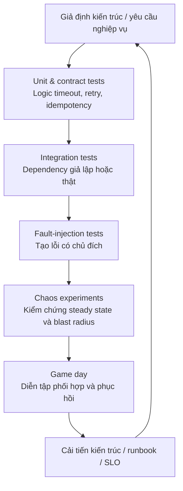
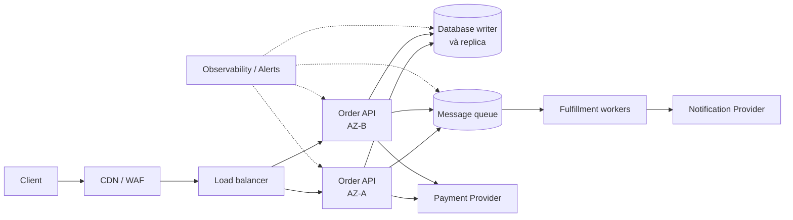
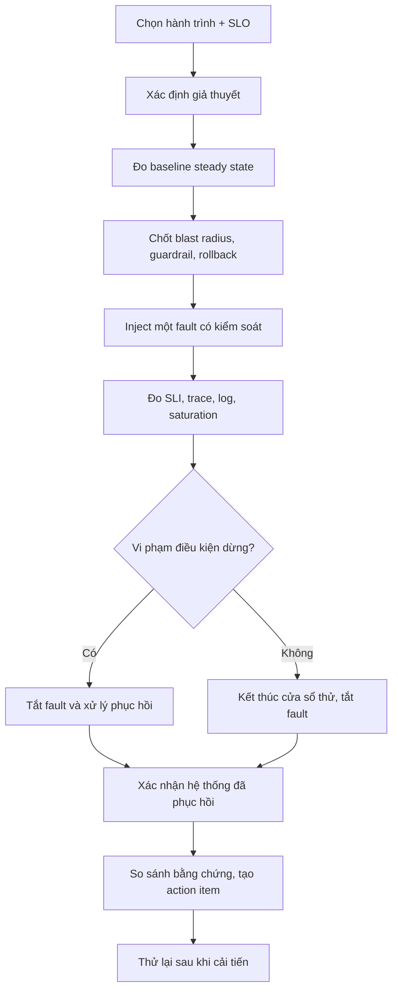
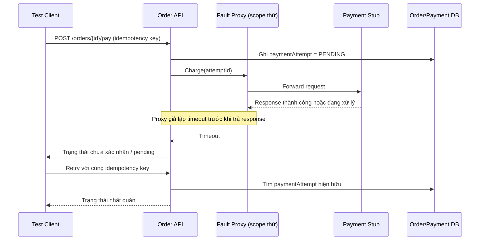

# Kiểm thử lỗi, chaos engineering và game day

> **Module:** CLOUD_ARCHITECTURE — thiết kế kiến trúc ứng dụng trên đám mây từ yêu cầu nghiệp vụ đến lựa chọn mạng, compute, dữ liệu và mô hình triển khai.  
> **Chương:** Đánh giá kiến trúc.  
> **Trọng tâm:** Kiểm chứng khả năng chịu lỗi bằng bằng chứng thực nghiệm; cân nhắc độ tin cậy, bảo mật, khả năng mở rộng, chi phí và vận hành theo các trụ cột Well-Architected.

## 1. Vì sao cần chủ động kiểm thử sự cố?

Một sơ đồ có hai vùng sẵn sàng (Availability Zone, AZ), bộ cân bằng tải, database replica và hàng đợi có thể **trông như** chịu lỗi tốt. Tuy nhiên, khả năng phục hồi chỉ thực sự được chứng minh khi một phần hệ thống gặp sự cố và hệ thống vẫn đáp ứng hành vi đã cam kết.

Trong thực tế, các giả định dễ sai bao gồm:

- Load balancer sẽ chuyển traffic sang instance còn khỏe trong thời gian chấp nhận được.
- Ứng dụng sẽ đóng kết nối cũ và kết nối lại đúng database writer sau failover.
- Khi downstream timeout, retry sẽ giúp request thành công mà không gây quá tải.
- Queue sẽ giữ mọi công việc đến khi worker khôi phục, không gây xử lý trùng.
- Người trực vận hành có thể phát hiện, quyết định rollback và thông báo đúng người trong vài phút.
- Tài liệu backup/restore đủ để tái tạo hệ thống khi mất tài nguyên thực.

**Kiểm thử lỗi (fault testing)**, **chaos engineering** và **game day** giúp biến những giả định đó thành giả thuyết có thể đo, tạo bằng chứng và tìm ra điểm yếu trong điều kiện có kiểm soát. Mục tiêu của chúng là **học cách hệ thống phản ứng khi có sự cố** rồi cải thiện thiết kế và quy trình vận hành, không đơn thuần tạo lỗi để xem điều gì xảy ra.

Sau bài học, bạn có thể:

1. Phân biệt kiểm thử lỗi có kịch bản, thí nghiệm chaos và diễn tập game day.
2. Xây dựng giả thuyết, trạng thái ổn định (*steady state*), phạm vi ảnh hưởng và điều kiện dừng cho một thí nghiệm.
3. Liên hệ failure mode với kiến trúc cloud, SLO, RTO, RPO và các trụ cột Well-Architected.
4. Thiết kế thí nghiệm kiểm chứng timeout, retry, circuit breaker, failover, queue, storage và phụ thuộc bên ngoài.
5. Điều hành game day có vai trò, dòng thời gian, phương án phục hồi và đánh giá sau diễn tập.
6. Chuyển kết quả thử nghiệm thành công việc cải tiến kiến trúc có ưu tiên và bằng chứng đo lường.

## 2. Thuật ngữ và phạm vi

### 2.1. Fault, error và failure

Trong kỹ thuật độ tin cậy, nên phân biệt:

| Khái niệm | Diễn giải | Ví dụ |
|---|---|---|
| **Fault — nguồn gây lỗi** | Điều kiện hoặc khiếm khuyết có thể gây hành vi sai | Một network path mất gói, node chết, chứng chỉ hết hạn |
| **Error — trạng thái sai** | Trạng thái bên trong đã lệch khỏi kỳ vọng | Kết nối tới writer cũ còn được giữ trong pool |
| **Failure — lỗi quan sát được** | Dịch vụ không thực hiện đúng chức năng như cam kết ở ranh giới của nó | Người dùng không thể tạo đơn hoặc bị trả 5xx |
| **Incident — sự cố vận hành** | Tình huống làm gián đoạn hoặc có nguy cơ làm gián đoạn mục tiêu dịch vụ, cần xử lý | Tỷ lệ checkout thành công giảm dưới SLO |
| **Recovery — phục hồi** | Đưa dịch vụ trở lại trạng thái đáp ứng mục tiêu đã định | Traffic trở lại các instance khỏe và lỗi giảm về mức chấp nhận |

Không phải fault nào cũng gây failure. Ví dụ, một pod bị dừng có thể chỉ làm giảm năng lực còn hệ thống vẫn đáp ứng SLO. Ngược lại, một sai lệch cấu hình nhỏ có thể khiến toàn bộ request trả lỗi.

### 2.2. Ba hoạt động liên quan nhưng khác nhau

| Hoạt động | Câu hỏi trung tâm | Cách làm thường thấy | Kết quả mong đợi |
|---|---|---|---|
| **Kiểm thử lỗi / fault injection** | Khi một lỗi cụ thể xảy ra, hệ thống có xử lý đúng không? | Tạo timeout, HTTP 500, mất kết nối, disk đầy hoặc restart tiến trình theo kịch bản có điều kiện kiểm tra | Xác nhận hành vi hoặc tìm regression |
| **Chaos engineering** | Khi điều kiện thực tế bị xáo trộn, giả thuyết về sự bền vững của hệ thống còn đúng không? | Đặt giả thuyết về steady state, thay đổi một điều kiện có kiểm soát, quan sát chỉ số và so sánh | Hiểu khả năng chịu lỗi và khám phá điểm yếu chưa biết |
| **Game day** | Con người, công cụ và quy trình có phối hợp phát hiện, ứng phó, phục hồi đúng mục tiêu không? | Diễn tập tình huống giả định hoặc inject lỗi có giới hạn, có đội trực và người quan sát | Nâng năng lực ứng phó, kiểm tra runbook, liên lạc và quyền truy cập |

Một **game day có thể dùng chaos experiment** làm tình huống mở màn; một kiểm thử lỗi có thể tự động chạy trong CI. Tuy nhiên, không phải game day nào cũng cần làm hỏng tài nguyên, và không phải mọi chaos experiment đều là diễn tập incident response.

### 2.3. Các cấp kiểm thử trong một chiến lược độ tin cậy



Không phải một thang bắt buộc áp dụng tuần tự cho mọi tính năng. Một phép thử đơn giản về timeout có thể đủ ở integration test; một mục tiêu khôi phục toàn vùng cloud cần game day và kiểm thử trên môi trường có cấu trúc gần thực tế hơn.

## 3. Bắt đầu bằng yêu cầu nghiệp vụ và giả thuyết chịu lỗi

Trước khi chọn công cụ chaos, hãy viết rõ **điều hệ thống phải bảo vệ**. Với một ứng dụng đặt hàng, “API còn chạy” chưa đủ nếu thanh toán bị ghi trùng hoặc đơn hàng bị mất.

### 3.1. Xác định hành trình quan trọng

Ví dụ hệ thống thương mại điện tử:

1. Duyệt và tìm sản phẩm.
2. Thêm hàng vào giỏ.
3. Đặt hàng và nhận mã đơn.
4. Thanh toán.
5. Theo dõi trạng thái đơn.

Không phải mọi hành trình đều có mức độ ưu tiên giống nhau. Khi dịch vụ gợi ý sản phẩm lỗi, trang danh mục vẫn có thể hoạt động. Khi dịch vụ xác thực thanh toán lỗi, hệ thống không được bỏ qua bước xác thực để trả kết quả “thành công”.

Gắn mỗi hành trình với **mức độ suy giảm được phép**: tiếp tục đầy đủ, phục vụ chế độ hạn chế, xếp hàng chờ xử lý, hay từ chối an toàn với thông báo rõ ràng.

### 3.2. SLI, SLO, SLA và error budget

- **SLI (Service Level Indicator):** chỉ số đo hành vi người dùng thực nhận, chẳng hạn tỷ lệ request đặt hàng hợp lệ hoàn thành đúng hoặc p95 latency.
- **SLO (Service Level Objective):** mục tiêu cho SLI trong một cửa sổ đo lường, ví dụ ít nhất 99,9% yêu cầu hợp lệ thành công trong 30 ngày.
- **SLA (Service Level Agreement):** cam kết dịch vụ theo thỏa thuận; có thể bao gồm điều kiện và hậu quả khi vi phạm, không đồng nhất với SLO nội bộ.
- **Error budget:** lượng lỗi/suy giảm mà SLO cho phép trong cửa sổ tương ứng; giúp quyết định mức độ rủi ro được chấp nhận.

Ví dụ SLO availability 99,9% theo thời gian trong cửa sổ 30 ngày:

```text
30 ngày × 24 giờ × 60 phút = 43.200 phút
Error budget lý thuyết = 43.200 × (1 - 0,999)
                       = 43,2 phút
```

**Chú ý:** ví dụ tính theo phút downtime; nếu SLI thực tế là tỷ lệ request thành công, error budget tính theo số **request hợp lệ** không đáp ứng, có thể khác với số phút downtime. Một thí nghiệm làm giảm SLI sẽ tiêu tốn error budget; không được mặc định rằng chỉ vì “kiểm thử” thì các request lỗi có thể bỏ qua khi báo cáo SLO.

### 3.3. RTO và RPO

- **RTO (Recovery Time Objective):** thời gian mục tiêu để khôi phục chức năng/khả năng phục vụ được yêu cầu sau khi gián đoạn.
- **RPO (Recovery Point Objective):** mức mất dữ liệu tối đa được chấp nhận, thường biểu diễn bằng khoảng thời gian giữa trạng thái dữ liệu đã khôi phục và thời điểm xảy ra sự cố.

Ví dụ “dịch vụ đặt hàng phải phục hồi trong 15 phút, mất dữ liệu đơn hàng không vượt quá 1 phút” là một mục tiêu có thể kiểm chứng bằng game day failover/restore. Cần định nghĩa rõ **mốc bắt đầu và mốc kết thúc** khi đo RTO: từ lúc sự cố phát sinh hay lúc phát hiện, và thế nào là “đã khôi phục”. RPO có thể khác nhau theo lớp dữ liệu; không thể suy từ RTO.

### 3.4. Đổi khẩu hiệu thành giả thuyết đo được

Giả định mơ hồ:

> “Nếu một AZ bị lỗi, ứng dụng vẫn hoạt động.”

Giả thuyết có thể kiểm thử:

> “Khi loại khỏi load balancer các instance của một AZ trong phạm vi thử nghiệm, ít nhất 99,5% request đọc hợp lệ sẽ trả thành công; p95 không vượt 800 ms trong giai đoạn phục hồi; lỗi 5xx không kéo dài quá 2 phút; không có đơn hàng bị ghi trùng.”

Giả thuyết cần bao gồm **tác động mô phỏng**, **hành trình nghiệp vụ**, **chỉ số quan sát**, **ngưỡng chấp nhận**, **khoảng đo**, **sự suy giảm được phép** và **điều kiện dừng**. Không chỉ ghi “failover thành công” mà không quy định thời gian và tính đúng dữ liệu.

## 4. Kiến trúc ví dụ để đánh giá

Giả sử hệ thống đặt hàng chạy trên cloud:



Đội phát triển tin rằng:

- Hai AZ giúp Order API chịu mất một nhóm instance.
- Queue giúp tách xử lý fulfillment khỏi thời gian phản hồi tạo đơn.
- Database có cơ chế failover, ứng dụng sẽ reconnect đúng.
- Payment Provider lỗi sẽ không tạo thanh toán trùng.
- Hệ thống giám sát sẽ phát hiện suy giảm và đội vận hành có thể phục hồi trong RTO.

Mỗi câu trên là **một giả thuyết khác nhau**. Cần thử từng giả thuyết với một failure mode rõ ràng, thay vì đồng thời tắt một AZ, ngắt database và gây lỗi payment rồi không biết nguyên nhân của thất bại.

## 5. Thiết kế một chaos experiment có kiểm soát

Một thí nghiệm tốt có cấu trúc dễ lặp lại và dễ giải thích kết quả.

### 5.1. Thẻ thí nghiệm (*experiment card*)

| Trường | Cần ghi |
|---|---|
| **Mã và chủ sở hữu** | EXP-ORDER-01; nhóm Order/SRE |
| **Giả thuyết** | Một dependency trả lỗi 500 không làm tổng tỷ lệ lỗi Order vượt ngưỡng |
| **Hành trình quan trọng** | GET /orders/{id}, POST /orders |
| **Trạng thái ổn định** | Tỷ lệ request thành công, p95/p99, backlog, số đơn đúng trạng thái |
| **Fault được tạo** | 20% lời gọi tới dịch vụ phụ thuộc trong nhóm thử trả 500 trong 3 phút |
| **Phạm vi ảnh hưởng** | Một tập workload/canary và traffic thử xác định |
| **Nhóm so sánh** | Nhóm không bị inject, chịu cùng tải và điều kiện tương đương nếu có thể |
| **Điều kiện dừng** | 5xx, latency, queue, saturation hoặc dấu hiệu mất tính đúng vượt guardrail |
| **Phục hồi** | Tắt fault rule, khôi phục routing, theo dõi queue và request tồn đọng |
| **Bằng chứng** | Trace, log, metric, sự kiện deploy/config và thời điểm inject |
| **Kết luận** | Giả thuyết được hỗ trợ/bị bác bỏ/chưa đủ bằng chứng; action item có chủ sở hữu |

**Đặt giả thuyết trước khi thực thi.** Nếu chỉ bấm tạo lỗi và xem dashboard sau đó, bạn khó phân biệt hiệu ứng thật với traffic biến động, deploy mới hay thay đổi ở dependency.

### 5.2. Steady state: đo từ góc nhìn người dùng

Steady state không có nghĩa hệ thống không hề có lỗi nội bộ. Nó là **hành vi bình thường có thể đo** của dịch vụ mà người dùng và nghiệp vụ quan tâm.

Ví dụ:

```text
Business SLI: đơn hàng hợp lệ tạo thành công, không ghi trùng
Traffic:     request hợp lệ/phút, theo khu vực và loại client
Latency:     p50 / p95 / p99 end-to-end
Errors:      lỗi 4xx nghiệp vụ phân biệt với lỗi 5xx hệ thống
Saturation:  CPU, memory, pool, queue depth, DB connections
Recovery:    thời gian từ fault đến khi SLI trở lại vùng chấp nhận
```

Nên có **baseline trước khi thử**, đo **trong lúc inject** và tiếp tục đo **sau khi tắt fault** cho đến khi backlog và trạng thái dữ liệu ổn định. Một phản hồi HTTP 200 không tự chứng minh đơn hàng được ghi chính xác; cần kiểm tra cả invariant nghiệp vụ.

### 5.3. Blast radius và phạm vi kiểm soát

**Blast radius** là phần hệ thống/người dùng bị ảnh hưởng khi lỗi lan truyền. Giảm blast radius bằng cách chọn:

- Môi trường staging với cấu hình đủ tương đồng hoặc tập canary riêng trong production.
- Một workload, một endpoint, một nhóm request giả lập, một service account hoặc một AZ đã được giới hạn scope.
- Thời gian ngắn, cường độ fault tăng dần, khả năng tắt inject tức thời.
- Không đưa dữ liệu sản xuất nhạy cảm vào log, sự kiện hay báo cáo thí nghiệm.
- Cơ chế giới hạn tải và phương án phục hồi được kiểm tra trước.

Trong production, thí nghiệm cần đi theo quy trình quản lý thay đổi và vận hành của tổ chức, có người sở hữu hệ thống và phương án dừng chủ động. Thí nghiệm trên staging đôi khi bỏ sót lỗi chỉ xuất hiện với traffic, quota, topology và đường mạng thực; vì vậy có thể tiến tới canary production khi kiểm soát rủi ro đã đủ mạnh.

### 5.4. Điều kiện dừng và hoàn tác

Phân biệt ba khái niệm:

- **Abort:** dừng inject lỗi ngay nếu guardrail vi phạm.
- **Rollback/remediation:** trả cấu hình, routing, workload hoặc dependency về trạng thái an toàn.
- **Recovery verification:** xác nhận chức năng, backlog, số liệu nghiệp vụ, connection pool và cảnh báo đã ổn định. Tắt injection chưa đồng nghĩa hệ thống đã phục hồi.

Ví dụ tiêu chí dừng được định nghĩa trước:

```text
Dừng nếu BẤT KỲ điều kiện nào xảy ra:
- SLI đặt hàng nhóm thử dưới ngưỡng đã thống nhất trong cửa sổ 1 phút
- p99 vượt mức an toàn 2 phút liên tục
- Queue backlog tăng không có dấu hiệu giới hạn
- Phát hiện dữ liệu giao dịch không nhất quán hoặc thanh toán trùng
- Người điều hành mất khả năng quan sát hoặc không thể tắt fault
```

Các ngưỡng trên là **hình thức minh họa**, không phải ngưỡng chuẩn cho mọi sản phẩm. Với rủi ro dữ liệu không thể đảo ngược, dừng ngay khi có tín hiệu đầu tiên đáng tin cậy thay vì đợi thêm.

## 6. Quy trình thí nghiệm từ đầu đến cuối



1. **Chọn phạm vi kinh doanh:** xác định service, user journey, chủ sở hữu, tác động chấp nhận được.
2. **Khảo sát kiến trúc:** xem dữ liệu chảy qua mạng, compute, storage, database, queue, IAM và dependency bên ngoài.
3. **Chọn một giả thuyết:** ví dụ “dừng một worker không làm mất message”.
4. **Thiết lập phép đo:** bảo đảm trace/log/metric cùng mốc thời gian; có synthetic transaction phù hợp.
5. **Xác minh trạng thái chuẩn:** SLO đang khỏe, không có incident ảnh hưởng, không có deploy hoặc migration xung đột.
6. **Chạy inject nhỏ và ngắn:** chỉ trong phạm vi định nghĩa, ghi timestamp bắt đầu và cấu hình.
7. **Quan sát và so sánh:** không chỉ kiểm tra “có lỗi hay không” mà đánh giá mức suy giảm, tính đúng, cơ chế bảo vệ có kích hoạt.
8. **Ngắt lỗi và phục hồi:** thực hiện rollback nếu cần; theo dõi hậu quả kéo dài như retry, dữ liệu tắc hoặc hàng đợi tồn.
9. **Báo cáo kết luận:** giả thuyết đúng/sai/chưa rõ; bằng chứng, giới hạn và công việc sửa.
10. **Tái kiểm chứng:** thực hiện lại thí nghiệm thích hợp sau khi sửa để chứng minh rủi ro đã giảm.

Thí nghiệm cần có **nguồn tạo traffic ổn định** để quan sát nếu traffic thật không đủ. Traffic thử không được tạo giao dịch thật ngoài phạm vi được phép, và dữ liệu đánh giá phải tách được khỏi giao dịch người dùng.

## 7. Ma trận fault injection theo thành phần cloud

| Thành phần / failure mode | Cách mô phỏng ở mức ý tưởng | Điều muốn kiểm chứng |
|---|---|---|
| **Compute:** một process/container ngừng | Dừng có kiểm soát một workload ở nhóm thử | Health check, tự khởi động lại, phân tải và request đang xử lý |
| **AZ/node:** mất một nhóm instance | Loại canary group khỏi đường traffic | Capacity dự phòng, load balancing, autoscaling và ảnh hưởng tới p99 |
| **Network:** latency/loss | Tăng độ trễ hoặc tỷ lệ lỗi ở một tuyến gọi đã giới hạn | Timeout, cancellation, retry budget, circuit breaker |
| **DNS/service discovery** | Trong môi trường thử, trả endpoint không khả dụng hoặc làm stale resolution | Cache DNS, thời gian cập nhật endpoint và cách kết nối lại |
| **Database writer failover** | Kích hoạt failover qua chức năng thử nghiệm được hỗ trợ | Reconnect, giao dịch chưa hoàn tất, kết nối stale, dữ liệu và RTO/RPO |
| **Database pool** | Giới hạn số connection trong workload thử | Backpressure, timeout và điều kiện quá tải lan truyền |
| **Message queue/broker** | Tạm dừng consumer hoặc ngắt một kết nối thử | Lag, xử lý trùng, DLQ, idempotency và khả năng replay |
| **Cache:** mất node/cache miss tăng | Ngắt cache của nhóm thử | DB load khi cache miss, stampede, fallback và TTL |
| **Storage:** lỗi đọc hoặc ghi | Trả lỗi truy cập/timeout qua lớp giả lập hoặc môi trường thử | Retry an toàn, bản sao, tải lại artifact, cảnh báo |
| **IAM/secrets/certificate** | Giả lập từ chối quyền hoặc chứng chỉ không hợp lệ trong sandbox | Cảnh báo, quy trình rotation, fail-closed và không lộ secret |
| **Third-party API** | Stub trả 429, 500, timeout hoặc response chậm | Rate-limit handling, retry, fallback, graceful degradation |
| **Deployment/config** | Phát hành cấu hình lỗi có thể rollback trong canary | Phát hiện sớm, chuyển traffic, rollback và tính tương thích |

Các ví dụ trên là **failure mode để thiết kế kiểm thử**, không phải hướng dẫn phá tài nguyên thật. Chọn phương pháp mô phỏng thích hợp với môi trường và khả năng phục hồi của nền tảng; không nhất thiết phải ngắt mạng hay xóa dữ liệu để chứng minh một giả thuyết.

### 7.1. Kiểm thử tác động trong một AZ

Một hệ thống chạy hai AZ chưa chắc có đủ công suất nếu mất một AZ. Giả sử traffic thường sử dụng 40% tài nguyên tính toán của **toàn cụm** trên hai AZ với phân phối cân đối. Khi một AZ mất, AZ còn lại cần xử lý gần gấp đôi lượng traffic, nhưng nếu autoscaling, quota, database connection hoặc API downstream không đủ thì khả năng phục vụ có thể giảm mạnh.

Cần xác minh:

- Instance còn lại có được health check và routing tới đúng không?
- Hệ thống còn đủ CPU, memory, network, connection pool, DB capacity không?
- Autoscaler có khả năng tạo thêm instance vào AZ còn sống và bị giới hạn quota nào?
- In-flight request có được retry an toàn? Việc retry có tạo trùng ghi hay không?
- Có dependency **điểm lỗi chung** như một database writer, NAT gateway, secrets service hoặc DNS path chưa được dự phòng?

Mất một AZ không chứng minh được khả năng khôi phục **toàn region**. Phạm vi thí nghiệm và phạm vi kết luận phải khớp nhau.

### 7.2. Kiểm thử database failover

Một cuộc diễn tập failover phải đo cả hai việc:

1. **Khả năng phục vụ:** thời gian kết nối lại và thực hiện các transaction hợp lệ.
2. **Tính đúng dữ liệu:** không tạo double charge, không mất đơn hàng đã xác nhận, không tự động commit lại thao tác ghi khi trạng thái commit cũ chưa rõ.

Khi client thấy timeout sau `COMMIT`, có thể database **đã ghi thành công** nhưng phản hồi bị mất. Retry mù một thao tác không idempotent có thể tạo bản ghi trùng. Thiết kế cần idempotency key, ràng buộc duy nhất hoặc phép kiểm tra trạng thái giao dịch trước khi lặp lại thao tác.

Thử failover database cũng cần đánh giá *replication lag* và mức độ nhất quán: replica đọc có thể chưa có ngay dữ liệu vừa ghi, nên không được suy ra RPO bằng 0 chỉ vì ứng dụng reconnect được.

### 7.3. Kiểm thử queue và worker

Với kiến trúc xử lý đơn hàng bất đồng bộ, giả thuyết có thể là:

> “Khi một worker ngừng giữa chừng, message chưa hoàn tất sẽ được xử lý lại và chỉ gây đúng một tác động nghiệp vụ.”

Kiểm tra thời điểm worker bị dừng: trước khi ghi DB, sau khi ghi DB nhưng trước ACK, hoặc sau khi phát lệnh gọi provider ngoài. Mỗi thời điểm có kết quả khác nhau.

Các bằng chứng cần thu:

- Message có được redeliver theo cơ chế broker không?
- Consumer có idempotent theo khóa nghiệp vụ/event ID không?
- Backlog tăng đến đâu, thời gian drain là bao lâu?
- Có vòng retry/DLQ khiến message không thể xử lý mãi không?
- Việc xử lý chậm có vượt thời hạn nghiệp vụ của khách hàng không?

Không mặc định “exactly-once delivery” của một nền tảng đảm bảo **exactly-once business effect** trên tất cả DB và API bên ngoài. Hiệu ứng nghiệp vụ đúng một lần cần thiết kế xuyên qua ranh giới giao dịch.

## 8. Ví dụ thực hành: Payment Provider trả timeout

### 8.1. Bài toán

Endpoint thanh toán gọi dịch vụ Payment Provider bên ngoài. Khi provider chậm, request checkout có nguy cơ hết timeout và đội phát triển lo ngại khách bị trừ tiền hai lần.

Đặt các yêu cầu:

- Không ghi nhận thanh toán thành công khi chưa có bằng chứng hợp lệ.
- Không tạo giao dịch kép khi client retry hoặc khi callback trả chậm.
- Khi provider không khả dụng, API trả trạng thái rõ ràng (`pending` hoặc lỗi có thể thử lại theo hợp đồng), không thông báo sai “thành công”.
- Người dùng vẫn xem được trạng thái đơn hàng; hệ thống có cơ chế đối soát.

### 8.2. Thiết kế thí nghiệm



Trong môi trường thử, dùng **payment stub** lưu trạng thái đã nhận charge. Inject timeout **sau khi stub đã nhận request** để tái hiện tình huống khó: phía client không biết giao dịch đã thành công hay chưa.

**Giả thuyết:** cùng một khóa nghiệp vụ không thể tạo hai payment attempt độc lập, cho dù client và backend retry; trạng thái cuối được reconciler cập nhật sau khi xác minh với provider.

**Các invariant cần kiểm tra:**

- Một idempotency key tương ứng tối đa một hiệu ứng thanh toán.
- Không có chuyển trạng thái `FAILED → SUCCEEDED` hoặc ngược lại ngoài quy tắc đã định.
- Không có order `PAID` khi chưa có bằng chứng thanh toán tương ứng.
- Retry trong lúc provider chậm không làm connection pool và queue tăng vượt giới hạn.

**Điều kiện dừng:** có dấu hiệu trừ tiền trùng trong dữ liệu thử, vòng retry không giới hạn, sai lệch trạng thái hoặc giảm khả năng phục vụ quá ngưỡng an toàn.

### 8.3. Kết quả và hành động cải tiến

Giả sử hệ thống không tạo trùng charge nhưng thời gian cập nhật trạng thái từ `PENDING` sang `PAID` là 12 phút trong khi mục tiêu là 5 phút. Khi đó giả thuyết “không thanh toán trùng” được hỗ trợ trong phạm vi thử, nhưng yêu cầu **thời gian hoàn tất** chưa đạt. Hành động phù hợp là cải thiện reconciliation, quan sát độ trễ callback/event và cảnh báo các payment pending quá hạn; không nên kết luận toàn hệ thống “pass chaos” chỉ từ một invariant.

## 9. Game day: diễn tập cả hệ thống và con người

**Game day** là phiên diễn tập theo kịch bản sự cố, có mục tiêu, người tham gia, quan sát và đánh giá. Một buổi có thể bắt đầu bằng thảo luận trên bàn (*tabletop*), rồi nâng cấp sang diễn tập kỹ thuật trên staging/canary khi đội ngũ đã sẵn sàng.

### 9.1. Các dạng game day

| Dạng | Thực hiện | Thích hợp |
|---|---|---|
| **Tabletop** | Điều phối viên đưa tình huống, nhóm thảo luận phản ứng; không cần inject lỗi | Làm rõ vai trò, liên lạc, quyền truy cập và runbook |
| **Technical drill** | Thử một thao tác phục hồi cụ thể, ví dụ restore backup hoặc chuyển traffic | Xác nhận thực hành một thành phần và đo RTO/RPO |
| **Full game day** | Diễn tập nhiều tình tiết, có công cụ quan sát và nhóm ứng phó thực tế | Kiểm chứng end-to-end về người, quy trình và công nghệ |
| **Unannounced/limited notice** | Ít người biết trước thời điểm/kịch bản, trong phạm vi được tổ chức cho phép | Kiểm tra phản ứng vận hành khi đội đã trưởng thành; cần cơ chế dừng rõ |

### 9.2. Vai trò trong buổi diễn tập

| Vai trò | Trách nhiệm |
|---|---|
| **Facilitator / Game Master** | Chuẩn bị inject/tình tiết, giữ phạm vi, điều phối tiến trình |
| **Incident Commander** | Dẫn dắt phản ứng, giao trách nhiệm, quyết định ưu tiên và tình trạng incident |
| **Responders** | Quan sát, chẩn đoán, thực thi runbook/rollback/khôi phục theo quyền được giao |
| **Safety / Stop Authority** | Có quyền yêu cầu dừng ngay khi guardrail bị vượt; thường tách khỏi người trực tiếp inject |
| **Scribe / Observer** | Ghi mốc thời gian, quyết định, giả định sai, cảnh báo và bước runbook thiếu |
| **Stakeholder / Communications** | Thực hành cập nhật trạng thái cho các nhóm liên quan và người dùng trong tình huống mô phỏng |

Một người có thể kiêm vai trò trong nhóm nhỏ, nhưng phải có **người chịu trách nhiệm dừng thử** và ghi nhận bằng chứng. Cần thống nhất rõ kênh diễn tập để tránh nhầm thông báo giả lập với incident thật.

### 9.3. Kịch bản game day mẫu: mất một AZ

**Tên:** GD-ORDER-AZ-01  
**Mục tiêu:** Xác nhận Order API duy trì xử lý trong giới hạn suy giảm cho phép và đội trực phục hồi trong RTO 15 phút.  
**Phạm vi:** một nhóm workload/canary đại diện cho AZ-A, với các request thử đã tách được.  
**Giả thuyết:** khi nhóm thử ở AZ-A không sẵn sàng, traffic chuyển sang AZ-B, không mất dữ liệu đơn hàng đã xác nhận và số request lỗi nằm trong budget được phê duyệt.

| Mốc tương đối | Tình tiết | Điều quan sát |
|---|---|---|
| T−15 phút | Xác nhận baseline, dashboard, kênh liên lạc, người có quyền abort | Hệ thống và dữ liệu thử khỏe, không có thay đổi khác trùng thời gian |
| T+0 | Facilitator bắt đầu inject đã giới hạn | Time marker, injection ID và scope chính xác |
| T+2 phút | Cảnh báo tăng 5xx / latency xuất hiện trong tình huống | Đội trực có phát hiện, phân loại severity, phân công không? |
| T+5 phút | Đội xác định mất capacity một AZ | Có dùng trace/metric để khoanh vùng đúng? |
| T+8 phút | Nhóm thực hiện phương án chuyển traffic/tăng capacity phù hợp | Có đạt chuẩn latency và lỗi? Có làm tải DB tăng quá mức? |
| T+12 phút | Tắt inject, xác minh hệ thống | Backlog, pool, order data và cảnh báo đã ổn định? |
| T+20 phút | Debrief ngắn, chốt việc cần sửa | Mốc thời gian, runbook, ownership, bằng chứng và hành động |

Mốc chỉ là **lịch diễn tập mẫu**, không phải khẳng định hệ thống sẽ đạt các thời gian này. Nếu điều kiện dừng xảy ra ở bất kỳ thời điểm nào, phiên thử chuyển ngay sang phục hồi; không chờ tới mốc tiếp theo trong bảng.

### 9.4. Chỉ số phục vụ game day

- **MTTD (Mean Time to Detect):** thời gian phát hiện tính từ mốc lỗi, tính trung bình trên các incident/diễn tập được định nghĩa tương đương.
- **MTTA (Mean Time to Acknowledge):** thời gian tới khi có người nhận trách nhiệm xử lý; tên chỉ số có thể khác theo tổ chức.
- **MTTR:** thường được dùng cho mean time to restore/recover/repair; phải ghi rõ định nghĩa đang dùng.
- **Recovery duration:** thời gian thực tế từ điểm bắt đầu sự cố đến lúc tiêu chí phục hồi đạt, để đối chiếu RTO.
- **Data loss / divergence:** đánh giá mất dữ liệu và sai lệch trạng thái, để đối chiếu RPO và invariant nghiệp vụ.
- **Operational measures:** thời gian mở dashboard, tìm runbook, lấy quyền, liên lạc đúng nhóm, thời gian rollback.

Không nên xem việc đội vận hành “xử lý trong vòng 5 phút” là thành công nếu sau đó hàng đợi tắc hai giờ hoặc phát sinh dữ liệu trùng. Phải xác nhận **phục hồi nghiệp vụ**, không chỉ hệ thống báo trạng thái green.

## 10. Cấu trúc runbook và bộ hồ sơ diễn tập

Một runbook phải đủ ngắn để dùng trong sự cố, nhưng cụ thể để người mới trực có thể định vị vấn đề.

### 10.1. Khung runbook

```text
RUNBOOK: ORDER-API-DEPENDENCY-FAILURE
Khi nào sử dụng:
  - Checkout error rate tăng, phụ thuộc Payment/Inventory timeout
Tín hiệu cần kiểm tra:
  - End-to-end SLI, trace sample, error type, retry rate, pool saturation
Ai chịu trách nhiệm:
  - IC, Order owner, dependency owner, communications
Bước chẩn đoán:
  1. Xác nhận phạm vi ảnh hưởng và thay đổi gần nhất
  2. So sánh latency các hop với baseline
  3. Kiểm tra retry amplification và giới hạn connection
Hành động giảm ảnh hưởng:
  - Thực hiện chuyển traffic / rollback / circuit breaker theo điều kiện
Điều kiện dừng:
  - Dữ liệu sai, phát hiện thanh toán trùng, mất khả năng quan sát
Xác nhận phục hồi:
  - SLI trong ngưỡng, hàng đợi giảm, dữ liệu đúng, cảnh báo ổn định
Sau sự cố:
  - Timeline, quyết định, vấn đề runbook, đầu việc và owner
```

Runbook thực tế cần thêm dashboard, công cụ, tên dịch vụ và lệnh **đã được kiểm chứng trong môi trường tổ chức**. Tránh sao chép lệnh thay đổi production từ bài giảng vào runbook mà không thử quyền và ảnh hưởng.

### 10.2. Mẫu hồ sơ experiment

```yaml
experiment:
  id: "EXP-CHECKOUT-TIMEOUT-01"
  owner: "order-team"
  system: "checkout"
  user_journey: "payment"
  hypothesis: >
    Payment timeout trong nhóm canary không tạo trùng thanh toán
    và API trả trạng thái chờ trong giới hạn latency đã định.
  environment: "staging"
  fault:
    type: "upstream-timeout"
    target: "payment-stub"
    duration: "3m"
    scope: "synthetic-orders-only"
  steady_state:
    - "valid_order_success_ratio"
    - "checkout_p95_latency_ms"
    - "duplicate_payment_count"
  stop_conditions:
    - "duplicate_payment_count > 0"
    - "checkout_error_ratio > approved_guardrail"
  recovery:
    - "disable-fault-rule"
    - "verify-pending-state-reconciliation"
  evidence:
    - "synthetic-request-ids"
    - "trace-ids"
    - "dashboard-snapshot"
```

Đây là **schema minh họa cho tài liệu**, không phải định dạng chạy trực tiếp của một công cụ chaos cụ thể; các ngưỡng cần điền từ SLO và quy tắc vận hành của hệ thống thật.

## 11. Quan sát và diễn giải kết quả đáng tin cậy

### 11.1. Có khả năng phát hiện lỗi và đo hệ quả

Trước thử nghiệm cần bảo đảm:

- **Metrics:** request rate, error rate, duration, saturation; có thể chia theo service, endpoint, AZ, canary/control.
- **Logs:** có request/trace correlation ID, timestamp đáng tin cậy, phân loại lỗi và quyết định retry/fallback; tránh lộ dữ liệu nhạy cảm.
- **Distributed traces:** biết service nào đang chờ, đoạn nào timeout, số lần retry, truy cập database/queue và đường tới hạn.
- **Business telemetry:** số đơn tạo, trạng thái thanh toán, tác vụ hoàn thành, dữ liệu trùng hoặc thất lạc.
- **Change annotations:** đánh dấu lúc deploy, lúc bật/tắt fault, lúc chuyển traffic, thay đổi cấu hình.

Biểu đồ chỉ hiển thị trung bình có thể che mất nhóm người dùng bị lỗi nặng. Khi xem p95/p99, chú ý **khối lượng mẫu**, dữ liệu theo phân khúc và sai số của ước lượng trong thời gian thử ngắn.

### 11.2. Control và treatment

Nếu có thể, giữ một **nhóm đối chứng** không bị inject cùng cấu hình và tải tương đương để so sánh với nhóm chịu fault. Điều này giúp tách ảnh hưởng fault khỏi biến động traffic hoặc hệ thống bên ngoài.

Tuy nhiên, không phải thí nghiệm nào cũng có đối chứng độc lập: một database writer dùng chung, DNS zone hoặc quota cloud có thể làm cả hai nhóm bị tác động. Khi đó cần ghi rõ giới hạn, dùng baseline và dữ liệu bổ sung để tránh kết luận quá mức.

### 11.3. Phân loại kết luận

| Kết luận | Khi nào dùng | Hành động |
|---|---|---|
| **Giả thuyết được hỗ trợ** | Các chỉ số và invariant đạt ngưỡng trong phạm vi thử, bằng chứng đầy đủ | Lưu bằng chứng, quy định tần suất thử lại khi kiến trúc thay đổi |
| **Giả thuyết bị bác bỏ** | Một hoặc nhiều tiêu chí không đạt, xác định được ảnh hưởng liên quan | Tạo action item, phân loại rủi ro, đề xuất thay đổi kiến trúc/runbook |
| **Chưa đủ bằng chứng** | Traffic không đủ, giám sát mất dữ liệu, fault không áp dụng đúng hoặc môi trường không đại diện | Sửa phương pháp và thí nghiệm lại với phạm vi phù hợp |
| **Dừng vì guardrail** | Chạm ngưỡng an toàn hoặc không còn khả năng kiểm soát | Dừng, phục hồi, điều tra và chỉ thử lại sau khi xử lý nguyên nhân |

**Không thành công cũng là một kết quả học tập hợp lệ** nếu giúp phát hiện giả định sai trước sự cố thật. Mục tiêu không phải đẩy tỷ lệ pass cho đẹp; cũng không được đổi ngưỡng sau khi thử chỉ để hợp thức hóa kết quả.

## 12. Những lỗi thường gặp khi triển khai chaos và game day

### 12.1. Inject lỗi mà không có giả thuyết

Tắt ngẫu nhiên node hoặc network rồi xem hệ thống có sập hay không dễ tạo nhiều cảnh báo nhưng không trả lời rõ câu hỏi kiến trúc. Cần một giả thuyết gắn với hành trình và tiêu chí đo được.

### 12.2. Chỉ kiểm thử khi tải rất thấp

Một retry storm hoặc DB connection exhaustion có thể chỉ xuất hiện ở tải cao. Thử trong điều kiện không đại diện có thể cho cảm giác an toàn sai. Giải pháp là dùng phân bố traffic/đặc tính workload đã quan sát, tăng tải trong giới hạn năng lực và ghi rõ tính đại diện.

### 12.3. Chỉ nhìn mã HTTP 200

Một API có thể trả 200 nhưng đơn hàng không được ghi, gửi email hai lần hoặc ghi sai trạng thái thanh toán. Luôn kiểm tra invariant nghiệp vụ, đặc biệt với thao tác ghi và tác động bên ngoài.

### 12.4. Đánh đồng restart với khôi phục

Pod hoặc VM khởi động lại chưa đủ chứng minh request xử lý thành công. Có thể vẫn còn session cũ, backlog kéo dài, dữ liệu chưa đồng bộ hoặc một replica chưa trở thành writer hợp lệ. Kết luận chỉ sau khi xác nhận trạng thái end-to-end.

### 12.5. Retry vô hạn để “tăng độ bền”

Retry không giới hạn làm tăng tải trong sự cố. Dùng deadline, backoff có jitter, retry budget, idempotency và sự phân biệt lỗi tạm thời/lỗi nghiệp vụ.

### 12.6. Game day chỉ để “đánh giá người trực”

Tạo áp lực cá nhân khiến người tham gia che giấu vấn đề và mất cơ hội cải tiến. Postmortem nên tập trung vào quy trình, công cụ, thiết kế và rào cản tổ chức, dựa trên bằng chứng và cải tiến có người chịu trách nhiệm.

### 12.7. Không thực hiện action item và không tái kiểm chứng

Một buổi diễn tập phát hiện thiếu dashboard, cảnh báo và quyền truy cập sẽ ít giá trị nếu không có người sửa và hạn hoàn thành. Sau khi sửa, phải đo lại trên một thử nghiệm tương đương để xác nhận giả thuyết đã được khôi phục.

### 12.8. Coi hỗ trợ multi-AZ là đủ cho mọi thảm họa

Multi-AZ, backup, replica và failover có **phạm vi bảo vệ khác nhau**. Một lần inject lỗi instance không chứng minh chống được outage vùng, xóa dữ liệu nhầm, quyền IAM lỗi, DNS sai hoặc nhà cung cấp thứ ba dừng dịch vụ.

## 13. Liên hệ với sáu trụ cột Well-Architected

| Trụ cột | Câu hỏi khi thiết kế kiểm thử | Thực hành phù hợp |
|---|---|---|
| **Operational Excellence – Vận hành xuất sắc** | Đội có phát hiện, điều phối và khôi phục đúng quy trình? | Runbook, game day, metrics, incident timeline, postmortem và owner action item |
| **Security – Bảo mật** | Khi IAM, secret, certificate hoặc network policy lỗi, hệ thống có giữ được nguyên tắc bảo mật? | Thử lỗi quyền trong sandbox, fail-closed, quyền tối thiểu, bảo vệ log và kênh khôi phục |
| **Reliability – Tin cậy** | Khi một thành phần hỏng, user journey có còn đạt SLO/RTO/RPO? | Chaos hypothesis, AZ failover, backup restore, timeout/retry, idempotency và đánh giá dữ liệu |
| **Performance Efficiency – Hiệu quả hiệu năng** | Sau khi mất capacity, độ trễ và throughput còn đạt mục tiêu? | Đo p95/p99, autoscaling, queue, pool saturation, cache miss và load balancing |
| **Cost Optimization – Tối ưu chi phí** | Failover, retry và tài nguyên dự phòng làm thay đổi chi phí thế nào? | Ước tính năng lực dự phòng, egress, phí thử nghiệm, chi phí per successful transaction |
| **Sustainability – Bền vững** | Cơ chế phục hồi có tạo xử lý và traffic dư thừa kéo dài? | Giới hạn retry, tối ưu workload, loại job trùng, tắt tài nguyên thử sau diễn tập |

Một kiến trúc có thể chịu lỗi tốt nhưng đắt vì chạy gấp đôi công suất, hoặc rẻ nhưng không đủ chỗ để xử lý khi mất AZ. Việc quyết định mức dự phòng và tần suất thử nghiệm phải bắt đầu từ hậu quả kinh doanh của downtime, SLO và chi phí có thể chấp nhận.

### 13.1. Từ kết quả thử nghiệm đến quyết định kiến trúc

Ví dụ thí nghiệm mất một AZ phát hiện:

- Hệ thống không mất dữ liệu và tự chuyển traffic, nhưng p99 tăng lên 4 giây trong 7 phút.
- SLO yêu cầu p99 dưới 1 giây, độ sẵn sàng vẫn trong error budget hiện tại.
- Tài nguyên còn lại CPU bão hòa; autoscaler mất 6 phút để cấp capacity.

**Các phương án đánh đổi:**

1. **Tăng baseline capacity** ở AZ còn lại: giảm thời gian suy giảm khi failover, tăng chi phí thường xuyên.
2. **Tối ưu autoscaler và warm capacity:** giảm thời gian scale, có thể tăng phức tạp và chi phí tối thiểu.
3. **Giảm tải chức năng không thiết yếu:** dành tài nguyên cho checkout, yêu cầu sản phẩm chấp nhận degrade.
4. **Tối ưu query/cache/connection pool:** giảm công suất cần thiết, nhưng phải kiểm chứng dữ liệu đúng và cache stampede.

Chọn phương án bằng cách đo **hiệu quả trên SLO, chi phí và vận hành**, rồi kiểm thử lại cùng failure mode. Không thể khẳng định chỉ cần autoscaling thì mất AZ sẽ không ảnh hưởng người dùng.

## 14. Tổ chức chương trình kiểm thử liên tục

Chaos engineering mang lại giá trị lớn nhất khi có chu trình học tập và kiểm chứng lại, thay vì một buổi demo đơn lẻ.

### 14.1. Chọn ưu tiên thí nghiệm dựa trên rủi ro

Đánh giá các failure mode theo:

- **Tác động nghiệp vụ:** gây mất doanh thu, mất dữ liệu, vi phạm bảo mật hay chỉ mất tính năng phụ?
- **Xác suất/tiền sử:** dependency có hay lỗi, timeout, giới hạn quota hoặc đã có incident tương tự?
- **Độ không chắc chắn:** có bằng chứng kiểm thử hay mới chỉ tin vào mô tả kiến trúc?
- **Khả năng kiểm soát:** có thể mô phỏng và phục hồi an toàn ở quy mô nhỏ không?
- **Giá trị học tập:** một lần thử giúp xác minh nhiều giả định quan trọng hay chỉ kiểm tra logic đã được unit test?

Bắt đầu từ hành trình quan trọng và dependency có rủi ro lớn: database, identity, queue, network, dịch vụ bên ngoài và các điểm lỗi chung.

### 14.2. Đưa bài học vào vòng đời phát hành

- **Trong CI:** unit/contract/integration test xác minh timeout, error mapping, idempotency, retry budget trên stub.
- **Trước phát hành:** chạy fault injection có kịch bản trên staging/canary cho những thay đổi ảnh hưởng resilience.
- **Định kỳ:** game day để kiểm tra khôi phục, backup/restore và khả năng điều phối theo mức độ rủi ro.
- **Sau incident:** chuyển nguyên nhân và điều kiện góp phần thành regression test/chaos experiment.
- **Sau thay đổi kiến trúc:** kiểm chứng lại những giả thuyết đã mất hiệu lực do thêm dependency, đổi region hoặc sửa scaling.

Tần suất không nên bị quyết định bởi mục tiêu số lượng thí nghiệm. Một thử nghiệm về khôi phục dữ liệu có bằng chứng đầy đủ có thể giá trị hơn hàng chục lần dừng pod nhưng không đo business SLI.

### 14.3. Bảng theo dõi kết quả

| Thí nghiệm | Phạm vi | Tiêu chí | Kết quả ví dụ | Việc cần làm |
|---|---|---|---|---|
| EXP-01: dừng một instance | Order canary | Không mất đơn, SLI đạt ngưỡng | Đạt | Thêm vào regression suite |
| EXP-02: Payment timeout | Payment stub | Không trùng charge; pending cập nhật trong 5 phút | Chưa đạt về thời gian | Cải thiện reconciliation và cảnh báo |
| EXP-03: mất AZ-A | Nhóm workload thử | RTO ≤ 15 phút; p99 trong ngưỡng | p99 vượt ngưỡng tạm thời | Nâng năng lực dự phòng/tối ưu autoscaling |
| EXP-04: worker chết sau DB commit | Queue và worker thử | Một hiệu ứng nghiệp vụ | Phát hiện xử lý trùng | Thêm idempotency và thử lại |
| EXP-05: restore backup | Staging recovery | RTO/RPO đã cam kết | Chưa đủ bằng chứng | Bổ sung timestamp và kiểm tra dữ liệu |

Kết quả trong bảng là **minh họa**, không phải số đo của hệ thống có thật. Khi lưu hồ sơ thực tế, nên đính kèm link trace, dashboard, fault configuration, thời gian, chủ sở hữu và ticket sửa.

## 15. Tình huống thực hành và câu hỏi tự đánh giá

### Tình huống A — Cache thất bại gây quá tải database

Ứng dụng có 10.000 request/phút; phần lớn đọc từ cache. Khi cache không khả dụng, request được chuyển toàn bộ về database; p99 tăng và connection pool đầy.

Hãy:

1. Viết giả thuyết về tính chịu lỗi của ứng dụng khi cache unavailable.
2. Chọn steady-state SLI, saturation metric và guardrail.
3. Đề xuất inject lỗi trên phạm vi canary.
4. So sánh cache fallback, stale data, rate limit, circuit breaker và capacity DB về tính đúng dữ liệu và chi phí.
5. Nêu bằng chứng cần thu trước khi tuyên bố đã giải quyết cache stampede.

### Tình huống B — Backup có nhưng chưa từng restore

Một service ghi dữ liệu khách hàng được snapshot hằng ngày; đội ngũ tuyên bố RPO bằng 15 phút và RTO bằng 1 giờ.

Hãy:

1. Phân tích điểm không khớp giữa lịch snapshot và RPO mong muốn.
2. Thiết kế một technical drill phục hồi vào **môi trường cô lập**.
3. Xác định mốc đo RTO, cách tính RPO từ dữ liệu đã khôi phục và điều kiện xác nhận dữ liệu đúng.
4. Nêu rủi ro nếu chỉ nhìn thông báo “restore completed”.
5. Đề xuất cơ chế backup/log replication phù hợp mức mất dữ liệu cho phép, kèm đánh đổi chi phí và vận hành.

### Tình huống C — Region failover nhưng hệ thống vẫn lỗi

Frontend và API đã được triển khai đa vùng, nhưng khi vùng chính mất, người dùng vẫn không tạo đơn được vì identity provider, database writer hoặc DNS phụ thuộc vùng lỗi.

Hãy:

1. Liệt kê các **điểm lỗi chung** có thể nằm ngoài sơ đồ API.
2. Phân biệt AZ failover và region failover.
3. Thiết kế thí nghiệm từng bước để xác định service nào ngăn user journey đạt mục tiêu.
4. Xác định kiểm tra nhất quán dữ liệu và trường hợp split-brain nếu có nhiều writer.
5. Đề xuất một game day và runbook có thể chứng minh RTO/RPO ở phạm vi phù hợp.

### Tình huống D — Không phát hiện sự cố kịp

Trong game day, thời gian failover kỹ thuật chỉ mất 3 phút nhưng đội trực mất 20 phút để biết dịch vụ thanh toán đang lỗi; khách hàng gửi ticket trước khi có cảnh báo.

Hãy:

1. Tách thời gian phát hiện, xác nhận, giảm ảnh hưởng và phục hồi.
2. Chỉ ra vì sao quan sát health check của pod là chưa đủ.
3. Đề xuất SLI/cảnh báo dựa trên giao dịch thanh toán thực tế và synthetic monitor.
4. Cải thiện runbook, quyền truy cập và kênh thông báo.
5. Định nghĩa cách kiểm chứng lại hiệu quả sau khi thay đổi alerting.

## 16. Checklist trước, trong và sau một phiên diễn tập

### Trước khi bắt đầu

- [ ] Có một giả thuyết rõ, gắn với hành trình nghiệp vụ và mức suy giảm cho phép.
- [ ] SLI/SLO, RTO/RPO và invariant dữ liệu được xác định đúng phạm vi.
- [ ] Có baseline, traffic kiểm thử, dashboard, tracing và mốc timestamp.
- [ ] Đã xác định target, blast radius, nhóm canary/đối chứng và thời hạn inject.
- [ ] Có người sở hữu, quyền dừng thử, phương án rollback và điều kiện dừng đã thống nhất.
- [ ] Đã chọn môi trường phù hợp; dữ liệu thử và quyền truy cập được kiểm soát.
- [ ] Các thay đổi đồng thời có thể làm nhiễu kết quả đã được ghi nhận hoặc tránh khi có thể.

### Trong lúc diễn tập

- [ ] Ghi thời điểm bắt đầu và phạm vi fault thực tế.
- [ ] Quan sát business SLI cùng metric hệ thống, log, trace và cảnh báo.
- [ ] Ghi các quyết định vận hành, thời gian phát hiện, xác nhận và phục hồi.
- [ ] Dừng ngay khi guardrail vi phạm hoặc mất khả năng kiểm soát.
- [ ] Không mở rộng fault vượt phạm vi chỉ vì kết quả ban đầu chưa rõ.

### Sau khi kết thúc

- [ ] Đã tắt inject và xác minh hệ thống phục hồi end-to-end.
- [ ] Đã đối chiếu dữ liệu, trạng thái giao dịch, queue backlog và hiệu ứng nghiệp vụ.
- [ ] Có kết luận được hỗ trợ/bị bác bỏ/chưa đủ bằng chứng, nêu giới hạn.
- [ ] Có action item, mức ưu tiên, chủ sở hữu và điều kiện xác nhận sửa.
- [ ] Đã cập nhật runbook, dashboard/cảnh báo và giả thuyết kiến trúc nếu cần.
- [ ] Có kế hoạch tái kiểm chứng phù hợp sau khi cải tiến.

## 17. Ghi nhớ

**Kiểm thử lỗi** xác minh hệ thống phản ứng thế nào với failure mode đã biết. **Chaos engineering** đặt giả thuyết về steady state rồi thay đổi điều kiện một cách có kiểm soát để tìm hiểu hành vi thực. **Game day** kiểm tra khả năng phối hợp của cả con người, quy trình và kỹ thuật khi phải phát hiện, xử lý và phục hồi sự cố.

Một kiến trúc chỉ thật sự được coi là có khả năng chịu lỗi trong **phạm vi đã kiểm chứng** khi có bằng chứng đo được rằng các hành trình quan trọng đạt mục tiêu về tính đúng, độ sẵn sàng, độ trễ, RTO/RPO và các giới hạn an toàn. Kết quả thí nghiệm phải dẫn tới thay đổi thiết kế hoặc vận hành có thể đo lại, đồng thời cân nhắc bảo mật, khả năng mở rộng, chi phí và sáu trụ cột Well-Architected.
