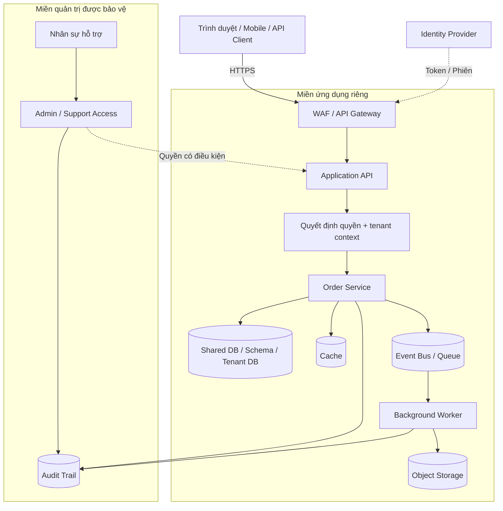
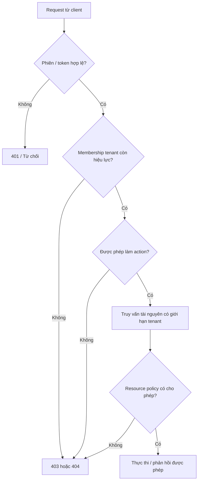

# Kiểm chứng bảo mật, phân quyền và ranh giới tenant

Một kiến trúc ứng dụng trên đám mây có thể được triển khai đa vùng, có mã hóa dữ liệu và vận hành qua mạng riêng nhưng vẫn xảy ra **rò rỉ dữ liệu xuyên tenant** nếu một lời gọi API cho phép người dùng của khách hàng A truy cập tài nguyên của khách hàng B. Vì vậy, đánh giá bảo mật kiến trúc phải trả lời bằng **bằng chứng kiểm chứng được**: ai có thể thực hiện hành động nào, với dữ liệu nào, trong ngữ cảnh tenant nào, qua những ranh giới tin cậy nào và hệ thống phản ứng ra sao khi các giả định bị vi phạm.

Bài học thuộc chương **Đánh giá kiến trúc** của phạm vi **CLOUD_ARCHITECTURE**. Mục tiêu là biến yêu cầu nghiệp vụ thành mô hình danh tính, quyền hạn và cô lập dữ liệu có thể thử nghiệm; kiểm tra các đánh đổi về độ tin cậy, bảo mật, khả năng mở rộng, chi phí và vận hành; cuối cùng ghi nhận quyết định theo tư duy Well-Architected. Một kiến trúc được xem là đạt khi các kiểm soát quan trọng hoạt động đúng dưới tình huống hợp lệ lẫn cố ý gửi yêu cầu sai, chứ không chỉ khi sơ đồ có các biểu tượng WAF, IAM hay VPC.

## 1. Xác định đối tượng cần bảo vệ và tiêu chí đánh giá

Giả sử xây dựng nền tảng SaaS quản lý đơn hàng cho nhiều doanh nghiệp. Mỗi doanh nghiệp là một **tenant**. Công ty **An Phát** sử dụng tenant **A** và công ty **Bình Minh** sử dụng tenant **B**. Cả hai dùng chung giao diện, API và một phần hạ tầng, nhưng đơn hàng, khách hàng, báo cáo và khóa tích hợp của mỗi bên phải được quản lý theo đúng ranh giới hợp đồng.

Các chủ thể có thể truy cập hệ thống:

- **Người dùng cuối:** nhân viên bán hàng, quản trị tenant, người chỉ xem báo cáo; một người có thể tham gia nhiều tenant với vai trò khác nhau.
- **Dịch vụ nội bộ:** Order, Billing, Reporting, Job Worker và tác vụ đồng bộ; có danh tính workload riêng, không mặc nhiên có quyền với mọi tenant.
- **Nhân sự vận hành nhà cung cấp SaaS:** hỗ trợ khách hàng, SRE, bảo mật và quản trị tài khoản cloud; một số tác vụ có thể yêu cầu quyền khẩn cấp được ghi nhận.
- **Hệ thống ngoài:** nhà cung cấp danh tính, cổng thanh toán, webhook đối tác và hệ thống xuất dữ liệu của từng tenant.

Đối tượng cần bảo vệ không chỉ là các hàng dữ liệu trong database: object đính kèm, bản cache, chỉ mục tìm kiếm, hàng đợi, nhật ký, backup, báo cáo định kỳ, khóa mã hóa, cấu hình, kết quả AI/search (nếu có), cũng có thể mang thông tin của tenant.

### 1.1. Những bất biến bảo mật cần chứng minh

Định nghĩa bất biến trước khi lựa chọn công nghệ:

1. **Mọi tác vụ có danh tính hợp lệ:** request được xác thực theo giao thức phù hợp; danh tính workload không được giả dạng bằng header công khai.
2. **Mọi thao tác có quyền hợp lệ:** người thực hiện có quyền với đúng hành động và đối tượng; xác thực thành công chưa đủ để cấp quyền.
3. **Dữ liệu luôn thuộc đúng tenant:** truy cập, ghi mới, cập nhật, tìm kiếm, export và khôi phục không làm lộ hay trộn dữ liệu giữa các tenant.
4. **Quyền được kiểm tra ở nơi chịu trách nhiệm tài nguyên:** không phụ thuộc hoàn toàn vào việc gateway đã xác thực token.
5. **Mọi đường đi đều được bao phủ:** HTTP API, background jobs, admin console, integration, bulk import/export, maintenance và các truy vấn trực tiếp đều có kiểm soát phù hợp.
6. **Sai phạm được từ chối và phát hiện:** mặc định deny, audit được thao tác nhạy cảm, có kiểm thử và cảnh báo cho sự thay đổi quyền hoặc vượt ranh giới.

Một mẫu phát biểu có thể dùng làm tiêu chí chấp nhận:

> Người dùng thuộc tenant A với quyền xem đơn hàng chỉ nhận được dữ liệu được cấp quyền trong A, kể cả khi tự thay đổi ID đơn, tenant trong URL, bộ lọc tìm kiếm hoặc tham số export. Các tác vụ bất đồng bộ do họ khởi tạo vẫn giữ cùng ràng buộc sau khi đưa vào hàng đợi.

## 2. Phân biệt xác thực, phân quyền và cô lập tenant

| Khái niệm | Câu hỏi | Ví dụ | Hiểu nhầm cần tránh |
|---|---|---|---|
| **Authentication (xác thực)** | Đây là ai hoặc workload nào? | Xác thực qua OIDC; workload được cấp danh tính bởi nền tảng. | Token hợp lệ không chứng minh được quyền đọc đơn bất kỳ. |
| **Authorization (phân quyền)** | Chủ thể được làm gì với tài nguyên này? | Nhân viên có quyền xem đơn thuộc tenant A; chỉ quản lý được quyền xuất báo cáo. | Vai trò “admin” không mặc nhiên có quyền ở mọi tenant. |
| **Tenant isolation (cô lập tenant)** | Dữ liệu, tài nguyên và tác động vận hành có được ngăn cách theo tenant không? | Truy vấn, cache, object, log và hàng đợi giới hạn đúng tenant. | Dùng database chung không tự động dẫn đến rò rỉ nếu có kiểm soát; database riêng cũng không đảm bảo nếu quản trị quyền sai. |
| **Network isolation (cô lập mạng)** | Những thành phần nào có thể kết nối tới nhau? | Database chỉ mở trong mạng riêng, security group hạn chế kết nối. | Mạng private không thay thế phân quyền trên bản ghi. |
| **Encryption (mã hóa)** | Dữ liệu được bảo vệ trên đường truyền và khi lưu ở đâu? | TLS, mã hóa ổ đĩa/object, KMS. | Mã hóa ở trạng thái lưu trữ không ngăn một API có quyền đọc sai tenant. |
| **Auditing (kiểm toán)** | Có thể truy vết truy cập và thay đổi quyền không? | Ai đã xuất dữ liệu, ở tenant nào, khi nào và kết quả ra sao. | Có log không đồng nghĩa đã chặn truy cập trái phép. |

Đánh giá tốt tách các câu hỏi này thành **điều kiện có thể thử nghiệm**, sau đó xem chúng bảo vệ nhau theo chiều sâu ra sao.

## 3. Sơ đồ luồng dữ liệu và các ranh giới tin cậy



Sơ đồ là **kiến trúc logic**: mỗi mũi tên đi qua một ranh giới cần được đánh giá riêng. Cần vẽ cả các đường không đi qua API Gateway, ví dụ một batch job có quyền database, console vận hành, script migration, pipeline phân tích, object storage và nhà cung cấp webhook.

### 3.1. Bảng ranh giới tin cậy

| Ranh giới | Dữ liệu/claim đi qua | Kiểm soát cần xem | Cách xác minh |
|---|---|---|---|
| Client → Gateway | Token, cookie, route, header, ID tài nguyên, tenant được chọn | TLS, xác thực token/session, request size, rate limiting, chống giả header | Token sai chữ ký/audience/hết hạn bị từ chối; header nội bộ do client tự gửi bị bỏ qua. |
| Gateway → API | Danh tính, scopes/roles, thông tin định tuyến | Kênh nội bộ an toàn, danh tính nguồn, xác minh hoặc truyền ngữ cảnh đáng tin cậy | Bypass gateway không thể gọi API với danh tính giả. |
| API → Domain Service | Actor, action, tenant, resource ID | Kiểm tra quyền theo tài nguyên, contract rõ ràng, timeout | Đổi resource ID sang tenant khác trả lỗi đúng; không có dữ liệu rò rỉ. |
| Service → Database | Truy vấn và ngữ cảnh tenant | Tenant predicate/RLS/schema hoặc DB riêng; quyền dịch vụ tối thiểu | Truy vấn thiếu điều kiện tenant không trả dữ liệu tenant khác. |
| Service → Cache/Search/Object | Key, index, metadata, bucket/key | Namespace và kiểm tra quyền nhất quán với dữ liệu gốc | Key đoán được, query rỗng hoặc URL cũ không mở dữ liệu tenant khác. |
| Service → Queue → Worker | Tenant, actor, loại sự kiện, đối tượng | Envelope đáng tin, kiểm tra quyền khi xử lý, giới hạn queue/topic | Job giả tenant hoặc replay không gây ghi/xuất dữ liệu sai miền. |
| Admin/Support → Tenant data | Ticket, người phê duyệt, mục đích, quyền tạm thời | Quy trình cấp quyền JIT, MFA, audit, phạm vi và thời hạn | Xem trace của một phiên hỗ trợ và chứng minh quyền bị thu hồi. |
| Backup/Analytics/Export → Bên nhận | Dataset, key giải mã, định danh tenant | Phân quyền, mã hóa, lọc tenant, retention và chính sách chia sẻ | Tệp xuất/restore của A không chứa dữ liệu B. |

Mỗi ô “cần xem” phải gắn với **chủ sở hữu kiểm soát và bằng chứng**; nhận xét kiểu “đã có security group” chỉ chứng minh kết nối mạng, không chứng minh quyền của dữ liệu.

## 4. Xác định mô hình đa tenant và hệ quả cô lập

Các mô hình thường gặp:

| Mô hình | Cách tổ chức | Lợi ích | Rủi ro và chi phí kiểm chứng |
|---|---|---|---|
| **Silo (tách riêng)** | Mỗi tenant có database/stack/tài khoản cloud riêng, tùy mức tách | Giảm chia sẻ tài nguyên; hỗ trợ yêu cầu cách ly nghiêm ngặt | Tăng chi phí cấp phát, quản lý phiên bản, triển khai, backup; quyền quản trị chung vẫn có thể vượt tenant. |
| **Pool (dùng chung)** | Nhiều tenant cùng dịch vụ, database hoặc bảng, thường có khóa tenant | Dùng tài nguyên hiệu quả; triển khai thống nhất | Phụ thuộc mạnh vào kiểm soát tenant ở tất cả đường truy cập, RLS, cache, tìm kiếm và analytics. |
| **Bridge (kết hợp)** | Một phần dùng chung, dữ liệu nhạy cảm hoặc tenant đặc biệt có stack riêng | Linh hoạt theo gói dịch vụ và yêu cầu tuân thủ | Độ phức tạp định tuyến, chuyển tenant, migration và kiểm tra dữ liệu qua ranh giới tăng. |

Không có mô hình nào tự đảm bảo an toàn. Kiến trúc cần ghi rõ **isolation unit** của từng lớp: tenant, workspace, dự án con, người dùng, tenant DB hoặc tài khoản cloud. Ví dụ, database tách theo tenant nhưng log vẫn đổ chung vào một index mở rộng cho mọi nhân viên hỗ trợ có thể làm mất lợi ích cô lập dữ liệu.

### 4.1. Phân biệt ba kiểu cách ly

- **Cách ly bí mật và toàn vẹn:** A không thể đọc/sửa dữ liệu B. Đây là tiêu chí bắt buộc của phân quyền xuyên tenant.
- **Cách ly tài nguyên và hiệu năng:** A tạo nhiều request không được làm B cạn quota hoặc không đáp ứng SLO; dùng quota, hàng đợi, autoscaling và cơ chế công bằng phù hợp.
- **Cách ly quản trị và vận hành:** người/ứng dụng có quyền của A không tự mở rộng được sang B; quyền của nền tảng phải giới hạn, được giám sát và có cơ chế ngoại lệ.

Trước khi đánh giá, đội thiết kế cần chỉ rõ loại cô lập nào là yêu cầu pháp lý/hợp đồng và loại nào là quyết định tối ưu chi phí, độ trễ hay vận hành.

## 5. Phương pháp đánh giá kiến trúc theo bằng chứng

Một quy trình khả thi đi từ yêu cầu đến thử nghiệm:

1. **Tập hợp ngữ cảnh:** xác định dữ liệu nhạy cảm, phân loại khách hàng, yêu cầu lưu trú dữ liệu, danh sách tenant, workload, luồng tin cậy và nhà cung cấp bên thứ ba.
2. **Vẽ kiến trúc thực tế:** mô tả entry points, control plane, data plane, IAM roles, network zones, nơi lưu dữ liệu, sự kiện và các đường quản trị/khẩn cấp; tránh chỉ dùng sơ đồ mức cao.
3. **Lập ma trận chủ thể–hành động–tài nguyên:** quyền của người dùng, nhóm, dịch vụ, tenant admin, platform admin và support; nêu điều kiện và ngoại lệ.
4. **Xây threat model:** xem người tấn công có token hợp lệ của tenant A, có thể điều khiển ID, URL, payload, webhook hay job nào; liệt kê giả định phải kiểm chứng.
5. **Thu thập bằng chứng thiết kế:** policy/IaC, cấu hình IAM, định tuyến, schema DB, cơ chế RLS, tài liệu protocol/claims, chính sách quản lý khóa, sequence diagrams và runbook.
6. **Thử nghiệm có chủ đích:** kiểm thử quyền dương/âm ở lớp API, database, cache, object, queue, báo cáo và tác vụ quản trị; chạy trong môi trường được phép với tenant và dữ liệu kiểm thử.
7. **Ghi nhận và ưu tiên rủi ro:** mô tả đường xâm nhập, tài sản bị ảnh hưởng, hậu quả, khả năng xảy ra, kiểm soát hiện tại, chủ sở hữu và tiêu chí khắc phục.
8. **Chứng minh lại sau sửa:** giữ log/chứng cứ kiểm thử, regression tests, cảnh báo và thời điểm đánh giá lại khi kiến trúc hoặc hợp đồng quyền thay đổi.

Một kết luận “PASS” chỉ nên xuất hiện nếu có bằng chứng đủ mới và bao phủ đúng đường đi đang đánh giá. Nếu chưa thể truy cập hệ thống để kiểm thử, ghi **NOT VERIFIED** và nêu rõ phần chưa có chứng cứ thay vì suy đoán an toàn từ sơ đồ.

## 6. Kiểm chứng danh tính và phiên truy cập

**Xác thực người dùng:** ứng dụng web/mobile có thể dùng OpenID Connect (OIDC) trên OAuth 2.0; native/mobile thường dùng Authorization Code + PKCE, và với web có thể cân nhắc BFF quản lý session bằng cookie an toàn. Đối với ứng dụng web dùng cookie, cần đánh giá `SameSite`, `Secure`, `HttpOnly` và phòng chống CSRF cho thao tác đổi trạng thái. CORS quy định trình duyệt cho phép truy cập từ origin nào, **không phải cơ chế xác thực hoặc kiểm tra quyền**.

**Xác thực API bearer token:** nếu gateway hoặc API dùng JWT, cần xác minh thuật toán được cho phép, chữ ký với khóa phù hợp, issuer (`iss`), audience (`aud`), thời gian (`exp`, `nbf`), scopes và chính sách thu hồi/phiên theo nhu cầu. Không tin vào JWT chỉ vì có thể giải mã phần payload; bất kỳ ai cũng có thể tự tạo một payload chưa được xác minh chữ ký.

**Danh tính dịch vụ:** workload nên dùng IAM role/service account/workload identity hoặc cơ chế được nhà cung cấp cloud hỗ trợ; khi cần, dùng mTLS và xác thực giữa dịch vụ. Không dùng chung static API key có quyền toàn hệ thống nếu có thể cấp quyền tạm thời, phạm vi hẹp và xoay vòng. Mạng nội bộ không tự biến header `X-User-ID` hoặc `X-Tenant-ID` thành thông tin đáng tin cậy.

### 6.1. Các tình huống phải thử

| Trường hợp | Kết quả chấp nhận |
|---|---|
| Token hết hạn, bị sửa chữ ký hoặc ký bởi issuer không được tin | Từ chối xác thực, không trả dữ liệu; không chuyển nguyên claim giả cho backend. |
| Token cấp cho API khác (sai audience) | Từ chối, kể cả chữ ký hợp lệ. |
| User rời tenant A nhưng phiên chưa hết hạn | Chính sách thu hồi/cập nhật membership có giới hạn thời gian rõ, phù hợp mức rủi ro; kiểm chứng không cấp quyền sau thời hạn chấp nhận. |
| Session cookie bị gửi kèm cross-site request | CSRF protection và chính sách cookie ngăn thao tác trái ý muốn theo mô hình web. |
| Client tự gửi `X-Tenant-ID: B` hoặc `X-User-ID` | Header không thể trở thành ngữ cảnh quyền nếu chưa được xác minh và gắn với phiên. |
| Service không có workload identity hợp lệ gọi trực tiếp API nội bộ | Bị từ chối tại lớp nhận hoặc ranh giới mạng/danh tính tương ứng. |
| Refresh token/session bị thu hồi | Không thể dùng tiếp theo cam kết thu hồi đã công bố và thực thi. |

Đánh giá cả **control plane** (người/vai trò quản trị tài nguyên cloud, thay đổi policy, triển khai) và **data plane** (lời gọi API, đọc dữ liệu, job). Một tài khoản service có quyền sửa policy IAM có thể bỏ qua nhiều kiểm soát ứng dụng; quyền cloud quá rộng là lỗ hổng kiến trúc dù mã API đúng.

## 7. Kiểm chứng phân quyền theo tài nguyên

Các cách biểu diễn quyền thường kết hợp:

- **RBAC (Role-Based Access Control):** quyền gắn với vai trò như Viewer, Editor, TenantAdmin. Dễ hiểu nhưng có thể phình vai trò nếu dữ liệu có nhiều điều kiện.
- **ABAC (Attribute-Based Access Control):** quyết định theo thuộc tính actor, tài nguyên và ngữ cảnh, chẳng hạn tenant, trạng thái đơn, độ nhạy dữ liệu, thiết bị hoặc thời điểm.
- **ReBAC (Relationship-Based Access Control):** quyền từ mối quan hệ, ví dụ người dùng thuộc nhóm sở hữu dự án hoặc là người tạo bản ghi.

Điều kiện tenant thường là **ràng buộc bắt buộc** bổ sung cho vai trò. Không nên dùng biểu thức “role = admin” toàn cục nếu admin chỉ thuộc một tenant.

### 7.1. Ma trận quyền mẫu

| Chủ thể | Xem đơn trong tenant của mình | Sửa đơn trong tenant của mình | Xem đơn tenant khác | Quản lý thành viên tenant |
|---|---|---|---|---|
| Tenant Viewer | Có | Không | Không | Không |
| Tenant Editor | Có | Có nếu trạng thái cho phép | Không | Không |
| Tenant Admin | Có | Theo policy nghiệp vụ | Không | Có trong tenant mình |
| Platform Support | Không theo mặc định | Không theo mặc định | Chỉ theo cơ chế truy cập hỗ trợ được duyệt, có scope/expiry/audit | Không theo mặc định |
| Background Worker | Chỉ phần dữ liệu cần xử lý qua ngữ cảnh job hợp lệ | Chỉ thao tác đã được cấp trong phạm vi workload | Không ngoài phạm vi được cấp | Không |

Đây là **quyền minh họa**, cần được điều chỉnh theo nghiệp vụ và yêu cầu hợp đồng. Trong sản phẩm thực, quyền chỉnh sửa còn phụ thuộc chủ sở hữu, trạng thái nghiệp vụ, chính sách four-eyes và yêu cầu phân chia nhiệm vụ.

### 7.2. Quy tắc quyết định quyền

Ví dụ một policy dạng giả mã:

```text
allow(actor, action, order) =
    actor.isAuthenticated
    AND isActiveMember(actor.id, order.tenantId)
    AND hasPermission(actor.id, action, order.tenantId)
    AND resourcePolicyAllows(actor, action, order)
    AND NOT hasExplicitDeny(actor, action, order)
```

Với request tạo mới, kiểm tra tenant được chọn **có trong membership còn hiệu lực** và gán `tenant_id` từ ngữ cảnh được xác minh. Không lấy `tenant_id` trong JSON do client gửi làm nguồn sự thật. Với request đọc/sửa, phải kiểm tra quyền trên **đối tượng đã tìm được**, không chỉ kiểm tra quyền trên tên route.

```text
GET /tenants/A/orders/ord-42
Actor = nhân viên tenant B
=> 403 Forbidden hoặc 404 Not Found theo policy chống lộ tài nguyên
=> Không trả metadata về đơn của tenant A

POST /tenants/A/orders
Actor = nhân viên tenant B
Body = { "tenantId": "A", "total": 100000 }
=> Từ chối; không tạo đơn trong A
```

Nếu dùng 404 để tránh tiết lộ tài nguyên, bảo đảm cả body, thông báo lỗi, telemetry công khai và độ khác biệt hành vi không vô tình lộ thông tin nhạy cảm. Không có quy tắc bắt buộc trả 403 hay 404 cho mọi sản phẩm; **phải thống nhất contract và kiểm thử tương ứng**.

### 7.3. Thứ tự kiểm tra trong ứng dụng



Trong triển khai, các bước có thể được tối ưu hoặc gộp vào cùng truy vấn. **Bất biến bắt buộc** vẫn là: không trả hoặc thay đổi dữ liệu trước khi mọi điều kiện quyền cần thiết được đáp ứng; mọi đường thực thi đi qua cùng policy có thể kiểm chứng.

## 8. Cô lập tenant ở lớp dữ liệu và tài nguyên phụ trợ

### 8.1. Database dùng chung và defense in depth

Một lỗi phổ biến là truy vấn theo `order_id` nhưng quên `tenant_id`:

```sql
-- Nguy hiểm nếu order_id là khóa được phép đoán hoặc được biết từ nguồn khác:
SELECT * FROM orders WHERE order_id = :order_id;

-- Một lớp hạn chế ở ứng dụng, với tenant đã xác minh:
SELECT * FROM orders
WHERE tenant_id = :verified_tenant_id AND order_id = :order_id;
```

Ở PostgreSQL có thể áp dụng **Row-Level Security (RLS)** như lớp bổ sung, nhưng phải hiểu rõ danh tính kết nối và trường hợp bypass:

```sql
-- Ví dụ minh họa, không phải migration production hoàn chỉnh.
CREATE TABLE orders (
    tenant_id uuid NOT NULL,
    order_id uuid NOT NULL,
    customer_id uuid NOT NULL,
    total_amount bigint NOT NULL,
    PRIMARY KEY (tenant_id, order_id)
);

ALTER TABLE orders ENABLE ROW LEVEL SECURITY;
ALTER TABLE orders FORCE ROW LEVEL SECURITY;

CREATE POLICY orders_tenant_policy ON orders
  USING (
    tenant_id = NULLIF(current_setting('app.tenant_id', true), '')::uuid
  )
  WITH CHECK (
    tenant_id = NULLIF(current_setting('app.tenant_id', true), '')::uuid
  );
```

Ứng dụng phải kiểm chứng membership trước, rồi thiết lập tenant context **được tin cậy** trên connection nằm trong transaction:

```sql
BEGIN;
-- :verified_tenant_id được lấy từ session và membership đã xác minh.
-- Dùng tham số hóa thực sự; không nối chuỗi SQL từ đầu vào client.
SELECT set_config('app.tenant_id', :verified_tenant_id, true);
SELECT order_id, total_amount FROM orders
WHERE order_id = :requested_order_id;
COMMIT;
```

Lưu ý quan trọng:

- `set_config(..., true)` là cấu hình cục bộ trong transaction; nếu pool connection tái sử dụng phiên mà đặt sai phạm vi, tenant context có thể rò giữa request. Phải thiết kế quản lý transaction/pool và kiểm thử concurrency.
- PostgreSQL superuser và role có `BYPASSRLS` có thể bỏ qua RLS; chủ sở hữu bảng cũng có điều kiện bypass nếu không dùng `FORCE ROW LEVEL SECURITY`. Không cho ứng dụng chạy bằng role quyền cao và không để đường truy vấn đặc quyền thành lối tắt thiếu kiểm soát.
- Session variable có thể bị sửa nếu kẻ tấn công đã có khả năng thực thi SQL tùy ý bằng cùng role; **RLS theo biến ngữ cảnh không thay thế phòng chống SQL injection và kiểm soát quyền gọi SQL**. Cần prepared statements, kiểm soát query và vai trò database.
- Chính sách đọc (`USING`) và ghi (`WITH CHECK`) cần kiểm tra độc lập; thử cả `INSERT`, `UPDATE`, `DELETE`, bulk operation và migration.
- Khóa liên kết quan trọng nên chứa tenant hoặc có ràng buộc tương đương, tránh một bản ghi của A tham chiếu tới bản ghi của B. Ví dụ khóa chính kết hợp `(tenant_id, order_id)` có thể hỗ trợ foreign key cùng tenant.

RLS là lớp **defense in depth** có ích cho mô hình pooled database; nếu dùng silo database thì thay bằng kiểm chứng định tuyến tenant → database, quyền kết nối, backup và quản trị tập trung. Không nên tin một cơ chế đơn lẻ.

### 8.2. Cache, tìm kiếm, object storage và analytics

| Thành phần | Lỗi thường gặp | Điều kiện kiểm chứng |
|---|---|---|
| Redis/cache | Key `order:42` không chứa namespace tenant, hoặc cache key bỏ qua role | Cache key có phạm vi tenant và quyền cần thiết; không trả kết quả đã cache cho actor khác quyền. |
| CDN | Cache phản hồi riêng tư như dữ liệu hóa đơn ở đường dẫn chung | Chính sách `Cache-Control`, cache key và phân loại nội dung; phản hồi nhạy cảm không public-cache sai. |
| Search/vector index | Query lọc theo từ khóa nhưng không lọc tenant/ACL | Bộ lọc tenant và quyền áp dụng trước khi trả kết quả; chỉ mục/rebuild không trộn dữ liệu. |
| Object storage | URL dự đoán được hoặc bucket policy cho phép liệt kê file tenant khác | Object key không là cơ chế quyền; API kiểm tra ACL và URL ký có phạm vi/thời hạn phù hợp. |
| Reporting/export | Query tổng hợp quên tenant, ghi file ở bucket chung rồi phát link sai | Lọc tenant xuyên pipeline, xác minh kết quả và quyền tải; file có retention/xóa đúng hạn. |
| Backup/restore | Phục hồi bản backup B vào môi trường A, hoặc support restore được mọi tenant | Quyền restore, nhãn tenant, kiểm tra nguồn, khóa mã hóa và cách ly môi trường phục hồi. |
| Observability | Log/trace chứa PII hoặc payload khách hàng, dashboard mở xuyên tenant | Redaction, quyền xem log, thời gian lưu giữ và kiểm toán thao tác tra cứu. |
| Feature flags/config | Cấu hình của tenant A áp cho tenant B do thiếu scope | Key cấu hình có định danh tenant và chính sách fallback rõ ràng. |

**Không coi tenant ID trong tên key là cơ chế bảo mật đủ mạnh.** Nó chỉ hỗ trợ tổ chức dữ liệu; API hoặc service phải xác minh người truy cập có quyền với tenant và tài nguyên trước khi đọc/ghi.

### 8.3. Hàng đợi và worker bất đồng bộ

Khi một request được đưa vào queue, token người dùng có thể đã hết hạn trước lúc worker thực thi. Cần quyết định rõ hai chính sách:

- **Quyền tại thời điểm tạo job:** hệ thống xác minh và ghi lại ủy quyền cho tác vụ, kèm phạm vi tenant, thao tác, actor, TTL và định danh yêu cầu; worker chỉ thực hiện công việc được cấp. Phù hợp khi tác vụ phải hoàn tất sau khi người dùng rời phiên, nhưng cần hạn chế thời gian/khối lượng và cơ chế thu hồi khi phù hợp.
- **Quyền tại thời điểm xử lý job:** worker kiểm tra lại membership/policy lúc thực thi; phù hợp với thao tác nhạy cảm mà quyền có thể bị thu hồi. Cần định nghĩa rõ cách xử lý job đang xếp hàng khi quyền thay đổi.

Ví dụ envelope nội bộ sau khi API đã xác minh:

```json
{
  "eventType": "report.export.requested",
  "jobId": "job-123",
  "tenantId": "tenant-A",
  "actorId": "user-9",
  "authorizedAction": "report:export",
  "reportId": "report-77",
  "requestedAt": "2026-11-18T09:00:00Z"
}
```

Đây là **payload minh họa**, bản thân JSON không phải bằng chứng ủy quyền. Worker phải chỉ nhận dữ liệu từ nguồn có xác thực/kiểm soát quyền, xác minh scope, kiểm tra idempotency/replay và không cho phép event từ nguồn ngoài tự tuyên bố đã được cấp quyền. Nếu một job có thể chạy qua nhiều tenant theo quyền nền tảng, cần giới hạn phạm vi và ghi lại hành động quản trị có thể kiểm toán.

## 9. Kiểm chứng quyền cloud, mạng và đường quản trị

Bảo mật ứng dụng có thể bị vượt qua qua quyền hạ tầng quá rộng:

- **IAM và workload roles:** role của Order Service chỉ cần quyền tới tài nguyên Order; Reporting Worker chỉ được phép đọc dữ liệu cần thiết và ghi ra đích theo tenant. Kiểm tra wildcard actions/resources và các quyền leo thang (ví dụ tự gán role, sửa policy, đọc secret).
- **Control plane:** CI/CD, quản lý cluster, thay đổi route/WAF, tạo database snapshot, IAM, KMS và backup có quyền riêng. Admin có thể đọc dữ liệu qua snapshot dù API chặn hoàn toàn.
- **Mạng:** database/cache trong private subnet hoặc biên tương đương, ingress/egress có quy tắc cụ thể; network policies và security group giảm bề mặt tấn công nhưng không thay thế RBAC/ABAC.
- **Secrets và khóa:** dùng secret manager/KMS, không đưa credential vào image, biến môi trường bị log hoặc repository; phân quyền sử dụng khóa theo workload/tenant khi có yêu cầu bảo vệ mạnh.
- **Quyền hỗ trợ khẩn cấp (break-glass):** cấp trong thời gian ngắn, có mục đích, phê duyệt/MFA theo yêu cầu, audit không thể tự sửa, cảnh báo và thu hồi khi kết thúc.
- **Hệ thống ngoài:** webhook ký/kiểm tra nguồn, bảo vệ replay, endpoint nội bộ không bị truy cập qua SSRF; tenant tích hợp chỉ được truy cập dữ liệu của mình.

### 9.1. Bằng chứng cần xin khi review

| Nhóm bằng chứng | Thí dụ |
|---|---|
| Danh tính | OIDC configuration, chính sách session/token, workload identities, vòng đời credential. |
| Phân quyền | Policy/role definitions, ma trận quyền, mã kiểm tra tenant/resource, thử nghiệm từ chối. |
| Tài nguyên cloud | IaC/IAM policy, sơ đồ network, KMS key policy, bucket/database access policy. |
| Dữ liệu | Schema, RLS policies, bảng mapping tenant→database, chính sách backup và export. |
| Luồng bất đồng bộ | Cấu hình queue/topic, producer/consumer IAM, event schema, cơ chế retry/idempotency. |
| Vận hành | Audit log có bảo vệ, dashboard access, runbook cấp quyền khẩn cấp, lịch sử review. |
| Kiểm thử | Test report, log kết quả, bằng chứng request/response đã ẩn dữ liệu nhạy cảm, CI job và thời điểm chạy. |

Mọi bằng chứng phải đúng **phiên bản kiến trúc đang triển khai**; sơ đồ cũ hoặc một test chỉ chạy trên mock không đủ để kết luận production đang an toàn.

## 10. Lập threat model bằng kịch bản lạm dụng

Có thể dùng tư duy STRIDE để không bỏ sót giả mạo danh tính, sửa đổi dữ liệu, phủ nhận hành động, lộ thông tin, từ chối dịch vụ và leo thang đặc quyền. Tuy nhiên mục tiêu đánh giá tenant là tạo ra **tình huống thử cụ thể**:

| Tác nhân và thao tác | Tài sản/ranh giới | Nguy cơ | Kiểm thử dự kiến |
|---|---|---|---|
| Người A tự thay `orderId` trong URL bằng ID của B | API → Order DB | BOLA/IDOR: đọc dữ liệu khác tenant | A nhận 403/404 theo contract; không lộ body/metadata của B. |
| Người A gửi header/JSON `tenantId=B` | Client → API | Giả mạo tenant context | Bị từ chối nếu A không thuộc B; không ghi dữ liệu vào B. |
| Tenant Admin A gọi API quản trị thành viên B | IAM nghiệp vụ | Leo thang quyền qua scope sai | Policy đánh giá cả vai trò và membership B. |
| Search không gắn filter tenant | Search index | Rò kết quả hoặc số lượng dữ liệu B | Query A không trả hit, facet/count hay preview của B. |
| Cache key dùng chung giữa A/B | Cache | Rò dữ liệu từ lần gọi trước | Gọi tuần tự/đồng thời nhiều tenant không làm lẫn kết quả. |
| Worker nhận message tự tạo từ nguồn ngoài | Queue → Worker | Ghi/xuất dữ liệu sai tenant | Bị chặn bởi quyền producer, message verification và policy worker. |
| Nhân viên hỗ trợ dùng quyền vĩnh viễn | Support → Data plane | Truy cập vượt phạm vi và khó phát hiện | Quyền cấp theo phiên/ticket, tự hết hạn, có audit và cảnh báo. |
| Workload bị chiếm identity có quyền `*` | Cloud control plane | Tăng ảnh hưởng sang toàn bộ tenant | IAM policy hạn chế tài nguyên và hành động; thử công cụ policy analyzer trong môi trường được phép. |
| Tenant A tạo tải quá mức | Compute/DB/Queue | Noisy neighbor, vi phạm SLO của B | Rate limit, quota, concurrency và giám sát theo tenant. |
| Backup/export bị đưa nhầm đích | Data pipeline → Object/Partner | Rò rỉ dữ liệu hàng loạt | Đích có phân quyền, xác minh tenant và audit trước chia sẻ. |

Nên đánh giá cả **positive case** (người B được phép đọc dữ liệu B) và **negative case** (người A không được đọc B). Một hệ thống từ chối tất cả yêu cầu có thể vượt negative tests nhưng không đáp ứng nghiệp vụ.

## 11. Bộ kiểm thử thực chứng cho tenant isolation

### 11.1. Chuẩn bị fixture

Tạo tối thiểu hai tenant A và B, mỗi tenant có:

- Hai tài khoản: Viewer và Editor/Tenant Admin với vai trò đã định nghĩa.
- Đơn hàng, hóa đơn, object đính kèm, dữ liệu search, cache và bản báo cáo có chuỗi kiểm thử riêng.
- Một tài khoản tham gia cả A/B nhưng có **vai trò khác nhau** ở từng tenant; giúp phát hiện việc gán role toàn cục.
- Một workload/job cho xử lý bất đồng bộ; có dữ liệu đủ để kiểm tra xuất báo cáo và kết quả event.

Đặt các ID đủ khác nhau để theo dõi và có một vài ID được biết giữa tenant; bảo mật không được phụ thuộc vào việc UUID khó đoán. Thu response status, response body đã ẩn thông tin riêng tư, trạng thái database và audit event. Không thử xâm nhập trên tenant thật khi chưa được phép.

### 11.2. Test matrix tối thiểu

| Mã | Yêu cầu/điều kiện | Kết quả mong đợi |
|---|---|---|
| **AUTH-01** | Token giả chữ ký, sai issuer/audience hoặc hết hạn | Không xác thực; không đi vào nghiệp vụ. |
| **AUTH-02** | Client thêm header giả `X-User-ID` hoặc `X-Tenant-ID` | Không có quyền phát sinh từ header công khai. |
| **TEN-01** | Viewer A `GET` đơn của A được phép | Thành công; dữ liệu và audit đúng A. |
| **TEN-02** | Viewer A `GET` đơn của B bằng ID biết trước | Từ chối; không lộ dữ liệu B. |
| **TEN-03** | Editor A `PATCH` đơn của B | Từ chối; database B không đổi. |
| **TEN-04** | A `POST` đơn với body khai tenant B | Từ chối; không tạo dữ liệu trong B. |
| **TEN-05** | Người có cả A/B, quyền Viewer ở B và Editor ở A | Không được dùng quyền Editor của A để sửa đơn B. |
| **TEN-06** | Tài khoản bị rút khỏi A ngay trước khi gọi API | Từ chối theo chính sách thu hồi/membership đã định. |
| **DAT-01** | Chạy query thiếu tenant qua đường truy cập dịch vụ được cấp | DB guardrail/RLS không trả dữ liệu tenant khác. |
| **DAT-02** | Tạo/đổi foreign key trỏ sang dữ liệu tenant khác | Schema/policy từ chối hoặc kiểm tra nghiệp vụ ngăn ghi. |
| **CACHE-01** | A và B truy vấn cùng đường dẫn/key sau khi cache nóng | Không nhận nội dung của tenant khác; cache hit không đổi quyền. |
| **OBJ-01** | A dùng object key/URL của B | Từ chối hoặc URL ký không hợp lệ; không tải được file B. |
| **SRCH-01** | A tìm kiếm toàn bộ, lọc rỗng hoặc phân trang | Không có bản ghi, tổng số kết quả hoặc preview của B. |
| **JOB-01** | Job A được xử lý chậm sau khi role thay đổi | Hành vi đúng chính sách kiểm tra quyền đã chọn; không xuất B. |
| **JOB-02** | Message giả tenant hoặc event replay | Bị từ chối/khử trùng lặp đúng cơ chế; không lặp ghi nguy hiểm. |
| **OPS-01** | Support truy cập không có ticket hoặc quá thời hạn | Không được xem dữ liệu; audit ghi nỗ lực truy cập. |
| **OPS-02** | IAM role chỉ dành cho Order cố truy cập Billing secret/bucket | Cloud IAM từ chối, không có đường bypass qua admin script. |
| **EXP-01** | Export dữ liệu tenant A rồi kiểm tra file/link | Chỉ chứa dữ liệu A; phạm vi tải xuống và retention đúng policy. |
| **PERF-01** | A gây tải lớn trong giới hạn bài thử | B giữ SLO trong phạm vi tiêu chí đã thống nhất; quota/isolated resource hoạt động. |

Khi chạy automation, lưu **mã testcase, kiến trúc/version, tenant fixture, điều kiện đầu vào, actor, quyền kỳ vọng, kết quả thật và đường dẫn bằng chứng**. Những test kiểm tra thay đổi cơ sở dữ liệu cần đối chiếu sau request, không chỉ nhìn HTTP status.

### 11.3. Gợi ý dạng test độc lập công nghệ

```text
Given:
    tenant A có order A-100
    tenant B có order B-200
    userAlice thuộc A với quyền "order:read"
When:
    Alice gọi GET /orders/B-200 bằng token hợp lệ
Then:
    API trả lỗi theo chính sách che tài nguyên (403 hoặc 404)
    Response không có dữ liệu/metadata của B-200
    Database và audit khẳng định không có thao tác ghi ngoài quyền

Given:
    userBob là Editor ở A, Viewer ở B
When:
    Bob chọn tenant B rồi PATCH /orders/B-200
Then:
    Bị từ chối do role trong B không có "order:write"
    Order B-200 không đổi
```

Thử biến thể trên tất cả đường nhập cùng chức năng: REST/GraphQL (nếu có), API phiên bản cũ, endpoint batch, websocket, report export và tác vụ nội bộ. Nếu cùng một tài nguyên có nhiều cách lấy dữ liệu, **mọi cách đều phải kiểm tra quyền**.

## 12. Đánh giá vận hành và kiểm soát sự thay đổi

Một thiết kế đúng hôm nay vẫn có thể mất cô lập tenant sau bản cập nhật schema, policy hoặc định tuyến. Để duy trì kết quả đánh giá:

1. **Policy as code / IaC review:** thay đổi IAM, bucket, database role, API policy và network phải qua kiểm tra tự động cùng review có chủ đích.
2. **Contract/authorization tests trong CI:** mỗi endpoint mới, role mới, worker mới và thay đổi schema phải có positive/negative tests tương ứng.
3. **Drift detection:** so sánh trạng thái production với policy đã duyệt; phát hiện quyền mở rộng ngoài kế hoạch và tài nguyên công khai không chủ ý.
4. **Giám sát theo tenant:** tỷ lệ từ chối 401/403, truy cập trái phép lặp lại, thao tác admin/export, bùng nổ truy vấn, cache/search anomalies. Tránh lộ tenant/user ID dưới nhãn metrics có cardinality cao hoặc trong log công khai.
5. **Review định kỳ quyền:** rà lại role/service account/nhân viên đã rời tổ chức, quyền support hết hạn, backup access và tài khoản tích hợp bên ngoài.
6. **Diễn tập sự cố rò dữ liệu:** xác định cách khoanh vùng, thu hồi token/role, bảo toàn bằng chứng, đánh giá tenant bị ảnh hưởng, thông báo theo quy trình phù hợp và ngăn tái diễn.

Cần đo cả tác động **vận hành và độ tin cậy** của cơ chế quyền: kiểm tra membership từ dịch vụ bên ngoài chậm hoặc gặp lỗi có làm request treo? Thiết kế nên đặt timeout và hành vi **fail closed** cho quyền không thể xác minh, nhưng cũng cần cache policy an toàn, chiến lược thu hồi và kế hoạch đáp ứng SLO. Không mở quyền chỉ vì dịch vụ phân quyền đang lỗi.

## 13. Ghi nhận phát hiện, mức độ rủi ro và quyết định kiến trúc

Một kết quả assessment phải cho phép người khác hiểu được lý do đánh giá. Không nên chỉ ghi “security: tốt / trung bình / yếu”.

### 13.1. Mẫu bản ghi phát hiện

```yaml
finding_id: SEC-TEN-004
title: "Endpoint export thiếu lọc tenant"
affected_component: "Reporting Worker"
asset: "Đơn hàng và thông tin khách hàng"
scenario: "Job export khởi tạo bởi tenant A có thể lấy bản ghi tenant B"
expected_invariant: "Export chỉ chứa dữ liệu tenant được cấp quyền"
evidence:
  - "Test EXP-01 cho thấy tệp đầu ra có bản ghi tenant B"
  - "Query job không áp dụng tenant predicate"
impact: "Lộ thông tin khách hàng xuyên tenant"
likelihood_context: "Người dùng hợp lệ có quyền export có thể kích hoạt"
risk_level: CRITICAL
owner: "Reporting team"
remediation:
  - "Ràng buộc tenant từ job context đáng tin cậy"
  - "Lọc và xác minh tenant ở truy vấn dữ liệu"
  - "Thêm test xuyên tenant trong CI"
verification: "EXP-01 và thử API + worker + tệp đầu ra"
status: OPEN
```

**CRITICAL** ở đây là mức **minh họa theo tình huống**; tổ chức phải dùng một thang phân loại nhất quán, xét tác động, khả năng khai thác, độ nhạy dữ liệu, số tenant ảnh hưởng và phạm vi truy cập. Không suy ra điểm CVSS chỉ từ nhãn ví dụ.

### 13.2. Ma trận ra quyết định

| Tình trạng | Quyết định gợi ý |
|---|---|
| Có bằng chứng rò dữ liệu xuyên tenant hoặc quyền cloud có thể đọc toàn bộ dữ liệu ngoài phạm vi | Chặn phát hành tính năng liên quan hoặc cô lập đường truy cập; xử lý theo quy trình rủi ro khẩn cấp. |
| Không có bằng chứng thử nghiệm cho đường admin, batch hoặc export quan trọng | Đánh dấu **NOT VERIFIED**; cần hoàn tất kiểm chứng hoặc phê duyệt chấp nhận rủi ro có thời hạn. |
| Test âm/dương qua API, worker, DB và phụ trợ đạt; policy/version khớp production | Có thể đánh dấu **PASS cho phạm vi đã thử**, kèm ngày, version và giới hạn. |
| Đã có biện pháp giảm nhẹ nhưng không khắc phục gốc | Đánh giá rủi ro còn lại, người chịu trách nhiệm, hạn khắc phục và cơ chế phát hiện. |

Hồ sơ review cuối cùng tối thiểu gồm **phạm vi, hệ thống/phiên bản, bất biến, sơ đồ trust boundary, test matrix, phát hiện, mức rủi ro, bằng chứng, quyết định và ngày tái kiểm tra**. Không coi “có WAF” hoặc “đạt một lần pentest” là bằng chứng bao phủ mọi đường dữ liệu trong tương lai.

## 14. Liên hệ Well-Architected và các đánh đổi

| Trụ cột | Câu hỏi đánh giá liên quan tenant | Bằng chứng/đánh đổi cần nhìn thấy |
|---|---|---|
| **Security — Bảo mật** | Ai đọc/sửa tài nguyên tenant nào? Policy có deny-by-default, least privilege và audit không? | Negative tests, IAM review, threat model, RLS/DB isolation, support access logs. |
| **Operational Excellence — Vận hành** | Người trực xử lý sự cố cross-tenant và rollback policy thế nào? | Runbook, policy as code, kiểm tra drift, owner và lịch review. |
| **Reliability — Độ tin cậy** | Hỏng dịch vụ phân quyền có làm mở quyền hoặc gián đoạn toàn bộ hệ thống? | Fail-closed tests, cache/timeout, backup và diễn tập cô lập sự cố. |
| **Performance Efficiency — Hiệu năng** | Kiểm tra quyền tác động thế nào đến latency và throughput khi có nhiều tenant? | P95 end-to-end, policy cache hit, chi phí query theo tenant, hiệu quả partition/index. |
| **Cost Optimization — Chi phí** | Nên chọn silo, pool hay bridge để đạt mức cô lập hợp đồng yêu cầu? | TCO compute/database, vận hành policy, backup, log, chi phí kiểm toán và sự cố. |
| **Sustainability — Bền vững** | Có đang nhân bản toàn bộ stack cho tenant không cần thiết? | Tỷ lệ sử dụng compute, thời gian tồn tại môi trường riêng, hiệu quả shared capacity. |

Ví dụ đánh đổi: pooled database thường rẻ hơn và dễ triển khai đồng loạt, nhưng đòi hỏi test tenant isolation rất chặt ở query, cache và pipeline. Dedicated database giảm một số rủi ro trộn dữ liệu, song tăng chi phí và số lượng cấu hình IAM/backup cần bảo trì. Đánh giá Well-Architected cần dựa vào **yêu cầu nghiệp vụ và bằng chứng hiện có**, không đánh đồng chi phí cao với mức bảo mật cao.

## 15. Bài tập thực hành đánh giá kiến trúc

### Đề bài

Nền tảng SaaS bán hàng có 3 tenant:

- **A:** cửa hàng nhỏ, dùng dịch vụ và database chung.
- **B:** doanh nghiệp lớn, yêu cầu dữ liệu tách schema và quyền export có phê duyệt.
- **C:** khách hàng chịu yêu cầu quản trị nghiêm ngặt, dùng database riêng nhưng vẫn dùng chung Reporting Worker.

Kiến trúc hiện tại dùng API Gateway xác minh JWT; tất cả services dùng một database admin role; cache key là `report:{reportId}`; worker nhận message chứa `tenantId` từ client qua API; support account có thể mở mọi báo cáo mà không cần ticket. Dashboard hạ tầng xanh, chưa có negative tests cho quyền xuyên tenant.

**Yêu cầu:** đóng vai kiến trúc sư đánh giá độc lập, thực hiện các bước:

1. Vẽ lại sơ đồ trust boundary và đánh dấu điểm nhập tenant context từ client, token, queue và database.
2. Phân loại phát hiện theo các bất biến đã nêu; chỉ rõ nguy cơ dù tenant C có database riêng.
3. Lập ma trận role–action–resource tối thiểu cho Viewer, Editor, Tenant Admin, Support và Reporting Worker.
4. Đề xuất kiểm soát ở gateway, API/domain service, database, cache, queue/worker, IAM, export và audit.
5. Viết ít nhất 8 testcase positive/negative, có dữ liệu thử và tiêu chí kết quả.
6. Ưu tiên sửa lỗi, chỉ ra bằng chứng cần thu sau khi sửa và quyết định có thể phát hành hay không.

### Gợi ý lời giải

| Điểm phát hiện | Tác động | Kiểm chứng và khắc phục tối thiểu |
|---|---|---|
| Services dùng database admin role | Có khả năng bypass RLS và truy cập trái phạm vi | Cấp role ứng dụng tối thiểu, kiểm soát kết nối từng dữ liệu; thêm test DB deny. |
| Cache key thiếu tenant/role scope | Có thể trả kết quả B cho A nếu trùng định danh hoặc dùng đường dẫn chung | Namespace tenant và quyền khi cần; thử truy cập nóng cache liên tenant. |
| Worker tin tenantId qua thông điệp bắt nguồn từ client | Có nguy cơ xuất/ghi dữ liệu sai tenant | Tạo job context từ quyền đã kiểm tra, xác thực producer, policy tại worker, test replay/forgery. |
| Support xem mọi report vô điều kiện | Tác động diện rộng, khó quy trách nhiệm | Quy trình JIT theo ticket, thời hạn, audit không thể tự xóa, kiểm tra truy cập trái phép. |
| Chỉ gateway kiểm tra JWT | Không có phân quyền theo tài nguyên hoặc tenant | Kiểm tra membership, action, resource/tenant tại service và dữ liệu. |
| Tenant C có DB riêng nhưng Reporting Worker dùng chung | Đường báo cáo vẫn có thể trộn dữ liệu của C với A/B | Mapping tenant→nguồn dữ liệu, quyền workload tối thiểu và test export per-tenant. |

Không được kết luận sản phẩm đạt đánh giá chỉ vì đã sửa code một endpoint. Cần thực thi test trên cả data plane và các luồng quản trị, đồng thời giữ bằng chứng phiên bản được kiểm tra.

## 16. Checklist trước khi thông qua kiến trúc

- [ ] Phạm vi và tài sản dữ liệu của từng tenant, mô hình silo/pool/bridge, yêu cầu hợp đồng đã được xác định.
- [ ] Có sơ đồ đường dữ liệu và trust boundary bao gồm API, service, DB, cache, search, queue, object, analytics, backup và control plane.
- [ ] Authentication có kiểm chứng chữ ký/token/session; workload identity, secret và quyền cloud được giới hạn.
- [ ] Role, membership, action và điều kiện trên từng tài nguyên được định nghĩa; quyền cross-tenant mặc định bị từ chối.
- [ ] Tenant context xuất phát từ danh tính/ủy quyền được xác minh; header, route, query, JSON và message do client kiểm soát không được tin mặc định.
- [ ] Có biện pháp cô lập ở lớp dữ liệu (tenant predicate/RLS/schema/DB) và kiểm tra trường hợp privileged roles/bypass.
- [ ] Cache, CDN, search, object storage, export, backup, log, admin/support và asynchronous jobs được kiểm thử quyền xuyên tenant.
- [ ] Có test positive và negative với tối thiểu hai tenant, hai role, trường hợp người dùng thuộc nhiều tenant và dữ liệu biết trước ID.
- [ ] Kiểm thử gồm kết quả API **và** trạng thái dữ liệu/audit sau thao tác; không chỉ dựa vào HTTP status.
- [ ] IAM/IaC, CI authorization tests, drift detection, giám sát, runbook và cơ chế revoke/break-glass đã được đánh giá.
- [ ] Rủi ro còn lại có mức độ, bằng chứng, owner, thời hạn và quyết định chấp nhận/khắc phục rõ ràng.
- [ ] Đã xem xét các đánh đổi bảo mật, độ tin cậy, hiệu năng, chi phí và vận hành theo Well-Architected.

**Điểm cần nhớ:** kiểm chứng bảo mật đa tenant là kiểm chứng **quyền trên đúng tài nguyên qua mọi đường đi của dữ liệu**. Một token hợp lệ, một mạng riêng hoặc một database tách biệt đều không tự chứng minh an toàn. Kết luận kiến trúc phải dựa trên bất biến, threat model, kiểm thử thực tế và bằng chứng có thể tái lập.
