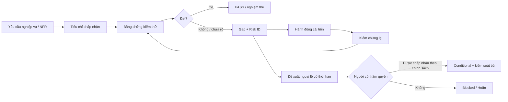
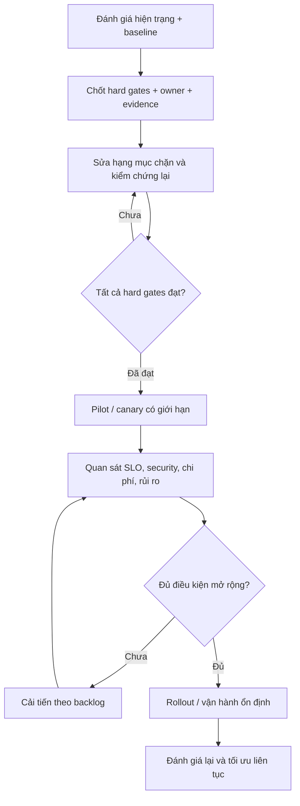
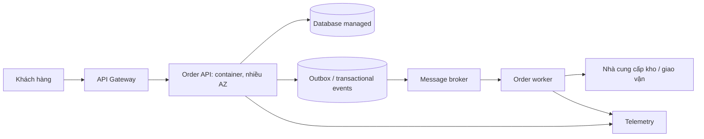

# Chốt tiêu chí chấp nhận và kế hoạch cải tiến kiến trúc

## 1. Tại sao đánh giá kiến trúc phải kết thúc bằng quyết định?

Một buổi **đánh giá kiến trúc (architecture assessment)** có thể phát hiện nhiều vấn đề: cơ sở dữ liệu chưa có phương án khôi phục, hệ thống không chịu được tải đỉnh, chi phí vượt ngân sách, phân quyền quá rộng hoặc không có khả năng truy vết giao dịch. Tuy nhiên, nếu đầu ra chỉ là một danh sách nhận xét như “nên cải thiện bảo mật” và “cần kiểm thử hiệu năng”, nhóm triển khai sẽ khó biết lúc nào thiết kế **được chấp nhận**, ai cần thực hiện việc gì và đến thời điểm nào.

Giai đoạn **chốt tiêu chí chấp nhận và kế hoạch cải tiến** biến các phát hiện thành một quyết định có trách nhiệm:

1. **Xác nhận phạm vi và ràng buộc nghiệp vụ**: kiến trúc đang được xét cho hệ thống, tải, dữ liệu, môi trường và mốc triển khai nào?
2. **Thiết lập tiêu chí chấp nhận đo được**: kết quả nào phải đạt trước khi phê duyệt thiết kế hoặc đưa hệ thống vào vận hành?
3. **Thu thập bằng chứng**: tài liệu, phép đo, bài kiểm thử hoặc kết quả diễn tập nào chứng minh tiêu chí đã đạt?
4. **Phân loại khoảng cách và rủi ro**: điểm chưa đạt nào buộc phải sửa ngay, điểm nào có thể chấp nhận có điều kiện?
5. **Xây dựng kế hoạch cải tiến**: mỗi hành động có người chịu trách nhiệm, thứ tự ưu tiên, phụ thuộc, thời hạn và điều kiện hoàn thành.
6. **Ra quyết định có lưu vết**: chấp nhận, chấp nhận có điều kiện, hoãn hoặc từ chối; ghi rõ rủi ro tồn đọng và thời điểm đánh giá lại.

Trong module **CLOUD_ARCHITECTURE**, quyết định này phải nối được yêu cầu nghiệp vụ với lựa chọn mạng, compute, dữ liệu và mô hình triển khai đám mây, đồng thời giải thích các **đánh đổi về độ tin cậy, bảo mật, khả năng mở rộng, chi phí và vận hành** theo nguyên tắc Well-Architected.

### Kết quả học tập

Sau bài này, bạn cần có thể:

- Phân biệt **tiêu chí đánh giá**, **tiêu chí chấp nhận**, **bằng chứng** và **khuyến nghị cải tiến**.
- Viết tiêu chí chấp nhận rõ phạm vi, ngưỡng đo, cách kiểm chứng, người phê duyệt và điểm dừng.
- Dùng kết quả đánh giá theo các trụ cột Well-Architected để đưa ra quyết định có điều kiện và quản lý ngoại lệ.
- Ưu tiên công việc sửa chữa bằng mức rủi ro, phụ thuộc, lợi ích nghiệp vụ, chi phí và năng lực thực thi.
- Lập kế hoạch cải tiến theo giai đoạn, gắn nhiệm vụ với kết quả đo được, kiểm tra lại sau thay đổi.

## 2. Bốn khái niệm dễ bị nhầm lẫn

| Khái niệm | Câu hỏi trả lời | Ví dụ trong ứng dụng đặt hàng |
|---|---|---|
| **Tiêu chí đánh giá (assessment criterion)** | Khía cạnh nào cần xem xét? | “Khả năng phục hồi cơ sở dữ liệu sau sự cố.” |
| **Tiêu chí chấp nhận (acceptance criterion)** | Phải đạt điều kiện kiểm chứng nào? | “Hoàn tất diễn tập phục hồi đạt RTO ≤ 60 phút và RPO ≤ 5 phút với tình huống mất vùng khả dụng đã xác định.” |
| **Bằng chứng (evidence)** | Dựa vào đâu xác nhận đạt/chưa đạt? | Báo cáo diễn tập có thời gian thực, log khôi phục, phiên bản cấu hình và chữ ký của người phụ trách |
| **Hành động cải tiến (remediation action)** | Nếu chưa đạt, ai làm gì để đạt? | Bổ sung replication, kiểm thử tự động khôi phục, chạy lại diễn tập trước ngày phê duyệt |

Ví dụ “kiến trúc có tính sẵn sàng cao” là một **mục tiêu**, chưa phải tiêu chí chấp nhận. “Sử dụng ba Availability Zone” là một **quyết định thiết kế**, không chứng minh được yêu cầu khôi phục hay SLO đầu cuối đã đạt. Một tiêu chí tốt phải nói rõ **hành vi mong muốn và cách kiểm chứng**, trong khi giải pháp kỹ thuật là phương tiện để đạt hành vi ấy.

Các loại bằng chứng cũng không hoàn toàn thay thế nhau:

- **Review thiết kế** chứng minh đã xem xét kịch bản, sơ đồ và giả định.
- **Kiểm tra cấu hình** cho thấy hạ tầng được khai báo hoặc cấu hình theo chính sách.
- **Kiểm thử tích hợp/tải/bảo mật** đo hành vi trong điều kiện đã nêu.
- **Diễn tập lỗi và khôi phục** cung cấp bằng chứng cho khả năng chịu sự cố đã thử nghiệm.
- **Số liệu sản xuất** cho biết hành vi khi hệ thống vận hành thật; có thể phát hiện điều test chưa mô phỏng được.

Không nên khẳng định “đạt yêu cầu khôi phục” chỉ vì backup đã được bật. Bằng chứng phù hợp phải bao gồm **khôi phục thành công và xác minh dữ liệu**.

## 3. Khóa phạm vi đánh giá trước khi chốt tiêu chí

Một kết quả kiểm thử không có phạm vi dễ dẫn tới kết luận sai. Ví dụ “API đạt p95 300 ms” không đủ nếu kiểm thử chỉ có 2 request/giây trong khi tải đỉnh dự kiến là 800 request/giây.

Trước tiên cần khóa các thông tin sau:

| Thành phần phạm vi | Nội dung cần ghi |
|---|---|
| **Kiến trúc và phiên bản** | Sơ đồ triển khai, môi trường, bản thiết kế/ADR, commit hoặc IaC revision được đánh giá |
| **Hành trình nghiệp vụ** | Chức năng nào quan trọng: đăng nhập, đặt hàng, thanh toán, tra cứu, báo cáo? |
| **Dữ liệu** | Loại dữ liệu, phân loại nhạy cảm, lưu trữ, luồng đi, yêu cầu vị trí dữ liệu, retention |
| **Lưu lượng và dự báo** | RPS/QPS, concurrent users, kích thước request, giờ cao điểm, tăng trưởng dự kiến |
| **Phụ thuộc** | Mạng, IAM, DNS, database, message broker, nhà cung cấp bên ngoài, batch và hệ thống cũ |
| **Mô hình triển khai** | Một vùng/nhiều vùng, AZ, serverless, container, VM, dịch vụ quản lý hay hybrid |
| **Giới hạn quyết định** | Phê duyệt phương án thiết kế, cho phép thử nghiệm hay cấp phép go-live production? |
| **Chủ thể quyết định** | Business owner, security, SRE/operations, data owner, kiến trúc sư và người phê duyệt cuối |

**Giữ riêng hai cổng quyết định**:

- **Design acceptance**: thiết kế có cơ sở để tiếp tục triển khai, đã nhận diện đầy đủ giả định/rủi ro chính và có kế hoạch kiểm chứng.
- **Production readiness / go-live acceptance**: hệ thống triển khai thực tế đã qua các kiểm thử, kiểm soát và diễn tập bắt buộc.

Design acceptance có thể được cấp khi một số bằng chứng runtime chưa tồn tại; nhưng phải **ghi rõ điều kiện chưa hoàn thành và thời điểm bắt buộc kiểm chứng**. Không được sử dụng chữ ký phê duyệt thiết kế như bằng chứng hệ thống đã an toàn để ra production.

## 4. Chuyển yêu cầu nghiệp vụ thành tiêu chí đo được

Một tiêu chí chấp nhận chất lượng thường có cấu trúc:

> **Trong [phạm vi/điều kiện tải và kịch bản], [đối tượng] phải đạt [ngưỡng hoặc hành vi], được kiểm chứng bằng [phương pháp/bằng chứng], do [chủ sở hữu] xác nhận trước [cổng quyết định].**

Ví dụ:

- **Chung chung**: “Hệ thống nhanh và ổn định.”
- **Kiểm chứng được**: “Với workload hỗn hợp 70% đọc/30% ghi ở 800 RPS trong 30 phút, p95 của API đặt hàng ≤ 500 ms, tỷ lệ lỗi 5xx dưới 0,5% và không mất đơn hàng; bằng chứng từ báo cáo load test phiên bản release candidate, được SRE và chủ sản phẩm xác nhận trước go-live.”

Các ngưỡng trong ví dụ là **giả định phục vụ học tập**; tổ chức phải chọn lại dựa trên tải, giá trị nghiệp vụ, baseline và mức rủi ro chấp nhận được. Không dùng một ngưỡng hiệu năng chung cho mọi API; thao tác tạo thanh toán và báo cáo tổng hợp có đặc tính khác nhau.

### Một tiêu chí đầy đủ nên ghi gì?

| Trường | Ý nghĩa | Ví dụ |
|---|---|---|
| **ID** | Tham chiếu duy nhất | `ACC-PERF-01` |
| **Mục tiêu và phạm vi** | Thành phần/hành trình chịu đánh giá | API `POST /orders`, release candidate v2 |
| **Giả định/kịch bản** | Workload, hạ tầng, loại dữ liệu, điều kiện lỗi | 800 RPS, 70/30 read/write, hai AZ |
| **Chỉ số/ngưỡng** | Hành vi cần đạt hoặc giới hạn không được vượt | p95 ≤ 500 ms, tỷ lệ 5xx < 0,5% |
| **Phương pháp** | Cách kiểm thử, nơi đo và cửa sổ đo | Load test 30 phút, số liệu đo tại client/gateway |
| **Bằng chứng** | Báo cáo, ảnh chụp hệ thống, pipeline, log | `load-test-run-128`, dashboard có timestamp |
| **Chủ sở hữu** | Ai thực hiện, ai xác nhận | Performance engineer; SRE xác nhận |
| **Cổng quyết định** | Khi nào cần đáp ứng | Trước production go-live |
| **Kết quả** | Pass, Fail, chưa kiểm chứng, ngoại lệ | `PASS` |
| **Liên kết rủi ro** | Nếu chưa đạt, đánh giá tác động | `RISK-017` |

Đặc biệt, trạng thái **“chưa có bằng chứng” không được ghi thành PASS**. Có thể dùng `NOT_VERIFIED` hoặc `BLOCKED` để tránh hiểu nhầm.

## 5. Bộ tiêu chí tham chiếu theo Well-Architected

Khung Well-Architected thường được dùng để nhìn kiến trúc qua sáu trụ cột. Những câu hỏi dưới đây là điểm khởi đầu; mỗi tổ chức cần điều chỉnh thành các tiêu chí đáp ứng bối cảnh sản phẩm.

| Trụ cột | Tiêu chí chấp nhận gợi ý | Bằng chứng phù hợp |
|---|---|---|
| **Operational Excellence — Vận hành** | Có telemetry cho hành trình quan trọng, người trực vận hành, runbook, phát hành/rollback được diễn tập | Dashboard, alert test, runbook, biên bản diễn tập deployment |
| **Security — Bảo mật** | Truy cập theo quyền tối thiểu; dữ liệu được phân loại, mã hóa; không có lỗ hổng nghiêm trọng chưa xử lý nằm trong ranh giới cấm | IAM review, threat model, kiểm thử phân quyền, scan, biên bản xử lý phát hiện |
| **Reliability — Độ tin cậy** | SLO phù hợp; tự phục hồi hoặc khôi phục trong RTO/RPO; không mất giao dịch ở kịch bản đã định nghĩa | SLO report, chaos/failover test, restore drill, kiểm tra toàn vẹn dữ liệu |
| **Performance Efficiency — Hiệu năng** | Đáp ứng p95/p99 và năng lực tải đỉnh thực tế, có giới hạn tài nguyên và scale policy | Load/stress/soak test, trace, saturation, autoscaling metrics |
| **Cost Optimization — Chi phí** | Dự báo và đo chi phí theo môi trường/dịch vụ/đơn vị nghiệp vụ, có ngân sách và cảnh báo | Cost model, báo cáo sử dụng, tagging coverage, budget alert |
| **Sustainability — Bền vững** | Hạ tầng được cấp phát phù hợp tải, dọn tài nguyên thừa, có lifecycle lưu trữ/dữ liệu | Utilization, lịch tắt môi trường, báo cáo dung lượng, chính sách retention |

### Cần thêm tiêu chí xuyên trụ cột

**Dữ liệu và tính nhất quán:** xác định system of record, backup, phục hồi, kiểm tra dữ liệu mất/trùng, yêu cầu read-after-write, độ trễ đồng bộ, xử lý lỗi message và quyền lưu trữ.

**Tuân thủ và quyền riêng tư:** dữ liệu phải ở đâu, được lưu bao lâu, ai được truy cập, cơ chế xóa/truy xuất dữ liệu cá nhân và kiểm toán như thế nào. Điều kiện cụ thể phụ thuộc pháp luật và hợp đồng áp dụng; không dùng một checklist pháp lý chung như chứng nhận tuân thủ.

**Khả năng mở rộng:** giải thích tải dự kiến, quota dịch vụ đám mây, tốc độ scale, điểm nghẽn database, giới hạn số kết nối, message backlog và mức chấp nhận graceful degradation.

**Quản lý thay đổi:** version hóa artifact, IaC review, kiểm soát secrets, deployment có rollback, data migration có kế hoạch khôi phục và đánh giá tác động tới phụ thuộc bên ngoài.

## 6. Mức ưu tiên của tiêu chí: bắt buộc và có điều kiện

Không phải tiêu chí nào cũng có trọng số như nhau. Một kiến trúc thiếu metric của tác vụ nền ít quan trọng có thể được cải tiến sau; một đường thanh toán bỏ kiểm tra quyền truy cập có thể khiến quyết định go-live phải bị chặn ngay.

Gợi ý phân loại:

| Loại | Ý nghĩa | Xử lý khi không đạt |
|---|---|---|
| **Hard gate / must-have** | Điều kiện bắt buộc trước một cổng cụ thể | Không được phê duyệt cổng đó cho đến khi đạt; nếu chính sách cho phép ngoại lệ thì phải có phê duyệt chính thức có thẩm quyền |
| **Conditional gate** | Có thể được phép tiếp tục tạm thời khi có biện pháp bù, chủ sở hữu và hạn chót | Ghi ngoại lệ/rủi ro, thời hạn, điều kiện vận hành và lịch đánh giá lại |
| **Improvement target** | Mục tiêu tối ưu hoặc nâng chất lượng sau mốc chính | Đưa vào backlog có ưu tiên, tiêu chí hoàn thành và lịch theo dõi |

Ví dụ **không được để nhãn “conditional” trở thành cách né kiểm soát bắt buộc**. Nếu quy định nội bộ, hợp đồng hoặc yêu cầu pháp lý cấm triển khai khi thiếu kiểm soát, người đánh giá phải ghi **FAIL/BLOCKED**, không tự quyết định chấp nhận rủi ro thay người có thẩm quyền.

### Quy tắc kiểm tra tối thiểu cho hard gate

Một tiêu chí hard gate chỉ PASS khi đồng thời đáp ứng:

1. Có kết quả đo/kiểm tra đúng ngưỡng trong phạm vi được phê duyệt.
2. Bằng chứng thuộc đúng **phiên bản kiến trúc và môi trường** cần đánh giá.
3. Không có thay đổi quan trọng chưa được kiểm chứng sau thời điểm lấy bằng chứng.
4. Chủ sở hữu có thẩm quyền đã xác nhận.
5. Không còn phát hiện chặn có mức ưu tiên cao liên quan đến tiêu chí.

Nếu bằng chứng đã cũ hoặc không đại diện cho cấu hình triển khai, cần kiểm tra lại; không tái sử dụng kết quả PASS vô thời hạn.

## 7. Lập ma trận chấp nhận có thể audit

Một **acceptance matrix** dùng để ra quyết định và theo dõi bằng chứng. Nên tách tiêu chí, tình trạng kiểm chứng, mức độ quan trọng và liên kết hành động sửa.

Ví dụ giả định cho dịch vụ đặt hàng triển khai ở hai Availability Zone:

| ID | Tiêu chí trước go-live | Ngưỡng / kỳ vọng minh họa | Kết quả hiện tại | Bằng chứng | Quyết định |
|---|---|---|---|---|---|
| `ACC-SEC-01` | API đặt hàng kiểm tra quyền theo tenant | 0 trường hợp truy cập chéo tenant trong bộ test xác định | PASS | Integration security suite 42 | Đạt |
| `ACC-REL-01` | Phục hồi database | RTO ≤ 60 phút; RPO ≤ 5 phút ở kịch bản diễn tập | FAIL | Restore drill 17: RTO 82 phút | Hard gate chưa đạt |
| `ACC-PERF-01` | Chịu tải đỉnh | 800 RPS trong 30 phút, p95 ≤ 500 ms | PASS | Load test 128: p95 420 ms | Đạt trong phạm vi test |
| `ACC-OPS-01` | Cảnh báo và runbook | Giả lập lỗi dịch vụ phải phát cảnh báo đến kênh trực được chỉ định | NOT_VERIFIED | Chưa diễn tập alert | Yêu cầu bằng chứng |
| `ACC-COST-01` | Chi phí hàng tháng | Ước tính trong ngân sách được phê duyệt | CONDITIONAL | Cost model v3; chưa có số liệu tải thật | Kiểm tra sau chạy thử |

Các giá trị, phiên bản và số liệu ở bảng **chỉ là dữ liệu minh họa**. Kết quả chính của ví dụ: **chưa đủ điều kiện go-live** vì `ACC-REL-01` là hard gate chưa đạt; việc có 3 mục đạt/đạt có điều kiện không bù được điều kiện bắt buộc này. Không nên cộng phần trăm PASS để che giấu điều kiện chặn.

### Mẫu tiêu chí lưu trong hồ sơ kỹ thuật

```yaml
id: ACC-REL-01
title: "Khôi phục cơ sở dữ liệu đặt hàng"
scope:
  application: "order-service"
  environment: "production-like"
  scenario: "mất cơ sở dữ liệu chính trong vùng đang chạy"
criterion:
  rto_max_minutes: 60
  rpo_max_minutes: 5
  data_integrity: "không mất hoặc trùng giao dịch ngoài ngưỡng đã phê duyệt"
measurement:
  method: "restore/failover drill"
  observation_point: "end-to-end order workflow"
evidence:
  link: "restore-drill-17"
  executed_at: "2026-11-10"
result: FAIL
severity: HARD_GATE
owner: "SRE lead"
linked_risk: RISK-017
next_action: "ACT-021"
approval_status: PENDING
```

Đây là **mẫu hồ sơ tham khảo**, không phải schema bắt buộc của một công cụ. Trong thực tế, nên lưu liên kết bằng chứng có quyền truy cập phù hợp và có khả năng truy vết đến phiên bản đang triển khai.

## 8. SLO, SLA, SLI và error budget trong quyết định chấp nhận

Các thuật ngữ dễ nhầm:

- **SLI (Service Level Indicator)**: phép đo, ví dụ tỷ lệ request thành công hoặc latency p95.
- **SLO (Service Level Objective)**: mục tiêu nội bộ trên SLI, với cửa sổ đo rõ ràng.
- **SLA (Service Level Agreement)**: cam kết theo hợp đồng với khách hàng, có thể gắn với hệ quả khi vi phạm.
- **Error budget**: lượng không đạt SLO được cho phép trong cửa sổ tính toán; hỗ trợ quyết định tốc độ thay đổi và mức chấp nhận rủi ro.

Ví dụ minh họa, nếu mục tiêu khả dụng là **99,9% trong 30 ngày liên tục**, thì phần không khả dụng tương đương **0,1% × 30 × 24 × 60 = 43,2 phút**. Phép tính thời gian này chỉ có ý nghĩa khi SLI được định nghĩa theo đơn vị thời gian tương ứng. Nếu SLI là tỷ lệ **request thành công**, error budget được tính theo số request đáp ứng điều kiện đo; không được tự quy đổi chính xác thành phút ngừng dịch vụ khi lưu lượng biến động.

Một tiêu chí SLO hoàn chỉnh cần xác định:

- Loại request nào được tính, loại lỗi nào loại trừ hoặc tính như không thành công.
- Cửa sổ đo (rolling 7 ngày, 30 ngày hay calendar month).
- Nơi đo (client, edge, service) và cách xử lý timeout, retry, dependency failure.
- Cách phân nhóm theo hành trình nghiệp vụ và mức quan trọng.
- Cách đánh giá khi dữ liệu đo còn thiếu hoặc traffic thấp.

**SLO không đồng nghĩa với tiêu chí go-live toàn diện.** Hệ thống có thể đạt SLO khả dụng nhưng làm sai quyền truy cập dữ liệu. Các tiêu chí an toàn và đúng nghiệp vụ cần cổng chấp nhận độc lập.

## 9. Bằng chứng: tính hợp lệ quan trọng hơn số lượng

Một bằng chứng tốt phải **đúng phiên bản, đúng điều kiện, có khả năng tái lập và được diễn giải đúng giới hạn**.

### Năm câu hỏi kiểm tra bằng chứng

1. **Nguồn**: bằng chứng đến từ hệ thống đo, pipeline kiểm thử, cuộc review hay lời xác nhận? Có đáng tin và kiểm tra lại được không?
2. **Phạm vi**: môi trường, workload, giả định, quy mô dữ liệu và cấu hình có đại diện cho production không?
3. **Thời điểm và phiên bản**: bằng chứng được tạo trước hay sau thay đổi kiến trúc/triển khai gần nhất?
4. **Tính toàn vẹn**: có log, trace, kết quả thô, người chạy, timestamp và cách tái hiện khi cần?
5. **Diễn giải**: kết quả thực sự chứng minh điều gì, và chưa chứng minh điều gì?

Ví dụ: load test đạt 800 RPS chỉ chứng minh mức chịu tải **trong workload và thời gian đã thử**, không chứng minh khả năng chống lỗi AZ. Một penetration test chỉ bao quát endpoint công khai không tự chứng minh dịch vụ nội bộ không có lỗi phân quyền. Một bản thiết kế failover được duyệt không tự chứng minh RTO thực tế.

### Bằng chứng theo loại tiêu chí

| Tiêu chí | Bằng chứng mạnh | Bằng chứng chưa đủ nếu đứng một mình |
|---|---|---|
| Phục hồi | Diễn tập restore/failover, log và đối soát dữ liệu, RTO/RPO đo thực tế | “Đã bật snapshot” |
| Hiệu năng | Load test đúng profile, đo client p95/p99, kết quả saturation, DB metric | “CPU còn 50% khi thử vài request” |
| Bảo mật | Threat model, IAM review, test tenant isolation và kiểm thử cấu hình | “Dịch vụ dùng HTTPS” |
| Chi phí | Cost model có giả định, dữ liệu quan sát hoặc benchmark, cảnh báo ngân sách | “Dùng serverless sẽ rẻ” |
| Vận hành | Alert drill, runbook, trace/log, on-call ownership và mô phỏng rollback | “Đã cài monitoring agent” |
| Dữ liệu | Đối soát bản ghi, thử recovery, kiểm tra tính nhất quán trong failure scenario | “Có bản sao database” |

## 10. Phân tích khoảng cách: từ phát hiện đến rủi ro có chủ sở hữu

Khi một tiêu chí chưa đạt, nên ghi **gap** và **rủi ro** riêng biệt:

- **Gap**: sự chênh lệch đo được so với yêu cầu. Ví dụ RTO thực tế 82 phút so với mức tối đa 60 phút.
- **Rủi ro**: điều gì có thể xảy ra và ảnh hưởng tới ai. Ví dụ sự cố cơ sở dữ liệu kéo dài khiến người dùng không thể đặt hàng, vi phạm cam kết phục hồi.
- **Nguyên nhân/giả thuyết**: quy trình restore phải tải lại dữ liệu thủ công, thiếu chỉ dẫn hoặc storage throughput không đủ.
- **Hành động**: tự động hóa thao tác restore, thay đổi cơ chế replication hoặc xây dựng quy trình failover phù hợp.
- **Tồn dư**: dù đã cải thiện vẫn còn xác suất mất dịch vụ vượt mục tiêu; phải đo và ghi nhận.

### Đánh giá mức rủi ro có giải thích

Một cách đơn giản là chấm **khả năng xảy ra (Likelihood)** và **mức tác động (Impact)** trên thang 1–5. Có thể dùng ma trận:

| Impact \ Likelihood | 1: Hiếm | 2: Ít | 3: Có thể | 4: Thường | 5: Rất thường |
|---|---:|---:|---:|---:|---:|
| 5: Nghiêm trọng | 5 | 10 | 15 | 20 | 25 |
| 4: Cao | 4 | 8 | 12 | 16 | 20 |
| 3: Trung bình | 3 | 6 | 9 | 12 | 15 |
| 2: Thấp | 2 | 4 | 6 | 8 | 10 |
| 1: Nhỏ | 1 | 2 | 3 | 4 | 5 |

Điểm `Likelihood × Impact` giúp **xếp tương đối** khi các mức được định nghĩa thống nhất; đây là thang **thứ bậc**, không phải xác suất định lượng hay số tiền thiệt hại kỳ vọng. Không dùng cách chấm điểm làm lý do bỏ qua một hard gate hoặc quy định bắt buộc.

Ví dụ:

- `RISK-017`: RTO chưa đạt; tác động 5, khả năng 3 → điểm tham khảo 15; cần khắc phục trước go-live.
- `RISK-019`: có tài nguyên test chạy ngoài giờ; tác động 2, khả năng 4 → điểm 8; tối ưu ở giai đoạn sau.
- `RISK-023`: một tài khoản có quyền quản trị vượt phạm vi; dù tần suất khai thác chưa xác định, việc không đáp ứng chính sách bảo mật vẫn có thể là **điều kiện chặn**.

### Ma trận traceability



Điểm quan trọng của traceability là **mỗi quyết định có thể giải thích bằng yêu cầu, bằng chứng và người chịu trách nhiệm**; mỗi hành động sửa phải dẫn về tiêu chí cụ thể, tránh backlog mơ hồ.

## 11. Các trạng thái ra quyết định và ngoại lệ

Nên dùng bộ trạng thái đơn giản, tránh thuật ngữ không rõ nghĩa:

| Trạng thái | Nghĩa | Điều kiện ghi nhận |
|---|---|---|
| **ACCEPTED** | Đủ điều kiện cho cổng đang xét | Tất cả hard gate PASS, các mục khác được xử lý theo chính sách |
| **ACCEPTED_WITH_CONDITIONS** | Được phép đi tiếp trong phạm vi/thời hạn giới hạn | Có ngoại lệ hợp lệ, biện pháp bù, owner, hạn chót, người phê duyệt và mốc kiểm tra lại; không vi phạm hard gate cấm ngoại lệ |
| **DEFERRED / BLOCKED** | Chưa đủ bằng chứng hoặc có vấn đề cần xử lý trước cổng | Ghi chính xác tiêu chí thiếu, việc cần làm và điều kiện mở lại đánh giá |
| **REJECTED** | Phương án hiện tại không phù hợp hoặc rủi ro vượt khả năng chấp nhận | Có lý do và hướng thiết kế/thay đổi phạm vi được yêu cầu |

**“Đã chấp nhận rủi ro” khác với “rủi ro đã hết”.** Quyết định chấp nhận cần có người có thẩm quyền, căn cứ nghiệp vụ, phạm vi, hạn chót, biện pháp bù, điều kiện hủy ngoại lệ và kế hoạch theo dõi.

### Mẫu hồ sơ ngoại lệ có kiểm soát

```text
Exception ID: EXC-008
Criteria: ACC-COST-01
Scope: Giai đoạn pilot, tối đa 2 tuần, tải nội bộ
Gap: Chưa có số liệu chi phí theo tải sản xuất
Risk: Ngân sách tháng có thể vượt dự báo
Compensating controls: Budget alert + quota + giới hạn tenant
Owner: FinOps lead
Approver: Product owner có thẩm quyền ngân sách
Expiry: Ngày kết thúc pilot đã được phê duyệt
Re-assessment: Trước khi mở rộng ra khách hàng thật
Stop condition: Dừng mở rộng khi chi phí thực tế vượt ngưỡng đã phê duyệt
```

Đây là mẫu **có thể chấp nhận có điều kiện** nếu chính sách cho phép. Không dùng nó để bỏ qua lỗi phân quyền, thiếu tuân thủ hoặc hard gate phục hồi đang chặn go-live.

## 12. Ưu tiên cải tiến: xử lý rủi ro trước rồi tối ưu giá trị

Sau đánh giá, backlog thường có nhiều đề xuất hơn năng lực thực hiện. Lập danh sách rồi sắp xếp theo mức rủi ro và tác động; không chỉ ưu tiên công việc dễ làm hoặc nhìn thấy ngay.

### Khung ưu tiên thực dụng

**Bước 1 — Tách việc bắt buộc:** hạng mục chặn tuân thủ, bảo mật hoặc go-live được xử lý theo mức độ khẩn cấp và deadline của cổng, không được đẩy xuống vì điểm ước tính thấp.

**Bước 2 — Xem rủi ro vận hành:** hậu quả khi lỗi, xác suất và độ lan rộng, hệ thống phụ thuộc, mức mất dữ liệu và thời gian khôi phục.

**Bước 3 — Cân nhắc giá trị và công sức:** mức cải thiện được đo, tần suất bị ảnh hưởng, chi phí thực hiện, kỹ năng đội ngũ và cơ hội tối ưu hơn.

**Bước 4 — Xem phụ thuộc và thời điểm:** hạng mục nền tảng như tracing, test harness hoặc IAM boundary có thể phải đi trước nhiều công việc khác.

**Bước 5 — Đánh giá tính có thể xác minh:** nên ưu tiên hoạt động tạo ra bằng chứng cho quyết định quan trọng; tránh triển khai phức tạp khi chưa chứng minh được vấn đề.

Ví dụ, **sửa lỗi phục hồi database** phải đi trước **tối ưu kích thước log** khi lỗi phục hồi đang chặn go-live. Sau khi vượt hard gate, một cải tiến nhỏ giúp giảm chi phí hàng tháng có thể được ưu tiên hơn việc đổi kiến trúc toàn diện nếu lợi ích/rủi ro tốt hơn.

### Dùng điểm ưu tiên đúng cách

Có thể dùng mô hình đơn giản cho các công việc **không thuộc hard gate**:

\[
P = \frac{\text{Giá trị kỳ vọng} \times \text{Độ tin cậy vào ước tính}}{\text{Công sức ước tính}}
\]

Chỉ so sánh các mục khi tổ chức đã định nghĩa cách chấm và cùng thang đo. Điểm có tính hỗ trợ thảo luận, không thay thế phán đoán chuyên môn, luật/chính sách hay thực tế phụ thuộc giữa các nhiệm vụ. Với dự án phức tạp, có thể dùng WSJF, RICE hoặc ma trận rủi ro–công sức nếu đội đã có quy ước thống nhất.

## 13. Lập kế hoạch cải tiến có thể thực thi

Một mục backlog kiểu “cải thiện reliability” không đủ để lập kế hoạch. Mỗi hạng mục cần có:

| Trường | Mục đích | Ví dụ |
|---|---|---|
| **Action ID / Risk ID** | Liên kết với tiêu chí và rủi ro | `ACT-021` / `RISK-017` |
| **Kết quả mong muốn** | Ngưỡng/hành vi cần đạt | RTO ≤ 60 phút, RPO ≤ 5 phút trong kịch bản đã duyệt |
| **Phạm vi kỹ thuật** | Thay đổi được đề xuất | Tự động hóa restore và kiểm tra thứ tự khởi động dependency |
| **Owner và người xác nhận** | Trách nhiệm thực hiện/nghiệm thu | SRE lead; kiến trúc sư và data owner kiểm chứng |
| **Ưu tiên và điều kiện chặn** | Có nằm trên critical path không | P0 — chặn go-live |
| **Phụ thuộc** | Điều kiện để bắt đầu/hoàn tất | Có môi trường diễn tập và quyền thao tác khôi phục |
| **Thời hạn hoặc mốc** | Bao giờ phải hoàn tất | Trước gate production readiness |
| **Effort / chi phí** | Năng lực và ngân sách dự kiến | 5 ngày kỹ thuật + thời gian diễn tập, chỉ là ước tính |
| **Cách xác nhận** | Test và evidence cụ thể | Restore drill + đối soát dữ liệu + RTO/RPO report |
| **Kế hoạch khôi phục thay đổi** | Xử lý khi cải tiến gây lỗi | Rollback cấu hình và chạy lại bài kiểm tra failover |

### Mẫu backlog cải tiến

| ID | Hành động | Mức ưu tiên | Owner | Điều kiện hoàn thành | Mốc |
|---|---|---|---|---|---|
| `ACT-021` | Tự động hóa runbook restore database, diễn tập lại | P0 | SRE | `ACC-REL-01` PASS; log và đối soát được lưu | Trước go-live |
| `ACT-022` | Diễn tập cảnh báo và trực vận hành | P0 | Operations | `ACC-OPS-01` PASS; kênh cảnh báo có xác nhận | Trước go-live |
| `ACT-023` | Đặt cảnh báo ngân sách và tagging chuẩn | P1 | FinOps / Platform | Báo cáo chi phí theo dịch vụ và ngưỡng cảnh báo hoạt động | Giai đoạn pilot |
| `ACT-024` | Tối ưu autoscaling dựa trên saturation | P1 | Platform | Load test mới đạt SLO trong tải dự báo | Sau pilot, trước mở rộng |
| `ACT-025` | Đặt chính sách lifecycle cho log và snapshot | P2 | Platform / Security | Retention đúng chính sách, giảm lưu trữ thừa | Cải tiến định kỳ |

Từng dòng phải có liên kết đến ticket, evidence và ADR hoặc risk register liên quan nếu sử dụng công cụ quản lý công việc.

## 14. Tổ chức lộ trình cải tiến theo giai đoạn

Lộ trình tốt thể hiện **điều kiện chuyển giai đoạn**, không chỉ lịch công việc.



### Giai đoạn 0 — Khóa quyết định và baseline

- Xác nhận business owner, tiêu chí chấp nhận, ranh giới hệ thống và thời điểm review.
- Thu thập baseline lỗi, latency, phục hồi, chi phí và bảo mật.
- Liên kết yêu cầu → tiêu chí → bằng chứng; phân biệt PASS với NOT_VERIFIED.
- Ghi nhận các giả định chưa kiểm chứng và ai chịu trách nhiệm làm rõ.

**Điều kiện ra:** review board biết rõ những tiêu chí nào là hard gate và bằng chứng đang thiếu.

### Giai đoạn 1 — Giải quyết điểm chặn

- Xử lý lỗ hổng phân quyền, backup/restore chưa đạt, hạ tầng thiếu cơ chế rollback, giới hạn tài nguyên có thể làm sập dịch vụ hoặc vấn đề tuân thủ.
- Chạy kiểm thử liên quan đến điểm sửa và kiểm thử hồi quy nơi thay đổi có thể gây tác dụng phụ.
- Đưa kết quả mới vào acceptance matrix, giữ lịch sử kết quả cũ.

**Điều kiện ra:** tất cả hard gate áp dụng cho cổng tiếp theo đã PASS; không có bằng chứng chưa được xác minh bị ghi nhầm là đạt.

### Giai đoạn 2 — Pilot hoặc canary

- Mở tải có giới hạn cho nhóm người dùng/tenant thích hợp.
- Theo dõi lỗi, latency, chất lượng dữ liệu, chi phí và sự cố thực tế.
- Có giới hạn dừng, đường quay lại và người trực phản ứng.
- Kiểm chứng những giả định chưa thể xác định trước triển khai, ví dụ chi phí trên tải thực.

**Điều kiện ra:** số liệu pilot đạt ngưỡng và các ngoại lệ đã hết hạn được xử lý.

### Giai đoạn 3 — Mở rộng và tối ưu

- Hoàn thiện scale policy, cost control, observability, vận hành và tự động hóa.
- Giảm technical debt có tác động lớn, loại bỏ cấu hình tạm, quyền dư thừa và tài nguyên không sử dụng.
- Đo lại SLO, chi phí/đơn vị giao dịch, bền vững tài nguyên và backlog rủi ro.

**Điều kiện ra:** kiến trúc đáp ứng mục tiêu tăng trưởng được phê duyệt với chi phí vận hành trong giới hạn.

Các giai đoạn không nhất thiết tuần tự tuyệt đối; một số công việc có thể song song. Tuy nhiên, **cổng chấp nhận không được bỏ qua** chỉ vì phần khác đã tiến triển.

## 15. Ví dụ xuyên suốt: hệ thống đặt hàng trên đám mây

### 15.1 Yêu cầu giả định

Một doanh nghiệp bán lẻ chuyển nền tảng đặt hàng lên đám mây. Luồng chính:



Yêu cầu nghiệp vụ minh họa:

- Tải giờ cao điểm dự kiến 800 request/giây với 70% đọc/30% ghi.
- Đơn hàng mới cần được ghi một lần và giữ được tính đúng đắn khi queue hoặc worker lỗi tạm thời.
- Thời gian phục hồi yêu cầu RTO tối đa 60 phút, RPO tối đa 5 phút cho kịch bản mất cơ sở dữ liệu chính.
- p95 cho luồng đặt hàng dưới 500 ms ở workload thử nghiệm đã thỏa thuận.
- Không có truy cập dữ liệu đơn hàng chéo tenant.
- Chi phí hoạt động phải nằm trong ngân sách do chủ sản phẩm và FinOps phê duyệt.

Các con số chỉ là **bối cảnh giả định**, không phải tiêu chuẩn chung.

### 15.2 Kết quả review ban đầu

| Nhóm | Phát hiện | Đánh giá |
|---|---|---|
| Security | Phân quyền tenant được kiểm thử đạt | PASS |
| Reliability | Restore drill mất 82 phút, chưa đạt RTO 60 phút | FAIL — hard gate |
| Performance | p95 420 ms ở 800 RPS trong 30 phút | PASS trong phạm vi bài test |
| Operations | Đã có cảnh báo nhưng chưa diễn tập nhận và xử lý alert | NOT_VERIFIED |
| Cost | Dự báo chi phí phù hợp ngân sách, thiếu dữ liệu tải thật | CONDITIONAL cho pilot theo chính sách |
| Data | Chưa chứng minh đầy đủ tính idempotent khi consumer nhận event lặp | NOT_VERIFIED, cần kiểm tra mức chặn theo yêu cầu dữ liệu |

**Quyết định sơ bộ:** **DEFERRED / BLOCKED cho production go-live**, vì `ACC-REL-01` không đạt và các bài kiểm tra vận hành/đúng đắn dữ liệu chưa hoàn tất. Có thể vẫn phê duyệt **pilot tách biệt, giới hạn và không xử lý giao dịch thật** nếu phạm vi pilot đáp ứng những gate riêng, nhưng điều đó không làm thay đổi trạng thái go-live.

### 15.3 Kế hoạch hành động

**Hạng mục 1 — Khôi phục database:** đội SRE lập giả thuyết nguyên nhân chậm, tối ưu đường restore/failover và diễn tập trong môi trường đại diện. Data owner xác minh độ toàn vẹn; báo cáo ghi lại RTO/RPO. Chỉ PASS khi thực tế đạt yêu cầu.

**Hạng mục 2 — Idempotency event:** đội application chứng minh consumer xử lý message lặp hoặc đến sai thứ tự mà không tạo đơn hàng/phát lệnh không mong muốn. Kiểm thử có failure injection vào broker, restart worker và retry.

**Hạng mục 3 — Alert drill:** đội Operations mô phỏng API lỗi, queue backlog, database failover và xác nhận cảnh báo đến người trực cùng runbook xử lý.

**Hạng mục 4 — Quan sát chi phí:** FinOps thiết lập cost allocation tag, dashboard và budget alert trước pilot; sau pilot cập nhật dự báo theo RPS, lưu lượng mạng, database và thông lượng queue thực tế.

**Hạng mục 5 — Scale và hiệu năng:** chỉ sau khi đường ghi và độ tin cậy đáp ứng điều kiện, tối ưu autoscaling, connection pool, queue concurrency và kiểm thử tăng trưởng với hồ sơ tải phù hợp.

### 15.4 Quyết định sau cải tiến

Giả sử lần diễn tập tiếp theo đo được RTO 44 phút, RPO 2 phút; test idempotency đạt, alert drill PASS và kiểm thử hiệu năng hồi quy vẫn đạt. Khi ấy hội đồng xem xét lại **phiên bản hiện hành** và mọi điều kiện ngoài bốn mục trên. Nếu tất cả hard gate bắt buộc đều đạt, có thể chuyển từ `BLOCKED` sang `ACCEPTED` hoặc `ACCEPTED_WITH_CONDITIONS` tùy trạng thái tiêu chí khác và chính sách ngoại lệ.

Không suy ra trạng thái mới chỉ từ các kết quả giả định: vẫn phải đối chiếu toàn bộ acceptance matrix và người có thẩm quyền phải ký quyết định.

## 16. Phối hợp trách nhiệm và cơ chế phê duyệt

Một nguyên nhân khiến kế hoạch cải tiến thất bại là “cả nhóm cùng chịu trách nhiệm”, nhưng không ai thực sự chịu trách nhiệm cuối cùng. Nên thống nhất trách nhiệm bằng RACI hoặc cách tương đương.

| Hoạt động | Accountable / quyết định | Responsible / thực hiện | Consulted / tham vấn |
|---|---|---|---|
| Xác nhận mục tiêu nghiệp vụ, SLA | Product/Business owner | Product manager | SRE, Security, Architect |
| Chốt phương án và ADR | Kiến trúc sư hoặc architecture board theo quy định | Solution architect | Platform, Development, Security |
| Đánh giá bảo mật | Security owner | Security engineers, Development | Data owner, Architect |
| SLO và khả năng phục hồi | Service owner / SRE owner | SRE/Platform | Business, Data owner |
| Dự báo và kiểm soát chi phí | Chủ ngân sách / FinOps owner | FinOps/Platform | Product, Engineering |
| Thực thi remediation | Engineering manager/service owner | Nhóm phụ trách ticket | SRE, Security, Data owner |
| Phê duyệt go-live | Release authority theo governance tổ chức | Release manager tổng hợp bằng chứng | Business, SRE, Security, Architect |

Vai trò thực tế khác nhau theo quy mô tổ chức; bảng chỉ là tham khảo. **Người đánh giá có thể đề xuất**, nhưng việc chấp nhận rủi ro và phê duyệt go-live cần đúng người có thẩm quyền theo quy trình tổ chức.

### Cuộc họp chốt cần quyết định những gì?

Cuộc họp ngắn nhưng hiệu quả nên có đầu ra:

1. Phiên bản thiết kế và phạm vi được xét.
2. Danh sách tiêu chí hard gate và kết quả/bằng chứng của từng tiêu chí.
3. Các tiêu chí chưa đạt, rủi ro và mức ưu tiên.
4. Ngoại lệ nào được đề xuất, ai có quyền phê duyệt, thời hạn và biện pháp bù.
5. Quyết định cho **cổng hiện tại** cùng điều kiện chuyển cổng tiếp theo.
6. Danh sách việc làm có owner và mốc hoàn thành; ngày review lại.
7. Bản ghi quyết định có dấu thời gian và danh sách người tham gia/phê duyệt.

## 17. Gắn acceptance criteria với CI/CD và vận hành

Càng nhiều tiêu chí có thể kiểm tra tự động, nhóm càng dễ phát hiện hồi quy sớm. Tuy nhiên, **không phải mọi tiêu chí đều có thể quy về một lệnh kiểm thử**.

### Các lớp kiểm soát

| Lớp | Điều kiện có thể tự động hóa | Phần cần đánh giá bổ sung |
|---|---|---|
| **Pull request / IaC** | Policy-as-code, secret scanning, lint, unit test, thay đổi security group/IAM | Ý nghĩa nghiệp vụ, ngoại lệ hợp lệ, điều kiện mạng thực |
| **Build và deploy staging** | SAST/SCA, contract test, integration test, database migration check | Rủi ro phiên bản dependency, cấu hình production khác staging |
| **Pre-production gate** | Load test, security test, smoke test, restore/failover drill nếu môi trường hỗ trợ | Kịch bản chưa mô phỏng, tương tác nhiều hệ thống, phê duyệt rủi ro |
| **Canary / rollout** | Error rate, p95/p99, saturation, budget alert, rollback threshold | Chất lượng nghiệp vụ, dữ liệu không đồng nhất, tác động khách hàng |
| **Production operations** | SLO alert, log/trace, backup success, drift detection, cost anomaly | Diễn tập người trực, audit, sự cố hiếm, review định kỳ |

Ví dụ luồng điều khiển:

```text
Design review
    |
    v
Acceptance matrix: all hard gates reviewed?
    |-- no --> Defer decision / assign evidence owners
    |
    v
Build + IaC policy checks + security/contract tests
    |-- fail --> Block promotion
    |
    v
Performance + recovery drill + data-integrity tests
    |-- fail --> Remediate and retest
    |
    v
Authorized release decision
    |-- not approved --> Keep release blocked
    |
    v
Canary with SLO / security / cost monitoring
    |-- breach --> Stop or rollback using runbook
    |
    v
Broader rollout + post-release assessment
```

**Git checks PASS** hoặc pipeline màu xanh chỉ xác nhận bộ test được cấu hình đã chạy thành công; không chứng minh mọi yêu cầu kiến trúc, dữ liệu hay tuân thủ đã được đánh giá. Hệ thống phải ghi rõ phạm vi những gì pipeline thực sự kiểm tra.

## 18. Xử lý đánh đổi và quyết định kiến trúc (ADR)

Nhiều yêu cầu không thể tối ưu đồng thời. Chẳng hạn:

- **Multi-region active-active** có thể tăng khả năng chịu lỗi vùng nhưng làm tăng chi phí, độ phức tạp nhất quán dữ liệu, latency và yêu cầu vận hành.
- **Cache** có thể giảm latency và chi phí đọc nhưng tăng rủi ro dữ liệu lỗi thời, đặc biệt với tồn kho hoặc giá.
- **Managed service** giảm khối lượng vận hành hạ tầng nhưng cần đánh giá quota, khả năng kiểm soát cấu hình, lock-in và chính sách dữ liệu.
- **Autoscaling tiết kiệm chi phí** có thể làm tăng thời gian sẵn sàng khi gặp tải đột ngột.
- **Dịch vụ tách nhỏ** có thể triển khai độc lập nhưng bổ sung hop mạng, trace phân tán và giao dịch nhiều hệ thống.

Không nên chốt bằng nhận xét mơ hồ “giải pháp A tốt hơn”. Một **ADR** nên ghi:

```text
ADR-024: Chọn database managed đa AZ, một region cho giai đoạn 1

Context:
- Mục tiêu: RTO <= 60 phút, RPO <= 5 phút cho kịch bản đã duyệt
- Tải dự báo và hạn ngân sách theo tài liệu business-approved
- Chưa yêu cầu ứng dụng tiếp tục xử lý ghi khi cả region không khả dụng

Options:
A. Một AZ
B. Managed database multi-AZ trong một region
C. Active-active ở hai regions

Decision:
- Chọn B cho giai đoạn 1, kèm automated backup và restore drill

Consequences:
- Chịu chi phí cao hơn một AZ, vận hành đơn giản hơn C
- Chưa bảo vệ đầy đủ kịch bản mất toàn region
- Phải diễn tập RTO/RPO và đánh giá lại khi có yêu cầu multi-region

Acceptance / revisit:
- ACC-REL-01 PASS trước go-live
- Xem lại khi thay đổi RTO/RPO, vùng dữ liệu hoặc quy mô tải
```

ADR nêu rõ phạm vi quyết định và giả định; **không thay thế bài kiểm thử thực tế**. Nếu ràng buộc thay đổi, quyết định phải được đánh giá lại và cập nhật tiêu chí.

## 19. Các sai lầm thường gặp

| Sai lầm | Hệ quả | Cách khắc phục |
|---|---|---|
| Tiêu chí chỉ nêu giải pháp (“phải dùng Kubernetes”) | Kiểm tra sai mục tiêu, khóa chặt công nghệ | Đo kết quả nghiệp vụ/NFR; công nghệ là phương án |
| Chốt “đạt 90% checklist” khi còn lỗi chặn | Cảm giác an toàn giả | Hard gate quyết định trước; tổng điểm chỉ hỗ trợ nhìn xu hướng |
| Chấp nhận rủi ro không có owner/hạn | Ngoại lệ tồn tại vĩnh viễn | Ghi risk owner, approver, biện pháp bù, expiry và re-assessment |
| Nhầm design acceptance với go-live | Hệ thống lên production khi chưa có bằng chứng runtime | Tách cổng và yêu cầu kiểm chứng |
| Dùng benchmark không đúng tải/môi trường | Thiếu năng lực khi triển khai thật | Đo workload đại diện và lưu giả định |
| Dùng điểm rủi ro như phép tính chính xác | Ưu tiên méo mó | Mô tả mức tác động, xác suất, độ tin cậy và hard gates |
| Action mơ hồ, không có điều kiện Done | Backlog không đóng được | Liên kết action với criterion, evidence và owner |
| Kiểm tra một lần rồi quên | Kiến trúc drift, tiêu chí trở nên lỗi thời | Review sau thay đổi lớn, sự cố, tăng tải và theo chu kỳ |
| Chỉ đo hạ tầng, bỏ qua hành trình nghiệp vụ | CPU khỏe nhưng người dùng vẫn lỗi | Theo dõi end-to-end transaction, data correctness |
| Cải tiến bằng cách thêm thành phần phức tạp | Chi phí và vận hành tăng, chưa giải quyết nguyên nhân | Chọn thay đổi tối thiểu có bằng chứng giải quyết gap |
| Xóa kết quả test FAIL sau khi sửa | Mất lịch sử và khả năng audit | Ghi nhận version, thời điểm và lý do chuyển trạng thái |

## 20. Bài thực hành: ra quyết định và lập roadmap

### Đề bài

Bạn đang đánh giá ứng dụng thanh toán thử nghiệm trên đám mây. Kết quả giả định:

- Hai AZ cho ứng dụng nhưng database vẫn chạy một instance, chưa có diễn tập phục hồi.
- API đạt p95 360 ms với tải thử 200 RPS; tải dự báo cho giờ cao điểm là 1.000 RPS.
- Một service account có quyền đọc và sửa rộng hơn phạm vi cần thiết.
- Đã có backup hằng ngày; RPO mục tiêu là 15 phút, chưa chứng minh được.
- Có metric CPU/memory nhưng chưa có tracing xuyên gateway → payment service → database.
- Chi phí ước tính phù hợp ngân sách pilot; chưa thiết lập budget alert.

**Nhiệm vụ của người học:**

1. Viết ít nhất 6 tiêu chí chấp nhận, trong đó có các tiêu chí về RTO/RPO, IAM, hiệu năng, khả năng quan sát và chi phí.
2. Phân loại hard gate, conditional gate và improvement target; nêu lý do.
3. Chỉ ra bằng chứng đang có và bằng chứng cần thu thập bổ sung.
4. Lập danh sách 5 hạng mục cải tiến có owner, ưu tiên, phụ thuộc, điều kiện hoàn thành và cổng cần đạt.
5. Đưa ra quyết định cho **design acceptance** và **production readiness** riêng biệt.
6. Giải thích một đánh đổi giữa database managed đa AZ, active-active nhiều vùng và phương án đơn giản hơn.

### Hướng giải tham khảo

- `ACC-SEC-01`: thu hẹp service account theo quyền tối thiểu, kiểm thử các chức năng vẫn hoạt động; nên là hard gate nếu chính sách bảo mật bắt buộc.
- `ACC-REL-01`: định nghĩa kịch bản lỗi, RTO/RPO tương ứng; chạy restore/failover drill, đo thời gian và kiểm tra toàn vẹn; thiếu bằng chứng nên chưa được PASS.
- `ACC-PERF-01`: phải thử workload đại diện tải 1.000 RPS (và mức dự phòng được thống nhất) rồi mới chốt năng lực; 200 RPS không đủ cơ sở.
- `ACC-OPS-01`: bổ sung trace ID và cảnh báo theo luồng thanh toán; kiểm tra khả năng xác định nguyên nhân một giao dịch lỗi.
- `ACC-COST-01`: bật budget alert và kiểm tra cost allocation trước pilot; so sánh chi phí sau pilot với giả định.
- `ACC-DATA-01`: kiểm tra giao dịch không bị ghi trùng/mất khi retry/timeout/consumer restart nếu có các thành phần bất đồng bộ.

**Production readiness: BLOCKED** cho tới khi đạt hard gate bảo mật, phục hồi và kiểm thử đáp ứng tải/đúng đắn theo yêu cầu. **Design acceptance** có thể cho phép tiếp tục triển khai có điều kiện khi những lỗ hổng và cách kiểm chứng đã được ghi rõ, miễn điều kiện chính sách của tổ chức cho phép.

### Tiêu chí đánh giá bài thực hành

Một lời giải tốt cần chứng minh rằng:

- Tiêu chí có phạm vi và ngưỡng **có thể kiểm chứng**; không chỉ ghi “đảm bảo an toàn”.
- Phân biệt **thiếu bằng chứng** với **đã kiểm chứng và không đạt**.
- Không dựa vào số lượng mục PASS để vượt hard gate.
- Việc làm được xếp ưu tiên theo tác động và phụ thuộc, có owner và điều kiện hoàn thành.
- Mọi ngoại lệ đều có người có thẩm quyền, hạn chót và điều kiện đánh giá lại.
- Đánh đổi công nghệ được trình bày bằng tác động đến độ tin cậy, bảo mật, hiệu năng, chi phí và vận hành.

## 21. Mẫu checklist chốt kiến trúc

- [ ] Đã thống nhất phạm vi hệ thống, phiên bản và **loại cổng đánh giá** (thiết kế, pilot hay go-live).
- [ ] Đã liên kết các yêu cầu nghiệp vụ/NFR với tiêu chí có ID, ngưỡng và điều kiện đo rõ ràng.
- [ ] Đã đánh dấu hard gate và người có thẩm quyền phê duyệt ngoại lệ, nếu được phép.
- [ ] Mỗi tiêu chí có trạng thái rõ: PASS, FAIL, NOT_VERIFIED hoặc ngoại lệ hợp lệ.
- [ ] Bằng chứng có timestamp, phiên bản, điều kiện thử nghiệm và người xác nhận.
- [ ] Các rủi ro có mô tả tác động, chủ sở hữu, mức ưu tiên và liên kết với tiêu chí.
- [ ] Kế hoạch cải tiến có action ID, công việc cụ thể, owner, phụ thuộc, hạn chót và điều kiện hoàn thành.
- [ ] Đã đánh giá tính khả thi và chi phí của từng cải tiến, có phương án xử lý khi thay đổi gây lỗi.
- [ ] Đã chốt điều kiện mở pilot/canary, dừng rollout, rollback và giám sát sau phát hành.
- [ ] Các đánh đổi quan trọng được ghi trong ADR và có thời điểm xem lại.
- [ ] Có lịch kiểm chứng lại sau khi sửa, sau sự cố hoặc sau thay đổi lớn về tải/hạ tầng.
- [ ] Quyết định cuối cùng có người phê duyệt, phạm vi áp dụng, điều kiện và thời điểm hết hiệu lực nếu có.

## 22. Ghi nhớ cốt lõi

**Đánh giá kiến trúc chỉ tạo ra giá trị khi biến phát hiện thành quyết định và thay đổi có thể kiểm chứng.** Kết quả cần có **tiêu chí chấp nhận cụ thể**, **bằng chứng đáng tin**, **rủi ro được quản lý**, **kế hoạch cải tiến có trách nhiệm** và **cổng phê duyệt rõ ràng**.

Theo tinh thần Well-Architected, chấp nhận kiến trúc không có nghĩa là tìm phương án hoàn hảo trên mọi trụ cột. Đó là việc xác nhận những **đánh đổi đã được hiểu và kiểm soát**, các yêu cầu bắt buộc đã đạt, và những cải tiến còn lại có kế hoạch cùng điều kiện đánh giá lại. Đây là điểm nối giữa thiết kế trên giấy và khả năng vận hành có trách nhiệm trong môi trường đám mây.

