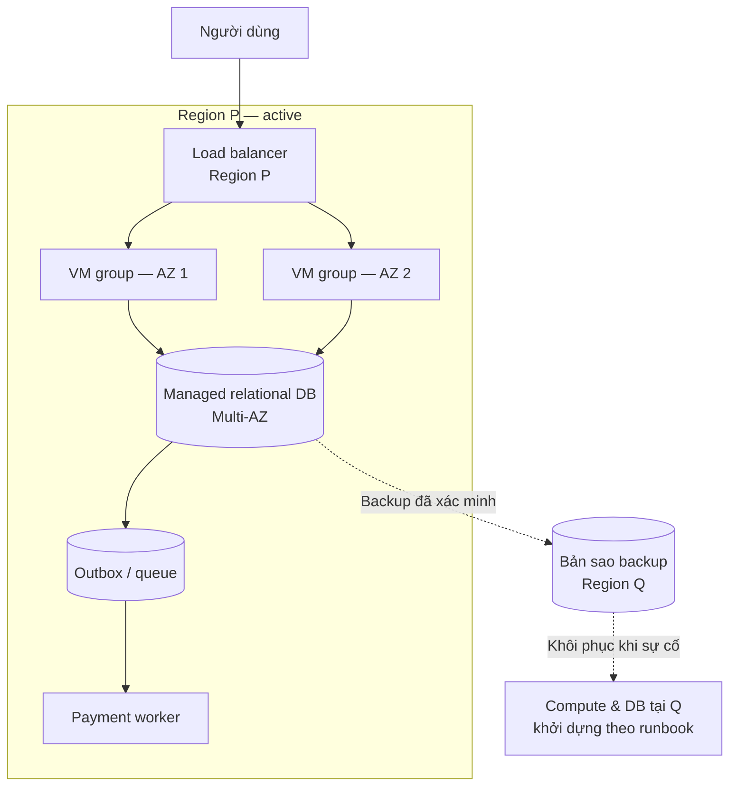
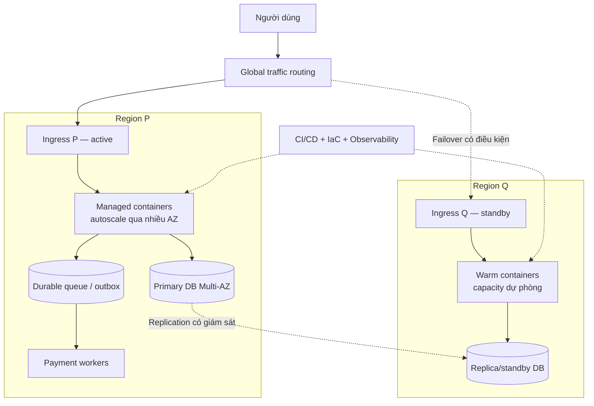
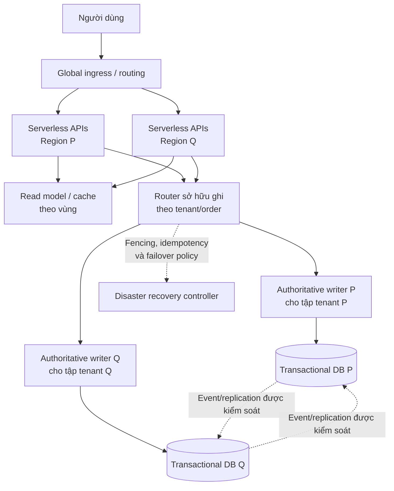

# So sánh ba phương án theo độ tin cậy, hiệu năng, chi phí và vận hành

> **Chương:** Thực hành thiết kế  
> **Module:** `CLOUD_ARCHITECTURE` — thiết kế kiến trúc ứng dụng trên đám mây từ yêu cầu nghiệp vụ đến lựa chọn mạng, compute, dữ liệu và mô hình triển khai; đánh giá các đánh đổi giữa độ tin cậy, bảo mật, khả năng mở rộng, chi phí và vận hành theo tư duy Well-Architected.

Khi được giao một bài toán kiến trúc đám mây, việc vẽ ba sơ đồ khác nhau tương đối dễ; khó hơn là chứng minh **phương án nào đáp ứng yêu cầu, phương án nào thất bại và tổ chức phải đánh đổi điều gì**. Bài thực hành này xây dựng một quy trình đánh giá có thể lặp lại: chuẩn hóa yêu cầu, đặt các phương án lên cùng nền giả định, kiểm tra ràng buộc bắt buộc, đo theo các kịch bản giống nhau, so sánh bốn trục chính và ghi lại quyết định.

Bài học sử dụng một **tình huống giả định** về hệ thống đặt hàng đa thị trường. Các region, mức tải, chi phí và kết quả đo được trình bày để học cách ra quyết định; **đây không phải kết quả benchmark hay báo giá của một nhà cung cấp đám mây cụ thể**. Khi áp dụng ở dự án thật, cần thay số liệu giả định bằng telemetry, load test, báo giá và bằng chứng vận hành thực tế.

## 1. Kết quả cần đạt và sản phẩm phải nộp

Sau bài này, bạn có thể:

1. Biến mô tả nghiệp vụ thành tập yêu cầu đo được cho reliability, performance, cost, operations và các ràng buộc bảo mật/dữ liệu.
2. Lập ba phương án triển khai khác biệt về **compute, dữ liệu, mạng, mô hình dự phòng và cách vận hành**, đồng thời nêu các phụ thuộc chung.
3. Tách **hard gate** (điều kiện bắt buộc) khỏi **tiêu chí có thể đánh đổi**.
4. Ước tính lưu lượng đỉnh, error budget, năng lực dự phòng, chi phí hằng tháng và chi phí trên mỗi đơn vị.
5. Thiết kế phương pháp xác minh RTO/RPO, p95/p99 latency, throughput, tính đúng đắn giao dịch và khả năng rollout/rollback.
6. Lập bảng điểm có trọng số, kiểm tra độ nhạy và giải thích điều kiện nào làm đổi lựa chọn.
7. Viết khuyến nghị kiến trúc cùng rủi ro còn tồn đọng, bằng chứng cần bổ sung và trigger xem xét lại.

**Bộ sản phẩm cuối bài** gồm: một bảng yêu cầu; ba sơ đồ phương án; bảng hard gate; ma trận so sánh bốn trục; mô hình chi phí ba kịch bản; một thí nghiệm kiểm chứng; bảng tính điểm và độ nhạy; một **Architecture Decision Record (ADR)** ngắn. Bài có **lời giải tham khảo** để đối chiếu phương pháp, không áp đặt một đáp án cố định cho mọi tình huống.

## 2. Đề bài: nền tảng đặt hàng trên đám mây

Một nền tảng thương mại điện tử phục vụ nhiều thị trường muốn thiết kế lại backend đặt hàng. Hiện tại backend chạy trên các máy ảo và database quan hệ đặt cùng một khu vực, khả năng phục hồi còn phụ thuộc thao tác thủ công. Chủ sản phẩm cần mở rộng các chiến dịch lớn mà không gây lỗi đặt hàng; đội vận hành muốn giảm công bảo trì; nhóm bảo mật yêu cầu kiểm soát dữ liệu khách hàng.

### Thông số đầu vào cho bài tập

| Nhóm | Thông tin / yêu cầu giả định |
| --- | --- |
| Hành trình quan trọng | Xem giỏ hàng → tạo đơn → yêu cầu thanh toán → nhận trạng thái; cần kiểm soát thao tác gửi lại do timeout. |
| Lưu lượng bình quân | **180 request/giây** trên toàn API, trung bình 24 giờ/ngày. |
| Lưu lượng đỉnh | **1.800 request/giây** kéo dài **15 phút** trong chiến dịch. |
| Cơ cấu request tại đỉnh | 70% đọc, 30% tạo/cập nhật dữ liệu; tải đến database và dịch vụ thanh toán còn phụ thuộc nghiệp vụ. |
| Hiệu năng | p95 latency API checkout **không quá 450 ms** tại tải đỉnh, với ranh giới đo thống nhất; tỷ lệ lỗi kỹ thuật tại tải kiểm thử **không quá 0,1%**. |
| Độ sẵn sàng | SLO **99,9%** cho request checkout hợp lệ trong mỗi cửa sổ 30 ngày, đo tại điểm được thống nhất. |
| Phục hồi | Nếu một region chính không thể phục vụ, **RTO mục tiêu 30 phút** cho tạo đơn mới. Phải phân tích riêng tính đúng đắn dữ liệu giao dịch và khả năng đối soát. |
| Dữ liệu | Cho phép xử lý/backup dữ liệu cá nhân chỉ trong **Region P và Region Q** đã được nhóm pháp lý phê duyệt trong tình huống giả định. |
| Tính đúng đắn | Không được tạo **hai khoản thu** cho cùng idempotency key. Giao dịch đã xác nhận phải có đường truy vết và khôi phục/đối soát đáng tin cậy. |
| Khả năng vận hành | Nhóm platform nhỏ, cần triển khai có kiểm soát, quan sát theo phiên bản và rollback được. |
| Ngân sách | Trần **35.000 USD/tháng** cho chi phí cloud dự kiến ở kịch bản cơ sở; chi phí nhân lực và một lần di chuyển được ghi riêng trong TCO. |

**Điểm phải làm rõ:** một request API không đồng nghĩa với một giao dịch thanh toán; 30% request ghi không có nghĩa 30% request tạo khoản thu. Không thể suy trực tiếp transaction throughput hay số connection DB từ số RPS trên mà không xác định traffic mix và hành vi từng endpoint.

Trong tình huống này, gọi hai vùng được phép là **P** và **Q** để không gắn với một provider/địa lý thực. **Điều kiện cả hai vùng hỗ trợ đúng loại dịch vụ, tính năng, quota và chính sách dữ liệu phải được xác minh trong dự án thật**.

### Bốn trục đánh giá

| Trục | Mục đích | Điều phải chứng minh |
| --- | --- | --- |
| **Độ tin cậy (Reliability)** | Dịch vụ tiếp tục hoặc phục hồi đúng khi thành phần lỗi. | Availability SLO, RTO/RPO, phạm vi lỗi lan rộng, chống thanh toán trùng, khả năng backup/restore và failover. |
| **Hiệu năng (Performance efficiency)** | Giữ latency và throughput khi tải tăng. | p95/p99 latency, lỗi tại tải đỉnh, autoscaling, kết nối DB, hiệu năng khi một AZ hỏng và năng lực chịu đột biến. |
| **Chi phí (Cost optimization)** | Kiểm soát TCO trong nhiều mức tải. | Compute, database, network/egress, standby, backup, quan sát, license, năng lực dự phòng và chi phí vận hành. |
| **Vận hành (Operational excellence)** | Đội có thể triển khai, giám sát, sửa lỗi và khôi phục an toàn. | Độ phức tạp CI/CD, IaC, on-call, quy trình rollback, số hệ thống phải quản lý, khả năng diễn tập và mức phụ thuộc người có chuyên môn. |

**Bảo mật, quyền riêng tư và dữ liệu** luôn được kiểm tra như ràng buộc xuyên suốt. Không chọn phương án có điểm tổng cao nếu vi phạm vị trí dữ liệu, quyền truy cập tối thiểu hoặc tính đúng đắn giao dịch.

## 3. Chuẩn hóa yêu cầu trước khi chọn công nghệ

Điểm yếu phổ biến của bài so sánh là đặt ba lựa chọn công nghệ lên bàn trước khi có định nghĩa thống nhất của “nhanh”, “an toàn” và “rẻ”. Hãy chuyển thông số của đề thành những kịch bản kiểm chứng.

| ID | Yêu cầu đã chuẩn hóa | Phép kiểm chứng | Mức |
| --- | --- | --- | --- |
| REQ-01 | p95 API checkout ≤ 450 ms tại 1.800 RPS trong 15 phút, dùng traffic mix nhất quán. | Load test với trace client/API, DB và phụ thuộc bên ngoài. | Hard gate trước go-live. |
| REQ-02 | Lỗi kỹ thuật ≤ 0,1% trong bài load test định nghĩa rõ loại request hợp lệ. | So lỗi 5xx/timeout và kết quả nghiệp vụ, không tính các lỗi chủ động do input sai. | Hard gate. |
| REQ-03 | SLO 99,9% checkout hợp lệ trong 30 ngày. | SLI tại production và chính sách error budget. | Hard gate dài hạn. |
| REQ-04 | Tạo đơn mới phục hồi trong ≤ 30 phút khi mất toàn bộ P. | Diễn tập mất P trên môi trường tương đương và đo từ lúc sự cố đến khi hành trình được phục vụ. | Hard gate, cần bằng chứng. |
| REQ-05 | Một idempotency key chỉ gây tối đa một khoản thu hợp lệ. | Test retry, timeout, webhook trùng, failover và đối soát nguồn thanh toán. | Hard gate. |
| REQ-06 | Dữ liệu cá nhân và bản sao hợp lệ chỉ ở P/Q. | Data flow, backup/logs, cấu hình IAM/region, phê duyệt chính sách. | Hard gate. |
| REQ-07 | Chi phí cloud ở tải cơ sở ≤ 35.000 USD/tháng. | Mô hình giá có thành phần, giả định, hạn mức và dự phòng. | Hard gate tài chính của bài. |
| REQ-08 | Phát hành có canary, giám sát theo phiên bản và rollback được. | Diễn tập triển khai một bản lỗi có kiểm soát, đánh giá runbook. | Tiêu chí nghiệm thu vận hành. |

**Khái niệm RPO phải được tách theo dữ liệu.** Đề chưa cho phép mất bao nhiêu thay đổi đơn hàng khi P hỏng. Một yêu cầu “không thanh toán trùng” không tự động có nghĩa RPO bằng 0 cho toàn bộ hệ thống, và RTO 30 phút không chứng minh dữ liệu đã phục hồi chính xác. Nhóm phải:

1. Xác định **điểm xác nhận đơn/thanh toán**, hệ thống ghi có thẩm quyền và dữ liệu phải bảo toàn.
2. Đề xuất RPO cho đơn hàng và cho analytics/logs **riêng biệt**, xin owner nghiệp vụ xác nhận.
3. Kiểm thử các cửa sổ lỗi: DB đã commit nhưng response mất, PSP đã thu tiền nhưng webhook chậm, outbox publish lại, region chuyển vai trò writer.
4. Nếu RPO yêu cầu cho giao dịch đã xác nhận là **0**, không xem replication bất đồng bộ một mình là lời giải: cần giao thức xác nhận, kiến trúc ghi và quy trình khôi phục đủ mạnh để chứng minh.

Sự thiếu thông tin là một **giả định cần xử lý** trong bài thực hành, không phải lý do âm thầm tự chọn bảo đảm dữ liệu yếu hơn.

### Danh sách giả định ban đầu

| ID | Giả định đang sử dụng | Nếu sai thì sao? | Cách xác minh |
| --- | --- | --- | --- |
| A-01 | Lưu lượng đỉnh chỉ kéo dài 15 phút và cao gấp 10 lần trung bình. | Đánh giá thiếu capacity/cost; hệ thống giảm chất lượng khi chiến dịch kéo dài. | Telemetry lịch sử, kế hoạch marketing, stress test 30–60 phút. |
| A-02 | P và Q đều có dịch vụ managed tương ứng và quota đủ dùng. | Mô hình standby/failover không thể triển khai như thiết kế. | Kiểm tra catalog vùng, quota và giới hạn từng dịch vụ. |
| A-03 | Bộ xử lý thanh toán hỗ trợ idempotency/truy vấn đối soát. | Retry hoặc chuyển vùng có thể tạo khoản thu trùng. | Hợp đồng API, test webhook/timeout, thỏa thuận provider. |
| A-04 | 70% request đọc có thể tách khỏi đường ghi quan trọng. | Cache hoặc replica đọc gây trạng thái cũ, sai quyết định nghiệp vụ. | Phân loại endpoint và yêu cầu consistency theo hành trình. |
| A-05 | Đội có năng lực duy trì nhiều region và diễn tập thường xuyên. | Giải pháp tốt trên giấy nhưng thời gian khôi phục thực vượt RTO. | On-call roster, runbook, diễn tập và chi phí nhân lực. |

## 4. Ba phương án kiến trúc cần so sánh

Ba phương án dưới đây dùng **cùng nghiệp vụ**, cùng giả định về lưu lượng, cùng mục tiêu bảo mật và cùng yêu cầu dữ liệu. Khác biệt chủ yếu nằm ở compute và chiến lược đa region.

### Phương án A — Máy ảo autoscaling, đa AZ, khôi phục region lạnh



**Ý tưởng:** tiếp tục dùng VMs nhưng quản lý image, autoscaling, load balancer, DB Multi-AZ, IaC và backup. Region Q chứa bản backup phù hợp, năng lực phục vụ chỉ được khởi dựng khi P hỏng.

- **Ưu:** chi phí nền của Q có thể thấp; dễ giữ các ứng dụng cần OS/runtime riêng; cải thiện chịu lỗi instance/AZ so với hệ thống đơn vùng sẵn sàng.
- **Nhược:** RTO cấp region có nguy cơ dài do restore DB, khởi tạo compute, cấu hình routing và kiểm thử nhất quán. Đội vẫn chịu trách nhiệm patch image/OS, capacity và nhiều thao tác vận hành.
- **Phụ thuộc cần soi:** backup có khôi phục được không, kích thước DB, IAM/secrets tại Q, quota cấp máy, network và DNS failover.
- **Sai lầm cần tránh:** thấy database “Multi-AZ” rồi suy ra chịu được mất toàn bộ region. Multi-AZ và multi-region là hai phạm vi lỗi khác nhau.

### Phương án B — Managed containers, đa AZ, region dự phòng ấm



**Ý tưởng:** ứng dụng stateless chạy bằng managed containers đa AZ ở P. Q duy trì một mức compute và dữ liệu dự phòng, có khả năng mở rộng khi chuyển lưu lượng. Nền tảng dùng CI/CD theo region, health checks theo nghiệp vụ và outbox/queue cho thao tác bất đồng bộ.

- **Ưu:** giảm công quản lý VMs, dễ phát hành theo cell/region, không phải khởi dựng hoàn toàn từ backup ở Q, RTO có thể ngắn hơn A nếu đã diễn tập.
- **Nhược:** vẫn phải xử lý state và failover database, replication lag, quota, mạng xuyên vùng, data reconciliation và chi phí dự phòng luôn tồn tại.
- **Phụ thuộc cần soi:** replica Q có cập nhật đủ mới không, app Q có kết nối đúng writer không, có cơ chế fencing writer P khi promote Q không, worker có xử lý idempotent không?
- **Sai lầm cần tránh:** quảng bá warm standby như bảo đảm RPO bằng 0 hoặc chuyển region tự động hoàn toàn. Cần chứng minh đường dữ liệu và xác nhận nghiệp vụ.

### Phương án C — Compute serverless đa region, đường đọc active-active, quyền ghi theo vùng sở hữu



**Ý tưởng:** API không trạng thái có thể nhận request ở P/Q và được tự động cấp năng lực theo nhu cầu. Mỗi tenant hoặc phân vùng nghiệp vụ có **một nơi ghi có thẩm quyền** tại một thời điểm; vùng còn lại có thể phục vụ đọc và nhận vai trò writer theo quy trình được kiểm chứng. Đường event/replica chỉ đưa những dữ liệu được phép sao chép.

- **Ưu:** độ sẵn sàng theo địa lý và khả năng mở rộng đường API tốt trong các trường hợp phù hợp; giảm một phần trách nhiệm quản lý compute.
- **Nhược:** định tuyến write theo owner, nhất quán dữ liệu, phân quyền và failover trở nên phức tạp; serverless có giới hạn concurrency, thời lượng, thời gian khởi động và connection pressure; chi phí biến thiên mạnh theo lưu lượng.
- **Phụ thuộc cần soi:** độ trễ xuyên vùng của write, chống split-brain khi chuyển writer, replay event, giao dịch thanh toán, bí mật và khả năng quan sát trên nhiều region.
- **Sai lầm cần tránh:** coi “active-active” là cho hai database tùy ý ghi đồng thời cùng một đơn. Không có quy tắc sở hữu ghi và xử lý xung đột thì chuyển vùng có thể tạo dữ liệu sai.

Ba sơ đồ trên biểu diễn **phạm vi logic**, không khẳng định công cụ managed hay phương án mạng cụ thể nào luôn có sẵn tại P/Q. Tất cả vẫn phải đảm bảo authentication, authorization, encryption, WAF/rate limiting và audit phù hợp.

## 5. Kiểm tra điều kiện bắt buộc trước khi chấm điểm

Không thể “lấy điểm reliability bù cho lỗi bảo mật” hay “dùng chi phí rẻ để bù cho hệ thống trừ tiền hai lần”. Hãy tách **hard gates** ra khỏi bảng điểm.

| Gate | Điều kiện đạt | Cách xác minh | Hệ quả khi chưa đạt |
| --- | --- | --- | --- |
| G1 — Dữ liệu | Dữ liệu nhạy cảm/backup/logs ở nơi được phép, quyền truy cập đáp ứng chính sách. | Data-flow review, IAM policy, kiểm tra cấu hình vùng và backup. | Không phê duyệt triển khai trước khi khắc phục. |
| G2 — Đúng đắn thanh toán | Retry, webhook trùng và failover không tạo thêm khoản thu hợp lệ cho cùng key. | End-to-end tests và reconciliation với nguồn có thẩm quyền. | Loại cấu hình rủi ro; thiết kế lại trước khi tiếp tục. |
| G3 — Hiệu năng | p95 ≤ 450 ms và lỗi kỹ thuật ≤ 0,1% ở mẫu tải đã thống nhất. | Load test cùng kịch bản, cùng endpoint mix. | Tối ưu, tăng capacity hoặc loại nếu không khả thi. |
| G4 — Phục hồi | RTO cấp region ≤ 30 phút; RPO theo loại dữ liệu được chủ nghiệp vụ chấp thuận. | Game day, quan sát promotion, restore và kiểm tra dữ liệu. | Không được khẳng định phương án đạt DR mục tiêu. |
| G5 — Ngân sách | Cloud bill ở kịch bản cơ sở ≤ 35.000 USD/tháng và không ẩn thành phần lớn. | Cost model được duyệt, phương án mở rộng khi lệch dự báo. | Cần tối ưu hoặc duyệt lại ngân sách. |
| G6 — Vận hành tối thiểu | Có owner, monitoring, runbook, rollback, backup và thực hành phục hồi. | Demo deploy/rollback/restore với nhóm trực thực tế. | Chưa sẵn sàng production. |

**Không đạt** khác với **chưa có bằng chứng**. Khi chưa diễn tập region failure, trạng thái phải là *UNKNOWN/PENDING*, không tự ghi *PASS*. Bằng chứng thử nghiệm cũng phải ghi rõ ngày, cấu hình, dữ liệu mẫu, người thực hiện và những khác biệt so với production.

### Bảng kết quả giả định cho workshop

Giả sử nhóm đã mô phỏng quy trình benchmark và drill dưới cùng mô hình tải; số liệu sau dùng để **luyện quyết định**, không phải đo đạc thật:

| Kết quả giả định | A — VMs + cold DR | B — Containers + warm DR | C — Serverless đa vùng |
| --- | ---: | ---: | ---: |
| p95 API checkout lúc đỉnh | 275 ms | 330 ms | 420 ms |
| Tỷ lệ lỗi kỹ thuật lúc đỉnh | 0,06% | 0,07% | 0,08% |
| RTO khi P mất khả năng phục vụ | **74 phút** | **21 phút** | **9 phút** |
| RPO của **dữ liệu analytics** trong kịch bản thử | 4 phút | 2 phút | 2 phút |
| Chi phí cloud cơ sở / tháng | **15.800 USD** | **23.400 USD** | **32.800 USD** |
| Công vận hành thường xuyên / tháng | 40 giờ | 20 giờ | 37 giờ |
| Dữ liệu trong P/Q được phép | PASS giả định | PASS giả định | PASS giả định |
| Idempotency checkout trong kịch bản test | PASS giả định | PASS giả định | PASS giả định |
| Bằng chứng bảo toàn mọi đơn đã xác nhận | **Cần xác minh thêm** | **Cần xác minh thêm** | **Cần xác minh thêm** |

**Diễn giải:** A đạt p95, lỗi kỹ thuật và trần chi phí, nhưng **không đạt G4** vì RTO 74 phút lớn hơn 30 phút. B và C đáp ứng các ngưỡng có số liệu ở bảng, song **chưa được phê duyệt hoàn toàn** vì thiếu xác nhận RPO/độ đúng của dữ liệu giao dịch đã xác nhận. Nếu thay dữ liệu analytics RPO 2 phút bằng tuyên bố “RPO đơn hàng 2 phút”, đó là một kết luận sai loại dữ liệu.

Với A, có thể thiết kế thêm warm standby, tăng mức sẵn sàng backup hoặc thay phương án chuyển vùng rồi **đo lại**; khi đó chi phí và effort đã khác phương án A ban đầu. Không lấy bảng giá rẻ của bản A cũ để biện hộ cho một kiến trúc A đã được bổ sung tài nguyên đáng kể.

## 6. Định lượng capacity, error budget và chi phí

### 6.1 Lưu lượng và năng lực cần phục vụ

Đề cho tải bình quân \(180\) req/s và peak \(1.800\) req/s kéo dài \(15\) phút:

\[
\text{PeakMultiplier} = \frac{1.800}{180} = 10
\]

\[
\text{PeakRequests} = 1.800 \times (15 \times 60) = 1.620.000
\]

Nếu 30% số request là ghi, đỉnh tương ứng **540 request ghi/giây**, hoặc **486.000 request ghi** trong 15 phút. Đó là số thao tác phía API, không nhất thiết tương ứng 486.000 transaction database độc lập. Một request có thể có nhiều lệnh ghi, event và cập nhật hàng đợi.

Ở tải đỉnh, tỷ lệ lỗi kỹ thuật tối đa 0,1% cho một bài kiểm thử 1.620.000 request tương ứng **1.620 request lỗi** nếu mẫu được lấy đầy đủ, không có loại trừ khác và quy tắc đo dựa trên tỷ lệ request. Cần đo riêng lỗi nghiệp vụ như thanh toán trùng hoặc dữ liệu sai; một số lỗi như vậy **không thể xem là “vẫn trong ngân sách 0,1%”**.

Đối với thiết kế đa region, nếu P đang xử lý toàn bộ 1.800 req/s trước failover thì Q phải tiếp nhận được tải tương ứng sau khi P mất, với các giới hạn DB, cache, queue, rate limit và network cùng được xét. **Một vùng có compute đủ lớn nhưng DB không chịu 540 write req/s tương ứng vẫn không đạt**.

### 6.2 Error budget không thay thế RTO

Với SLO dựa trên **tỷ lệ thời gian** 99,9% trong 30 ngày, ngân sách thời gian gián đoạn lý thuyết:

\[
T_{\text{budget}} = (1-0{,}999)\times 30\times 24\times 60
= 43{,}2\;\text{phút}
\]

Nhưng yêu cầu ban đầu dùng **tỷ lệ request hợp lệ**, vì vậy **không được quy đổi cứng 99,9% thành 43,2 phút** nếu tải thay đổi theo thời gian. Với giả định tải trung bình duy trì 180 req/s suốt 30 ngày, số request xấp xỉ:

\[
N_{\text{month}} = 180\times 86.400\times30=466.560.000
\]

Ngân sách 0,1% cho mô hình request này là **466.560 request lỗi**. Một lần ngừng 10 phút ngay giữa peak có thể tiêu thụ nhiều error budget hơn ngừng cùng thời lượng ở giờ thấp tải. Do đó **RTO là mục tiêu khôi phục từng sự cố**, còn **SLO/error budget** đo mức ảnh hưởng tích lũy; cần đánh giá cả hai.

### 6.3 Mô hình chi phí công bằng

Chỉ so giá mỗi VM với giá mỗi invocation là không công bằng. Nên phân tách chi phí:

\[
C_{\text{cloud}} = C_{\text{compute}} + C_{\text{DB}} + C_{\text{network}} +
C_{\text{storage/backup}} + C_{\text{observability}} + C_{\text{security}} +
C_{\text{standby}} + C_{\text{other}}
\]

Và **TCO** còn thêm vận hành, di chuyển, đào tạo và chi phí thay đổi:

\[
C_{\text{TCO}} = C_{\text{cloud}} +
C_{\text{personnel}} + C_{\text{migration}} + C_{\text{licenses}} +
C_{\text{risk/other}}
\]

Tránh tính trùng nếu một khoản đã nằm trong cloud bill hoặc dịch vụ managed. Ghi rõ các khoản chưa định lượng, nhất là chi phí egress khi replicate/cross-region read, backup dài hạn, log/tracing có cardinality lớn và chi phí dự phòng chưa được dùng.

Theo bảng ví dụ, **B cao hơn A 7.600 USD/tháng** ở kịch bản cơ sở; **C cao hơn B 9.400 USD/tháng**. Đổi lại, mức RTO giả định của B và C thấp hơn đáng kể. Chênh lệch giá chưa chứng minh bên nào có ROI tốt hơn: cần ước lượng tác động kinh doanh của downtime và công sức vận hành.

Chi phí trên một triệu request ở tải bình quân giả định:

\[
C_{\text{per million requests}} =
\frac{C_{\text{cloud/month}}}{N_{\text{month}}/1.000.000}
\]

| Phương án | Cloud bill giả định | Chi phí / triệu request (xấp xỉ) |
| --- | ---: | ---: |
| A | 15.800 USD | 33,87 USD |
| B | 23.400 USD | 50,15 USD |
| C | 32.800 USD | 70,30 USD |

Đây là phép phân bổ **tổng cloud bill cho mọi API request**, không phải chi phí biên mỗi request và không phải chi phí trên mỗi **đơn thành công**. Khi workload mix thay đổi, mẫu số và thành phần chi phí có thể biến đổi theo cách khác nhau.

### 6.4 Kiểm tra ba kịch bản chi phí

Hãy đánh giá cùng ba mức tải dưới đây cho **từng phương án**, không chỉ kịch bản đẹp nhất:

| Kịch bản | Giả định tối thiểu | Điều cần hỏi |
| --- | --- | --- |
| **Thấp** | Traffic còn 50% dự kiến, dữ liệu tăng chậm. | Chi phí cố định của standby/cluster lớn đến mức nào? |
| **Cơ sở** | 180 req/s bình quân, peak 1.800 req/s, data growth dự báo. | Tổng chi phí có trong ngân sách, SLO có đạt? |
| **Cao/stress** | Peak kéo dài gấp 4 lần thời gian, dữ liệu tăng nhanh, một AZ giảm năng lực. | Có đủ quota/capacity, chi phí spike và cách giảm chất lượng có kiểm soát? |

Không nhân mọi khoản chi phí lên gấp đôi khi lưu lượng gấp đôi: chi phí database, license, bộ nhớ, replica, network và nhân sự có cấu trúc cố định và bậc thang. Lập bảng theo tài nguyên thực tế rồi kiểm tra độ nhạy.

## 7. Đánh giá độ tin cậy bằng failure scenarios

Đánh giá reliability chỉ bằng “có hai region” hoặc “có nhiều replica” là thiếu. Xác định sự cố, đường lan rộng, dữ liệu có thẩm quyền, cơ chế phát hiện và thao tác phục hồi.

| Sự cố / câu hỏi | A | B | C |
| --- | --- | --- | --- |
| **Mất một instance** | LB loại VM lỗi, ASG thay máy; cần health check nghiệp vụ. | Container orchestrator thay task/pod; kiểm tra warm-up và session. | Nền tảng tự quản lý instance phần nào; vẫn cần xử lý downstream failure. |
| **Mất AZ trong P** | Ứng dụng/DB Multi-AZ có thể chuyển; kiểm tra năng lực còn lại. | Container/DB sang AZ khác; cần headroom và kiểm tra queue. | Năng lực đa AZ của dịch vụ managed còn tùy cấu hình/provider; state store vẫn là điểm cần xét. |
| **Mất toàn bộ P** | Khôi phục cold từ backup ở Q; RTO có nguy cơ vượt ngưỡng. | Promote DB/cấu hình Q, scale warm compute, redirect traffic. | Router gán owner mới, fence writer cũ, chạy giao thức phục hồi state ở Q. |
| **DB nghẽn bởi tải đỉnh** | Autoscale VM không làm DB tự tăng thông lượng. | Hàng đợi/async giảm áp lực nhưng write path vẫn có giới hạn. | Thêm serverless concurrency có thể khiến connection DB quá tải nhanh hơn. |
| **Provider thanh toán timeout** | Tất cả cần idempotency/ledger/reconciliation. | Tất cả cần idempotency/ledger/reconciliation. | Tất cả cần idempotency/ledger/reconciliation. |
| **Phát hành bản code lỗi** | Cần rolling/canary và rollback VM images. | Canary theo region/cell, rollback image/flag. | Canary/traffic shifting cho functions, cần giữ tương thích schema và routing. |
| **Sai cấu hình IAM/secret toàn cầu** | Có thể ảnh hưởng nhiều AZ. | Có thể ảnh hưởng cả P và Q nếu shared control/config. | Có thể ảnh hưởng nhiều region dù compute phân tán. |

Các cơ chế tự hồi phục không miễn trừ việc **đo thời gian phát hiện sự cố** và **đo phục hồi end-to-end**. Ví dụ health check của load balancer xanh nhưng checkout không thể commit database thì dịch vụ vẫn hỏng đối với người dùng.

### Runbook mất region phải trả lời

1. Ai quyết định failover? Tín hiệu nào là đủ và tín hiệu nào cần người duyệt?
2. Region Q có đủ **compute + DB capacity + quota + network + secrets** khi nhận toàn bộ tải không?
3. Dữ liệu nào được replicate và đang trễ bao nhiêu? Nếu có ghi chưa sao chép, xử lý thế nào?
4. Cách **fence writer cũ** và ngăn ghi hai nơi cùng lúc là gì?
5. Với timeout giữa bước payment provider và DB, làm sao tránh thu trùng nhưng vẫn tìm lại khoản thu đã xác nhận?
6. Sau khi P phục hồi, quá trình **failback** và reconciliation diễn ra ra sao?
7. RTO được đo từ thời điểm nào đến thời điểm nào; thử nghiệm có bao gồm DNS/cache/session/clients đang kết nối không?

Một phương án đạt RTO nhưng không bảo toàn tính đúng đắn của các đơn đã xác nhận **chưa đáp ứng yêu cầu nghiệp vụ**.

## 8. Đánh giá hiệu năng bằng cùng traffic model

Ba thiết kế có thể đạt cùng p95 bằng những cơ chế khác nhau. Phép đo phải thống nhất:

- **Điểm đo:** từ khi request vào API gateway/edge đến lúc phản hồi API; tách riêng thời gian thanh toán bên thứ ba nếu SLO đã loại trừ.
- **Tập request:** cùng phân phối endpoint, read/write ratio, kích thước payload, phân phối tenant, số connection và trạng thái cache.
- **Tình trạng dữ liệu:** database với kích thước/index tương đương, có hot keys và tỷ lệ cache hit đại diện.
- **Thời gian kiểm thử:** warm-up, 15 phút peak, soak test dài hơn, giai đoạn autoscale và tình huống lỗi một AZ.
- **Chỉ số:** p50/p95/p99, error/timeout, DB CPU/IOPS/connections, queue depth, throttling, cold start, và throughput **đơn hàng thành công**.
- **Giới hạn ngoại vi:** mock PSP chỉ dùng trong một số phép thử tải; end-to-end reliability vẫn cần test với môi trường/điều kiện đối tác phù hợp.

Nếu B có p95 330 ms và C có 420 ms, chưa thể kết luận B tốt hơn trên mọi chiều: p99, thời gian warm-up, khả năng chịu 5× peak, độ trễ xuyên region và kịch bản failover có thể đưa ra thứ hạng khác. **Không lấy một số p95 duy nhất làm bằng chứng về hiệu năng tổng thể**.

### Hành vi “giảm chất lượng có kiểm soát”

Ở tải vượt capacity, nên giữ nghiệp vụ tạo đơn an toàn bằng cách tạm chậm analytics, recommendation, gửi email hoặc các tác vụ không chặn thanh toán. Những tính năng có thể giảm phải được owner sản phẩm cho phép; không được “tối ưu hiệu năng” bằng cách bỏ kiểm tra gian lận hoặc xác nhận giao dịch bắt buộc.

Một hệ thống hàng đợi giúp đệm công việc bất đồng bộ, nhưng nếu queue backlog dài khiến đơn không được xác nhận trong SLO thì vấn đề chỉ chuyển vị trí. Cần theo dõi **độ trễ end-to-end** và tính đúng đắn bên cạnh tốc độ API.

## 9. Đánh giá năng lực vận hành của nhóm

Đối với một nhóm platform nhỏ, vận hành là chi phí và nguồn rủi ro thực tế. Một phương án có nhiều tự động hóa không tự động dễ bảo trì hơn: số vùng, tuyến ghi, công cụ quan sát và sự cố hiếm có thể phức tạp hơn tổng thể.

| Công việc | A — VMs | B — Containers | C — Serverless đa region |
| --- | --- | --- | --- |
| Quản lý image/patch OS | Nhóm quản lý nhiều lớp OS/image. | Nền tảng quản lý một phần host; nhóm vẫn chịu trách nhiệm base image và ứng dụng. | Nền tảng che bớt host; nhóm vẫn quản lý runtime và dependency. |
| Phát hành/rollback | Rolling VM images, drain và điều khiển ASG. | Rollout theo version/region, traffic shifting, rollback image. | Alias/version traffic shifting; cần quản lý nhiều vùng và routing owner. |
| Autoscaling | Phải đặt capacity/min/max và health check. | Phải điều chỉnh CPU/queue/concurrency và DB pressure. | Compute tự mở theo cơ chế dịch vụ; phải hạn chế concurrency và bảo vệ downstream. |
| DR | Restore Q và tái dựng dịch vụ; runbook dài. | Promote dữ liệu và kích hoạt warm Q; vẫn phải diễn tập. | Failover quyền ghi/routing phức tạp; rủi ro split-brain. |
| Quan sát | VM/OS + app + DB + queue. | Containers + ingress + app + DB + queue. | Distributed traces giữa P/Q, function concurrency, event flows, data ownership. |
| Rủi ro chuyên môn | Patch, capacity, thủ công khi mất region. | Container/cluster, replication, standby. | Concurrency, dịch vụ phân tán đa vùng, consistency và debugging. |

Đừng mặc định **giờ vận hành** trong bảng ví dụ đại diện cho mọi tổ chức. Một đội có kinh nghiệm serverless và ít kinh nghiệm container có thể đảo thứ hạng; một ứng dụng legacy phụ thuộc hệ điều hành đặc thù có thể khiến phương án VMs thực dụng hơn. **Điểm vận hành phải dựa trên đội sẽ trực hệ thống**, bao gồm đào tạo và khả năng hỗ trợ sự cố ngoài giờ.

Câu hỏi buộc phải trả lời trước go-live: một người đang trực, chưa tham gia thiết kế ban đầu, có thể dựa trên runbook để chẩn đoán lỗi, rollback phiên bản và phục hồi trong thời gian mục tiêu hay không?

## 10. Chấm điểm có trọng số: công cụ hỗ trợ quyết định

Sau hard gates, nhóm có thể dùng thang **1–5** (1 là rất kém phù hợp, 5 là rất phù hợp). Dữ liệu chỉ nên được chấm khi có định nghĩa và bằng chứng đủ rõ. Trọng số dưới đây ưu tiên reliability vì checkout là đường doanh thu quan trọng.

| Trục | Trọng số | A | B | C |
| --- | ---: | ---: | ---: | ---: |
| Reliability | **35%** | 2 | 4 | 5 |
| Performance | **25%** | 4 | 4 | 3 |
| Cost | **20%** | 5 | 4 | 2 |
| Operations | **20%** | 2 | 4 | 2 |
| **Tổng điểm có trọng số** | **100%** | **3,10** | **4,00** | **3,30** |
| **Trạng thái hard gate** | — | **FAIL G4** | **PENDING data proof** | **PENDING data proof** |

Công thức:

\[
S_j = \sum_{i=1}^{4} w_i \cdot s_{ij}
\quad\text{với}\quad \sum_i w_i=1
\]

Với B:

\[
S_B=0{,}35(4)+0{,}25(4)+0{,}20(4)+0{,}20(4)=4{,}00
\]

**Tại sao A có điểm nhưng vẫn bị loại?** Điểm giúp hiểu đánh đổi; việc không đạt RTO 30 phút là rào cản của yêu cầu hiện tại, không phải điểm yếu có thể bù bằng giá rẻ. Với B/C, thiếu bằng chứng dữ liệu khiến kết quả chỉ là **khuyến nghị có điều kiện**, chưa phải quyết định go-live.

### Kiểm tra độ nhạy với trọng số

Nếu chủ sản phẩm tuyên bố giảm thời gian phục hồi quan trọng hơn nhiều và đổi trọng số thành **70% reliability, 10% performance, 10% cost, 10% operations**:

| Phương án | Điểm trước | Điểm sau | Diễn giải |
| --- | ---: | ---: | --- |
| A | 3,10 | 2,50 | Vẫn FAIL G4. |
| B | 4,00 | 4,00 | Phù hợp cân bằng nhiều tiêu chí. |
| C | 3,30 | **4,20** | Vượt B trong mô hình trọng số mới, nhưng rủi ro dữ liệu vẫn cần chứng minh. |

Việc thứ hạng B/C đảo là **kết quả của ưu tiên đánh đổi**, không phải phát hiện mới về hiệu năng thực tế. Nếu một tiêu chí chưa có chứng cứ, đưa nó vào điểm số có thể tạo cảm giác chính xác giả. Hãy kiểm tra độ nhạy theo cả:

- **Trọng số:** nhóm vận hành, tài chính, SRE và sản phẩm có ưu tiên khác nhau không?
- **Giả định chi phí:** peak kéo dài hơn hoặc yêu cầu tăng thêm region dự phòng thì phương án nào đổi mạnh nhất?
- **Giả định tải:** nếu lưu lượng tăng gấp 3 trong năm thứ hai thì DB hoặc egress nào trở thành điểm nghẽn?
- **Độ tin cậy của bằng chứng:** nếu RTO C chỉ là ước tính chưa diễn tập, điều gì xảy ra khi thực tế dài gấp 3?

Chọn phương án thắng **trong phạm vi bằng chứng hiện có**, ghi rõ những điều kiện sẽ làm thay đổi lựa chọn.

## 11. Thực hành từng bước: từ dữ liệu tới quyết định

Thực hiện theo sáu lượt; có thể làm cá nhân hoặc theo nhóm, phân vai kiến trúc sư, SRE, security, product và FinOps.

### Lượt 1 — Chuẩn hóa đề (15 phút)

Viết lại tám yêu cầu REQ-01…REQ-08. Thêm những điều **chưa được nêu đủ**: điểm commit đơn, RPO từng loại dữ liệu, loại request lỗi được tính vào SLO, phụ thuộc PSP và khả năng chuyển vùng dữ liệu. Gán owner cho mỗi câu hỏi.

**Đầu ra:** requirement matrix và tối thiểu năm giả định có tác động đến phương án.

### Lượt 2 — Vẽ ranh giới lỗi và dữ liệu (20 phút)

Vẽ lại A, B, C và bổ sung những đường thường bị bỏ quên: ingress/global DNS, IAM/secrets, DB writer/replica, queue, outbox, PSP, backup, logs, metrics và tuyến triển khai.

Dùng màu/chú thích hoặc bảng để phân biệt **đường request**, **đường ghi có thẩm quyền** và **đường phục hồi**. Trả lời: thay đổi IAM toàn cầu có thể làm hai region cùng hỏng không? Một sự kiện đã gửi vào outbox có thể bị tiêu thụ hai lần không? Ai quyết định promotion database?

**Đầu ra:** ba sơ đồ có failure domain và data flow.

### Lượt 3 — Áp hard gates (15 phút)

Đánh dấu PASS/FAIL/PENDING từng phương án theo G1…G6 và liên kết bằng chứng. Với dữ liệu đã cho, **A thất bại ở RTO**. Với các gate dữ liệu chưa đủ bằng chứng, ghi nhiệm vụ cụ thể phải kiểm chứng trước go-live.

**Đầu ra:** bảng trạng thái có owner và hạn cho mọi PENDING.

### Lượt 4 — So sánh bốn trục (20 phút)

Dùng số liệu minh họa để tính peak requests, SLO/error budget, chi phí trên triệu request. Lập bảng score 1–5 theo bốn trục và viết **ít nhất một lập luận định lượng cho mỗi điểm số**. Điểm reliability nên phân biệt đường phục hồi AZ, region và lỗi phần mềm áp dụng cho nhiều vùng.

**Đầu ra:** bảng so sánh, công thức, mô hình cost thấp/cơ sở/cao và giả định.

### Lượt 5 — Kiểm tra độ nhạy và thí nghiệm (20 phút)

Thay trọng số reliability lên 70%, ghi kết quả và giải thích. Sau đó chọn **một phép kiểm chứng có thể thay đổi quyết định**: thử region failover, kiểm tra database write bottleneck, hoặc kiểm thử thanh toán khi retry/trùng webhook.

**Đầu ra:** bảng độ nhạy và kế hoạch PoC có pass/fail, owner, môi trường, dữ liệu mẫu, giới hạn bằng chứng.

### Lượt 6 — Viết ADR và bảo vệ quyết định (15 phút)

Chọn phương án dự kiến, nêu trường hợp nào phải loại, rủi ro còn lại và yêu cầu go/no-go. Nếu chọn B, giải thích vì sao không lấy C dù RTO ngắn hơn; nếu chọn C, chứng minh lợi ích reliability bù được chi phí và độ phức tạp; nếu chọn A, **phải sửa phương án và thử lại RTO** trước khi nói đã đạt.

**Đầu ra:** ADR và bản tóm tắt một trang dành cho người duyệt.

## 12. Kế hoạch kiểm thử mẫu để phân biệt các phương án

Một thí nghiệm tốt phải đánh đúng **giả định quan trọng nhất**, không phải chỉ kiểm tra xem có deploy được ứng dụng mẫu hay không.

```yaml
# Mẫu minh họa, không phải cú pháp của một dịch vụ cloud cụ thể.
experiment_id: EXP-REGION-FAILOVER-01
question: "B và C có phục hồi checkout trong 30 phút mà không tạo thu trùng?"
scope:
  alternatives: [B, C]
  region_failure: "Mô phỏng mất khả năng phục vụ của P"
  peak_rps: 1800
  duration_minutes: 15
  read_ratio: 0.70
  write_ratio: 0.30
  data:
    - "Đơn đã commit"
    - "Giao dịch đang chờ phản hồi PSP"
    - "Webhook bị gửi lại"
    - "Event trong outbox/queue chưa xử lý"
measure:
  - checkout_recovery_time
  - success_rate_by_region
  - p95_and_p99_api_latency
  - confirmed_order_reconciliation
  - duplicate_valid_charges
  - replication_lag_and_data_loss
  - receiving_region_db_capacity
pass_criteria:
  - "RTO <= 30 phút"
  - "Không có thu trùng hợp lệ cho cùng idempotency key"
  - "RPO/độ bảo toàn dữ liệu theo yêu cầu nghiệp vụ được phê duyệt"
  - "Luồng checkout sau failover đạt SLO trong điều kiện thử"
owner: "SRE + Payment owner + Data owner"
evidence: "Log, trace, metric, thời điểm sự kiện, bản ghi đối soát"
```

**Tiến trình thử:** ghi nhận trạng thái P/Q ban đầu; tạo tải và các request thanh toán đang mở; mô phỏng sự cố P trong giới hạn được cho phép; xác nhận detection, writer fencing/promotion, route switch và khả năng xử lý tại Q; kiểm tra lại các giao dịch đã xác nhận cùng retry/webhook; sau đó diễn tập **failback** và đối soát.

Trong môi trường thật, không tạo giao dịch thu tiền thực ngoài phạm vi sandbox/ủy quyền. Một kết quả test chỉ có ý nghĩa với **đúng cấu hình, giới hạn quota, kích thước dữ liệu và tải** đã thử. Nếu P/Q không có dịch vụ như sơ đồ giả định, cần thay giả định và thiết kế trước khi kết luận.

### Kiểm chứng bổ sung theo trục

| Trục | Thử nghiệm / bằng chứng | Pass/fail cần chốt |
| --- | --- | --- |
| Reliability | AZ disruption, region failover, restore backup, duplicate PSP callback, rollback app lỗi. | RTO/RPO, không sai giao dịch, mức phục vụ tối thiểu. |
| Performance | Burst và soak test, hot tenant, cold start, DB connection pressure, degradation mode. | p95/p99, error rate, throughput, đủ headroom khi AZ mất. |
| Cost | Dự báo chi phí từ usage, giả lập peak dài, egress, replica, logging và storage tăng. | Trần chi phí theo từng kịch bản, cost/unit và cảnh báo ngân sách. |
| Operations | Canary và rollback, rotate secrets, on-call game day, IaC rebuild, quan sát end-to-end. | Thao tác có runbook, owner, audit, thời gian triển khai/khôi phục. |

## 13. Lời giải tham khảo: lập luận chọn phương án B có điều kiện

Lời giải này sử dụng **chính các giả định và kết quả mô phỏng** ở các bảng trên. Nó minh họa cách bảo vệ lựa chọn; khi làm dự án thật, không sao chép quyết định nếu thiếu bằng chứng tương ứng.

**Bước loại trừ:** A chưa đạt mục tiêu RTO vì 74 phút lớn hơn 30 phút. Dù A có mức cloud bill thấp nhất và p95 tốt, không được phê duyệt A nguyên trạng. B và C tạm đáp ứng các ngưỡng hiệu năng, phục hồi đã đo trong bài, ngân sách và vị trí dữ liệu giả định.

**Bước so sánh:** B có mức cloud bill thấp hơn C 9.400 USD/tháng và công vận hành ít hơn trong tình huống này; p95 330 ms so với 420 ms. C có RTO ngắn hơn B (9 so với 21 phút) nhưng yêu cầu xử lý dữ liệu và failover writer theo tenant phức tạp hơn. Với trọng số reliability 35%, performance 25%, cost 20%, operations 20%, B đạt 4,00 so với 3,30 của C.

**Bước giới hạn kết luận:** dữ liệu đã xác nhận chưa được chứng minh bảo toàn đầy đủ khi P hỏng và PSP timeout; do đó chọn B là **khuyến nghị kiến trúc cho bước triển khai thử nghiệm**, còn **go-live đa region** phụ thuộc phép kiểm chứng về data integrity, RPO và reconcile. Nếu hội đồng đặt trọng số reliability 70% và C chứng minh được cơ chế phục hồi dữ liệu, C có thể là lựa chọn hợp lý hơn.

**Rủi ro còn lại cho B:**

| Rủi ro | Biện pháp giảm thiểu | Owner | Điều kiện chặn go-live |
| --- | --- | --- | --- |
| Replica Q trễ, dữ liệu giao dịch không đầy đủ sau promotion. | Xác định RPO, transaction boundary, replay từ nguồn có thẩm quyền, đối soát với PSP. | Data + Payment | Chưa chứng minh được bảo toàn những khoản thu đã xác nhận. |
| Failover chuyển tải làm DB Q quá tải. | Capacity test, kiểm tra quota, warm capacity, giới hạn concurrency và degrade tính năng phụ. | Platform/SRE | Q không xử lý được lưu lượng mục tiêu sau chuyển vùng. |
| CI/CD cập nhật lỗi cả hai region. | Phát hành theo wave, canary, dừng toàn chiến dịch khi gate lỗi, rollback được. | Release owner | Chưa diễn tập dừng và rollback. |
| Secret/IAM hoặc cấu hình chung gây lỗi cả P/Q. | Tách failure domain hợp lý, kiểm toán quyền, phục hồi cấu hình, chạy game day. | Security/SRE | Đường checkout phụ thuộc một điểm lỗi chưa có xử lý. |
| Chi phí warm standby và egress tăng khi tải thay đổi. | Theo dõi cost/transaction, cấu hình retention, kế hoạch stress và budget alerts. | FinOps | Dự báo vượt mức được duyệt mà chưa có phương án. |

### Ví dụ ADR ngắn

```markdown
# ADR-007 — Chọn kiến trúc backend checkout

Status: PROPOSED / CONDITIONAL
Context:
- 180 RPS bình quân; 1.800 RPS peak trong 15 phút.
- Checkout p95 <= 450 ms, RTO mất region <= 30 phút.
- Dữ liệu nhạy cảm trong các region được phép; giới hạn cloud bill 35.000 USD/tháng.
- Idempotency và bảo toàn giao dịch là yêu cầu bắt buộc.

Decision:
- Ưu tiên B: managed containers multi-AZ ở P, warm standby ở Q,
  managed relational DB và outbox/queue có cơ chế idempotency.
- Không chọn A hiện tại vì giả lập DR cho RTO 74 phút.
- Chưa chọn C vì tăng chi phí và phức tạp quyền ghi theo vùng
  so với lợi ích RTO trong bộ ưu tiên hiện tại.

Evidence:
- B p95 330 ms, lỗi 0,07%, RTO 21 phút, cloud bill 23.400 USD/tháng
  (tất cả chỉ là số liệu của bài tập).
- Scoring: B 4,00; C 3,30 theo trọng số đã thống nhất.

Unresolved:
- Chứng minh bảo toàn giao dịch đã xác nhận, RPO thực tế,
  PSP reconciliation, failback và vùng dữ liệu hợp lệ.

Go-live gate:
- Kết quả kiểm thử end-to-end được owner nghiệp vụ, SRE và
  security duyệt; có khả năng rollback và runbook diễn tập.

Revisit when:
- Nhu cầu RTO giảm dưới 10 phút; workload/chi phí đổi mạnh;
  chính sách region thay đổi; yêu cầu active-active theo thị trường.
```

**Lưu ý:** ADR ở trên là ví dụ cách ghi **quyết định có điều kiện**. Trong hồ sơ thật phải liên kết nguồn số liệu và ngày kiểm thử, địa chỉ tài liệu yêu cầu, người phê duyệt và phạm vi triển khai. Không chuyển `Status: PROPOSED` thành `ACCEPTED` khi các hard gate vẫn đang PENDING.

## 14. Biến thể để luyện phân tích không phụ thuộc đáp án

Sau khi làm xong phương án cơ sở, hãy thay **một yếu tố mỗi lần** và xem quyết định có đảo không:

| Biến thể | Thay đổi đề | Câu hỏi cần giải |
| --- | --- | --- |
| **V1 — Giảm RTO** | RTO giảm từ 30 xuống 5 phút. | Có phương án nào hiện tại đạt? Cần thay đổi recovery model ra sao? |
| **V2 — Tiết kiệm** | Trần cloud bill giảm từ 35.000 xuống 20.000 USD/tháng. | Có phương án vừa đạt RTO vừa đạt ngân sách không? Phải thương lượng yêu cầu nào? |
| **V3 — Đỉnh kéo dài** | Peak 1.800 req/s kéo dài 6 giờ mỗi ngày. | Cost model và mô hình autoscaling/serverless nào đổi đáng kể? |
| **V4 — Không được sao chép dữ liệu** | Một loại PII chỉ được tồn tại trong P. | Failover sang Q có còn hợp lệ? Cần phân tách loại dữ liệu/hành trình nào? |
| **V5 — Đội thiếu chuyên môn đa vùng** | Không có người có thể xử lý promotion/failback an toàn trong trực đêm. | Cần thay cơ chế, tăng managed support hay giảm độ phức tạp? |
| **V6 — Đòi RPO bằng 0** | Đơn đã xác nhận không được phép mất dưới bất kỳ kịch bản lỗi region nào được xác định. | Thiết kế commit/replication/ledger hiện tại có chứng minh được không? Độ trễ tăng thế nào? |

Với V2, không nên chọn A chỉ vì A dưới 20.000 USD: A **vẫn vi phạm RTO**. Kết luận có thể là **chưa có phương án thỏa đồng thời các ràng buộc**; cần thiết kế thêm hoặc thảo luận lại mục tiêu/ngân sách với chủ sở hữu phù hợp.

Với V1, cả B (21 phút) và C (9 phút) trong bảng giả định đều chưa đạt 5 phút. Việc sửa mục tiêu không làm cho kết quả thử nghiệm cũ tự tốt hơn.

## 15. Rubric tự đánh giá bài thực hành

| Tiêu chí | Trọng số học tập | Đạt yêu cầu khi |
| --- | ---: | --- |
| Chuẩn hóa yêu cầu và hard gates | 20% | Có tiêu chí đo/owner, phân biệt hard gate với ưu tiên đánh đổi và yêu cầu dữ liệu chưa rõ. |
| Ba kiến trúc có ranh giới lỗi/dữ liệu | 20% | Sơ đồ compute, network, DB/queue/replica và recovery, không ngụy nhận multi-AZ thành multi-region. |
| Định lượng reliability, performance và cost | 20% | Tính đúng peak/error budget, có kiểm thử RTO/RPO và mô hình TCO cùng giả định. |
| Ma trận so sánh công bằng | 15% | So bốn trục trên cùng tải/điều kiện, có bằng chứng, tính điểm đúng và áp gate trước score. |
| Phân tích độ nhạy và thiết kế thí nghiệm | 15% | Cho thấy khi nào thứ hạng thay đổi, có test pass/fail và giới hạn chứng cứ. |
| ADR, rủi ro và kế hoạch vận hành | 10% | Quyết định có điều kiện, owner, go-live gate, rollback/failback và trigger xem xét lại. |
| **Tổng** | **100%** | Có thể bảo vệ quyết định trước product, security, SRE và finance. |

### Những lỗi khiến bài chưa đạt

- Chọn “điểm cao nhất” khi phương án vi phạm ràng buộc bắt buộc.
- Trình bày các số p95, cost, RTO trong đề **như benchmark sản phẩm cloud thật**.
- Chỉ nói “Multi-AZ nên high availability” mà bỏ qua mất region, dữ liệu và PSP.
- Gọi replication bất đồng bộ là không mất dữ liệu ở mọi sự cố.
- Không kiểm chứng idempotency khi retry, failover hoặc webhook được gửi nhiều lần.
- So sánh chi phí compute mà bỏ qua dữ liệu, egress, DR, observability và nhân lực.
- Không phân biệt thử nghiệm đã chạy với việc cần phải kiểm thử, hoặc biến PENDING thành PASS.
- Không xét khả năng người trực thực hiện các thao tác trong RTO đã cam kết.

## 16. Checklist bàn giao thiết kế

- [ ] Có mục tiêu nghiệp vụ, traffic mix, SLI/SLO và điều kiện kiểm thử định lượng.
- [ ] RTO/RPO được định nghĩa theo loại dữ liệu, có tiêu chí bảo toàn giao dịch đã xác nhận.
- [ ] Có ba phương án mô tả cùng phạm vi, cùng giả định và có sơ đồ failure domain.
- [ ] Có cơ chế xác thực, phân quyền, mã hóa, giới hạn dữ liệu theo region và đánh giá phụ thuộc bên ngoài.
- [ ] Có kết quả hard gates với trạng thái PASS/FAIL/PENDING rõ ràng và bằng chứng/owner cho từng gate.
- [ ] Có giả định về capacity P/Q, p95/p99, DB bottleneck, latency cross-region và hành vi khi quá tải.
- [ ] Có mô hình chi phí cloud và TCO, ba kịch bản tải và chi phí trên một đơn vị có ý nghĩa.
- [ ] Có điểm số bốn trục với trọng số phê duyệt, kiểm tra độ nhạy và nhận thức giới hạn số điểm.
- [ ] Có ít nhất một PoC hoặc game day đủ sức xác minh giả định có thể đảo lựa chọn.
- [ ] Có kế hoạch triển khai theo đợt, rollback, failover/failback, xử lý dữ liệu và quan sát.
- [ ] Có ADR với bối cảnh, phương án bị loại, bằng chứng, điều kiện go-live và rủi ro còn lại.
- [ ] Quyết định cuối cùng có owner chịu trách nhiệm và điều kiện xem xét lại khi bài toán thay đổi.

**Kết quả quan trọng nhất của bài thực hành** là khả năng giải thích vì sao một phương án phù hợp hơn các phương án khác **trong bối cảnh cụ thể**, bằng yêu cầu đo được, ràng buộc được tôn trọng và bằng chứng có thể kiểm tra. Kiến trúc tốt không chỉ phục vụ bình thường khi mọi thứ thuận lợi; nó còn có con đường vận hành và phục hồi rõ ràng khi các giả định bị thử thách.
