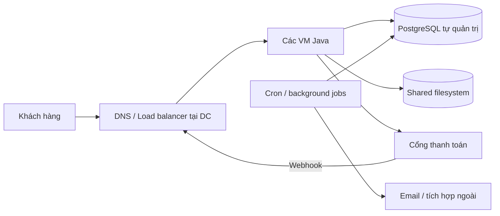
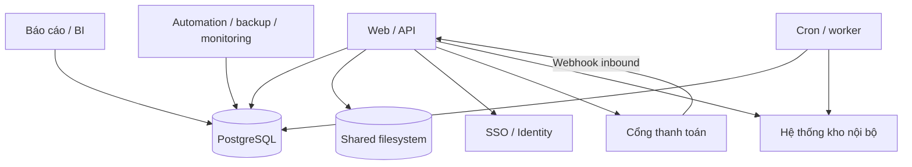
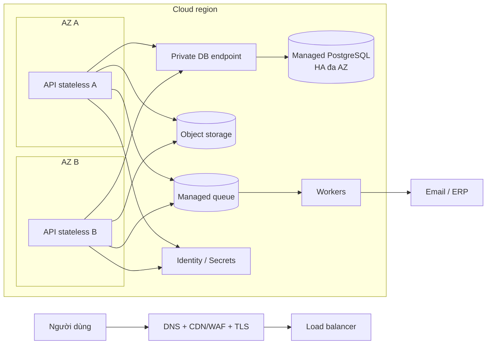
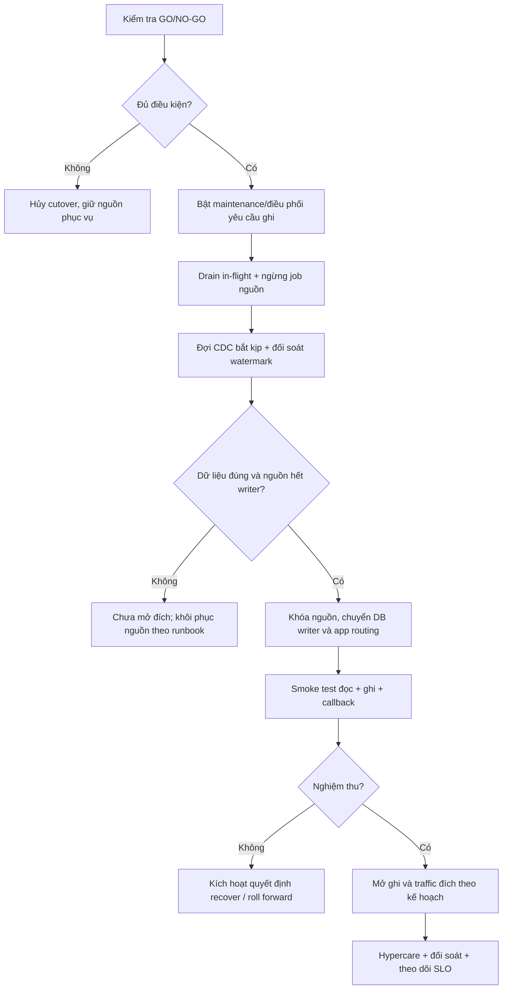

# Xây dựng kế hoạch di chuyển một hệ thống đang hoạt động

## 1. Mục tiêu của bài thực hành

Di chuyển một ứng dụng đang phục vụ người dùng lên đám mây không đơn thuần là sao chép mã nguồn, máy ảo và cơ sở dữ liệu. Khi hệ thống vẫn có giao dịch phát sinh, mỗi thay đổi về mạng, compute, lưu trữ hay cách triển khai đều có thể ảnh hưởng tới **tính đúng đắn của dữ liệu, trải nghiệm khách hàng và khả năng phục hồi**. Một kế hoạch di chuyển tốt phải xác định được khi nào được chuyển lưu lượng, ai có quyền quyết định, kết quả nào chứng minh việc chuyển đổi thành công và làm gì nếu xuất hiện lỗi.

Bài học thuộc chương **Thực hành thiết kế** của học phần `CLOUD_ARCHITECTURE`. Người học vận dụng yêu cầu nghiệp vụ để lựa chọn kiến trúc mạng, compute, dữ liệu và mô hình triển khai; đánh giá đánh đổi giữa độ tin cậy, bảo mật, khả năng mở rộng, chi phí và vận hành theo tư duy **Well-Architected**.

Sau bài học, bạn có thể:

1. Khảo sát hệ thống hiện hữu và lập bản đồ phụ thuộc trước khi di chuyển.
2. Chuyển yêu cầu kinh doanh thành tiêu chí di chuyển kiểm chứng được, gồm mức gián đoạn chấp nhận, tính toàn vẹn dữ liệu, SLO và RPO/RTO.
3. So sánh các chiến lược di chuyển ứng dụng, dữ liệu và lưu lượng; chọn cách phù hợp với ràng buộc thực tế.
4. Chia thành các đợt di chuyển, xây dựng runbook cutover, tiêu chí GO/NO-GO và phương án phục hồi.
5. Tính toán sơ bộ thời gian truyền dữ liệu, capacity, rủi ro, chi phí và tổ chức kiểm thử trước khi chuyển production.
6. Viết hồ sơ quyết định kiến trúc (ADR) và đánh giá thiết kế theo Well-Architected.

**Đầu ra của bài thực hành:** bản kiểm kê hệ thống, sơ đồ trạng thái hiện tại và đích, ma trận lựa chọn giải pháp, kế hoạch di chuyển dữ liệu, lịch triển khai theo đợt, runbook cutover/rollback, danh sách rủi ro và bằng chứng nghiệm thu.

## 2. Tình huống xuyên suốt: hệ thống đặt hàng đang phục vụ khách

Giả sử doanh nghiệp có một ứng dụng đặt hàng vận hành trong trung tâm dữ liệu nội bộ. Người dùng truy cập website và API; dữ liệu đơn hàng lưu trong PostgreSQL tự quản trị; tệp sản phẩm nằm trên lưu trữ dùng chung; công việc gửi thông báo chạy trong tiến trình nền.

### Hiện trạng giả định

| Thành phần | Hiện trạng | Khó khăn cần giải quyết |
| --- | --- | --- |
| Website và API | 3 máy ảo chạy ứng dụng Java, sau một load balancer nội bộ | Triển khai thủ công, tăng/giảm máy mất thời gian |
| Cơ sở dữ liệu | PostgreSQL primary trên VM, một bản sao standby và backup theo lịch | Vận hành bản vá, giám sát failover và restore tốn nhân lực |
| Phiên đăng nhập | Một phần trạng thái giữ trong bộ nhớ máy ứng dụng | Chuyển lưu lượng có thể làm người dùng mất phiên |
| Ảnh và chứng từ | Shared filesystem/NFS | Khó mở rộng và sao chép nhất quán với metadata |
| Xử lý nền | Cron/job nội bộ gửi email, đồng bộ kho | Job có thể chạy trùng khi bật cả hai môi trường |
| Thanh toán | Gọi cổng thanh toán bên ngoài; nhận webhook | Có rủi ro gửi lại giao dịch và webhook khi đổi endpoint |
| Bảo mật | Quyền mạng và bí mật cấu hình được quản lý phân tán | Cần kiểm kê quyền, mã hóa và nhật ký truy cập |
| Vận hành | Log trên VM, dashboard chưa có SLO theo hành trình đơn hàng | Khó nhận diện lỗi ngay khi thay đổi lưu lượng |

Sơ đồ logic:



### Yêu cầu kinh doanh minh họa

| Mã | Yêu cầu | Chỉ số hoặc quy tắc chấp nhận |
| --- | --- | --- |
| BR-01 | Website và API tiếp tục phục vụ trong quá trình chuyển | Khoảng dừng **ghi đơn hàng có kế hoạch không vượt 10 phút** |
| BR-02 | Không mất hoặc nhân đôi đơn đã xác nhận trong cutover | Mọi đơn đã trả thành công trước lúc đóng ghi được đối soát ở đích; không phát sinh giao dịch thu tiền trùng |
| BR-03 | Hiệu năng tại tải cao điểm | 450 request/giây, p95 API đặt hàng dưới 700 ms trong kiểm thử tải đã thống nhất |
| BR-04 | Mục tiêu sẵn sàng sau di chuyển | SLO 99,9%/tháng cho hành trình tạo đơn |
| BR-05 | Chịu lỗi hạ tầng | Kiểm thử mất một instance và một availability zone (AZ) thuộc phạm vi HA |
| BR-06 | Khôi phục sau sự cố trong phạm vi đã xác định | RTO 60 phút; RPO 15 phút **cho kịch bản DR được doanh nghiệp phê duyệt** |
| BR-07 | Bảo mật | Dữ liệu cá nhân được phân quyền, mã hóa, ghi audit; kiểm soát nơi lưu dữ liệu |
| BR-08 | Tài chính và vận hành | Chi phí tháng có ngân sách dự kiến và cảnh báo; có runbook/on-call |

Các số liệu trên **chỉ phục vụ bài tập**. Trong dự án thật phải đo traffic theo giờ/ngày, thống nhất công thức SLO và xác nhận chính xác kịch bản áp dụng RTO/RPO. Mục tiêu “không mất đơn đã xác nhận khi cutover” là điều kiện toàn vẹn giao dịch của đợt chuyển đổi, **khác** RPO cho thảm họa. Cơ chế đồng bộ bất đồng bộ tự nó chưa chứng minh được mất dữ liệu bằng không.

## 3. Phân biệt các loại di chuyển

Di chuyển lên cloud gồm nhiều quyết định có thể khác nhau cho từng thành phần:

| Cách tiếp cận | Ý nghĩa | Ví dụ phù hợp | Đánh đổi |
| --- | --- | --- | --- |
| **Rehost** | Di chuyển workload gần như nguyên trạng | Chuyển một VM ứng dụng lên VM cloud | Nhanh hơn nhưng có thể giữ nguyên nợ kỹ thuật, vận hành |
| **Replatform** | Đổi một phần nền tảng, hạn chế sửa nghiệp vụ | Java app chạy trên PaaS/managed containers, PostgreSQL chuyển sang managed DB | Giảm công vận hành; cần kiểm tra tương thích và kết nối |
| **Refactor / rearchitect** | Thay đổi thiết kế ứng dụng và phân ranh giới dịch vụ | Tách job nền, sửa cách quản lý phiên, sự kiện hóa giao dịch | Linh hoạt hơn nhưng phức tạp, khó hoàn thành cùng một đợt |
| **Repurchase** | Thay ứng dụng bằng SaaS hoặc sản phẩm khác | Dùng nền tảng CRM SaaS thay công cụ nội bộ | Đổi quy trình nghiệp vụ, chuyển dữ liệu và tích hợp |
| **Retain** | Giữ tại chỗ trong một giai đoạn | Hệ thống chưa hỗ trợ di chuyển hoặc cần thiết bị đặc thù | Vẫn cần kết nối hybrid, vận hành hai nơi |
| **Retire** | Ngừng thành phần không còn cần thiết | Batch cũ hoặc dịch vụ không có người sử dụng | Phải xác minh không còn phụ thuộc ngầm |
| **Relocate** | Chuyển hạ tầng ảo hóa tương thích với ít thay đổi hệ điều hành | Di chuyển workload cùng công nghệ ảo hóa khi nhà cung cấp hỗ trợ | Phụ thuộc khả năng nền tảng, ít tận dụng managed services |

Đây là những **nhóm chiến lược**, không phải thứ tự bắt buộc. Trong ví dụ, có thể chọn **replatform cho web/API và PostgreSQL**, **refactor nhỏ** để tách phiên/job khỏi VM, **retain** một tích hợp nội bộ trong giai đoạn đầu, và chỉ tối ưu sâu sau khi production ổn định.

### Tránh gộp quá nhiều thay đổi vào một đợt

Nếu vừa chuyển DB, vừa chia monolith thành 12 microservices, vừa đổi API, vừa thay cổng thanh toán, số biến cần kiểm tra tăng mạnh. Nên phân biệt:

- **Thay đổi cần thiết để cutover an toàn:** endpoint, credentials, kết nối mạng, session state, storage, background jobs, kiểm thử tương thích.
- **Thay đổi nên làm trước để giảm rủi ro:** bổ sung observability, backup/restore, idempotency, IaC, khả năng bật/tắt tác vụ.
- **Thay đổi có thể trì hoãn:** phân rã miền nghiệp vụ, tối ưu kiến trúc lớn và thay công nghệ không cần thiết cho mục tiêu di chuyển.

## 4. Khảo sát hệ thống trước khi thiết kế đích

Bước đầu tiên không phải vẽ cloud đẹp mà là thu thập **sự thật đang vận hành**.

### 4.1. Ma trận kiểm kê

| Nhóm cần kiểm kê | Dữ liệu cần thu thập | Vì sao quan trọng |
| --- | --- | --- |
| Workload | Ứng dụng, version, runtime, OS, container/VM, cấu hình khởi động | Xác định tương thích và phương án đóng gói |
| Tải thực tế | Request rate, peak, concurrency, CPU/RAM, I/O, batch window | Sizing đích và kiểm thử capacity |
| CSDL | Engine/version, extension, schema, dữ liệu lớn, transaction rate, WAL/binlog, index, stored procedure | Chọn dịch vụ managed và cơ chế sao chép |
| Dữ liệu phi cấu trúc | Tổng dung lượng file, số lượng, cách đổi tên, checksum, người sở hữu | Lập kế hoạch object storage và đồng bộ |
| Phụ thuộc | DNS, IdP, cổng thanh toán, email, ERP, ERP nội bộ, firewall, VPN, IP allowlist | Tránh lỗi kết nối sau cutover |
| Trạng thái và job | Session, cron, scheduler, queue, tệp tạm, cache, webhook | Tránh mất phiên, chạy job trùng hoặc bỏ sót |
| Bảo mật | Dữ liệu nhạy cảm, account/role, chứng chỉ, secrets, khóa mã hóa, audit | Thiết kế quyền và tuân thủ |
| Vận hành | Backup, restore time, deploy, incident, on-call, dashboard, alert, runbook | Xác định các phụ thuộc để khôi phục |
| Giấy phép/chi phí | License, hợp đồng, egress, storage, băng thông, thời gian dùng song song | Ước lượng ngân sách |

Phải rà **phụ thuộc ngược**: không chỉ ứng dụng gọi gì, mà còn hệ thống nào đang gọi ứng dụng. Ví dụ cổng thanh toán gửi webhook vào IP cũ; kho hàng truy vấn trực tiếp DB nội bộ; công cụ báo cáo dùng cron đọc file từ NFS; nhân viên vận hành chạy script vào một schema không nằm trong tài liệu.

### 4.2. Vẽ bản đồ phụ thuộc



Mỗi cạnh nên có dữ liệu: **source, destination, direction, port/protocol, identity, độ trễ cho phép, retry, chủ sở hữu, môi trường, điều gì xảy ra nếu mất kết nối**. Phụ thuộc không được xác nhận là một rủi ro cần điều tra trước cutover.

### 4.3. Baseline cần đo

Thu thập tối thiểu 1–2 chu kỳ nghiệp vụ có ý nghĩa, gồm giờ cao điểm, các batch theo ngày và chu kỳ khuyến mại nếu có. Ghi request rate, p50/p95/p99, error rate, DB transaction/giây, số kết nối, slow queries, lag replication, tài nguyên, throughput và tỷ lệ thành công của hành trình tạo đơn. Nếu chưa có dữ liệu đủ tin cậy, đánh dấu là **giả định** và dành công sức bổ sung đo đạc.

## 5. Thiết kế kiến trúc đích trên cloud

Một phương án mục tiêu cho ví dụ có thể là:



Sơ đồ thể hiện quan hệ logic, **không khẳng định** mọi dịch vụ managed đều nằm trong subnet của ứng dụng. Private endpoint, kết nối tới dịch vụ khu vực, tuyến ra ngoài, NAT và chính sách firewall phải thiết kế theo khả năng thực tế của nhà cung cấp.

### Quyết định cần ghi rõ

| Mảng | Phương án ban đầu | Kiểm tra trước khi chốt |
| --- | --- | --- |
| Network | Môi trường phân đoạn; LB công khai, API và DB không mở truy cập trực tiếp từ Internet | CIDR chồng lấn, DNS hybrid, outbound access, TLS, private endpoints |
| Compute | Managed containers/PaaS, tối thiểu 2 AZ và đủ công suất N-1 | Startup time, autoscaling, quota, health checks, cold start nếu serverless |
| Data | Managed PostgreSQL với HA và backup/PITR phù hợp | Compatibility, extensions, schema, failover, connection limit, restore test |
| Files | Object storage; URL/ACL có kiểm soát | Kiểm tra checksum, MIME, quyền public/private, lifecycle |
| Session | Kho phiên dùng chung hoặc cơ chế stateless được bảo vệ | Không phụ thuộc vào bộ nhớ một instance |
| Background jobs | Queue + worker hoặc scheduler có khóa/lease | Không có hai worker cùng thực hiện giao dịch không idempotent |
| Identity | IAM workload, secret manager, least privilege | Kết nối DB và API có đúng phạm vi quyền |
| Observability | Metrics, logs, traces, synthetics, alert theo SLO | Có thể đối chiếu lỗi nguồn và lỗi đích trong quá trình cutover |
| Deployment | IaC và CI/CD với rollback ứng dụng | Schema migration tương thích, phân quyền production |

**Multi-AZ là một phần của độ tin cậy, không thay thế DR.** Nếu yêu cầu bao gồm mất cả region, phải phân tích riêng nơi lưu backup, khả năng phục hồi tại region khác, khóa mã hóa, DNS, nhân bản dữ liệu và thực đo RPO/RTO. Không suy ra đạt yêu cầu chỉ vì bật cờ “managed” hoặc “HA”.

## 6. Chọn mẫu di chuyển phù hợp

Có ba cách tổ chức chuyển đổi thường gặp:

| Mẫu | Cách thực hiện | Ưu điểm | Hạn chế |
| --- | --- | --- | --- |
| **Big bang** | Dừng hệ thống, chuyển ứng dụng/dữ liệu, bật đích cùng lúc | Ít trạng thái trung gian | Nguy cơ downtime dài, khó quay lui với dữ liệu mới |
| **Parallel run / blue–green** | Chuẩn bị đích song song, so sánh rồi chuyển lưu lượng tại thời điểm định trước | Kiểm thử kỹ hơn, thời gian chuyển ngắn nếu dữ liệu bắt kịp | Tốn phí chạy song song; cần quản lý writer |
| **Di chuyển theo đợt / strangler** | Tách thành phần hoặc hành trình theo từng giai đoạn | Giảm blast radius, học từ các đợt nhỏ | Routing, tương thích dữ liệu và vận hành hybrid phức tạp |

Với ví dụ đặt hàng, chọn **chuẩn bị đích song song** và **chuyển theo các đợt có kiểm soát**. Bắt đầu từ chức năng chỉ đọc hoặc batch ít rủi ro; chuyển API/DB ghi đơn ở một cutover đã rehearsed. Nếu DB đích được đồng bộ liên tục từ DB nguồn, chỉ được coi là **một nguồn dữ liệu chuẩn tại một thời điểm** trừ khi có thiết kế multi-writer được chứng minh.

### Quy tắc về một nguồn ghi

Trong giai đoạn dữ liệu nguồn sao chép sang đích:

```text
TRƯỚC CUTOVER:
  Ứng dụng production -> DB nguồn (writer)
  DB nguồn -> snapshot + CDC -> DB đích (read-only/shadow)

TẠI CUTOVER:
  Chặn/điều phối yêu cầu ghi mới
  Đợi request đang xử lý hoàn tất và đồng bộ bắt kịp
  Khóa/đóng writer nguồn theo runbook
  Kiểm tra dữ liệu đích và cơ chế chống trùng
  Chỉ kích hoạt writer đích sau khi đủ điều kiện

SAU CUTOVER:
  Ứng dụng production -> DB đích (writer)
  DB nguồn -> giữ làm bản tham chiếu, không tiếp tục nhận ghi
```

**Dual write trực tiếp** vào cả hai DB từ ứng dụng thường có nguy cơ ghi một nơi thành công, nơi kia thất bại; thứ tự cập nhật, transaction và xung đột rất khó bảo đảm. Chỉ sử dụng khi có giao thức điều phối và cơ chế khắc phục được thiết kế, thử nghiệm rõ ràng. Nếu đơn vị không thể chấp nhận khoảng dừng ghi, cần giải pháp chuyên biệt hơn với tài liệu chứng minh khả năng nhất quán, thay vì tự giả định CDC có thể đạt chuyển đổi không gián đoạn.

## 7. Lập kế hoạch dữ liệu: phần quyết định tính đúng đắn

### 7.1. Chọn phương pháp sao chép

| Phương pháp | Đặc điểm | Phù hợp với |
| --- | --- | --- |
| Backup/restore hoặc dump/import | Chuyển một ảnh chụp nhất quán tại thời điểm xác định | Dữ liệu nhỏ hoặc chấp nhận downtime đủ dài |
| Snapshot ban đầu + CDC | Tải dữ liệu nền, sau đó chuyển các thay đổi từ transaction log | Hệ thống đang ghi liên tục, muốn rút ngắn cutover |
| Sao chép vật lý/logical replication được engine hỗ trợ | Giữ bản sao tương thích, có luồng bắt kịp | Cùng engine/phiên bản tương thích, yêu cầu replication phù hợp |
| Di chuyển theo miền/bảng | Tách dữ liệu và các chức năng theo đợt | Có ranh giới chủ sở hữu rõ, ít giao dịch xuyên miền |
| Offline seed + cập nhật bổ sung | Dữ liệu cực lớn, mạng không đủ băng thông | Có quy trình vận chuyển an toàn và đồng bộ phần thay đổi |

Khi chọn managed PostgreSQL, phải kiểm tra **phiên bản engine, extensions, encoding/collation, sequence, role/permission, stored procedure, trigger, index, DDL, WAL retention, khả năng replication và giới hạn công cụ đích**. CDC không phải lúc nào cũng sao chép DDL, sequence hoặc đối tượng ngoài bảng theo cách mong muốn; cần một danh sách riêng để chuyển và kiểm chứng.

### 7.2. Quy trình dữ liệu từng bước

1. **Phân loại dữ liệu:** nghiệp vụ cốt lõi, file, cache có thể dựng lại, dữ liệu lịch sử, dữ liệu nhạy cảm và dữ liệu phải lưu giữ.
2. **Lập bản sao lưu nguồn** trước thay đổi; khôi phục thử để chắc chắn backup dùng được.
3. **Chuẩn bị schema đích tương thích**; tạo quyền tối thiểu, khóa mã hóa, kết nối riêng và migration scripts.
4. **Nạp baseline** từ snapshot/dump ở một mốc nhất quán và ghi nhận high-watermark của transaction log.
5. **Bật CDC/replication** từ mốc thích hợp, kiểm tra không thiếu khoảng thay đổi giữa snapshot và luồng CDC.
6. **Theo dõi lag và tình trạng log**; đảm bảo tiến trình không làm đầy WAL/disk nguồn khi đích chậm.
7. **Đối soát theo lô** trên dữ liệu ở cùng mốc đã đồng bộ, kiểm tra số lượng, tổng tiền, khóa chính, quan hệ và mẫu bản ghi.
8. **Cutover writer** trong cửa sổ được chốt: dừng ghi nguồn, xử lý in-flight, bắt kịp log, khóa nguồn, xác minh lần cuối, bật ghi đích.
9. **Theo dõi sau chuyển**: đối soát dữ liệu mới, giao dịch thanh toán, webhook, batch và hệ thống downstream.

Đối với file trên NFS, cần sao chép baseline, tiếp tục đồng bộ phần file thay đổi và xác minh checksum/metadata tại mốc chuyển. Chỉ chuyển metadata DB mà bỏ tệp tương ứng có thể làm đơn hàng tham chiếu tới chứng từ không tồn tại.

### 7.3. Kiểm chứng tính toàn vẹn

**Chỉ so sánh tổng số dòng là chưa đủ.** Hai bảng có thể cùng số dòng nhưng khác nội dung. Nên dùng nhiều lớp:

| Lớp kiểm tra | Ví dụ | Lưu ý |
| --- | --- | --- |
| Khối lượng | Count theo ngày, tenant hoặc partition | Cần so ở **cùng mốc transaction** |
| Giá trị nghiệp vụ | Tổng tiền đơn, số đơn theo trạng thái, số lượng tồn | Kiểm tra đơn vị tiền và làm tròn |
| Khóa và quan hệ | Primary/foreign keys, bản ghi mồ côi, sequence | Sequence có thể cần cập nhật riêng |
| Bản ghi mẫu | So sánh các ID theo phân tầng, checksum nội dung chuẩn hóa | Không log dữ liệu cá nhân vào báo cáo đối soát |
| Tệp | Số tệp, kích thước, checksum, quyền truy cập | ETag không luôn là checksum nội dung đáng tin cậy |
| Tác dụng bên ngoài | Thanh toán, email, webhook, tồn kho | Đối soát với hệ thống đối tác và event ID |

Ví dụ truy vấn PostgreSQL minh họa cho báo cáo đối soát theo ngày:

```sql
SELECT
    created_at::date AS order_day,
    COUNT(*) AS order_count,
    SUM(total_minor_units) AS total_amount_minor_units,
    COUNT(*) FILTER (WHERE status = 'CONFIRMED') AS confirmed_count
FROM orders
WHERE created_at < :cutoff_timestamp
GROUP BY created_at::date
ORDER BY order_day;
```

Tham số `cutoff_timestamp` phải đại diện mốc nhất quán mà cả hai bên đã xử lý. Không so trực tiếp nguồn ở thời điểm 10:00 với đích đang lag ở 09:59 rồi kết luận mất dữ liệu. Khi cần độ chính xác cao, sử dụng snapshot nhất quán, transaction log position/LSN và đối soát theo commit boundary được công cụ/engine hỗ trợ.

### 7.4. Kiểm soát dữ liệu đang thay đổi

Các tình huống phải kiểm thử riêng:

- Một đơn đã commit nhưng response cho client bị timeout; client gửi lại.
- Payment callback đến đúng thời điểm đổi ingress hoặc đổi endpoint webhook.
- Một job chạy ở cả nguồn và đích dẫn đến gửi email hoặc trừ tồn hai lần.
- Sequence tại đích chưa được cập nhật, gây trùng primary key khi bắt đầu ghi.
- Dữ liệu file mới được tạo ở nguồn nhưng chưa có ở object storage.
- Một transaction lớn chưa kịp replay dù báo cáo trung bình replication lag nhỏ.

Sử dụng **idempotency key** cho thao tác tạo đơn/thanh toán, ràng buộc duy nhất phù hợp, audit trail và xử lý retry có giới hạn. Việc tắt job nguồn và bật job đích phải có bước độc lập trong runbook và ghi người chịu trách nhiệm.

## 8. Chuyển ứng dụng và lưu lượng an toàn

### 8.1. Chuẩn bị ứng dụng trước cutover

- Bảo đảm API **không giữ trạng thái quan trọng trong bộ nhớ instance**; chuyển session cần tồn tại sang kho chung hoặc áp dụng phương án tương thích.
- Tách cấu hình theo môi trường; quản lý secrets qua dịch vụ chuyên dụng và danh tính workload, không nhúng khóa vào image/source.
- Tạo health/readiness endpoint thể hiện khả năng nhận việc; không đưa instance chưa sẵn sàng vào pool.
- Thêm timeout, bounded retry, connection pooling và idempotency cho request ghi và worker.
- Áp dụng migration schema **expand–migrate–contract** để phiên bản nguồn/đích cùng hiểu được dữ liệu trong giai đoạn chuyển.
- Đảm bảo các hệ thống bên ngoài chấp nhận IP, DNS, TLS certificate và callback URL mới; kiểm tra chính sách allowlist từ cả hai phía.
- Đặt feature flag hoặc routing rule có khả năng đảo hướng khi an toàn, đồng thời giới hạn blast radius của thử nghiệm.

### 8.2. Shadow traffic, canary và blue–green

**Shadow traffic** có thể gửi một bản sao request tới môi trường đích để đo độ trễ/response, nhưng phải loại bỏ hoặc giả lập mọi side effect: không tạo đơn, gửi email, gọi thanh toán hoặc ghi thật chỉ vì được mirror request. Payload nhạy cảm cần được che hoặc xử lý theo quyền cho phép.

**Canary** thường chuyển tỷ lệ nhỏ lưu lượng thực sang phiên bản mới và theo dõi lỗi. Với việc **đổi DB writer**, canary ghi đòi hỏi hai đường ứng dụng cùng truy cập được một nguồn dữ liệu chuẩn hoặc có phân vùng lưu lượng/tenant rõ ràng và an toàn. Không thể tùy tiện gửi 5% đơn ghi vào DB đích trong khi 95% còn ghi DB nguồn độc lập.

**Blue–green** hữu ích khi có hai môi trường ứng dụng hoàn chỉnh và có cơ chế đổi hướng ingress nhanh. Khả năng rollback ứng dụng không đồng nghĩa rollback dữ liệu sau khi đích đã nhận giao dịch mới.

### 8.3. DNS, kết nối và phiên người dùng

Giảm DNS TTL trước cutover có thể rút ngắn thời gian một số resolver dùng địa chỉ cũ, nhưng **không bảo đảm mọi client đổi ngay** vì cache, keep-alive và trình duyệt. Nếu nền tảng cho phép, việc đổi tuyến trên một load balancer/gateway đang giữ endpoint ổn định thường dễ kiểm soát hơn đổi DNS. Dù chọn cách nào, cần thử xử lý connection đang mở và endpoint webhook của đối tác.

Kiểm tra cơ chế quản lý cookie, session, CORS, redirect URI, callback và hostname/TLS mới. Khi thay domain hoặc issuer, người dùng có thể cần đăng nhập lại; phải tính đây là tác động trải nghiệm trong kế hoạch truyền thông.

## 9. Chia thành các đợt di chuyển

Một kế hoạch hợp lý không đòi hỏi mọi thành phần cùng cutover:

| Đợt | Thành phần / công việc | Điều kiện hoàn thành | Phụ thuộc |
| --- | --- | --- | --- |
| Wave 0 | Landing zone: network, IAM, logs, CI/CD, IaC, budgets | Hạ tầng đích có thể tái tạo, giám sát và kiểm toán | Phân quyền cloud, connectivity |
| Wave 1 | Object storage, file tĩnh, CDN và kiểm tra truy cập | File/checksum đúng; quyền và cache hợp lệ | Wave 0 |
| Wave 2 | Dịch vụ chỉ đọc, báo cáo hoặc môi trường thử nghiệm | Có baseline hiệu năng, không tạo side effect | Wave 0, dữ liệu thử nghiệm |
| Wave 3 | API và worker chạy thử trên cloud; chuẩn bị DB managed và CDC | Tương thích schema, data checks, load/failover tests đạt | Wave 0–2 |
| Wave 4 | Cutover giao dịch chính, đóng writer nguồn, mở writer đích | Qua cổng GO/NO-GO, đối soát và giám sát | Wave 3 |
| Wave 5 | Hypercare, tối ưu, gỡ quyền/kết nối cũ, ngừng hạ tầng nguồn theo lịch | SLO ổn định, backup/restore tốt, quyết định đóng dự án | Wave 4 |

Đợt trước tạo **bằng chứng và kinh nghiệm** cho đợt sau. Chỉ chuyển các module dễ trước không đủ nếu đường ghi đơn hàng vẫn có rủi ro cao; cần diễn tập sát production cho cutover quan trọng. Cũng không nên tắt nguồn quá sớm: còn cần đối soát, lưu hồ sơ, khả năng điều tra và quy trình hủy tài nguyên an toàn.

## 10. Ước lượng thời gian, năng lực và chi phí

### 10.1. Thời gian truyền dữ liệu

Giả sử cần chuyển **500 GB** dữ liệu nền qua đường mạng 200 Mb/s và hiệu suất truyền thực đo đạt 70% băng thông danh nghĩa:

```text
Throughput hữu dụng  = 200 Mb/s × 0,70 = 140 Mb/s
Dung lượng            = 500 GB × 8 = 4.000 Gb (GB thập phân)
Thời gian lý tưởng    = 4.000 Gb / 0,14 Gb/s
                     ≈ 28.571 giây ≈ 7,94 giờ
```

Đây là **ước lượng lý tưởng cho byte truyền**, chưa tính đọc từ đĩa, nén, overhead ứng dụng, retry, mã hóa, tải DB, kiểm tra và thay đổi phát sinh trong lúc sao chép. Với DB 500 GB, cần thử nghiệm thực tế và tính cả **thời gian apply CDC, rebuild index, kiểm chứng**. Nên có dự phòng đáng kể; không lập lịch cutover dựa duy nhất vào phép chia dung lượng cho băng thông.

Nếu hệ thống tiếp tục ghi với tốc độ 30 MB/s trong khi CDC chỉ apply được 20 MB/s, backlog sẽ tăng **10 MB/s**, nên không thể bắt kịp dù snapshot đã xong. Phải đo cả tốc độ phát sinh và tốc độ áp dụng thay đổi, đồng thời tính giới hạn WAL/binlog retention.

### 10.2. Capacity khi một AZ lỗi

Giả sử mỗi AZ có thể xử lý tối đa 300 request/giây, tổng tải đỉnh được xác nhận là 450 request/giây:

```text
Công suất bình thường       = 300 + 300 = 600 req/s
Sau khi mất một AZ          = 300 req/s
Thiếu so với tải đỉnh       = 450 - 300 = 150 req/s
```

Hệ thống triển khai đa AZ nhưng **chưa đạt N-1 capacity** tại peak. Cần chọn số replica và giới hạn tải theo phương án thực đo: dư công suất đủ lớn, khả năng scale kịp thời, rate limiting, ưu tiên checkout và giảm tính năng không cốt lõi. Kiểm tra thêm database connection, pool, quota và bandwidth khi dồn tải.

### 10.3. Ngân sách

Chi phí di chuyển gồm cả chi phí một lần và chi phí thường xuyên:

| Nhóm | Nội dung cần ước lượng |
| --- | --- |
| Chuẩn bị và thử nghiệm | Môi trường staging, test load, kỹ thuật migration, diễn tập DR |
| Chạy song song | VM/DB nguồn và cloud đích, CDC, kết nối hybrid, log hai bên |
| Dữ liệu | Storage, backup, snapshot, PITR, đồng bộ, request, cross-zone/region transfer |
| Network | VPN/direct connection, NAT, private endpoints, internet egress, CDN |
| Compute và DB | Capacity dự phòng AZ, managed DB HA, worker, queue, cache |
| Bảo mật/vận hành | Key/secret management, audit logs, observability, incident response |
| Sau chuyển | Giữ nguồn theo chính sách, license còn hiệu lực, gỡ hạ tầng, tối ưu tài nguyên |

Nên so sánh **tổng chi phí sở hữu** của ít nhất hai phương án, gồm công sức vận hành và tác động nếu lỗi. Dùng bảng giá thực tại region đích ở thời điểm thực hiện. Có ngân sách và cảnh báo theo nhãn môi trường/dự án để không vô tình giữ tài nguyên thử nghiệm tốn kém.

## 11. Bảo mật, dữ liệu và vận hành trước cutover

### Kiểm soát an toàn tối thiểu

1. **Network:** chỉ công khai endpoint thật sự cần; private connectivity tới DB; giới hạn east–west traffic và outbound access.
2. **Identity:** tài khoản riêng theo workload và môi trường, quyền tối thiểu, MFA cho quản trị; tài khoản break-glass có giám sát.
3. **Mã hóa:** TLS khi truyền; dữ liệu, backup và object storage được mã hóa theo chính sách; khóa có quy trình khôi phục phù hợp.
4. **Secrets:** lưu trong secret manager; xoay vòng có kiểm soát; không đưa vào repository, file cấu hình dùng chung hay log.
5. **Data governance:** kiểm tra vùng lưu dữ liệu, thời hạn giữ, quyền xóa/truy cập, nhật ký thay đổi và chính sách bảo vệ dữ liệu cá nhân.
6. **Supply chain:** build có version, kiểm tra image/dependency, phân quyền CI/CD và review IaC.
7. **Backup và DR:** backup có thể restore, được giám sát, và phù hợp RPO/RTO của kịch bản đã thống nhất.

Khi sự cố xảy ra, không được bỏ qua xác thực hoặc cấp quyền DB rộng để hệ thống “chạy tạm”. Kế hoạch khôi phục phải giữ nguyên các kiểm soát bảo mật quan trọng; mọi thao tác khẩn cấp cần được ghi nhận.

### Quy trình vận hành

Thống nhất người chỉ huy cutover, người phụ trách DB, ứng dụng, mạng/DNS, bảo mật, hệ thống tích hợp và đại diện nghiệp vụ. Mỗi vai trò cần có người thay thế, kênh liên lạc, giờ trực và quyền truy cập được kiểm tra trước. Ghi lại thay đổi dưới dạng ticket/ADR, không để quyết định GO/NO-GO chỉ nằm trong cuộc gọi không có biên bản.

## 12. Kế hoạch kiểm thử và điều kiện nghiệm thu

| Nhóm kiểm thử | Kịch bản | Bằng chứng cần giữ |
| --- | --- | --- |
| Chức năng | Đăng nhập, xem hàng, tạo đơn, thanh toán, hoàn/hủy, webhook, tìm kiếm | Kết quả test, trace, order IDs giả lập |
| Tương thích dữ liệu | PostgreSQL version/extension/schema, sequence, type, timezone, collation | Script đối soát và biên bản chênh lệch |
| Hiệu năng | Tải thường, 450 req/s peak, burst, batch chạy đồng thời | p95/p99, error rate, DB utilization, throughput |
| Độ tin cậy | Kill instance, DB failover, giả lập mất AZ, tăng network latency | Thời gian phục hồi, lỗi người dùng, log/trace |
| Đồng bộ | Snapshot, CDC lag, transaction lớn, mất mạng giữa chừng, resume | High-watermark, lag chart, checksum |
| Toàn vẹn nghiệp vụ | Client retry, callback trùng, worker chạy lại, không oversell/charge twice | Idempotency result, audit ledger, reconciliation |
| Bảo mật | IAM least privilege, DB không public, TLS, secret rotation, audit | Kết quả kiểm tra phân quyền và cấu hình |
| Cutover rehearsal | Chạy trọn runbook trên bản sao dữ liệu đủ đại diện | Mốc thời gian từng bước, người duyệt, vấn đề tồn |
| Restore/DR | Restore từ backup và thao tác failover thuộc phạm vi mục tiêu | RPO/RTO thực đo và xác minh dữ liệu |
| Chi phí | Kiểm thử tải, thu chi phí môi trường đích | Ước lượng chi phí theo ngày/tháng, alerts |

Trong rehearsal, cần dùng **môi trường cô lập, dữ liệu thử nghiệm hoặc dữ liệu đã được xử lý theo chính sách**, tránh phát lệnh thanh toán hay gửi email thực ngoài chủ đích. Những thử nghiệm fault injection đối với production cần phạm vi, điều kiện dừng và chủ sở hữu rõ ràng.

### Ví dụ tiêu chí chấp nhận trước GO

Các ngưỡng dưới đây là **đề xuất bài tập**, phải được doanh nghiệp chấp thuận và điều chỉnh theo baseline thật:

- Toàn bộ kiểm thử hành trình tạo đơn/thanh toán bắt buộc **PASS**.
- Load test ở **450 req/s**, p95 API đặt hàng **dưới 700 ms**, tỷ lệ lỗi trong mức SLO đã chốt.
- Rehearsal có thời gian đóng ghi **không quá 10 phút**.
- Các bản ghi đã commit trước mốc đóng ghi được đối soát tại đích, không có sai khác chưa giải thích của các invariant trọng yếu.
- CDC theo kịp đến watermark cuối cùng; DB/sequence, file, webhook và queue được xác minh.
- Restore drill đạt các mục tiêu đã thống nhất trong **kịch bản được kiểm thử**.
- Có chủ sở hữu, lịch trực và khả năng khôi phục đã được diễn tập; không có lỗi bảo mật nghiêm trọng chưa xử lý.

## 13. Runbook cutover: chuyển production từng bước

Runbook là **kịch bản thực thi có điều kiện**, ghi người làm, tín hiệu xác nhận và phương án nếu bước không đạt. Dưới đây là runbook minh họa; thời lượng thực tế phải lấy từ rehearsal.

### Trước cửa sổ chuyển đổi

| Thời điểm tương đối | Việc cần làm | Chủ trì | Bằng chứng / cổng |
| --- | --- | --- | --- |
| T−14 đến T−7 ngày | Hoàn tất IaC, API, network, staging, cấu hình observability | Platform + App | Checklist tài nguyên và dashboard |
| T−7 đến T−2 ngày | Nạp baseline, bật CDC, đồng bộ file, chạy đối soát và load test | DBA + Data | Biểu đồ lag, báo cáo dữ liệu |
| T−48 giờ | Rehearsal full runbook, kiểm tra thời gian đóng ghi và failover | Incident commander | Biên bản diễn tập và vấn đề đã đóng |
| T−24 giờ | Xác nhận phụ thuộc ngoài, IP allowlist, webhook, hạn chứng chỉ, thông báo khách | App + Partner + Ops | Danh sách người liên hệ và ACK |
| T−4 giờ | Kiểm tra backup, replication, quota, chi phí, secrets, on-call | DBA + Security + Ops | Go/No-Go checklist |
| T−30 phút | Đóng băng deploy không liên quan, lưu mốc metrics/LSN, xác nhận rollback boundary | Incident commander | Biên bản bắt đầu |

### Trong cửa sổ chuyển đổi



Chi tiết một lần chạy:

1. **T−00:10 — Xác nhận GO:** người chỉ huy gọi tên từng chủ sở hữu; kiểm tra backup, CDC lag, lỗi production hiện tại, capacity, secret và đường liên lạc.
2. **T+00:00 — Đóng nhận ghi mới:** API trả trạng thái bảo trì có kiểm soát hoặc xếp lệnh vào cơ chế an toàn được thiết kế trước. Đọc dữ liệu vẫn được phép nếu không làm sai kỳ vọng và không giấu lỗi quan trọng.
3. **T+00:01 — Drain:** xử lý hoặc chốt trạng thái các request/transaction đang chạy, chặn scheduler và webhook side effect trùng; xác nhận không còn đường ghi ngoài dự kiến.
4. **T+00:03 — Đồng bộ cuối:** chờ CDC đến đúng commit watermark; đối soát DB, sequence, file và transaction; xác nhận DB nguồn không còn nhận ghi.
5. **T+00:05 — Chuyển writer và ingress:** thực hiện cấu hình đã thử trước; chỉ một DB là nguồn ghi chính thức. Mọi thao tác phải được log cùng thời điểm và người phụ trách.
6. **T+00:06 — Smoke test:** đăng nhập, đọc đơn có sẵn, tạo một đơn test có idempotency key, kiểm tra callback an toàn, kiểm tra log/trace, DB connect, queue và công việc nền.
7. **T+00:08 — Nghiệm thu:** đại diện nghiệp vụ cùng tech lead xác nhận không có sai khác trọng yếu; mở ghi production trên đích nếu đạt.
8. **T+00:10 trở đi — Hypercare:** giữ đội trực, giám sát SLO và đối soát đơn, thanh toán, file, job; mở rộng traffic theo kịch bản đã kiểm chứng.

Các mốc phút **không phải cam kết**; ví dụ minh họa cách thiết kế cửa sổ 10 phút. Một bước fail, lag chưa bắt kịp hoặc thử nghiệm không đạt phải **dừng theo runbook** thay vì ép theo lịch. Đặc biệt, nếu không thể chặn mọi nguồn ghi như cron, batch, webhook, DBA script thì chưa đủ cơ sở tuyên bố có một writer.

### Quyền quyết định tại từng cổng

| Cổng | Người đề nghị | Ai chốt | Điều phải có |
| --- | --- | --- | --- |
| Cho phép bắt đầu đóng ghi | DBA, App, Ops | Incident commander + đại diện nghiệp vụ | Tất cả checklist trước cutover PASS |
| Cho phép mở DB đích thành writer | DBA + owner dữ liệu | Incident commander theo quyền phê duyệt | Watermark/consistency PASS, nguồn đã ngừng ghi |
| Cho phép mở traffic ghi | App + QA + Ops | Incident commander + đại diện nghiệp vụ | Smoke test, giám sát, không lỗi blocker |
| Tuyên bố hoàn tất cutover | Ops + nghiệp vụ | Chủ sở hữu dịch vụ | Đối soát sau chuyển và SLO ổn định |

## 14. Rollback, roll forward và điểm không thể quay lui đơn giản

**Rollback ứng dụng** là quay lại phiên bản code hoặc cấu hình trước. **Rollback dữ liệu** là đưa trạng thái dữ liệu về mốc cũ. Hai việc này không tương đương.

### Trước khi đích nhận giao dịch mới

Nếu nguồn vẫn là writer duy nhất, chưa mở ghi đích và phát hiện lỗi trong bước đồng bộ/đối soát, có thể:

1. Dừng cutover, giữ DB nguồn làm nguồn chuẩn.
2. Mở lại khả năng ghi tại nguồn theo thủ tục đã rehearsed.
3. Chuyển ingress về nguồn, xác minh login, tạo đơn, payment và webhook.
4. Kiểm tra các yêu cầu đang chờ và xử lý lại an toàn theo idempotency.
5. Ghi incident/change log và lên lịch thử lại khi đã sửa nguyên nhân.

### Sau khi đích đã nhận giao dịch mới

Tình huống khó hơn: DB nguồn đã **lỗi thời**. Nếu chỉ đổi DNS về nguồn, các đơn/thu tiền đã commit tại đích có thể biến mất khỏi hệ thống đang phục vụ. Phải cân nhắc:

- **Roll forward:** giữ đích là nguồn chuẩn, sửa lỗi ứng dụng/cấu hình trên đích và dùng các biện pháp giảm ảnh hưởng. Thường thực tế hơn khi không có cơ chế sao chép ngược đáng tin cậy.
- **Quay về nguồn có kiểm soát:** chỉ được phép khi có phương pháp đưa toàn bộ thay đổi hợp lệ từ đích về nguồn, giải quyết xung đột và đối soát các hiệu ứng ngoài DB (payment/webhook/queue). Có thể cần đóng ghi một lần nữa.
- **Giảm chức năng:** tạm khóa các thao tác có nguy cơ sai dữ liệu, giữ đọc/tra cứu nếu an toàn, điều tra và đối soát.

**Điểm chuyển quyền ghi (write authority transfer)** phải được công bố rõ trong runbook. Từ thời điểm này, lựa chọn “đổi route về đích cũ” không còn là rollback đơn giản. Ngay từ thiết kế phải xác định phương án sau mốc này, người quyết định và thời gian phục hồi dự kiến dựa trên diễn tập.

### Ma trận quyết định khi sự cố

| Thời điểm / sự cố | Hành động ưu tiên | Điều kiện |
| --- | --- | --- |
| CDC lag lớn trước khi khóa nguồn | Hoãn cutover | Giữ source serving, sửa replication |
| Đối soát dữ liệu sai trước khi mở writer đích | NO-GO | Điều tra sai khác, không bỏ qua giao dịch trọng yếu |
| Routing mới lỗi trước khi có write trên đích | Quay routing về nguồn | Xác nhận nguồn còn là writer, kiểm tra in-flight |
| API đích lỗi sau khi có đơn mới | Sửa/rollback code trên đích hoặc giảm chức năng | Không đánh mất dữ liệu đã commit trên đích |
| DB đích không sử dụng được sau khi đã có write | Kích hoạt DR/restore và đối soát theo runbook | Xác định RPO/RTO thực, xử lý giao dịch bên ngoài |
| Cổng thanh toán đã charge nhưng đơn chưa cập nhật | Đối soát và phục hồi trạng thái giao dịch | Không charge lại khi retry; dùng idempotency key/transaction ID |

Một backup hợp lệ giúp phục hồi nhưng không tự đồng bộ những giao dịch phát sinh sau backup. Không thể hứa RPO bằng không khi phương án phục hồi chỉ có snapshot cũ.

## 15. Hypercare và kết thúc dự án

Ngay sau cutover, tập trung vào **hành trình nghiệp vụ và dữ liệu mới**, không chỉ sức khỏe máy ảo:

| Phạm vi | Metric / phép đối soát | Tín hiệu cần can thiệp |
| --- | --- | --- |
| Khách hàng | Error rate, latency p95/p99, login, checkout success | SLO suy giảm, lỗi hàng loạt, mất phiên |
| DB | Query latency, pool, CPU/I/O, locks, failover events | Hết kết nối, giao dịch treo, query khác baseline |
| Đơn hàng | Tổng đơn theo giờ, trạng thái, số đơn trùng/mồ côi | Chênh lệch không giải thích được |
| Thanh toán | Số tiền/transaction ID, webhook lag, đối soát đối tác | Đã charge nhưng không có đơn hoặc thu tiền trùng |
| File | URL, quyền truy cập, tệp mới, checksum mẫu | 404, sai quyền, thiếu chứng từ |
| Queue/job | Message age, backlog, retry, DLQ, duplicate effects | Tác vụ treo, gửi lặp, mất tác vụ |
| Bảo mật | Auth errors, role denials, audit events, secret failures | Quyền không đủ hoặc cấp quá rộng |
| Chi phí | Compute, managed DB, storage, network egress, logs | Phát sinh bất thường so dự kiến |

**Hypercare** là giai đoạn theo dõi tăng cường với người trực và ngưỡng xử lý đã chốt. Có thể đặt các mốc 24 giờ, 72 giờ và 7 ngày trong bài tập; thời gian thực phụ thuộc chu kỳ nghiệp vụ. Chỉ khi đối soát đủ các batch theo ngày/tuần, dashboard ổn định, runbook cập nhật và chủ sở hữu tiếp nhận thì mới xem xét gỡ hạ tầng nguồn.

Khi ngừng môi trường nguồn, cần kiểm tra:

- Không còn client, job, báo cáo hoặc webhook phụ thuộc vào IP/database cũ.
- Các bản sao cần lưu giữ đã được bảo vệ theo chính sách; có bằng chứng restore và lịch hủy.
- Credential/secret, VPN và rule firewall cũ được thu hồi theo lịch; không bỏ tài nguyên thừa mở truy cập.
- Dữ liệu cần xóa được xóa theo quy trình và yêu cầu lưu giữ; việc xóa có phê duyệt thích hợp.
- Hồ sơ ADR, diagram, runbook, danh sách owner và ước lượng chi phí được cập nhật.

## 16. Sổ đăng ký rủi ro di chuyển

Một bảng rủi ro cần chứa **xác suất, tác động, tín hiệu phát hiện, hành động, owner và rủi ro còn lại**, không chỉ mô tả “có rủi ro”.

| ID | Rủi ro | Tác động | Dấu hiệu / cách kiểm chứng | Biện pháp | Chủ trì |
| --- | --- | --- | --- | --- | --- |
| R-01 | CDC không bắt kịp trước cửa sổ | Cutover kéo dài hoặc dữ liệu thiếu | Lag, log retained, apply throughput | Benchmark, giám sát, tăng capacity, NO-GO khi chưa đồng bộ | DBA |
| R-02 | Sequence/schema/extension không tương thích | Giao dịch đích lỗi | Contract + compatibility tests | Migration thử, chỉnh schema, xác minh sequence | App + DBA |
| R-03 | Webhook và job chạy trùng ở hai môi trường | Charge trùng, tồn kho hoặc email sai | External transaction ID, event ID, audit | Một active owner, idempotency, chặn job ở nguồn | App |
| R-04 | AZ còn lại thiếu capacity | p95/5xx tăng khi failover | N-1 test, saturation, quota | Dự phòng capacity, autoscaling, giới hạn tải | Platform |
| R-05 | File metadata đến nhưng file chưa đồng bộ | 404, chứng từ bị mất | Checksum, count, synthetic download | Delta sync, validation gate | Data |
| R-06 | Dịch vụ ngoài không chấp nhận IP/TLS mới | Thanh toán/ERP gián đoạn | End-to-end connectivity test | Cập nhật allowlist, hợp đồng, rehearsal | Integration |
| R-07 | Secret/IAM lỗi hoặc cấp quyền quá rộng | Gián đoạn, lộ dữ liệu | Policy tests, auth logs, security review | Least privilege, vault, staged deployment | Security |
| R-08 | Kế hoạch quay về không xử lý write đích | Mất đơn khi đổi route về nguồn | Tabletop exercise, cutover rehearsal | Quy định write boundary, roll-forward, đối soát ngược nếu cần | Incident commander |
| R-09 | Chi phí chạy hai môi trường vượt dự toán | Vượt ngân sách | Daily cost/report, tags | Budget alerts, lifecycle, lịch decommission | FinOps |
| R-10 | Thiếu owner/đội trực trong giờ cutover | Phản ứng chậm, kéo dài RTO | Attendance/permission drill | Runbook, người dự phòng, kiểm tra quyền sớm | Ops |

Điểm mức độ ưu tiên có thể dùng ma trận `Impact × Likelihood` nội bộ, nhưng cần ghi rõ thang điểm và không được coi đó là xác suất tuyệt đối. Rủi ro liên quan mất dữ liệu hoặc lộ thông tin nhạy cảm phải được đánh giá riêng dù tần suất thấp.

## 17. Rà soát phương án theo Well-Architected

| Trụ cột | Câu hỏi cần tự đánh giá | Bằng chứng thiết kế và vận hành |
| --- | --- | --- |
| **Operational excellence – Vận hành** | Có ai chịu trách nhiệm từng bước, đo được và lặp lại được không? | IaC, runbook, rehearsal, ADR, on-call, change log |
| **Security – Bảo mật** | Dữ liệu, khóa, quyền và đường kết nối có được bảo vệ xuyên suốt hai môi trường? | Data classification, IAM, TLS, audit, secrets, test quyền |
| **Reliability – Độ tin cậy** | Có thể chuyển writer và khôi phục mà không làm mất/nhân đôi nghiệp vụ trọng yếu? | CDC checks, idempotency tests, failover/restore drill, RPO/RTO |
| **Performance efficiency – Hiệu năng** | Đích chịu tải cao điểm và khi mất một AZ không? | Load test, N-1 capacity, p95, DB pool, quota |
| **Cost optimization – Chi phí** | Chi phí tạm thời và lâu dài có được quản lý, có kế hoạch gỡ nguồn không? | Dự toán, cost breakdown, budget alerts, decommission plan |
| **Sustainability – Bền vững** | Có giảm tài nguyên chạy song song quá lâu, lưu trữ thừa và capacity nhàn rỗi? | Right sizing, autoscale, storage lifecycle, lịch tắt môi trường |

Kiến trúc mới không tự “đạt Well-Architected” vì dùng managed database và nhiều AZ. Chỉ có thể đánh giá khi **yêu cầu, failure mode, lựa chọn, bằng chứng và rủi ro còn lại** được làm rõ.

## 18. Bài tập tổng hợp: lập hồ sơ di chuyển để trình duyệt

Giả sử bạn là kiến trúc sư phụ trách hệ thống ở mục 2. Bạn có một cuộc họp với chủ sản phẩm, DBA, bảo mật và vận hành để trình kế hoạch. Hãy hoàn thành bảy sản phẩm sau:

1. **As-is / to-be diagram:** thể hiện ingress, ứng dụng, DB, file, job, thanh toán, phụ thuộc và ranh giới mạng; phân biệt single writer.
2. **Requirement matrix:** chốt các yêu cầu nghiệp vụ và phi chức năng, cách đo từng yêu cầu, ai xác nhận.
3. **Migration decision record:** nêu chiến lược cho compute, dữ liệu, file và job; so sánh ít nhất hai phương án.
4. **Wave plan:** lập thứ tự, phụ thuộc, mốc nghiệm thu và owner của các đợt.
5. **Data migration plan:** mô tả snapshot, CDC, watermark, so sánh dữ liệu và tình huống mất kết nối.
6. **Cutover + recovery runbook:** ghi từng bước, người làm, cổng GO/NO-GO, điểm chuyển quyền ghi và cách xử lý trước/sau mốc đó.
7. **Validation + risk register:** có bài load test, failure test, restore drill, bảo mật, chi phí và ít nhất năm rủi ro ưu tiên.

### Mẫu quyết định kiến trúc (ADR)

```text
ADR-001: Di chuyển ứng dụng đặt hàng sang managed containers
Trạng thái: Proposed
Ngữ cảnh:
  - Peak 450 req/s; yêu cầu đóng ghi có kế hoạch <= 10 phút
  - Ứng dụng Java đang chạy trên VM; DB PostgreSQL tự quản trị
  - Nhân lực vận hành giới hạn, cần giảm thao tác quản lý OS
Quyết định:
  - Replatform Java vào managed containers đa AZ
  - Managed PostgreSQL với HA, backup/PITR phù hợp
  - Snapshot + CDC, chỉ một DB writer tại mọi thời điểm
  - Object storage cho file; scheduler/worker có owner rõ
Phương án đã cân nhắc:
  - Rehost nguyên VM/DB
  - Refactor thành microservices toàn phần trước chuyển đổi
Đánh đổi:
  - Phí managed service và môi trường chạy song song
  - Tương thích runtime, schema, network và đường tích hợp
Điều kiện kiểm chứng:
  - Rehearsal cutover, đối soát, N-1 test, restore drill
  - Chứng minh hành trình thanh toán không phát sinh trùng
Owner: Platform + App + DBA; nghiệp vụ phê duyệt cutover
```

### Mẫu bảng tiến độ có điều kiện

| Mốc | Cửa ra bắt buộc | Kết quả nếu không đạt |
| --- | --- | --- |
| Design freeze | Sơ đồ, inventory, mục tiêu và risk register được duyệt | Tiếp tục discovery, không cấp lịch production |
| Data rehearsal | Snapshot+CDC hoàn chỉnh, đối soát trọng yếu đạt | Sửa migration tool/schema, thử lại |
| Cutover rehearsal | Đủ thời gian, có thể phục hồi, test kinh doanh đạt | NO-GO production |
| Production cutover | Đóng ghi an toàn, data checks PASS, smoke tests PASS | Dừng theo điểm phục hồi phù hợp |
| Hypercare exit | SLO, đối soát batch, cost/security và owner vận hành đạt | Tiếp tục giám sát, không gỡ nguồn |

### Gợi ý cách bảo vệ phương án trước hội đồng

Hội đồng có thể hỏi: “Tại sao không chuyển toàn bộ trong một đêm?”, “Tại sao cần CDC nếu đã có backup?”, “Đang chạy 2 AZ mà còn thiếu capacity?”, “Nếu DB đích nhận 100 đơn rồi bị lỗi, có thể đổi DNS về nguồn không?”, “Nếu thanh toán đã thành công nhưng event bị lặp thì sao?”. Câu trả lời tốt phải chỉ rõ **dữ liệu, giả định, phương án đã thử và điều kiện quyết định**, thay vì chỉ dựa vào tên dịch vụ cloud.

### Thang đánh giá bài thực hành (100 điểm)

| Tiêu chí | Điểm tối đa | Minh chứng |
| --- | ---: | --- |
| Khảo sát và bản đồ phụ thuộc | 15 | Inventory, as-is diagram, hidden dependencies |
| Thiết kế cloud đích và đánh đổi | 15 | To-be, network/compute/data, ADR |
| Di chuyển dữ liệu và tính nhất quán | 20 | CDC, one writer, watermark, đối soát, idempotency |
| Cutover, rollback/roll forward | 20 | Runbook, gates, write boundary, recovery |
| Kiểm thử và bằng chứng nghiệm thu | 15 | Load, failover, restore, SLO, data checks |
| Bảo mật, chi phí, vận hành | 10 | IAM, secrets, budget, on-call, decommission |
| Tính rõ ràng và khả năng thực thi | 5 | Owner, timeline, hồ sơ quyết định |

## 19. Câu hỏi tự kiểm tra

1. Vì sao migration của một ứng dụng đang nhận đơn hàng cần quan tâm tới **commit boundary** và **writer authority** hơn một lần copy DB thông thường?
2. Khi nào nên chọn rehost, khi nào replatform, và khi nào việc refactor lớn cần để sau cutover?
3. Vì sao giảm DNS TTL không đủ để bảo đảm toàn bộ client chuyển endpoint tức thì?
4. Với 500 GB dữ liệu, băng thông 200 Mb/s và hiệu suất 70%, ước lượng thời gian truyền lý tưởng là bao nhiêu? Còn thiếu những yếu tố nào?
5. Nếu CDC lag tăng liên tục, có nên bắt đầu cutover chỉ vì bản snapshot đã nạp xong không?
6. Làm thế nào để chứng minh file, DB và các giao dịch thanh toán đã được chuyển nhất quán?
7. Vì sao chỉ so sánh `COUNT(*)` hai bảng chưa đủ để khẳng định dữ liệu giống nhau?
8. Đâu là khác biệt giữa một canary ứng dụng và một canary thay đổi DB writer?
9. Nếu đã có đơn mới ở DB đích, vì sao việc đổi routing về DB nguồn có thể làm mất dữ liệu nghiệp vụ?
10. Một kiến trúc đa AZ cần đo gì để biết có đủ capacity khi mất một AZ?
11. Runbook nên quy định ai có quyền quyết định NO-GO, dừng nhận ghi và mở writer đích như thế nào?
12. Trong review Well-Architected, bạn sẽ trình bằng chứng gì về bảo mật, độ tin cậy, hiệu năng, chi phí và vận hành của một kế hoạch di chuyển?

**Điểm cần ghi nhớ:** một bản kế hoạch di chuyển hệ thống đang hoạt động là **kế hoạch kiểm soát thay đổi trạng thái nghiệp vụ** trên hạ tầng mới. Cần bắt đầu từ yêu cầu và phụ thuộc thật, thiết kế nguồn dữ liệu chuẩn, luyện tập đồng bộ và cutover, đặt cổng nghiệm thu rõ ràng, định nghĩa khả năng phục hồi sau khi dữ liệu đích đã thay đổi, rồi dùng kết quả đo để quyết định GO/NO-GO. Thành công nghĩa là dịch vụ tiếp tục vận hành **đúng dữ liệu, đủ bảo mật và đáp ứng mục tiêu**, không chỉ là máy chủ trên cloud đã bật lên.
