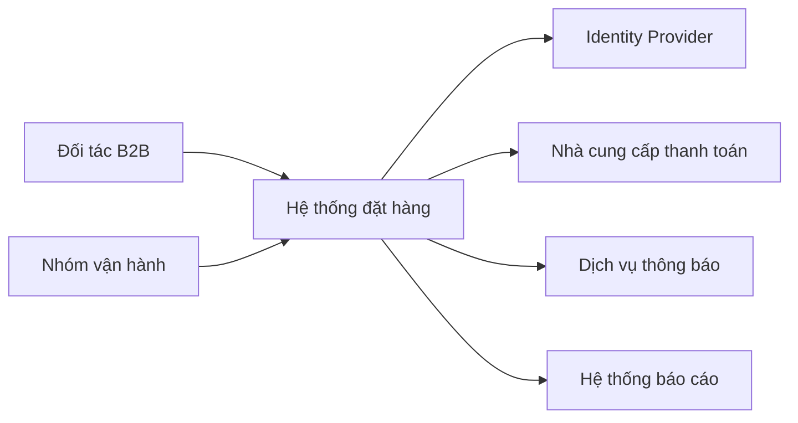
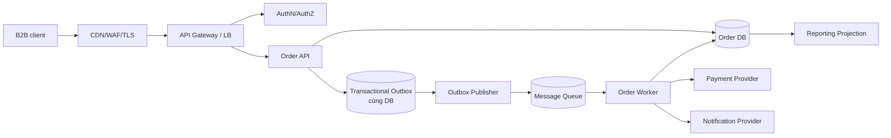
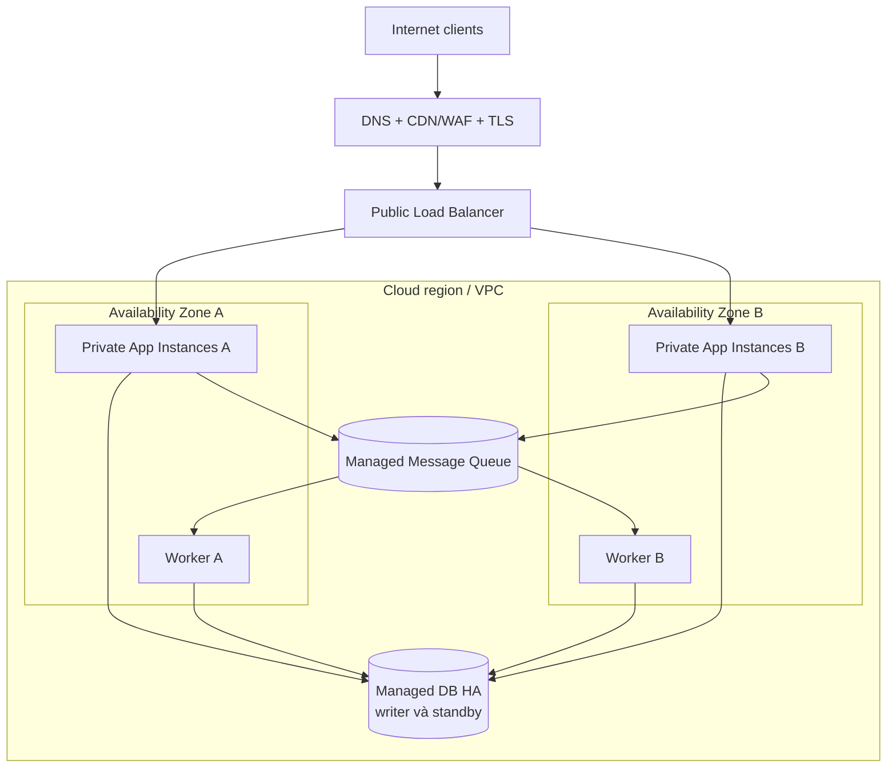
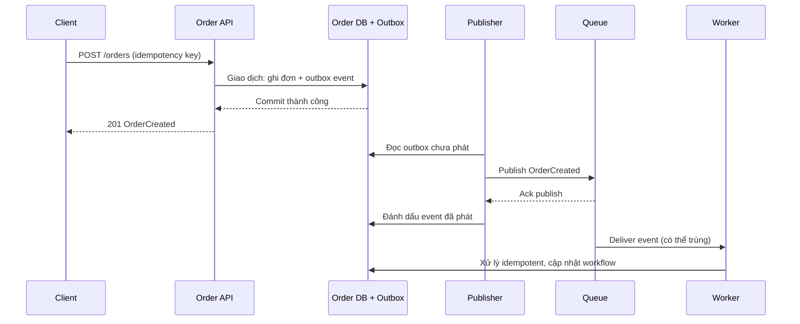
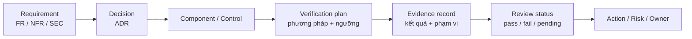

# Hoàn thiện hồ sơ kiến trúc, ADR và bằng chứng kiểm chứng

> **Module:** CLOUD_ARCHITECTURE — thiết kế kiến trúc ứng dụng trên đám mây từ yêu cầu nghiệp vụ đến lựa chọn mạng, compute, dữ liệu và mô hình triển khai.  
> **Chương:** Thực hành thiết kế.  
> **Mục tiêu:** Hoàn thiện một bộ hồ sơ có thể dùng để review và bàn giao: mô tả kiến trúc, các bản ghi quyết định kiến trúc (ADR), ma trận truy vết yêu cầu và bằng chứng kiểm chứng; giải thích được đánh đổi về độ tin cậy, bảo mật, khả năng mở rộng, chi phí và vận hành theo Well-Architected.

## 1. Bài toán: bản thiết kế “đúng” đã đủ để triển khai chưa?

Một sơ đồ cloud có load balancer, hai vùng sẵn sàng, database quản lý và hàng đợi có thể trông hợp lý. Nhưng trước khi phê duyệt, nhóm triển khai vẫn cần trả lời:

- Vì sao chọn phương án này thay vì phương án khác? Điều kiện nào khiến quyết định không còn đúng?
- Hệ thống cần đáp ứng yêu cầu nghiệp vụ, độ trễ, tính đúng dữ liệu và giới hạn chi phí nào?
- Thành phần nào sở hữu dữ liệu, ai có quyền truy cập và các điểm lỗi chung nằm ở đâu?
- Độ sẵn sàng, thời gian khôi phục, khả năng scale và các biện pháp bảo vệ đã được **đo** hay mới chỉ **dự kiến**?
- Nếu thay đổi mô hình dữ liệu, vùng cloud hoặc nhà cung cấp, người vận hành tìm được giả định, quyết định và hướng khôi phục ở đâu?

**Hồ sơ kiến trúc** là tập tài liệu và bằng chứng giúp một người không tham gia thiết kế ban đầu vẫn hiểu phạm vi, lựa chọn, lý do, giới hạn và cách kiểm tra hệ thống. Hồ sơ có giá trị khi nó trả lời được câu hỏi thực tế của reviewer, người triển khai và người trực vận hành.

**ADR (Architecture Decision Record)** ghi lại một **quyết định có ý nghĩa kiến trúc**, bối cảnh, các phương án đã xem xét, lý do lựa chọn và hệ quả. ADR không thay thế sơ đồ hay kiểm thử; nó giải thích **vì sao** kiến trúc thành hình.

**Bằng chứng kiểm chứng** là kết quả có nguồn gốc, phương pháp, thời điểm và tiêu chí chấp nhận đủ rõ để đối chiếu một tuyên bố: test report, dashboard, trace, kết quả restore/failover, kết quả threat modeling, cấu hình đã kiểm tra hoặc ước tính chi phí có giả định minh bạch.

Sau bài học, bạn có thể:

1. Xây dựng bộ hồ sơ kiến trúc gọn nhưng đủ phục vụ review, triển khai và vận hành.
2. Viết ADR có quyết định, phương án thay thế và hệ quả thực tế, không chỉ mô tả công nghệ đã chọn.
3. Liên kết **yêu cầu → quyết định → thành phần → cách kiểm chứng → bằng chứng → trạng thái**.
4. Phân biệt giả định, kết quả mô phỏng, kết quả kiểm thử và bằng chứng chạy thật.
5. Phân loại phát hiện, rủi ro còn mở, quyết định có điều kiện và việc cần hoàn thành trước production.
6. Tổ chức một buổi review Well-Architected dựa trên bằng chứng và các đánh đổi rõ ràng.

## 2. “Hoàn thiện hồ sơ” nghĩa là gì?

Không có một số lượng tài liệu cố định cho mọi hệ thống. Một website tĩnh nội bộ có thể chỉ cần vài trang; hệ thống thanh toán liên vùng có thể cần nhiều sơ đồ, mô hình đe dọa, khôi phục thảm họa và hồ sơ compliance. **Độ sâu phải tương xứng với rủi ro và mức độ phức tạp.**

Một hồ sơ đạt yêu cầu tối thiểu nên cho phép trả lời sáu câu:

| Câu hỏi review | Tài liệu hoặc bằng chứng cần có |
|---|---|
| **Thiết kế giải quyết bài toán gì?** | Problem statement, phạm vi, stakeholder, use case và mục tiêu thành công |
| **Hệ thống phải đạt mức chất lượng nào?** | Yêu cầu chức năng/phi chức năng có mã ID, SLI/SLO, RTO/RPO, ràng buộc và giả định |
| **Hệ thống vận hành bằng cách nào?** | Context/container/deployment diagram, luồng dữ liệu, trust boundary, quyền truy cập, dependency |
| **Vì sao chọn cấu trúc này?** | ADR, phương án thay thế, trade-off, điều kiện xem xét lại |
| **Làm sao biết thiết kế đạt mục tiêu?** | Test plan, acceptance criteria, evidence record, kết quả đo, phạm vi và hạn chế |
| **Nếu lỗi hoặc yêu cầu thay đổi thì sao?** | Risk register, runbook, monitoring, backup/rollback, ownership, backlog quyết định còn mở |

**Definition of Done (DoD) của hồ sơ:** mọi yêu cầu quan trọng có chủ sở hữu và phương án kiểm chứng; mọi quyết định có tác động lớn có ADR; sơ đồ phản ánh cùng một kiến trúc; kết quả đo được gắn với tiêu chí; các điểm chưa chứng minh và rủi ro còn mở được nêu minh bạch.

“Có file PDF đẹp” hoặc “đã vẽ đủ biểu tượng dịch vụ cloud” không phải là tiêu chí hoàn thành.

## 3. Case study xuyên suốt: nền tảng đặt hàng B2B

Các số liệu sau là **đề bài giả định để luyện tập**, không phải thông số đo của hệ thống thật hay cam kết từ một nhà cung cấp.

Một doanh nghiệp xây nền tảng đặt hàng cho các cửa hàng đối tác. Đối tác đăng nhập, tra cứu sản phẩm, tạo đơn, thanh toán và xem trạng thái xử lý. Nhóm thiết kế cần đề xuất kiến trúc production đầu tiên và một kế hoạch kiểm chứng.

### 3.1. Yêu cầu ban đầu

| ID | Yêu cầu / ràng buộc | Tiêu chí chấp nhận | Mức ưu tiên |
|---|---|---|---|
| **FR-01** | Đối tác tạo đơn và nhận mã đơn | Cùng idempotency key không tạo hai đơn có tác động nghiệp vụ trùng | Bắt buộc |
| **FR-02** | Theo dõi trạng thái đơn | Mọi thay đổi trạng thái hợp lệ được truy vết; có trạng thái đang xử lý | Bắt buộc |
| **FR-03** | Thông báo đơn được tiếp nhận | Thông báo có thể đến sau giao dịch; thất bại gửi không làm mất đơn | Nên có |
| **NFR-01** | Đáp ứng tải cao điểm | Tối thiểu 80 request tạo đơn/giây ở workload đã định nghĩa | Bắt buộc |
| **NFR-02** | Độ trễ | p95 của request tạo đơn hợp lệ ≤ 800 ms ở tải mục tiêu | Bắt buộc |
| **NFR-03** | Độ sẵn sàng | SLO 99,95% request tạo đơn hợp lệ thành công trong cửa sổ 30 ngày | Bắt buộc |
| **NFR-04** | Phục hồi khi mất một AZ | RTO ≤ 30 phút cho chức năng tạo đơn; phải kiểm tra tính đúng dữ liệu | Bắt buộc |
| **NFR-05** | Khôi phục dữ liệu báo cáo | RPO ≤ 5 phút cho dữ liệu báo cáo tái tạo/khôi phục | Nên có |
| **SEC-01** | Tách quyền truy cập giữa các đối tác | Người dùng không thể đọc/sửa đơn của đối tác khác | Bắt buộc |
| **SEC-02** | Bảo vệ dữ liệu và truy cập dịch vụ | TLS; định danh workload, phân quyền tối thiểu, quản lý secret và audit log | Bắt buộc |
| **OPS-01** | Quan sát và khôi phục | Có dashboard, cảnh báo, runbook, đường rollback và người sở hữu | Bắt buộc |
| **COST-01** | Ngân sách hoạt động | Đặt trần ngân sách giả định 3.000 USD/tháng cho workload đã mô tả; phải nêu phần chi phí chưa tính | Ràng buộc đề bài |

**Điểm cần làm rõ trước khi chốt kiến trúc:**

- “Request tạo đơn thành công” là khi **database đã commit bền vững**, hay khi toàn bộ thanh toán và gửi thông báo hoàn tất? Trong bài này, thành công của tạo đơn nghĩa là **đã commit đơn và có thể tra cứu**; thanh toán và thông báo là workflow có trạng thái riêng.
- NFR-04 chỉ cam kết xử lý lỗi **một AZ**. Không được suy ra đã đạt RTO tương tự khi **toàn region** ngừng hoạt động.
- NFR-05 áp dụng cho **dữ liệu báo cáo**; dữ liệu đơn hàng và thanh toán đã xác nhận cần bảo toàn theo invariant giao dịch riêng. Phải xác định RPO giao dịch và cơ chế đối soát trước khi kết luận về khả năng khôi phục thảm họa lớn.
- SLO yêu cầu 30 ngày; một load test 30 phút không đủ chứng minh độ sẵn sàng suốt 30 ngày.
- Ngân sách là giả định thiết kế; cần đo/ước tính dựa trên giá, vùng triển khai, traffic và điều khoản thực tế tại thời điểm lập hồ sơ.

Tài liệu tốt cần ghi những điểm mơ hồ thành **open question**, gán người giải quyết và hạn chốt, thay vì tự chọn một cách diễn giải rồi coi đó là yêu cầu đã được chấp thuận.

## 4. Cấu trúc hồ sơ kiến trúc có thể bàn giao

Một cách tổ chức logic (không bắt buộc tạo thêm file trong bài học):

```text
architecture-package/
├── 00-executive-summary.md
├── 01-requirements-and-assumptions.md
├── 02-architecture-overview.md
├── 03-diagrams/
│   ├── context.md
│   ├── containers.md
│   ├── deployment-and-failure-domains.md
│   └── data-flow-and-trust-boundaries.md
├── 04-decisions/
│   ├── ADR-001-order-events.md
│   └── ADR-002-multi-az-deployment.md
├── 05-verification/
│   ├── verification-plan.md
│   ├── evidence-index.md
│   └── test-reports-and-links.md
├── 06-risk-register.md
├── 07-operations-and-recovery.md
└── 08-review-and-signoff.md
```

Đây là **ví dụ cấu trúc tài liệu**, không phải tên file phải sinh trong repository. Với một hệ thống nhỏ, có thể gộp nhiều mục vào một Markdown duy nhất, miễn mọi thông tin quan trọng dễ tìm và có lịch sử chỉnh sửa.

### 4.1. Một trang tóm tắt dành cho reviewer

Nên trả lời được trong 1–2 phút:

- **Bối cảnh:** hệ thống dành cho ai, nghiệp vụ nào quan trọng nhất, quy mô hiện tại và dự kiến.
- **Phương án:** kiến trúc và quyết định nổi bật, cùng mô hình triển khai cloud.
- **Yêu cầu then chốt:** SLO, tải, RTO/RPO theo phạm vi, bảo mật và ngân sách.
- **Lợi ích/đánh đổi:** lý do chấp nhận độ phức tạp, độ trễ hay chi phí.
- **Bằng chứng hiện có:** đã đo gì, kết quả và mức tin cậy.
- **Rủi ro và quyết định còn mở:** mục nào cản trở production, ai chịu trách nhiệm.
- **Đề nghị review:** chấp thuận phương án, chấp thuận có điều kiện hoặc yêu cầu thiết kế lại.

Không nên trộn “đã được kiểm chứng” và “dự kiến” trong cùng một câu. Ví dụ “thiết kế hướng tới RTO ≤ 30 phút cho một AZ, chờ diễn tập EVD-DR-01” chính xác hơn “kiến trúc có RTO 30 phút” khi chưa có kết quả thử nghiệm.

### 4.2. Metadata và quy ước phiên bản

Mỗi hồ sơ nên ghi người sở hữu, ngày cập nhật, trạng thái, phiên bản kiến trúc, môi trường áp dụng, phiên bản diagram/ADR và liên kết ticket/PR liên quan. Ví dụ:

```yaml
architecture_id: "ARCH-ORDER-01"
title: "Nền tảng đặt hàng B2B"
owner: "architecture-team"
review_status: "proposed"
revision: "v0.3"
scope: ["production", "staging"]
last_reviewed: "YYYY-MM-DD"
related_adrs: ["ADR-001", "ADR-002"]
open_risks: ["RISK-01", "RISK-02"]
```

Đây là **mẫu metadata minh họa**, không phải schema bắt buộc hay dữ liệu của bài đã được triển khai.

## 5. Sơ đồ kiến trúc: vẽ để trả lời câu hỏi

Nên biểu diễn ít nhất **bối cảnh**, **thành phần/luồng dữ liệu** và **triển khai/failure domain**. Một sơ đồ duy nhất nhồi mọi biểu tượng thường khiến reviewer không thấy ranh giới tin cậy hay đường đi của giao dịch.

### 5.1. Context — ai dùng và hệ thống phụ thuộc vào đâu?



Các câu hỏi cần trả lời kèm sơ đồ: ai chịu trách nhiệm từng hệ thống ngoài, SLA/SLO nào có thể phụ thuộc, dữ liệu nào đi qua ranh giới, cơ chế xác thực và trạng thái khi đối tác ngoài lỗi.

### 5.2. Container/data flow — thành phần phục vụ nghiệp vụ



Sơ đồ là **đề xuất logic minh họa**, chưa đủ thay thế sequence diagram về trạng thái đơn/tiền. Khi triển khai, cần ghi rõ cách các tác vụ xử lý trạng thái, idempotency, retry, dead-letter queue và xác thực callback thanh toán. Nhánh “AuthN/AuthZ” là kiểm soát áp dụng tại API/điểm thực thi phù hợp, không có nghĩa chỉ cần một dịch vụ kiểm tra danh tính duy nhất là đủ.

### 5.3. Deployment — mạng, compute và failure domain



Sơ đồ này cần được bổ sung bằng **tài liệu cấu hình thực tế**: subnet công khai/riêng, route và egress/NAT, security group/network policy, identity và secret, vị trí DB primary/standby, backup và replication, vị trí queue cũng như điểm lỗi chung. Không gán nhãn “HA” rồi tự mặc định managed service sẽ chịu mọi sự cố; chế độ HA, khả năng chuyển đổi và cơ chế backup là những lựa chọn cấu hình cần kiểm tra với dịch vụ thực tế.

Đặt sơ đồ cạnh các **ADR** và **bằng chứng kiểm chứng**: ví dụ một AZ failover test phải ghi rõ đã làm mất tài nguyên nào, chứ không chỉ ghi “đã thử HA”.

### 5.4. Sequence cho đường ghi quan trọng



Cần giải thích rằng **outbox giúp tránh ghi đơn thành công nhưng không còn dấu vết sự kiện phải phát**, nhưng không tự đảm bảo đúng một lần phát/nhận. Publisher có thể crash sau khi broker ack nhưng trước khi đánh dấu đã gửi; worker vì vậy phải xử lý trùng an toàn. Nếu có thanh toán, invariant “không trừ tiền hai lần” cần được kiểm chứng ở cả ranh giới với payment provider, không chỉ trong DB của Order.

## 6. Chuẩn hóa yêu cầu và giả định để truy vết

### 6.1. Viết yêu cầu có thể kiểm chứng

Một yêu cầu tốt phải nói rõ **đối tượng, điều kiện, cách đo và ngưỡng**.

| Yêu cầu mơ hồ | Phiên bản đủ kiểm chứng |
|---|---|
| “Hệ thống chạy nhanh.” | “Tại workload 80 request tạo đơn/giây đã công bố, p95 latency của POST /orders hợp lệ không quá 800 ms.” |
| “Có dự phòng.” | “Khi loại khỏi tải một AZ, chức năng tạo đơn phục hồi theo tiêu chí đã xác định trong tối đa 30 phút.” |
| “An toàn.” | “Mọi request đọc/sửa đơn của tenant khác đều bị từ chối; có audit và kiểm thử theo ma trận role/tenant.” |
| “Có thể rollback.” | “Phiên bản ứng dụng trước được khôi phục theo runbook, giữ tương thích schema và kiểm tra smoke test sau rollback.” |
| “Tiết kiệm chi phí.” | “Hồ sơ có cost model theo lượng request, storage, egress, DB, queue, log, backup; nêu giới hạn so với trần ngân sách giả định.” |

Đừng dùng uptime tháng để thay thế các yêu cầu **tính đúng** như không ghi trùng đơn. Một hệ thống trả 200 rất nhanh nhưng ghi sai tiền/đơn vẫn không đạt.

### 6.2. Ghi assumption, constraint, dependency

Một bảng mẫu:

| ID | Loại | Nội dung | Người xác nhận | Rủi ro nếu sai |
|---|---|---|---|---|
| ASM-01 | Giả định | Khối lượng ghi tăng tối đa gấp 3 vào chiến dịch | Product/Business | Thiếu capacity, tăng latency |
| ASM-02 | Giả định | Payment có API hỗ trợ idempotency hoặc tra trạng thái | Payment owner | Retry có thể gây hiệu ứng kép |
| CON-01 | Ràng buộc | Giai đoạn 1 dùng một cloud region | Sponsor/Platform | Chưa đáp ứng sự cố mất toàn vùng |
| DEP-01 | Phụ thuộc | Identity Provider là dịch vụ ngoài | Security/Platform | Login có thể lỗi độc lập với Order API |
| OQ-01 | Câu hỏi mở | RPO giao dịch đã xác nhận trong kịch bản thảm họa vùng | Business/DBA | Chưa đủ cơ sở chấp nhận DR |

Một **assumption đã xác nhận** cần có người xác nhận và thời điểm; một constraint do cấp có thẩm quyền đặt phải được ghi rõ, để reviewer biết ràng buộc là bắt buộc hay chỉ là thói quen của đội.

## 7. ADR: ghi quyết định để người đến sau hiểu được

### 7.1. Khi nào cần ADR?

Tạo ADR cho quyết định có hậu quả đáng kể hoặc khó thay đổi, chẳng hạn:

- Chọn đơn khối có module rõ ràng hay các dịch vụ độc lập.
- Chọn database quan hệ hay NoSQL cho dữ liệu giao dịch.
- Chọn đồng bộ hay bất đồng bộ cho workflow dài.
- Triển khai một region multi-AZ hay nhiều region.
- Chọn chính sách consistency/cache có thể ảnh hưởng dữ liệu người dùng.
- Chọn mạng riêng, endpoint/egress và trust boundary cho dữ liệu nhạy cảm.

Không cần ADR cho mọi tên biến hoặc một cấu hình dễ đổi có tác động nhỏ. Nếu thay đổi sẽ làm nhiều team phải di chuyển dữ liệu, đổi contract, sửa quy trình vận hành hoặc tăng đáng kể chi phí, ADR có giá trị.

### 7.2. Template ADR tối thiểu

```markdown
# ADR-XXX: Tên quyết định ở dạng khẳng định

- Trạng thái: Proposed | Accepted | Superseded | Deprecated
- Ngày:
- Người đề xuất / người chấp thuận:
- Phạm vi:
- Liên kết yêu cầu: FR-..., NFR-..., SEC-...
- Bằng chứng và rủi ro: EVD-..., RISK-...

## Bối cảnh và vấn đề
Quyết định nào cần đưa ra? Điều gì thúc đẩy lựa chọn?
Có constraint, giả định hoặc yêu cầu phi chức năng nào?

## Các phương án được xem xét
A. ... (ưu/nhược điểm, rủi ro, chi phí)
B. ... (ưu/nhược điểm, rủi ro, chi phí)
C. ... nếu có lý do thực tế để cân nhắc

## Quyết định
Chọn phương án X trong phạm vi nào.
Lý do dựa trên tiêu chí và bằng chứng đã có.

## Hệ quả
Mặt được, chi phí, hạn chế, nợ kỹ thuật,
rủi ro và trách nhiệm vận hành phát sinh.

## Kiểm chứng và điều kiện xem xét lại
Bài test nào chứng minh giả định? Điều kiện nào
sẽ khiến ADR cần thay thế? Ai theo dõi?
```

ADR không phải bản cam kết “quyết định này luôn đúng”. Nó là **ảnh chụp có lý do của một quyết định ở thời điểm và bối cảnh cụ thể**.

### 7.3. ADR ví dụ số 1 — outbox và xử lý bất đồng bộ

**ADR-001: Phát hành sự kiện OrderCreated qua transactional outbox và queue**

| Trường | Nội dung |
|---|---|
| **Trạng thái** | Proposed, chờ kiểm chứng EVD-ASYNC-01 và xem xét vận hành |
| **Yêu cầu liên quan** | FR-01, FR-02, FR-03, NFR-02, OPS-01 |
| **Bối cảnh** | Request tạo đơn cần xác nhận DB đã commit, không phải chờ gửi thông báo hoặc thực thi tác vụ fulfillment dài |
| **Phương án A** | Gọi fulfillment/notification đồng bộ trong đường tạo đơn |
| **Phương án B** | Chỉ lưu đơn rồi publish trực tiếp tới broker sau transaction DB |
| **Phương án C (chọn)** | Trong cùng transaction ghi đơn và outbox event; publisher độc lập chuyển sự kiện đến queue |
| **Lý do** | C giảm coupling thời gian chạy; tránh khoảng trống “DB commit nhưng không có sự kiện phải phát” của B; trả HTTP nhanh khi đơn đã commit |
| **Hệ quả tích cực** | Request không phụ thuộc độ trễ gửi thông báo; có thể retry publisher và worker |
| **Hệ quả tiêu cực** | Eventual consistency; thêm outbox, queue, worker, DLQ, idempotency, observability và đối soát |
| **Điều kiện xem xét lại** | Throughput vượt khả năng publisher/outbox, yêu cầu đồng bộ nghiêm ngặt hơn hoặc chi phí vận hành vượt lợi ích |
| **Kế hoạch kiểm chứng** | Inject crash sau DB commit; crash publisher sau broker ack; trùng delivery; theo dõi lag, tỷ lệ hoàn thành và invariant đơn |

**Vì sao B có rủi ro?** Nếu transaction DB thành công nhưng process dừng trước khi publish, sự kiện có thể không bao giờ được gửi. C không loại bỏ mọi lỗi phát sự kiện; nó cung cấp một bản ghi bền vững cho quá trình phát lại và yêu cầu consumer xử lý trùng.

### 7.4. ADR ví dụ số 2 — phạm vi dự phòng

**ADR-002: Triển khai Order API qua hai AZ trong một region ở giai đoạn đầu**

**Bối cảnh:** NFR-04 yêu cầu phục hồi khi **mất một AZ** trong ≤ 30 phút. Doanh nghiệp đặt ràng buộc ngân sách giai đoạn 1. Chưa có yêu cầu đã chốt về RTO/RPO khi mất toàn region.

**Các phương án:**

| Phương án | Lợi ích | Đánh đổi |
|---|---|---|
| Một AZ | Đơn giản và có thể rẻ hơn | Lỗi AZ có thể làm gián đoạn toàn bộ ứng dụng |
| **Một region, hai AZ** | Cô lập phần compute khỏi lỗi một AZ; khả năng triển khai tương đối gọn | Vẫn phụ thuộc region và các dịch vụ dùng chung; phải kiểm chứng capacity và failover |
| Hai region active-passive | Có thể mở rộng khả năng DR vùng nếu dữ liệu và định tuyến được thiết kế đúng | Tăng chi phí, replication, runbook và complexity |
| Hai region active-active | Tiềm năng phục vụ nhiều vùng và giảm phụ thuộc region | Khó bảo đảm nhất quán ghi, routing/failover và tránh split-brain; chi phí/vận hành cao |

**Quyết định đề xuất:** dùng **hai AZ trong một region** cho giai đoạn đầu, kèm database managed HA phù hợp, phân phối app instance, autoscaling và diễn tập mất một AZ.

**Hệ quả:** mô hình này chỉ có thể được tuyên bố đáp ứng phạm vi NFR-04 **sau khi có bằng chứng thử thực tế**. Không tuyên bố chịu được mất toàn region; giữ **RISK-DR-01 / OQ-01** ở trạng thái mở cho đến khi business phê duyệt mục tiêu DR rộng hơn.

**Kiểm chứng:** EVD-AZ-01 (mất một AZ), EVD-DB-01 (database failover), EVD-CAP-01 (năng lực còn lại) và EVD-RESTORE-01 (restore bản sao lưu trong môi trường cô lập).

### 7.5. ADR được thay thế như thế nào?

Khi kiến trúc thay đổi, **không lặng lẽ sửa quyết định lịch sử để trông như chưa từng chọn phương án cũ**. Tạo ADR mới, ghi rõ thay thế ADR cũ, thời điểm/phạm vi có hiệu lực và đường migration. Ví dụ ADR-005 “Triển khai DR sang region thứ hai” có thể *supersede* ADR-002 sau khi đáp ứng các tiêu chí.

Giữ lịch sử giúp người review hiểu vì sao hệ thống phát triển từ một region sang nhiều region và tài sản nào cần chuyển đổi.

## 8. Quyết định dựa trên đánh đổi, không dựa vào độ phổ biến của công nghệ

### 8.1. Đặt tiêu chí trước khi chấm điểm

Một bảng so sánh hữu ích bắt đầu từ **hard constraints**. Nếu phương án vi phạm điều kiện bảo mật hoặc tính đúng không thể chấp nhận, điểm chi phí rẻ không nên “bù” để phương án đó thắng.

Sau khi lọc hard constraints, có thể chấm phương án theo trọng số do nhóm review thống nhất. Ví dụ so sánh hai cách xử lý phần thông báo đơn:

| Tiêu chí | Trọng số | Đồng bộ (điểm 1–5) | Async queue/outbox (điểm 1–5) |
|---|---:|---:|---:|
| Độ trễ của tạo đơn | 30% | 2 | 5 |
| Khả năng chịu lỗi provider | 25% | 2 | 4 |
| Tính đúng và khả năng khôi phục | 25% | 3 | 4 |
| Đơn giản vận hành | 10% | 5 | 2 |
| Chi phí giai đoạn đầu | 10% | 4 | 3 |
| **Tổng điểm có trọng số** | **100%** | **2,75** | **4,00** |

Cách tính: `Điểm tổng = ∑ (trọng số × điểm tiêu chí)`, trong đó trọng số 30% được dùng là 0,30. Với bảng ví dụ: đồng bộ = `0,30×2 + 0,25×2 + 0,25×3 + 0,10×5 + 0,10×4 = 2,75`; bất đồng bộ = `0,30×5 + 0,25×4 + 0,25×4 + 0,10×2 + 0,10×3 = 4,00`.

> **Lưu ý về bảng điểm:** Các phép tính dùng để phê duyệt phải có thể tái lập. Điểm và trọng số ở đây là **đánh giá minh họa**, không thay thế đo đạc độ trễ, độ tin cậy và chi phí.

Điểm số giúp buộc nhóm nêu tiêu chí và thảo luận đánh đổi; nó **không** biến ý kiến chủ quan thành sự thật đo được. Nếu bằng chứng mới làm thay đổi điểm hoặc ràng buộc, quyết định cần được xem xét lại.

### 8.2. Tính không chắc chắn cũng là thông tin kiến trúc

Ví dụ “chi phí queue nhỏ” là một giả định chưa đủ. Cần ghi:

- Lưu lượng event/giây, kích thước message, tỷ lệ retry và thời gian lưu giữ.
- Chi phí request, storage, data transfer/egress, logging, DLQ và nhân lực vận hành.
- Chênh lệch giữa tải trung bình, tải đỉnh và tải khi có sự cố.
- Giá và tính năng của dịch vụ tại vùng cloud được chọn, ngày tham chiếu.
- Các khoảng dự đoán và biến số có thể khiến chi phí vượt ngân sách.

Bảng cost model nên có công thức, nguồn đầu vào và version để reviewer tính lại; chi phí đã đo trong một đợt test không tự suy ra chi phí cả tháng khi workload khác.

## 9. Ma trận truy vết: nối yêu cầu với bằng chứng

Đây là phần làm cho hồ sơ có thể **kiểm tra và phản biện**.



Ví dụ ma trận:

| Yêu cầu | Thiết kế / ADR | Kiểm chứng dự kiến | Bằng chứng | Trạng thái ở ví dụ |
|---|---|---|---|---|
| FR-01: không tạo đơn trùng | API idempotency + unique constraint; ADR-001 | Gửi lại request, inject timeout sau commit | EVD-IDEMP-01 | Chờ chạy |
| NFR-01: ≥ 80 create/s | App autoscaling, DB pool; ADR-002 | Load test ở ≥ 80 req/s với workload công bố | EVD-LOAD-01 | Chờ chạy |
| NFR-02: p95 ≤ 800 ms | Critical path ngắn + outbox; ADR-001 | Đo p95 end-to-end cùng công suất yêu cầu | EVD-PERF-01 | Chờ chạy |
| NFR-03: SLO 99,95%/30 ngày | Multi-AZ, alerts, rollback | Monitoring dài hạn + review error budget | EVD-SLO-01 | Chưa đủ cửa sổ quan sát |
| NFR-04: AZ RTO ≤ 30 phút | Deploy hai AZ + DB HA; ADR-002 | Game day mất AZ, kiểm tra dữ liệu | EVD-AZ-01 | Chờ chạy |
| SEC-01: tenant isolation | AuthZ tại domain/service, tenant scope | Positive/negative access tests và review | EVD-AUTH-01 | Chờ chạy |
| OPS-01: quan sát/rollback | Dashboards, runbook, CI/CD | Drill rollback và kiểm tra cảnh báo | EVD-OPS-01 | Chờ chạy |
| COST-01: ngân sách | Cost model + dự toán theo traffic | Ước tính theo giả định và theo dõi thực tế | EVD-COST-01 | Chờ thẩm định |

**Một bằng chứng có thể hỗ trợ nhiều yêu cầu**, nhưng phải ghi chính xác nó hỗ trợ đến đâu. EVD-LOAD-01 có thể chứng minh p95 ở một tải nhất định; nó không thể tự chứng minh SLO availability 30 ngày, hiệu quả chống tấn công hay RPO.

## 10. Bằng chứng kiểm chứng: ghi thế nào để người khác tin và tái lập?

### 10.1. Sáu thuộc tính của một evidence record

1. **Tuyên bố/điều kiện cần kiểm tra:** liên kết ID yêu cầu và ngưỡng đạt.
2. **Phương pháp:** công cụ, loại test, workload, dữ liệu, cấu hình, fault injection nếu có.
3. **Định danh môi trường:** ngày, phiên bản build/IaC, cloud region, topology, kích thước tài nguyên, dependency giả lập/thật.
4. **Dữ liệu nguồn:** link kết quả raw, dashboard/trace/log, command hoặc script đã quản lý version, bản snapshot kiểm toán nếu cần.
5. **Kết luận:** pass/fail/inconclusive, lý do, ảnh hưởng của sai số và giới hạn phạm vi.
6. **Trách nhiệm:** người chạy, người review, owner công việc sửa và thời hạn tái kiểm chứng.

Không sử dụng screenshot biểu đồ bị cắt trục, không ghi thời gian hoặc thiếu cấu hình làm bằng chứng duy nhất. Một biểu đồ p95 đẹp ở traffic rất thấp không chứng minh hệ thống chịu tải mục tiêu.

### 10.2. Template bản ghi bằng chứng

```yaml
evidence_id: "EVD-LOAD-01"
related_requirements: ["NFR-01", "NFR-02"]
claim: "POST /orders đạt >=80 RPS và p95 <=800 ms"
status: "NOT_RUN"
environment: "staging"
build_revision: "<git-sha>"
iac_revision: "<git-sha>"
test_window_utc: "<start..end>"
traffic_profile:
  endpoint: "POST /orders"
  arrival_rate_rps: 100
  duration_minutes: 30
  data: "synthetic-tenants"
measurements:
  successful_requests: "<actual>"
  p95_ms: "<actual>"
  error_rate: "<actual>"
acceptance:
  min_sustained_rps: 80
  max_p95_ms: 800
raw_artifacts:
  - "<link-to-run-data>"
  - "<link-to-dashboard>"
limitations:
  - "Không chứng minh SLO 30 ngày"
reviewer: "<owner>"
```

Các dấu ngoặc nhọn và giá trị trong mẫu là **chỗ điền khi thực sự kiểm thử**. Không nên tạo một bản ghi có `status: PASS` nếu chưa có kết quả raw tương ứng.

### 10.3. Dữ liệu minh họa để luyện cách kết luận

Bảng dưới là **giả lập kết quả**, chỉ nhằm hướng dẫn đọc bằng chứng; không có bài test thực tế nào được chạy trong bài học này.

| Bằng chứng | Kết quả giả định | Tiêu chí | Kết luận đúng phạm vi |
|---|---|---|---|
| EVD-LOAD-01 | 100 request/s trong 30 phút; p95 610 ms; error 0,02% | ≥ 80 req/s, p95 ≤ 800 ms | Đạt điều kiện hiệu năng trong workload thử, chưa chứng minh SLO 30 ngày |
| EVD-IDEMP-01 | 10.000 lần retry có cùng khóa, không tạo đơn thứ hai | Không có tác động ghi trùng | Đạt tập tình huống đã thử; cần test thêm race condition và lỗi sau commit |
| EVD-AZ-01 | Giả lập mất một nhóm AZ; chức năng phục hồi sau 12 phút | AZ RTO ≤ 30 phút | Đạt ở scope và cấu hình đã thử; chưa khẳng định region outage |
| EVD-RESTORE-01 | Phục hồi dữ liệu báo cáo, điểm phục hồi cách 4 phút | RPO báo cáo ≤ 5 phút | Đạt cho tập dữ liệu và bài restore; không chứng minh RPO đơn hàng |
| EVD-AUTH-01 | Phát hiện endpoint export cho phép đọc chéo tenant | Mọi truy cập trái phép phải bị từ chối | **FAIL — blocker bảo mật** cần sửa và thử lại |
| EVD-COST-01 | Ước tính 2.400 USD/tháng theo workload giả định | < 3.000 USD/tháng | Trong ngân sách mô hình, chưa xác nhận hóa đơn thực và phí chưa tính |

**Một phát hiện fail bắt buộc không được “trung bình hóa” cùng nhiều kết quả pass.** Nếu SEC-01 là điều kiện chấp thuận bắt buộc, endpoint export đọc chéo tenant phải được xử lý trước khi quyết định production, dù các kiểm tra tải và chi phí đã đạt.

### 10.4. Phương pháp kiểm chứng tương ứng từng câu hỏi

| Tuyên bố | Kiểm chứng phù hợp | Điều không thể suy ra trực tiếp |
|---|---|---|
| p95 của API đạt ngưỡng | Load test có dữ liệu, phân bố request và thời gian đo phù hợp | Uptime tháng, khả năng chịu mất region |
| Request không tạo đơn trùng | Concurrency test, retry/timeout sau commit, kiểm tra DB và downstream | Không mất dữ liệu khi restore thảm họa |
| Mất một AZ vẫn phục vụ | Fault injection/game day AZ, đo SLI và RTO | Chịu lỗi region, lỗi cấu hình DNS toàn hệ thống |
| Dữ liệu phục hồi theo RPO | Restore drill và so sánh mốc dữ liệu đúng | Hoàn thành xử lý nghiệp vụ sau restore |
| Tenant isolation | Test phân quyền theo resource, role, tenant và review policy | Không tồn tại mọi loại lỗ hổng bảo mật khác |
| Có thể rollback an toàn | Diễn tập rollback cả app, schema và config tương thích | Mọi migration trong tương lai đều tự động đảo ngược được |
| Chi phí không vượt dự toán | Cost model có nguồn và quan sát hóa đơn/usage thực tế | Giá không đổi hoặc traffic tương lai giữ nguyên |

### 10.5. Dữ liệu kiểm thử và bảo mật bằng chứng

Dùng dữ liệu tổng hợp hoặc đã được xử lý đúng quy định; hạn chế ghi PII, token, số thẻ, secret và thông tin nhạy cảm trong artifact. Quyền truy cập dashboard, log và link evidence phải phù hợp với nhóm review. Đối với kiểm chứng bảo mật, ghi **kết luận và cách tái hiện trong môi trường được phép**; không đưa chi tiết khai thác nhạy cảm hoặc secret thật vào tài liệu công khai.

Evidence record nên bất biến hoặc có lịch sử chỉnh sửa được kiểm toán; khi chạy lại, tạo run ID và ngày mới để không ghi đè dấu vết thất bại cũ.

## 11. Rủi ro, vấn đề mở và giới hạn được chấp nhận

Hồ sơ hoàn thiện phải nói rõ **điều chưa biết**. Tránh hai cực đoan: từ chối mọi thiết kế vì chưa thể chứng minh tuyệt đối, hoặc gắn nhãn “đã đạt” khi mới có giả định.

### 11.1. Risk register mẫu

| ID | Rủi ro / khoảng trống | Tác động | Khả năng | Giảm thiểu / quyết định cần chốt | Owner | Trạng thái |
|---|---|---|---|---|---|---|
| RISK-01 | Region mất hoàn toàn, chưa có phương án phục hồi | Không phục vụ lâu hơn mục tiêu có thể chấp nhận | Chưa ước lượng | Business xác nhận region-level RTO/RPO, chọn DR nếu cần | Sponsor/Platform | Open |
| RISK-02 | Payment callback có thể đến trễ/trùng | Sai trạng thái đơn hoặc trừ tiền kép | Trung bình | Idempotency, đối soát, thử timeout sau commit | Payment owner | Open |
| RISK-03 | DB pool bão hòa khi một AZ mất | Tăng p99 và lỗi toàn cụm | Trung bình | Thử AZ outage dưới tải đỉnh; giới hạn pool, dự phòng capacity | SRE/DBA | Open |
| RISK-04 | Chi phí log và egress chưa tính đủ | Vượt trần ngân sách | Trung bình | Bổ sung cost model và alert usage | FinOps/Platform | Open |
| RISK-05 | Export endpoint đọc chéo tenant trong ví dụ test | Vi phạm phân quyền dữ liệu | Cao | Chặn release, sửa AuthZ, kiểm thử lại | Security/API | Blocking |

Mức tác động/khả năng trong bảng là **đánh giá giả định**. Khi dùng thật, nhóm cần có thang đo, nguồn sự kiện và tiêu chí phân loại phù hợp.

### 11.2. Phân loại gap để ra quyết định

- **Blocker:** vi phạm hard constraint, yêu cầu bảo mật/tính đúng nghiêm trọng, hoặc bằng chứng bắt buộc fail/chưa có mà rủi ro không thể chấp nhận.
- **Conditionally acceptable:** rủi ro trong phạm vi xác định được chủ sở hữu có thẩm quyền chấp nhận, có biện pháp giảm thiểu, điều kiện và hạn hoàn thành. Chỉ dùng nếu quy định nội bộ cho phép.
- **Improvement:** điểm có thể tối ưu sau phát hành mà không đe dọa tiêu chí chấp thuận.
- **Open question:** thông tin đầu vào cần xác minh trước khi quyết định; không được tự biến thành assumption đã được duyệt.

Mọi ngoại lệ cần mô tả **ai có quyền chấp nhận rủi ro, căn cứ, thời hạn và trigger xem xét lại**. Chữ ký không thay thế việc giải quyết một lỗi bảo mật chưa được phép chấp nhận.

## 12. Lập kế hoạch kiểm chứng trước khi triển khai

Kiểm chứng cần được thiết kế **cùng lúc với kiến trúc**. Nếu đến cuối dự án mới hỏi cách chứng minh RTO, nhóm có thể phát hiện thiếu công cụ failover, metric, backup hoặc quyền diễn tập.

### 12.1. Kế hoạch kiểm chứng theo thứ tự ưu tiên

| Giai đoạn | Kiểm tra | Kết quả/tiêu chí |
|---|---|---|
| Trước khi triển khai production | Review requirement và ADR, threat model, cost estimate | Không còn hard constraint không rõ; risk register có owner |
| Unit/contract test | Idempotency, validation, API contract, auth policies, event schema | Test tự động cho cả đường hợp lệ và trường hợp bị từ chối |
| Integration | DB transaction/outbox, queue, payment stub, secret access | Giữ invariant khi dependency lỗi, event trùng và timeout |
| Staging/load | 80–100 req/s theo workload mục tiêu; p95; DB/queue saturation | Đạt NFR-01/NFR-02 ở điều kiện đã mô tả |
| Fault injection/game day | Mất một AZ, DB failover, worker crash, payment timeout | Đo RTO, không ghi trùng, giảm lỗi có kiểm soát |
| Security verification | Negative authorization, review IAM, secret, encryption, logging | Không có lỗi bắt buộc còn mở |
| Trước go-live | Restore drill, rollback, alert/runbook rehearsal, chi phí dự kiến | Có evidence và người trực nhận bàn giao |
| Sau go-live | SLO rolling 30 ngày, error budget, cost/billing, incident review | Cập nhật evidence định kỳ, quyết định mới khi giả định đổi |

SLO 30 ngày chỉ có thể được đánh giá đầy đủ khi có **cửa sổ dữ liệu đủ dài**. Trước go-live, có thể chấp thuận dựa trên các bằng chứng thay thế và kế hoạch theo dõi, nhưng phải ghi rõ đó là mức tin cậy nào, không tô thành kết quả quan sát 30 ngày.

### 12.2. Thiết kế fault injection có giới hạn

Ví dụ game day cho NFR-04:

1. Định nghĩa steady state: tỷ lệ thành công của POST /orders, p95/p99, số ghi trùng, DB pool, backlog.
2. Chạy traffic tổng hợp có nhãn riêng và baseline ổn định.
3. Loại khỏi tải workload của một AZ trong phạm vi đã được cho phép; bảo đảm môi trường và người trực có quyền dừng.
4. Quan sát health check, routing, autoscaling, DB failover, retry và trạng thái giao dịch.
5. Dừng nếu có dấu hiệu mất tính đúng dữ liệu hoặc vượt guardrail.
6. Tắt fault, theo dõi đến khi business SLI và backlog trở lại ổn định.
7. Ghi actual RTO, mức suy giảm, trace/timeline và kết luận vào EVD-AZ-01.

Thử mất một nhóm instance **không đồng nghĩa** với thử mất toàn AZ nếu các thành phần chung vẫn còn. Hồ sơ phải nêu fault đã inject đúng vào đâu và giới hạn của kết luận.

### 12.3. Kiểm thử rollback và migration

Một hướng dẫn rollback hoàn chỉnh cần xét cả:

- Ứng dụng đã triển khai phiên bản nào, traffic đang trỏ tới đâu?
- Database schema có backward-compatible khi chạy lại binary cũ không?
- Event schema/consumer có chấp nhận message đã phát từ phiên bản mới không?
- Dữ liệu đã migration có thể phục hồi hoặc đối soát ra sao?
- Tắt feature flag có làm dừng workflow đang xử lý giữa chừng không?
- Ai có quyền và có thể hoàn tất trong thời gian chấp nhận được?

**Rollback code không mặc nhiên rollback dữ liệu.** Với schema migration khó đảo ngược, có thể dùng chiến lược expand–migrate–contract và bước phục hồi dữ liệu riêng, được mô tả trong ADR và runbook.

## 13. Đánh giá kiến trúc theo Well-Architected với bằng chứng

Một cuộc review theo Well-Architected không chỉ đánh dấu “có” ở các ô kiểm. Mỗi nhận định phải chỉ ra cấu hình/quyết định, bằng chứng tương ứng, rủi ro và quyền sở hữu.

| Trụ cột | Câu hỏi cho case study | Bằng chứng/ADR cần xem |
|---|---|---|
| **Operational Excellence – Vận hành xuất sắc** | Có CI/CD, quản lý thay đổi, dashboard, runbook, rollback và on-call rõ ràng? | ADR triển khai, EVD-OPS-01, game day timeline, quy trình incident |
| **Security – Bảo mật** | Tenant được cách ly ở mọi lớp truy cập? Có least privilege, encryption, secret rotation, audit? | Threat model, policy review, EVD-AUTH-01 và kết quả negative test |
| **Reliability – Tin cậy** | Khi mất AZ, DB failover, payment timeout hoặc worker crash, đơn có đúng và phục hồi kịp? | ADR-001/002, EVD-AZ-01, EVD-DB-01, EVD-IDEMP-01 |
| **Performance Efficiency – Hiệu quả hiệu năng** | p95 và throughput đạt ở tải đỉnh, có headroom và auto scaling hợp lý? | EVD-LOAD-01, EVD-PERF-01, capacity model, trace |
| **Cost Optimization – Tối ưu chi phí** | Nguồn tăng chi phí chính là gì; có tính egress, request, log, backup và dự phòng? | EVD-COST-01, forecast, budget alert, cost per successful order |
| **Sustainability – Bền vững** | Có thể giảm xử lý/retry thừa và tài nguyên nhàn rỗi mà vẫn đạt SLO? | Capacity review, tối ưu payload, sử dụng compute và queue |

### 13.1. Mẫu “finding” cho một trụ cột

```text
Finding ID: WA-REL-03
Trụ cột: Reliability
Nhận định: Chưa có bằng chứng database failover đáp ứng RTO một AZ
Yêu cầu liên quan: NFR-04
Kiến trúc liên quan: DB HA, Order API pool, ADR-002
Evidence hiện có: chưa có (EVD-DB-01 NOT_RUN)
Rủi ro: sau failover ứng dụng giữ kết nối stale hoặc commit không rõ
Ưu tiên: trước production
Owner: DBA + Order Team
Hành động: game day failover + kiểm tra giao dịch, ghi kết quả EVD-DB-01
Điều kiện đóng: RTO và invariant nghiệp vụ đạt theo tiêu chí
```

Đây là dạng phát hiện có thể giao việc và kiểm chứng, tốt hơn câu chung “cần tăng độ tin cậy”.

## 14. Quy trình review và phê duyệt hồ sơ

### 14.1. Những người cần tham gia

| Vai trò | Trách nhiệm review |
|---|---|
| **Business/Product owner** | Xác nhận nghiệp vụ, mức suy giảm chấp nhận, ưu tiên và chi phí hậu quả khi lỗi |
| **Architect/Tech lead** | Tính nhất quán thiết kế, ADR, hợp đồng service và đánh đổi kỹ thuật |
| **Security** | Threat model, quyền truy cập, trust boundary, lưu trữ dữ liệu và phát hiện bảo mật |
| **SRE/Operations** | Quan sát, capacity, on-call, backup/restore, game day, rollback và runbook |
| **DBA/Data owner** | Tính đúng, quyền sở hữu dữ liệu, backup/replication, RPO và migration |
| **FinOps/Finance** | Cost model, giả định traffic, ngân sách và cảnh báo chi phí |
| **Approver có thẩm quyền** | Quyết định chấp thuận, điều kiện bắt buộc và trách nhiệm rủi ro còn mở |

Không nhất thiết mỗi dự án phải có từng vai trò là một người riêng, nhưng **trách nhiệm chấp thuận** cần được xác định, nhất là các quyết định liên quan dữ liệu, bảo mật và DR.

### 14.2. Một vòng review có kỷ luật

1. **Pre-read:** chia sẻ bản hồ sơ, sơ đồ, ADR, ma trận truy vết, evidence index và risk register.
2. **Review vấn đề:** xác nhận scope, requirement, assumption và mức quan trọng của từng hành trình.
3. **Review phương án:** so sánh các phương án đã chọn, quyết định còn tranh luận, tính nhất quán giữa diagram–ADR–IaC.
4. **Review bằng chứng:** xem phương pháp, dữ liệu gốc, giới hạn và chỗ nào chưa chạy test.
5. **Review rủi ro và vận hành:** kiểm tra SLO/RTO/RPO, fallback, security, chi phí, quyền và runbook.
6. **Ra quyết định:** approved, approved with conditions (nếu được phép), hoặc changes required; ghi rõ blocker và owner.
7. **Theo dõi:** cập nhật từng finding và yêu cầu re-review khi điều kiện thay đổi.

Kết quả review phải trở thành bản ghi có ngày, phiên bản hồ sơ, danh sách người tham gia, những quyết định được thông qua, các ngoại lệ được chấp thuận và điều kiện đóng. Tránh kết luận mơ hồ như “mọi người có vẻ đồng ý”.

### 14.3. Definition of Done trước bàn giao

Một checklist review có thể sử dụng:

- [ ] Phạm vi, giả định, ràng buộc và người sở hữu được chốt.
- [ ] Các yêu cầu quan trọng có ID, ngưỡng định lượng và phương pháp kiểm chứng.
- [ ] Sơ đồ context, container/data flow và deployment/failure domain cùng phản ánh một thiết kế.
- [ ] Trust boundary, dữ liệu nhạy cảm, identity/IAM và ownership dữ liệu đã được review.
- [ ] Các quyết định lớn có ADR và phương án thay thế, lý do, hệ quả, trạng thái.
- [ ] Ma trận truy vết không bỏ sót yêu cầu bắt buộc.
- [ ] Evidence có run ID, build, environment, ngày, cấu hình, dữ liệu gốc và kết luận.
- [ ] Không dùng kết quả ở staging để tuyên bố bảo đảm mọi tình huống production.
- [ ] Có RTO/RPO đúng phạm vi, phương án restore/failover, rollback và runbook.
- [ ] Có cost model với giả định và khả năng kiểm tra lại.
- [ ] Mọi lỗi chưa sửa được ghi blocker/risk/open question, có owner và điều kiện đóng.
- [ ] Bản phê duyệt ghi rõ những gì đã kiểm chứng và những gì chỉ được chấp thuận có điều kiện.

## 15. Bài thực hành hoàn chỉnh: đóng gói một hồ sơ kiến trúc

**Tình huống:** bạn là kiến trúc sư phụ trách giai đoạn đầu của nền tảng đặt hàng B2B ở mục 3. Ban điều hành yêu cầu một hồ sơ để quyết định có cho phép triển khai production hay không.

### 15.1. Đầu vào được cung cấp

- FR/NFR/SEC/OPS/COST theo bảng ở mục 3.
- Sơ đồ đề xuất ở mục 5, chưa được chứng minh bằng kết quả chạy thực.
- ADR-001 và ADR-002 vẫn ở trạng thái Proposed.
- Payment API có thể trả timeout sau khi đã nhận request.
- Một report export endpoint đang bị nghi có khả năng trả dữ liệu chéo tenant.
- Budget 3.000 USD/tháng chỉ là mức giả định; chưa có billing hay báo giá được xác minh.
- Nhóm cần phát hành bản đầu nhưng chưa diễn tập mất AZ và chưa kiểm tra restore.

### 15.2. Yêu cầu nộp bài

**Phần A — Architecture overview:** viết một trang tóm tắt, mô tả scope, stakeholder, workload, luồng ghi đơn và hai rủi ro lớn nhất. Bổ sung sơ đồ deployment có boundary về AZ, mạng riêng, data store, đường egress và dịch vụ ngoài.

**Phần B — Requirements & traceability:** chuẩn hóa ít nhất 8 yêu cầu có ID, đo được và có mức ưu tiên. Mỗi yêu cầu dẫn tới một thành phần/ADR, một phép thử và mã bằng chứng.

**Phần C — ADR:** hoàn thiện ít nhất hai ADR có trạng thái, bối cảnh, phương án thay thế, quyết định, hệ quả và điều kiện xem xét lại. Phải giải thích tại sao queue/outbox cần idempotency và vì sao multi-AZ chưa chứng minh multi-region DR.

**Phần D — Verification plan:** thiết kế ít nhất bốn phép thử (load, AZ failover, retry sau commit, tenant isolation) với workload, metric, ngưỡng, phạm vi, điều kiện dừng và cách lưu raw artifact. Chưa chạy thì giữ `NOT_RUN`.

**Phần E — Risk & review:** lập risk register, chỉ ra blocker thực sự, người chịu trách nhiệm và tiêu chí để chấp thuận production. Cần phân biệt “rủi ro được phê duyệt chấp nhận” với “thiếu bằng chứng bắt buộc”.

### 15.3. Mẫu bảng nộp ma trận truy vết

| Requirement ID | Quyết định/Control | Evidence ID | Acceptance criterion | Actual result | Status / Owner |
|---|---|---|---|---|---|
| FR-01 | API idempotency, DB uniqueness; ADR-001 | EVD-IDEMP-01 | Không duplicate business effect | Chưa chạy | NOT_RUN / API |
| NFR-02 | Critical path, outbox; ADR-001 | EVD-PERF-01 | p95 ≤ 800 ms ở 80 RPS | Chưa chạy | NOT_RUN / SRE |
| NFR-04 | Multi-AZ; ADR-002 | EVD-AZ-01 | RTO ≤ 30 phút cho một AZ | Chưa chạy | NOT_RUN / Platform |
| SEC-01 | AuthZ theo tenant | EVD-AUTH-01 | Mọi truy cập trái phép bị từ chối | Chưa chạy | NOT_RUN / Security |
| COST-01 | Cost model và giám sát ngân sách | EVD-COST-01 | Trong ngân sách đã xác nhận | Chưa ước tính | PENDING / FinOps |

Mẫu này giúp phân biệt **thiết kế có control** với **control đã được kiểm chứng**. Một cột “Yes/No” không đủ để chứng minh.

### 15.4. Thang đánh giá bài thực hành

| Tiêu chí | Điểm tối đa | Dấu hiệu đạt |
|---|---:|---|
| Hiểu bài toán, phạm vi, giả định và yêu cầu có thể đo | 20 | Rõ mục tiêu nghiệp vụ, ưu tiên, SLO, RTO/RPO và chỗ mơ hồ |
| Kiến trúc và sơ đồ nhất quán | 20 | Có luồng dữ liệu, ownership, trust boundary, failure domain và dependency |
| Chất lượng ADR | 20 | So sánh phương án thực, quyết định có căn cứ và hệ quả/điều kiện xem xét lại |
| Ma trận truy vết và chất lượng bằng chứng | 25 | Mỗi yêu cầu có phép thử phù hợp, ngưỡng, raw evidence, kết luận đúng phạm vi |
| Risk register, vận hành và review Well-Architected | 15 | Nhận diện blocker, owner, runbook, chi phí và action item có thể đóng |
| **Tổng** | **100** | |

**Điều kiện bắt buộc ngoài điểm số:** không đánh dấu PASS cho phép thử chưa chạy, không bỏ qua lỗi phân quyền chéo tenant, không tuyên bố bảo đảm region DR chỉ từ sơ đồ hai AZ. Vi phạm các điều kiện này cần sửa hồ sơ trước khi kết luận kiến trúc đã sẵn sàng.

### 15.5. Hướng dẫn tự kiểm tra bài làm

Hãy tự đóng vai ba reviewer:

1. **Security reviewer:** nếu dùng API export với tenant ID do client gửi, hệ thống kiểm tra quyền trên từng record ở đâu? Có bằng chứng negative test?
2. **SRE reviewer:** khi DB failover, request đã commit nhưng response bị mất sẽ được retry như thế nào? Runbook có nêu cách đo RTO/RPO?
3. **Finance reviewer:** nếu gấp ba traffic và log volume, những thành phần nào làm chi phí tăng? Dự toán đã tính phí egress và backup hay chưa?

Nếu một câu hỏi không tìm được câu trả lời hoặc một mục **đang chờ xác minh**, tạo open finding với owner, cách xác minh và deadline. Đó là một phần của hồ sơ có chất lượng, không phải lý do để che giấu kết quả.

## 16. Những phản mẫu khi viết hồ sơ kiến trúc

### 16.1. Sơ đồ rất đẹp nhưng không có lý do quyết định

Bản vẽ có nhiều dịch vụ cloud nhưng không nói vì sao phải dùng queue, managed DB HA, WAF hay CDN, và không có phương án khác. Cần một ADR cho các lựa chọn quan trọng, nêu hệ quả về chi phí và vận hành.

### 16.2. Mọi thứ đều “scalable”, “secure”, “highly available”

Đây là tính từ, không phải yêu cầu kiểm chứng. Chuyển thành SLI/SLO, capacity, threat model, fault model và tiêu chí chấp nhận có ngưỡng.

### 16.3. Lấy một phép thử nhỏ để chứng minh mọi yêu cầu

Một phép thử load ngắn không chứng minh uptime tháng, DR toàn vùng hoặc toàn bộ bảo mật. Ghi đúng phạm vi, môi trường, giới hạn và mức tin cậy.

### 16.4. ADR biến thành biên bản ghi “chọn dịch vụ X”

Nếu thiếu bối cảnh, phương án bị loại, hậu quả và điều kiện xem xét lại, ADR không giúp thế hệ sau hiểu lựa chọn. Cần viết theo vấn đề và đánh đổi, không theo tên sản phẩm.

### 16.5. Chỉ lưu ảnh chụp dashboard không có dữ liệu nguồn

Ảnh không có thời điểm, phiên bản, traffic profile và run ID khó tái lập. Kết quả cần liên kết tới dữ liệu gốc hoặc bản xuất phù hợp, với quyền truy cập và thời hạn lưu.

### 16.6. Ghi “chấp thuận” nhưng không định nghĩa điều kiện

Kết luận “Approved” khi còn hard constraint chưa đạt tạo rủi ro cho người trực vận hành. Ghi rõ điều kiện, người có thẩm quyền, phạm vi chấp thuận, hạn xử lý và quyết định xem xét lại.

### 16.7. Không cập nhật hồ sơ khi kiến trúc thay đổi

Diagram v0.1, IaC v0.5 và ADR v0.2 có thể mâu thuẫn nếu không có quy trình cập nhật. Gắn hồ sơ với PR/release, review các thay đổi có ý nghĩa và tạo ADR thay thế khi quyết định đảo chiều.

### 16.8. Bằng chứng có thật nhưng không liên kết với yêu cầu

Có nhiều log, trace và test report nhưng reviewer không biết chúng chứng minh điều gì. Evidence index phải đưa người đọc từ ID yêu cầu đến phép thử và kết luận tương ứng.

## 17. Bộ câu hỏi dùng khi bảo vệ thiết kế

1. Yêu cầu nào là hard constraint, và ai có quyền thay đổi yêu cầu đó?
2. Nếu một AZ lỗi, hệ thống còn đủ compute, connection pool, DB và quota không?
3. RPO áp dụng cho loại dữ liệu nào? Đơn hàng đã ACK có thể mất không và khi đó quy trình xử lý ra sao?
4. Phương án thay thế được đánh giá thế nào? Có quyết định vì chi phí hay vì tính đúng/độ tin cậy?
5. Khi payment provider timeout sau khi nhận charge, điều gì ngăn hiệu ứng thanh toán trùng?
6. Nếu event được xử lý hai lần, invariant nào vẫn phải đúng?
7. Người dùng A có thể đọc tài nguyên của tenant B thông qua endpoint phụ hoặc export không?
8. Có điểm lỗi chung nào bị che bởi sơ đồ multi-AZ?
9. Bằng chứng nào chứng minh p95 và throughput, và nó dùng workload nào?
10. SLO availability trong 30 ngày được quan sát ở đâu; nếu chưa đủ cửa sổ thì hồ sơ ghi gì?
11. Cost model đã tính khi giảm cache hit, tăng retry và log volume chưa?
12. Ai chịu trách nhiệm rollback/restore và có thể chạy runbook với quyền thực tế không?
13. Có phát hiện fail hoặc chưa đủ bằng chứng nào đang bị đánh dấu nhầm thành pass không?
14. Khi workload tăng ba lần hoặc mục tiêu DR thay đổi, ADR nào cần xem xét lại trước?
15. Nếu một reviewer mới đến, họ có thể đi từ FR-01 tới ADR-001, sơ đồ, EVD-IDEMP-01 và risk register trong vài phút không?

## 18. Tổng kết

Bộ hồ sơ kiến trúc hoàn chỉnh là một **chuỗi lập luận có thể kiểm chứng**: yêu cầu nghiệp vụ và yêu cầu chất lượng dẫn tới phương án kiến trúc; ADR ghi lại quyết định và đánh đổi; sơ đồ mô tả cấu trúc/luồng dữ liệu/failure domain; verification plan đặt ra cách thử; evidence ghi kết quả thực và giới hạn; risk register làm rõ điều chưa chứng minh; review quyết định mức sẵn sàng và trách nhiệm tiếp theo.

Điểm cốt lõi của thực hành CLOUD_ARCHITECTURE là không dừng ở việc “kiến trúc này có vẻ tốt”. Hãy cho thấy **vì sao thiết kế được chọn, điều gì sẽ chứng minh nó đạt yêu cầu, bằng chứng đang có đến đâu và cần làm gì trước khi đưa vào vận hành**. Chỉ khi đó các đánh đổi giữa độ tin cậy, bảo mật, khả năng mở rộng, chi phí và vận hành mới có thể được đánh giá theo Well-Architected một cách minh bạch và có trách nhiệm.
