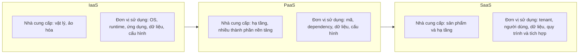
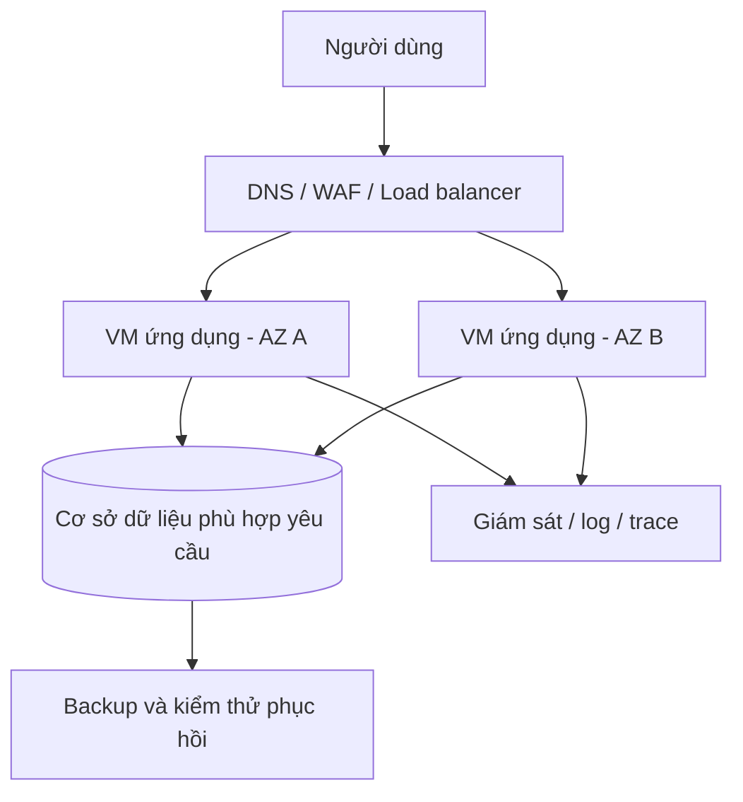
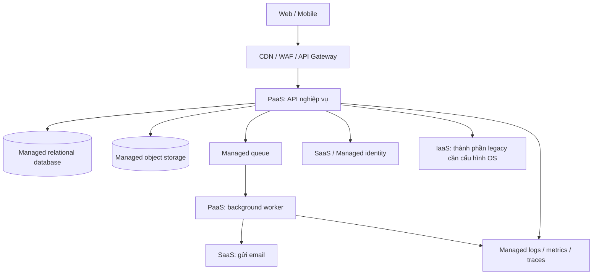
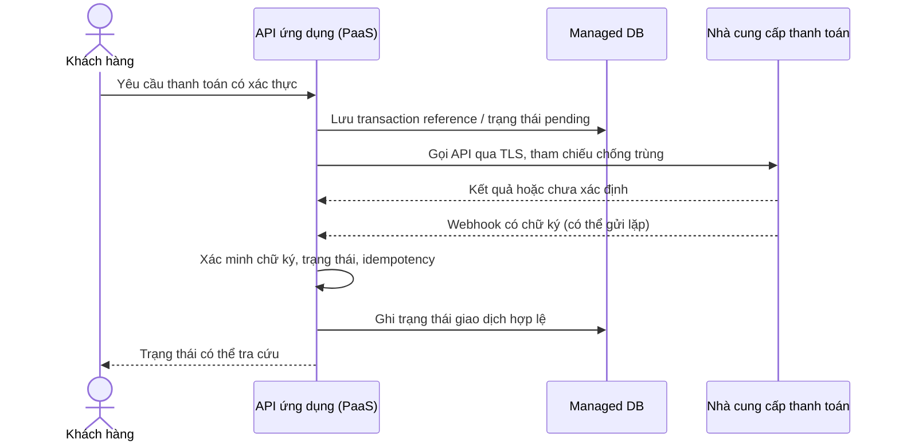
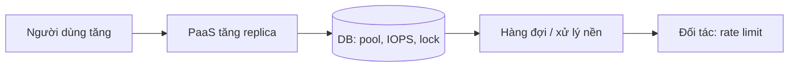

# Lựa chọn IaaS, PaaS, SaaS và dịch vụ được quản lý theo trách nhiệm vận hành

## 1. Đặt vấn đề: Chọn dịch vụ cũng là chọn phần việc phải tự vận hành

Khi thiết kế ứng dụng trên đám mây, câu hỏi đầu tiên không nên là “Dùng máy ảo hay Kubernetes?”, mà là: **Đội ngũ cần kiểm soát những lớp nào của hệ thống, và đủ khả năng vận hành chúng đến đâu?** Hai giải pháp chạy cùng mã ứng dụng có thể có yêu cầu nhân sự, quy trình vá lỗi, bảo mật, khả năng khôi phục và cấu trúc chi phí rất khác nhau.

Giả sử một doanh nghiệp xây dựng hệ thống đặt dịch vụ trực tuyến. Đội phát triển có thể:

- Thuê máy ảo và tự cài web server, runtime, cơ sở dữ liệu, công cụ giám sát.
- Đưa mã nguồn hoặc image container lên nền tảng triển khai ứng dụng, để nhà cung cấp xử lý phần lớn hạ tầng bên dưới.
- Dùng phần mềm sẵn có theo thuê bao cho các nghiệp vụ phổ thông như quản lý khách hàng.
- Kết hợp dịch vụ cơ sở dữ liệu, hàng đợi, lưu trữ và quản lý bí mật do nhà cung cấp vận hành.

Tất cả đều có thể là lựa chọn hợp lý **nếu đáp ứng yêu cầu nghiệp vụ, bảo mật, độ tin cậy, khả năng mở rộng, chi phí và năng lực vận hành**. Mục tiêu của bài học thuộc chương **Mô hình triển khai** trong module **CLOUD_ARCHITECTURE** là xây dựng cách chọn dịch vụ có căn cứ, đồng thời xác định rõ ai chịu trách nhiệm khi triển khai, cập nhật, giám sát và xử lý sự cố.

Sau bài học, người học có thể:

1. Phân biệt IaaS, PaaS, SaaS và ý nghĩa của cụm từ “dịch vụ được quản lý” (*managed service*).
2. Phác thảo ranh giới trách nhiệm giữa nhà cung cấp đám mây, đơn vị sử dụng và bên thứ ba.
3. Chọn mô hình theo từng thành phần của ứng dụng, thay vì ép toàn bộ hệ thống vào một mô hình.
4. So sánh phương án theo độ linh hoạt, rủi ro, chi phí sở hữu, độ tin cậy và khả năng vận hành.
5. Viết quyết định kiến trúc có điều kiện chấp nhận, phương án kiểm chứng và tiêu chí xem xét lại.

## 2. Phân biệt service model với deployment model

Các thuật ngữ thường xuất hiện cạnh nhau nhưng trả lời **hai câu hỏi khác nhau**:

| Nhóm khái niệm | Câu hỏi | Ví dụ |
| --- | --- | --- |
| **Mô hình dịch vụ** (*service model*) | Đơn vị sử dụng nhận và tự quản lý đến lớp nào của hệ thống? | IaaS, PaaS, SaaS |
| **Mô hình triển khai đám mây** (*cloud deployment model*) | Hạ tầng được cung cấp cho ai, ở đâu và theo cách tổ chức nào? | Public cloud, private cloud, hybrid cloud, community cloud trong một số phân loại |
| **Hình thức cung cấp/quản trị dịch vụ** | Ai đảm nhận hoạt động vận hành của một thành phần cụ thể? | Managed database, managed Kubernetes, managed messaging, dịch vụ tự vận hành trên VM |

Một ứng dụng **PaaS trên public cloud** có thể kết nối với **managed database**, dùng **SaaS** cho CRM và giao tiếp với hệ thống nội bộ qua kết nối riêng. Vì vậy, một kiến trúc thực tế thường phối hợp nhiều loại dịch vụ.

Cũng cần tránh đồng nhất “cloud native”, “container”, “serverless” với các nhóm trên:

- **Container** là cách đóng gói và chạy phần mềm; container có thể chạy trên VM tự quản lý, nền tảng container được quản lý hoặc nền tảng kiểu PaaS.
- **Serverless** là mô hình tiêu thụ tài nguyên mà nhà cung cấp đảm nhận nhiều công việc cấp phát, mở rộng và duy trì hạ tầng; nó thường nằm gần PaaS/FaaS nhưng có những giới hạn thực thi và mô hình tính phí riêng.
- **Managed service** mô tả **mức công việc nhà cung cấp nhận vận hành đối với một dịch vụ**, không phải một mô hình thứ tư hoàn toàn tách biệt khỏi IaaS, PaaS và SaaS.

## 3. Hiểu các mô hình dịch vụ từ góc độ trách nhiệm

### 3.1. IaaS — Infrastructure as a Service

**IaaS cung cấp tài nguyên hạ tầng** như máy ảo, mạng ảo, đĩa và địa chỉ mạng. Đơn vị sử dụng triển khai hệ điều hành, runtime, phần mềm ứng dụng và các chính sách vận hành trên tài nguyên được cấp.

Ví dụ: thuê VM chạy Linux, tự cài JVM, reverse proxy và dịch vụ đặt hàng. Nhà cung cấp chịu trách nhiệm về trung tâm dữ liệu, máy chủ vật lý và lớp ảo hóa theo phạm vi hợp đồng; nhóm vận hành ứng dụng thường chịu trách nhiệm cấu hình OS, cập nhật bản vá, quản lý tiến trình, an ninh máy, sao lưu dữ liệu ứng dụng và thiết kế tính sẵn sàng.

**Phù hợp khi:** ứng dụng cũ cần quyền điều khiển OS hoặc phần mềm đặc thù; yêu cầu kernel/agent/chứng nhận chưa được PaaS hỗ trợ; cần cấu hình mạng hoặc runtime rất cụ thể.

**Chi phí đánh đổi:** đội ngũ có nhiều quyền kiểm soát nhưng cũng phải duy trì bản vá, cấu hình, kế hoạch khôi phục, tự động hóa triển khai và năng lực trực sự cố.

### 3.2. PaaS — Platform as a Service

**PaaS cung cấp nền tảng thực thi ứng dụng**: nhà phát triển đưa mã nguồn, package hoặc container image lên dịch vụ, còn nền tảng quản lý nhiều lớp hạ tầng, hệ điều hành và cơ chế triển khai.

Ví dụ: ứng dụng Java được triển khai lên dịch vụ application hosting hoặc managed container runtime. Nhà cung cấp thường quản lý việc cấp phát máy chủ và phần mềm nền tảng. Đơn vị sử dụng vẫn chịu trách nhiệm mã ứng dụng, dependency, lỗ hổng trong image do mình xây dựng, cách cấu hình dịch vụ, quyền truy cập, dữ liệu và phương án phục hồi ở cấp ứng dụng.

**Phù hợp khi:** nhóm cần ra sản phẩm nhanh, ứng dụng tương đối chuẩn hóa, lưu lượng thay đổi và muốn giảm công việc quản trị máy chủ.

**Chi phí đánh đổi:** giới hạn runtime, cấu hình mạng, thời gian xử lý, hạn mức tài nguyên, kiểu lưu trữ, cơ chế scale hoặc khả năng truy cập mức thấp; có thể phụ thuộc sâu vào API của nền tảng.

### 3.3. SaaS — Software as a Service

**SaaS cung cấp phần mềm ứng dụng hoàn chỉnh** để người dùng hoặc hệ thống khác sử dụng qua giao diện/API. Nhà cung cấp phát triển, cập nhật, vận hành sản phẩm và hạ tầng phục vụ sản phẩm.

Ví dụ: dịch vụ email doanh nghiệp, CRM, hệ thống quản lý công việc hoặc kế toán theo thuê bao.

Khách hàng SaaS thường **không vận hành mã nguồn hay database nội bộ của sản phẩm**, nhưng vẫn phải quản lý tài khoản, quyền của người dùng, cấu hình tenant, dữ liệu đưa vào hệ thống, tích hợp với hệ thống khác, khả năng xuất dữ liệu, quy trình sử dụng đúng và kế hoạch khi dịch vụ gián đoạn.

**Phù hợp khi:** chức năng là nghiệp vụ phổ biến, mức tùy biến cần thiết nằm trong giới hạn sản phẩm, thời gian triển khai quan trọng hơn quyền kiểm soát mã nguồn.

**Chi phí đánh đổi:** phụ thuộc vào khả năng tùy biến, quy tắc cấp quyền, API và chính sách của nhà cung cấp; chi phí thuê bao theo người dùng/giao dịch; hạn chế xuất hoặc di chuyển dữ liệu.

### 3.4. Dịch vụ được quản lý — Managed Service

“Managed” nghĩa là nhà cung cấp đảm nhận **một tập nhiệm vụ vận hành đã công bố**. Tập nhiệm vụ đó rất khác nhau giữa dịch vụ và nhà cung cấp:

- **Managed relational database:** thường cấp phát hạ tầng cơ sở dữ liệu, tự động hóa một phần cập nhật engine, sao lưu/khôi phục và cơ chế high availability theo cấu hình.
- **Managed message broker/queue:** nhà cung cấp xử lý phần lớn hạ tầng môi giới thông điệp; khách hàng quản lý schema, semantics, quyền truy cập, retry, dead-letter và consumer.
- **Managed Kubernetes:** nhà cung cấp có thể quản lý control plane; khách hàng vẫn có thể chịu trách nhiệm worker nodes, image, cluster add-on, chính sách bảo mật, workload và dung lượng, tùy kiểu dịch vụ.
- **Managed object storage:** nhà cung cấp vận hành lớp lưu trữ; khách hàng định nghĩa phân quyền bucket, vòng đời dữ liệu, mã hóa, versioning và yêu cầu truy xuất.
- **Managed secrets/key service:** nhà cung cấp vận hành thành phần lưu trữ/kiểm soát khóa, nhưng khách hàng vẫn phải quản lý chính sách cấp quyền, vòng đời khóa/bí mật và cách ứng dụng sử dụng.

**Không suy luận “managed” là tự động an toàn, tự động backup đúng nhu cầu hay không bao giờ gián đoạn.** Phạm vi thực tế phải được xác minh trong tài liệu và điều khoản của dịch vụ được chọn.

## 4. Mô hình trách nhiệm chia sẻ: công cụ chính để ra quyết định

Tư duy **shared responsibility** phân biệt việc nhà cung cấp bảo vệ và vận hành **hạ tầng của đám mây** với nghĩa vụ của khách hàng **khi sử dụng dịch vụ trên đám mây**. Tỷ lệ trách nhiệm thay đổi theo mô hình dịch vụ; phần việc còn lại không biến mất chỉ vì tài nguyên được tự động hóa.

Bảng sau minh họa xu hướng điển hình, không phải hợp đồng áp dụng chung cho mọi sản phẩm:

| Lớp hoặc hoạt động | IaaS: VM tự vận hành | PaaS: chạy ứng dụng | SaaS: dùng phần mềm | Managed database |
| --- | --- | --- | --- | --- |
| Tòa nhà, nguồn điện, máy chủ vật lý | Nhà cung cấp | Nhà cung cấp | Nhà cung cấp | Nhà cung cấp |
| Lớp ảo hóa/hạ tầng bên dưới dịch vụ | Nhà cung cấp | Nhà cung cấp | Nhà cung cấp | Nhà cung cấp |
| Hệ điều hành và bản vá OS | **Khách hàng** trên guest OS | Thường nhà cung cấp | Nhà cung cấp | Thường nhà cung cấp ở máy chủ DB |
| Runtime/framework của ứng dụng | **Khách hàng** | Chia sẻ tùy PaaS và gói triển khai | Nhà cung cấp | Không áp dụng theo cùng cách |
| Mã ứng dụng và dependency do khách tự viết | **Khách hàng** | **Khách hàng** | Nhà cung cấp vận hành sản phẩm; khách hàng chịu phần tích hợp/tùy biến | Khách hàng đối với ứng dụng truy cập DB |
| Thiết kế schema, truy vấn, chất lượng dữ liệu nghiệp vụ | Khách hàng | Khách hàng | Khách hàng quản trị việc sử dụng, chất lượng và quyền dữ liệu theo khả năng SaaS | **Khách hàng** |
| Phân quyền, danh tính người dùng, cấu hình tenant/dịch vụ | Khách hàng | Khách hàng | **Khách hàng**, thường chia sẻ trách nhiệm với sản phẩm | Khách hàng |
| Quyết định backup, retention, RPO/RTO và diễn tập restore | Khách hàng | Khách hàng, có thể dùng khả năng nền tảng | Khách hàng cần xác minh cam kết/khả năng của SaaS | Khách hàng cấu hình và kiểm chứng trên khả năng do nhà cung cấp hỗ trợ |
| Giám sát nghiệp vụ, phát hiện giao dịch sai và xử lý lỗi ứng dụng | Khách hàng | Khách hàng | Chia sẻ: nhà cung cấp giám sát sản phẩm, khách hàng giám sát quy trình/tích hợp của mình | Khách hàng |
| Kiểm soát vật lý và an toàn phần cứng | Nhà cung cấp | Nhà cung cấp | Nhà cung cấp | Nhà cung cấp |

**Chú thích:** “Khách hàng” trong bảng là đơn vị sở hữu hệ thống. Với SaaS, khách hàng vẫn chịu trách nhiệm pháp lý/kinh doanh nhất định liên quan đến dữ liệu, mục đích xử lý, việc cấp quyền, cấu hình và quản lý người dùng; cam kết về tính sẵn sàng hay phục hồi cần đọc trong hợp đồng cụ thể.

### 4.1. Sơ đồ trực giác về phần trách nhiệm



Sơ đồ thể hiện **xu hướng tăng phạm vi do nhà cung cấp vận hành**, không đồng nghĩa IaaS kém an toàn hoặc SaaS luôn phù hợp hơn. Mức kiểm soát, giới hạn tùy biến và chi phí phải được đánh giá cùng với nhu cầu thực tế.

### 4.2. Ma trận RACI cho một dịch vụ thật

Với mỗi thành phần quan trọng, lập bảng ghi người **chịu trách nhiệm thực hiện** (*Responsible*), người **chịu trách nhiệm cuối cùng** (*Accountable*), người cần được tham vấn (*Consulted*) và người cần nhận thông tin (*Informed*). Ví dụ cho managed database:

| Công việc | Đội phát triển | Cloud/Platform Ops | Nhà cung cấp dịch vụ | Bảo mật |
| --- | --- | --- | --- | --- |
| Thiết kế schema, migration, tối ưu query | R/A | C | I | C |
| Chọn instance, HA, cấu hình backup/retention | C | R/A | C | C |
| Vận hành host của DB engine theo phạm vi dịch vụ | I | C | R/A | I |
| Định nghĩa IAM, network policy, khóa mã hóa | C | R | C | A/C theo mô hình quản trị |
| Kiểm thử restore dữ liệu nghiệp vụ | R | A | C | I |
| Xử lý sự cố kết nối, truy vấn, quá tải | R | A/R | C theo trách nhiệm dịch vụ | I |

Ví dụ này là **mẫu để điều chỉnh**, vì trong thực tế một đội hoặc nhà cung cấp có thể nắm các vai trò khác. Điều quan trọng là mọi công việc có chủ sở hữu, phạm vi được ghi nhận và đường chuyển giao rõ ràng; không để những nhiệm vụ như kiểm thử restore hoặc vá dependency ứng dụng rơi vào khoảng trống.

## 5. Lập hồ sơ workload trước khi chọn mô hình

Một hệ thống nên được phân thành các **workload/thành phần** có đặc điểm khác nhau: frontend, API, xử lý nền, database giao dịch, search, phân tích, xác thực và công cụ nghiệp vụ. Với từng phần, hãy thu thập:

| Nhóm tiêu chí | Dữ liệu cần có | Ví dụ câu hỏi |
| --- | --- | --- |
| **Mục tiêu kinh doanh** | Khả năng phải cung cấp, hạn ra mắt, KPI, người dùng mục tiêu | Ứng dụng có điểm khác biệt mà SaaS không đáp ứng được không? |
| **Nhu cầu kiểm soát kỹ thuật** | OS, kernel, loại runtime, agent, port, giao thức, phiên bản thư viện | Có cần driver hoặc cấu hình kernel không được nền tảng hỗ trợ không? |
| **Dạng tải** | RPS, peak/burst, CPU, RAM, I/O, độ dài tác vụ, thời gian rảnh | Tải đều 24/7 hay chỉ vài phút mỗi giờ? |
| **Dữ liệu** | Độ nhạy, tính nhất quán, dung lượng, lưu trú dữ liệu, khôi phục | Dữ liệu nào là nguồn chân lý và có yêu cầu lưu ở khu vực cụ thể không? |
| **Độ tin cậy** | SLI/SLO, RTO, RPO, yêu cầu multi-AZ, đường lỗi | Mất dịch vụ trong bao lâu thì ảnh hưởng kinh doanh nghiêm trọng? |
| **Bảo mật/tuân thủ** | IAM, mã hóa, audit, tích hợp định danh, kiểm tra quy định | Có yêu cầu chứng nhận hoặc nhật ký mà dịch vụ không cung cấp được không? |
| **Tích hợp** | API, protocol, private connectivity, data export, event contract | Cần kết nối hệ thống nội bộ hoặc đối tác theo kiểu nào? |
| **Năng lực đội ngũ** | Số người trực, kỹ năng OS/DB/Kubernetes, quy trình ứng cứu | Ai sẽ cập nhật và khôi phục dịch vụ lúc nửa đêm? |
| **Tài chính** | Chi phí tài nguyên, license, nhân sự, data egress, đào tạo | Tổng chi phí 12–36 tháng thay đổi thế nào theo tải và quy mô người dùng? |
| **Khả năng rời nền tảng** | Export dữ liệu, định dạng, API, thời gian chuyển đổi | Nếu ngừng dịch vụ trong 6 tháng, đường di chuyển là gì? |

### 5.1. Các ràng buộc bắt buộc phải lọc trước

Trước khi cho điểm phương án, loại lựa chọn **không đáp ứng điều kiện bắt buộc**, chẳng hạn:

- Phiên bản runtime, loại database, extension, hệ điều hành hoặc giao thức không được hỗ trợ.
- Không có khu vực triển khai phù hợp yêu cầu lưu trú dữ liệu, quy định hoặc độ trễ.
- Không hỗ trợ cách cấp quyền, nhật ký kiểm toán, kiểm soát kết nối riêng hoặc tiêu chuẩn mã hóa bắt buộc.
- Hạn mức timeout, dung lượng hoặc throughput thấp hơn tải tối thiểu có chứng cứ.
- Không có khả năng sao lưu/khôi phục tương ứng RPO/RTO được phê duyệt.
- Điều khoản bảo vệ dữ liệu, SLA, khả năng xuất dữ liệu hoặc hợp đồng không đáp ứng yêu cầu của tổ chức.

Những điều kiện này là **gating constraints**: tổng điểm hấp dẫn về chi phí không bù đắp được một điều kiện bắt buộc bị vi phạm.

### 5.2. Chỉ số đo cần ràng với trải nghiệm thực

“Dịch vụ có HA” là mô tả tính năng, chưa chứng minh luồng nghiệp vụ đạt độ tin cậy. Ví dụ:

- **SLI tìm kiếm:** tỷ lệ yêu cầu hợp lệ có kết quả trong ngưỡng thời gian, đo từ phía người dùng.
- **SLO checkout:** tỷ lệ yêu cầu có trạng thái cuối cùng hoặc trạng thái “đang xử lý” có thể tra cứu được, theo cửa sổ thời gian đã thống nhất.
- **RTO:** thời gian tối đa cho phép khôi phục luồng cốt lõi sau gián đoạn.
- **RPO:** lượng mất mát dữ liệu được chấp nhận, đo theo thời gian.
- **Bất biến nghiệp vụ:** không xác nhận cùng một đơn vị tài nguyên cho hai giao dịch xung đột.
- **Chi phí đơn vị:** tổng chi phí tương ứng một giao dịch nghiệp vụ hoàn tất, không chỉ chi phí một request.

Các giá trị cụ thể phải được xác định từ mức tổn thất chấp nhận được và kiểm thử. Một nền tảng có quảng cáo uptime cao vẫn có thể để ứng dụng sai cấu hình, hết quota hoặc ghi dữ liệu lỗi.

## 6. Khi nào chọn IaaS?

Hãy chọn IaaS khi **lợi ích của quyền kiểm soát hạ tầng lớn hơn phần vận hành tự gánh**. Một số tình huống điển hình:

1. Chuyển ứng dụng legacy cần cài thư viện hệ thống, agent hoặc thành phần phụ thuộc OS cụ thể; chưa thể thay đổi nhanh cách triển khai.
2. Phần mềm thương mại yêu cầu cấu hình máy, mạng hoặc giấy phép cài đặt đặc thù.
3. Khối lượng công việc ổn định, cần mức tuning chi tiết và đội ngũ đã có năng lực tự vận hành.
4. Thành phần cần mức truy cập thấp mà dịch vụ nền tảng được quản lý không cung cấp.

IaaS **không có nghĩa chỉ cần tạo VM là hoàn thành kiến trúc**. Một workload quan trọng còn cần ít nhất:



Sơ đồ minh họa khả năng triển khai qua nhiều availability zone, không khẳng định mọi cấu hình hai VM tự động đáp ứng HA. Cần kiểm chứng health check, session state, database failover, kết nối mạng và các điểm lỗi đơn (*single point of failure*).

Các hoạt động vận hành thường phải thiết kế rõ:

- **Provisioning:** cấu hình hạ tầng bằng IaC, image chuẩn, kiểm soát thay đổi và quản lý drift.
- **Vá lỗi:** lịch vá OS, agent, runtime, quy trình kiểm thử và rollback.
- **Hardening:** firewall/security group, quản trị quyền truy cập hệ thống, hạn chế SSH/RDP, mã hóa đĩa.
- **Triển khai:** rolling/blue-green deploy, health checks, khởi động lại an toàn, quản lý secret.
- **Mở rộng:** autoscaling group hoặc quy trình tăng số VM, giới hạn kết nối backend và phân phối tải.
- **Phục hồi:** backup dữ liệu, cấu hình hạ tầng tái tạo được, thử restore và phương án failover.
- **Quan sát:** log, metrics, traces, cảnh báo và quy trình trực vận hành.

**Bẫy thường gặp:** so sánh giá giờ thuê VM với giá PaaS mà bỏ qua thời gian kỹ sư trực, sao lưu, vá lỗi, bảo mật và xử lý sự cố.

## 7. Khi nào chọn PaaS?

PaaS thường phù hợp cho dịch vụ ứng dụng có giao diện triển khai tương đối chuẩn, khi nhóm muốn dành nhiều thời gian cho **mã nghiệp vụ** và giảm quản trị host.

Ví dụ một API Java có đặc điểm:

- Stateless giữa các request; phiên đăng nhập được quản lý có chủ đích.
- Có health endpoint, readiness/liveness hợp lý và xử lý tín hiệu dừng an toàn.
- Kết nối đến database/queue qua giao diện được hỗ trợ.
- Log ra luồng tập trung, cấu hình/secret được tiêm khi chạy.
- Có khả năng scale nhiều instance và tránh lưu dữ liệu bền vững trên filesystem tạm.

Dịch vụ này là ứng viên tốt cho managed app platform hoặc managed container runtime, nếu runtime, hạn mức, kết nối, chính sách bảo mật và yêu cầu tài chính phù hợp.

### 7.1. PaaS không xóa trách nhiệm của người viết ứng dụng

Nhóm vẫn phải quản lý:

- Lỗi nghiệp vụ, validation, authentication/authorization, API contract.
- Phiên bản dependency, lỗ hổng trong application image và thư viện bên thứ ba.
- Cấu hình CPU/memory, số replica, autoscaling policy, timeout, quota và connection pool.
- Tương thích migration database khi rolling deploy/rollback.
- Đặt SLI/SLO, cảnh báo latency/lỗi, đo chi phí mỗi giao dịch.
- Xử lý retry, idempotency, trạng thái giao dịch khi kết nối tới đối tác không ổn định.

Nếu PaaS hỗ trợ nhiều chế độ, cần đọc kỹ **tính năng thực sự của gói được chọn**: có nền tảng nhận source code trực tiếp, nền tảng chạy container có quyền quản lý image, nền tảng function chỉ cho phép thời gian thực thi ngắn hoặc mô hình tính phí theo request và thời gian sử dụng. Không tự suy ra một ưu điểm cho mọi biến thể.

### 7.2. Đánh đổi quan trọng của PaaS

| Vấn đề | Khi nào ảnh hưởng kiến trúc? | Cách đánh giá |
| --- | --- | --- |
| Hạn mức thực thi | Tác vụ chạy lâu hơn giới hạn request/job | Tách background worker, kiểm tra thời gian tối đa và checkpoint |
| Autoscaling/cold start | Yêu cầu latency thấp ở lưu lượng thưa hoặc bùng nổ | Đo cold/warm latency, concurrency và giới hạn scale |
| Kết nối private network | Cần đi tới DB nội bộ hoặc hệ thống đối tác | Kiểm tra DNS, routing, egress, security policy và chi phí |
| Stateless filesystem | Ứng dụng ghi file lên ổ cục bộ | Chuyển dữ liệu bền vững sang object storage/DB, dùng vùng tạm đúng mục đích |
| Đa phiên bản và rollback | Hai bản ứng dụng đồng thời dùng schema khác nhau | Expand/contract migration, feature flag, deploy có kiểm soát |
| Tính di động | Dùng extension/API riêng của nền tảng | Đánh giá adapter, chuẩn giao tiếp, chi phí và thời gian chuyển nhà cung cấp |

## 8. Khi nào chọn SaaS?

SaaS thường có lợi khi tính năng cần dùng đã được một sản phẩm trưởng thành giải quyết tốt, còn việc tự xây và vận hành ít tạo khác biệt cạnh tranh. Ví dụ: email doanh nghiệp, quản lý yêu cầu hỗ trợ, lịch công tác, CRM hoặc công cụ phân tích phổ thông.

Trước khi chọn SaaS, hãy tách hai câu hỏi:

1. **Sản phẩm có đáp ứng quy trình nghiệp vụ không?** Xem các chức năng bắt buộc, quyền tùy biến, API, khả năng nhập/xuất dữ liệu, mức độ đáp ứng các ngoại lệ của quy trình.
2. **Tổ chức có sử dụng và kiểm soát được SaaS an toàn, bền vững không?** Xem dữ liệu nào được tải lên, tenant/role model, SSO/MFA, log, lưu trú dữ liệu, backup/export, cam kết uptime, phản hồi sự cố và điều khoản chấm dứt.

Bảng kiểm đặc biệt cho SaaS:

| Câu hỏi | Rủi ro nếu chưa rõ |
| --- | --- |
| SSO/MFA, provisioning/deprovisioning tài khoản (ví dụ qua SCIM) được hỗ trợ thế nào? | Nhân viên nghỉ việc vẫn có quyền truy cập |
| Ai có thể xuất/xóa dữ liệu? Có audit log truy cập và thay đổi không? | Khó điều tra sự cố hoặc thực thi chính sách dữ liệu |
| API có giới hạn rate/quota và cơ chế webhook nào? | Tích hợp gián đoạn, thiếu dữ liệu hoặc trùng sự kiện |
| Dữ liệu lưu ở đâu, xử lý bởi bên phụ nào, điều khoản thay đổi thế nào? | Không đáp ứng yêu cầu lưu trú, riêng tư hoặc hợp đồng |
| Export có đầy đủ dữ liệu và quan hệ, ở định dạng tái sử dụng được không? | Vendor lock-in và khôi phục dữ liệu tốn kém |
| RTO/RPO hoặc chính sách backup của sản phẩm được cam kết đến đâu? | Nhầm khả năng khôi phục nội bộ của vendor với quyền tự khôi phục dữ liệu của khách |
| Giá thay đổi theo seat, tính năng, API call hoặc dung lượng? | Chi phí tăng nhanh khi quy mô người dùng/mức dùng thay đổi |

**Trách nhiệm dữ liệu không biến mất khi dùng SaaS.** Nhà cung cấp có thể vận hành ứng dụng và hạ tầng, còn đơn vị sử dụng vẫn kiểm soát ai được nhập/xem dữ liệu nào, cấu hình chia sẻ, thời hạn lưu cần thiết, tích hợp và việc sử dụng dữ liệu đúng mục đích. Những phần được vendor xử lý theo hợp đồng cần được kiểm tra cụ thể.

### 8.1. Ví dụ: Nên dùng SaaS hay tự phát triển CRM?

Một doanh nghiệp có 50 nhân viên kinh doanh và quy trình chăm sóc khách hàng tương đối chuẩn. Nếu mua SaaS CRM, đội ngũ có thể sử dụng workflow, báo cáo, phân quyền và ứng dụng di động đã có, đổi lại là phí thuê bao, giới hạn tùy biến và phụ thuộc API. Nếu tự phát triển, doanh nghiệp có thể đáp ứng quy trình đặc thù nhưng phải đầu tư cả phát triển tính năng lẫn bảo mật, sẵn sàng, nâng cấp, sao lưu và hỗ trợ người dùng.

Quyết định phải căn cứ vào **độ khác biệt của quy trình, khả năng tích hợp, yêu cầu dữ liệu, tổng chi phí và thời gian đạt giá trị**, thay vì mặc định “tự xây luôn linh hoạt hơn” hoặc “mua SaaS luôn rẻ hơn”.

## 9. Dùng managed services đúng chỗ: giảm tải vận hành, giữ trách nhiệm nghiệp vụ

Một kiến trúc không nhất thiết đưa mọi thứ lên cùng một nền tảng. Ví dụ thường gặp:



Mỗi thành phần có lựa chọn riêng dựa trên nhiệm vụ:

| Thành phần | Một lựa chọn ban đầu | Trách nhiệm vẫn cần chủ động xử lý |
| --- | --- | --- |
| Frontend tĩnh | Object storage + CDN được quản lý | Cache invalidation, HTTPS, bảo vệ nội dung, versioning |
| API nghiệp vụ | PaaS/managed container runtime | Mã, dependency, auth, scale, SLO, rollout |
| Cơ sở dữ liệu giao dịch | Managed relational DB | Schema, index, giao dịch, phân quyền, backup policy, restore |
| Tác vụ nền | PaaS worker/function | Retry, idempotency, poison message, timeout |
| Thông điệp | Managed queue | Dữ liệu thông điệp, semantics, ordering, DLQ, consumer |
| Đăng nhập | Managed identity hoặc SaaS IdP | Role mapping, chính sách phiên, MFA, quyền ứng dụng |
| Tính năng thương mại phổ thông | SaaS | Cấu hình tenant, tích hợp, dữ liệu, vendor risk |
| Ứng dụng cũ đặc thù | VM IaaS | OS, triển khai, bảo mật, backup, giám sát |

### 9.1. Ví dụ quan trọng: Managed database

Một managed database thường giúp giảm công việc vận hành host và engine, nhưng không thay đội ngũ sở hữu dữ liệu. Những câu hỏi phải được trả lời trước production:

- Có tự động sao lưu không? Thời hạn giữ, point-in-time recovery và phạm vi backup là gì?
- Đã bật chế độ multi-AZ hay read replica? Chúng giải quyết **mục tiêu khác nhau**: read replica chủ yếu tăng năng lực đọc; HA/failover cần cơ chế và cam kết riêng.
- Khi failover, kết nối ứng dụng có tự phục hồi được không? Connection pool và DNS cache có gây gián đoạn kéo dài không?
- Ai chọn cửa sổ bảo trì, engine version và lịch upgrade? Có downtime hoặc thay đổi tương thích không?
- RPO/RTO đã được **diễn tập bằng restore thật** chưa?
- Nếu xóa nhầm dữ liệu hoặc chạy migration sai, quy trình khôi phục một thời điểm an toàn là gì?
- Có yêu cầu quản lý khóa mã hóa, auditing, private network, giám sát storage/IOPS và ngưỡng tăng trưởng không?

**Chú ý:** backup tự động, snapshot, replication và failover không thay thế nhau. Replication có thể sao chép cả thao tác xóa nhầm; backup không chứng minh được tốc độ khôi phục cho đến khi được thử.

### 9.2. Ví dụ quan trọng: Managed Kubernetes

Thuật ngữ “managed Kubernetes” dễ gây hiểu sai nhất. Nhiều dịch vụ chỉ nhận quản lý **control plane**, còn khách hàng vận hành hoặc cấu hình worker nodes, add-ons, network policy, image, RBAC, secret, ingress, autoscaler, storage class, workload, backup và upgrade tương thích. Một số dịch vụ có chế độ quản lý node sâu hơn, nhưng phạm vi phải kiểm tra theo sản phẩm.

Managed Kubernetes hữu ích khi tổ chức thật sự cần Kubernetes API, hệ sinh thái deployment, workload diversity hoặc cơ chế điều phối container. Với một API nhỏ, PaaS runtime đơn giản thường giảm đáng kể việc vận hành cluster. Nên hỏi: **Có yêu cầu nào mà nền tảng ứng dụng đơn giản không đáp ứng được?** Nếu không, thêm Kubernetes có thể làm tăng số thành phần, đường lỗi và chi phí trực vận hành.

## 10. Bảo mật và tuân thủ khi thay đổi mô hình vận hành

### 10.1. Trách nhiệm vẫn tập trung vào danh tính, dữ liệu và cấu hình

Các nhóm kiểm soát thường không được “chuyển giao” hoàn toàn:

1. **Identity & Access Management:** ai được truy cập vào dịch vụ, dữ liệu, bảng điều khiển cloud; dùng quyền tối thiểu, MFA và danh tính máy cho workload.
2. **Dữ liệu:** phân loại, mục đích xử lý, quyền truy cập, vòng đời và xóa; quy trình xuất dữ liệu, khôi phục, bảo vệ dữ liệu nhạy cảm.
3. **Mã ứng dụng:** kiểm tra dependency, xử lý đầu vào, phân quyền nghiệp vụ, chống lạm dụng, bảo vệ secret.
4. **Cấu hình:** không công khai bucket, database endpoint hoặc secret; kiểm tra network access, log và policy.
5. **Quan sát và phản ứng:** giám sát hành vi sai, log audit và phối hợp nhà cung cấp khi có sự cố.

Trên IaaS, các mục này cộng thêm việc hardening và vá máy chủ. Trên PaaS, phạm vi cấu hình host giảm nhưng application vulnerability vẫn tồn tại. Trên SaaS, tenant bị cấp quyền quá rộng hoặc tích hợp token bị rò rỉ vẫn có thể gây lộ dữ liệu dù vendor vá hạ tầng đúng lịch.

### 10.2. Ma trận ranh giới tin cậy

Ví dụ một quy trình thanh toán đi qua API PaaS và SaaS xử lý thanh toán:



Ranh giới cần kiểm soát gồm: client không đáng tin, API Internet-facing, kết nối ứng dụng–database trong mạng riêng, outbound tới đối tác, và webhook quay lại từ Internet. Nhóm ứng dụng chịu trách nhiệm xác minh **thông điệp và kết quả nghiệp vụ**, không thể coi việc đối tác là SaaS hay managed service là đủ bảo đảm.

### 10.3. Hồ sơ chứng cứ cho yêu cầu tuân thủ

Trước khi phê duyệt một dịch vụ, thu thập đúng những gì yêu cầu nội bộ/luật áp dụng đòi hỏi: khu vực dữ liệu, hợp đồng xử lý dữ liệu, lịch sử chứng nhận/đánh giá độc lập, phạm vi kiểm toán, chính sách truy cập quản trị, retention và cách xóa dữ liệu. Không suy ra một chứng nhận của nhà cung cấp tự động khiến **toàn bộ ứng dụng** đáp ứng tiêu chuẩn; quyền truy cập, quy trình và cấu hình của khách hàng cũng nằm trong phạm vi đánh giá.

## 11. Độ tin cậy, khả năng mở rộng và vận hành theo mô hình

| Góc nhìn | IaaS | PaaS | SaaS | Managed DB/Queue |
| --- | --- | --- | --- | --- |
| **Scaling** | Người dùng thiết kế/thi hành autoscaling và giới hạn hạ tầng | Nền tảng hỗ trợ scale theo cấu hình, quota và đặc tính workload | Vendor scale sản phẩm theo phạm vi dịch vụ, khách vẫn có giới hạn tenant/API | Nhà cung cấp hỗ trợ một phần; khách hàng chọn capacity, quota, thiết kế dữ liệu/consumer |
| **Failover** | Cần tự thiết kế topology, health check, phân phối tải | Cần chọn region/AZ/replica và kiểm tra giới hạn nền tảng | Theo cam kết dịch vụ, khách cần phương án vận hành tạm | Cần bật và kiểm chứng cấu hình HA nếu có |
| **Backup/restore** | Khách thiết kế và kiểm tra end-to-end | Dữ liệu vẫn cần chiến lược riêng | Quyền restore/export phụ thuộc sản phẩm/hợp đồng | Tính năng hỗ trợ không thay việc đặt retention và diễn tập |
| **Patch/upgrade** | Tự chịu OS, runtime, ứng dụng | Vendor cập nhật nền tảng; khách cập nhật mã/dependency và kiểm tra tương thích | Vendor cập nhật sản phẩm; khách kiểm soát cấu hình/tích hợp thay đổi | Vendor có trách nhiệm engine/host theo phạm vi; khách kiểm tra version và compatibility |
| **Observability** | Tự thu thập host và ứng dụng | Nền tảng cung cấp một phần; khách vẫn cần telemetry nghiệp vụ | Có thể hạn chế nội bộ; cần audit/export và theo dõi tích hợp | Có metrics hệ thống; khách cần query/business metrics |

### 11.1. SLO là yêu cầu cấp hành trình, không chỉ cấp dịch vụ

Nếu checkout phụ thuộc vào API PaaS, database managed và cổng thanh toán SaaS, **SLO của checkout không đơn giản bằng cách lấy SLO của từng nhà cung cấp**. Cần đo thời gian và tỷ lệ hoàn tất thực tế, tính đến luồng retry, cache, đối soát và cách hệ thống xử lý khi một thành phần lỗi. Một nền tảng có uptime cao vẫn có thể gây thất bại nếu hết connection pool hoặc không còn quota tài nguyên.

Thiết kế nên ghi rõ:

- Hệ thống phản hồi thế nào khi một phụ thuộc bị chậm: timeout, circuit breaker, thông báo đang xử lý, hàng đợi hoặc chuyển sang thao tác thủ công.
- Hệ thống phục hồi từ lỗi từng AZ/region tới mức nào, và điều gì vẫn là single point of failure.
- Quy trình ai nhận sự cố trước, thông tin nào được gửi cho nhà cung cấp, và runbook nào được kích hoạt.
- Cách diễn tập khôi phục để chứng minh RTO/RPO, tính toàn vẹn dữ liệu và đường xử lý sự cố.

### 11.2. Khả năng mở rộng không chỉ là tăng số instance

Ví dụ API trên PaaS có thể tự scale từ 2 lên 30 instance khi lượng request tăng, nhưng database có giới hạn kết nối và một bảng bị tranh chấp khóa. Khi đó latency vẫn tăng mặc dù CPU ứng dụng thấp. Cần xét **toàn bộ chuỗi phụ thuộc**:



Các chỉ số thiết kế phải bao gồm throughput, độ trễ p95/p99, contention, queue lag, quota, cache hit, chi phí vận hành và số giao dịch **thực sự hoàn tất**.

## 12. Tổng chi phí sở hữu: giá dịch vụ chỉ là một phần

Có thể mô hình hóa tổng chi phí 12–36 tháng như sau:

```text
TCO = chi phí dịch vụ/hạ tầng
    + lưu trữ, mạng và data egress
    + license/seat/API usage
    + thời gian kỹ sư vận hành và trực sự cố
    + bảo mật, quan sát, backup/DR
    + triển khai/migration và đào tạo
    + chi phí rủi ro/gián đoạn được lượng hóa hợp lý
```

**Ví dụ giả định để học cách so sánh:** Một API nội bộ có chức năng giống nhau được triển khai bằng VM IaaS hoặc app PaaS. Nhóm ước lượng chi phí tháng và dùng đơn giá nội bộ cho giờ vận hành; số liệu chỉ là đầu vào minh họa, không phải báo giá thị trường.

| Hạng mục/tháng | VM IaaS | App PaaS |
| --- | ---: | ---: |
| Compute và tài nguyên nền tảng | 420 đơn vị | 560 đơn vị |
| Logging, backup, lưu lượng bổ sung | 90 | 80 |
| Giờ kỹ sư vận hành/tháng | 18 giờ | 6 giờ |
| Đơn giá quy đổi giờ kỹ sư | 30 đơn vị/giờ | 30 đơn vị/giờ |
| **TCO minh họa/tháng** | **1.050** | **820** |

Phép tính: IaaS = 420 + 90 + 18 × 30 = **1.050**; PaaS = 560 + 80 + 6 × 30 = **820**.

Ví dụ trên chỉ cho thấy **PaaS có thể có giá tài nguyên cao hơn nhưng TCO thấp hơn**. Kết quả đảo chiều nếu workload có yêu cầu khác, PaaS phát sinh phí request/egress lớn, tổ chức đã có nền tảng VM vận hành hiệu quả hoặc workload chạy liên tục ổn định. Khi đánh giá thật, cần tính cả redundancy, backup và chi phí người trực ở hai phương án để so sánh cùng tiêu chuẩn độ tin cậy.

### 12.1. Cấu trúc giá thường gặp

- **IaaS:** tính theo thời gian và kích thước VM, block storage, snapshot, load balancer, địa chỉ công khai, lưu lượng ra.
- **PaaS:** có thể tính theo vCPU/RAM-thời gian, instance, request, concurrency, build/deployment hoặc tài nguyên nền tảng.
- **SaaS:** thường theo seat, gói tính năng, tenant, mức sử dụng hoặc số giao dịch; cần đọc điều khoản tăng giá và giới hạn.
- **Managed database:** tính thêm loại instance, dung lượng, IOPS, backup vượt mức, network, replication và cross-region.
- **Managed queue:** thường theo request, message volume, throughput tier, lưu lượng hoặc dung lượng lưu.

Đừng so sánh các phương án bằng một dòng giá nếu chúng **không cung cấp cùng giá trị nghiệp vụ**. Mua SaaS CRM và tự chạy API CRM tùy biến là hai lựa chọn với thời gian phát triển, khả năng và mô hình nâng cấp rất khác nhau; trước tiên phải xác định danh sách tính năng tối thiểu tương đương.

### 12.2. Kiểm tra sensitivity trước khi chốt

Thử ít nhất ba kịch bản dự báo:

| Kịch bản | Điều thay đổi | Điều cần xem |
| --- | --- | --- |
| Cơ sở | Tải, số người dùng và giá như kế hoạch | TCO, SLO và nhu cầu nhân sự |
| Tăng trưởng nhanh | RPS gấp 3, số seat gấp 2, dữ liệu tăng | Hạn mức, auto scale, phí license, egress |
| Gián đoạn/hồi phục | Một AZ lỗi, mất dịch vụ đối tác, restore dữ liệu | Chi phí dự phòng, thời gian khôi phục, giờ trực |

Trọng số giữa chi phí và độ tin cậy phải theo mức tổn thất nghiệp vụ, thay vì áp một công thức đồng nhất cho mọi thành phần.

## 13. Ra quyết định theo từng thành phần và ghi lại đánh đổi

### 13.1. Quy trình chọn mô hình sáu bước

1. **Xác định workload và chủ sở hữu:** thành phần giải quyết chức năng gì, ai phụ trách nghiệp vụ, phát triển và trực vận hành.
2. **Chốt điều kiện bắt buộc:** dữ liệu, bảo mật, kết nối, runtime, SLO, RTO/RPO, chi phí tối đa và thời hạn.
3. **Tạo danh sách phương án khả thi:** SaaS cho chức năng mua được; PaaS cho ứng dụng cần xây; managed service cho hạ tầng chuyên biệt; IaaS khi thực sự cần điều khiển OS/host.
4. **Lập ma trận trách nhiệm:** mỗi phương án phải có người nhận việc vá lỗi, cấu hình, backup, monitor, failover, security và xử lý sự cố.
5. **Kiểm chứng bằng proof of concept:** thử tải, sự cố, export/restore, latency, sự tương thích và chi phí thực tế theo workload.
6. **Ghi quyết định và điều kiện xem lại:** chọn phương án theo chứng cứ, công bố đánh đổi, đề ra phương án rollback/exit.

### 13.2. Ma trận chấm điểm minh họa

Giả sử cần triển khai một **API giao dịch mới**. Sau khi loại các phương án vi phạm yêu cầu bắt buộc, nhóm so ba cách chạy **cùng ứng dụng**: VM IaaS, PaaS application runtime và managed Kubernetes (giả định có cluster/node cần vận hành). Mỗi phương án được đánh giá từ 1 (yếu) đến 5 (tốt).

| Tiêu chí | Trọng số | IaaS VM | PaaS app | Managed Kubernetes |
| --- | ---: | ---: | ---: | ---: |
| Thời gian đưa sản phẩm ra thị trường | 20% | 2 | 5 | 3 |
| Khả năng tùy chỉnh hạ tầng | 15% | 5 | 3 | 4 |
| Giảm công sức vận hành | 25% | 1 | 5 | 3 |
| Mức dễ thiết lập bảo mật cơ bản | 15% | 2 | 4 | 3 |
| Mức dễ thiết lập HA | 15% | 2 | 4 | 4 |
| Dễ dự báo chi phí | 10% | 3 | 3 | 2 |
| **Điểm trọng số (thang 5)** | **100%** | **2,30** | **4,20** | **3,20** |

Cách tính PaaS: `(20×5 + 15×3 + 25×5 + 15×4 + 15×4 + 10×3) / 100 = 4,20`.

**Kết luận trong bối cảnh giả định:** PaaS có điểm cao nhất vì đội nhỏ, ưu tiên giao sản phẩm nhanh và giảm vận hành. Nếu một điều kiện bắt buộc đòi quyền điều khiển kernel mà PaaS không hỗ trợ, PaaS phải bị loại **trước bước chấm điểm**, dù điểm trung bình vẫn cao. Tương tự, nếu doanh nghiệp có đội platform Kubernetes trưởng thành và cần hệ sinh thái chuyên biệt, các điểm số sẽ thay đổi.

Không đưa SaaS vào bảng này vì yêu cầu là **chạy API tự phát triển**; SaaS chỉ nên so sánh nếu sản phẩm sẵn có đáp ứng được **cùng chức năng nghiệp vụ**, và khi đó cần một bài đánh giá tương đương về tính năng.

### 13.3. Ghi lại quyết định bằng ADR

```markdown
# ADR-007: Chọn app PaaS cho API giao dịch
Trạng thái: Proposed
Bối cảnh: API Java stateless; tải biến động; đội nhỏ;
           yêu cầu p95 và RTO/RPO đã được xác nhận riêng.
Các lựa chọn: VM IaaS, app PaaS, managed Kubernetes.
Quyết định: Dùng app PaaS cho API; managed DB cho dữ liệu giao dịch.
Lý do:
- Đáp ứng yêu cầu runtime và kết nối private network.
- Giảm vận hành OS, phù hợp quy mô đội.
- Hỗ trợ mở rộng và triển khai theo mô hình đã kiểm thử.
Đánh đổi:
- Hạn mức và API riêng của nền tảng.
- Vẫn phải quản lý code, dependency, IAM, backup và telemetry.
Kiểm chứng trước production:
- Load test và thử scale/cold start.
- Kiểm thử failover, backup/restore, rollback schema.
- Đo TCO và so sánh với ngân sách.
Điều kiện xem lại:
- Không đạt SLO, vượt hạn mức, chi phí đơn vị vượt ngưỡng
  hoặc cần tính năng OS/nền tảng PaaS không hỗ trợ.
Kế hoạch rời dịch vụ:
- Docker image, cấu hình IaC, export DB được kiểm chứng,
  hợp đồng API rõ ràng và thời gian cutover dự kiến.
```

Một ADR tốt không chỉ nói “chọn giải pháp X”; nó trả lời **vì sao chọn, đã kiểm chứng điều gì và khi nào phải đánh giá lại**.

## 14. Tình huống kiến trúc thực tế

### 14.1. Startup ra mắt ứng dụng thương mại điện tử

**Bối cảnh:** đội 4 kỹ sư, cần ra tính năng nhanh, tải mùa sale dao động mạnh. Dữ liệu đơn hàng có tính giao dịch; gửi email và báo cáo có thể bất đồng bộ.

**Hướng lựa chọn:**

- PaaS/managed container cho API nghiệp vụ.
- Managed relational database cho đơn hàng, với transaction, HA và backup phù hợp.
- Managed queue cho thông báo và cập nhật ngoài luồng.
- SaaS cho email và công cụ hỗ trợ khách hàng.
- CDN/object storage cho hình ảnh và frontend tĩnh.

**Vì sao:** đội dành năng lực cho logic đơn hàng, định giá và luồng đặt hàng. Tuy nhiên, vẫn phải kiểm thử xung đột tồn kho, idempotency thanh toán, khả năng phục hồi dữ liệu và chi phí bùng nổ khi tải tăng.

**Phương án đảo chiều:** nếu yêu cầu bắt buộc về một runtime/agent không được PaaS hỗ trợ, thành phần đó có thể chạy IaaS trong khi phần còn lại giữ mô hình được quản lý.

### 14.2. Doanh nghiệp có phần mềm kế toán legacy

**Bối cảnh:** ứng dụng cần cài đặt trên Windows Server với thư viện cụ thể và chỉ hỗ trợ một số phiên bản SQL Server; chu kỳ thay đổi chậm.

**Hướng lựa chọn ban đầu:** IaaS cho thành phần chưa thể thay thế, ưu tiên hardening, backup, kiểm soát truy cập và quy trình vá lỗi. Cần thẩm định license và hỗ trợ của nhà sản xuất phần mềm.

**Bước tiếp theo:** cô lập hệ thống bằng mạng phù hợp, xây API tích hợp có kiểm soát, lập kế hoạch nâng cấp hoặc chuyển một số chức năng phù hợp sang SaaS/PaaS khi có chứng cứ về khả năng tương thích. Không ép chuyển thẳng sang PaaS nếu gây rủi ro hỗ trợ và nghiệp vụ.

### 14.3. Hệ thống phân tích dữ liệu chạy theo lô

**Bối cảnh:** mỗi đêm chạy xử lý dữ liệu 45 phút, không cần máy hoạt động suốt ngày, dữ liệu đầu vào lưu trên object storage.

**Ứng viên:** managed batch/containers, serverless job hoặc PaaS worker có khả năng cấp phát theo nhu cầu.

**Đánh đổi:** kiểm tra giới hạn thời gian thực thi, memory, chi phí khởi tạo, quota, idempotency, checkpoint, cách rerun và thời hạn hoàn tất. Nếu job đòi agent/driver đặc biệt hoặc GPU mà nền tảng không hỗ trợ, xem xét IaaS chuyên dụng.

### 14.4. Tổ chức xử lý dữ liệu chịu ràng buộc pháp lý nghiêm ngặt

**Bối cảnh:** có yêu cầu lưu trú dữ liệu, log kiểm toán, quản lý khóa hoặc chứng cứ kiểm soát truy cập.

**Quy tắc:** trước tiên xác định phạm vi pháp lý, loại dữ liệu và các yêu cầu cụ thể; đánh giá khả năng đáp ứng của **từng dịch vụ trong khu vực được phép**, kể cả nhà thầu phụ. Khi managed service đáp ứng đầy đủ yêu cầu, nó có thể giảm lỗi do tự vận hành. Khi một tính năng bắt buộc không có, có thể cần IaaS hoặc nền tảng riêng với chi phí vận hành cao hơn. Tên mô hình dịch vụ **không tự xác định tính tuân thủ**.

## 15. Migration, phụ thuộc nhà cung cấp và khả năng thoát

Chọn mô hình là quyết định có vòng đời. Một phương án tốt ở giai đoạn MVP có thể cần xem lại khi dữ liệu, tải, đội ngũ hoặc quy định thay đổi. Không nên cố “không lock-in” bằng mọi giá; nên **biết phần phụ thuộc nào có giá trị và chi phí di chuyển thực tế**.

### 15.1. Tách ba loại lock-in

| Loại phụ thuộc | Biểu hiện | Phương án kiểm soát |
| --- | --- | --- |
| **Compute/runtime** | Dùng hook runtime, API deploy hoặc cấu hình riêng của PaaS | Container hóa khi phù hợp, chuẩn hóa interface, IaC và pipeline có thể tái tạo |
| **Data/service API** | Dùng schema, SQL extension, queue semantics hoặc database API riêng | Đánh giá export, versioning, adapter, test tính tương thích và thử di chuyển dữ liệu |
| **Tổ chức/quy trình** | Vận hành, quyền và báo cáo phụ thuộc vào console nhà cung cấp | Runbook, automation, lưu trữ cấu hình, quản lý danh tính, đào tạo đa kỹ năng |

**Portability không miễn phí.** Kiến trúc ép mọi thành phần dùng mẫu số chung thấp nhất có thể làm mất lợi ích hiệu năng/độ tin cậy của dịch vụ managed. Hãy ghi quyết định theo chi phí chuyển đổi dự kiến và nhu cầu thực sự của doanh nghiệp.

### 15.2. Lộ trình chuyển từ IaaS sang dịch vụ được quản lý

1. **Inventory:** ghi rõ ứng dụng, dữ liệu, runtime, cấu hình OS, tích hợp, licencing, owner và SLO.
2. **Đánh giá tương thích:** chốt giới hạn và tính năng bắt buộc; thử chạy một workload đại diện.
3. **Thiết kế dữ liệu:** xác định downtime cho phép, sao chép dữ liệu, consistency, chiến lược migration và rollback.
4. **Cấu hình bảo mật và vận hành:** IAM, secret, network, log, backup, alert và runbook.
5. **Chạy song song/kiểm chứng:** so kết quả nghiệp vụ, thử tải, failover, restore và đo chi phí.
6. **Cutover và theo dõi:** chuyển lưu lượng có kiểm soát, khả năng quay lui, kiểm tra dữ liệu và cập nhật ADR.

Với dữ liệu có giao dịch, cần thiết kế việc đồng bộ và điểm chốt ghi (**write cutover**) cẩn thận; chỉ chuyển DNS chưa đảm bảo dữ liệu nhất quán. Nếu thay SaaS, phải kiểm chứng khả năng xuất toàn bộ dữ liệu cần thiết, mapping quyền và các quy trình phụ thuộc trước khi ngừng dịch vụ cũ.

## 16. Đánh giá theo nguyên tắc Well-Architected

Có thể dùng các trụ cột Well-Architected để chất vấn lựa chọn dịch vụ. Tên và phạm vi trụ cột có thể khác nhau theo nhà cung cấp/framework; bảng dưới bao quát các góc nhìn phổ biến trong thiết kế đám mây.

| Góc nhìn | Câu hỏi cần trả lời sau khi chọn mô hình |
| --- | --- |
| **Operational Excellence — Vận hành** | Chủ sở hữu từng nhiệm vụ đã rõ chưa? Có IaC, pipeline, runbook, cảnh báo và lịch thực hành xử lý sự cố chưa? |
| **Security — Bảo mật** | Ai sở hữu IAM, dữ liệu, secret, bản vá và audit? Có ranh giới tin cậy, quyền tối thiểu và chứng cứ kiểm soát không? |
| **Reliability — Độ tin cậy** | Workload chịu lỗi AZ/region, service quota hoặc đối tác chậm thế nào? Backup/restore và failover có được kiểm thử không? |
| **Performance Efficiency — Hiệu năng** | Scaling có đáp ứng p95/p99 khi tải đỉnh không? Database/queue/đối tác có là nút thắt không? |
| **Cost Optimization — Chi phí** | TCO và chi phí đơn vị trong ba kịch bản thay đổi ra sao? Có đo idle, egress, license và giờ trực không? |
| **Sustainability — Tính bền vững** | Dịch vụ có giúp tăng hiệu suất sử dụng tài nguyên, tắt workload không cần thiết, tối ưu lưu trữ và tính toán không? |

Đừng chỉ liệt kê tính năng có trong console. Mỗi câu trả lời phải liên kết tới **cấu hình thật, bằng chứng kiểm thử hoặc tài liệu cam kết của dịch vụ cụ thể**.

## 17. Các sai lầm thường gặp

**1. “PaaS nghĩa là nhà cung cấp lo mọi thứ.”** Nhà cung cấp có thể quản lý host, còn lỗi trong mã nguồn, dependency, quyền truy cập, migration schema và giao dịch nghiệp vụ vẫn do đội ứng dụng xử lý.

**2. “Managed database là không cần DBA.”** Thiết kế schema, index, query, transaction, dung lượng, quyền hạn, data lifecycle và restore vẫn cần người chịu trách nhiệm; có thể ít công việc vá host hơn nhưng không hết công việc dữ liệu.

**3. “SaaS luôn an toàn và phục hồi tốt hơn tự xây.”** Cần kiểm tra hợp đồng, phân quyền tenant, hỗ trợ export, audit, backup và sự phụ thuộc vào kết nối/API.

**4. “IaaS luôn rẻ hơn vì giá VM thấp.”** Giá tài nguyên là một phần TCO; có thể tốn nhiều hơn ở nhân sự vận hành, chống lỗi và backup.

**5. “Managed Kubernetes tương đương PaaS ứng dụng hoàn toàn.”** Control plane được quản lý chưa chắc worker, ingress, add-on, workload và chính sách bảo mật cũng được quản lý.

**6. “Tăng replica là giải quyết mọi vấn đề hiệu năng.”** Hạn mức nền tảng, database lock, connection pool và API đối tác có thể vẫn là điểm nghẽn.

**7. “Tính năng HA có sẵn là đủ.”** Nếu không bật hoặc cấu hình sai, ứng dụng vẫn có điểm lỗi đơn. Cần kiểm thử failover, recovery và kết quả nghiệp vụ.

**8. “Phải chọn một mô hình cho toàn bộ hệ thống.”** Thành phần cần giữ mã nguồn riêng có thể chạy PaaS, dữ liệu dùng managed DB, công cụ nghiệp vụ phổ thông dùng SaaS và ứng dụng legacy tạm thời ở IaaS.

**9. “Đánh giá theo tên sản phẩm là đủ.”** Cùng chữ “managed” có thể bao hàm phạm vi vận hành, SLA và giới hạn khác nhau. Luôn rà soát phiên bản/khu vực/chế độ dịch vụ thực tế.

## 18. Bài tập thực hành: Thiết kế mô hình dịch vụ cho hệ thống đặt chỗ

**Bối cảnh:** Công ty triển khai dịch vụ đặt chỗ với các thành phần:

- Website và mobile app; 30.000 người dùng hoạt động/ngày, lượng truy cập tăng mạnh dịp khuyến mại.
- API quản lý lịch trống và đặt chỗ viết bằng Java; yêu cầu không xác nhận trùng cùng một tài nguyên.
- Hệ thống thanh toán qua nhà cung cấp bên ngoài; webhook có thể đến trễ hoặc lặp.
- Báo cáo nội bộ và gửi thông báo có thể chạy nền.
- Hệ thống quản lý khách hàng hiện dùng bảng tính; doanh nghiệp muốn ra mắt nhanh.
- Một ứng dụng legacy dùng thư viện OS đặc thù; ít thay đổi nhưng cần kết nối an toàn.
- Nhóm phát triển 5 người, chưa có người chuyên vận hành Kubernetes.

**Yêu cầu:** Hãy chọn mô hình theo từng thành phần và bảo vệ quyết định bằng chứng. Có thể dùng bảng mẫu:

| Thành phần | Mô hình đề xuất | Trách nhiệm của đội | Cần kiểm chứng trước production |
| --- | --- | --- | --- |
| Frontend | … | … | … |
| API đặt chỗ | … | … | … |
| CSDL đặt chỗ | … | … | … |
| Queue/worker | … | … | … |
| CRM | … | … | … |
| Thanh toán | … | … | … |
| Ứng dụng legacy | … | … | … |

Hãy trả lời thêm:

1. Đâu là **ba điều kiện bắt buộc** để loại một phương án trước khi chấm điểm?
2. Liệt kê **ít nhất tám nhiệm vụ vận hành** và cho biết đội ứng dụng, platform team hoặc nhà cung cấp nào chịu trách nhiệm.
3. Chọn hai luồng trọng yếu, viết SLI/SLO hoặc RTO/RPO **có thể đo và kiểm thử được**.
4. Đề xuất một phép kiểm thử đồng thời về tồn chỗ, một diễn tập khôi phục dữ liệu và một phép thử khi webhook thanh toán đến trễ.
5. Với CRM, so SaaS với tự phát triển theo giá trị nghiệp vụ, thời gian triển khai, tích hợp, dữ liệu, chi phí 3 năm và khả năng xuất dữ liệu.
6. Viết ADR ngắn cho lựa chọn chạy API, gồm ràng buộc, phương án, đánh đổi, kiểm chứng và điều kiện xem lại.

**Gợi ý hướng giải:** API Java thường là ứng viên PaaS; managed relational database phù hợp nếu các ràng buộc giao dịch và khôi phục được đáp ứng; CRM phổ thông có thể khảo sát SaaS; ứng dụng legacy có thể giữ trên IaaS nếu cần quyền OS; background worker và queue là ứng viên cho managed services. Những lựa chọn này chỉ hợp lệ **sau khi kiểm chứng các điều kiện bắt buộc và phân rõ trách nhiệm**.

### Tiêu chí tự đánh giá

Một lời giải đạt yêu cầu phải trình bày được **vì sao** chọn từng mô hình, **ai vận hành** từng lớp, **điều gì vẫn thuộc trách nhiệm ứng dụng**, **cách chứng minh** độ tin cậy/bảo mật/chi phí và **khi nào** lựa chọn cần được đánh giá lại. Nêu tên dịch vụ mà không có ownership, SLO, thử nghiệm và phương án xử lý lỗi là chưa đủ.

---

**Điểm cần nhớ:** IaaS, PaaS, SaaS và managed services tạo ra các **ranh giới trách nhiệm vận hành khác nhau**. Mô hình phù hợp nhất là mô hình đáp ứng nhu cầu nghiệp vụ và ràng buộc kỹ thuật, trong khi tổ chức có khả năng vận hành an toàn, khôi phục đúng yêu cầu và kiểm soát chi phí trong suốt vòng đời của workload.
