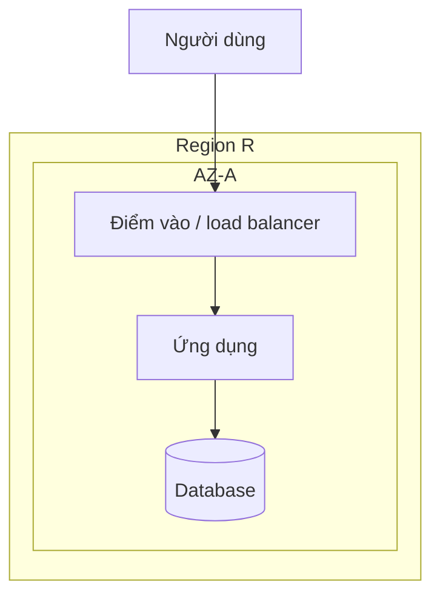
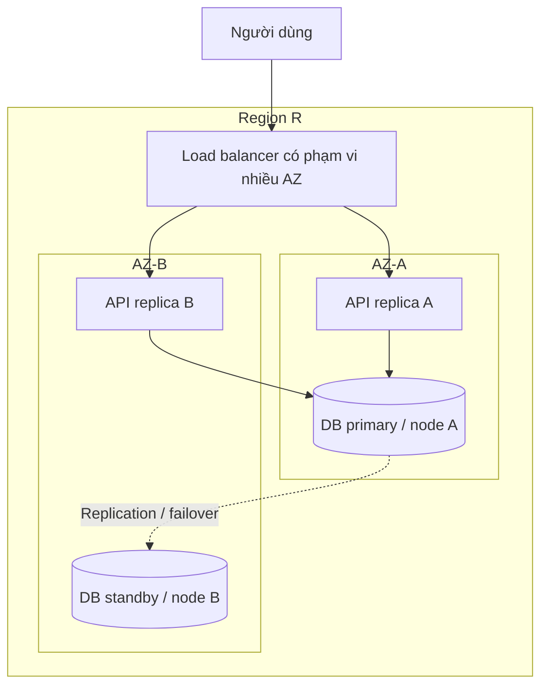
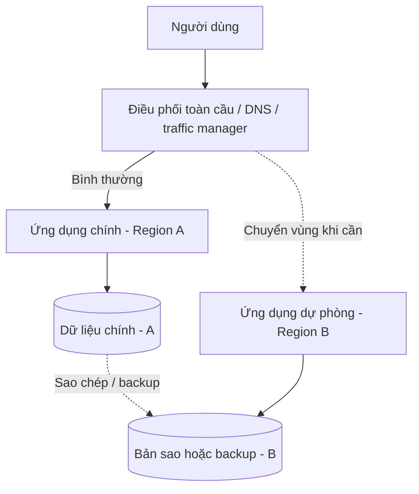
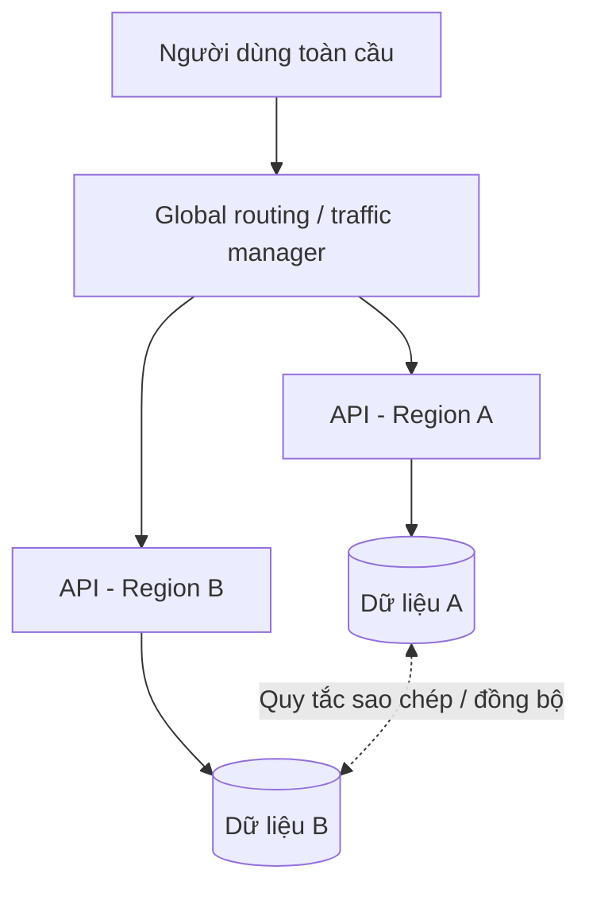
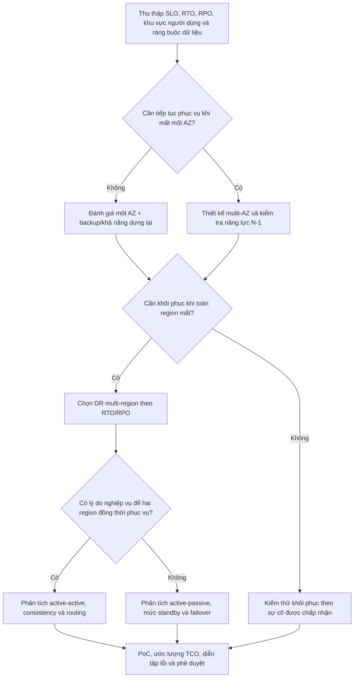

# Một vùng, nhiều vùng sẵn sàng và nhiều khu vực địa lý

## 1. Chọn phạm vi triển khai để kiểm soát phạm vi sự cố

Trong kiến trúc ứng dụng đám mây, **đặt hệ thống ở đâu** là quyết định ảnh hưởng trực tiếp đến độ tin cậy, bảo mật, độ trễ, khả năng mở rộng, chi phí và cách vận hành. Một ứng dụng có nhiều bản sao máy chủ nhưng tất cả nằm trong cùng một vùng sẵn sàng vẫn có thể ngừng hoạt động khi vùng đó gặp sự cố. Ngược lại, trải ứng dụng qua nhiều khu vực địa lý có thể cải thiện khả năng chịu lỗi diện rộng, nhưng phát sinh bài toán đồng bộ dữ liệu, chuyển hướng lưu lượng và chi phí vận hành.

Bài học thuộc chương **Mô hình triển khai** của **CLOUD_ARCHITECTURE**. Ta sẽ đi từ mục tiêu nghiệp vụ và yêu cầu khôi phục, sau đó lựa chọn mạng, compute, dữ liệu và cấu hình triển khai phù hợp; mọi phương án đều được xem xét theo các đánh đổi của **Well-Architected**.

Sau bài học, bạn có thể:

- Phân biệt **region (khu vực địa lý)**, **availability zone/AZ (vùng sẵn sàng)**, trung tâm dữ liệu và phạm vi chịu lỗi.
- Giải thích kiến trúc **một AZ trong một region**, **nhiều AZ trong một region**, và **nhiều region**.
- Chọn giữa **active-passive** và **active-active**, đồng thời nhận diện giới hạn của từng phương án.
- Đối chiếu kiến trúc với **SLO, RTO, RPO**, yêu cầu lưu trú dữ liệu, nhân lực và ngân sách.
- Thiết kế kiểm thử sự cố, chuyển đổi dự phòng và khôi phục trước khi đưa hệ thống vào production.

## 2. Khái niệm nền tảng: region, zone và miền lỗi

**Region** là khu vực địa lý do nhà cung cấp đám mây định nghĩa, thường chứa nhiều **availability zone (AZ)** hoặc **zone**. Mỗi AZ là một miền hạ tầng được bố trí để tăng khả năng cách ly sự cố so với các AZ khác trong cùng region. Chi tiết cách ly nguồn điện, mạng, cơ sở vật chất và dịch vụ khác nhau theo nhà cung cấp; **không được mặc định rằng mọi dịch vụ đều được tự động trải qua nhiều AZ**.

**Fault domain (miền lỗi)** là tập thành phần có thể cùng bị ảnh hưởng bởi một nguyên nhân hỏng. Trong cùng một AZ, nhiều instance vẫn có thể cùng bị ảnh hưởng khi AZ đó mất kết nối. Hai AZ trong một region giảm một số rủi ro hạ tầng chung, nhưng vẫn cùng chịu những phụ thuộc theo region hoặc toàn cục: dịch vụ điều khiển, cấu hình định tuyến, IAM, DNS, pipeline triển khai, lỗi ứng dụng hoặc thay đổi dữ liệu.

| Khái niệm | Phạm vi | Điểm cần hiểu khi thiết kế |
|---|---|---|
| Instance/container/pod | Một đơn vị chạy ứng dụng | Tăng số lượng bản sao có thể chịu lỗi một instance, nhưng không tự bảo vệ khỏi mất AZ |
| Availability zone (AZ) | Một miền hạ tầng bên trong region | Cách ly một phần sự cố nguồn điện/mạng/cơ sở vật chất, cần kiểm tra từng dịch vụ |
| Region | Một khu vực địa lý, thường có nhiều AZ | Có thể chứa tài nguyên và dịch vụ theo vùng; sự cố cấp region đòi hỏi phương án ngoài region |
| Dịch vụ global/edge | Phạm vi nhiều region hoặc điểm biên | Có thể hỗ trợ định tuyến/điều phối toàn cầu, nhưng cũng là phụ thuộc phải kiểm tra |

**Lưu ý thuật ngữ:** trong bài này, **một AZ (single-AZ)** là triển khai tại một vùng sẵn sàng bên trong **một region**. **Nhiều AZ (multi-AZ)** vẫn nằm trong **một region**. **Nhiều region (multi-region)** là triển khai ở từ hai khu vực địa lý trở lên. Một region không đồng nghĩa với một AZ.

## 3. Phương án A — Một vùng sẵn sàng (single-AZ)

Ví dụ một API và database đều chạy trong **AZ-A** của Region R. Có thể đặt nhiều process hoặc instance trong AZ-A để chịu lỗi từng tiến trình/máy; tuy nhiên các bản sao vẫn chia sẻ miền lỗi AZ.



**Ưu điểm:** sơ đồ mạng, kiểm soát dữ liệu và quy trình triển khai đơn giản; thường có chi phí cơ sở thấp hơn mô hình dự phòng nhiều AZ; phù hợp cho môi trường thử nghiệm, học tập, PoC, công việc theo lô có thể chạy lại hoặc sản phẩm chấp nhận gián đoạn dài hơn.

**Giới hạn:** nếu AZ mất kết nối hoặc tài nguyên cốt lõi của AZ bị ảnh hưởng, toàn bộ luồng phục vụ có thể dừng. Autoscaling trong cùng AZ hay tăng số instance **không chuyển một triển khai single-AZ thành multi-AZ**. Sao lưu cùng AZ cũng có thể không đủ khi cần phục hồi sau sự cố cấp AZ.

Nếu chọn single-AZ, cần quyết định rõ **khả năng chấp nhận gián đoạn**, thời gian cần để dựng lại ở AZ khác, vị trí độc lập của backup, cách khôi phục IaC và dữ liệu; không được ghi “high availability” chỉ vì có nhiều instance trong cùng AZ.

## 4. Phương án B — Nhiều vùng sẵn sàng trong một region (multi-AZ)

Trong mô hình multi-AZ, các bản sao của tầng ứng dụng chạy trên **ít nhất hai AZ**. Một thành phần cân bằng tải/điểm vào có khả năng hoạt động qua AZ sẽ điều phối yêu cầu đến các bản sao còn khỏe. Khi một AZ ngừng phục vụ, AZ còn lại phải có **đủ năng lực xử lý tải còn lại** và đường dữ liệu vẫn phải sử dụng được.



Sơ đồ mô tả **một kiểu triển khai minh họa**: database có primary và standby, ứng dụng cùng ghi vào endpoint database. Tính năng replication, quyền ghi, cách chuyển primary và thời gian failover phụ thuộc sản phẩm/cấu hình cụ thể. Không suy ra rằng standby luôn nhận đọc hoặc luôn có replication đồng bộ.

### 4.1. Ba tầng phải có cơ chế chịu lỗi tương ứng

| Tầng | Thiết kế cần xem xét | Rủi ro nếu bỏ sót |
|---|---|---|
| Điểm vào và mạng | Load balancer nhiều AZ; subnet, route, firewall, NAT/egress và endpoint thiết yếu có phương án khi mất AZ | Còn API replica nhưng không nhận được lưu lượng hoặc không gọi được dịch vụ ngoài |
| Compute | Replica trên nhiều AZ; health check, tự khởi động, lịch phân bổ, autoscaling và giới hạn tài nguyên | Mọi replica dồn vào một AZ hoặc AZ còn lại không chịu nổi tải |
| Dữ liệu | HA/replication đa AZ, failover database, quyền truy cập, kết nối lại, backup và thử restore | App còn sống nhưng không ghi/đọc được dữ liệu; mất giao dịch khi chuyển primary |
| Thành phần phụ trợ | Cache, queue, session store, secrets, service discovery, logging | Một dependency single-AZ trở thành điểm lỗi duy nhất của toàn ứng dụng |

**Stateless application** thường dễ chạy nhiều AZ vì mỗi replica có thể nhận bất kỳ request nào. Nếu lưu session trên bộ nhớ của một instance, khi instance/AZ mất, session sẽ mất hoặc yêu cầu mới phải tìm đúng instance. Có thể dùng session token phù hợp hoặc session store có kiến trúc chịu lỗi.

### 4.2. Sự cố một AZ: từ dự phòng đến khả năng tiếp tục phục vụ

Giả sử hai AZ cùng chia tải, mỗi AZ thường xử lý khoảng 50% tải. Khi AZ-A hỏng, **AZ-B có thể phải xử lý gần 100% tải**. Nếu AZ-B chỉ còn đủ tài nguyên cho 50%, hệ thống vẫn có thể quá tải. Thiết kế năng lực cần xét kịch bản **N-1**: mất một miền lỗi nhưng phần còn lại vẫn đáp ứng mục tiêu hiệu năng đã cam kết, hoặc ít nhất duy trì chế độ suy giảm có kiểm soát được chấp thuận.

Đường đi dữ liệu quan trọng không kém compute. Nếu database primary ở AZ-A, standby ở AZ-B cần được cấu hình và kiểm tra khả năng nhận vai trò primary. Ứng dụng phải chịu được **kết nối database bị cắt**: retry có giới hạn và backoff, timeout, idempotency cho thao tác có thể lặp, đóng/mở connection pool và phát hiện transaction không chắc chắn đã commit. Không nên chỉ đo “database đã failover” mà bỏ qua thời gian chức năng nghiệp vụ thực sự phục hồi.

Multi-AZ **không bảo vệ trước mọi sự cố cấp region** hoặc lỗi logic lan truyền qua replication, như xóa nhầm dữ liệu hay triển khai phiên bản chứa bug trên tất cả replica.

### 4.3. Giá phải trả cho multi-AZ

Chi phí tăng do tài nguyên dự phòng, đường truyền giữa các AZ, replication, load balancing và quan sát hệ thống. Hệ thống cũng cần quy trình triển khai không làm tất cả AZ ngừng phục vụ cùng lúc, kiểm thử failover và tối thiểu hóa thay đổi cấu hình chung gây lỗi đồng thời.

Số AZ cần dùng phụ thuộc mục tiêu sẵn sàng, đặc tính dịch vụ và kiến trúc quorum: **hai AZ có thể đủ cho một số mô hình primary-standby**, nhưng một số hệ thống phân tán cần thêm miền lỗi để duy trì quorum. Không suy rộng “cứ hai AZ là luôn đủ”.

## 5. Phương án C — Nhiều region (multi-region)

Multi-region đặt các thành phần hoặc bản sao hệ thống ở **từ hai region trở lên**. Mục tiêu có thể là chịu sự cố diện rộng, phục vụ người dùng ở nhiều khu vực với độ trễ thấp hơn, đáp ứng yêu cầu địa lý hoặc bảo đảm khả năng phục hồi nghiệp vụ. Cần xác định rõ **thành phần nào thực sự tồn tại tại region dự phòng**: chỉ có backup, có hạ tầng chưa chạy, có ứng dụng chạy chờ, hay cả hai region cùng phục vụ.

### 5.1. Active-passive: một region chính, một region dự phòng



Trong **active-passive**, region A tiếp nhận lưu lượng chính; region B được chuẩn bị để tiếp quản. Mức “sẵn sàng” của region B rất khác nhau:

| Mô hình phục hồi | Trạng thái region dự phòng | Đánh đổi thường gặp |
|---|---|---|
| **Backup and restore** | Chủ yếu lưu bản sao dữ liệu, tài liệu và IaC để dựng lại khi sự cố | Chi phí thường thấp hơn; thời gian khôi phục có thể dài, phụ thuộc tốc độ dựng hạ tầng và restore |
| **Pilot light** | Duy trì một số dịch vụ/dữ liệu tối thiểu, mở rộng ứng dụng khi kích hoạt DR | Tiết kiệm hơn môi trường chạy đầy đủ nhưng cần thời gian khởi động, đồng bộ và tăng năng lực |
| **Warm standby** | Có phiên bản ứng dụng đang chạy với công suất thấp và dữ liệu cập nhật theo thiết kế | Chuyển đổi nhanh hơn trong nhiều trường hợp, nhưng tốn tài nguyên thường trực |
| **Hot standby** | Hạ tầng dự phòng ở trạng thái sẵn sàng cao, có thể xử lý gần đủ tải khi chuyển vùng | Chi phí cao hơn, vẫn phải kiểm tra dữ liệu, quyền truy cập và chuyển hướng lưu lượng |

Đây là các **mẫu thiết kế**, không phải cam kết RTO/RPO cố định. Ví dụ, warm standby không đương nhiên đạt RTO dưới một phút; thời gian thực tế phụ thuộc việc phát hiện lỗi, quyết định kích hoạt, đồng bộ dữ liệu, cập nhật định tuyến và kiểm tra nghiệp vụ sau chuyển vùng.

### 5.2. Active-active: nhiều region đồng thời phục vụ



**Active-active** cho phép cả hai region nhận lưu lượng. Nó có thể giúp giảm độ trễ cho người dùng ở các vùng địa lý khác nhau và giữ lưu lượng ở region còn khỏe, nhưng yêu cầu:

- Quyết định **dữ liệu ghi ở đâu**: một writer chính, nhiều writer theo vùng/tenant, hay multi-writer thực sự.
- Quy định **mô hình nhất quán (consistency)**, xử lý xung đột, thứ tự sự kiện và sự chậm trễ sao chép.
- Thiết kế định tuyến người dùng và dữ liệu (ví dụ bám vùng dữ liệu khi pháp lý yêu cầu), cơ chế retry/idempotency và chống giao dịch trùng.
- Kiểm tra năng lực của mỗi region khi region kia mất, giới hạn quota và các thành phần phụ thuộc dịch vụ toàn cục.

Không nên tự mặc định **multi-region = active-active**. Một ứng dụng đọc nội dung công khai với cache độc lập có thể khá dễ chạy active-active; hệ thống thanh toán với nhiều ghi đồng thời trên hai region khó hơn nhiều. Nếu hai region đều được phép ghi vào dữ liệu không có cơ chế phối hợp, hiện tượng **split-brain**, ghi đè hoặc trùng đơn hàng có thể xuất hiện khi mạng phân vùng.

### 5.3. Những giới hạn thường bị đánh giá thấp

**Độ trễ:** các region cách xa nhau tạo thêm round-trip time; cố duy trì giao dịch đồng bộ qua khoảng cách lớn có thể tăng latency và giảm thông lượng. Một số dịch vụ cung cấp cơ chế nhất quán mạnh xuyên region, nhưng cái giá phải trả và hành vi khi partition phải được kiểm thử đúng dịch vụ.

**Sao chép bất đồng bộ:** thường giảm độ trễ ghi ở region chính, đổi lại vùng dự phòng có thể chậm hơn. Khi failover, một số ghi cuối cùng có nguy cơ chưa được sao chép; cần biết độ trễ sao chép thực tế và hệ quả nghiệp vụ.

**Lỗi chung:** mã ứng dụng bị lỗi, tài khoản/quyền bị cấu hình sai, bản cập nhật schema không tương thích, thao tác xóa dữ liệu hoặc sự cố dịch vụ điều phối toàn cục có thể ảnh hưởng cả hai region. Vì vậy, cần sao lưu độc lập với replication, phân quyền chặt chẽ, triển khai từng bước và khả năng rollback.

**Bảo mật và dữ liệu:** cần xác minh quy tắc vị trí lưu dữ liệu, dữ liệu trong backup/log, luồng truyền xuyên region, khóa mã hóa, quyền truy cập, secret, chứng chỉ và khả năng kiểm toán ở vùng dự phòng. Chuyển vùng không được tự ý làm dữ liệu đi sang khu vực chưa được phê duyệt.

## 6. HA, DR, SLO, RTO, RPO: bốn thước đo dễ bị nhầm

**High availability (HA)** là khả năng duy trì dịch vụ khi một số thành phần hỏng, thường thông qua dự phòng và tự động chuyển đổi. **Disaster recovery (DR)** là khả năng khôi phục sau thảm họa hoặc gián đoạn nghiêm trọng với quy trình, dữ liệu, con người và hạ tầng chuẩn bị trước. Multi-AZ thường phục vụ HA trong region; multi-region thường được xem xét cho DR cấp region, nhưng đây không phải quy tắc cứng.

| Khái niệm | Diễn giải | Ví dụ câu hỏi nghiệm thu |
|---|---|---|
| **SLI** | Chỉ số thực tế đo chất lượng dịch vụ, ví dụ tỷ lệ request thành công | Có đo từ phía người dùng, theo tuyến nghiệp vụ quan trọng không? |
| **SLO** | Mục tiêu chất lượng theo kỳ, ví dụ 99,9% request hợp lệ thành công trong tháng | Lỗi của AZ/region có khiến vượt ngân sách lỗi của tháng không? |
| **RTO** (*Recovery Time Objective*) | Thời gian gián đoạn tối đa đặt mục tiêu để khôi phục chức năng sau một loại sự cố | Từ lúc hệ thống bị gián đoạn đến khi giao dịch phục hồi được phép kéo dài bao lâu? |
| **RPO** (*Recovery Point Objective*) | Khoảng mất dữ liệu tối đa mục tiêu, tính lùi từ thời điểm xảy ra sự cố | Khi phải chuyển vùng, chấp nhận mất bao nhiêu phút dữ liệu đã ghi? |

Ví dụ giả định: hệ thống đặt đơn yêu cầu **RTO ≤ 30 phút** và **RPO ≤ 5 phút khi region chính không thể phục hồi**. Nếu sao chép bất đồng bộ thường chậm 12 phút, kiến trúc đó **chưa chứng minh được RPO 5 phút**. Nếu cần dựng hệ thống từ backup mất 2 giờ, phương án backup and restore **chưa đạt RTO 30 phút**. Phải thay đổi cơ chế phục hồi, giảm mục tiêu sau phê duyệt hoặc tăng ngân sách/nhân lực.

Một SLO 99,9% trong tháng 30 ngày tương đương khoảng **43,2 phút thời gian không khả dụng** theo cách tính thời gian liên tục đơn giản: \((1-0{,}999)\times 30\times24\times60\). Tuy nhiên, SLO đo theo request hoặc hành trình người dùng có thể cho kết quả khác. **Một kiến trúc multi-region không mặc nhiên bảo đảm SLO nào đó**; cần tính trên số liệu đo, rủi ro phụ thuộc chung và phương thức chuyển vùng.

### 6.1. Phân biệt replication với backup

- **Replication** giúp bản sao cập nhật gần dữ liệu chính và hỗ trợ tiếp tục hoạt động, nhưng xóa nhầm hoặc ghi sai có thể lan sang bản sao.
- **Backup** cho phép khôi phục về điểm trước đó khi có lịch sử phù hợp; phải xem thời hạn giữ, tính bất biến/quyền chống xóa, vùng lưu trữ độc lập và thời gian restore.
- **Failover** là chuyển sang tài nguyên thay thế; **failback** là trở về hoặc chuyển vai trò sau khi nơi cũ phục hồi. Failback có thể phức tạp vì dữ liệu ở hai phía đã khác nhau.

Vì vậy, cần kiểm tra **HA, backup, DR và sự toàn vẹn nghiệp vụ** như bốn phần bổ sung cho nhau.

## 7. Bảng so sánh ba phạm vi triển khai

| Tiêu chí | Một AZ trong một region | Nhiều AZ trong một region | Nhiều region |
|---|---|---|---|
| Mất một instance | Có thể chịu được nếu có replica trong AZ | Có thể chịu được nếu cấu hình đúng | Có thể chịu được nếu các tầng được dự phòng |
| Mất nguyên AZ | Có nguy cơ gián đoạn toàn bộ | Có thể duy trì nhờ AZ còn lại nếu đủ năng lực và không có điểm lỗi chung | Có thể duy trì nếu các thành phần cần thiết nằm ngoài AZ lỗi |
| Mất toàn region | Thường phải dựng lại/phục hồi ở nơi khác | Hai AZ cùng region có thể mất; cần phương án ngoài region | Có thể phục hồi ở region khác nếu dữ liệu, định tuyến và quy trình đã chuẩn bị |
| Độ phức tạp vận hành | Thấp hơn | Trung bình, gồm cân bằng tải và failover | Cao, nhất là dữ liệu, điều phối và bài toán phân vùng |
| Chi phí cơ sở | Thường thấp hơn | Tăng theo replica, dự phòng và truyền dữ liệu | Thường tăng đáng kể theo region, dự phòng, replication và traffic toàn cầu |
| Độ trễ dữ liệu | Đơn giản hơn | Có thể phát sinh truyền qua AZ | Có thể phát sinh truyền xuyên region, cần chọn consistency |
| Trường hợp thường gặp | Dev/test, PoC, job có thể chạy lại | Ứng dụng production cần chịu sự cố AZ | Hệ thống cần DR cấp region, người dùng toàn cầu hoặc ràng buộc địa lý |

Bảng chỉ mô tả **khả năng theo mẫu triển khai**. Kết quả thực tế phụ thuộc dịch vụ được chọn, cấu hình, quota, topologies mạng/dữ liệu và kết quả diễn tập. Chỉ việc “có tài nguyên ở hai AZ” hoặc “có tài khoản ở hai region” chưa tạo ra HA/DR.

## 8. Cách ra quyết định từ yêu cầu nghiệp vụ đến kiến trúc

Thay vì bắt đầu bằng câu “nên dùng bao nhiêu region?”, hãy bắt đầu từ **hậu quả khi dịch vụ gián đoạn**, loại sự cố phải chịu được và chi phí chấp nhận được.



Quy trình chi tiết:

1. **Xác định mục tiêu và kịch bản sự cố.** Chỉ rõ mức gián đoạn/mất dữ liệu chấp nhận được đối với lỗi instance, AZ, region, xóa dữ liệu nhầm và lỗi triển khai. Phân biệt yêu cầu cấp API với giao dịch thanh toán/đặt đơn.
2. **Định vị người dùng và dữ liệu.** Liệt kê khu vực khách hàng, độ trễ yêu cầu, nơi dữ liệu được phép lưu/đi qua, quy định backup và vùng đặt khóa mã hóa.
3. **Vẽ đường phụ thuộc end-to-end.** Đi từ DNS/edge đến load balancer, API, database, cache, queue, KMS/secrets, dịch vụ bên thứ ba và hệ thống nội bộ; xác định thành phần nào chỉ tồn tại ở một AZ/region.
4. **Chọn mức dự phòng theo tầng.** Compute stateless có thể trải AZ; database cần cơ chế failover tương thích consistency; queue/cache/session cũng phải đáp ứng khả năng sống còn khi mất miền lỗi.
5. **Dự toán và kiểm tra tính khả thi.** Bao gồm tài nguyên chạy thường trực, công suất dự phòng, truyền dữ liệu xuyên AZ/region, backup, log, kiểm thử DR, công vận hành, on-call và giới hạn quota.
6. **Thử tình huống hỏng thật.** Đo thời gian phát hiện, chuyển hướng, khôi phục giao dịch, lag replication, dữ liệu mất và tải đỉnh sau failover; so với RTO/RPO/SLO.
7. **Ghi ADR và runbook.** Ghi phương án, lý do, giả định, trade-off, chủ sở hữu cảnh báo, điều kiện kích hoạt DR, phân quyền quyết định và kế hoạch failback.

### 8.1. Checklist về mạng, compute và dữ liệu

| Tầng | Câu hỏi thiết kế và kiểm thử |
|---|---|
| DNS / traffic | Cách đánh giá health? Điều kiện chuyển vùng? Thời gian cache DNS/TTL ảnh hưởng bao lâu? Có thể chuyển thủ công khi auto failover sai không? |
| Ingress / network | Load balancer có hiện diện qua AZ? NAT, firewall, route, private endpoint và kết nối on-prem có một điểm lỗi không? |
| Compute | Replica có thực sự phân bổ đúng AZ? Sau khi mất AZ, có đủ CPU/RAM, quota, IP, connection pool và giới hạn autoscaling không? |
| Database | Ai có quyền ghi? Thao tác ghi khi leader đổi có thể lặp? RPO đo ở ứng dụng hay chỉ ở replication? Restore đã được thử chưa? |
| Queue / session / cache | Tin nhắn đang xử lý có thể được gửi lại? Có cơ chế deduplicate/idempotency? Mất cache có gây quá tải database không? |
| Bảo mật | IAM, secret, certificate, KMS, audit log và giới hạn dữ liệu có đáp ứng ở vùng dự phòng không? |
| Vận hành | Alert có đến đúng người? Runbook có bước xác nhận toàn vẹn nghiệp vụ, rollback và failback không? |

## 9. Ví dụ xuyên suốt: hệ thống đặt hàng thương mại điện tử

Giả sử một sản phẩm có khách hàng tập trung trong một quốc gia, xử lý **500 đơn hàng/giờ ở thời gian cao điểm**, cần lưu dữ liệu theo vùng được bộ phận có thẩm quyền phê duyệt. Con số trong ví dụ dùng để học cách ra quyết định, **không phải cam kết hiệu năng hay SLA của nhà cung cấp**.

Ban đầu đội chỉ có hai lập trình viên và một kỹ sư vận hành kiêm nhiệm. Nếu môi trường chỉ để demo và đơn hàng có thể khôi phục từ nguồn khác, single-AZ cùng backup/khả năng tái tạo hạ tầng có thể hợp lý, với điều kiện chủ sản phẩm chấp nhận thời gian gián đoạn khi AZ hỏng.

Khi sản phẩm đi vào production, chủ sản phẩm đặt mục tiêu sau:

| Điều kiện giả định | Tiêu chí chấp nhận |
|---|---|
| Sự cố một AZ | Người dùng vẫn đặt hàng được hoặc chức năng hồi phục trong vài phút đã thống nhất |
| Mất dữ liệu đơn hàng | Cần nêu RPO theo từng kịch bản và chứng minh bằng kiểm thử, không chấp nhận im lặng bỏ đơn |
| Hiệu năng | Trong tình huống mất một AZ, hệ thống còn lại xử lý được tải đỉnh dự kiến |
| Dữ liệu và bảo mật | Backup, log và region dự phòng nằm trong phạm vi được phê duyệt |
| Ngân sách | Tính đủ chi phí dự phòng, băng thông, backup và nhân lực trực sự cố |

**Bước 1 — Multi-AZ trong một region.** Phân bố API replica qua AZ-A và AZ-B, dùng load balancer có chức năng health check, cấu hình database HA đáp ứng mục tiêu, thiết kế idempotency cho API tạo đơn, tránh session cục bộ. Kiểm thử mô phỏng mất AZ-A: AZ-B nhận lưu lượng, database tiếp tục ghi hoặc failover, đơn hàng không bị nhân đôi. Ghi lại khoảng ngắt thực tế thay vì tuyên bố “zero downtime”.

**Bước 2 — Chỉ thêm multi-region khi có yêu cầu cụ thể.** Sau đó sản phẩm mở rộng và đặt **RTO 30 phút, RPO 5 phút đối với mất toàn region**. Đội đánh giá warm standby ở Region B, replication phù hợp và một quy trình chuyển định tuyến đã được phê duyệt. Nếu không có phương án dữ liệu đáp ứng RPO 5 phút, hoặc Region B chưa đạt yêu cầu vị trí dữ liệu, thiết kế này chưa được chấp thuận. Đội cần thử replication lag, restoration, promotion, routing, công suất tải của B và quy trình quay lại Region A.

**Bước 3 — Xem xét active-active khi thực sự cần.** Nếu sau này phục vụ nhiều địa lý và mục tiêu độ trễ yêu cầu ứng dụng chạy ở cả hai region, nhóm có thể giữ một writer và phục vụ đọc địa phương, hoặc phân vùng ghi theo khách hàng. **Active-active ứng dụng không buộc phải multi-writer database**; mỗi mô hình nhất quán cần thiết kế và đánh đổi riêng. Việc chuyển sang multi-writer chỉ hợp lý nếu có cơ chế giải quyết xung đột, giao dịch lặp, thứ tự sự kiện và nghiệm thu nghiệp vụ rõ ràng.

### 9.1. Kịch bản diễn tập có thể kiểm chứng

| Kịch bản giả lập | Cần quan sát | Điều kiện đạt |
|---|---|---|
| Tắt một API replica | Health check loại node, request chuyển đến replica khác | SLI không vượt ngưỡng lỗi cho phép, không mất giao dịch |
| Cô lập AZ-A | Khả năng phục vụ của AZ-B, đường mạng, queue, database failover, latency | SLO/RTO cho sự cố AZ được đáp ứng ở tải mục tiêu |
| Cắt kết nối tới primary database | Thời gian nhận leader mới, retry, transaction không chắc kết quả | Không ghi trùng hoặc thất lạc đơn; RPO đo bằng đối chiếu dữ liệu |
| Chặn toàn bộ lưu lượng tới Region A | Thời gian phát hiện, kích hoạt DR, routing, năng lực Region B | RTO/RPO cấp region đạt và báo cáo được dữ liệu thiếu nếu có |
| Xóa nhầm một bản ghi quan trọng | Khả năng point-in-time restore, quy trình bảo vệ/xác minh | Khôi phục theo chính sách dữ liệu; không trông chờ replication sửa lỗi |
| Thử failback về A | Đồng bộ dữ liệu mới từ B, chuyển quyền ghi, xử lý cache/DNS | Không phát sinh split-brain, mất đơn hoặc chuyển vùng lặp vô hạn |

Nên thử trong môi trường có cấu hình đủ đại diện, giới hạn phạm vi tác động, theo dõi kết quả và có kế hoạch quay lại trạng thái an toàn. Chạy bài test chỉ trên sơ đồ hạ tầng hoặc trong môi trường có tải thấp chưa chứng minh được khả năng chịu tải khi gặp sự cố thật.

## 10. Đánh giá lựa chọn theo Well-Architected

| Trụ cột | Một AZ | Multi-AZ | Multi-region |
|---|---|---|---|
| **Operational Excellence** | Dễ triển khai nhưng cần runbook dựng lại | Cần tự động hóa health check, failover, triển khai từng AZ | Cần diễn tập DR, phân vai on-call, kiểm soát failover/failback và cấu hình đồng bộ |
| **Security** | Tập trung phân quyền, mã hóa, backup | Kiểm tra IAM, secret, network policy nhất quán qua AZ | Kiểm soát nơi lưu/di chuyển dữ liệu, khóa, chứng chỉ và log ở nhiều region |
| **Reliability** | Không chịu được sự cố AZ nếu thiếu phương án ngoài AZ | Có thể chịu mất AZ nếu mọi dependency đã dự phòng | Có thể đáp ứng sự cố cấp region nếu dữ liệu và điều phối thực sự hoạt động |
| **Performance Efficiency** | Đơn giản, có giới hạn vùng lỗi | Đủ năng lực N-1 và độ trễ liên AZ phù hợp | Đo độ trễ xuyên region, consistency, cache và routing người dùng |
| **Cost Optimization** | Ít chi phí dự phòng hơn, có rủi ro gián đoạn | Đánh đổi phí replica, replication và traffic liên AZ lấy HA | Tính chi phí region dự phòng, truyền dữ liệu, traffic manager, kiểm thử và nhân sự |
| **Sustainability** | Ít tài nguyên nền hơn trong nhiều trường hợp | Có thêm replica nhưng có thể right-size và autoscale | Tránh overprovision không cần thiết; cân đối hiệu suất với nhu cầu DR thực tế |

Không có mô hình “tốt nhất” cho mọi ứng dụng. **Single-AZ có thể đúng** với hệ thống chấp nhận lỗi AZ; **multi-AZ có thể đủ** cho phần lớn yêu cầu sẵn sàng trong một region; **multi-region chỉ tạo giá trị khi kịch bản nghiệp vụ, yêu cầu phục hồi hoặc địa lý biện minh được độ phức tạp và chi phí**.

## 11. Sai lầm thường gặp và cách sửa

1. **“Có ba instance nghĩa là đã HA.”** Hãy kiểm tra chúng ở bao nhiêu fault domain, có chung database/network điểm lỗi không và liệu bản sao còn lại chịu đủ tải không.
2. **“Có database replica nghĩa là có backup.”** Replication có thể sao chép cả thao tác xóa sai; cần backup độc lập, chính sách giữ và restore đã được thử.
3. **“Multi-AZ sẽ chịu được mất region.”** Multi-AZ nằm trong cùng region; phải có kế hoạch ngoài region nếu yêu cầu chịu mất region.
4. **“Đặt một VM ở region thứ hai đã có DR.”** Cần bản sao dữ liệu, phụ thuộc cần thiết, phân quyền, DNS/routing, runbook và bài kiểm thử phục hồi nghiệp vụ.
5. **“DNS failover luôn tức thì.”** Caching, TTL, health detection, client behavior và kết nối đang mở có thể kéo dài quá trình chuyển vùng.
6. **“Active-active chỉ cần bật hai endpoint.”** Bài toán writer, consistency, split-brain, ordering và idempotency phải được giải trước.
7. **“Thêm region là chắc chắn bảo mật hơn.”** Tăng region cũng mở rộng nơi lưu dữ liệu, khóa và bề mặt vận hành; phải xác nhận quy định dữ liệu trước.
8. **“Thiết kế DR xong không cần diễn tập.”** Chỉ kết quả kiểm thử có đối chiếu RTO/RPO và giao dịch nghiệp vụ mới cung cấp bằng chứng.

## 12. Mẫu quyết định kiến trúc (ADR) và bảng kiểm

Mẫu sau là **ví dụ mô tả quyết định**, có thể đưa vào repository kiến trúc để nhóm thống nhất cùng product owner và vận hành:

```yaml
decision_id: ADR-DEPLOY-003
system: ordering-service
business_criticality: high
deployment_model: multi_az_single_region
target_failure_scenarios:
  - single_instance
  - single_availability_zone
availability_slo: "99.9% trong 30 ngày (theo SLI định nghĩa riêng)"
rto_by_scenario:
  az_loss: "10 phút"
rpo_by_scenario:
  az_loss: "1 phút"
region_loss: "Chưa cam kết; cần đánh giá DR riêng"
assumptions:
  - "Region được phê duyệt cho dữ liệu khách hàng"
  - "AZ còn lại chịu được tải cao điểm khi AZ kia bị cô lập"
acceptance_evidence:
  - "Kiểm thử điều phối tải và database failover"
  - "Kiểm thử khôi phục giao dịch và đối chiếu dữ liệu"
  - "Báo giá compute, network, database, backup, observability"
review_triggers:
  - "SLO hoặc RTO/RPO thay đổi"
  - "Sản phẩm mở rộng ra thị trường mới"
  - "Xuất hiện yêu cầu phục hồi cấp region"
```

**Các giá trị SLO, RTO, RPO trong YAML là giả định minh họa**, không phải mức bảo đảm của multi-AZ. Chỉ ghi vào quyết định chính thức sau khi người chịu trách nhiệm chấp thuận và bài diễn tập chứng minh tính khả thi.

Trước khi phê duyệt triển khai, hãy kiểm tra:

- [ ] Đã phân biệt rõ single-AZ, multi-AZ, multi-region và phạm vi lỗi cần chịu.
- [ ] Đã có mục tiêu SLI/SLO, RTO/RPO theo **từng kịch bản**, kèm chủ sở hữu và thời hạn đo.
- [ ] Mạng, compute, database, cache, queue, session, secrets và các dependency quan trọng không tạo điểm lỗi duy nhất trái với mục tiêu.
- [ ] Công suất sau mất một AZ/region được đo với tải cao điểm hoặc mô phỏng đại diện.
- [ ] Chi phí TCO tính cả tài nguyên dự phòng, replication, lưu lượng liên AZ/region, backup, monitoring và công on-call.
- [ ] Vùng lưu dữ liệu, backup, log, khóa và luồng truyền dữ liệu đã được các bên có thẩm quyền xác nhận.
- [ ] Failover, restore và failback được diễn tập; có cách so sánh dữ liệu và nhận biết giao dịch trùng/thiếu.
- [ ] Có runbook, cảnh báo, quyền kích hoạt, phương án quay lại, ADR và ngày rà soát các giả định.

**Điểm cần ghi nhớ:** khả năng chịu lỗi đến từ **toàn bộ luồng phục vụ người dùng**, không chỉ số lượng AZ hoặc region xuất hiện trên sơ đồ. Chọn phạm vi triển khai bằng cách đối chiếu hệ thống cần sống sót qua sự cố nào, dữ liệu được phép mất bao nhiêu, chức năng cần trở lại sau bao lâu, đội ngũ có thể vận hành đến đâu và tổ chức sẵn sàng trả chi phí gì.
