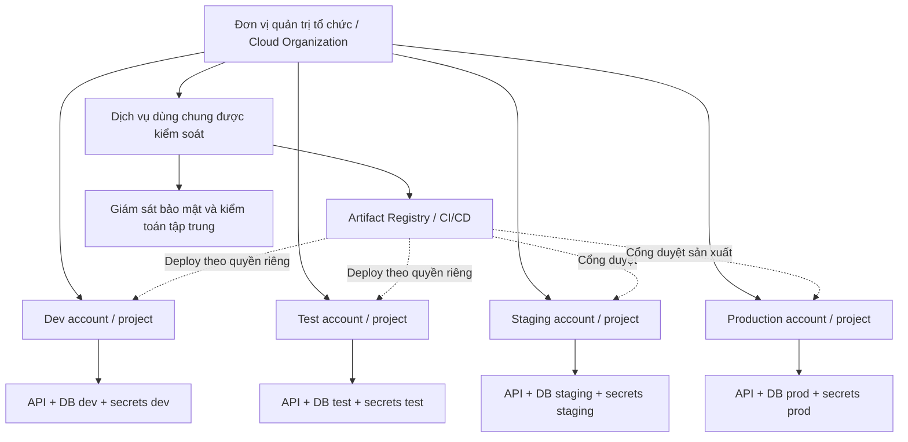
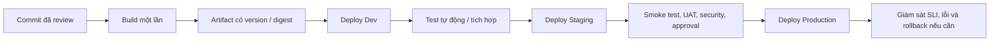

# Tách môi trường phát triển, kiểm thử, thử nghiệm và sản xuất

## 1. Vì sao phải tách môi trường?

Trong thiết kế kiến trúc đám mây, một ứng dụng không chỉ có hệ thống đang phục vụ khách hàng. Đội phát triển cần nơi sửa lỗi, chạy kiểm thử tự động, thử phiên bản sắp phát hành và vận hành dịch vụ thật. Nếu các hoạt động này dùng chung tài nguyên, một câu lệnh xóa cơ sở dữ liệu, một đợt kiểm thử tải hoặc một thay đổi cấu hình có thể làm gián đoạn người dùng và làm lộ dữ liệu sản xuất.

**Tách môi trường** là tổ chức tài nguyên và quyền truy cập sao cho mỗi giai đoạn có phạm vi thay đổi, dữ liệu, ngân sách và quy trình triển khai phù hợp. Đây là một quyết định kiến trúc liên quan trực tiếp đến **bảo mật, độ tin cậy, khả năng mở rộng, chi phí và vận hành**, không đơn thuần là đặt tên máy chủ `dev` hay `prod`.

Bài học thuộc chương **Tổ chức tài nguyên** của module **CLOUD_ARCHITECTURE**. Sau bài học, bạn có thể:

- Phân biệt mục đích của môi trường **development, test, staging/preview và production**.
- Quyết định ranh giới cô lập ở cấp tài khoản, dự án, mạng, dữ liệu, danh tính và hệ thống triển khai.
- Thiết kế quy trình chuyển phiên bản qua các môi trường bằng **CI/CD** và **Infrastructure as Code (IaC)**.
- Xác định điểm cân bằng giữa độ giống production, an toàn, thời gian phát hành, chi phí và năng lực vận hành.
- Đánh giá cách tổ chức môi trường dưới góc nhìn các trụ cột **Well-Architected**.

## 2. Bốn môi trường phục vụ bốn mục tiêu khác nhau

| Môi trường | Mục đích chính | Hoạt động tiêu biểu | Nguyên tắc quan trọng |
|---|---|---|---|
| **Phát triển (development/dev)** | Lập trình, thử nhanh, gỡ lỗi | Chạy nhánh tính năng, kiểm tra thủ công, thử API | Dễ tạo và thay đổi; không có quyền ghi dữ liệu production |
| **Kiểm thử (test/QA)** | Xác minh hành vi chức năng và phi chức năng | Unit/integration/end-to-end, kiểm thử hợp đồng, bảo mật, hồi quy | Tái lập được trạng thái; dữ liệu và kết quả đo có thể kiểm chứng |
| **Thử nghiệm trước phát hành (staging/pre-production)** | Thẩm định phiên bản dự kiến ra production | UAT, smoke test, thử migration, hiệu năng, tích hợp, triển khai/rollback | Cấu hình và hành vi đủ đại diện cho production; kiểm soát thay đổi |
| **Sản xuất (production/prod)** | Phục vụ người dùng và dữ liệu thật | Giao dịch nghiệp vụ, giám sát SLO, sao lưu, ứng cứu sự cố | Bảo vệ dữ liệu, quyền tối thiểu, quy trình thay đổi và phục hồi rõ ràng |

Trong nhiều nhóm, **test** và **staging** có thể được đặt tên khác hoặc kết hợp nếu phạm vi nhỏ. Ở đây, “**thử nghiệm**” chỉ **môi trường staging/pre-production dùng để nghiệm thu phiên bản sắp phát hành**. Môi trường sandbox khám phá dịch vụ hoặc thử ý tưởng chưa ổn định có thể là một môi trường bổ sung; không nên nhầm sandbox với nơi nghiệm thu trước production.

### 2.1. Development: tối ưu vòng phản hồi

Mục tiêu là phát hiện lỗi nhanh và giúp lập trình viên tự thử nghiệm. Có thể cho phép tạo, hủy các tài nguyên tạm thời hoặc môi trường riêng theo nhánh, nhưng phải có **giới hạn chi phí, quyền truy cập, mạng và thời gian tồn tại**.

Development nên dùng dữ liệu giả lập, fixture hoặc dữ liệu đã được xử lý và phê duyệt. Không cấp thông tin xác thực production cho công cụ chạy trên máy cá nhân hoặc pipeline development. Tính linh hoạt của dev không đồng nghĩa với bỏ qua kiểm soát tài khoản và ngân sách.

### 2.2. Test: kiểm tra tính đúng đắn, lặp lại được

Môi trường test hỗ trợ chạy các bộ kiểm thử có đầu vào và trạng thái xác định, thường có quy trình **khởi tạo → chạy kiểm thử → thu kết quả → dọn dẹp**. Có thể tổ chức nhiều biến thể: test tích hợp dùng database thật, test hợp đồng dùng dịch vụ mô phỏng, test tải dùng dữ liệu và cấu hình đủ đại diện.

Điểm cần tránh là dùng chung một database test cho nhiều pipeline chạy song song nhưng không tách dữ liệu: kiểm thử sẽ thất bại ngẫu nhiên vì các bài test sửa cùng bản ghi. Có thể cấp một schema/database theo phiên chạy hoặc tạo tài nguyên tạm thời với giới hạn tài nguyên rõ ràng.

### 2.3. Staging: diễn tập bản phát hành

Staging nhằm trả lời: **“Nếu phát hành đúng phiên bản này với cách cấu hình này, hệ thống có hoạt động đúng như kỳ vọng không?”** Vì vậy, nên giữ gần production ở những đặc tính ảnh hưởng đến hành vi: phiên bản runtime, cơ sở dữ liệu và schema, topology mạng/compute, phiên bản dịch vụ, chính sách truy cập, cơ chế triển khai và giám sát.

Không nhất thiết sao chép nguyên công suất production sang staging. Có thể giảm kích thước để tiết kiệm, nhưng khi đó phải **nêu rõ phần nào không tương đương**; cần môi trường hoặc bài chạy tải riêng nếu đang xác nhận năng lực tải đỉnh. Mọi khác biệt có thể gây thay đổi hành vi, ví dụ cache, queue, khóa mã hóa, kết nối dịch vụ ngoài hoặc cấu hình HA, phải được kiểm kê và kiểm thử phù hợp.

### 2.4. Production: bảo vệ giao dịch và dữ liệu thật

Production yêu cầu quyền truy cập hẹp, triển khai được kiểm soát, thay đổi có thể truy vết, backup và khôi phục đã thử, cùng các chỉ số theo dõi từ góc nhìn người dùng. Hoạt động thử nghiệm có tính phá hủy, tải cao hoặc sử dụng dữ liệu nhạy cảm phải được đánh giá và có phương án riêng. **Không coi production là môi trường gỡ lỗi thường ngày**.

## 3. Tách môi trường nghĩa là cô lập những gì?

Một hệ thống có bốn namespace mang tên `dev`, `test`, `staging`, `prod` vẫn có thể chung tài khoản quản trị, mạng, database, secret hoặc pipeline. Khi đó, lỗi ở môi trường thấp hơn vẫn có thể lan sang production. Cần xác định ranh giới theo nhiều lớp:

| Lớp cô lập | Câu hỏi bắt buộc | Nếu bỏ qua |
|---|---|---|
| **Quản trị tài nguyên** | Mỗi môi trường ở tài khoản/subscription/project riêng hay dùng chung? Ai có thể tạo/xóa tài nguyên? | Một thay đổi/quota/billing ở môi trường khác ảnh hưởng production |
| **Danh tính và quyền (IAM)** | Tài khoản người dùng, service identity, role triển khai có tách theo môi trường? | Lộ token dev có thể triển khai hoặc đọc dữ liệu prod |
| **Mạng** | Subnet/VPC/VNet, firewall, DNS, egress và kết nối riêng có độc lập không? | Dịch vụ test truy cập nhầm database prod hoặc mở đường đi không mong muốn |
| **Dữ liệu** | Database, object storage, backup, queue và chính sách lưu giữ có tách? | Chạy migration/xóa dữ liệu test làm hỏng production |
| **Secrets và khóa** | API key, khóa mã hóa, chứng chỉ, webhook secret có chia sẻ không? | Lộ hoặc thu hồi secret một nơi ảnh hưởng nhiều môi trường |
| **Triển khai và vận hành** | Pipeline, quyền phê duyệt, rollback, cảnh báo và log có phân biệt? | Một thao tác deploy nhầm môi trường hoặc cảnh báo sản xuất bị nhiễu |
| **Chi phí, hạn mức** | Có ngân sách, tag và giới hạn sử dụng riêng? | Test tải dùng hết quota hoặc tạo hóa đơn không dự báo |

Cô lập tốt cần cả **ranh giới kỹ thuật** và **quy trình**: người có thể bấm nút “deploy prod” phải được cấp quyền phù hợp; service account của test không có đường ghi vào production; biến môi trường và thông tin kết nối được kiểm tra trước khi chạy migration.

## 4. Các mô hình tổ chức tài nguyên

Trên cloud, khái niệm đơn vị quản trị khác nhau theo nền tảng: ví dụ **account** trong AWS, **subscription** trong Azure hoặc **project** trong Google Cloud. Bài học dùng chung tên **đơn vị quản trị** để nói về ranh giới cấp quyền, quota và theo dõi chi phí. Cách cách ly cụ thể phải được xác minh với nhà cung cấp và dịch vụ được chọn.

### 4.1. Một đơn vị quản trị cho mọi môi trường

Tài nguyên được tách bằng namespace, resource group, tên và tag; có thể dùng mạng/role riêng trong cùng một đơn vị quản trị.

**Ưu điểm:** thiết lập ban đầu nhanh, ít cấu hình tổ chức, thuận tiện khi dự án còn nhỏ. **Rủi ro:** quota, quyền quản trị cấp cao, chính sách, một số tài nguyên chung và chi phí có thể ảnh hưởng qua lại. Tên `app-prod-db` **không phải ranh giới bảo mật**.

Phù hợp nhất khi đang học/PoC hoặc ứng dụng nội bộ rủi ro thấp, với điều kiện vẫn tách dữ liệu, IAM và network tối thiểu. Trước khi phục vụ dữ liệu quan trọng, phải đánh giá lại ranh giới.

### 4.2. Hai nhóm: production và non-production

Tài nguyên production nằm trong đơn vị quản trị riêng; dev/test/staging chia sẻ đơn vị non-production nhưng vẫn tách mạng, dữ liệu, service identity và quyền. Đây là bước giảm rủi ro tương đối rõ mà không tạo quá nhiều đơn vị quản lý.

Điểm hạn chế: nếu staging bị ảnh hưởng bởi test tải, hoặc dev/test dùng chung quota, bài nghiệm thu có thể không còn đại diện. Nên bổ sung giới hạn tài nguyên và phân tách staging khi các phụ thuộc này trở thành vấn đề thực tế.

### 4.3. Mỗi môi trường một đơn vị quản trị

Dev, test, staging và prod có **tài khoản/subscription/project riêng** dưới cấu trúc quản trị chung. Chính sách bảo mật, IAM, ngân sách và quota có thể được áp dụng theo môi trường. Mô hình này thường phù hợp khi có nhiều nhóm, dữ liệu nhạy cảm, yêu cầu kiểm toán hoặc ứng dụng production quan trọng.

**Ưu điểm:** phân biệt trách nhiệm và giảm nguy cơ thay đổi vô tình vượt ranh giới. **Đánh đổi:** nhiều cấu hình danh tính, mạng, pipeline, DNS, hạn mức và log hơn; cần tự động hóa tạo tài nguyên để tránh sai lệch giữa môi trường.

| Phương án | Độ đơn giản ban đầu | Cô lập quản trị | Hạn chế và điều kiện |
|---|---|---|---|
| Một đơn vị, nhiều namespace/resource group | Cao | Thấp hơn | Cần kiểm soát quyền và tài nguyên dùng chung kỹ; không đủ cho mọi yêu cầu tuân thủ |
| Hai đơn vị prod/non-prod | Trung bình | Tách production khỏi non-prod | Dev/test/staging vẫn có thể ảnh hưởng nhau |
| Mỗi môi trường một đơn vị | Phức tạp hơn | Rõ ràng hơn | Cần automation, governance, quan sát và chi phí tổ chức |

**Nguyên tắc:** chọn cấp ranh giới theo **mức hậu quả khi xảy ra lỗi, quy định dữ liệu, nhu cầu kiểm soát và khả năng vận hành**. Đừng lựa chọn chỉ vì nhìn sơ đồ có vẻ “chuẩn doanh nghiệp”.

### 4.4. Sơ đồ tổ chức gợi ý



Các dịch vụ dùng chung như registry artifact, danh tính tổ chức, hệ thống thu thập log hoặc pipeline có thể được dùng xuyên môi trường **nếu phân quyền, mã hóa, audit và phạm vi ảnh hưởng được thiết kế rõ**. Chúng là các phụ thuộc quan trọng, nên tránh cấp cho pipeline một khóa quản trị có thể thao tác mọi môi trường mà không kiểm soát.

## 5. Thiết kế IAM, mạng và đường đi dữ liệu

### 5.1. IAM: quyền tối thiểu và danh tính riêng theo môi trường

Một bảng quyền đơn giản để thảo luận với đội kỹ thuật:

| Vai trò | Dev | Test | Staging | Production |
|---|---|---|---|---|
| Developer | Tạo/sửa tài nguyên trong phạm vi dev được giao | Đọc kết quả; thao tác test có giới hạn | Đọc log/metric cần thiết | Thường chỉ đọc thông tin cần thiết; không deploy trực tiếp |
| QA | Quyền cần để kiểm tra | Chạy test, tạo/xóa dữ liệu test được ủy quyền | Chạy kiểm thử nghiệm thu có kiểm soát | Không có quyền sửa dữ liệu thật |
| Release pipeline | Quyền deploy dev theo scope | Quyền deploy test theo scope | Quyền deploy staging qua gate | Chỉ deploy sau gate sản xuất, quyền có thời hạn/phạm vi |
| Nhóm trực vận hành | Theo nhu cầu hỗ trợ | Theo nhu cầu hỗ trợ | Thử runbook | Quyền vận hành đã duyệt, audit; nâng quyền khẩn cấp qua quy trình riêng |

Đây là mô hình minh họa: quyền thực tế cần điều chỉnh theo chức danh, trách nhiệm và chính sách tổ chức. Ưu tiên định danh ngắn hạn/federation cho pipeline thay vì phát tán khóa tĩnh; tách **service identity**, tài khoản người dùng và quyền triển khai. Đối với production, bật ghi nhật ký truy cập và dùng cơ chế nâng quyền khẩn cấp (**break-glass**) có giám sát, thời hạn và hậu kiểm.

### 5.2. Network: tránh đường nối vô tình

- Mỗi môi trường nên có phân đoạn mạng riêng đủ rõ để áp dụng chính sách inbound, outbound, DNS và route. Tách network theo account/project giúp quản lý nhưng chưa đủ nếu cấu hình peering, firewall hoặc private endpoint mở rộng quá mức.
- Chỉ cho phép **đường kết nối cần cho nghiệp vụ**. Ví dụ, runner CI của test có thể kết nối test database; không có lý do để kết nối production database.
- Tránh tái sử dụng tên DNS không kèm môi trường hoặc đọc một biến `DB_HOST` từ cấu hình dùng chung khiến ứng dụng dev trỏ vào prod. Có thể áp dụng kiểm tra deny-list/allow-list đích kết nối lúc pipeline bắt đầu.
- Ghi lại traffic sang hệ thống bên thứ ba. Môi trường test phải dùng endpoint thử nghiệm của đối tác khi có; tránh tạo lệnh thanh toán, email, SMS hoặc webhook thật ngoài ý muốn.
- Môi trường production có thể cần kết nối riêng về on-prem hoặc dịch vụ đối tác; quyền và route kết nối đó không mặc định sao chép sang dev/test.

### 5.3. Dữ liệu: một ranh giới phải kiểm chứng

**Không sao chép nguyên cơ sở dữ liệu production sang dev/test chỉ để tạo dữ liệu giống thật.** Dữ liệu có thể chứa thông tin cá nhân, token, mật khẩu băm, dữ liệu thanh toán, định danh khách hàng hoặc bí mật kinh doanh. Các biện pháp nên xét:

1. **Synthetic data** (dữ liệu sinh giả) làm lựa chọn mặc định cho bài test chức năng.
2. Khi cần dữ liệu thực tế hơn để thử truy vấn/phân bố, chỉ sử dụng dữ liệu đã được **ẩn danh hoặc khử nhận dạng theo chính sách được phê duyệt**; masking/pseudonymization đơn giản có thể vẫn cho phép tái nhận dạng, vì vậy không mặc định an toàn.
3. Xóa hoặc thay thế token, API key, email, số điện thoại và callback URL; ngăn các luồng gửi thông báo hoặc tính phí thật.
4. Tách **backup, snapshot, chính sách giữ dữ liệu, mã hóa và quyền restore** theo môi trường. Không để thành viên dev restore snapshot production tùy ý.
5. Dựng dữ liệu test có thể lặp, dọn dẹp sau khi chạy; xác định thời hạn giữ dữ liệu và quyền truy cập log chứa payload nhạy cảm.

Một bản sao dữ liệu được phép dùng trong staging vẫn phải tuân theo quy định về **vùng lưu trữ, quyền truy cập, backup, log và xóa dữ liệu**. Tên môi trường “staging” không miễn trừ nghĩa vụ bảo vệ dữ liệu.

## 6. Cấu hình, secrets và tiêu chuẩn nhất quán

Mỗi môi trường cần có cấu hình riêng cho endpoint database, queue, domain, mức log, lưu giữ dữ liệu, giới hạn tải và địa chỉ tích hợp. Nhưng **các khác biệt phải được quản lý có chủ đích**, tránh sửa tay mà không được kiểm soát.

Phân tách:

- **Mã nguồn và mẫu hạ tầng dùng chung:** logic ứng dụng, module IaC và schema kiểm tra cấu hình; tránh nhân bản từng bản mã khác nhau cho từng môi trường.
- **Tham số không nhạy cảm theo môi trường:** region, tài nguyên, giới hạn autoscaling, domain, cờ tính năng đã được phê duyệt.
- **Secrets theo môi trường:** mật khẩu, khóa dịch vụ và token nằm trong secret manager hoặc cơ chế được tổ chức phê duyệt, được cấp theo danh tính của môi trường đó.
- **Chính sách riêng:** quyền truy cập, bảo vệ xóa, backup, monitoring và approval gate chặt hơn ở production.

Ví dụ cấu hình mô tả có thể lưu trong Git, **không chứa secret**:

```yaml
environment: staging
region: approved-region-1
app:
  replicas: 2
  public_base_url: https://staging.example.invalid
database:
  tier: managed
  secret_reference: secret://staging/order-db
observability:
  log_retention_days: 14
deployment:
  require_manual_approval: true
```

Giá trị `example.invalid`, vùng và secret reference chỉ là minh họa; cú pháp `secret://...` ở đây **không phải API chuẩn của một nhà cung cấp cloud**. Trong triển khai thực tế, áp dụng cú pháp công cụ đang sử dụng và chính sách tổ chức.

Các biến môi trường quan trọng nên được **validate ở lúc triển khai và khởi động**: ví dụ không cho service account `dev` sử dụng secret có nhãn `prod`, không cho phiên test gửi thông báo đến gateway thật, và không cho database migration production chạy nếu identity không được cấp quyền. Chỉ kiểm tra bằng tên chuỗi là chưa đủ, cần chính sách IAM và mạng làm lớp bảo vệ độc lập.

## 7. Infrastructure as Code và vòng đời môi trường

### 7.1. Dùng chung module, khác nhau ở tham số

IaC (ví dụ Terraform, công cụ native của nhà cung cấp hoặc các hệ thống tương đương) giúp dựng lại môi trường theo cách có thể review và theo dõi. Cùng một **module hạ tầng** có thể được gọi với tham số `environment`, `region`, `instance_size`, `backup_policy` và `allowed_principals`, nhưng mỗi môi trường cần state và quyền triển khai được kiểm soát riêng.

Một mô tả cấu trúc logic:

```text
platform/
  modules/
    application/
    network/
    database/
  environments/
    dev/       # Cấu hình và state riêng
    test/      # Cấu hình và state riêng
    staging/   # Cấu hình và state riêng
    prod/      # Cấu hình và state riêng; quy trình duyệt nghiêm hơn
```

Đây là **sơ đồ minh họa**, không bắt buộc sử dụng cùng đường dẫn trong mọi repository. Việc tổ chức state cần bảo vệ khóa, quyền cập nhật và tính toàn vẹn; để tất cả môi trường viết vào một state không được phân tách có thể khiến một lệnh thay đổi ảnh hưởng sai phạm vi.

### 7.2. Tài nguyên tạm thời và quy tắc dọn dẹp

Môi trường test theo nhánh hoặc theo pull request (ephemeral environment) có thể được tạo tự động để thử tích hợp và UI. Cần định nghĩa:

- Giới hạn số môi trường/tài nguyên tối đa và ngân sách trên mỗi nhóm.
- Quy tắc tạo DNS, certificates, database, secret, storage và quyền truy cập khi dựng môi trường.
- Thời gian hết hạn (**TTL**) và cơ chế thu hồi khi pull request đóng; kiểm tra dữ liệu và secret đã được xóa theo chính sách.
- Điều kiện không tự động xóa khi đang chạy bài điều tra lỗi đã được cho phép, và người có quyền gia hạn.

Automation dọn dẹp phải kiểm tra **đúng định danh môi trường và phạm vi quyền**. Không cho job dọn ephemeral environment quyền xóa tài nguyên production.

### 7.3. Kiểm soát sai lệch cấu hình

Khi một người sửa trực tiếp firewall hoặc tham số database trong console production mà không cập nhật IaC, môi trường không còn giống định nghĩa. Đó là **configuration drift**. Nên so sánh trạng thái thực với định nghĩa, phát cảnh báo, yêu cầu review và xác định cách đưa cấu hình trở lại trạng thái mong muốn. Không tự động ghi đè thay đổi khẩn cấp khi chưa biết lý do và tác động; cần đưa thay đổi đã phê duyệt trở lại mã hạ tầng để tránh tái phát sai lệch.

## 8. CI/CD: chuyển cùng một bản phát hành qua các môi trường

Một quy trình triển khai nhất quán giúp trả lời hai câu hỏi: **đã kiểm thử đúng artifact nào** và **artifact nào đang ở production**?



Nên **build một lần rồi promote cùng artifact đã được kiểm thử**, xác định bằng version hoặc immutable digest. Tránh build lại một image từ cùng tên nhánh ở từng môi trường vì dependency hoặc build input đã thay đổi có thể tạo ra bản khác dù tên phiên bản giống nhau.

**Điểm chặn/gate** có thể bao gồm kiểm thử tự động, kiểm tra thay đổi IaC, quét lỗ hổng, xác minh cấu hình/secret, smoke test, review migration, kết quả hiệu năng và phê duyệt triển khai production. Đội có thể chọn chiến lược tự động hóa gate tùy rủi ro; không phải mọi thao tác dev đều cần phê duyệt thủ công.

### 8.1. Migration và triển khai an toàn

Đối với hệ thống có database, deployment ứng dụng và database schema thường không diễn ra trong một giao dịch nguyên tử. Có thể dùng mô hình **expand → migrate → contract**:

1. **Expand:** thêm trường/cấu trúc tương thích với phiên bản ứng dụng hiện tại; kiểm tra ở staging.
2. **Migrate:** triển khai ứng dụng mới, chuyển dữ liệu theo kế hoạch; quan sát lỗi và khả năng quay lại.
3. **Contract:** chỉ loại bỏ trường/cấu trúc cũ khi tất cả consumer đã chuyển đổi và có bằng chứng an toàn.

Rollback application **không đương nhiên đảo ngược được schema migration**. Với thay đổi dữ liệu khó đảo, cần backup/khôi phục, kịch bản chạy lại và kế hoạch xử lý dữ liệu phát sinh sau deployment.

Tại production, cân nhắc canary, rolling, blue-green hoặc feature flag tùy khả năng của ứng dụng và nền tảng. Cần có điều kiện dừng và rollback dựa trên metric từ người dùng: tỷ lệ lỗi, độ trễ, giao dịch thành công và tải database, thay vì chỉ kiểm tra pod/container đã chạy.

## 9. Tên tài nguyên, tag và theo dõi chi phí

Tên và tag giúp tìm, quản lý, tính chi phí và tự động hóa. Ví dụ quy tắc đặt tên:

`<service>-<environment>-<region>-<component>`

Chẳng hạn `booking-staging-r1-api`, `booking-prod-r1-db`. Quy tắc cần phù hợp giới hạn ký tự và tính duy nhất của dịch vụ cụ thể; không mặc định một mẫu áp dụng cho mọi resource.

Tag/label có ích: `application`, `environment`, `owner`, `cost_center`, `data_classification`, `managed_by`, `expiry_date` (chỉ cho môi trường tạm), và `criticality`. **Tag là metadata, không phải cơ chế cô lập an ninh**; cơ chế kiểm soát phải ở IAM, chính sách tổ chức, network và lớp dữ liệu.

### 9.1. Ngân sách khác nhau theo mục đích

| Môi trường | Hướng tối ưu | Chỉ số nên giám sát |
|---|---|---|
| Dev | Phản hồi nhanh với chi phí hợp lý, tắt khi không dùng | Chi phí theo nhóm/nhánh, tài nguyên bỏ quên, số giờ chạy |
| Test | Cấp phát theo nhu cầu, dọn sau bài test | Chi phí mỗi phiên test, số pipeline song song, tài nguyên còn sót |
| Staging | Đủ đại diện để kiểm thử phát hành, chỉ giảm tài nguyên khi chấp nhận khác biệt | Chi phí nền, mức giống prod, chi phí chạy kiểm thử tải |
| Prod | Đáp ứng SLO, hiệu năng, an ninh và tăng trưởng trong ngân sách | Chi phí mỗi giao dịch, sử dụng năng lực, dự báo tăng trưởng, chi phí dự phòng |

Đặt **budget alert** theo môi trường, gắn trách nhiệm xử lý cảnh báo và theo dõi quota riêng khi khả thi. Budget alert thường chỉ cảnh báo, **không phải công tắc bảo đảm chặn được toàn bộ chi tiêu**. Với non-production có thể dùng lịch tắt, giới hạn tài nguyên và policy tạo máy; với production không tự động dừng dịch vụ quan trọng chỉ vì sắp chạm ngân sách.

## 10. Ví dụ xuyên suốt: ứng dụng đặt lịch trên cloud

Giả sử đội xây hệ thống đặt lịch gồm web/API, database PostgreSQL, queue gửi email và dịch vụ thanh toán. Mục tiêu là ra mắt an toàn với đội nhỏ, cần bảo vệ đơn đặt lịch thật, tránh phát sinh giao dịch thanh toán nhầm và duy trì khả năng mở rộng sau này.

Một thiết kế tham khảo có thể tổ chức **mỗi môi trường một project/account** dưới cùng cơ chế chính sách trung tâm:

| Thành phần | Dev | Test | Staging | Production |
|---|---|---|---|---|
| Compute | Cấu hình nhỏ, dễ cập nhật | Tự động theo pipeline | Giống runtime/topology prod ở mức cần nghiệm thu | Dự phòng/scale theo SLO và tải |
| Database | Dữ liệu giả | Dữ liệu fixture, reset định kỳ | Schema tương thích prod; dữ liệu giả hoặc đã xử lý được phê duyệt | Dữ liệu khách hàng thật, backup và HA theo mục tiêu |
| Email | Giả lập/hộp thư kiểm thử | Provider stub/sandbox | Sandbox hoặc danh sách người nhận được cho phép | Provider thật và cảnh báo lỗi gửi |
| Thanh toán | Sandbox của đối tác | Mock + sandbox để kiểm hợp đồng | Sandbox và bài thử tương thích | Credential thật, giám sát giao dịch, kiểm soát quyền |
| Secrets | Secret dev | Secret test | Secret staging | Secret prod; quyền truy cập hẹp hơn |
| Quyền deploy | Developer/CI trong dev | Test pipeline trong test | Gate nghiệm thu | Gate phát hành và audit |
| Quan sát | Debug log giới hạn dữ liệu | Kết quả test, trace | Metric phục vụ so sánh và thử rollback | SLI/SLO, cảnh báo, runbook sự cố |

### 10.1. Ba sự cố cần ngăn từ khâu thiết kế

**Tình huống A — Test kết nối nhầm production database.** Lập trình viên copy một connection string sang cấu hình test. Phòng ngừa bằng secret store riêng, service identity test không có quyền với secret/prod DB, mạng test không đi được tới DB prod và pipeline kiểm tra đích kết nối trước migration. Chỉ đổi tên biến là chưa đủ.

**Tình huống B — Staging được “tiết kiệm” đến mức không thấy lỗi.** Prod chạy nhiều replica với database HA, staging chỉ dùng một process và một database đơn giản. Đợt phát hành gây lỗi khi chuyển primary database, nhưng staging không có cơ chế failover để phát hiện. Cần ghi nhận mức chênh lệch; bổ sung thử nghiệm failover trong staging hoặc môi trường kiểm thử chuyên biệt đủ giống prod để xác minh thay đổi quan trọng.

**Tình huống C — Test tải làm ảnh hưởng production.** Test và prod dùng chung quota hoặc thành phần NAT/database/queue; đợt benchmark chiếm hết kết nối. Cần tách quota/tài nguyên quan trọng, giới hạn tải test và kiểm tra phụ thuộc dùng chung. Nếu bắt buộc có bài tải trên production, phải có cửa sổ được phê duyệt, giám sát, điểm dừng và quy trình khôi phục.

### 10.2. Chu trình phát hành một phiên bản

1. Developer tạo thay đổi và kiểm thử local; CI build image bất biến `booking-api:v2.3.0` cùng digest.
2. Pipeline deploy image vào dev để thử nghiệp vụ, sau đó chạy test tự động với database/queue test độc lập.
3. Cùng digest được promote lên staging. Đội thực hiện migration rehearsal, smoke test, UAT, test webhook sandbox và kiểm tra kế hoạch rollback.
4. Sau khi gate đạt và được duyệt, pipeline có **quyền production riêng** triển khai cùng digest bằng chiến lược rollout đã chọn.
5. Đội giám sát tỷ lệ đặt lịch thành công, lỗi và độ trễ; nếu vượt ngưỡng, thực hiện rollback/roll-forward có kiểm soát và xử lý tương thích dữ liệu.

Trường hợp staging chưa đạt điều kiện, **không đẩy phiên bản đó lên prod**. Nếu thiếu năng lực hoặc ngân sách khiến staging không đủ đại diện, phải mô tả rõ rủi ro còn lại và yêu cầu người có thẩm quyền quyết định trước phát hành.

## 11. Đánh đổi theo Well-Architected

| Trụ cột | Câu hỏi khi tổ chức môi trường |
|---|---|
| **Operational Excellence** | Có thể dựng lại môi trường bằng IaC? Pipeline có review, audit, rollback và xử lý drift? Ai chịu trách nhiệm từng môi trường? |
| **Security** | Prod có ranh giới IAM/mạng/secret/dữ liệu riêng? Dữ liệu thật có thể bị sao chép hoặc truy cập từ non-prod không? |
| **Reliability** | Lỗi test, thay đổi dev hoặc sự cố quota có thể lan vào production? Có kiểm chứng HA/backup/restore ở nơi đủ đại diện? |
| **Performance Efficiency** | Môi trường thử tải có tái hiện cấu hình và mô hình tải quan trọng? Có phân biệt khác biệt giữa staging và prod? |
| **Cost Optimization** | Non-prod có lịch tắt, TTL, quota, tag và cảnh báo chi phí? Mức giống prod có tương xứng rủi ro? |
| **Sustainability** | Có dọn môi trường tạm, giảm tài nguyên nhàn rỗi, dùng mức cấu hình vừa đủ cho test và dev không? |

Một ràng buộc luôn tồn tại: **cô lập chặt hơn và staging giống prod hơn thường tăng chi phí và công quản trị**. Phương án phù hợp phải cân bằng giữa rủi ro nghiệp vụ, mục tiêu độ tin cậy, bảo mật, số nhân lực vận hành và thời gian phát hành. Không nên tiết kiệm bằng cách cho dev/test dùng quyền hoặc dữ liệu production.

## 12. Lộ trình áp dụng từng bước

**Bước 1 — Kiểm kê tài nguyên và phụ thuộc.** Lập danh sách account/project, network, database, object storage, DNS, secret, IAM, CI/CD, log, backup và dịch vụ đối tác đang phục vụ từng môi trường. Đánh dấu thành phần dùng chung và người chịu trách nhiệm.

**Bước 2 — Xác định mục tiêu tách.** Ghi rõ môi trường nào được chứa dữ liệu thật, ai được deploy, ứng dụng nào cần staging gần prod, chi phí cho non-prod và mức cách ly cần thiết. Nếu dữ liệu có yêu cầu lưu trú vùng hoặc tuân thủ, xác nhận trước khi chọn địa điểm tạo tài nguyên.

**Bước 3 — Thiết kế ranh giới.** Chọn đơn vị quản trị cho prod và non-prod, tách network/IAM/secrets/database; khai báo policy chặn thao tác sai phạm vi. Đảm bảo đường tích hợp bên ngoài có sandbox hoặc cơ chế giả lập.

**Bước 4 — Dựng bằng IaC và chuẩn hóa.** Định nghĩa module dùng chung, tham số theo môi trường, state riêng, naming/tagging, logging, backup và ngân sách. Tự động dọn môi trường tạm và ghi lại mọi ngoại lệ.

**Bước 5 — Đưa CI/CD vào sử dụng.** Build artifact một lần, đặt gate test/staging/prod, giới hạn quyền pipeline, kiểm tra migration, quan sát ứng dụng và cơ chế rollback.

**Bước 6 — Kiểm thử ranh giới trước ra mắt.** Cố gắng truy cập DB prod từ identity test, thử dùng secret nhầm môi trường, giả lập test tải, restore dữ liệu staging và theo dõi alert. Các phép thử phải được thực hiện trong phạm vi được cấp quyền, tránh tác động thực vào dịch vụ production.

**Bước 7 — Rà soát định kỳ.** Khi thêm nhóm, vùng, khách hàng hoặc yêu cầu tuân thủ, đánh giá lại ranh giới và cấu hình. Theo dõi drift, chi phí, quyền truy cập, các exception và chất lượng phát hành.

### 12.1. Mẫu hồ sơ quyết định tổ chức môi trường

Đây là một **mẫu ADR dạng YAML để thảo luận**, không phải file cấu hình trực tiếp cho cloud:

```yaml
decision_id: ADR-ENV-003
title: Separate development, test, staging and production
service: booking
decision: one_cloud_management_unit_per_environment
environments:
  dev:
    data_policy: synthetic_only
    deploy: developer_and_dev_pipeline
  test:
    data_policy: synthetic_or_approved_deidentified
    deploy: test_pipeline
  staging:
    data_policy: synthetic_or_approved_deidentified
    deploy: release_pipeline_with_gate
  prod:
    data_policy: real_customer_data
    deploy: approved_production_release_pipeline
controls:
  - separate_networks_and_datastores
  - separate_environment_identities_and_secrets
  - isolated_infrastructure_state
  - immutable_artifact_promotion
  - central_audit_with_environment_scoping
  - budgets_and_resource_tags
tradeoffs:
  - higher_management_overhead
  - better_isolation_of_production
review_when:
  - compliance_or_data_residency_changes
  - new_team_or_region_is_added
  - staging_cannot_reproduce_production_failures
```

Người sở hữu kiến trúc cần bổ sung **phương án đã so sánh, lý do chấp thuận, ngoại lệ, bằng chứng kiểm thử và thời điểm rà soát**. Quyết định chọn ranh giới môi trường cũng cần được xem lại khi ứng dụng thay đổi mức quan trọng hoặc số lượng nhóm vận hành.

## 13. Bảng kiểm trước khi cho môi trường đi vào sử dụng

- [ ] Mỗi môi trường có mục đích, người phụ trách, phạm vi dữ liệu và chính sách truy cập xác định.
- [ ] Có ranh giới quản trị, network, IAM, database, secrets và backup đủ đáp ứng mức độ rủi ro.
- [ ] Identity của dev/test/staging không thể đọc secret hoặc ghi dữ liệu production ngoài các ngoại lệ đã kiểm soát.
- [ ] Dữ liệu thử nghiệm là synthetic hoặc đã xử lý và được phê duyệt; không phát sinh email, SMS, thanh toán thật ngoài ý muốn.
- [ ] IaC, state, tham số và pipeline được phân tách; drift và thay đổi thủ công có cơ chế theo dõi.
- [ ] Một artifact bất biến được promote qua test/staging/prod với gate, audit và cách rollback rõ ràng.
- [ ] Mức tương đồng giữa staging và production được ghi nhận, nhất là runtime, database, topology, bảo mật và luồng tích hợp.
- [ ] Có naming/tagging, ngân sách, quota, lịch tắt, TTL và quy trình dọn dẹp phù hợp với từng môi trường.
- [ ] Logging, metric và alert phân biệt môi trường; lỗi thử nghiệm không che lấp cảnh báo production.
- [ ] Đã thử các tình huống kết nối nhầm, sai quyền, sai cấu hình, sự cố quota, migration và khôi phục.

**Kết luận thực hành:** tách dev, test, staging và production là thiết kế **ranh giới tác động của thay đổi**. Cùng mã nguồn và module IaC có thể được tái sử dụng, nhưng dữ liệu, danh tính, cấu hình nhạy cảm, quyền triển khai và trách nhiệm vận hành phải được tổ chức theo mục tiêu của từng môi trường. Một mô hình phù hợp giúp nhóm phát hành nhanh hơn mà vẫn bảo vệ hệ thống đang phục vụ người dùng.
