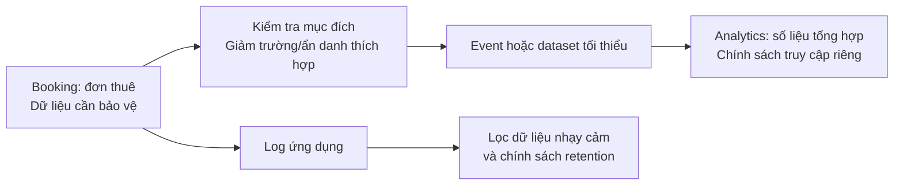
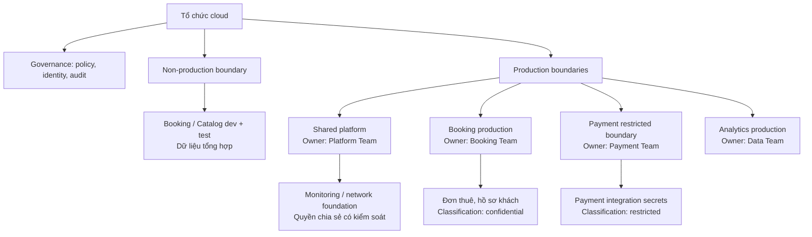
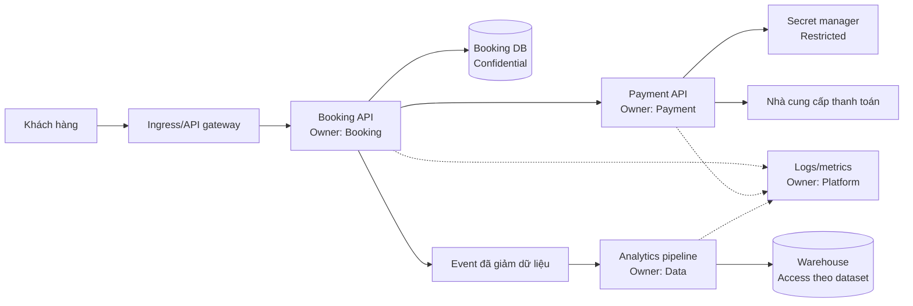

# Tách tài nguyên theo sản phẩm, nhóm sở hữu và mức độ nhạy cảm

Trong môi trường cloud, số lượng tài nguyên có thể tăng nhanh: ứng dụng, database, bucket, queue, VPC/virtual network, service account, secret, dashboard, log và tài nguyên phục hồi. Nếu mọi thứ nằm chung trong một nơi quản trị với quyền truy cập rộng, đội ngũ khó trả lời ba câu hỏi cơ bản: **Tài nguyên phục vụ sản phẩm nào? Ai chịu trách nhiệm? Dữ liệu và chức năng của nó cần được bảo vệ đến mức nào?**

Chủ đề **Tổ chức tài nguyên** trong module **CLOUD_ARCHITECTURE** tập trung vào việc biến các câu hỏi này thành **ranh giới quản trị và bảo vệ có thể thực thi**. Khi thiết kế kiến trúc ứng dụng trên đám mây từ yêu cầu nghiệp vụ đến mạng, compute, dữ liệu và triển khai, ta phải cân bằng độ tin cậy, bảo mật, khả năng mở rộng, chi phí, vận hành và các nguyên tắc Well-Architected.

Bài học sử dụng ví dụ **nền tảng cho thuê thiết bị**. Các tên nhóm, tài nguyên, chính sách và mức phân loại là giả định minh họa; việc phân loại thực tế phải dựa trên dữ liệu, mức tác động, yêu cầu pháp lý và mô hình quản trị của tổ chức.

## 1. Ba trục phân chia giải quyết ba vấn đề khác nhau

| Trục | Câu hỏi thiết kế | Dùng để quyết định | Ví dụ |
| --- | --- | --- | --- |
| **Sản phẩm / miền nghiệp vụ** | Tài nguyên tạo giá trị cho sản phẩm, khả năng hay luồng nghiệp vụ nào? | Ranh giới vòng đời, phụ thuộc, triển khai và phân bổ chi phí | Catalog, Booking, Payment, Analytics |
| **Nhóm sở hữu (ownership)** | Ai có trách nhiệm duy trì, ứng cứu sự cố, phê duyệt thay đổi và tối ưu tài nguyên? | Trách nhiệm vận hành, quyền quản trị, cảnh báo, ngân sách | Booking Team chịu trách nhiệm API đặt chỗ; Platform Team sở hữu ingress dùng chung |
| **Mức độ nhạy cảm** | Nếu dữ liệu hoặc tài nguyên bị lộ, sửa sai hay gián đoạn, tác động sẽ lớn đến đâu? | Ranh giới tin cậy, quyền truy cập, mã hóa, kiểm toán, lưu giữ và cách chia sẻ | Cấu hình công khai, dữ liệu nội bộ, hồ sơ khách hàng, khóa truy cập nhạy cảm |

Ba trục là **ba thuộc tính song song** của một tài nguyên, không phải ba cấp thư mục bắt buộc phải xếp nối tiếp. Ví dụ:

> Database đơn đặt thuê thuộc **sản phẩm Booking**, do **Booking Team** chịu trách nhiệm, chứa **dữ liệu cá nhân cần bảo vệ nghiêm ngặt** và nằm trong **production**.

Chỉ biết tài nguyên thuộc Booking chưa đủ để cấp quyền. Chỉ biết Booking Team sở hữu chưa cho phép mọi thành viên xem dữ liệu khách hàng. Chỉ biết dữ liệu nhạy cảm cũng chưa xác định nhóm nào xử lý lỗi lúc nửa đêm.

**Quy tắc định hướng:** dùng ranh giới tài nguyên để thực thi các yêu cầu cách ly thực sự; dùng metadata, IAM, tagging/label và quy trình để biểu diễn các trục còn lại. Tránh mặc định tạo một account hoặc project mới cho mọi tổ hợp sản phẩm × nhóm × mức nhạy cảm.

## 2. Tài nguyên nào cần được đưa vào sơ đồ tổ chức?

Tài nguyên cloud không chỉ là VM hoặc container. Cần kiểm kê cả thành phần tạo ra **quyền, luồng truy cập, dữ liệu, chi phí và trách nhiệm**:

| Nhóm tài nguyên | Ví dụ | Câu hỏi quan trọng |
| --- | --- | --- |
| Compute và runtime | VM, container service, serverless function, Kubernetes workload | Ai triển khai và phản ứng khi lỗi? |
| Mạng | Virtual network, subnet, load balancer, gateway, firewall, DNS | Ai được kết nối với ai, qua ranh giới nào? |
| Dữ liệu | Managed database, bucket, volume, cache, warehouse, backup | Có chứa dữ liệu nhạy cảm, tồn tại bao lâu, do ai quản lý? |
| Tích hợp | Queue, topic, event bus, API gateway, webhook endpoint | Ai sở hữu hợp đồng, producer/consumer nào được phép sử dụng? |
| Danh tính | IAM role, service account, secret, KMS key | Ai có thể giả danh workload hoặc giải mã dữ liệu? |
| Vận hành | Log, trace, metric, alarm, dashboard, pipeline, IaC state | Ai trực ca, truy cập log và sửa cấu hình? |
| Khả năng phục hồi | Backup, snapshot, replica, DR deployment | Bản sao nằm ở đâu, ai được khôi phục và xóa? |

Tài nguyên phụ trợ có thể chứa dữ liệu nhạy cảm không kém tài nguyên chính. Ví dụ **log** có thể chứa địa chỉ email, **snapshot** là bản sao của database, **IaC state** có thể chứa thông tin nhạy cảm, còn **CI/CD** có thể có quyền tạo hoặc xóa dịch vụ production. Do đó, không bỏ qua chúng trong mô hình phân chia.

## 3. Trục sản phẩm: nhóm tài nguyên theo năng lực tạo giá trị

Phân chia theo sản phẩm hoặc miền nghiệp vụ giúp nhóm thấy rõ **phần nào cần phát triển, mở rộng, triển khai và trả chi phí cùng nhau**. Đây là một công cụ để giảm phụ thuộc và xác định phạm vi ảnh hưởng của thay đổi.

Với nền tảng cho thuê, có thể tách logic:

| Sản phẩm / miền | Tài nguyên điển hình | Lý do gom nhóm |
| --- | --- | --- |
| **Catalog** | API sản phẩm, search index, ảnh công khai, cache danh mục | Lưu lượng đọc lớn, dữ liệu phần lớn công khai |
| **Booking** | API giữ chỗ, queue hết hạn, database đơn thuê, metric trạng thái | Có ràng buộc giao dịch và nguy cơ đặt trùng |
| **Payment** | Payment adapter, webhook, audit trail, secret tích hợp | Phạm vi truy cập chặt, xử lý sự kiện tài chính |
| **Analytics** | Data pipeline, warehouse, báo cáo tổng hợp | Xử lý dữ liệu thứ cấp, có thể trễ; phạm vi truy cập riêng |
| **Shared Platform** | Kết nối mạng nền, định danh tập trung, registry, telemetry platform | Nhiều sản phẩm sử dụng; cần owner và cơ chế tính chi phí |

### Xác định ranh giới sản phẩm dựa trên điều gì?

Hãy kiểm tra:

1. **Mục tiêu nghiệp vụ:** tài nguyên phục vụ năng lực nào? Nếu nghiệp vụ đó ngừng hoạt động, tài nguyên còn mục đích độc lập không?
2. **Vòng đời thay đổi:** có cần triển khai, scale hoặc phục hồi độc lập với phần còn lại?
3. **Dữ liệu và giao dịch:** thành phần nào cần cùng một giao dịch, cơ chế nhất quán hoặc tốc độ phản hồi?
4. **Trách nhiệm và ngân sách:** có nhóm và chủ sở hữu chi phí rõ ràng không?
5. **Phụ thuộc:** nếu tách, có tạo quá nhiều lời gọi mạng, chính sách truy cập chéo hoặc vận hành phức tạp không?

**Không có quy tắc “một microservice = một cloud account”.** Một sản phẩm có thể bao gồm nhiều module hoặc service trong cùng một boundary quản trị; ngược lại, một thành phần xử lý dữ liệu rất nhạy cảm có thể cần ranh giới riêng dù nó vẫn thuộc cùng sản phẩm.

### Tài nguyên dùng chung phải được đối xử rõ ràng

DNS gốc, mạng trung tâm, hệ thống nhận log và registry thường phục vụ nhiều sản phẩm. Không nên “gán tạm” chúng cho một nhóm chỉ vì nhóm đó tạo trước. Mỗi tài nguyên dùng chung cần:

- **Owner vận hành** chịu trách nhiệm khả dụng, cấu hình, nâng cấp và phản ứng sự cố.
- **Consumer và hợp đồng sử dụng**: nhóm nào được sử dụng, theo API/quy trình nào, giới hạn ra sao.
- **Chi phí và quota**: chi phí nền tảng do nhóm trung tâm trả hay phân bổ lại theo mức sử dụng?
- **Giới hạn ảnh hưởng (blast radius)**: thay đổi thành phần chung có làm nhiều sản phẩm cùng ngừng dịch vụ không?

Nếu phần dùng chung chứa dữ liệu khác mức nhạy cảm, cần đánh giá khả năng tách dữ liệu, phân quyền theo nguồn và kiểm soát hoạt động của người vận hành. Chia sẻ một hệ thống quan sát **không tự động** cho phép mọi nhóm đọc tất cả log.

## 4. Trục nhóm sở hữu: trách nhiệm khác với quyền truy cập

Một tài nguyên cần có **một nhóm chịu trách nhiệm chính (accountable owner)** ngay cả khi nhiều nhóm cùng phát triển hoặc sử dụng. Quyền đọc, quyền ghi, quyền triển khai và quyền quản trị bảo mật nên được cấp dựa trên vai trò và nhu cầu cụ thể.

Ví dụ phân công:

| Công việc | Booking Team | Platform Team | Security Team | Data Team |
| --- | --- | --- | --- | --- |
| Logic đặt chỗ, API, đơn thuê | **Chịu trách nhiệm chính** | Hỗ trợ runtime | Review quyền nhạy cảm | Đọc dữ liệu đã được phép |
| Load balancer và mạng dùng chung | Sử dụng, nêu yêu cầu | **Chịu trách nhiệm chính** | Đặt guardrail | Sử dụng khi cần |
| Phân loại dữ liệu đơn thuê | **Data owner nghiệp vụ** cùng người chịu trách nhiệm dữ liệu | Hỗ trợ lưu trữ | Thiết lập chuẩn, kiểm tra | Tư vấn lineage, chất lượng |
| Dựng hạ tầng ứng dụng bằng IaC | Đề xuất và review | Xây nền tảng và guardrail | Kiểm tra thay đổi nhạy cảm | — |
| Kho dữ liệu phân tích | Xác nhận ý nghĩa dữ liệu nguồn | Hỗ trợ hạ tầng | Kiểm soát quyền và chính sách | **Chịu trách nhiệm vận hành** |

Phân công trên chỉ minh họa, không phải ma trận bắt buộc. Với từng tài nguyên, nên ghi rõ ít nhất:

- **Service owner**: chịu trách nhiệm chất lượng dịch vụ, vận hành và trực ca.
- **Data owner/steward khi có dữ liệu**: định nghĩa mục đích sử dụng, phân loại, lưu giữ, quyền truy cập ở góc độ nghiệp vụ.
- **Technical contact**: nhóm hoặc kênh xử lý sự cố.
- **Cost owner**: nơi ghi nhận chi phí và duyệt ngân sách.
- **Approval authority**: ai duyệt thay đổi có rủi ro cao, chẳng hạn mở mạng hoặc cấp quyền đọc dữ liệu nhạy cảm.

Các vai trò có thể trùng một nhóm nhưng không nhất thiết trùng. Ví dụ Platform Team vận hành database managed, còn Booking Team chịu trách nhiệm ngữ nghĩa và dữ liệu đơn thuê. **Sở hữu hạ tầng không tự sinh quyền xem dữ liệu**; quyền nên dựa trên trách nhiệm đã phê duyệt, danh tính phù hợp và khả năng ghi nhận truy cập.

### Ownership phục vụ vận hành thế nào?

Khi xảy ra sự cố, hệ thống cảnh báo cần liên hệ được owner của workload cùng các phụ thuộc. Nếu một API tăng lỗi do database quá tải, Booking Team phải điều tra truy vấn, Platform Team có thể hỗ trợ giới hạn dịch vụ, còn Security Team chỉ can dự khi có dấu hiệu rủi ro bảo mật. Các nhóm cần có **quy trình phối hợp và escalation** thay vì đẩy trách nhiệm cho nhau.

Ownership cũng phải đổi được theo vòng đời. Khi chuyển một sản phẩm từ đội A sang đội B, không chỉ đổi tag: cần bàn giao IaC, cảnh báo, runbook, quyền truy cập, ngân sách, khóa/secret liên quan, lịch trực và dữ liệu nếu có.

## 5. Trục mức độ nhạy cảm: phân loại để áp đúng biện pháp bảo vệ

Mức độ nhạy cảm phản ánh **tác động khi dữ liệu hoặc chức năng bị lộ, bị sửa trái phép, mất khả dụng hoặc bị sử dụng sai mục đích**. Có thể dùng hệ phân loại minh họa sau; tổ chức cần xác định ngưỡng cụ thể và đối chiếu yêu cầu pháp lý áp dụng:

| Mức tham khảo | Ví dụ | Nguyên tắc xử lý |
| --- | --- | --- |
| **Public** (công khai có chủ đích) | Ảnh sản phẩm đã xuất bản, mô tả thiết bị công khai | Cho phép phân phối công khai theo quy trình xuất bản; vẫn bảo vệ quyền sửa, xóa |
| **Internal** (nội bộ) | Tài liệu vận hành chung, số liệu tổng hợp nội bộ | Chỉ người và workload nội bộ được phép truy cập |
| **Confidential** (bí mật) | Hồ sơ khách hàng, chi tiết đơn thuê, dữ liệu chưa công bố | Phân quyền theo mục đích, hạn chế sao chép, mã hóa và giám sát truy cập |
| **Restricted / Highly sensitive** (hạn chế nghiêm ngặt) | Private key, bí mật xác thực, dữ liệu có tác động nghiêm trọng khi lộ | Cách ly quyền rất chặt, sử dụng kho bí mật chuyên dụng, audit và phê duyệt theo rủi ro |

Tên mức chỉ là ví dụ. Không phải thông tin nào liên quan khách hàng cũng có mức giống nhau; cũng không nên tự coi mọi tài nguyên thuộc Payment là cùng một mức nếu dữ liệu và tác động khác nhau.

### Phân loại dữ liệu trước, sau đó suy ra nhu cầu của tài nguyên

1. Liệt kê loại thông tin: tên, số điện thoại, địa chỉ, lịch thuê, mã giao dịch, bản ghi hỗ trợ, log.
2. Xác định tác động và mục đích sử dụng: ai được xem, sửa, xuất, chia sẻ; hậu quả nếu lộ hoặc mất.
3. Gắn phân loại cho **dữ liệu và luồng xử lý**, kèm người phê duyệt và quy tắc lưu giữ.
4. Với tài nguyên chứa nhiều loại dữ liệu, áp kiểm soát tối thiểu theo **loại dữ liệu rủi ro cao nhất mà tài nguyên thực sự có thể tiếp xúc**, trừ khi chứng minh được cách ly đủ mạnh.
5. Kiểm tra dữ liệu dẫn xuất: bản sao lưu, snapshot, log, export, search index, cache, dead-letter queue và analytics dataset.

Ví dụ, một bucket chứa ảnh catalog công khai không có cùng rủi ro với bucket lưu hóa đơn. Nếu để chung bucket mà một cấu hình quyền sai có thể mở toàn bộ đối tượng, nên xem xét tách nơi lưu hoặc thiết kế boundary theo prefix/object policy thật chặt; tách bucket thường dễ kiểm soát hơn khi mức nhạy cảm khác nhau rõ rệt.

**Chú ý:** tag **classification=confidential** chỉ là metadata; nó **không tự mã hóa dữ liệu, không chặn truy cập và không chứng minh tuân thủ**. Phải liên kết phân loại với IAM, network policy, encryption, DLP, retention, backup, audit và quy trình kiểm tra.

### Dữ liệu có thể thay đổi mức phân loại qua xử lý

Một event về đơn thuê có thông tin khách hàng không nên được sao chép nguyên bản sang hệ phân tích chỉ vì cần đếm đơn. Có thể dùng luồng:



**Pseudonymization** (thay định danh trực tiếp bằng định danh khác) không mặc nhiên biến dữ liệu thành thông tin công khai hoặc ẩn danh hoàn toàn. Nếu vẫn có thể tái nhận dạng một cá nhân từ khóa đối chiếu hoặc kết hợp dữ liệu khác, dữ liệu dẫn xuất vẫn cần kiểm soát tương xứng.

## 6. Chọn ranh giới kỹ thuật: từ metadata đến account độc lập

Không phải mọi trục đều cần cùng độ mạnh cách ly. Đánh giá phạm vi ảnh hưởng, quyền quản trị, dữ liệu và yêu cầu vận hành rồi chọn boundary phù hợp.

| Cơ chế tổ chức | Phù hợp khi | Điểm cần biết |
| --- | --- | --- |
| **Naming, tag, label, inventory** | Nhận diện sản phẩm, owner, mức phân loại, ngân sách | Có ích cho tìm kiếm, policy và báo cáo; **bản thân không phải biện pháp cách ly** |
| **Resource group / tương đương** | Gom tài nguyên cùng vòng đời hoặc phạm vi quản trị | Độ mạnh quyền, billing và policy phụ thuộc cloud provider |
| **Namespace / logic workload boundary** | Phân chia workload trong cluster hoặc nền tảng chia sẻ | Không mặc nhiên tương đương tenant hoặc security boundary cứng; cần RBAC, network policy, workload identity |
| **IAM / policy / key boundary** | Chặn quyền người dùng, pipeline, workload theo nhu cầu | Chỉ có hiệu lực nếu được thực thi đúng scope, không bị role cấp trên vượt qua |
| **Network boundary** | Hạn chế kết nối và đường đi dữ liệu | Không thay thế xác thực, phân quyền dữ liệu và bảo vệ ở tầng ứng dụng |
| **Account / subscription / project độc lập** | Khác mức rủi ro, môi trường production, yêu cầu quota, billing, ownership hoặc blast radius rõ rệt | Cần tổ chức IAM, mạng, logging, guardrail và cross-boundary access; không tự bảo đảm cách ly tuyệt đối |
| **Tách kho dữ liệu / khóa mã hóa** | Dữ liệu có mục đích, mức nhạy cảm hoặc vòng đời khác nhau | Dễ giới hạn truy cập, retention và backup; có thêm chi phí tích hợp |

Ví dụ tương quan giữa các cloud provider:

| Nhà cung cấp | Đơn vị tổ chức/quản trị thường gặp | Lưu ý |
| --- | --- | --- |
| **AWS** | Organization / Organizational Unit (OU) / Account; trong account có tài nguyên và tag | OU quản lý **account** và áp chính sách quản trị; không là container trực tiếp của mọi resource |
| **Azure** | Management group / Subscription / Resource group / Resource | Policy, RBAC, billing và giới hạn áp theo scope phù hợp; subscription và resource group có vai trò khác nhau |
| **Google Cloud** | Organization / Folder / Project / Resource | Project thường là đơn vị trọng tâm của tài nguyên, quota, API và billing association; policy có thể được kế thừa từ cấp trên |

Các ánh xạ này dùng để suy luận kiến trúc, **không coi các đơn vị của ba nhà cung cấp hoàn toàn tương đương về quota, IAM, network isolation hay billing**. Cần đối chiếu tài liệu phiên bản thực tế khi triển khai.

### Nguyên tắc chọn mức cách ly

Tách thành **boundary quản trị độc lập** khi cần giới hạn quyền quản trị, blast radius, ngân sách/quota, chính sách vùng dữ liệu hoặc trách nhiệm pháp lý rõ rệt. Dùng **nhóm logic và tag** khi tài nguyên vẫn có cùng vòng đời vận hành và có thể chia sẻ bảo vệ mà không tạo rủi ro đáng kể. Tăng độ mạnh cách ly theo mức rủi ro thực tế, thay vì nhân số account theo tất cả tên team và nhãn.

Ví dụ, analytics thử nghiệm không nên mặc nhiên có quyền quản trị database chứa dữ liệu cá nhân production. Việc tách project/account cho workload analytics, chỉ cho phép nhận dataset đã xử lý với quyền đọc tối thiểu, có thể đơn giản hơn một mạng quyền chéo phức tạp.

## 7. Mô hình nhiều trục: tổ chức theo boundary, ghi thuộc tính bằng metadata

Ngoài ba trục chính, cần xét **môi trường (dev/staging/prod)**, **region**, **mức quan trọng của dịch vụ** và đôi khi **tenant**. Đây là các chiều bổ sung, không phải lý do để nhân mọi tổ hợp thành một đơn vị hạ tầng riêng.

Giả sử có 5 sản phẩm, 4 team, 4 mức phân loại và 3 môi trường: tạo boundary cho đủ mọi tổ hợp sẽ sinh **240 đơn vị** kể cả những tổ hợp không có workload thực. Cách tiếp cận này tăng overhead IAM, mạng, hạn mức, cost reporting và khả năng quản trị.

Một cách làm hợp lý hơn:

1. Chọn boundary mạnh cho **production**, workload có quyền cao hoặc dữ liệu có rủi ro đặc biệt, và nơi cần hạn chế blast radius.
2. Trong mỗi boundary, nhóm tài nguyên theo **sản phẩm/vòng đời** và gắn các trường **owner, classification, environment, cost-center, criticality**.
3. Phân quyền qua role của **người dùng, workload và pipeline**; policy xác định tài nguyên nào được phép truy cập.
4. Với dịch vụ chia sẻ, có **platform owner** và hợp đồng truy cập; không mở quyền admin chung cho tất cả nhóm.
5. Khi yêu cầu thay đổi, tách boundary mới nếu biện pháp hiện tại không còn đáp ứng rủi ro hoặc giới hạn vận hành.

### Sơ đồ tổ chức minh họa

Sơ đồ dưới đây là **logic quản trị**, không phải cây đối tượng có thể copy nguyên sang AWS, Azure hoặc Google Cloud:



Một doanh nghiệp nhỏ có thể dùng ít account hơn sơ đồ trên; doanh nghiệp có nghĩa vụ tuân thủ cao hoặc nhiều team tự chủ có thể cần nhiều boundary hơn. Quan trọng là các quyết định có **lý do, người chịu trách nhiệm và kiểm soát tương ứng**.

### Metadata chuẩn cho tài nguyên

Ví dụ **mô hình metadata quy ước nội bộ**, không phải cú pháp tag áp dụng nguyên xi cho mọi cloud:

```yaml
resource:
  name: booking-orders-db-prod
  product: booking
  ownerTeam: booking-platform
  environment: production
  dataClassification: confidential
  criticality: high
  costCenter: digital-rentals
  technicalContact: oncall-booking
  managedBy: infrastructure-as-code
  region: ap-southeast-1
```

Các trường như **technicalContact** có thể chứa tên nhóm hoặc định danh kênh trực ca, không đưa số điện thoại cá nhân, token hoặc dữ liệu nhạy cảm vào tag. Hệ thống tag thực tế có giới hạn về số lượng, ký tự, kế thừa và hỗ trợ của từng dịch vụ; vì thế nên định nghĩa **schema metadata** chung và cơ chế map sang provider.

Metadata phải được dùng thật: chính sách kiểm tra tag bắt buộc khi tạo tài nguyên; bảng tài sản hiển thị tài nguyên thiếu owner; báo cáo ngân sách gom theo **product/costCenter**; cảnh báo định tuyến theo **ownerTeam**; kiểm tra bảo mật dựa trên **dataClassification**. Nếu trường chỉ tồn tại trong bảng hướng dẫn mà không được áp dụng vào vận hành, chúng dễ bị lỗi thời.

## 8. Ví dụ xuyên suốt: Booking, Payment và Analytics

Xét ba luồng trong nền tảng cho thuê:

- **Booking** giữ chỗ, xác nhận đơn và quản lý thông tin khách hàng. Có nhiều tác vụ ghi cần tính nhất quán.
- **Payment** giao tiếp với nhà cung cấp thanh toán, nhận webhook và quản lý secret dùng để xác minh thông báo. Phạm vi dữ liệu thực tế phụ thuộc thiết kế tích hợp; ưu tiên không lưu thông tin thanh toán nhạy cảm hơn mức cần thiết.
- **Analytics** tổng hợp số lượng đơn, doanh thu và tỷ lệ thành công. Phần lớn câu hỏi báo cáo không cần thông tin định danh trực tiếp của khách hàng.

### 8.1. Lập bản đồ tài nguyên và quyền

| Tài nguyên | Sản phẩm | Owner chính | Dữ liệu / mức nhạy cảm minh họa | Ranh giới và kiểm soát |
| --- | --- | --- | --- | --- |
| Catalog CDN và ảnh thiết bị đã xuất bản | Catalog | Catalog Team | Nội dung công khai | Public delivery, nhưng quyền ghi/xóa chỉ cho pipeline được cấp phép |
| Booking API | Booking | Booking Team | Xử lý thông tin khách, không lưu bền vững trên instance | Workload identity riêng; chỉ gọi API và kho dữ liệu cần thiết |
| Booking database | Booking | Booking Team | Đơn thuê, thông tin khách; confidential | Private access, mã hóa, backup, quyền đọc/ghi giới hạn |
| Payment webhook và adapter | Payment | Payment Team | Trạng thái giao dịch; tùy dữ liệu thực nhận | Kiểm tra chữ ký/xác thực webhook, hạn chế quyền mạng, audit |
| Secret của cổng thanh toán | Payment | Payment Team + đơn vị quản lý bí mật | Restricted | Secret manager/KMS, chỉ workload và quy trình xoay vòng được ủy quyền |
| Event đơn hàng đã giảm dữ liệu | Booking → Analytics | Booking Team phát hành; Data Team tiêu thụ | Phụ thuộc trường còn lưu; không tự coi là public | Hợp đồng sự kiện, phân quyền topic/consumer, retention |
| Warehouse và dashboard doanh thu | Analytics | Data Team | Từ internal đến confidential tùy dữ liệu | Phân quyền dataset, quyền dashboard riêng, audit truy vấn |
| Log và trace tập trung | Shared Platform | Platform Team | Có thể chứa dữ liệu nhạy cảm nếu không lọc | Giảm dữ liệu ở nguồn, scope truy cập theo sản phẩm, retention phù hợp |
| Backup Booking DB | Booking | Booking Team và đội vận hành backup | Cùng mức bảo vệ tương ứng bản gốc | Mã hóa, quyền restore/xóa độc lập, kiểm tra khôi phục |

Từ bảng trên, một số yêu cầu bảo vệ đi qua nhiều tài nguyên. **Data Team** cần KPI doanh thu nhưng không nên mặc nhiên có quyền đọc database chứa hồ sơ khách. **Platform Team** cần xem tình trạng hệ thống nhưng không cần quyền đọc nội dung bảng dữ liệu. **Payment Team** có thể triển khai payment adapter nhưng chỉ pipeline hoặc workload chuyên dụng được phép sử dụng bí mật sản xuất.

### 8.2. Thiết kế luồng truy cập theo nguyên tắc tối thiểu



Sơ đồ là **quan hệ chức năng**, chưa biểu diễn tất cả kết nối mạng và policy IAM. Khi triển khai, cần đảm bảo:

1. Booking API dùng danh tính workload riêng để ghi dữ liệu Booking, không chia sẻ thông tin xác thực quản trị database.
2. Booking gọi Payment bằng API đã xác thực và có cơ chế idempotency; nó không cần quyền đọc secret của Payment.
3. Payment adapter chỉ truy cập những secret cần thiết; không chia sẻ secret qua file cấu hình hoặc log.
4. Dữ liệu sang Analytics phải có hợp đồng trường dữ liệu, mục đích sử dụng và quyền consumer; dữ liệu nhạy cảm không cần thiết phải bị loại hoặc biến đổi trước khi xuất.
5. Đường truyền qua các boundary phải có xác thực, bảo vệ kênh và cơ chế ghi nhận phù hợp; việc ở trong “mạng nội bộ” không tự bảo đảm được tin cậy.

### 8.3. Viết chính sách ở cấp nguyên tắc trước khi chọn dịch vụ cloud

Ví dụ chính sách ở dạng **ý định**, không phải file policy có thể áp dụng trực tiếp:

```yaml
# Ví dụ quy tắc quản trị nội bộ, KHÔNG phải cú pháp IAM của provider.
rules:
  - resourceType: customer-data-store
    allowedWorkloads:
      - booking-api-prod
    permittedActions:
      - read-required-fields
      - create-and-update-booking
    humanAccess: approved-break-glass-only

  - resourceType: payment-provider-secret
    allowedWorkloads:
      - payment-adapter-prod
    permittedActions:
      - retrieve-secret-at-runtime
    humanAccess: restricted-and-audited

  - resourceType: analytics-order-event
    producer:
      - booking-event-publisher
    consumers:
      - analytics-ingestion
    dataContract: minimum-fields-for-reporting
```

Một hệ thống cloud thực tế phải chuyển những quy tắc này thành **IAM/policy đúng theo dịch vụ**, network controls, ứng dụng kiểm tra quyền ở cấp hành vi và guardrail trong pipeline. Ví dụ “read-required-fields” không phải hành động IAM phổ quát: có thể phải dùng API trung gian, policy cấp cột/hàng nếu dịch vụ hỗ trợ, hoặc loại bỏ trường trước khi chia sẻ.

## 9. Môi trường, khu vực triển khai và tenant là những chiều cần xét thêm

### Tách non-production khỏi production

Các môi trường dev, test, staging thường dùng để chạy thử mã hoặc dữ liệu không ổn định. Chúng nên có **ranh giới quyền, ngân sách và khả năng gây ảnh hưởng** phù hợp để một thử nghiệm không làm hỏng production.

| Tiêu chí | Dev / test | Staging | Production |
| --- | --- | --- | --- |
| Dữ liệu | Ưu tiên dữ liệu tổng hợp/giả lập | Dữ liệu đại diện, đã giảm nhạy cảm nếu cần | Dữ liệu thật, kiểm soát theo mục đích |
| Quyền triển khai | Rộng hơn cho nhóm phát triển theo giới hạn | Qua pipeline, có review | Hạn chế, pipeline và approval theo rủi ro |
| Network | Hạn chế kết nối tới prod | Cấu trúc gần prod ở các thuộc tính cần kiểm thử | Phân đoạn và giám sát chặt |
| Chi phí | Giới hạn ngân sách, có thể tự hủy tài nguyên tạm | Đủ khả năng kiểm thử; tránh tồn tại dư thừa | Dựa trên SLO, tải, mức dự phòng và phục hồi |
| Secrets | Secret thử nghiệm riêng | Secret thử nghiệm có scope riêng | Secret production, quyền chặt và audit |

**Không sao chép dữ liệu production sang dev vì tiện kiểm thử** nếu chưa đánh giá quyền, mục đích, che giấu/ẩn danh, thời hạn lưu và pháp lý. Một bản sao dữ liệu nhạy cảm vẫn là dữ liệu nhạy cảm, dù nằm trong project có tên **dev**.

### Vùng dữ liệu và khả năng phục hồi

Region không chỉ là lựa chọn độ trễ. Dữ liệu có thể chịu ràng buộc về vị trí lưu trữ và chuyển vùng; backup, replication, log tập trung và disaster recovery cũng cần được tính vào phạm vi dữ liệu. Nếu một sản phẩm phải giới hạn dữ liệu theo khu vực, cần kiểm tra cả **đường dữ liệu phụ trợ**, không chỉ database chính.

Việc chia theo region còn liên quan đến sẵn sàng và chi phí: nhiều region giúp tạo phương án phục hồi khi vùng rộng bị lỗi trong một số kiến trúc, nhưng tăng chi phí truyền dữ liệu, đồng bộ, quan sát và phức tạp vận hành. Chỉ chọn khi yêu cầu RTO/RPO, tính sẵn sàng và khả năng vận hành chứng minh được nhu cầu.

### Có nên tách một boundary cho mỗi tenant?

Trong SaaS đa khách hàng, tenant là một trục phân cách khác. Có thể chọn:

- **Pooled:** chia sẻ hạ tầng và tách logic theo tenant trong ứng dụng/dữ liệu. Hiệu quả chi phí cao nhưng cần kiểm tra nghiêm ngặt quyền ở lớp ứng dụng và dữ liệu.
- **Silo:** tenant có môi trường, database hoặc account riêng. Giảm phạm vi ảnh hưởng và giúp đáp ứng yêu cầu cách ly mạnh, nhưng tăng số lượng tài nguyên và công vận hành.
- **Hybrid:** nhóm tenant cần độ cách ly cao có boundary riêng, các tenant còn lại dùng hạ tầng chia sẻ có kiểm soát.

Phân tách tenant **khác** phân tách sản phẩm và team. Không nên dùng tag **tenantId** làm cơ chế kiểm soát truy cập duy nhất; cần thực thi phân quyền và nhất quán trong mọi truy vấn, API, event và đường xuất dữ liệu.

## 10. Xem xét chi phí, quota và vận hành khi chọn ranh giới

Phân tách tài nguyên hợp lý giúp theo dõi chi phí theo sản phẩm, nhưng mọi boundary đều có chi phí quản trị: log, mạng, IAM, budget, quota, pipeline và tài nguyên nền.

### Truy vết và phân bổ chi phí

Một quy ước metadata có thể gồm:

| Thuộc tính | Mục đích báo cáo |
| --- | --- |
| **product** | Chi phí trực tiếp của Catalog, Booking, Payment, Analytics |
| **ownerTeam** | Nhóm chịu trách nhiệm tối ưu và xác minh tài nguyên đang sử dụng |
| **costCenter** | Đơn vị ngân sách chịu chi phí |
| **environment** | Phân biệt dev/test/staging/prod và phát hiện tài nguyên test tồn tại quá lâu |
| **sharedService** | Tách hạ tầng nền tảng và chi phí dùng chung |
| **criticality** | Đánh giá mức dự phòng có phù hợp giá trị dịch vụ hay không |

Không phải mọi chi phí cloud đều xuất hiện dưới tag của resource: traffic, dịch vụ hỗ trợ, cam kết chiết khấu, phí chia sẻ và hóa đơn ở cấp tổ chức có thể cần mô hình phân bổ riêng. Với chi phí hạ tầng dùng chung, có thể chọn **phân bổ theo sử dụng thực tế**, **quy tắc tỷ lệ minh bạch** hoặc **trung tâm chi phí nền tảng**. Ghi rõ phương pháp để tránh báo cáo sai lệch.

Ví dụ: một mạng trung tâm dùng cho bốn sản phẩm có thể được Platform Team vận hành, nhưng chi phí egress được phân bổ theo số liệu đo được; phần chi phí điều hành chung còn lại có thể tính cho nền tảng. Không nên sao chép mạng này bốn lần chỉ để bảng chi phí dễ cộng.

### Quota, scale và blast radius

Quota/limit thường được áp ở những scope riêng của provider như account, subscription, project, region hoặc dịch vụ. Hai sản phẩm dùng chung quota compute hoặc API request có thể ảnh hưởng nhau khi một sản phẩm tăng tải. Tách boundary có thể giúp quản lý quota riêng, nhưng cũng cần theo dõi tổng hạn mức, chi phí và kết nối liên boundary.

Đối với hệ thống quan trọng, hãy đặt câu hỏi: **“Một thao tác triển khai, tài khoản bị lộ, cấu hình firewall sai hoặc sự cố database có thể ảnh hưởng những sản phẩm nào?”** Đó là cách thực tế để đo phạm vi ảnh hưởng. Ranh giới phù hợp phải giảm hậu quả của lỗi **kết hợp** với cơ chế backup, IAM, mạng, observability và quy trình ứng cứu.

## 11. Đánh giá theo Well-Architected

| Trụ cột / mối quan tâm | Thiết kế phân chia hợp lý giúp gì? | Đánh đổi cần kiểm chứng |
| --- | --- | --- |
| **Operational excellence** | Owner, cảnh báo, runbook và phạm vi triển khai rõ; giảm tài nguyên “mồ côi” | Quá nhiều boundary tạo thêm pipeline và thủ tục |
| **Security** | Giảm quyền rộng; tách workload nhạy cảm, key và dữ liệu; audit rõ | Boundary quá phân mảnh khiến chính sách chéo phức tạp, dễ cấp quyền tắt |
| **Reliability** | Khoanh vùng lỗi, quota và khôi phục theo hệ thống quan trọng | Shared service vẫn có thể là điểm lỗi chung; nhân bản làm tăng phức tạp đồng bộ |
| **Performance efficiency** | Scale theo nhu cầu sản phẩm, hạn chế nhiễu tài nguyên | Truy cập liên boundary có thể tăng latency, egress và phụ thuộc mạng |
| **Cost optimization** | Phân bổ ngân sách, dọn tài nguyên, nhận diện chi phí theo sản phẩm | Tách quá chi tiết làm tăng chi phí nền, traffic, vận hành |
| **Sustainability** | Sắp xếp workload và vòng đời tài nguyên hiệu quả, giảm tài nguyên không dùng | Tạo bản sao dư thừa có thể tăng tiêu thụ tài nguyên |

Một thiết kế tốt không tối đa hóa riêng bảo mật hoặc chi phí bằng mọi giá. Cần liên hệ **độ nhạy cảm dữ liệu**, **tác động lỗi**, **số nhóm vận hành**, **tải thực tế** và **ngân sách** trước khi quyết định mức tách.

## 12. Ma trận ra quyết định: khi nào tách mạnh, khi nào nhóm logic?

| Tình huống | Phương án ban đầu đáng cân nhắc | Vì sao / điều phải xác minh |
| --- | --- | --- |
| Hai module thuộc cùng sản phẩm, cùng owner, cùng dữ liệu và vòng đời | Cùng account/project; khác resource group, namespace hoặc tag nếu cần | Tách admin boundary có thể chỉ tăng chi phí; vẫn cần IAM theo workload |
| Hai sản phẩm khác team, cần lịch phát hành và quota khác nhau | Resource boundary hoặc account/project riêng tùy tác động | Giảm quyền chéo, blast radius; đánh giá chia sẻ network và logging |
| Workload xử lý bí mật tích hợp thanh toán rủi ro cao | Kho bí mật/key và workload role riêng; cân nhắc account/project riêng | Phạm vi truy cập và ảnh hưởng khi lộ thông tin |
| Dữ liệu khách hàng thật và môi trường thử nghiệm | Tách môi trường cùng dữ liệu, danh tính, secret riêng; ưu tiên synthetic data | Giảm rủi ro lộ hoặc thay đổi dữ liệu production |
| Nhiều sản phẩm cùng dùng DNS, registry, identity | Shared platform có owner rõ, policy, quota và chi phí phân bổ | Tránh sao chép nền tảng; kiểm soát single point of failure |
| Analytics cần số liệu từ Booking | Hợp đồng dữ liệu và xuất bản dữ liệu tối thiểu; quyền consumer riêng | Giảm quyền database trực tiếp và phạm vi sao chép PII |
| Một tenant doanh nghiệp yêu cầu cách ly đặc biệt | Dedicated data/workload boundary khi hợp đồng và rủi ro yêu cầu | Tăng chi phí, cần automation tạo và vận hành tenant |
| Mỗi thành viên muốn account riêng vì thuận tiện | Xem xét sandbox có ngân sách, quyền và thời hạn; tránh account prod tùy ý | Phân chia theo người không giúp mô hình trách nhiệm sản phẩm ổn định |

Đây là gợi ý khởi điểm, không phải quy tắc bắt buộc. Quyết định cuối cùng cần chứng cứ về quyền, dữ liệu, quota, billing và khả năng vận hành của cloud provider được chọn.

## 13. Phản mẫu thường gặp và cách khắc phục

**1. Dùng một account production cho tất cả mọi thứ với quyền admin chung.** Khi cấu hình sai hoặc credential bị lộ, phạm vi ảnh hưởng rộng. Giới hạn vai trò, tách môi trường và phân vùng workload có rủi ro cao; bảo vệ các công cụ quản trị nền tảng.

**2. Lấy sơ đồ tổ chức nhân sự làm cây tài nguyên cố định.** Team thay đổi tên và cấu trúc nhanh hơn nhiều tài nguyên. Nên giữ ranh giới theo sản phẩm và mức rủi ro tương đối ổn định; quản lý ownership bằng metadata và quy trình bàn giao.

**3. Chỉ dựa vào tag để bảo vệ dữ liệu.** Tag giúp phân loại và có thể được policy dùng làm điều kiện, nhưng chỉ có ý nghĩa khi policy được thực thi. Kết hợp IAM, mạng, key, phân quyền ứng dụng, audit và test truy cập trái phép.

**4. Để log, backup, cache và dữ liệu thử nghiệm nằm ngoài phạm vi phân loại.** Dữ liệu nhạy cảm thường đi sang các hệ thống phụ. Bổ sung data-flow inventory, quy tắc log redaction, retention và quyền restore phù hợp.

**5. Tách mọi service thành project/account độc lập.** Bị đội chi phí mạng và vận hành, cross-account IAM phức tạp, khó theo dõi luồng hệ thống. Tách theo blast radius và nhu cầu thật; giữ module chung boundary khi không có lý do buộc phải tách.

**6. Dùng chung secret và danh tính deploy cho tất cả sản phẩm.** Khi một pipeline bị chiếm quyền, kẻ tấn công có thể thao tác toàn bộ hệ thống. Cấp credential ngắn hạn, quyền tối thiểu, role theo môi trường và workload.

**7. Không có owner cho tài nguyên dùng chung.** Khi lỗi không ai nhận xử lý, khi tăng chi phí không ai tối ưu. Thiết lập owner, SLO, hợp đồng sử dụng, quota và quy tắc phân bổ chi phí.

**8. Xây dashboard analytics bằng cách mở quyền đọc database production.** Vừa tăng tải vừa mở rộng phạm vi dữ liệu nhạy cảm. Cân nhắc bản dữ liệu được xuất hợp đồng/giảm trường, phương án sao chép có kiểm soát và quyền dataset cụ thể.

## 14. Quy trình thiết kế và triển khai phân chia tài nguyên

### Bước 1 — Xác định danh mục sản phẩm và người chịu trách nhiệm

Liệt kê các sản phẩm, dịch vụ dùng chung, môi trường, nhóm vận hành và ngân sách. Với mỗi thành phần, ghi **mục đích kinh doanh**, **người sở hữu**, **dữ liệu xử lý**, **khả năng ảnh hưởng khi lỗi**. Không cần biết ngay chính xác có bao nhiêu cloud account.

### Bước 2 — Lập sơ đồ dữ liệu và ranh giới tin cậy

Với những luồng quan trọng (đăng ký, đặt thuê, thanh toán, xuất báo cáo), đánh dấu:

- Dữ liệu đi từ đâu đến đâu; nguồn nào có thẩm quyền.
- Ai có thể đọc, ghi, xóa, xuất hoặc khôi phục dữ liệu.
- Dữ liệu có đi vào log, event, cache, bản sao lưu hoặc môi trường kiểm thử không.
- Có giới hạn về vùng lưu trữ, mục đích và thời hạn lưu giữ không.

### Bước 3 — Chọn boundary theo tác động và mức độc lập

Chọn các scope chính: production so với non-production, workload rủi ro cao, phạm vi mạng và quyền, nhóm sản phẩm cần triển khai và quota riêng. Xác định dịch vụ dùng chung và cách truy cập chéo. Nếu quyết định tách account/project, vẽ luôn đường kết nối, quyền giao tiếp, logging và chi phí nền.

### Bước 4 — Chuẩn hóa metadata và quyền

Thiết kế schema name/tag/label; bắt buộc trường **product, ownerTeam, environment, classification, costCenter** theo khả năng hỗ trợ. Quản lý IaC và IAM bằng code có review; cấp role cho workload và pipeline theo phạm vi cần thiết. Tạo quy trình cấp quyền tạm thời và thu hồi quyền.

### Bước 5 — Tạo guardrail và khả năng quan sát

Kiểm tra tạo tài nguyên thiếu owner, bucket public ngoài chính sách, quyền admin quá rộng, vùng triển khai không được phép, backup không đạt yêu cầu, chi phí vượt ngân sách. Định tuyến cảnh báo theo owner và quản lý tập trung inventory, nhưng hạn chế quyền xem dữ liệu nhạy cảm trong log/dashboard.

### Bước 6 — Kiểm thử các tình huống xấu

Thử credential của analytics gọi API đọc hồ sơ khách; workload dev truy cập secret production; một nhóm cố đổi policy resource của nhóm khác; thay đổi mạng ảnh hưởng dịch vụ dùng chung. Các trường hợp này cần **bị chặn đúng như mong đợi**. Đồng thời thử backup/restore theo RTO/RPO và theo dõi chi phí/quota sau khi tách.

### Bước 7 — Ghi quyết định, lập kế hoạch di chuyển và điều chỉnh

Với hệ thống đã chạy, việc di chuyển database, key, endpoint hoặc account không phải chỉ là đổi tên: có thể thay ID tài nguyên, đường mạng, policy, billing, quy trình backup và phụ thuộc. Cần lập kế hoạch di chuyển dữ liệu, chuyển lưu lượng, kiểm chứng và rollback theo từng loại tài nguyên. Ghi ADR để sau này nhóm có thể đánh giá khi sản phẩm, dữ liệu hoặc độ nhạy cảm thay đổi.

Ví dụ một ADR ngắn:

> **Quyết định:** tách workload Payment production và các bí mật tích hợp ra boundary có quyền quản trị riêng; Booking gọi Payment qua API có xác thực.  
> **Lý do:** Payment có rủi ro credential và yêu cầu audit khác; giảm số workload và nhân sự có thể tiếp cận secret.  
> **Đánh đổi:** thêm quản lý mạng, IAM chéo, pipeline và chi phí vận hành; phải theo dõi độ trễ và lỗi API.  
> **Kiểm chứng:** danh tính Booking không đọc được secret Payment; Payment vẫn đáp ứng SLO, quy trình xoay vòng khóa và phục hồi được diễn tập.

## 15. Bài tập tình huống và cách tự kiểm tra

### Tình huống A — Chuyển owner nhưng giữ nguyên sản phẩm

Booking Team giao chức năng gửi thông báo cho Customer Experience Team. Queue thông báo và consumer đang chạy trong boundary Booking production.

**Câu hỏi:** cần tạo account mới ngay không?

**Gợi ý:** trước tiên xác định ai chịu trách nhiệm service, ai được triển khai, nội dung message có nhạy cảm không, lịch phát hành và rủi ro chung. Có thể bàn giao ownership, alert, IAM và chi phí mà chưa cần di chuyển tài nguyên. Chỉ tách boundary nếu yêu cầu độc lập, quyền hoặc rủi ro thực sự đòi hỏi.

### Tình huống B — Thay đổi mức nhạy cảm của dataset

Analytics Team trước đây chỉ nhận tổng số đơn theo ngày. Nay sản phẩm muốn hiển thị tỷ lệ mua lại theo khách, nên dataset bổ sung định danh khách có thể liên kết lại.

**Câu hỏi:** có cần cập nhật phân chia tài nguyên không?

**Gợi ý:** cần phân loại lại dữ liệu và đánh giá mục đích sử dụng; quyền xem, thời gian lưu, export, log, backup và cách chia sẻ. Nếu kho phân tích cũ có nhiều người truy cập hoặc ít biện pháp bảo vệ, có thể cần tạo dataset/kho mới với quyền chặt, không chỉ đổi một tag.

### Tình huống C — Shared service trở thành điểm lỗi chung

Nhiều sản phẩm dùng một API gateway trung tâm. Một thay đổi route sai làm cả Booking và Catalog ngừng tiếp nhận yêu cầu.

**Câu hỏi:** sở hữu tập trung có nghĩa bắt buộc giữ blast radius chung không?

**Gợi ý:** không. Platform Team vẫn có thể là owner chung trong khi tách cấu hình/điểm vào theo sản phẩm, bảo vệ policy, áp kiểm tra route, rollout theo phạm vi nhỏ và rollback có kiểm chứng. Đánh giá chi phí tách gateway so với rủi ro lỗi chung.

### Bảng tự đánh giá

| Câu hỏi | Có chứng cứ nào? |
| --- | --- |
| Tài nguyên nào phục vụ sản phẩm và năng lực nghiệp vụ nào? | Inventory, product mapping, data-flow/service dependency diagram |
| Mỗi resource có owner, cost owner và người trực sự cố rõ ràng không? | Tag/CMDB, runbook, on-call routing |
| Những dữ liệu nào là confidential/restricted và đi qua đâu? | Data catalog, classification, lineage, kiểm thử log/backup |
| Ranh giới quyền được thực thi bằng gì? | IAM, network controls, KMS/secret policy, test quyền bị từ chối |
| Dev và production có được phân cách theo mức rủi ro không? | Account/project, role, network, secret, data policy |
| Khi thay đổi một sản phẩm, sản phẩm khác có thể bị ảnh hưởng thế nào? | Dependency map, blast-radius review, quota và failure scenarios |
| Chi phí hạ tầng dùng chung và riêng được phân bổ ra sao? | Billing export, tag coverage, shared-cost model |
| Có thể chứng minh phục hồi, kiểm toán và bàn giao owner không? | Backup/restore test, audit trail, ADR, runbook, diễn tập |

Phân chia tài nguyên theo **sản phẩm** giúp kiểm soát vòng đời và phạm vi tác động; theo **nhóm sở hữu** giúp quản trị trách nhiệm và vận hành; theo **mức độ nhạy cảm** giúp chọn đúng bảo vệ. Khi ba trục được mô hình hóa cùng các chiều môi trường, region, quyền và chi phí, tổ chức có thể phát triển kiến trúc cloud mà vẫn truy vết được ai chịu trách nhiệm, dữ liệu được bảo vệ thế nào và vì sao mỗi ranh giới được lựa chọn.
