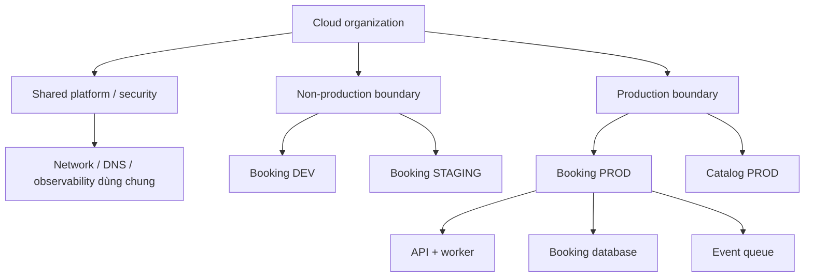
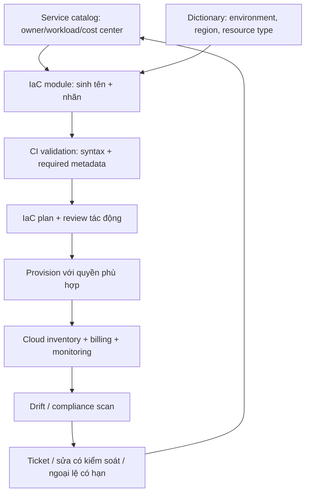
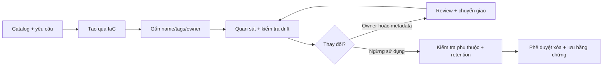

# Quy hoạch định danh tài nguyên, nhãn và quyền sở hữu

## 1. Vì sao phải quy hoạch tài nguyên ngay từ lúc thiết kế kiến trúc?

Trong module **CLOUD_ARCHITECTURE**, kiến trúc cloud được xây từ yêu cầu nghiệp vụ, lựa chọn mạng, compute, dữ liệu và mô hình triển khai, đồng thời cân bằng độ tin cậy, bảo mật, khả năng mở rộng, chi phí và vận hành theo tư duy **Well-Architected**. Để quản lý được kiến trúc sau khi triển khai, đội ngũ còn cần biết **mỗi tài nguyên là gì, thuộc hệ thống nào, phục vụ môi trường nào và ai chịu trách nhiệm**.

Một sơ đồ có hai cụm ứng dụng, một cơ sở dữ liệu và một hàng đợi chưa đủ để trả lời các câu hỏi thực tế:

- Hóa đơn tăng 30% tháng này do tài nguyên nào và thuộc ngân sách của nhóm nào?
- Khi cơ sở dữ liệu hết dung lượng lúc nửa đêm, ai nhận cảnh báo và có quyền thực hiện khôi phục?
- Một máy ảo không có lưu lượng đã ba tháng có được xóa hay đang phục vụ công việc định kỳ?
- Những tài nguyên nào chứa dữ liệu nhạy cảm và phải tuân thủ chính sách sao lưu, truy cập, lưu giữ?
- Nếu chuyển ứng dụng sang khu vực địa lý khác, quy ước tên và quyền sở hữu có còn đúng?

**Quy hoạch định danh tài nguyên, nhãn (tags/labels) và quyền sở hữu** giải quyết việc **nhận diện, phân loại, truy vết và điều hành** tài nguyên suốt vòng đời. Nó giúp đánh giá chi phí và rủi ro theo dịch vụ kinh doanh, nhưng **không tự bảo đảm bảo mật, khả dụng hay quyền truy cập**.

Sau bài này, bạn sẽ có thể:

1. Phân biệt **mã định danh do nền tảng cấp**, **tên tài nguyên**, **nhãn metadata** và **bản ghi quyền sở hữu**.
2. Thiết kế mẫu đặt tên nhất quán nhưng không phụ thuộc vào một cú pháp áp dụng cho mọi cloud service.
3. Định nghĩa bộ nhãn tối thiểu dùng để quản lý chi phí, môi trường, dữ liệu, bảo mật và vòng đời.
4. Xác định trách nhiệm khi vận hành, xử lý sự cố, chuyển giao hoặc xóa tài nguyên.
5. Tự động áp dụng và kiểm tra quy ước qua Infrastructure as Code (IaC), policy, inventory và quy trình thay đổi.
6. Đánh giá một phương án tổ chức tài nguyên dựa trên các mục tiêu Well-Architected.

## 2. Bốn khái niệm phải tách bạch

| Khái niệm | Chức năng | Ví dụ minh họa | Lưu ý |
|---|---|---|---|
| **Resource ID** | Định danh tài nguyên trong hệ thống quản lý của nhà cung cấp | ID/ARN/resource path do cloud cấp | Có thể bao gồm tên hoặc đường dẫn; không được tự cho rằng nó bất biến qua mọi thao tác di chuyển/tái tạo |
| **Resource name** | Tên dễ đọc hoặc tên vật lý khi tạo resource | `acme-booking-prd-sea-db-01` | Có ràng buộc riêng về ký tự, độ dài, phạm vi duy nhất của từng dịch vụ |
| **Tag/label** | Metadata dạng key–value để phân nhóm, tính phí, lọc, chính sách | `environment=prod`, `owner-team=booking` | Không phải mọi tài nguyên hoặc dịch vụ billing đều hỗ trợ và kế thừa tag giống nhau |
| **Ownership record** | Ghi ai chịu trách nhiệm kỹ thuật, nghiệp vụ, chi phí và xử lý sự cố | Nhóm `team-booking` trong service catalog | Có thể lưu ngoài cloud trong CMDB/service catalog; chủ sở hữu cần được kiểm chứng và cập nhật |

Ví dụ: cơ sở dữ liệu giao dịch có **resource ID** do cloud cấp, **tên** `acme-booking-prd-sea-db-01`, các **tag** `workload=booking`, `environment=prod`, `owner-team=team-booking`; trong service catalog, `team-booking` là nhóm trực vận hành và `finance-apps` là đơn vị nhận chi phí.

**Tên không phải quyền truy cập.** Đổi tên hiển thị hoặc thêm tag `owner-team=team-booking` không tự động cấp IAM cho nhóm đó. Phải dùng chính sách IAM/RBAC và quy trình cấp quyền riêng; một số nền tảng có thể **tham chiếu tag trong điều kiện IAM**, nhưng đó là chính sách được định nghĩa tường minh, cần kiểm thử và bảo vệ khả năng sửa tag.

## 3. Tổ chức tài nguyên theo ranh giới quản trị

Trước khi đặt tên từng máy chủ, hãy xác định các **ranh giới tổ chức**: tổ chức cloud, account/subscription/project, môi trường, workload, region, mạng và khu vực dữ liệu.

Tên cụ thể khác nhau giữa nhà cung cấp:

| Mục đích | Ví dụ cơ chế tổ chức |
|---|---|
| AWS | Organization/Organizational Unit (OU), account, region, resource |
| Azure | Management group, subscription, resource group, resource |
| Google Cloud | Organization, folder, project, resource |

Các cấu trúc trên **không hoàn toàn tương đương**. Chính sách kế thừa, mô hình billing, giới hạn quyền và khả năng di chuyển tài nguyên khác nhau theo nền tảng. Khi triển khai phải kiểm tra chức năng và giới hạn của dịch vụ cụ thể.

### 3.1. Vì sao nên tách môi trường ở cấp quản trị đủ mạnh?

Tách `dev`, `staging`, `prod` chỉ bằng tiền tố tên có thể khiến các môi trường vẫn chia sẻ quyền truy cập, hạn mức, mạng hoặc giới hạn billing. Đối với workload quan trọng, cân nhắc **account/subscription/project riêng cho production**, kết hợp chính sách tổ chức và kết nối liên môi trường có kiểm soát.

Sơ đồ logic tham khảo:



Đây là **cấu trúc khái niệm**, không mô tả sẵn tài nguyên vật lý hoặc quan hệ kế thừa quyền cụ thể của AWS, Azure hay Google Cloud. Thành phần dùng chung thường cần **owner vận hành riêng, cơ chế phân bổ chi phí và giới hạn truy cập**; không gán mặc định toàn bộ trách nhiệm cho một nhóm ứng dụng.

Khi chọn ranh giới, hãy trả lời:

1. Một thay đổi sai trong môi trường phát triển có thể làm gián đoạn production không?
2. Ai được phép tạo/xóa tài nguyên production? Có tách quyền người dùng và quyền pipeline?
3. Chi phí của workload và môi trường có bóc tách được không?
4. Có yêu cầu dữ liệu nằm ở region cụ thể hoặc phân tách theo khách hàng không?
5. Hạn mức dịch vụ, quota, IP address space, DNS và quy trình khôi phục có xung đột giữa các nhóm không?

## 4. Thiết kế quy ước đặt tên

### 4.1. Tên trả lời câu hỏi gì?

Tên nên giúp con người nhận diện nhanh **ứng dụng, môi trường, vị trí logic và loại tài nguyên**; còn thông tin chi tiết, thay đổi thường xuyên nên để trong tags và catalog. Không cần nhồi tất cả thông tin vào tên.

Một mẫu khởi điểm:

```text
<organization>-<workload>-<environment>-<region-code>-<resource-type>-<index>
```

Ví dụ với tổ chức giả định `acme`, workload `booking`, production `prd`, region code nội bộ `sea`:

```text
acme-booking-prd-sea-api-01
acme-booking-prd-sea-db-01
acme-booking-prd-sea-queue-01
acme-booking-stg-sea-api-01
```

Đây là **tên logic minh họa**, không bảo đảm hợp lệ cho tất cả loại dịch vụ. Mã `sea` trong ví dụ chỉ là mã vị trí do tổ chức tự định nghĩa trong một bảng ánh xạ chính thức; không phải tên region chuẩn có thể dùng trực tiếp cho mọi nhà cung cấp.

| Thành phần | Ví dụ | Quy tắc đề xuất |
|---|---|---|
| `organization` | `acme` | Viết tắt ổn định, không chứa thông tin nhạy cảm |
| `workload` | `booking` | Tên dịch vụ nghiệp vụ từ service catalog, không phụ thuộc tên cá nhân |
| `environment` | `dev`, `stg`, `prd` | Danh sách giá trị đóng, thống nhất giữa các nhóm |
| `region-code` | `sea`, `euw` | Bảng ánh xạ tới region thực tế, tránh mã trùng/khó hiểu |
| `resource-type` | `api`, `db`, `queue`, `bucket` | Từ điển viết tắt có kiểm soát |
| `index` | `01`, `02` | Chỉ dùng khi cần phân biệt nhiều tài nguyên cùng loại; không dùng làm chỉ số số replica tự động nếu autoscaler quản lý |

### 4.2. Quy tắc thiết kế tên có thể vận hành

- **Đơn giản và xác định:** cùng một tập đầu vào sinh ra tên theo quy ước; các mã rút gọn phải có từ điển, không tự sáng tạo mỗi nhóm một cách.
- **Ổn định:** tránh chứa số phiên bản ứng dụng, tên nhân viên, thời hạn tạm thời hoặc trạng thái như `new`, `final`; các thuộc tính này dễ thay đổi.
- **Hợp lệ cho từng dịch vụ:** độ dài tối đa, chữ hoa/chữ thường, ký tự `-`/`_`/`.`, tiền tố bắt buộc và phân biệt hoa thường có thể khác nhau. Một số loại tài nguyên cần **tên duy nhất toàn cục**; một số chỉ cần duy nhất trong account, project hay region.
- **Không đưa bí mật vào tên:** token, số điện thoại, địa chỉ email cá nhân, mã khách hàng nhạy cảm và thông tin nội bộ không nên xuất hiện trong tên hoặc tag.
- **Giữ tên logic và tên vật lý khác nhau khi cần:** trong IaC, tên module/resource trong mã có thể ổn định dù provider tạo ID vật lý với hậu tố để tránh đụng độ.
- **Tính trước vòng đời:** không giả định mọi resource có thể đổi tên tại chỗ; một số thao tác đổi `name` buộc thay thế tài nguyên và có thể gián đoạn, thay DNS/endpoint hoặc mất dữ liệu nếu thiếu kế hoạch di chuyển.

Ví dụ, storage bucket/object namespace thường có quy tắc đặt tên và độ duy nhất khác tên VM. Cần hàm dựng tên theo **loại tài nguyên**, có thể thêm hậu tố ngắn được quản lý để tránh xung đột; tránh cho phép pipeline tạo tên ngẫu nhiên thiếu khả năng truy vết.

### 4.3. Không dùng tên làm định danh nghiệp vụ vĩnh viễn

Nếu tên resource đổi khi tách hệ thống, các script gắn cứng vào tên có thể hỏng. Nên lưu **resource ID**, liên kết catalog và các cấu hình xuất từ IaC theo cách phù hợp; nơi ứng dụng cần endpoint ổn định thì sử dụng DNS/service discovery hoặc endpoint hợp đồng, thay vì dựa vào tên máy cụ thể.

Đối với IaC, phải phân biệt **địa chỉ tài nguyên trong trạng thái quản lý** với **tên vật lý tại cloud**. Đổi địa chỉ trong mã có thể khiến công cụ hiểu là xóa/tạo nếu không khai báo thao tác di chuyển state tương ứng; đổi tên vật lý có thể yêu cầu thay thế. Luôn xem kế hoạch thay đổi trước khi áp dụng lên tài nguyên chứa dữ liệu.

## 5. Thiết kế từ điển tag/label chuẩn

Nhãn là các cặp key–value dùng để hỏi: tài nguyên thuộc môi trường nào, ai sở hữu, chi phí thuộc đâu, chứa loại dữ liệu gì và được quản lý theo quy trình nào?

### 5.1. Bộ trường tối thiểu đề xuất

| Key chuẩn nội bộ | Ví dụ giá trị | Mục đích | Bắt buộc? |
|---|---|---|---|
| `workload` | `booking` | Liên kết ứng dụng/dịch vụ nghiệp vụ | Có |
| `environment` | `dev`, `stg`, `prod` | Lọc môi trường, áp chính sách phù hợp | Có |
| `owner-team` | `team-booking` | Nhóm chịu trách nhiệm kỹ thuật, tra service catalog | Có |
| `cost-center` | `cc-042` | Quy chi phí về đơn vị ngân sách | Có nếu tài nguyên thuộc phạm vi phân bổ chi phí |
| `managed-by` | `terraform`, `platform` | Cho biết nguồn quản lý, hỗ trợ phát hiện drift | Có |
| `data-classification` | `public`, `internal`, `confidential`, `restricted` | Phân loại dữ liệu và gợi ý chính sách bảo vệ | Có với tài nguyên dữ liệu; có thể dùng giá trị `not-applicable` khi hợp lý |
| `criticality` | `low`, `medium`, `high` | Ưu tiên cảnh báo, khôi phục, thay đổi | Có với workload quan trọng |
| `lifecycle` | `persistent`, `ephemeral` | Nhận diện tài nguyên tạm thời hoặc lâu dài | Khuyến nghị |
| `expires-on` | `2027-02-28` | Mốc xem xét/xóa đối với môi trường tạm | Bắt buộc với tài nguyên tạm có TTL |

Các key trên là **chính sách nội bộ minh họa**. Cloud providers có giới hạn số tag, độ dài, ký tự và tên key dành riêng; Kubernetes labels có quy tắc riêng; không được mặc định cùng một bộ key dùng được nguyên vẹn ở mọi nơi. Chọn biến thể triển khai tương ứng nhưng bảo toàn **ý nghĩa nghiệp vụ**.

Ví dụ metadata mong đợi cho cơ sở dữ liệu đặt lịch:

```yaml
resource:
  logicalName: booking-primary-db
  providerResourceId: "<id-do-nha-cung-cap-cap>"
  accountOrProject: acme-production
  region: "<region-thuc-te>"
  tags:
    workload: booking
    environment: prod
    owner-team: team-booking
    cost-center: cc-042
    managed-by: terraform
    data-classification: confidential
    criticality: high
    lifecycle: persistent
```

Khối YAML trên là **bản ghi inventory minh họa**; cấu trúc `resource/tags` không phải API tạo tài nguyên của nhà cung cấp.

### 5.2. Chất lượng dữ liệu nhãn quan trọng hơn số lượng

Một chính sách tag hiệu quả cần:

- **Danh sách giá trị hợp lệ:** `environment=prod` không được lúc khác đổi thành `PRD`, `production`, `live` khiến báo cáo sai lệch; cung cấp mapping và kiểm tra tự động.
- **Nguồn sự thật:** `owner-team` phải trỏ đến mã nhóm tồn tại trong catalog; `cost-center` trỏ đến danh mục ngân sách đang hoạt động.
- **Phân biệt bắt buộc với tùy chọn:** không bắt tài nguyên do provider tự tạo phải có tag nếu API không hỗ trợ; thiết lập ngoại lệ có bằng chứng và inventory bổ sung.
- **Quản lý quyền sửa nhãn:** người có thể đổi `environment` hoặc `owner-team` có thể ảnh hưởng chính sách hoặc báo cáo. Hạn chế quyền sửa các key nhạy cảm.
- **Kiểm tra tính kế thừa:** một tài nguyên con không nhất thiết tự nhận tag của account/project/parent. Cần kiểm tra việc lan truyền tag thật sự ở từng dịch vụ hoặc truyền từ module IaC.
- **Bảo vệ thông tin nhạy cảm:** tag có thể xuất hiện trong API, nhật ký, công cụ inventory và hóa đơn. Không lưu token, tên khách, thông tin cá nhân hay tài liệu bảo mật trong tag.

Ví dụ phân biệt **tag** và **resource label** trong container platform: Kubernetes label thường phục vụ chọn đối tượng, tổ chức workload và query; tag của cloud có thể được dùng cho cost allocation. Không giả định Kubernetes label trên Pod sẽ tự được đưa vào hóa đơn cloud; nếu cần phân bổ chi phí đến namespace/workload, thiết kế pipeline đo và phân bổ riêng.

### 5.3. Tag chi phí không phải thước đo chi phí hoàn chỉnh

Một số chi phí như truyền dữ liệu, dịch vụ dùng chung, phí hỗ trợ hoặc hóa đơn nhà cung cấp ngoài có thể không quy được đầy đủ theo resource tags. Nhiều hệ thống billing yêu cầu kích hoạt hoặc cấu hình riêng cho cost allocation tags và có độ trễ trước khi dữ liệu được ghi nhận.

Vì vậy, mô hình chargeback/showback cần cả **account/project hierarchy**, tag và quy tắc phân bổ chi phí dùng chung. Nếu chi phí mạng chung được phân bổ theo số request hoặc mức sử dụng, phải ghi rõ công thức, nguồn số liệu và đơn vị nhận phần chi phí chưa phân bổ.

## 6. Quyền sở hữu tài nguyên: ai quyết định, ai vận hành?

Một tag `owner-team` không đủ nếu đến lúc sự cố không có người tiếp nhận. Quyền sở hữu nên được thể hiện trong **service catalog/CMDB** và liên kết với nhóm, không gắn cứng vào cá nhân.

| Vai trò | Trách nhiệm điển hình | Ví dụ |
|---|---|---|
| **Service owner** | Chịu trách nhiệm mục tiêu nghiệp vụ, SLO, ưu tiên thay đổi và rủi ro chấp nhận | Nhóm sở hữu sản phẩm Booking |
| **Technical/resource owner** | Cấu hình, vòng đời, dữ liệu, kế hoạch nâng cấp/khôi phục cho tài nguyên thuộc phạm vi mình | `team-booking` sở hữu API và schema nghiệp vụ |
| **Platform owner** | Cung cấp nền tảng, mạng, policy chung, IaC modules và dịch vụ dùng chung | `team-platform` |
| **Security owner** | Đưa ra chuẩn kiểm soát, rà soát rủi ro và ngoại lệ bảo mật | `team-security` |
| **Cost owner** | Theo dõi ngân sách, xác thực chargeback/showback và hành động tối ưu | `cost-center=cc-042` |
| **On-call responder** | Nhận cảnh báo, chạy runbook, khôi phục bước đầu và leo thang | Lịch trực gắn với `team-booking` |

Một nhóm có thể giữ nhiều vai trò; vai trò có thể phân tán ở nhóm platform và nhóm sản phẩm. Quan trọng là **mỗi đầu việc có một đầu mối chịu trách nhiệm cuối cùng** và đường chuyển giao rõ ràng.

### 6.1. Ma trận trách nhiệm ví dụ (RACI)

Ký hiệu: **R** thực hiện, **A** chịu trách nhiệm cuối cùng, **C** tham vấn, **I** được thông báo. Mỗi dòng có một bên **A** để tránh thiếu người quyết định.

| Công việc | Booking team | Platform team | Security team | Finance/FinOps |
|---|:---:|:---:|:---:|:---:|
| Xác nhận tên/tag cho API Booking | **A/R** | C | I | I |
| Cung cấp module IaC và policy tagging chung | C | **A/R** | C | C |
| Phê duyệt ngoại lệ kiểm soát bảo mật | R | C | **A** | I |
| Tối ưu truy vấn/backup ứng dụng Booking | **A/R** | C | C | I |
| Rà soát chargeback và ngân sách | R | C | I | **A** |
| Xử lý lỗi network/dịch vụ platform dùng chung | I | **A/R** | C | I |

Đây là ví dụ tổ chức; trong một doanh nghiệp, người chịu trách nhiệm về bảo vệ dữ liệu hoặc phê duyệt thay đổi sản xuất có thể là vai trò khác. RACI cần phù hợp mô hình thực tế và thẩm quyền đã được giao.

### 6.2. Phân biệt sở hữu tài nguyên dùng chung

Ví dụ NAT, DNS, cơ chế quan sát và mạng kết nối được platform quản lý nhưng phục vụ nhiều workload. Nên ghi:

- **Owner kỹ thuật:** nhóm platform vận hành và khôi phục.
- **Các consumer:** workload/nhóm đang dùng, truy được từ catalog hoặc quan hệ phụ thuộc.
- **Owner ngân sách:** nền tảng hoặc các nhóm consumer theo quy tắc phân bổ đã thỏa thuận.
- **Quy trình thay đổi:** cần thông báo tác động, thời gian triển khai, phương án rollback và người xác nhận.

Không để một tài nguyên có ba tên nhóm trong cùng tag `owner-team` rồi hy vọng cảnh báo tự tìm đúng người. Đặt **một đội chịu trách nhiệm chính**, các bên liên quan ghi ở trường riêng hoặc catalog.

### 6.3. Thay đổi nhân sự, chuyển nhóm và orphan resource

Khi kỹ sư rời đội, quyền sở hữu phải không bị mất theo tài khoản cá nhân. Dùng mã nhóm ổn định, đồng bộ thành viên vào IAM, quản lý lịch trực độc lập. Khi chuyển giao workload cần chuyển **trách nhiệm** trước khi đổi **tag**: inventory, sơ đồ phụ thuộc, runbook, quyền truy cập, budget, backup, dashboard, secret rotation, rủi ro tồn đọng và người chấp nhận.

Tài nguyên không tra được owner trong catalog là **orphan resource**. Đưa vào hàng đợi xử lý của platform/FinOps, không xóa ngay chỉ vì tag thiếu: nó có thể là thành phần hệ thống đang hoạt động hoặc tài nguyên phục hồi quan trọng.

## 7. Gắn quy ước với bảo mật và các mục tiêu Well-Architected

### 7.1. Bảo mật: ranh giới quản trị trước, tag sau

Tag giúp chọn đối tượng để rà soát hoặc tham chiếu trong policy, nhưng **không thay thế isolation**. Tài nguyên production quan trọng cần cấp quyền theo nguyên tắc ít đặc quyền, giới hạn mạng, mã hóa, nhật ký kiểm toán và vai trò triển khai riêng.

Rủi ro điển hình khi dùng tag trong chính sách truy cập:

1. Nếu người dùng có thể sửa `environment=prod` thành `dev`, một chính sách IAM dựa trên tag thiếu bảo vệ có thể bị vượt qua.
2. Nếu policy yêu cầu tag lúc tạo nhưng dịch vụ không truyền được tag cho tài nguyên con, pipeline có thể tạo resource thiếu kiểm soát hoặc bị từ chối ngoài ý muốn.
3. Nếu một tài nguyên chưa hỗ trợ điều kiện theo tag, cần policy thay thế ở scope khác (account/project, đường dẫn, role, service-specific condition).

Do đó hãy kiểm thử chính sách bằng vai trò **được phép**, **không được phép** và **không có tag**, bao gồm quyền tạo, sửa tag, xóa và đọc dữ liệu. Triển khai enforcement theo giai đoạn để không khóa các thao tác khôi phục khẩn cấp.

### 7.2. Độ tin cậy

Gắn owner, mức quan trọng và liên kết dịch vụ giúp định tuyến cảnh báo và lập kế hoạch RTO/RPO. Tuy nhiên `criticality=high` **không tự tạo multi-AZ, backup hay failover**. Catalog phải chỉ đến cấu hình và bằng chứng kiểm thử tương ứng.

Nếu DB production bị đánh sai thành `dev`, hệ thống tự động có thể áp chính sách retention hoặc dọn dẹp không phù hợp. Vì vậy trường phục vụ tự động hóa vòng đời cần quyền thay đổi hạn chế, kiểm tra chéo với account/project thực tế và có cơ chế phê duyệt cho thao tác phá hủy.

### 7.3. Hiệu năng và khả năng mở rộng

Tag phân nhóm tài nguyên giúp dashboard tập hợp latency, CPU, database connections, queue age theo `workload` và `environment`. Nhưng một tập metric bị gắn sai nhãn có thể giấu nút thắt hoặc khiến autoscaler ra quyết định sai. Tránh gắn nhãn có cardinality quá cao như `request-id` hay `customer-id` vào time-series metric.

### 7.4. Chi phí và vận hành

Nhãn tốt hỗ trợ tìm idle resource, dự báo ngân sách, phân bổ chi phí, kiểm tra backup và phát hiện drift. Chi phí gắn tag phải được so sánh với các khoản **không có tag** và phí dùng chung. Các ngoại lệ cần có owner, thời hạn giải quyết và quy trình theo dõi.

### 7.5. Bền vững

Một inventory có chủ sở hữu và mốc hết hạn giúp xóa tài nguyên thử nghiệm không còn dùng, giảm lưu trữ dư thừa và compute nhàn rỗi. Tuy nhiên chỉ tự động xóa khi đã xác thực phụ thuộc, chính sách retention và dữ liệu cần giữ; việc gắn `expires-on` không mặc nhiên cho phép xóa dữ liệu quan trọng.

## 8. Áp dụng qua IaC, policy và kiểm tra liên tục

Để quy ước không chỉ nằm trong tài liệu, hãy định nghĩa **contract metadata** từ một nguồn chuẩn rồi đưa vào template, IaC module, pipeline và inventory.

### 8.1. Luồng áp dụng khuyến nghị



Một phiên bản logic có thể biểu diễn như sau (pseudocode, **không phải cấu hình áp dụng trực tiếp cho mọi cloud**):

```text
required_tags = {
  "workload": catalog.workload_id,
  "environment": deployment.environment,
  "owner-team": catalog.technical_owner_team,
  "cost-center": catalog.cost_center,
  "managed-by": "terraform"
}

assert catalog.technical_owner_team exists
assert deployment.environment in ["dev", "stg", "prod"]
assert catalog.cost_center is active
assert all values match provider-specific limits

resource_name = naming_policy.build(
  workload=catalog.workload_id,
  environment=deployment.environment,
  region=deployment.region,
  resource_type="api"
)

plan = iac.plan(resource_name, required_tags)
review(plan, especially_destroy_or_replace=true)
```

**Không tin tất cả resource do công cụ tạo sẽ tự nhận tag.** Một số tài nguyên mặc định, child resources, managed components hoặc tài nguyên phát sinh từ autoscaling có thể yêu cầu cơ chế truyền metadata khác, hoặc không hỗ trợ tag.

### 8.2. Policy có tầng kiểm soát phù hợp

| Thời điểm | Kiểm soát | Hành động hợp lý |
|---|---|---|
| Trước khi merge | Kiểm tra naming function, field bắt buộc, schema catalog, tính hợp lệ giá trị | Chặn cấu hình sai, cung cấp lỗi cụ thể |
| Khi tạo tài nguyên | Policy theo scope, loại resource, tag-on-create nếu được hỗ trợ | Từ chối thao tác vi phạm mức bảo vệ bắt buộc; ghi ngoại lệ khi có lý do |
| Sau khi triển khai | Inventory và policy scan theo lịch | Đánh dấu thiếu tag/owner, tạo ticket, cảnh báo drift |
| Hàng tháng | Đối chiếu cloud billing với catalog/FinOps | Bóc tách tài nguyên không phân bổ, cập nhật owner/budget |
| Khi thay đổi hoặc xóa | IaC plan, dependency check, backup/retention, phê duyệt theo mức nguy hiểm | Tránh xóa nhầm tài nguyên production và dữ liệu còn cần |

Nên bắt đầu bằng **audit/notify** để tìm giới hạn của platform, sau đó chuyển sang **enforce** ở những loại tài nguyên có hỗ trợ đầy đủ. Với tài nguyên production nhạy cảm, việc hạn chế tạo sai phải đi cùng cơ chế bootstrap và break-glass được kiểm soát, để không cản xử lý sự cố.

### 8.3. Quy tắc ngoại lệ

Ngoại lệ là một bản ghi có cấu trúc, gồm: resource ID, loại resource, metadata thiếu hoặc khác quy chuẩn, lý do, mức rủi ro, người phê duyệt, owner, biện pháp bù đắp, ngày hết hạn và kế hoạch xử lý. “Tài nguyên đặc biệt” không phải lý do để bỏ trống ownership.

## 9. Vòng đời metadata và quyền sở hữu

### 9.1. Khi tạo

Trước khi tạo resource: tạo/kiểm tra mục workload trong catalog, xác định owner kỹ thuật và chi phí, môi trường, region, data classification, SLO/RTO/RPO liên quan. Pipeline tạo tên phù hợp, ghi tag và lưu resource ID/đường dẫn liên kết catalog.

### 9.2. Khi vận hành

Đối chiếu inventory định kỳ để tìm resource thiếu tag, nằm sai môi trường, không có owner hợp lệ, hoặc dùng tên ngoài quy ước. Tại thời điểm sự cố, dashboard phải dẫn đến runbook và nhóm trực nhận trách nhiệm; không nên cần tra thủ công người đã tạo VM từ nhiều năm trước.

### 9.3. Khi đổi tên hoặc chuyển team

Không tự động rename resource vật lý vì đổi tên sản phẩm hay cơ cấu nhóm. Đánh giá ảnh hưởng đến DNS, client, IaC state, backup, IAM, monitoring và billing; cập nhật bản ghi catalog/tag trước nếu chỉ thay đổi ownership. Với resource phải thay thế mới đổi được tên, lập kế hoạch migration/rollback và chốt cửa sổ thay đổi.

### 9.4. Khi hết hạn và xóa

Tài nguyên thử nghiệm có `expires-on` cần cảnh báo trước hạn, xác minh không còn traffic/dependency, kiểm tra snapshot và chính sách lưu dữ liệu, rồi mới xóa có kiểm soát. Sau xóa, cập nhật inventory và báo cáo chi phí; khóa/secret/route/alert cũ cũng cần được xử lý.



## 10. Ví dụ xuyên suốt: tài nguyên hệ thống đặt lịch

Giả sử ứng dụng Booking có hai môi trường `stg` và `prod`, phục vụ một region chính. API, worker và DB có nhu cầu bảo vệ khác nhau; networking và logging dùng chung do platform quản lý.

| Tài nguyên | Tên logic minh họa | Workload / Environment | Owner kỹ thuật | Cost owner | Lưu ý vận hành |
|---|---|---|---|---|---|
| API production | `acme-booking-prd-sea-api-01` | booking / prod | team-booking | cc-042 | Có health check, alert p95 và autoscaling nếu phù hợp |
| DB giao dịch | `acme-booking-prd-sea-db-01` | booking / prod | team-booking | cc-042 | `data-classification=confidential`, backup, HA và restore test |
| Queue sự kiện | `acme-booking-prd-sea-queue-01` | booking / prod | team-booking | cc-042 | Retry, DLQ, cảnh báo backlog |
| API staging | `acme-booking-stg-sea-api-01` | booking / stg | team-booking | cc-042 | Không giữ dữ liệu thật trái quy định; giới hạn chi phí |
| Network dùng chung | `acme-shared-prd-sea-net-01` | platform / prod | team-platform | cc-platform | Liên kết consumer; phân bổ chi phí egress minh bạch |
| Log/observability chung | `acme-shared-prd-sea-obs-01` | platform / prod | team-platform | cc-platform | Retention và truy cập log theo phân loại dữ liệu |

Tên trên có thể là **alias logic** nếu provider/service không chấp nhận cú pháp đó. Đối với API autoscale, một tên nhóm tài nguyên/deployment có thể ổn định, trong khi replica được tạo/xóa tự động bằng ID khác.

### 10.1. Hai truy vấn inventory hữu ích

Pseudocode dưới đây biểu diễn dữ liệu **đã đồng bộ** từ cloud inventory + service catalog; không phải cú pháp SQL chung cho API của nhà cung cấp:

```sql
-- Tài nguyên production không có owner hợp lệ
SELECT r.resource_id, r.resource_type, r.name, r.owner_team
FROM resource_inventory AS r
LEFT JOIN team_catalog AS t ON r.owner_team = t.team_id
WHERE r.environment = 'prod'
  AND (r.owner_team IS NULL OR t.team_id IS NULL OR t.active = FALSE);

-- Chi phí còn chưa được phân bổ theo workload/cost center
SELECT billing_period, SUM(cost_amount) AS unallocated_amount
FROM normalized_billing
WHERE workload IS NULL OR cost_center IS NULL
GROUP BY billing_period;
```

Giá trị trả về từ hai truy vấn này giúp tạo ticket hoặc thảo luận FinOps, **không phải lệnh xóa tự động**. Cần xác định tỷ lệ coverage của inventory và nguồn dữ liệu billing: tài nguyên không hỗ trợ tag và chi phí dịch vụ dùng chung vẫn phải được xét riêng.

### 10.2. Một kịch bản vận hành có và không có ownership

**Tình huống:** chi phí DB tăng, đồng thời tỷ lệ lỗi đặt chỗ tăng vào giờ cao điểm.

Khi có catalog và tagging tốt, cảnh báo `workload=booking`, `environment=prod`, `criticality=high` được nhóm `team-booking` tiếp nhận. Nhóm truy được DB và dashboard liên quan, xác định lock wait/connection pool, trao đổi với platform về hạn mức DB rồi lập thay đổi. FinOps nhìn được tăng chi phí của `cc-042` và theo dõi kết quả tối ưu.

Nếu DB thiếu owner và nằm trong account dùng chung mà không có inventory, các nhóm phải hỏi nhau ai tạo tài nguyên, có được đổi thông số không và ai chịu ngân sách. Kỹ thuật có thể vẫn hoạt động, nhưng **thời gian xử lý sự cố và rủi ro thay đổi sai tăng**.

## 11. Đánh giá theo Well-Architected

| Góc nhìn | Câu hỏi cần hỏi khi review quy ước | Bằng chứng |
|---|---|---|
| **Operational Excellence** | Khi có cảnh báo, có xác định được team trực và runbook từ resource ID không? | Catalog, link dashboard, thực hành incident |
| **Security** | Có tách prod/non-prod, kiểm soát quyền đổi nhãn và không có bí mật trong metadata không? | IAM/RBAC, policy, audit log, test quyền |
| **Reliability** | Ai chịu trách nhiệm backup/restore, DR và thay đổi tài nguyên critical? | RACI, thử restore, SLO/RTO/RPO, phương án rollback |
| **Performance Efficiency** | Có phân nhóm metric theo workload/env để phát hiện bottleneck không? | Dashboard p95, saturation, query/queue metrics |
| **Cost Optimization** | Bao nhiêu phần trăm chi phí được gắn owner/cost center đáng tin cậy? | Billing, inventory, quy tắc shared cost allocation |
| **Sustainability** | Có phát hiện và loại bỏ resource thử nghiệm nhàn rỗi, sau khi kiểm tra retention không? | Utilization, báo cáo idle, quy trình xóa có kiểm soát |

AWS Well-Architected Framework dùng sáu trụ cột trên, gồm cả **Sustainability**. Các câu hỏi có thể áp dụng rộng hơn AWS, nhưng công cụ kiểm soát cụ thể phải được điều chỉnh theo nhà cung cấp cloud và mô hình tổ chức.

## 12. Những lỗi quy hoạch thường gặp

| Sai lầm | Hệ quả | Cách khắc phục |
|---|---|---|
| Đưa toàn bộ hệ thống vào một account/project, phân biệt bằng tiền tố | Khó tách quyền, quota, billing và tác động lỗi | Tách ranh giới quản trị theo môi trường/workload quan trọng |
| Đặt tên chứa người tạo, ngày tháng, `new`, `final` | Tên nhanh lỗi thời, migration khó | Dùng workload ID ổn định; lưu người tạo trong audit nếu cần |
| Xem tag `owner-team` như quyền IAM | Tài nguyên có thể bị truy cập sai | Thiết kế IAM/RBAC riêng, kiểm soát sửa tag |
| Mọi team tự chọn `prod`, `prd`, `production` | Báo cáo và policy không nhất quán | Từ điển giá trị chuẩn, CI validation |
| Cho phép thông tin cá nhân hoặc secret trong tag | Rò rỉ qua inventory/log/billing | Kiểm tra trường nhạy cảm, dùng secret manager |
| Giả định mọi tài nguyên con kế thừa tag | Thiếu coverage, cost allocation sai | Kiểm tra từng loại resource, bổ sung inventory mapping |
| Dùng tag làm nguồn sự thật duy nhất | Mất ownership khi tag sai/bị xóa | Catalog/CMDB liên kết resource ID và chủ sở hữu |
| Tự động xóa mọi resource có `expires-on` | Có thể phá dữ liệu hoặc dependency | Xác minh owner, traffic, retention và phê duyệt |
| Rename trực tiếp resource production | Có thể thay thế, gián đoạn, mất endpoint | Đọc plan, backup, migration và rollback |
| Không tính shared resources | Thiếu chi phí mạng, quan sát, backup | Quy tắc phân bổ và owner của dịch vụ dùng chung |
| Chặn toàn bộ thao tác nếu thiếu tag mà không kiểm tra hỗ trợ provider | Làm lỗi bootstrap hoặc phục hồi khẩn cấp | Policy theo từng resource, audit rồi enforce từng bước |

## 13. Bài thực hành: thiết kế chuẩn cho một ứng dụng cloud

Một tổ chức chuẩn bị chạy ba workload: **Booking API**, **Catalog API** và **Reporting job**. Booking/Catalog có `dev`, `stg`, `prod`; Reporting dùng dữ liệu tổng hợp theo lịch. Có một mạng và hệ thống log dùng chung. Mỗi workload có nhóm kỹ thuật riêng; nhóm platform quản lý dịch vụ dùng chung.

Hãy tạo tài liệu thiết kế ngắn đáp ứng các đầu việc:

1. **Vẽ hierarchy**: chọn ranh giới prod/non-prod và nơi đặt shared services; giải thích tác động của phương án tới IAM, blast radius và billing.
2. **Đề xuất naming convention**: đặt tên logic cho một API, một DB, một queue, một storage bucket và một log sink. Nêu loại nào cần kiểm tra tính duy nhất toàn cục, character set hoặc thao tác rename theo provider.
3. **Lập từ điển tag**: chọn ít nhất sáu key; ghi rõ giá trị hợp lệ, ai tạo, ai được sửa và dữ liệu nào không được đưa vào tag.
4. **Xác định ownership**: chỉ định technical owner, cost owner, on-call, platform owner cho từng tài nguyên và tài nguyên chung; mô tả tình huống nhóm Booking bàn giao cho nhóm mới.
5. **Đặt kiểm soát tự động**: nêu kiểm tra CI lúc tạo, kiểm tra inventory sau tạo, xử lý tài nguyên không hỗ trợ tag và quy trình ngoại lệ có hạn.
6. **Làm bài review**: giả định một tài nguyên storage tồn tại ba tháng, không có owner, hóa đơn tăng và không ai biết dữ liệu lưu gì. Nêu những bước **chỉ đọc** cần làm trước khi đề xuất xóa.

### Gợi ý khung câu trả lời

```yaml
workload: booking
environment: prod
technical_owner_team: team-booking
cost_center: cc-042
resource_type: db
data_classification: confidential
criticality: high
managed_by: terraform
resource_name_example: acme-booking-prd-sea-db-01
controls:
  - validate-catalog-owner
  - validate-environment-and-cost-center
  - review-iac-plan
  - inventory-drift-check
  - verify-backup-and-restore
```

Đây là **mẫu bài tập**, không phải manifest tạo DB. Bài làm tốt phải giải thích cả **vì sao** mỗi trường tồn tại và **đội nào xử lý khi dữ liệu trường đó sai**.

## 14. Checklist dùng khi review kiến trúc

- [ ] Hierarchy đã xác định ranh giới môi trường, trách nhiệm chi phí và tác động lỗi chưa?
- [ ] Tên logic và tên vật lý có được phân biệt, quy tắc đặt tên có xét ràng buộc từng dịch vụ không?
- [ ] Mỗi resource có liên kết tới workload, environment, owner và ngân sách có thể kiểm tra không?
- [ ] Các tag có từ điển giá trị chuẩn, hạn chế thông tin nhạy cảm và kiểm soát quyền sửa không?
- [ ] Tài nguyên shared, managed và không hỗ trợ tag có cơ chế ownership/chi phí thay thế không?
- [ ] Catalog có technical owner, on-call, cost owner, dependency và runbook tương ứng không?
- [ ] CI/IaC và inventory có phát hiện missing tags, owner không hợp lệ và drift không?
- [ ] Quy trình chuyển giao, đổi tên, ngoại lệ, retention và xóa có chủ sở hữu và bước kiểm chứng không?
- [ ] Có bằng chứng rằng phân loại `criticality`/environment được phản ánh bằng cấu hình backup, IAM, SLO và alert thật không?

Quy hoạch định danh, nhãn và quyền sở hữu tốt làm cho một kiến trúc cloud **có thể tìm được, hiểu được và vận hành có trách nhiệm** trong suốt vòng đời. Bản thân quy ước metadata không thay thế thiết kế mạng, compute, dữ liệu hay kiểm thử Well-Architected; nó giúp các quyết định đó được áp dụng, theo dõi và kiểm chứng một cách nhất quán.
