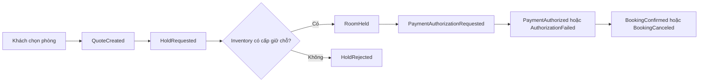
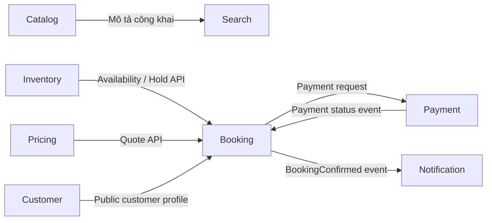
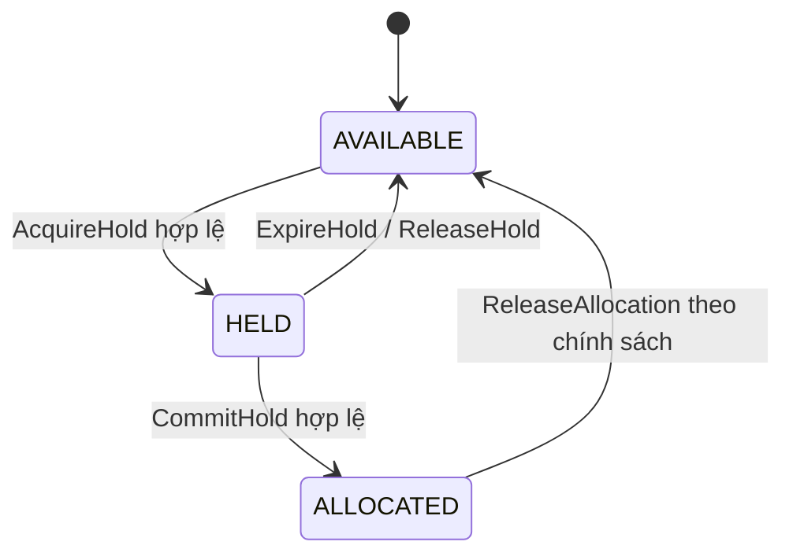
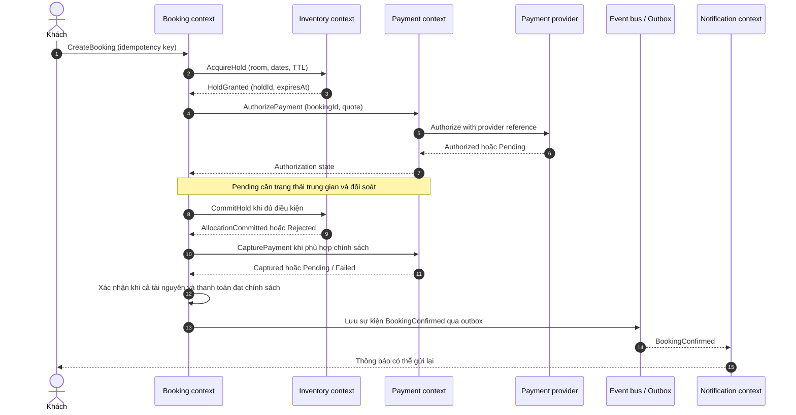
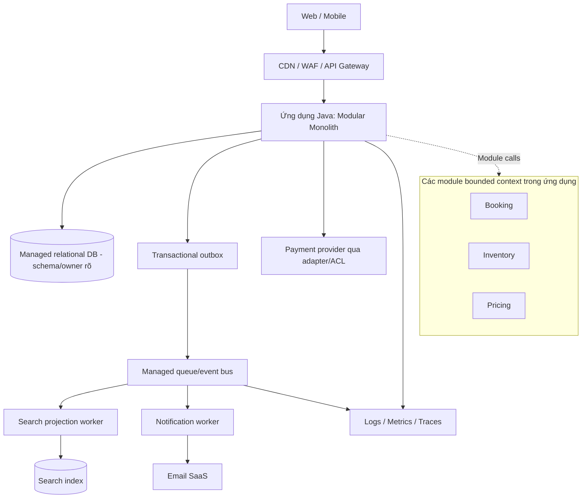
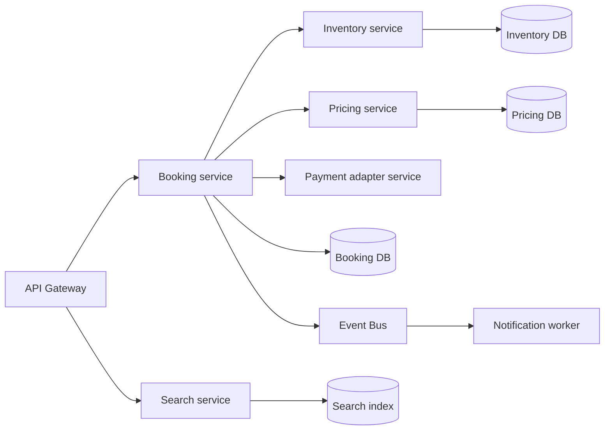

# Thiết kế theo miền nghiệp vụ và ranh giới bounded context

## 1. Vì sao thiết kế theo miền nghiệp vụ quan trọng trong kiến trúc cloud?

Một ứng dụng có thể dùng đúng các dịch vụ đám mây, tự động mở rộng và triển khai liên tục nhưng vẫn rất khó sửa đổi khi các quy tắc nghiệp vụ bị trộn lẫn. Chẳng hạn, ở nền tảng đặt chỗ, một thay đổi về chính sách hoàn tiền lại buộc đội phát triển chỉnh cả logic tìm kiếm, quản lý phòng và phát hành hóa đơn. Các thành phần có thể được triển khai độc lập trên cloud nhưng vẫn phụ thuộc chặt chẽ vào nhau qua database chung, thuật ngữ không thống nhất và các lệnh gọi vòng tròn.

**Thiết kế theo miền nghiệp vụ** (*domain-driven design*, thường viết tắt là DDD) giúp tổ chức mô hình phần mềm quanh những khái niệm, quy tắc và kết quả mà doanh nghiệp thực sự quan tâm. Ở cấp kiến trúc, DDD hỗ trợ nhận diện **bounded context**: phạm vi mà trong đó một mô hình và ngôn ngữ nghiệp vụ có nghĩa nhất quán.

Trong chương **Mô hình ứng dụng** của module **CLOUD_ARCHITECTURE**, mục tiêu của bài là biến yêu cầu nghiệp vụ thành ranh giới thiết kế có thể duy trì khi hệ thống phát triển trên đám mây. Người học cần cân nhắc độ tin cậy, bảo mật, khả năng mở rộng, chi phí và vận hành theo các nguyên tắc Well-Architected, thay vì coi việc chia hệ thống thành thật nhiều dịch vụ là mục tiêu tự thân.

Sau bài học, bạn có thể:

1. Phân biệt miền nghiệp vụ, subdomain, bounded context, aggregate và đơn vị triển khai.
2. Tìm ranh giới từ ngôn ngữ, quy tắc, dữ liệu, bất biến và sự thay đổi của nghiệp vụ.
3. Vẽ context map và chọn kiểu tích hợp giữa các bounded context.
4. Xác định nơi đặt giao dịch nhất quán, nơi dùng event và cách xử lý lỗi xuyên ranh giới.
5. Chuyển mô hình miền thành kiến trúc cloud có chủ sở hữu, SLO, ranh giới bảo mật và chi phí hợp lý.
6. Đánh giá một thiết kế qua ví dụ, bài kiểm thử và ghi chép quyết định kiến trúc.

## 2. Các khái niệm cốt lõi: đừng đồng nhất “miền” với “service”

| Khái niệm | Ý nghĩa | Ví dụ trong nền tảng đặt chỗ |
| --- | --- | --- |
| **Domain** (*miền nghiệp vụ*) | Phạm vi vấn đề doanh nghiệp muốn giải quyết, gồm mục tiêu, quy tắc và thuật ngữ | Kinh doanh dịch vụ lưu trú |
| **Subdomain** (*miền con*) | Một phần của miền, phân loại theo năng lực nghiệp vụ | Quản lý tồn phòng, đặt chỗ, thanh toán, chăm sóc khách |
| **Bounded context** | Ranh giới trong đó mô hình, quy tắc và ngôn ngữ có nghĩa nhất quán; có thể có mô hình khác ngoài ranh giới | Trong *Booking*, “đặt chỗ” là yêu cầu và trạng thái xác nhận; trong *Inventory*, “giữ chỗ” là quyền tạm thời với tài nguyên |
| **Ubiquitous language** (*ngôn ngữ chung*) | Bộ thuật ngữ mà người nghiệp vụ và kỹ thuật dùng nhất quán trong một context | “Giữ chỗ”, “hết hạn”, “xác nhận”, “hủy” có định nghĩa cụ thể |
| **Entity / Value Object** | Thực thể có danh tính / đối tượng được xác định bằng giá trị | `Booking` / `Money`, `DateRange` |
| **Aggregate** | Nhóm đối tượng miền có một *aggregate root* bảo vệ các bất biến khi cập nhật | Aggregate `RoomAllocation` kiểm soát tranh chấp tài nguyên |
| **Context map** | Bản đồ quan hệ phụ thuộc và cách hai mô hình tương tác | Booking dùng hợp đồng công khai của Inventory; Payment phát sự kiện thanh toán |
| **Module / Service / Deployable** | Đơn vị tổ chức mã / giao tiếp / triển khai kỹ thuật | Hai bounded context có thể nằm trong cùng một ứng dụng được triển khai |

Một phân biệt đặc biệt quan trọng:

- **Subdomain thuộc không gian vấn đề** (*problem space*): doanh nghiệp cần những năng lực nào.
- **Bounded context thuộc không gian giải pháp** (*solution space*): phần mềm tổ chức và diễn giải mô hình như thế nào.

Không bắt buộc có quan hệ một-một giữa subdomain và bounded context. Một subdomain phức tạp có thể có nhiều context, một context có thể đáp ứng nhiều phần việc có quan hệ chặt chẽ, và một context có thể trải qua nhiều module nội bộ.

**Bounded context cũng không đồng nghĩa microservice.** Ranh giới mô hình có thể nằm trong cùng một *modular monolith*, được triển khai dưới dạng một hoặc nhiều service, hoặc có phần nghiệp vụ dùng SaaS. Quyết định triển khai phụ thuộc vào mức cô lập mong muốn, tổ chức đội ngũ, nhu cầu mở rộng và tổng chi phí vận hành.

### 2.1. Những gì bounded context thực sự ràng buộc

Trong một context, nhóm cần thống nhất:

- Thuật ngữ và nghĩa của từng khái niệm.
- Những quy tắc/nghiệp vụ mà context sở hữu.
- Dữ liệu có thẩm quyền, các trạng thái và cách chuyển trạng thái.
- Hợp đồng công khai được cung cấp cho context khác.
- Người chịu trách nhiệm thay đổi mô hình, xử lý lỗi và vận hành.

Ranh giới tốt giúp **thay đổi quy tắc trong một phạm vi có thể dự đoán**, giảm tình trạng một khái niệm vừa có nhiều nghĩa vừa bị dùng ở khắp hệ thống.

## 3. Tìm subdomain từ năng lực và hành trình nghiệp vụ

Không bắt đầu bằng sơ đồ service hoặc phân chia package `controller/service/repository`. Hãy bắt đầu từ câu hỏi: người dùng và doanh nghiệp muốn đạt kết quả gì, cần quy tắc nào để đạt kết quả đó?

Ví dụ, hệ thống đặt phòng trực tuyến có những năng lực sau:

| Năng lực | Tác vụ nghiệp vụ | Quy tắc đáng chú ý |
| --- | --- | --- |
| **Catalog** | Quản lý cơ sở lưu trú, ảnh, tiện nghi và mô tả | Chỉ hiển thị nội dung đã được duyệt |
| **Search** | Tìm phòng theo địa điểm, ngày và bộ lọc | Kết quả có thể dùng chỉ mục đọc có độ trễ cập nhật được chấp nhận |
| **Inventory** | Biết đơn vị phòng nào còn khả dụng; giữ/giải phóng tài nguyên | Không cấp cùng một đơn vị phòng cho hai yêu cầu chồng lấn |
| **Pricing** | Tính giá, giảm giá, thuế/phí và chính sách báo giá | Báo giá có hiệu lực theo điều kiện và thời hạn |
| **Booking** | Theo dõi ý định đặt, trạng thái, xác nhận và hủy | Chỉ xác nhận khi điều kiện thanh toán/tài nguyên đáp ứng chính sách |
| **Payment** | Tạo, xác minh và đối soát giao dịch thanh toán | Một lệnh logic không được tạo thu tiền lặp do retry |
| **Customer** | Quản lý hồ sơ, kênh liên hệ, tùy chọn | Truy cập dữ liệu khách hàng phải được ủy quyền |
| **Notification** | Gửi email/SMS và ghi nhận kết quả | Gửi thông báo thất bại không được làm sai trạng thái đặt chỗ |

Đây là **ứng viên subdomain**, chưa phải bản thiết kế cuối cùng. Cần kiểm chứng với chuyên gia nghiệp vụ: có nơi Inventory và Booking cần cùng một ranh giới giao dịch, có nơi Catalog và Search do một đội sở hữu, có nơi Payment là hệ thống bên thứ ba nhưng Payment context nội bộ vẫn cần đối soát và chuẩn hóa trạng thái.

### 3.1. Phân loại core, supporting và generic

DDD thường phân biệt:

- **Core subdomain:** nơi tạo lợi thế cạnh tranh hoặc giá trị khác biệt, đáng đầu tư năng lực mô hình hóa và kỹ thuật sâu. Với nền tảng đặt chỗ theo thời gian thực, thuật toán phân bổ tồn phòng có thể là *core*.
- **Supporting subdomain:** chức năng cần thiết cho sản phẩm nhưng không phải lợi thế chính; có thể xây vừa đủ, sử dụng chung hoặc ủy thác cho đội khác.
- **Generic subdomain:** năng lực phổ biến như xác thực, gửi email, báo cáo cơ bản; có thể dùng SaaS/managed service nếu đáp ứng yêu cầu.

Phân loại **phụ thuộc chiến lược của doanh nghiệp**, không cố định theo tên chức năng. Một công ty thanh toán có thể coi Payment là core; một ứng dụng nội dung đơn giản có thể mua dịch vụ thanh toán như năng lực hỗ trợ. Khi chiến lược thay đổi, phân loại có thể thay đổi.

### 3.2. Kỹ thuật khai phá miền

Một quy trình workshop hữu ích:

1. Chọn **một hành trình trọng yếu**: “Khách tìm, giữ và thanh toán phòng.”
2. Liệt kê các **sự kiện nghiệp vụ đã xảy ra** theo thời gian: “Báo giá được tạo”, “Phòng được giữ”, “Thanh toán được ủy quyền”, “Đặt chỗ được xác nhận”.
3. Với mỗi sự kiện, hỏi lệnh nào gây ra, ai ra lệnh, quy tắc nào phải đúng, dữ liệu nào quyết định kết quả và ai chịu trách nhiệm.
4. Tìm những điểm có nhiều cách hiểu cùng một thuật ngữ, các quy tắc thay đổi theo nhịp khác nhau hoặc cần chủ sở hữu khác nhau.
5. Nhóm hoạt động thành vùng nhất quán về mô hình; thử đặt tên context theo trách nhiệm nghiệp vụ.
6. Kiểm chứng ranh giới bằng tình huống xung đột, nhánh lỗi, áp lực tải và yêu cầu triển khai.

Trong *Event Storming*, nên dùng sự kiện ở thì quá khứ, ví dụ `BookingConfirmed`, để mô tả sự thật đã xảy ra. Phân biệt nó với **command** `ConfirmBooking`, tức yêu cầu thực hiện hành động có thể bị từ chối.



Sơ đồ trên chỉ là xương sống của buổi thảo luận. Không suy ra từ đó rằng việc xác nhận booking và thanh toán được thực hiện trong một giao dịch phân tán ACID.

## 4. Ubiquitous language: một từ có thể mang nhiều nghĩa

Trong một tổ chức, từ “khách hàng” có thể chỉ người dùng đã tạo tài khoản, người ký hợp đồng, hoặc bên được ghi trên hóa đơn. Nếu dùng chung một bảng `customer` và cùng một lớp `Customer` cho mọi trường hợp, mỗi thay đổi về một nghĩa có thể phá vỡ logic ở context khác.

Ví dụ:

| Thuật ngữ | Trong context | Nghĩa và quy tắc |
| --- | --- | --- |
| **Room** | Catalog | Loại phòng, ảnh và mô tả hiển thị |
| **Unit** | Inventory | Tài nguyên vật lý/logic có thể cấp quyền sử dụng theo khoảng ngày |
| **Offer** | Pricing | Gói điều kiện giá, hạn hiệu lực, chính sách |
| **Reservation/Booking** | Booking | Ý định và kết quả đặt dịch vụ của khách |
| **Charge** | Payment | Yêu cầu/công cụ thu tiền có trạng thái riêng |
| **Customer** | Customer | Hồ sơ và các lựa chọn liên hệ do khách sở hữu |

Điều này có hai hệ quả thiết kế:

**Thứ nhất, không cố có một “mô hình dữ liệu doanh nghiệp thống nhất” cho mọi use case.** Các context có thể cùng tham chiếu một khách qua định danh công khai nhưng xây mô hình bên trong phù hợp nhiệm vụ riêng.

**Thứ hai, phải dịch nghĩa ở ranh giới.** Ví dụ, API của Pricing trả về báo giá có số tiền, tiền tệ, thời hạn và mã phiên bản điều khoản; Booking lưu lại *snapshot* đã chấp nhận để giải thích vì sao đơn hàng có giá đó. Booking không nên truy vấn trực tiếp từng bảng quy tắc nội bộ của Pricing.

### 4.1. Tạo glossary cụ thể

Mỗi bounded context nên có bảng thuật ngữ, gắn với ví dụ và phản ví dụ:

| Thuật ngữ | Định nghĩa | Không được hiểu là | Chủ sở hữu |
| --- | --- | --- | --- |
| **Hold** | Quyền giữ tạm tài nguyên đến thời điểm hết hạn cụ thể | Booking đã xác nhận | Inventory |
| **Confirmed Booking** | Booking đã hoàn tất các điều kiện xác nhận theo chính sách | Chỉ mới nhận yêu cầu từ client | Booking |
| **Authorized Payment** | Nhà cung cấp đã chấp thuận giữ khả năng thu tiền theo phương thức cụ thể | Tiền đã được quyết toán/chuyển về tài khoản | Payment |
| **Refunded** | Hoàn tiền đã được xác minh theo quy tắc của Payment | Đã nhấn nút “yêu cầu hoàn” | Payment |

Ngôn ngữ này cần xuất hiện nhất quán trong thảo luận, tài liệu API, mã nguồn, test và dashboard. Nếu các nhóm nghiệp vụ không thống nhất được định nghĩa, nên giải quyết bất đồng trước khi cắt service.

## 5. Xác định ranh giới bounded context bằng bằng chứng

Một ranh giới hợp lý thường nằm ở nơi nhiều tín hiệu cùng xuất hiện:

| Dấu hiệu | Câu hỏi thực hành | Hướng xử lý |
| --- | --- | --- |
| **Quy tắc và bất biến** | Dữ liệu nào phải thay đổi nguyên tử để một quy tắc luôn đúng? | Giữ các thao tác cần giao dịch cục bộ đủ gần nhau |
| **Ngôn ngữ** | Một thuật ngữ có nghĩa khác biệt giữa hai nhóm không? | Tạo mô hình riêng và hợp đồng dịch rõ nghĩa |
| **Quyền sở hữu** | Nhóm nào ra quyết định nghiệp vụ và chịu trách nhiệm sự cố? | Đặt owner rõ cho model và hợp đồng |
| **Nhịp thay đổi** | Quy tắc nào thường xuyên thay đổi độc lập? | Cân nhắc tách module/context nếu giảm ảnh hưởng thay đổi |
| **Dữ liệu có thẩm quyền** | Ai có quyền xác nhận “trạng thái đúng” của thực thể? | Chỉ một nguồn ghi có thẩm quyền cho một quy tắc |
| **Tải và độ trễ** | Một năng lực cần scale hoặc tối ưu theo cách rất khác? | Cân nhắc tách runtime khi lợi ích đo được |
| **Bảo mật/tuân thủ** | Dữ liệu và quyền hạn có cần cô lập khác nhau? | Thiết kế ranh giới IAM, mạng và xử lý dữ liệu |
| **Vận hành** | Mức sẵn sàng và quy trình phục hồi có khác rõ không? | Chọn mức tách triển khai/phụ thuộc phù hợp |

### 5.1. Ranh giới không nên dựa trên tên bảng hoặc màn hình

Tách `UserService`, `BookingService`, `PaymentService` chỉ vì database có các bảng tương ứng chưa chứng minh ranh giới tốt. Một màn hình “Đặt chỗ” có thể đi qua nhiều context; ngược lại, một context có thể phục vụ nhiều màn hình và tác vụ nền.

Các dấu hiệu cảnh báo về ranh giới chưa tốt:

- Hai context thường xuyên cùng sửa một bản ghi hoặc bắt buộc deploy cùng nhau.
- Một use case phải gọi đồng bộ 5–6 service để hoàn tất thao tác đơn giản.
- Service A truy vấn trực tiếp bảng của B vì API “không tiện”.
- Event chứa toàn bộ mô hình nội bộ của nơi phát, làm bên nhận phụ thuộc schema chi tiết.
- Mọi thay đổi giá phải chỉnh đồng thời Booking, Payment, Search và Notification.
- Hai nhóm tranh cãi ai có quyền chấp thuận/trả về trạng thái cuối cùng.

Ranh giới cần được điều chỉnh khi bằng chứng thực tế cho thấy coupling quá lớn. Tách hay gộp không phải thất bại thiết kế; đó là một phần của quá trình học miền.

### 5.2. Aggregate khác bounded context

Trong một bounded context có thể có nhiều aggregate. Aggregate là phạm vi nhất quán giao dịch **của một nhóm đối tượng**, còn bounded context là phạm vi **mô hình và ngôn ngữ** rộng hơn.

Ví dụ Inventory context có `Hold` và `Allocation`. Quy tắc không cấp hai quyền sử dụng trùng thời gian có thể cần được cưỡng chế tại một cấu trúc giao dịch chung cho từng đơn vị tài nguyên, không chỉ bên trong một object `Hold` độc lập. Aggregate design phải xuất phát từ invariant và hành vi cập nhật đồng thời, không chỉ từ sơ đồ lớp.

## 6. Context map: thể hiện quan hệ, không chỉ các khối trên sơ đồ

Sau khi có các context ứng viên, cần ghi lại **hướng phụ thuộc và cách hợp tác**:



Đường phụ thuộc trên là một thiết kế tham khảo. Trong hệ thống khác, Booking và Inventory có thể thuộc cùng context để bảo vệ giao dịch, hoặc Search nhận sự kiện từ cả Catalog và Inventory để xây read model. Phải ghi rõ mô hình nào là **nguồn dữ liệu có thẩm quyền** và mô hình nào là **bản sao dẫn xuất**.

### 6.1. Những kiểu quan hệ thường gặp trong strategic DDD

| Kiểu quan hệ | Ý nghĩa chính | Khi nào phù hợp |
| --- | --- | --- |
| **Customer–Supplier** | Context phía sau cung cấp hợp đồng theo nhu cầu đã thương lượng với context tiêu thụ | Hai đội có khả năng phối hợp roadmap |
| **Conformist** | Context phía tiêu thụ chấp nhận mô hình/hợp đồng phía cung cấp mà ít khả năng ảnh hưởng | Tích hợp hệ thống vendor với quyền tùy biến hạn chế |
| **Anti-Corruption Layer (ACL)** | Lớp dịch chống để mô hình bên ngoài “rò” vào mô hình bên trong | Tích hợp legacy/SaaS có thuật ngữ hoặc quy tắc khác |
| **Published Language** | Hợp đồng dữ liệu công khai, đã thỏa thuận và quản lý phiên bản | Nhiều bên tiêu thụ cùng một hợp đồng sự kiện/API |
| **Open Host Service (OHS)** | Giao diện tích hợp rõ ràng cho nhiều consumer | Context cung cấp API ổn định cho hệ sinh thái |
| **Shared Kernel** | Chia sẻ một phần mô hình rất nhỏ, có kiểm soát và đồng sở hữu | Hai đội phối hợp chặt, chấp nhận coupling có chủ ý |
| **Separate Ways** | Hai context xử lý độc lập, tránh phụ thuộc không cần thiết | Tích hợp tốn kém hơn giá trị mang lại |
| **Partnership** | Hai đội phụ thuộc lẫn nhau và cam kết phối hợp chặt | Khả thi khi nhịp phát triển/phối hợp thực sự đồng bộ |

**ACL không chỉ là HTTP adapter.** Nó phải chuyển đổi **ngữ nghĩa**: chẳng hạn hệ thống legacy có trạng thái `P` (“paid”) nhưng thực tế chỉ có nghĩa “đã ghi nhận yêu cầu thanh toán”. Context Payment nội bộ không được biến `P` thành `PaymentSettled` nếu chưa có bằng chứng quyết toán.

### 6.2. Quyền thay đổi hợp đồng

Mỗi API/event cần có:

- Owner và consumer được biết đến.
- Ý nghĩa của field, khả năng null, đơn vị tiền/giờ, mã lỗi, tính bất biến của dữ liệu.
- Chính sách thêm/bỏ field và tương thích phiên bản.
- SLA/SLO, quota, retry/idempotency, timeout và khả năng xử lý mất kết nối.
- Hướng truyền dữ liệu nhạy cảm và chính sách bảo mật.

Context map là một bản đồ **quan hệ xã hội và kỹ thuật**. Nếu một đội không có quyền đề xuất sửa hợp đồng phía upstream, nên thừa nhận thực tế đó khi chọn cách tích hợp, thay vì vẽ hai khối giao tiếp cân bằng nhưng khó phối hợp.

## 7. Từ bounded context đến mô hình ứng dụng: monolith hay microservices?

Có ít nhất ba cách triển khai ranh giới miền:

| Cách tổ chức | Cách phản ánh bounded context | Ưu điểm | Đánh đổi |
| --- | --- | --- | --- |
| **Modular monolith** | Mỗi context là module riêng với interface và dữ liệu được đóng gói; chạy trong một deployment | Giao dịch nội bộ đơn giản hơn, ít hop mạng, vận hành rẻ hơn | Cần kỷ luật giữ ranh giới module; scale/deploy chung |
| **Microservices** | Một hoặc một nhóm context được triển khai thành service có sở hữu API và dữ liệu | Cô lập thay đổi/tải và có thể triển khai độc lập | Network failure, distributed tracing, eventual consistency, SRE, CI/CD, chi phí vận hành |
| **Hybrid** | Core context nằm trong monolith hoặc vài service; năng lực khác dùng managed service/SaaS | Tối ưu theo giai đoạn và năng lực đội | Tích hợp, ownership và chuyển đổi dữ liệu đa dạng |

Không có quy tắc “một bounded context bằng một microservice”. Một context rất lớn có thể có nhiều triển khai kỹ thuật nhưng vẫn phải giữ **mô hình thống nhất và chủ sở hữu rõ**. Một microservice cũng không nên gom các mô hình không liên quan chỉ để giảm số lượng dịch vụ.

### 7.1. Ví dụ modular monolith cho ứng dụng Java

```text
com.example.reservation
├── catalog
│   ├── domain
│   ├── application
│   └── infrastructure
├── inventory
│   ├── domain
│   ├── application
│   └── infrastructure
├── booking
│   ├── domain
│   ├── application
│   └── infrastructure
├── payment
│   ├── domain
│   ├── application
│   └── infrastructure
└── shared
    └── technical
```

Trong thiết kế này, code ở `booking` không được import trực tiếp entity/repository nội bộ của `inventory`. Thay vào đó, nó gọi **application port** đã công bố hoặc phát command/event qua interface. Module `shared` chỉ chứa công cụ kỹ thuật thực sự dùng chung; không trở thành “kho” của mọi domain class.

Có thể dùng kiểm tra kiến trúc ở cấp build để đảm bảo các phụ thuộc chỉ đi qua interface được cho phép. Đóng gói dữ liệu cũng phải có hiệu lực: việc các module dùng cùng một database vật lý không có nghĩa module này được sửa bảng nội bộ của module khác.

### 7.2. Khi nào nên tách dịch vụ triển khai?

Có thể cân nhắc tách khi đạt một hoặc nhiều điều kiện rõ ràng:

- Có đội đủ năng lực sở hữu toàn vòng đời, và nhịp deploy độc lập tạo giá trị thực.
- Một context cần scale theo dạng tải riêng, chẳng hạn search đọc nhiều so với ghi booking.
- Có nhu cầu cô lập lỗi, quyền mạng, dữ liệu nhạy cảm hoặc yêu cầu tuân thủ.
- Có ranh giới contract và dữ liệu đủ ổn định, cần thiết để giảm phụ thuộc chéo.
- Độ trễ, tải và chi phí network qua ranh giới nằm trong mức chấp nhận.

**Không tách chỉ để “đúng DDD”.** Khi nhóm còn nhỏ, nghiệp vụ thay đổi liên tục và giao dịch cần gắn chặt, modular monolith thường là điểm khởi đầu hợp lý hơn. Ranh giới được biểu diễn trong mã và quy trình trước khi quyết định có nên biến thành ranh giới mạng.

## 8. Bất biến và tính nhất quán: nơi nào phải chung một giao dịch?

**Bất biến** (*invariant*) là điều kiện phải luôn đúng sau mỗi thay đổi hợp lệ. Nó là đầu vào quan trọng nhất để chọn ranh giới aggregate và công nghệ lưu trữ.

Ví dụ:

- Hai booking đã xác nhận không được chiếm cùng đơn vị phòng trong cùng khoảng thời gian.
- Một khoản thanh toán đã hoàn tất không được ghi nhận hai lần cho cùng giao dịch logic.
- Booking đã hủy không thể chuyển sang xác nhận bằng webhook đến muộn nếu chính sách không cho phép.
- Một báo giá chỉ được chấp nhận khi còn hiệu lực và đúng điều kiện áp dụng.

**Một bounded context có thể chứa nhiều aggregate; không có bảo đảm transaction xuyên mọi context.** Những bất biến cần kiểm tra nguyên tử nên đặt ở ranh giới dữ liệu có khả năng cưỡng chế thật, thường là transaction trong một kho ghi có thẩm quyền. Nếu một bất biến luôn cần sửa đồng thời dữ liệu của hai context, cần xem lại ranh giới hoặc thiết kế trạng thái trung gian và giao thức điều phối.

### 8.1. Tranh chấp tài nguyên trong Inventory

Hai người cùng đặt phòng cuối. Cả hai có thể đọc `available = true` gần như đồng thời. Nếu mỗi người thực hiện “kiểm tra rồi ghi” qua hai lệnh riêng, cả hai có thể vượt qua kiểm tra.

Một chiến lược là cho Inventory context chịu trách nhiệm độc quyền việc cấp quyền sử dụng và thực thi kiểm soát đồng thời ở database (khóa/ràng buộc dữ liệu/transaction isolation thích hợp). Trạng thái `HELD` có hạn sử dụng; chuyển từ `HELD` sang `ALLOCATED` phải kiểm tra lại điều kiện và thực hiện một cách an toàn.



Sơ đồ đơn giản hóa theo **một quyền cấp trên một tài nguyên trong một khoảng thời gian**. Triển khai thật phải xử lý các khoảng ngày chồng lấn và một tài nguyên có nhiều phiên sử dụng liên tiếp. Khóa theo `room_id` và kiểm tra từng khoảng thời gian hoặc ràng buộc loại trừ có thể phù hợp tùy hệ quản trị database; không áp dụng một kỹ thuật khóa cho mọi mô hình dữ liệu.

### 8.2. Aggregate root bảo vệ điều kiện chuyển trạng thái

Ví dụ Java mang tính minh họa cho mô hình trong Booking context:

```java
public enum BookingStatus {
    PENDING, CONFIRMING, CONFIRMED, CANCELED
}

public final class Booking {
    private final String id;
    private BookingStatus status = BookingStatus.PENDING;
    private String allocationId;

    public Booking(String id) {
        this.id = id;
    }

    public void beginConfirmation() {
        if (status != BookingStatus.PENDING) {
            throw new IllegalStateException("Booking is not pending");
        }
        status = BookingStatus.CONFIRMING;
    }

    public void confirm(String confirmedAllocationId, boolean paymentSatisfied) {
        if (status != BookingStatus.CONFIRMING || !paymentSatisfied
                || confirmedAllocationId == null
                || confirmedAllocationId.isBlank()) {
            throw new IllegalStateException("Confirmation conditions not met");
        }
        this.allocationId = confirmedAllocationId;
        status = BookingStatus.CONFIRMED;
    }

    public BookingStatus status() {
        return status;
    }
}
```

Ở đây, `confirm` thể hiện quy tắc cục bộ. **Boolean `paymentSatisfied` và `confirmedAllocationId` phải đến từ kết quả đã xác minh**, không được tin một giá trị do client tự gửi. Ví dụ chưa giải quyết việc transaction giữa Inventory, Payment và Booking; phần đó phải được xử lý bởi luồng nghiệp vụ và cơ chế đối soát. Trong hệ thống thật, còn phải bảo đảm cập nhật aggregate có kiểm soát đồng thời (ví dụ optimistic locking/version) để hai lệnh không ghi đè sai trạng thái.

## 9. Luồng xuyên bounded context: đồng bộ, bất đồng bộ và bù trừ

Một bước nghiệp vụ có thể đi qua nhiều context, nhưng không nên tạo giả định rằng mọi database của các bên tham gia nằm trong một transaction ACID duy nhất.

**Gọi đồng bộ** thích hợp khi người gọi cần phản hồi ngay để tiếp tục, ví dụ lấy báo giá còn hiệu lực hoặc tạo hold. Người gọi cần timeout, retry có giới hạn và cách xử lý khi kết quả không rõ.

**Trao đổi bất đồng bộ** thích hợp khi sự kiện đã xảy ra và bên nhận có thể xử lý sau, ví dụ gửi thông báo xác nhận, cập nhật chỉ mục Search hoặc đối soát giao dịch. Bên nhận phải xử lý được thông điệp trùng, trễ, mất thứ tự hoặc bị lỗi nhiều lần theo hợp đồng của hạ tầng.

### 9.1. Quy trình đặt chỗ minh họa



Sơ đồ mô tả đường thành công. Trong triển khai thật, sau bất kỳ cuộc gọi nào cũng có thể xảy ra timeout ngay cả khi phía nhận đã xử lý thành công. Vì vậy, Booking cần **máy trạng thái có thể tiếp tục**, khóa idempotency, tham chiếu giữa các context và tác vụ đối soát; nếu Payment đã thu tiền nhưng Inventory không cấp được tài nguyên thì phải bù trừ/hoàn tiền theo chính sách. Nếu đã giữ tài nguyên nhưng Payment thất bại, phải giải phóng hoặc xử lý theo thời hạn. Quy trình xác nhận phải tránh hứa với khách một trạng thái cuối cùng trước khi các điều kiện thực sự đạt.

### 9.2. Saga và các bước bù

Một *Saga* điều phối nhiều giao dịch cục bộ theo một workflow; khi một bước thất bại, hệ thống thực hiện các hành động bù phù hợp nghiệp vụ. Có hai cách phổ biến:

- **Orchestration:** một coordinator (ví dụ Booking workflow) ra lệnh thực hiện các bước và xử lý kết quả. Dễ quan sát một trạng thái trung tâm, nhưng coordinator phải được thiết kế bền vững.
- **Choreography:** các context phản ứng với event mà không có điều phối viên trực tiếp. Giảm phụ thuộc vào coordinator nhưng khó theo dõi nếu chuỗi sự kiện dài, nhiều nhánh và dễ tạo vòng lặp.

Hành động bù **không nhất thiết là rollback kỹ thuật**. Hoàn tiền là một giao dịch nghiệp vụ mới, có thể lỗi hoặc chậm; việc hủy phòng sau khi khách đã nhận xác nhận có thể cần quy trình hỗ trợ. Phải thiết kế chính sách và trạng thái như `COMPENSATING`, `RECONCILING`, `MANUAL_REVIEW` khi cần.

### 9.3. Outbox, inbox, idempotency

Các cơ chế thường đi cùng nhau:

| Cơ chế | Vấn đề giải quyết | Giới hạn cần hiểu |
| --- | --- | --- |
| **Transactional outbox** | Ghi trạng thái nghiệp vụ và bản ghi sự kiện cần phát trong cùng giao dịch cục bộ | Relay có thể phát lại; consumer vẫn cần chống trùng |
| **Inbox/deduplication** | Nhận diện event đã xử lý ở bên tiêu thụ | Phải dùng khóa sự kiện ổn định và xử lý nguyên tử với cập nhật trạng thái |
| **Idempotency key** | Client hoặc service gửi lại một lệnh logic không tạo kết quả mới | Khóa cần scope, retention và kiểm tra payload; kết quả đối tác cũng cần đối soát |
| **Retry + backoff + jitter** | Giảm lỗi tạm thời và tránh tạo tải dồn | Không retry vô hạn hoặc retry tác vụ không an toàn khi chưa rõ kết quả |
| **DLQ và reconciliation** | Phân loại thông điệp lỗi và xử lý sai lệch lâu dài | Cần owner, cảnh báo, runbook và cơ chế phát lại có kiểm soát |

Đừng hứa “exactly-once end-to-end” chỉ vì queue có một tính năng chống trùng. Bất biến nghiệp vụ cần được giữ đúng ngay cả khi client, queue, worker và đối tác thử lại nhiều lần.

## 10. Quyền sở hữu dữ liệu và hợp đồng tích hợp

Một nguyên tắc thực hành là **context sở hữu dữ liệu và logic ghi có thẩm quyền** của mình. Context khác truy cập qua interface đã công bố, sự kiện hoặc read model được cho phép. “Sở hữu” ở đây là **quyền quyết định ngữ nghĩa và ghi**, không nhất thiết mỗi context phải dùng một máy chủ database vật lý riêng.

Ví dụ, Booking không nên cập nhật trực tiếp bảng `inventory_hold`. Nó phải gửi lệnh có ngữ nghĩa `CommitHold`; Inventory quyết định có thỏa các bất biến hay không.

### 10.1. Tách mô hình bên trong khỏi hợp đồng công khai

Một event tích hợp nên chứa **thông tin đủ cho consumer cần biết**, không sao chép tất cả entity và chi tiết SQL của context.

```json
{
  "eventId": "evt-31b3",
  "eventType": "BookingConfirmed",
  "schemaVersion": 1,
  "occurredAt": "2026-01-12T08:15:00Z",
  "bookingId": "booking-842",
  "customerRef": "customer-119",
  "allocationRef": "allocation-713",
  "correlationId": "checkout-58d"
}
```

Đây là ví dụ hợp đồng minh họa. Consumer không nên suy đoán trạng thái Payment từ sự kiện Booking nếu hợp đồng không cam kết điều đó. Không đưa số thẻ, token, email hoặc dữ liệu cá nhân dư thừa vào event; định danh tham chiếu cũng phải được bảo vệ theo phạm vi truy cập.

### 10.2. Hợp đồng API cần mô tả hành vi khi lỗi

Ví dụ hợp đồng `POST /holds` của Inventory:

| Thuộc tính | Yêu cầu |
| --- | --- |
| Input | Mã tài nguyên, khoảng thời gian, mã yêu cầu logic và danh tính được ủy quyền |
| Thành công | Trả `holdId`, `expiresAt` và trạng thái được cam kết |
| Không hợp lệ | Từ chối với mã lỗi nghiệp vụ phân biệt tài nguyên không có, ngày sai, quyền thiếu |
| Retry | Lặp cùng idempotency key và payload trả cùng kết quả logic |
| Timeout | Người gọi phải tra cứu trạng thái thay vì giả định thất bại |
| Concurrency | Không cấp các hold/allocate xung đột theo bất biến nghiệp vụ |
| Observability | Có correlation ID, độ trễ, tỷ lệ từ chối và dấu vết truy vấn |

Khi mở rộng contract, cần bảo đảm **consumer cũ và producer mới vẫn hiểu nhau** trong thời gian triển khai lệch phiên bản. Sự kiện đã tồn tại trong queue có thể được xử lý bởi phiên bản worker mới, nên kiểm thử khả năng đọc dữ liệu lịch sử. Event versioning và schema registry chỉ hữu ích khi đi kèm quy ước thay đổi thực tế.

### 10.3. Khi nào dùng API, event và bản sao dữ liệu?

| Tình huống | Lựa chọn khởi đầu | Lý do |
| --- | --- | --- |
| Cần quyết định ngay, phải phản hồi thành công/thất bại | API/command đồng bộ hoặc lệnh có trạng thái | Bên gọi cần biết kết quả để quyết định bước tiếp |
| Cập nhật search index, cache, báo cáo | Event + read model | Có thể chấp nhận độ trễ và giảm coupling |
| Truy vấn tổng hợp nhiều context | Read model, query service hoặc API composition | Tránh cho phép truy vấn chéo các bảng nội bộ |
| Phát sinh nghiệp vụ sau một sự thật đã xảy ra | Domain/integration event | Các consumer mở rộng độc lập theo hợp đồng |
| Cần giữ bất biến chặt trong một transaction | Giao dịch cục bộ tại owner | Hạn chế cửa sổ sai lệch và giảm phức tạp phân tán |

Nếu read model chấp nhận eventual consistency, giao diện phải thể hiện tình trạng phù hợp: kết quả tìm kiếm có thể cũ nhưng lệnh giữ phòng phải kiểm tra trực tiếp nguồn Inventory. Không dùng cache hoặc search index làm bằng chứng để xác nhận phòng đã được cấp.

## 11. Ranh giới miền tác động thế nào tới kiến trúc đám mây?

DDD mô tả mô hình và quyền sở hữu; kiến trúc cloud quyết định **chạy và vận hành** chúng ở đâu. Phải ánh xạ ranh giới miền sang những quyết định có căn cứ:

| Quyết định cloud | Câu hỏi từ góc độ bounded context | Ví dụ |
| --- | --- | --- |
| **Compute** | Các context có tải, runtime hoặc chu kỳ triển khai khác nhau không? | Search worker dùng tài nguyên tính toán khác Booking API |
| **Dữ liệu** | Ai có quyền ghi? Giao dịch cần phạm vi đến đâu? | Inventory dùng kho giao dịch; Search dùng chỉ mục dẫn xuất |
| **Mạng** | Lưu lượng nào đi qua trust boundary? Cần private endpoint hoặc rate limit ở đâu? | Booking gọi Inventory qua interface có xác thực; Payment kết nối đối tác |
| **Bảo mật** | Context nào xử lý dữ liệu nhạy cảm, role nào được gọi lệnh nguy hiểm? | Chỉ Payment context được giữ secret của payment provider |
| **Triển khai** | Nên là module, container/service hay SaaS? | Booking và Inventory có thể cùng modular monolith; Notification là worker riêng |
| **Mở rộng** | Có thể scale một phần độc lập không, và điểm nghẽn thật ở đâu? | Search scale read-heavy; DB giữ booking cần concurrency control |
| **Độ tin cậy** | Context nào được lỗi mà luồng khác vẫn hoạt động? | Notification bị lỗi không làm mất booking đã xác nhận |
| **Chi phí** | Phân tán thêm tạo ra bao nhiêu hop, log, egress, hệ thống vận hành? | Tách quá nhỏ làm tăng latency và chi phí nền tảng |

### 11.1. Sơ đồ triển khai tham khảo: bắt đầu vừa đủ



Điểm đáng chú ý là **sự phân chia mô hình rõ ràng ngay cả khi deploy chung**. Có thể xây các ranh giới module, quyền ghi dữ liệu và hợp đồng event trước khi triển khai nhiều microservice. Khi tải Search hoặc Notification tăng, các worker đã tách được về mặt mô hình nên dễ scale độc lập.

### 11.2. Bản triển khai tách service khi có đủ lý do



Sơ đồ chỉ diễn tả **phân quyền dữ liệu và lưu lượng logic**, chưa đủ thành kiến trúc production. Cần bổ sung service identity, IAM, network policy, timeout, retry, quota, HA, tracing, key management, failover, backup, sự cố đối tác và công cụ triển khai. Nếu Booking gọi Inventory/Price/Payment theo chuỗi đồng bộ, độ trễ và xác suất lỗi của cả hành trình có thể tăng; cần thiết kế đường phản hồi và trạng thái trung gian từ trước.

### 11.3. Chi phí của một ranh giới triển khai

Mỗi service tách rời có thể cần CI/CD, image scanning, bí mật, telemetry, on-call, quota, monitoring, alert, hợp đồng API, cơ chế rollout, runbook và các dashboard. Một context ít thay đổi và tải thấp có thể không biện minh cho việc tách deployment riêng. Bounded context hữu ích ở mọi quy mô; số lượng service nên phụ thuộc **giá trị độc lập vận hành**.

## 12. Đánh đổi về độ tin cậy, hiệu năng, bảo mật và chi phí

Một lựa chọn ranh giới có thể cải thiện một trụ cột và làm khó trụ cột khác:

### 12.1. Reliability: hạn chế lỗi lan truyền

Nếu Notification là consumer bất đồng bộ, lỗi nhà cung cấp email không nên làm mất transaction Booking. Ngược lại, nếu Booking buộc phải gọi Payment đồng bộ để trả kết quả cuối, timeout từ đối tác có thể làm checkout kéo dài hoặc hiển thị không chắc chắn. Cần deadline, trạng thái `PROCESSING`/`RECONCILING`, outbox, retry và runbook.

**Bằng chứng:** kiểm thử ngắt kết nối, queue bị chậm, callback trùng, failover database và phục hồi từ backup. Đừng chỉ kiểm tra một request HTTP thành công.

### 12.2. Performance Efficiency: tránh chatty services

Nếu một màn hình phải gọi tuần tự Catalog, Pricing, Inventory, Review, Customer rồi mới trả kết quả, độ trễ tổng có thể vượt SLO. Các cách cải thiện gồm read model tổng hợp, cache có thời hạn, truy vấn song song phù hợp, giới hạn fan-out và giảm số network hop. Tuy nhiên, **không dùng dữ liệu đọc cũ để thực hiện thao tác ghi cần tính đúng đắn**.

### 12.3. Security: ranh giới miền không tự trở thành ranh giới tin cậy

Đặt Payment trong service riêng không đủ nếu mọi service vẫn có cùng credential DB hoặc quyền đọc secret thanh toán. Cần ranh giới IAM, xác thực service-to-service, ủy quyền tại lệnh nghiệp vụ, quản lý secret, mã hóa và audit. Event chỉ chứa dữ liệu cần thiết; consumer phải được phép nhận loại sự kiện đó.

### 12.4. Cost: so tổng chi phí sở hữu

Một yêu cầu qua nhiều service có thể phát sinh chi phí compute nền, inter-service networking, queue, egress, telemetry, API gateway và giờ trực. Ngược lại, khả năng scale Search mà không scale Payment/Inventory có thể tiết kiệm đáng kể khi lưu lượng đọc tăng. Đánh giá theo TCO của các kịch bản tải và chi phí trên mỗi **giao dịch hoàn tất**, không chỉ giá mỗi VM/container.

### 12.5. Operational Excellence: ownership trước autonomy

Các bounded context cần người chịu trách nhiệm cho model, dữ liệu, hợp đồng và vận hành. Một thiết kế chia 20 service nhưng chỉ có 3 người có thể trực sự cố thường không đạt hiệu quả vận hành. Nếu một đội duy nhất đang quản lý toàn bộ ứng dụng, module boundaries rõ và deploy chung có thể giúp thay đổi nhanh, kiểm thử đơn giản và giảm lỗi điều phối.

## 13. Đặt SLI, SLO và mức phục hồi theo luồng nghiệp vụ

Không nên quyết định “Inventory cần 99,99% uptime” chỉ từ tên context. Cần bắt đầu bằng hậu quả nghiệp vụ khi chức năng đó thất bại.

Bảng sau là **mẫu yêu cầu minh họa**, không phải mức SLO mặc định:

| Luồng / Context | SLI đề xuất | Mục tiêu minh họa | Điều cần kiểm chứng |
| --- | --- | --- | --- |
| Search | Tỷ lệ tìm kiếm hợp lệ trả kết quả trong ngưỡng | p95 ≤ 2 giây dưới tải mục tiêu | Hiệu quả cache, chỉ mục, fan-out, phản ứng khi Search lỗi |
| Inventory | Số lần cấp tài nguyên xung đột | **0 xung đột được xác nhận** theo invariant | Kiểm thử race condition, khóa, transaction, timeout |
| Booking | Tỷ lệ yêu cầu có kết quả đúng/trạng thái có thể tra cứu | SLO do nghiệp vụ thống nhất trong cửa sổ 30 ngày | Không trả “thất bại” khi kết quả thực tế chưa rõ |
| Payment | Tuổi tối đa của giao dịch cần đối soát | Tỷ lệ giao dịch quá hạn nhỏ hơn ngưỡng đã thỏa thuận | Callback trùng/trễ, mã tham chiếu, đối soát |
| Notification | Tỷ lệ thông điệp gửi được trong thời hạn mục tiêu | Phù hợp cam kết trải nghiệm đã thống nhất | DLQ, retry, idempotency, nhà cung cấp email |
| Dữ liệu giao dịch | RTO/RPO cho khôi phục | Theo mức mất mát/gián đoạn chấp nhận được | Restore thực tế và đối chiếu bất biến |

**Availability của service** và **tính đúng đắn của nghiệp vụ** là hai khía cạnh khác nhau. API Inventory có thể trả HTTP 200 liên tục nhưng vẫn vi phạm invariant cấp chỗ; khi đó luồng nghiệp vụ đã thất bại dù hạ tầng có vẻ khỏe.

Cần liên kết telemetry xuyên context bằng `correlation_id` hoặc `trace_id` nhưng không làm lộ dữ liệu cá nhân/secret. Một giao dịch có thể sinh nhiều trace khi qua queue; phải lưu quan hệ tham chiếu ở cấp nghiệp vụ để truy vết qua các bước bất đồng bộ.

## 14. Từ domain event đến observability và runbook

Khi xảy ra sự cố, đội vận hành cần biết **trạng thái nghiệp vụ**, không chỉ CPU và số container.

Ví dụ log nghiệp vụ minh họa:

```json
{
  "event": "booking.state_changed",
  "bookingId": "booking-842",
  "correlationId": "checkout-58d",
  "fromState": "CONFIRMING",
  "toState": "RECONCILING",
  "reasonCode": "PAYMENT_RESULT_UNKNOWN",
  "retryCount": 2
}
```

Một bộ chỉ số hữu ích có thể gồm:

- Tỷ lệ hold thành công/thất bại, số từ chối do tranh chấp.
- Số booking ở `PENDING`, `CONFIRMING`, `RECONCILING` và tuổi trạng thái trung gian.
- Số Payment authorization/capture chưa xác minh, số giao dịch hoàn tiền cần theo dõi.
- Tuổi event chưa tiêu thụ, tỷ lệ xử lý trùng, DLQ.
- Số lỗi contract giữa các context và version incompatibility.
- Chi phí theo context/luồng và tổng thời gian từ ý định đến xác nhận.

Runbook cần chỉ rõ khi nào ứng dụng tự retry, khi nào đối soát với nhà cung cấp, khi nào yêu cầu hỗ trợ thủ công và ai có quyền điều chỉnh trạng thái. Không cho phép nhân viên “sửa tay database” vượt qua invariant mà không có quy trình được kiểm soát và audit.

## 15. Thiết kế giới hạn bảo mật và quyền riêng tư theo context

Khi chia miền, hãy gắn **data classification** và **access policy** với từng context:

| Context | Dữ liệu nhạy cảm | Nguyên tắc giảm rủi ro |
| --- | --- | --- |
| Customer | Thông tin liên hệ, hồ sơ người dùng | Cấp quyền theo mục đích, tối thiểu hóa trường dữ liệu, audit |
| Payment | Tham chiếu giao dịch, token thanh toán | Tách secret nhà cung cấp, hạn chế truy cập, tránh lưu dữ liệu thẻ không cần thiết |
| Booking | Lịch sử đặt và liên kết khách | Kiểm tra quyền sở hữu booking, không tin ID client |
| Inventory | Lịch tài nguyên và quyền cấp chỗ | Chỉ các lệnh được ủy quyền được cập nhật quyền sử dụng |
| Search | Dữ liệu chỉ mục tối ưu đọc | Không đưa hồ sơ nhạy cảm vào index công khai |
| Notification | Địa chỉ gửi và template | Giảm thông tin cá nhân trong queue/log, quản lý retention |

Một hệ thống multi-tenant phải xác định tenant boundary tại mỗi lệnh và truy vấn, bất kể đang chạy monolith hay microservice. Ranh giới context giúp tổ chức quyền sở hữu, nhưng **phân quyền vẫn cần được thực thi ở lớp API, logic nghiệp vụ và dữ liệu**, không thể chỉ dựa vào sơ đồ kiến trúc.

## 16. Cải tiến kiến trúc đang có: từ monolith lẫn lộn đến module rõ ràng

Không phải dự án nào cũng bắt đầu mới. Với codebase đã nhiều năm, có thể tiến hành theo từng bước:

1. **Xác định hành trình và domain events hiện có:** phỏng vấn người nghiệp vụ; đọc các luồng quan trọng và ghi tác động thay đổi.
2. **Vẽ bản đồ phụ thuộc thực tế:** module nào gọi module nào, bảng nào bị nhiều nhóm ghi, giao dịch kéo qua bao nhiêu tính năng.
3. **Chọn một ranh giới giá trị cao:** có ngôn ngữ riêng, ít phụ thuộc hoặc thay đổi thường xuyên; đặt owner và hợp đồng.
4. **Tạo module rõ ràng trong monolith:** di chuyển logic liên quan về đúng context, giới hạn truy cập database, thêm interface/ACL.
5. **Tách đọc hoặc event trước khi tách ghi khi phù hợp:** xây projection và consumer idempotent, đo độ trễ/consistency.
6. **Tách deployment chỉ khi có yêu cầu:** quy trình rollback, quan sát, contract test, data ownership đã sẵn sàng.
7. **Dọn đường tích hợp cũ:** loại bỏ truy vấn bảng xuyên context và các lệnh gọi cũ sau khi xác minh không còn phụ thuộc.

Đây là cách tiếp cận tiến hóa (*incremental migration*, có thể kết hợp *Strangler Fig pattern*), không đòi “viết lại toàn bộ” trong một lần.

### 16.1. Cẩn trọng với bước tách database

Nếu hai context đang cùng ghi một bảng, chỉ “chia repository” không đủ. Cần quyết định:

- Context nào là chủ sở hữu cuối cùng cho từng dữ liệu và quy tắc.
- Cách chuyển hoặc nhân bản dữ liệu, kiểm tra dữ liệu không lệch.
- Thời điểm ngừng quyền ghi của context cũ và cách thực hiện cutover.
- Cách bảo đảm không mất update trong quá trình chuyển tiếp, kể cả lúc rollback.
- Cách duy trì tương thích hợp đồng trong giai đoạn chạy hai phiên bản.

**Không chạy dual-write không kiểm soát** giữa hai database rồi giả định sẽ nhất quán. Nếu cần đồng bộ chuyển tiếp, phải có cơ chế phát hiện sai lệch, idempotency, ordering và đối soát.

## 17. Ghi quyết định bằng ADR và kiểm chứng thiết kế

Một ADR (*Architecture Decision Record*) giúp nhóm nối kiến thức miền với lựa chọn triển khai cụ thể. Ví dụ:

```text
ADR-014: Giữ Booking và Inventory trong cùng modular monolith

Bối cảnh:
- Đội có 6 kỹ sư; quy tắc giữ chỗ và xác nhận còn thay đổi.
- Bất biến cấp phòng cần được cưỡng chế chặt.
- Search có tải đọc cao, Notification có thể chạy nền.
- Chưa có nhu cầu deploy Booking và Inventory độc lập.

Các lựa chọn:
A. Mỗi context thành một microservice với database riêng.
B. Một modular monolith, context có interface và ownership rõ.
C. Một monolith không phân ranh giới, dùng model/table chung.

Quyết định:
- Chọn B ở giai đoạn hiện tại.
- Inventory là owner của quyền cấp phòng; Booking chỉ gọi port công khai.
- Search và Notification nhận integration event qua outbox.
- Bảo đảm transaction, kiểm thử concurrent booking và restore.

Đánh đổi:
- Booking/Inventory vẫn deploy chung.
- Giảm hop mạng và chi phí trực vận hành.
- Cần kiểm thử kiến trúc để ngăn import/repository trái ranh giới.

Điều kiện xem lại:
- Quy tắc hai context ổn định.
- Có đội sở hữu riêng, nhu cầu scale/deploy độc lập rõ ràng.
- Đã có contract test, tracing, outbox, runbook và ngân sách SRE.
```

### 17.1. Những kiểm thử cần có

| Phạm vi | Kịch bản | Điều kiện đạt |
| --- | --- | --- |
| **Domain unit test** | Chuyển booking `CANCELED` sang `CONFIRMED` trái chính sách | Lệnh bị từ chối, trạng thái không đổi |
| **Concurrency test** | Hai khách giữ/đặt cùng phòng cuối ở khoảng ngày chồng lấn | Không có allocation/booking xác nhận xung đột |
| **Contract test** | Consumer cũ nhận event/schema phiên bản mới | Field và ngữ nghĩa tương thích theo quy tắc |
| **Integration test** | Inventory từ chối hold khi Booking đang xử lý | Booking chuyển trạng thái và thông báo đúng, không thu tiền sai |
| **Failure test** | Payment provider timeout sau khi đã xử lý lệnh | Không tạo charge logic lặp; trạng thái được đối soát |
| **Event replay** | Event gửi lại hoặc đảo thứ tự | Không nhân đôi tác dụng hoặc chuyển trạng thái sai |
| **Resilience test** | Notification worker lỗi trong lúc Booking vẫn hoạt động | Booking vẫn xác nhận; event tồn đọng được xử lý lại |
| **Recovery test** | Restore database và khôi phục consumer | RPO/RTO đạt mục tiêu; dữ liệu và bất biến được kiểm tra |
| **Performance test** | Tải Search tăng trong khi có checkout | SLO của checkout vẫn đạt trong giới hạn thiết kế |
| **Security test** | Một tenant gọi API đặt chỗ của tenant khác | Truy cập bị từ chối, có dấu vết phù hợp |

Bộ kiểm thử phải ưu tiên các **bất biến và hợp đồng**, không chỉ kiểm tra rằng controller gọi đúng service. Khi deployment được tách, mở rộng sang contract test và bài thử chịu lỗi mạng thật.

## 18. Những sai lầm dễ mắc khi áp dụng DDD

1. **Một context cho mỗi entity/database table:** tạo service CRUD nhỏ nhưng nghiệp vụ phải gọi nhiều vòng qua mạng để hoàn thành một hành động.
2. **Một context cho mỗi đội hiện có:** sơ đồ tổ chức có thể thay đổi; cần thêm bằng chứng về ngôn ngữ, trách nhiệm và invariant.
3. **Dùng cùng domain model cho toàn công ty:** gây coupling giữa các định nghĩa khác nhau của cùng một thuật ngữ.
4. **Để mọi service cùng ghi database chung:** mất quyền sở hữu dữ liệu và khó kiểm soát quy tắc bất biến.
5. **Tách microservice trước khi hiểu nghiệp vụ:** ranh giới sai bị cố định thành API/mạng, sửa lại tốn kém.
6. **Lạm dụng event cho mọi bước:** những quyết định cần phản hồi tức thời bị biến thành chuỗi eventual consistency khó hiểu.
7. **Dùng synchronous REST call cho mọi bước:** luồng dễ bị kéo dài, timeout và lỗi dây chuyền.
8. **Xem event là snapshot đầy đủ của entity nội bộ:** làm lộ mô hình, dữ liệu nhạy cảm và tạo phụ thuộc version.
9. **Không có owner cho trạng thái trung gian:** giao dịch bị kẹt trong `PROCESSING` mà không ai chịu trách nhiệm đối soát.
10. **Tưởng bounded context là security boundary:** bỏ sót authorization, IAM, tenant isolation và quản lý secret.
11. **Bỏ qua chi phí và đội vận hành:** tạo kiến trúc phân tán rất “đẹp” nhưng không có người triển khai, giám sát và phục hồi.
12. **Cố tối ưu trước khi đo:** tách Search hoặc Payment khi chưa có chứng cứ về tải, thay đổi, giới hạn hoặc chi phí.

## 19. Bài tập vận dụng: kiến trúc nền tảng bán vé sự kiện

**Bối cảnh:** Một ứng dụng bán vé cho các buổi hòa nhạc. Người mua chọn sự kiện và hạng ghế, giữ vé trong 7 phút rồi thanh toán. Ban tổ chức sửa thông tin sự kiện, nhà cung cấp thanh toán gửi webhook có thể trễ/lặp, đội chăm sóc khách hàng có thể duyệt hoàn tiền. Khi mở bán, hàng nghìn người tranh vé cuối; gửi email xác nhận có thể chậm vài phút.

### Yêu cầu thực hiện

1. Xác định các ứng viên subdomain; phân loại core, supporting, generic theo chiến lược của doanh nghiệp trong tình huống này.
2. Đề xuất ít nhất **năm bounded context**, nêu ngôn ngữ chung, dữ liệu có thẩm quyền và quy tắc quan trọng của mỗi context.
3. Vẽ context map với hướng phụ thuộc và kiểu tích hợp (`API`, event, ACL hoặc read model); giải thích vì sao không nên truy vấn trực tiếp bảng của context khác.
4. Xác định ít nhất **ba bất biến**, ví dụ một vé chỉ được cấp một lần, không hoàn tiền vượt số đã thu; nêu nơi cưỡng chế nguyên tử.
5. Thiết kế workflow `HoldTicket → AuthorizePayment → ConfirmTicket → NotifyBuyer`, bổ sung nhánh timeout, hết hạn hold, callback trùng và hoàn tiền.
6. Lựa chọn modular monolith, microservices hoặc hybrid với giả định đội 5 người; nêu điều kiện nào sẽ khiến bạn thay đổi lựa chọn.
7. Thiết kế SLI/SLO cho luồng mua vé, kịch bản kiểm thử tranh vé cuối, trạng thái chưa rõ và kế hoạch khôi phục dữ liệu.
8. Ghi ADR gồm bối cảnh, phương án, quyết định, chi phí/đánh đổi, trách nhiệm và tiêu chí kiểm chứng.

### Gợi ý phân tích

- **Ticket Inventory** cần sở hữu việc cấp quyền lên ghế hoặc số lượng vé; **Ticket Order/Booking** sở hữu trạng thái đơn; **Payment** sở hữu ý nghĩa giao dịch và đối soát; **Event Catalog** sở hữu mô tả sự kiện; **Notification** chỉ đảm nhận gửi thông tin.
- Catalog/Search có thể hiển thị dữ liệu trễ ngắn, nhưng xác nhận quyền sở hữu vé cần đọc trạng thái có thẩm quyền.
- Một đội nhỏ có thể bắt đầu bằng modular monolith cho nghiệp vụ gắn chặt; worker thông báo có thể dùng queue.
- Nếu Payment đã thu tiền nhưng vé hết hạn, cần trạng thái bù và quy trình hoàn tiền được kiểm toán; không xem callback thành công là bằng chứng ghế vẫn còn.

**Tiêu chí chấm bài:** Ranh giới có lý do từ nghiệp vụ; invariant nằm đúng owner; hợp đồng và ngữ nghĩa giữa context rõ; đường lỗi được xử lý; quyết định triển khai có đánh đổi Well-Architected và có phép kiểm thử đo được.

## 20. Checklist trước khi chốt ranh giới

- [ ] Các chuyên gia nghiệp vụ và đội kỹ thuật thống nhất ngôn ngữ trong từng context.
- [ ] Mỗi context có owner rõ, nhiệm vụ và dữ liệu có thẩm quyền được ghi nhận.
- [ ] Những bất biến cần tính nguyên tử có vị trí cưỡng chế cụ thể.
- [ ] Consumer dùng hợp đồng công khai, tránh sửa trực tiếp bảng của context khác.
- [ ] Context map nêu rõ hướng phụ thuộc, ACL/Published Language khi cần.
- [ ] Có chính sách timeout, retry, idempotency, trạng thái trung gian và đối soát.
- [ ] Tính nhất quán chậm và dữ liệu dẫn xuất được thể hiện đúng trên giao diện.
- [ ] Bảo mật, quyền riêng tư, IAM, tenant boundary được thực thi ở các điểm cần thiết.
- [ ] SLI/SLO, RTO/RPO và ngân sách chi phí xuất phát từ luồng nghiệp vụ.
- [ ] Quyết định modular monolith hay microservices có chứng cứ về tải, đội ngũ và nhu cầu deploy.
- [ ] Có contract test, concurrency test, resilience test và restore drill.
- [ ] ADR ghi rõ đánh đổi và điều kiện cần đánh giá lại.

---

**Ghi nhớ:** DDD và bounded context giúp phân ranh giới **ý nghĩa và trách nhiệm** trong ứng dụng. Khi các ranh giới này rõ, đội ngũ mới có cơ sở quyết định module nào triển khai cùng nhau, service nào cần tách, dữ liệu nào phải nhất quán, sự kiện nào có thể xử lý bất đồng bộ và những kiểm soát nào cần triển khai trên cloud. Thiết kế tốt được đánh giá qua khả năng thay đổi nghiệp vụ an toàn, vận hành đáng tin cậy, bảo mật phù hợp và chi phí có thể kiểm soát.
