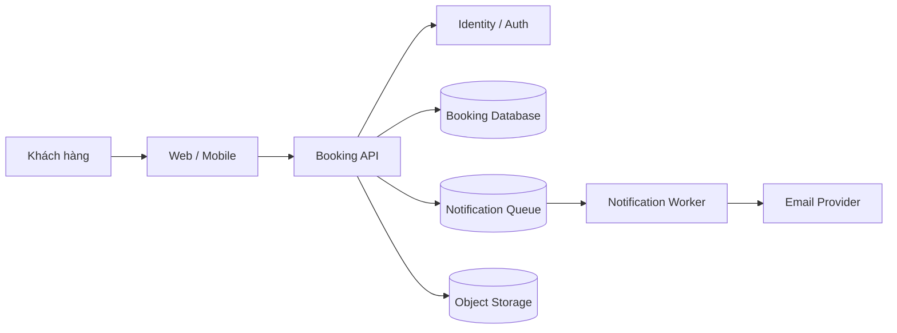
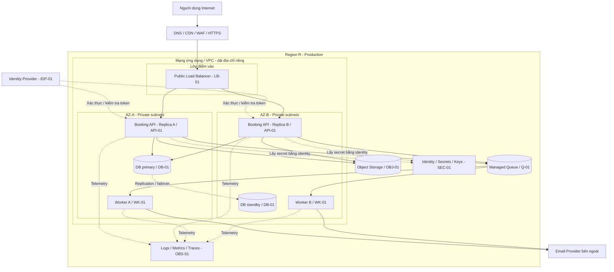

# Sơ đồ triển khai và ánh xạ thành phần lên tài nguyên đám mây

## 1. Sơ đồ triển khai trả lời câu hỏi gì?

Khi thiết kế kiến trúc ứng dụng trên đám mây, một sơ đồ chỉ ghi `Web → API → Database` chưa đủ để triển khai hay đánh giá rủi ro. Người thực hiện còn cần biết **API chạy ở đâu**, **bao nhiêu bản sao**, **nằm trong mạng và vùng sẵn sàng nào**, **dùng dịch vụ dữ liệu gì**, **truy cập tài nguyên bằng quyền nào**, **kết nối qua giao thức gì** và **thành phần nào vẫn hoạt động nếu một tài nguyên gặp sự cố**.

**Sơ đồ triển khai (deployment diagram)** mô tả sự gắn kết giữa các thành phần phần mềm và nơi chúng được thực thi hoặc lưu trữ: máy chủ, container, cụm ứng dụng, dịch vụ quản lý, mạng, region và availability zone (AZ). **Ánh xạ thành phần lên tài nguyên đám mây** là bước chuyển những khối chức năng trong thiết kế logic thành tài nguyên có thể cấu hình, vận hành và kiểm chứng trên nền tảng cloud.

Bài học thuộc chương **Sơ đồ và quyết định** của module **CLOUD_ARCHITECTURE**. Mục tiêu là thực hành thiết kế từ yêu cầu nghiệp vụ đến mạng, compute, dữ liệu và mô hình triển khai; đồng thời nhìn rõ các đánh đổi về độ tin cậy, bảo mật, mở rộng, chi phí và vận hành theo **Well-Architected**.

Sau bài học, bạn có thể:

- Phân biệt sơ đồ **ngữ cảnh**, **thành phần logic** và **triển khai vật lý/cloud**, biết mỗi loại trả lời câu hỏi nào.
- Ánh xạ một ứng dụng web có API, database, queue và worker sang các tài nguyên cloud cùng quan hệ kết nối và phụ thuộc.
- Thể hiện ranh giới **account/project, môi trường, region, AZ, mạng, quyền truy cập và dữ liệu** để người khác đọc đúng phạm vi lỗi/bảo mật.
- Ghi rõ giả định, quyết định và chi tiết còn phải xác minh; liên kết sơ đồ với **ADR**, bảng tài nguyên và IaC.
- Đánh giá sơ đồ dựa trên lưu lượng, độ tin cậy, bảo mật, khả năng mở rộng, chi phí và vận hành.

## 2. Chọn đúng mức sơ đồ cho đúng người đọc

| Mức nhìn | Câu hỏi chính | Thành phần thường xuất hiện | Người sử dụng |
|---|---|---|---|
| **Ngữ cảnh hệ thống** | Ai sử dụng hệ thống? Hệ thống trao đổi với bên ngoài nào? | Người dùng, hệ thống mục tiêu, cổng thanh toán, email, hệ thống nội bộ | Product owner, nghiệp vụ, bảo mật |
| **Logic / container** | Ứng dụng gồm các khối xử lý và luồng dữ liệu nào? | Web, API, worker, database, queue, object storage, giao thức logic | Kiến trúc sư, lập trình viên |
| **Triển khai** | Mỗi khối chạy trên tài nguyên gì, ở đâu, nối với nhau thế nào? | Region, AZ, subnet, load balancer, compute, database, endpoint, IAM | Cloud engineer, SRE, vận hành, bảo mật |
| **Vận hành / phục hồi** | Khi xảy ra lỗi, phát hiện và khôi phục ra sao? | Cảnh báo, bản sao, backup, failover, điểm phụ thuộc, on-call | SRE, vận hành, người chịu trách nhiệm dịch vụ |

Có thể dùng **C4 model** cho mức ngữ cảnh/container và triển khai (deployment view), hoặc ký pháp **UML Deployment Diagram** với node, execution environment, artifact và communication path. Mermaid, PlantUML, draw.io hoặc công cụ tài liệu khác đều có thể diễn đạt ý tưởng; công cụ vẽ không thay thế tính chính xác của quyết định.

**Không cần đưa mọi thứ vào một hình.** Sơ đồ tổng quan giúp trao đổi ý tưởng; sơ đồ triển khai chi tiết giúp review tính khả thi; sơ đồ dữ liệu hoặc bảo mật riêng có thể giải thích đường đi phức tạp. Khi một hình chứa quá nhiều đường cắt nhau, hãy tách thành nhiều góc nhìn có tên và liên kết với nhau.

### 2.1. Phân biệt thành phần logic với tài nguyên vật lý

Ví dụ `Order API` là một **thành phần logic** cung cấp nghiệp vụ đặt hàng. Nó có thể được triển khai bằng hai container ở hai AZ, hoặc một nhóm VM, hoặc một dịch vụ serverless. Ngược lại, một cụm container có thể chạy nhiều dịch vụ logic độc lập.

Do đó, ánh xạ thường có các quan hệ:

- **Một thành phần → nhiều tài nguyên:** `Order API` → nhiều replica, load balancer, cấu hình autoscaling và quyền truy cập.
- **Nhiều thành phần → một nền tảng chạy:** `Order API` và `Notification Worker` có thể dùng chung nền tảng container nhưng tách deployment, scaling, IAM.
- **Một năng lực logic → dịch vụ được quản lý:** `Order Database` → managed relational database có endpoint, backup, khả năng HA và thông số dung lượng.
- **Một phụ thuộc xuyên nhiều thành phần:** logging, metrics, secrets và identity thường phục vụ nhiều ứng dụng nhưng vẫn phải được ghi nhận trên sơ đồ hoặc danh mục đi kèm.

Đừng nhầm tên hộp logic với tên sản phẩm cloud. Ví dụ hộp `Queue` chỉ nói cần truyền sự kiện bất đồng bộ; chưa kết luận phải dùng dịch vụ hàng đợi nào cho đến khi biết yêu cầu về ordering, retry, retention, throughput và delivery semantics.

## 3. Bắt đầu từ yêu cầu, chưa bắt đầu từ biểu tượng cloud

Trước khi vẽ, cần lập một bảng đầu vào để sơ đồ phản ánh nhu cầu thực:

| Nhóm đầu vào | Câu hỏi cần trả lời | Ảnh hưởng đến sơ đồ triển khai |
|---|---|---|
| Nghiệp vụ | Hành trình quan trọng nào cần hoạt động? Có hệ thống bên thứ ba nào? | Hộp logic và luồng request, sự kiện, phản hồi |
| Tải và hiệu năng | RPS/đơn hàng mỗi giờ, tải đỉnh, độ trễ mục tiêu, tăng trưởng? | Số bản sao, autoscaling, caching, giới hạn mạng/database |
| Độ tin cậy | SLO, RTO, RPO; cần chịu lỗi instance/AZ/region nào? | Số AZ/region, bản sao, điểm chuyển vùng, backup |
| Bảo mật | Loại dữ liệu, quyền truy cập, mã hóa, kết nối private/public? | Trust boundary, IAM, network, secrets, luồng dữ liệu |
| Dữ liệu | Quan hệ hay phi quan hệ, giao dịch, nhất quán, dung lượng, lưu giữ? | Loại database, backup, replication, storage, luồng ghi/đọc |
| Chi phí và nhân lực | Trần ngân sách và kỹ năng vận hành? | Managed service hay tự quản lý, môi trường, kích thước dự phòng |
| Ràng buộc tổ chức | Region được duyệt, công nghệ hiện hữu, chuẩn IaC, hạn ra mắt? | Phạm vi account/region, dịch vụ được phép, tiến độ triển khai |

Nếu thiếu dữ liệu, ghi **giả định** có người chịu trách nhiệm xác minh. Ví dụ “một region với hai AZ đáp ứng yêu cầu gián đoạn” chỉ là giả định cho đến khi được đối chiếu mục tiêu chịu lỗi, kiến trúc database, dịch vụ hỗ trợ và kết quả kiểm thử.

## 4. Ví dụ xuyên suốt: hệ thống đặt lịch trên cloud

Giả sử tổ chức triển khai ứng dụng đặt lịch với các yêu cầu **minh họa** sau:

- Người dùng truy cập bằng web/mobile; đặt lịch và xem lịch sử. API phải xác thực người dùng.
- Việc tạo lịch là giao dịch cần bảo đảm không tạo trùng khi client retry; gửi email xác nhận có thể xử lý bất đồng bộ.
- Hệ thống cần phục vụ tải đỉnh dự kiến **300 request/giây**. Con số này là dữ liệu bài tập, chưa chứng minh được năng lực của phương án nào.
- Mong muốn tiếp tục phục vụ khi một AZ mất; mục tiêu RTO/RPO chi tiết phải được chủ hệ thống chốt và kiểm thử.
- Dữ liệu khách hàng phải ở region được phê duyệt; môi trường production tách với non-production.
- Đội ngũ vận hành hạn chế nên ưu tiên cân nhắc dịch vụ quản lý phù hợp trước khi chọn nền tảng tự quản lý phức tạp.

### 4.1. Sơ đồ logic: chức năng và luồng nghiệp vụ



Sơ đồ này cho thấy API ghi/đọc database, phát sự kiện xác nhận và worker gửi email. Nó **chưa** cho biết API được chạy trên VM, container hay serverless; database có HA không; và mạng/secret được bảo vệ như thế nào. Đây chính là phần phải bổ sung ở bước ánh xạ.

### 4.2. Ánh xạ từ hộp logic sang năng lực cloud

| Thành phần logic | Năng lực/tài nguyên cloud có thể dùng | Quyết định cần chốt | Bằng chứng để xác minh |
|---|---|---|---|
| Web/mobile entry | DNS, CDN, TLS certificate, WAF khi phù hợp | Miền truy cập, HTTPS, cache, kiểm soát lưu lượng | Kiểm tra TLS, routing, cache policy, log truy cập |
| Booking API | Managed container/PaaS, VM group hoặc serverless; load balancer nếu cần | Runtime, số bản sao, autoscaling, health check, giới hạn concurrency | Test tải 300 RPS, failure injection, latency/error |
| Identity/Auth | Dịch vụ định danh, IdP/OIDC hoặc thành phần xác thực được phê duyệt | Token validation, role, key rotation, điểm phụ thuộc | Test lỗi token, quyền truy cập, audit |
| Booking Database | Managed relational DB tương thích schema | HA đa AZ, backup/PITR, kết nối, RPO/RTO, encryption | Migration PoC, restore/failover test, đo connection limits |
| Notification Queue | Managed queue hoặc broker phù hợp | At-least-once, TTL, dead-letter queue, retry, ordering | Test retry, duplicate, poison messages |
| Notification Worker | Managed container/job/worker hoặc serverless | Concurrency, retry/backoff, idempotency, quyền gửi email | Test ngắt provider, chạy lại message |
| Object Storage | Dịch vụ object storage theo region | Phân quyền, mã hóa, retention, URL truy cập, lifecycle | Test upload/download, quyền, chính sách xóa |
| Secrets/keys | Secret manager, IAM, KMS tương ứng | Danh tính workload, rotation, quyền tối thiểu | Access review, thử từ chối quyền trái phép |
| Observability | Logs, metrics, traces, alerts, audit | Retention, chi phí, SLI, cảnh báo và người nhận | Alert drill, truy vết giao dịch lỗi |

**Điểm quan trọng:** bảng mô tả **vai trò** của tài nguyên, chưa phải danh sách sản phẩm cần mua. Một dịch vụ quản lý có thể bao gồm nhiều năng lực; mỗi nhà cung cấp có giới hạn, phạm vi region/AZ và mô hình HA khác nhau.

## 5. Sơ đồ triển khai cloud: thể hiện nơi chạy và phạm vi phụ thuộc

Ví dụ sau giả định **một region, hai AZ, compute có replica ở cả hai AZ, database có cơ chế HA đa AZ**, còn queue và object storage được biểu diễn như dịch vụ managed theo phạm vi region. Dịch vụ thực tế có thể có đặc tính vùng/zone khác; cần tra tài liệu và cấu hình của dịch vụ chọn dùng.



Sơ đồ trên là **sơ đồ khái niệm để học cách biểu diễn**; không phải mẫu cấu hình có thể triển khai nguyên xi. Một số chi tiết được lược bớt để dễ đọc, ví dụ subnet thực tế dành cho database (phải khác phạm vi mạng của ứng dụng theo cấu hình bảo mật), route table, NAT/egress, endpoint riêng, IAM role và tên dịch vụ cụ thể. Sơ đồ đặt database primary ở AZ-A và standby ở AZ-B để **minh họa yêu cầu cách ly miền lỗi**; việc đặt hai hộp trong hình không chứng minh dịch vụ đã có HA hoặc tự động failover.

### 5.1. Sáu điều phải chỉ ra được trên sơ đồ triển khai

1. **Ranh giới quản trị:** cloud organization/account/subscription/project và tên môi trường, để tránh nhầm production với test.
2. **Ranh giới địa lý và lỗi:** region, AZ và phạm vi của từng dịch vụ. Chú thích dịch vụ regional/global nếu nó không thuộc subnet cụ thể.
3. **Luồng kết nối:** chiều gọi, giao thức/port quan trọng, yêu cầu private hay public và các điểm vào/ra Internet.
4. **Nơi thực thi và dữ liệu:** bản sao compute, database, queue, object storage, replication, backup, quyền ghi và điểm failover.
5. **Ranh giới tin cậy:** identity, IAM role, secrets, encryption, TLS, firewall/security group và dữ liệu nhạy cảm đi qua đường nào.
6. **Tính vận hành:** log, metrics, traces, health check, autoscaling, cảnh báo, sao lưu, khôi phục, rollout/rollback và người chịu trách nhiệm.

Không nhất thiết viết đủ mọi chi tiết ngay bên cạnh mỗi icon. Những thông tin dài hơn có thể để trong **bảng ánh xạ**, **sơ đồ luồng dữ liệu**, **runbook** hoặc **ADR**. Mỗi phần nên dùng cùng mã định danh tài nguyên để nối được thông tin.

### 5.2. Trình bày đường mạng và quan hệ phụ thuộc

Trong sơ đồ, **mũi tên có ý nghĩa**:

- `A --> B` cho thấy A gọi/gửi dữ liệu tới B. Nếu có hai chiều thực sự, mô tả riêng từng giao thức hoặc ghi rõ khi cần.
- `API → DB : TCP/TLS, cổng database` mô tả đường truy cập dữ liệu; chỉ ghi cổng cụ thể sau khi xác nhận cấu hình.
- `API → Queue : Publish`, `Queue → Worker : Consume` giúp phân biệt producer với consumer và chỗ có retry.
- `DB primary ⇢ standby : replication` giúp người đọc kiểm tra khả năng khôi phục nhưng không khẳng định mức mất dữ liệu bằng không.
- Đường nét đứt có thể quy ước là **phụ thuộc quản trị/telemetry/replication** thay vì luồng request của người dùng; cần có chú giải trên sơ đồ chính thức.

Không nên vẽ “Internet truy cập thẳng database” nếu thực tế database chỉ nằm trong mạng private; cũng không nên vẽ đường API đến object storage đi qua NAT nếu thiết kế đã dùng private service endpoint. Những chi tiết này ảnh hưởng khả năng bảo mật, quan sát và chi phí truyền dữ liệu.

## 6. Biến sơ đồ thành bảng ánh xạ có thể kiểm tra

Sơ đồ tốt giúp hình dung; **bảng ánh xạ** giúp đội triển khai kiểm tra được từng quyết định. Với ví dụ đặt lịch, ta có thể lập bảng sau:

| ID | Thành phần | Tài nguyên và phạm vi | Quyền/kết nối | Chỉ số và rủi ro phải kiểm tra |
|---|---|---|---|---|
| `EDGE-01` | Public entry | DNS/CDN/WAF/TLS theo phạm vi dịch vụ | Public HTTPS đến load balancer | TTL, WAF rule, chứng chỉ, khả năng truy cập và cache |
| `LB-01` | Load balancing | LB vùng hỗ trợ các AZ ứng dụng | HTTPS từ edge; route đến API | Health checks, backend sau mất AZ, timeout |
| `API-01` | Booking API | Tối thiểu hai replica ở AZ-A/AZ-B trong ví dụ | Role chỉ đọc secret cần thiết, ghi DB, publish queue | Tải 300 RPS, autoscaling, idempotency, latency |
| `IDP-01` | Identity provider | Dịch vụ định danh được phê duyệt, phạm vi triển khai tùy nhà cung cấp | API kiểm tra token/chữ ký, quyền người dùng | Token expiry, JWKS/key rotation, sự cố xác thực |
| `DB-01` | Booking DB | Managed DB với cấu hình HA được xác minh | Chỉ identity/đường mạng từ workload được phép | Failover, backup/PITR, lag, restore, RPO/RTO |
| `Q-01` | Queue | Managed service theo region | API publish, worker consume | Backlog, retry, DLQ, delivery semantics |
| `WK-01` | Email worker | Worker ở các AZ, scale độc lập | Consume queue, gọi email provider | Duplicate email, retry/backoff, rate limit |
| `OBJ-01` | File storage | Object storage region được duyệt | Quyền theo prefix/bucket và nhu cầu thực tế | Encryption, lifecycle, public access, egress |
| `SEC-01` | Secret/key | Dịch vụ secrets/keys được duyệt | Workload identity, quyền tối thiểu | Rotation, audit, không ghi secret vào log |
| `OBS-01` | Observability | Logs/metrics/traces/alert theo chính sách | Agent/workload gửi telemetry, người trực được cấp quyền đọc | SLI, log retention, chi phí, cảnh báo |

Đối với tài nguyên thực tế, nên bổ sung `owner`, `environment`, `region`, `AZ` (khi có), `resource_id`, `IaC_module`, `data_classification`, `cost_center` và đường dẫn đến runbook. **Mã ID trong bảng phải trùng mã ID đặt trên sơ đồ** hoặc có một bảng mapping rõ ràng; tránh trường hợp sơ đồ viết “DB chính” nhưng IaC tồn tại hai database không ai xác định cái nào phục vụ production.

### 6.1. Ví dụ hồ sơ ánh xạ dạng YAML

Đoạn sau là **dữ liệu tài liệu hóa để minh họa**, không phải file cấu hình hợp lệ của một nhà cung cấp hay Terraform:

```yaml
architecture_id: booking-prod-v1
environment: production
approved_region: region-r
components:
  - id: API-01
    logical_name: Booking API
    resource_kind: managed_containers
    placement:
      azs: [az-a, az-b]
      network: private-application-subnets
    dependencies: [DB-01, Q-01, SEC-01, OBS-01]
    service_identity: booking-api-prod
    verification:
      - handle_single_az_failure
      - pass_peak_load_test
  - id: DB-01
    logical_name: Booking Database
    resource_kind: managed_relational_database
    placement:
      region: region-r
      availability: multi_az_subject_to_provider_capabilities
    data_classification: customer_data
    verification:
      - backup_restore_drill
      - database_failover_drill
  - id: Q-01
    logical_name: Notification Queue
    resource_kind: managed_queue
    verification:
      - retry_and_dead_letter_queue
      - duplicate_delivery_handling
references:
  adr: ADR-BOOKING-001
  diagram: deployment-booking-prod
  iac: infrastructure/production
```

Những tên `region-r`, `az-a` và `resource_kind` là tên trừu tượng. Khi triển khai thật, phải thay bằng ID region/AZ/service hợp lệ và dự toán theo nhà cung cấp; `verification` là việc cần kiểm tra, **không phải kết quả kiểm thử đã đạt**.

## 7. Kiểm tra sơ đồ theo lớp mạng, compute và dữ liệu

### 7.1. Lớp mạng

Đánh dấu các điểm **ingress/egress**, reverse proxy/load balancer, subnet public/private, route, security group/firewall, NAT hoặc private endpoint. Không phải mọi dịch vụ được quản lý đều nằm trực tiếp trong VPC; nhiều dịch vụ được truy cập thông qua endpoint và IAM. Điều này phải được biểu diễn đúng để không đưa ra giả định mạng sai.

Cần trả lời:

- Người dùng Internet kết nối vào đâu? TLS chấm dứt ở lớp nào và có được mã hóa tiếp đến backend không?
- API có thể gọi database bằng đường private không? Tài nguyên nào thực sự cần outbound Internet?
- Kết nối sang bên thứ ba đi qua IP/egress nào? Họ có yêu cầu allowlist không?
- Khi mất một AZ, các đường định tuyến, endpoint, egress và load balancer còn dùng được không?
- Có luồng dữ liệu nào đi sang region hoặc hệ thống chưa được phép không?

### 7.2. Lớp compute

Thể hiện các đơn vị thực thi theo nhu cầu: VM, container service, serverless function hoặc batch job. Ghi autoscaling theo metric, số lượng replica tối thiểu, ranh giới AZ và quota. Với worker, phân biệt **scale theo chiều dài queue** với scale API theo RPS/CPU; chúng là hai mô hình tải khác nhau.

Sơ đồ phải giúp trả lời: nếu một replica chết, ai nhận lưu lượng? Nếu một AZ mất, AZ còn lại có đủ công suất để phục vụ hay chỉ còn chạy ở mức suy giảm? Nếu cần thời gian hồi phục ngắn, có phụ thuộc vào việc cấp phát tài nguyên mới trong sự cố không?

### 7.3. Lớp dữ liệu

Thể hiện rõ **nguồn dữ liệu chuẩn (source of truth)**, nơi được phép ghi, phương thức replication, backup và restore. Một replica database có thể dùng để HA hoặc đọc, tùy dịch vụ; **không mặc định standby luôn nhận query đọc**. Xác minh tình trạng nhất quán, lag, cơ chế failover, giới hạn kết nối và trách nhiệm ứng dụng khi kết nối bị cắt.

Với tác vụ bất đồng bộ, cần chỉ rõ queue, worker, DLQ, retry và xử lý idempotency. Nếu queue áp dụng at-least-once delivery thì xử lý message trùng là kịch bản bình thường cần thiết kế, không nên suy ra hệ thống gửi email “đúng một lần” chỉ từ sơ đồ queue.

## 8. Vẽ ranh giới bảo mật và trách nhiệm

Sơ đồ triển khai cũng là tài liệu hữu ích cho **threat modeling**. Vẽ hoặc chú thích các ranh giới tin cậy:

1. **Internet ↔ điểm vào public:** TLS, WAF/rate limit, log truy cập, bảo vệ khỏi request không hợp lệ.
2. **Điểm vào ↔ mạng private:** security group/firewall, chỉ expose backend cần thiết.
3. **Ứng dụng ↔ dữ liệu:** xác thực danh tính workload, IAM/quyền DB, encryption, giới hạn truy cập.
4. **Ứng dụng ↔ managed service:** endpoint, quyền truy cập theo tài nguyên, secret manager, audit.
5. **Cloud ↔ bên thứ ba:** HTTPS, xác thực webhook/callback, egress policy, retry/timeout và bảo vệ dữ liệu trao đổi.
6. **Người vận hành ↔ production:** vai trò theo công việc, quyền nâng cao có kiểm soát, audit và quy trình khẩn cấp.

Ví dụ, nếu trong hình có API → database, phải hỏi **danh tính nào có quyền ghi**, **DB có public endpoint không**, **mạng nào được phép kết nối** và **backup/log có cùng phân loại dữ liệu không**. Chỉ vẽ hình ổ khóa bên cạnh database không cung cấp bằng chứng rằng dữ liệu được bảo vệ.

## 9. Từ sơ đồ sang quyết định kiến trúc (ADR) và IaC

Sơ đồ trả lời **“đang đề xuất triển khai như thế nào?”**; **Architecture Decision Record (ADR)** giải thích **“vì sao chọn cách đó, so với các lựa chọn nào và điều kiện nào có thể khiến quyết định thay đổi?”**. IaC giúp tạo và kiểm soát tài nguyên tương ứng nhưng không thay thế việc mô tả nhu cầu nghiệp vụ.

Ví dụ ADR ngắn cho bài tập:

> **ADR-BOOKING-001 — Triển khai Booking API bằng managed containers trong hai AZ, dùng managed relational database có phương án HA.**
>
> **Bối cảnh:** hệ thống đặt lịch cần xử lý tải đỉnh 300 RPS, dữ liệu khách hàng ở region đã duyệt, đội vận hành nhỏ và cần chịu lỗi một AZ.
>
> **Lựa chọn:** dùng nền tảng managed container để chạy API replica ở hai AZ; DB managed có backup và failover được xác minh; queue tách xử lý email khỏi giao dịch đặt lịch.
>
> **Lý do:** giảm khối lượng quản trị máy chủ và cho phép scale API/worker độc lập; có cơ sở thiết kế khả năng chịu mất một AZ.
>
> **Đánh đổi:** tăng chi phí replica, truyền dữ liệu và HA; vẫn phụ thuộc dịch vụ cloud theo region, cấu hình health check/replication và đội vận hành phải diễn tập failover.
>
> **Điều kiện chấp nhận:** vùng dữ liệu được phê duyệt; bảng giá nằm trong ngân sách; kiểm thử tải, database failover, restore, idempotency và cảnh báo đạt mục tiêu đã thống nhất.

### 9.1. Đảm bảo sơ đồ và hạ tầng thực không lệch nhau

Một quy trình có thể áp dụng:

1. Gán mã ID cho thành phần/tài nguyên trên sơ đồ và bảng ánh xạ.
2. Liên kết mã ID với module IaC, nhóm tài nguyên cloud và nhãn `environment`, `service`, `owner`, `cost_center`.
3. Yêu cầu pull request thay đổi topology, quyền IAM, đường mạng hoặc cấu hình HA cập nhật sơ đồ/ADR liên quan.
4. Sau triển khai, đối chiếu tài nguyên thực với IaC và bảng ánh xạ, phát hiện **configuration drift** hoặc tài nguyên chưa được quản lý.
5. Định kỳ kiểm tra sơ đồ có đúng các phụ thuộc vừa được thêm vào: queue, bên thứ ba, database replica, endpoint, hệ thống log và backup.

Một sơ đồ đẹp nhưng không còn đúng production sẽ dẫn đến đánh giá rủi ro sai. Có thể sinh một phần hình từ IaC hoặc inventory tự động, song **thông tin “vì sao” và “yêu cầu gì” vẫn cần được người thiết kế ghi lại**.

## 10. Đọc sơ đồ để phát hiện điểm lỗi và đánh đổi

Hãy dùng mô hình triển khai mẫu để đặt các câu hỏi Well-Architected:

| Trụ cột | Câu hỏi khi review sơ đồ | Kết quả kỳ vọng |
|---|---|---|
| **Operational Excellence** | Có chủ sở hữu, cảnh báo, runbook, CI/CD, rollback, cách xác minh trạng thái thật? | Tái triển khai và ứng cứu được bằng quy trình rõ ràng |
| **Security** | Đường public/private nào tồn tại? IAM, secret, mã hóa và dữ liệu có ranh giới kiểm soát? | Tài nguyên chỉ mở đúng luồng và đúng danh tính cần thiết |
| **Reliability** | Mất instance/AZ làm hỏng những dependency nào? Backup có độc lập với replication? | Khả năng chịu lỗi và khôi phục được chứng minh bằng bài test |
| **Performance Efficiency** | Thành phần nào scale theo RPS, queue backlog hoặc IOPS? Cổ chai database/egress ở đâu? | Năng lực và giới hạn được đo tại tải mục tiêu |
| **Cost Optimization** | Có tài nguyên dự phòng, băng thông liên AZ, NAT, lưu trữ, log, backup chưa tính? | Dự toán TCO đủ theo kịch bản tải và phương án DR |
| **Sustainability** | Replica/tài nguyên nhàn rỗi có thể right-size hoặc tự động dừng ở non-prod? | Sử dụng năng lực phù hợp nhu cầu, không cấp dư vô hạn |

### 10.1. Bài kiểm tra lỗi một AZ

Giả sử AZ-A bị cô lập. Sơ đồ cho thấy API replica B còn hoạt động; nhưng phải kiểm tra **database standby ở AZ-B có thể chuyển thành writer không**, **LB có route đến B không**, **queue/secret manager còn truy cập được không**, **worker còn đủ năng lực không**, và **B có chịu được toàn bộ tải cao điểm không**. Nếu còn một dịch vụ chỉ sống ở AZ-A, toàn bộ giao dịch vẫn có thể thất bại dù API B “healthy”.

Nếu yêu cầu chống sự cố toàn region, sơ đồ hiện tại **chưa có multi-region DR**. Phải bổ sung region dự phòng, phương án dữ liệu, hướng chuyển lưu lượng, kiểm thử RTO/RPO và ràng buộc lưu trú dữ liệu. Không nên suy ra khả năng phục hồi cấp region từ việc có hai AZ trong một region.

### 10.2. Bài kiểm tra tài nguyên dùng chung

Hai thành phần có thể chạy riêng nhưng cùng phụ thuộc một secret, một DNS zone, một service account, một queue hoặc một dịch vụ triển khai. Sự cố do xóa secret hoặc triển khai sai có thể ảnh hưởng tất cả AZ. Sơ đồ cần thể hiện các phụ thuộc chung, đồng thời có cơ chế kiểm soát thay đổi, phân quyền và rollback để giảm **common-mode failure**.

## 11. Lỗi thường gặp khi vẽ sơ đồ triển khai

| Sai sót | Hậu quả | Cách sửa |
|---|---|---|
| Hộp được đặt tên `Cloud` nhưng không có region/AZ/network | Không đánh giá được phạm vi lỗi và luồng mạng | Bổ sung các ranh giới triển khai có ý nghĩa |
| Có nhiều bản sao API nhưng database chỉ có một điểm lỗi | Ngộ nhận hệ thống đã có HA | Vẽ dependency và cơ chế DB failover/backup |
| Chỉ ghi tên dịch vụ thương mại mà không ghi vai trò | Khó hiểu lý do dùng dịch vụ và phương án thay thế | Ghi tên logic, vai trò, ID và lựa chọn tài nguyên |
| Dùng đường nối không có chiều/giao thức | Không phân biệt luồng request, replication, egress | Ghi chiều, nhãn và quy ước nét/đường |
| Vẽ mọi dịch vụ bên trong private subnet | Có thể sai về mô hình kết nối managed service | Chỉ ra service endpoint/phạm vi dịch vụ theo tài liệu nhà cung cấp |
| Quên IAM, secret, backup, log và monitoring | Không thấy nhu cầu bảo mật và vận hành | Thêm khối phụ thuộc hoặc tài liệu tham chiếu |
| Mọi thứ được vẽ trên một hình quá dày | Người đọc bỏ sót chi tiết | Tách context, logical, deployment, data flow và operations |
| Sơ đồ không có phiên bản, ngày, chủ sở hữu, trạng thái | Dễ dùng bản lỗi thời để triển khai | Gắn metadata, đường dẫn IaC/ADR, cập nhật theo thay đổi |

## 12. Quy trình thực hành từng bước

Để tạo một sơ đồ có thể mang vào buổi review kiến trúc, hãy đi theo thứ tự:

1. **Viết kịch bản nghiệp vụ.** Chọn một giao dịch quan trọng, ví dụ “người dùng tạo lịch và nhận email xác nhận”; ghi yêu cầu về tính đúng đắn, tải và độ trễ.
2. **Tạo sơ đồ logic.** Vẽ user, entry, API, database, queue, worker, nhà cung cấp bên ngoài; ghi luồng request và dữ liệu.
3. **Định nghĩa ranh giới triển khai.** Chọn môi trường, đơn vị quản trị, region, AZ và mạng. Kiểm tra yêu cầu bảo vệ dữ liệu trước khi quyết định region.
4. **Ánh xạ từng thành phần.** Chọn lớp năng lực cloud, dạng thực thi, dịch vụ dữ liệu, số bản sao, cách scaling; ghi lựa chọn mở nếu chưa có bằng chứng.
5. **Bổ sung giao tiếp.** Ghi ingress/egress, giao thức, quyền truy cập, luồng đồng bộ/bất đồng bộ, điểm phục hồi và dịch vụ quản lý.
6. **Đưa thuộc tính phi chức năng vào.** Thể hiện HA, backup, SLO/RTO/RPO liên quan, monitoring, security và cơ chế rollback.
7. **Kiểm tra tình huống lỗi.** Truy vết một yêu cầu khi mất replica, mất AZ, DB failover, queue backlog và lỗi email provider.
8. **Đối chiếu chi phí và vận hành.** Tính tài nguyên dự phòng, băng thông, log, backup và trách nhiệm on-call; xem lại với ngân sách và năng lực đội.
9. **Ghi quyết định và triển khai.** Liên kết sơ đồ với ADR, bảng ánh xạ, IaC và test; không quảng bá giả định thành kết quả đã xác minh.
10. **Rà soát sau thay đổi.** Mỗi thay đổi topology, dịch vụ, quyền hay region phải cập nhật hình và bằng chứng.

### 12.1. Bài tập tự thực hành

Ứng dụng đặt lịch cần bổ sung chức năng **tải ảnh minh họa**, tối đa 10 MB/ảnh, cho phép người dùng xem lại. Hãy cập nhật:

1. **Sơ đồ logic:** client, API, object storage và khả năng tạo URL upload/download; xác định client truyền ảnh qua API hay trực tiếp tới storage.
2. **Sơ đồ triển khai:** đường HTTPS, cơ chế cấp quyền tải lên, bucket/object policy, vị trí dữ liệu, CDN nếu cần và luồng giám sát.
3. **Bảng ánh xạ:** ghi kích thước tối đa, dung lượng lưu trữ dự kiến, thời hạn giữ, quyền đọc/ghi, mã hóa, lifecycle và chi phí egress.
4. **ADR:** so sánh “upload qua API” với “upload trực tiếp bằng URL ký có thời hạn”; nêu tác động đến tải API, quyền truy cập, chống tải file độc hại và khả năng kiểm toán.

Đáp án phụ thuộc yêu cầu thực tế. Chẳng hạn upload trực tiếp có thể giảm băng thông qua API, nhưng phải kiểm soát loại/tải file, giới hạn thời hạn URL, quyền theo đối tượng, quét nội dung khi phù hợp và xác nhận nghiệp vụ khi tải lên hoàn tất.

### 12.2. Checklist khi bàn giao sơ đồ cho người triển khai

- [ ] Có tên hệ thống, môi trường, phạm vi, phiên bản, ngày cập nhật và người sở hữu.
- [ ] Sơ đồ ngữ cảnh/logical giải thích được giao dịch và các hệ thống ngoài.
- [ ] Sơ đồ triển khai chỉ ra account/project, region, AZ, mạng, ingress, egress và managed services đúng phạm vi.
- [ ] Mỗi thành phần logic có tài nguyên hoặc lựa chọn triển khai tương ứng trong bảng ánh xạ.
- [ ] Luồng dữ liệu có chiều, giao thức/port quan trọng và ranh giới tin cậy.
- [ ] Database, cache, queue, storage, secrets, identity, backup và observability được mô tả khi có phụ thuộc.
- [ ] Kiểu scaling, phương án HA, backup, failover và năng lực sau mất miền lỗi được nêu hoặc ghi rõ chưa xác minh.
- [ ] Có chủ sở hữu, IAM phù hợp, chính sách dữ liệu, vị trí lưu trữ và yêu cầu bảo vệ thông tin.
- [ ] Đã xem xét chi phí vận hành, băng thông, replica, log, backup và quota.
- [ ] Sơ đồ liên kết đến ADR, IaC, runbook và kiểm thử; mọi giả định còn mở đều có người xác nhận.

**Nguyên tắc cốt lõi:** sơ đồ triển khai là **bản đồ có thể kiểm tra giữa nhu cầu ứng dụng và cách cloud thực sự vận hành**. Vẽ đủ để người phát triển, bảo mật, vận hành và chủ sản phẩm cùng hiểu các thành phần ở đâu, kết nối thế nào, được bảo vệ ra sao và điều gì xảy ra khi một phần hệ thống không còn hoạt động.
