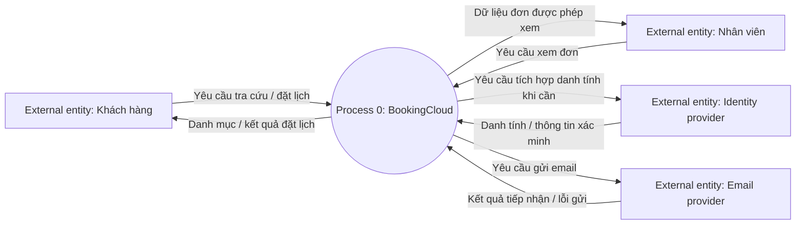
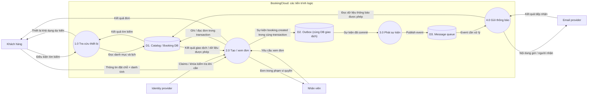
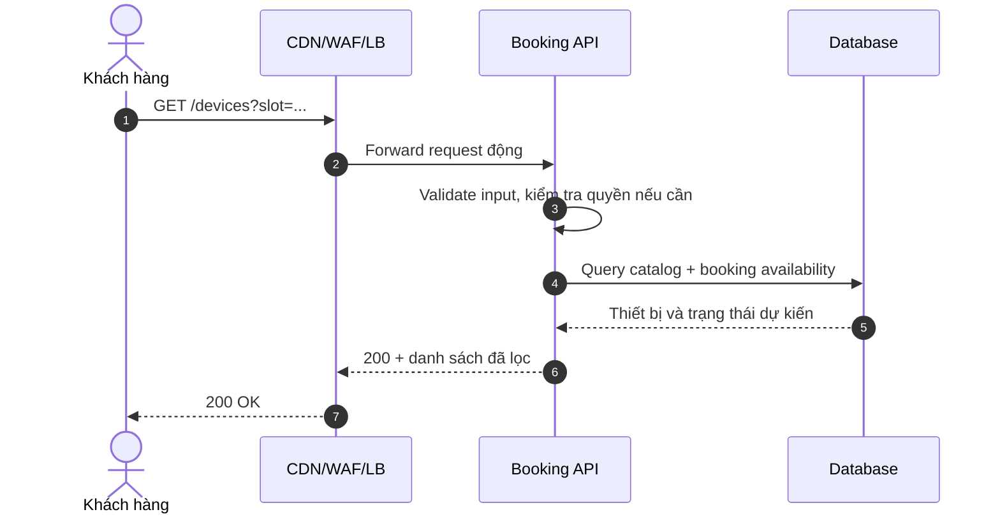
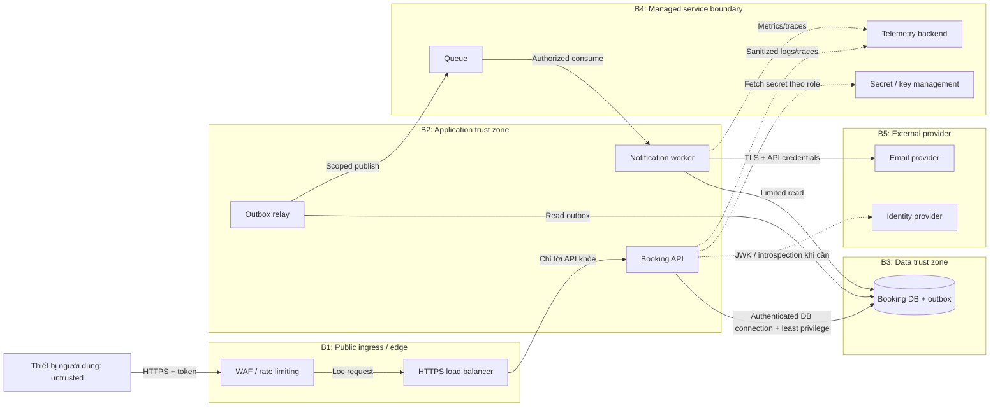
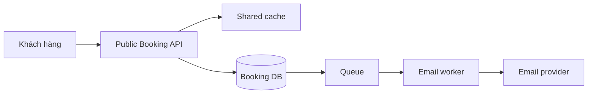

# Sơ đồ luồng dữ liệu, luồng yêu cầu và ranh giới tin cậy

## 1. Vì sao cùng một hệ thống cần nhiều sơ đồ?

Trong module **CLOUD_ARCHITECTURE**, chúng ta thiết kế ứng dụng cloud từ yêu cầu nghiệp vụ đến mạng, compute, dữ liệu và mô hình triển khai, rồi đánh giá các đánh đổi về độ tin cậy, bảo mật, khả năng mở rộng, chi phí và vận hành theo tư duy **Well-Architected**. Một sơ đồ tổng thể có các biểu tượng API, database và queue chưa đủ để giải thích hệ thống có an toàn và xử lý đúng hay không.

Hãy tưởng tượng một câu hỏi đơn giản: **“Khi khách bấm Đặt lịch, dữ liệu của họ đi đâu và ai được quyền truy cập?”** Để trả lời trọn vẹn, chúng ta cần ít nhất ba góc nhìn:

1. **Sơ đồ luồng dữ liệu (Data Flow Diagram — DFD):** dữ liệu nào phát sinh, đi qua tiến trình nào, được lưu ở đâu và chia sẻ với bên nào?
2. **Sơ đồ luồng yêu cầu (request flow/sequence):** thành phần nào gọi thành phần nào, theo thứ tự nào, đồng bộ hay bất đồng bộ, và chuyện gì xảy ra khi lỗi?
3. **Sơ đồ ranh giới tin cậy (trust boundary):** ở đâu giả định tin cậy thay đổi, ai kiểm tra danh tính, quyền, dữ liệu đầu vào và các chính sách mạng?

Ba sơ đồ **bổ trợ** nhau. DFD nói rõ dòng thông tin nhưng thường không cho biết thứ tự thời gian. Sequence diagram diễn tả hành trình một tương tác nhưng không tự chỉ ra toàn bộ nơi lưu dữ liệu. Trust-boundary view chỉ ra nơi cần kiểm soát nhưng không thay thế chính sách IAM, thiết kế network hay kết quả kiểm thử bảo mật.

Sau bài này, bạn có thể vẽ và đọc cả ba loại sơ đồ; đối chiếu chúng với yêu cầu nghiệp vụ; phát hiện đường dữ liệu nhạy cảm và lỗi thiết kế; ghi quyết định kiến trúc cùng bằng chứng kiểm chứng.

## 2. Bài toán xuyên suốt và giả định thiết kế

Xét ứng dụng giả định **BookingCloud** cho thuê thiết bị theo khung giờ. Khách dùng web/mobile để tìm thiết bị còn trống, tạo đơn thuê và nhận email xác nhận. Nhân viên được phân quyền xem các đơn thuộc phạm vi quản lý.

| Mã | Yêu cầu hoặc giả định | Điều cần thể hiện trên sơ đồ |
|---|---|---|
| F1 | Khách tra cứu danh mục và tình trạng còn chỗ | Luồng truy vấn, cache nếu có, dữ liệu trả về, nguồn dữ liệu chính |
| F2 | Khách đặt một thiết bị trong khung giờ | Luồng ghi có transaction và bảo vệ chống đặt trùng |
| F3 | Sau khi đơn được ghi nhận, gửi email xác nhận | Luồng event/queue, retry, phụ thuộc nhà cung cấp email |
| S1 | Chỉ chủ đơn và nhân viên có quyền mới được đọc/sửa đơn | Danh tính, authorization ở API, ranh giới dữ liệu và audit |
| S2 | Không để lộ email, số điện thoại, token truy cập hoặc secret | Điểm lưu/chuyển dữ liệu nhạy cảm, log và bên nhận dữ liệu |
| R1 | Nếu API lỗi giữa lúc ghi, retry không được tạo đơn thứ hai | Idempotency key, ranh giới commit, nhánh lỗi |
| Q1 | Mục tiêu minh họa: p95 tạo đơn không quá 1,5 giây | Đường đồng bộ ảnh hưởng thời gian phản hồi, điểm đo latency |
| O1 | Có thể xác định và xử lý khi email bị chậm hoặc backlog | Queue age, outbox pending, dead-letter queue (DLQ), owner |

Những mục tiêu có số ở đây là **giả định phục vụ học tập**, chưa phải kết quả đo hoặc cam kết của nhà cung cấp cloud. Giả sử ứng dụng chạy trong **một region với nhiều Availability Zone**, API không giữ session cục bộ, có cơ sở dữ liệu quan hệ managed, object storage cho ảnh công khai và dịch vụ email bên ngoài. Chúng ta chỉ vẽ ở **mức logic**; vị trí vật lý và cấu hình dịch vụ cụ thể cần được xác định khi triển khai.

## 3. Chuẩn bị một “từ điển” chung cho cả ba sơ đồ

Trước khi vẽ, liệt kê **tác nhân**, **dữ liệu**, **tiến trình** và **vùng trách nhiệm**. Tránh đặt tên chung chung như `Service A` hoặc `Data 1` khiến người review phải đoán.

| Phần tử | Vai trò | Dữ liệu liên quan | Ai chịu trách nhiệm |
|---|---|---|---|
| Khách hàng | Tìm thiết bị, tạo đơn | Thời gian thuê, tài khoản, mã đơn | Người dùng cuối |
| Nhân viên | Xem đơn đúng phạm vi | Mã đơn, thông tin liên hệ được phép xem | Chủ sản phẩm + nhóm vận hành nghiệp vụ |
| Identity provider (IdP) | Đăng nhập, phát hành token | Danh tính, claim, khóa xác minh | Nhóm identity hoặc nhà cung cấp dịch vụ |
| Booking API | Xác thực, phân quyền, thực thi nghiệp vụ | Request, user ID, dữ liệu đặt lịch | Nhóm ứng dụng Booking |
| Transactional DB | Nguồn dữ liệu giao dịch có thẩm quyền | Thiết bị, slot, booking, outbox | Nhóm Booking phối hợp với platform |
| Object storage/CDN | Phân phối ảnh danh mục | Ảnh công khai hoặc có quyền truy cập | Nhóm Booking/platform |
| Outbox relay + queue | Chuyển sự kiện đã commit | Event ID, booking ID | Nhóm Booking/platform theo hợp đồng vận hành |
| Notification worker | Gửi thông báo theo sự kiện | Email người nhận, mẫu thông báo | Nhóm Booking |
| Email provider | Chuyển email ra ngoài | Địa chỉ email, nội dung thông báo | Nhà cung cấp bên ngoài; Booking chịu trách nhiệm tích hợp |
| Logs/metrics/traces | Quan sát vận hành và điều tra lỗi | Request ID, trạng thái, thời gian, metric | Nhóm ứng dụng và platform |

Đối với mỗi dòng dữ liệu, nên ghi thêm **phân loại dữ liệu**, **nơi lưu**, **thời hạn lưu**, **lý do cần chia sẻ** và **quyền truy cập**. Ví dụ:

| Dữ liệu | Phân loại minh họa | Nơi có thể đi qua | Yêu cầu kiểm soát |
|---|---|---|---|
| Ảnh thiết bị công khai | Public | CDN, object storage, trình duyệt | Bảo vệ quyền ghi và nguồn nội dung; cache hợp lệ |
| Danh mục và slot khả dụng | Internal/public tùy sản phẩm | API, DB, client, cache đọc | Tránh tiết lộ trường nội bộ; trạng thái cache có thể cũ |
| ID đơn và thời gian thuê | Internal, có thể liên kết cá nhân | API, DB, event, worker | Kiểm tra quyền theo đơn; giới hạn nội dung event |
| Email/số điện thoại khách | Personal/confidential | DB, worker, nhà cung cấp email | Mã hóa truyền/lưu, retention, kiểm soát bên nhận |
| Access token hoặc secret | Sensitive credential | Client/API hoặc secret manager | Không đưa vào URL, queue, tag hay log; giới hạn phạm vi và thời gian tồn tại |
| Log request và trace | Operational, có thể nhạy cảm | Collector, observability backend | Che dữ liệu cá nhân, RBAC, retention và audit |

**Luồng dữ liệu** không nhất thiết đồng nghĩa với **luồng mạng**: DFD có thể mô tả “đọc booking” như một hành động logic, trong khi sơ đồ mạng phải thể hiện giao thức, cổng, endpoint và network policy cụ thể. Giữ tên thành phần nhất quán giữa các sơ đồ để dễ truy vết.

## 4. DFD: dữ liệu nào được tạo, biến đổi, lưu và chia sẻ?

### 4.1. Ký pháp DFD ở mức logic

DFD thường có bốn loại phần tử:

- **External entity:** tác nhân hoặc hệ thống ngoài phạm vi đang phân tích, ví dụ khách hàng hay email provider.
- **Process:** công việc biến đổi hoặc xử lý dữ liệu, ví dụ “Xử lý đặt lịch”. Đặt tên bằng **động từ + đối tượng**.
- **Data store:** nơi lưu dữ liệu bền vững hoặc có ý nghĩa nghiệp vụ, ví dụ “Booking DB”, “Outbox”.
- **Data flow:** dòng dữ liệu có tên, ví dụ “Yêu cầu đặt chỗ”, “Kết quả đặt chỗ”, “Sự kiện đã commit”.

Một mũi tên có nhãn “booking details” thể hiện **thông tin được chuyển**, không tự nói request là HTTP POST, nội dung đã mã hóa hay trình tự thực thi. Các chi tiết đó cần thể hiện ở sơ đồ khác hoặc phần chú giải. Không đặt mũi tên “DB gọi DB” chỉ để mô tả xử lý mà thiếu process có trách nhiệm; DFD tập trung vào cách dữ liệu được xử lý.

### 4.2. DFD mức ngữ cảnh (context / level 0)

Đầu tiên xem BookingCloud như **một hệ thống duy nhất**. Điều này trả lời “ai trao đổi dữ liệu với hệ thống?” trước khi hỏi các thành phần nội bộ có cấu trúc ra sao.



**Phạm vi đang vẽ:** hành trình nghiệp vụ trong BookingCloud. Những hộp “external entity” chỉ nói chúng nằm ngoài phạm vi phân tích; **không đồng nghĩa** chúng đều nằm ngoài cùng một VPC hoặc vùng mạng. Ví dụ IdP có thể là dịch vụ managed, còn người dùng ở Internet.

Context diagram cũng chưa cho biết khách hàng đăng nhập trước đó hay API kiểm tra JWT cục bộ. Mũi tên tới IdP thể hiện **khả năng trao đổi khi cần**, không khẳng định mỗi request phải gọi IdP qua mạng.

### 4.3. DFD mức 1: phân rã thành tiến trình và kho dữ liệu

Tiếp theo mở rộng Process 0 thành các chức năng. Mục tiêu là làm rõ **dữ liệu đi vào từng tiến trình**, **nơi lưu** và **dữ liệu nào rời hệ thống**.



**Chú giải quan trọng:** D1 và D2 được vẽ thành hai **kho logic** để phân biệt bảng nghiệp vụ và bảng outbox, nhưng trong phương án này chúng nằm trong **cùng cơ sở dữ liệu hỗ trợ transaction**. Nếu outbox ở một datastore độc lập không cùng phạm vi transaction, không thể tự tuyên bố “ghi nguyên tử” cho hai nơi.

Các dòng tới D1 có nhãn đọc/ghi để dễ dạy; khi tài liệu yêu cầu DFD hình thức chặt hơn, hãy tách mũi tên yêu cầu đọc và kết quả đọc tương ứng. DFD là bản đồ **dữ liệu**, vì vậy một tiến trình không nên chỉ có input mà không có output hoặc side effect có thể giải thích.

### 4.4. Kiểm tra tính nhất quán giữa hai mức DFD

Khi phân rã mức ngữ cảnh xuống mức 1, những luồng **đi qua ranh giới hệ thống** phải được bảo toàn về ý nghĩa (nguyên tắc *balancing*):

| Luồng ở context | Luồng tương ứng trong level 1 | Cần kiểm tra |
|---|---|---|
| Khách yêu cầu tra cứu | C → P1 | Có đầu vào điều kiện tìm kiếm |
| Khách nhận kết quả | P1/P2 → C | Có kết quả tra cứu và đặt lịch |
| Nhân viên yêu cầu xem đơn | A → P2 | Có kiểm tra quyền trước khi trả dữ liệu |
| Thông tin danh tính | ID → P2 | Phù hợp thực tế xác minh token / tích hợp IdP |
| Yêu cầu gửi email | P4 → EMAIL | Chỉ thông báo về đơn đã commit |
| Kết quả gửi email | EMAIL → P4 | Có đường lưu/truy vết lỗi |

Không nên thêm hệ thống analytics, công cụ hỗ trợ khách hàng hay bên nhận mới ở level 1 mà bỏ qua chúng ở context: đó là dấu hiệu **dòng dữ liệu rời hệ thống chưa được khai báo**. Nếu chỉ có một nhóm người dùng hoặc một miền dữ liệu được phân tích, ghi rõ phạm vi thay vì khẳng định đã vẽ toàn bộ doanh nghiệp.

## 5. Request flow: thứ tự xử lý, đồng bộ, bất đồng bộ và nhánh lỗi

DFD không thể trả lời chính xác câu hỏi “API trả 201 trước hay sau khi gửi email?” hoặc “hai người cùng đặt một slot thì ai thắng?”. Sơ đồ sequence thể hiện **thứ tự thông điệp, điểm commit, thời điểm phản hồi và nhánh lỗi**.

### 5.1. Luồng tra cứu (đọc)



Nếu tra cứu qua cache hoặc read replica, trạng thái còn trống **có thể cũ**. Việc hiển thị “còn chỗ” không bảo đảm thao tác đặt sau đó thành công. Đường ghi phải kiểm tra bất biến bằng transaction/ràng buộc trên nguồn dữ liệu có thẩm quyền.

Với truy vấn có chứa dữ liệu khách hoặc quyền riêng, cần tránh cache chia sẻ sai key. Trace/log nên dùng correlation ID thay vì ghi nguyên token, tham số nhạy cảm hoặc thông tin liên hệ.

### 5.2. Luồng đặt chỗ (ghi) và sự kiện thông báo

Giả sử mỗi `device_id + slot_id` chỉ có **một đơn đang chiếm chỗ**. Cơ sở dữ liệu phải bảo vệ bất biến này bằng ràng buộc/giao dịch phù hợp; thao tác “kiểm tra còn chỗ rồi insert” tách rời có thể tạo race condition.

```mermaid
sequenceDiagram
    autonumber
    actor U as Khách hàng
    participant API as Booking API
    participant DB as Transactional DB
    participant Relay as Outbox relay
    participant Queue as Queue
    participant Worker as Notification worker
    participant Mail as Email provider

    U->>API: POST /bookings + token + Idempotency-Key
    API->>API: Verify token, authorize, validate, rate limit
    API->>DB: BEGIN; kiểm tra idempotency; insert booking + outbox; COMMIT
    alt Commit thành công
        DB-->>API: booking_id
        API-->>U: 201 Created + booking_id
        Relay->>DB: Đọc outbox đã commit
        DB-->>Relay: booking.created + event_id
        Relay->>Queue: Publish event
        Queue-->>Worker: Deliver event (có thể lặp)
        Worker->>Worker: Dedupe theo event_id
        Worker->>DB: Lấy email/nội dung cần thiết theo quyền
        DB-->>Worker: Dữ liệu thông báo
        Worker->>Mail: Send email
        Mail-->>Worker: Accepted hoặc failure
        Worker-->>Queue: Ack sau khi xử lý thành công
    else Đặt trùng khung giờ
        DB-->>API: Conflict / rollback
        API-->>U: 409 Conflict
    end
```

Đọc sơ đồ theo các **điểm bất biến**:

1. **Trước khi truy cập DB**, API phải xác minh danh tính, quyền tạo đơn, đầu vào và giới hạn lạm dụng. Đừng giả định WAF đã kiểm tra quyền nghiệp vụ.
2. **Trong một transaction**, DB ghi cả đơn và dòng outbox. Transaction chỉ commit khi bất biến đặt chỗ được giữ vững; yêu cầu cạnh tranh còn lại phải được xử lý như xung đột. Với khung giờ tùy ý, ràng buộc thời gian có thể cần cơ chế khác unique key đơn giản.
3. **Sau khi DB commit**, API mới trả thành công. Email có thể được gửi sau; lỗi email không làm “rollback” một đơn đã commit.
4. Relay có thể publish trùng khi timeout; queue thường hoạt động theo ngữ nghĩa **at-least-once**. Worker nên xử lý idempotent theo `event_id`, có retry/backoff, DLQ và theo dõi outbox còn tồn.
5. Sự kiện chỉ cần mang ID/metadata tối thiểu; worker có thể lấy email khi xử lý. Không đưa token và dữ liệu cá nhân dư thừa vào message hoặc log.

**Điểm cần tinh chỉnh khi triển khai:** nếu API nhận lại cùng `Idempotency-Key` sau timeout, cơ chế lookup/ghi key phải được bảo vệ atomically; nếu key đã dùng cho payload khác, API cần trả lỗi phù hợp. Nếu nhà cung cấp email không hỗ trợ khóa chống gửi lặp, không thể khẳng định email “exactly once”; cần thiết kế trạng thái gửi và quy trình đối soát.

### 5.3. Bản đồ nhánh lỗi: điều gì xảy ra với dữ liệu?

| Sự cố | Vị trí trên sequence | Trạng thái đúng cần bảo vệ | Phản ứng và phép thử |
|---|---|---|---|
| Token hết hạn hoặc thiếu quyền | Trước DB | Không đọc/ghi dữ liệu trái quyền | 401 cho lỗi xác thực hoặc 403 khi đã xác thực nhưng thiếu quyền, theo hợp đồng API |
| Hai khách đặt cùng slot | Trong DB transaction | Chỉ một booking chiếm chỗ thành công | Concurrency test, ràng buộc/locking và 409 cho yêu cầu xung đột |
| API chết trước commit | Trong transaction | Chưa có đơn được commit | DB rollback; retry cùng key an toàn |
| API timeout sau commit | Sau commit, trước response | Đơn đã tồn tại một lần | Client retry cùng key, nhận lại kết quả phù hợp |
| DB failover giữa giao dịch | Trong transaction | Kết quả commit có thể chưa rõ tại client | Sau khôi phục, truy vấn theo key; không tự tạo đơn mới với key khác |
| Relay publish rồi timeout | D2 → queue | Event có thể xuất hiện hai lần | Deduplication ở consumer; phát lại không làm thay đổi booking |
| Email provider lỗi | Worker → provider | Booking vẫn được lưu, sự kiện chờ xử lý | Retry/backoff, DLQ, alert queue age và trạng thái gửi |
| Log/tracing không sẵn sàng | Đường quan sát | Không để lộ dữ liệu; hành vi fail-open/fail-closed tùy loại kiểm soát | Xác định chính sách rõ; không biến logging thông thường thành nút chặn bất ngờ |

Sơ đồ sequence nên thể hiện **timeout** và **lỗi**, thay vì chỉ vẽ mũi tên thành công. Khi một dependency không còn đáp ứng, cần ghi rõ timeout, retry, giới hạn lần thử, circuit breaker nếu phù hợp và cơ chế tránh nhân đôi side effect.

## 6. Ranh giới tin cậy: thay đổi giả định quyền ở đâu?

**Trust boundary** là nơi một luồng đi từ miền có chính sách/quyền sở hữu/độ tin cậy này sang miền khác. Nó không chỉ là đường viền VPC. Các ranh giới có thể gồm:

- Trình duyệt hoặc ứng dụng mobile của người dùng ↔ dịch vụ Internet công khai.
- Internet ↔ lớp edge/ingress có WAF và load balancer.
- Lớp ingress ↔ API trong private subnet/VPC.
- API với role riêng ↔ DB và secret store với quyền chặt hơn.
- API/relay ↔ hàng đợi hoặc dịch vụ managed có chính sách truy cập riêng.
- Worker ↔ nhà cung cấp email nằm ngoài phạm vi vận hành của nhóm.
- Ứng dụng ↔ hệ thống logs/analytics, vì dữ liệu nhạy cảm có thể theo đường telemetry.
- Production ↔ development/test và giữa các tenant, dù chúng chia sẻ mạng hay cùng một service.

Không nên tự xem hai thành phần cùng VPC là “đã tin cậy”: nếu API bị chiếm quyền, quyền truy cập DB của API vẫn cần được giới hạn. Các dịch vụ managed có thể nằm ngoài subnet của bạn mà vẫn thuộc một miền chính sách được bảo vệ bằng private endpoint, TLS và danh tính dịch vụ.

### 6.1. Sơ đồ trust boundary ở mức logic



**Cách đọc:** các khung B1–B5 thể hiện **ranh giới chính sách và trách nhiệm** để đặt câu hỏi; không khẳng định tất cả chúng là network subnet vật lý. Trong sơ đồ này DB là nguồn giao dịch có thẩm quyền, còn queue/secret/telemetry là các tích hợp riêng. Một ranh giới vật lý có thể chứa nhiều ranh giới quyền, và một dịch vụ managed có thể được truy cập bằng private networking phù hợp.

### 6.2. Bảng kiểm soát tại từng điểm băng qua ranh giới

| Đường đi | Dữ liệu/quyền | Mối đe dọa chính | Kiểm soát thiết kế cần kiểm chứng |
|---|---|---|---|
| Client → edge/API | Token, tham số tìm kiếm, dữ liệu đặt | Giả mạo, lạm dụng, input độc hại, nghe lén | TLS, WAF/rate limit, validation, authentication |
| Ingress → API | HTTP request nội bộ | Truy cập trực tiếp bỏ qua ingress, spoof header | Restrict ingress, xử lý trusted proxy headers đúng, TLS khi cần |
| API → DB | Ghi/đọc đơn, PII | Quyền DB quá rộng, injection, truy cập chéo user | IAM/DB role tối thiểu, parameterized query, authorization theo đối tượng, encryption |
| API/relay → queue | Event ID, booking ID | Publish trái phép, event giả hoặc trùng | Permission publish/consume riêng, payload validation, idempotency, audit |
| Worker → DB | Email/nội dung cần gửi | Worker đọc quá nhiều dữ liệu | Role chỉ đọc những dữ liệu cần, giới hạn truy vấn/retention |
| Worker → email provider | Email khách, thông báo | Lộ dữ liệu qua bên thứ ba, credential bị lộ | TLS, egress control khi phù hợp, secret rotation, hợp đồng xử lý dữ liệu |
| API/worker → telemetry | Metadata, lỗi, trace | Token/PII lọt vào log, người xem log trái phép | Redaction, access control, retention, audit, trace sampling phù hợp |
| IaC/CI → control plane | Khóa triển khai, quyền tạo/xóa | Thay đổi production trái phép | Federated identity hoặc credential có vòng đời ngắn, approvals và scope IAM |

**Xác thực (authentication)** trả lời “ai đang gọi?”, **phân quyền (authorization)** trả lời “người gọi được làm gì với tài nguyên cụ thể?”. Cả hai cần được diễn tả trong thiết kế. Ví dụ, JWT hợp lệ của khách A **không** cho phép A xem đơn của khách B. API vẫn phải kiểm tra owner/role trên từng booking.

Một lưu ý riêng về token: với JWT được ký, API thường có thể **kiểm tra chữ ký, issuer, audience và thời hạn** bằng khóa công khai được quản lý đúng cách; không nhất thiết gọi IdP ở mỗi request. Với token opaque hoặc yêu cầu thu hồi tức thời, kiến trúc kiểm tra có thể cần introspection hoặc một cơ chế khác. Sơ đồ phải khớp lựa chọn thực tế.

### 6.3. Ranh giới dữ liệu nhạy cảm

Chọn một trường nhạy cảm, ví dụ email khách, rồi đi hết vòng đời:

1. **Thu thập:** email được cung cấp khi đăng ký/đặt lịch theo mục đích cụ thể; client truyền qua TLS.
2. **Xử lý:** API kiểm tra đầu vào, quyền và chỉ giữ trong bộ nhớ cần thiết; không đưa thông tin vào URL query nếu có thể tránh.
3. **Lưu trữ:** DB áp chính sách encryption at rest, backup/retention và quyền hạn chế; bảo vệ cả bản sao/backup.
4. **Truyền cho bên xử lý:** worker chỉ lấy đúng người nhận/nội dung cần gửi; email provider nhận dữ liệu theo hợp đồng và cơ sở pháp lý áp dụng.
5. **Quan sát:** log dùng booking ID/request ID thích hợp, không ghi toàn bộ request body hay token; người xem log có quyền tương ứng.
6. **Lưu giữ/xóa:** quy định retention cho DB, event, DLQ, email provider và backups; việc xóa ở DB chính không đồng nghĩa đã xóa khỏi mọi bản sao.

Nếu chỉ vẽ DB mà bỏ qua queue payload, DLQ và telemetry, đánh giá bảo vệ dữ liệu sẽ thiếu những nơi dữ liệu có thể tồn tại. Trust-boundary review cần theo dõi **dòng thông tin thứ cấp**, không chỉ luồng HTTP chính.

## 7. Dùng STRIDE để rà soát các luồng qua ranh giới

**STRIDE** là một khung nhận diện mối đe dọa: *Spoofing, Tampering, Repudiation, Information Disclosure, Denial of Service, Elevation of Privilege*. Đây là danh sách câu hỏi để kiểm tra thiết kế, không phải bằng chứng hệ thống đã an toàn.

| Nhóm STRIDE | Ví dụ trên BookingCloud | Thành phần/ranh giới liên quan | Biện pháp và cách kiểm tra |
|---|---|---|---|
| Spoofing — Giả mạo danh tính | Client dùng token sai hoặc message giả mạo publisher | Client → API; relay → queue | Verify token/issuer/audience, service identity, policy publisher; test giả token |
| Tampering — Sửa dữ liệu | Thay `booking_id` để sửa đơn của người khác, sửa event payload | API → DB; queue → worker | Object-level authorization, validation, integrity controls; test request sửa ID |
| Repudiation — Chối bỏ hành động | Nhân viên sửa đơn nhưng không truy được ai làm | API, DB, audit pipeline | Audit event có actor/action/time/trace ID; bảo vệ log khỏi sửa/xóa trái phép |
| Information Disclosure — Rò rỉ | Email/token lọt vào log hoặc DLQ mà nhiều người đọc được | App → telemetry; queue/DLQ | Redaction, data minimization, encryption, quyền xem riêng; kiểm tra sample log |
| Denial of Service — Từ chối dịch vụ | Request dồn dập làm DB cạn connection, queue backlog | Edge/API/DB/queue | Rate limit, pool limits, backpressure, autoscale phù hợp, cảnh báo và load test |
| Elevation of Privilege — Leo thang quyền | Worker có quyền admin DB; người đổi tag tự cấp quyền | Worker → DB; IAM/control plane | Least privilege, tách role, kiểm soát quyền sửa policy/tag, kiểm thử deny |

STRIDE chỉ dẫn **nên hỏi gì**, còn mức ưu tiên cần dựa vào dữ liệu nào nhạy cảm, tác nhân có khả năng thực hiện, tác động kinh doanh và độ phức tạp kiểm soát. Với hệ thống nhiều tenant, ngoài trust boundary mạng còn cần đánh dấu **tenant boundary** ở lớp dữ liệu và authorization.

## 8. Đọc sự cố để kiểm tra ba sơ đồ có khớp nhau không

Một sơ đồ tốt phải giúp suy luận khi có sự cố, không chỉ lúc mọi thứ hoạt động.

### 8.1. Tình huống: API trả timeout sau khi DB đã commit

- **DFD:** chỉ ra booking và outbox đã được lưu bền vững; email chưa nhất thiết được gửi.
- **Sequence:** xác định timeout xảy ra **sau commit nhưng trước response**; request lại với cùng idempotency key phải tìm được kết quả trước đó.
- **Trust boundary:** chỉ API đã xác thực mới được hỏi kết quả theo key/user; không để một khách dò key của người khác.
- **Bằng chứng:** concurrency/retry test cho một key và payload, kết quả chỉ có một booking; audit và trace chỉ ra trạng thái commit.

### 8.2. Tình huống: nhà cung cấp email mất kết nối 20 phút

- **DFD:** sự kiện vẫn tồn tại trong outbox/queue, email người nhận chỉ nên được truy xuất khi cần.
- **Sequence:** booking đã trả thành công; worker retry có giới hạn/backoff, có DLQ hoặc cơ chế replay có kiểm soát.
- **Trust boundary:** credential provider được giữ trong secret manager, không ghi vào log khi provider lỗi; dữ liệu chỉ gửi ra bên nhận đã định.
- **Bằng chứng:** đo queue age, số message pending/retry/DLQ, tỷ lệ gửi sau khi provider hồi phục và số trường hợp gửi trùng.

### 8.3. Tình huống: khách A thử xem đơn của khách B

- **DFD:** thông tin đơn rời D1 để trả về client; đây là **data flow nhạy cảm**.
- **Sequence:** request `GET /bookings/{id}` phải kiểm tra token và quyền theo từng đơn trước khi đọc/trả nội dung.
- **Trust boundary:** client không được tin cậy ngay cả khi token hợp lệ; quyền phải được thực thi ở API hoặc tầng dữ liệu thích hợp.
- **Bằng chứng:** test truy cập chéo account/tenant cho endpoint đọc, sửa, tải file và danh sách; không có PII trong response lỗi hoặc log truy cập công khai.

### 8.4. Tình huống: mất một Availability Zone

- **DFD:** dữ liệu và chức năng nghiệp vụ **không** nói chúng đã được nhân bản thế nào.
- **Sequence:** cần thể hiện retry khi kết nối tới instance/DB failover, các transaction chưa rõ commit và event có thể giao lặp.
- **Trust boundary:** routing sau failover vẫn phải duy trì kiểm tra IAM/network; không mở quyền DB công khai để “chữa cháy”.
- **Bằng chứng:** diễn tập AZ failure, đo thời gian mất khả năng phục vụ, số request lỗi, tính toàn vẹn booking, RTO/RPO theo mục tiêu đã định nghĩa.

Các ví dụ trên cho thấy phải bổ sung **sơ đồ triển khai** và cấu hình hạ tầng nếu muốn chứng minh topology multi-AZ: DFD hay sequence **không thay thế** deployment view.

## 9. Kết nối sơ đồ với quyết định kiến trúc

Một sơ đồ dễ trở thành tranh minh họa nếu không liên kết với **yêu cầu → quyết định → đánh đổi → bằng chứng**. Dùng một bảng truy vết đơn giản:

| Yêu cầu | DFD | Sequence | Trust boundary | Quyết định và phép thử |
|---|---|---|---|---|
| Không đặt trùng | P2 ghi D1 | Transaction/commit, nhánh 409 | API → DB | Ràng buộc/locking trên DB; 100 request đồng thời cùng slot |
| Không lộ thông tin đơn | P2 trả dữ liệu cho C/A | Kiểm tra quyền trước response | Client → API → DB | Object-level authorization; test truy cập chéo khách |
| Không mất sự kiện sau commit | D2 → P3 → D3 | Outbox relay sau commit | Relay → queue | Transactional outbox; test crash giữa commit và publish |
| API không chờ email | P4 ngoài đường đặt chính | 201 trước khi worker gửi | Worker → provider | Queue; đo p95 POST và backlog khi provider chậm |
| Có thể điều tra lỗi | Luồng sự kiện, kho dữ liệu | Request/event ID xuyên chặng | App → telemetry | Distributed tracing, log đã che dữ liệu, test tìm vết request |

### 9.1. Ví dụ ADR: tách thông báo khỏi transaction đặt chỗ

```markdown
# ADR-003: Gửi thông báo sau khi tạo booking

Trạng thái: Proposed

## Bối cảnh
POST /bookings cần commit chính xác theo bất biến chống đặt trùng.
Email provider là phụ thuộc bên ngoài có thể chậm hoặc lỗi.

## Phương án
A. API gọi email đồng bộ sau khi ghi DB.
B. API ghi booking + outbox trong một transaction; relay, queue
   và worker gửi email bất đồng bộ.

## Quyết định đề xuất
Chọn B để giảm phụ thuộc latency của API vào email provider
và giữ được bản ghi sự kiện cùng transaction nghiệp vụ.

## Đánh đổi
Cần vận hành outbox, queue, retry, DLQ; event có thể giao lặp.
Đơn đã tạo có thể nhận email trễ; cần SLO thông báo riêng.

## Kiểm chứng
Test API chết sau DB commit; test provider lỗi; đo p95 API,
queue age, số event được xử lý và số email gửi trùng.

## Điều kiện xem xét lại
Khi yêu cầu nghiệp vụ đối với thời gian xác nhận hoặc khả năng
xử lý dữ liệu của bên thứ ba thay đổi.
```

ADR nên liên kết đến **phiên bản sơ đồ** tương ứng và kết quả thử nghiệm. Nếu sơ đồ sau này đổi nhưng ADR không cập nhật, người review có thể đánh giá sai giả định ban đầu.

### 9.2. Từ sơ đồ tới đánh giá Well-Architected

| Góc nhìn | Câu hỏi khi nhìn ba sơ đồ | Bằng chứng cần tìm |
|---|---|---|
| **Operational Excellence** | Tìm lỗi từ request ID đến message ID bằng cách nào? Ai sở hữu queue và cảnh báo? | Trace, dashboard, alert, runbook, on-call, quy trình replay |
| **Security** | Luồng PII băng qua những trust boundary nào? Ai có quyền đọc/sửa? | IAM/network rules, test authorization, secret management, audit |
| **Reliability** | Mất API/DB/queue/email provider thì booking và event ở trạng thái nào? | Thử fault injection, failover, restore, RTO/RPO |
| **Performance Efficiency** | Chặng nào nằm trên critical path của request? Có cache/retry làm tải tăng không? | p95/p99 đầu cuối, distributed traces, load test, DB saturation |
| **Cost Optimization** | Chức năng nào tạo chi phí DB, egress, log, queue và nhà cung cấp ngoài? | Hóa đơn/metrics theo workload, cost per booking, retention |
| **Sustainability** | Có luồng tính toán/lưu trữ dư thừa hoặc event bị xử lý lặp nhiều không? | Utilization, duplicate/retry rate, lifecycle và retention |

Ví dụ AWS Well-Architected Framework có sáu trụ cột tương ứng các góc nhìn trên. Chỉ có đường vẽ “encrypted” hoặc “multi-AZ” chưa phải chứng cứ; cần chính sách triển khai và kết quả kiểm chứng.

## 10. Quy trình vẽ và review có thể áp dụng ngay

1. **Chốt phạm vi:** người dùng, tính năng quan trọng, môi trường/region/tenant, bên thứ ba và câu hỏi cần giải đáp.
2. **Liệt kê nguồn và loại dữ liệu:** trường nhạy cảm, nơi lưu, bên nhận, thời hạn lưu, dữ liệu nào được phép cũ.
3. **Vẽ context DFD:** một hệ thống, các external entity, tất cả dòng dữ liệu chính đi qua phạm vi.
4. **Phân rã level 1:** tách các process, data store, event và kiểm tra tính cân bằng với context; đánh dấu nguồn dữ liệu có thẩm quyền.
5. **Chọn kịch bản sequence quan trọng:** ít nhất luồng đọc, ghi, retry sau timeout, cạnh tranh đồng thời và lỗi dependency.
6. **Đánh trust boundary:** Internet, edge, ứng dụng, dữ liệu, managed services, third party, control plane và tenant khi có; đặt kiểm soát từng đường đi.
7. **Đặt câu hỏi STRIDE:** giả mạo, sửa dữ liệu, chối bỏ, rò rỉ, từ chối dịch vụ và leo thang quyền trên các luồng ưu tiên.
8. **Đối chiếu các sơ đồ:** tên thành phần, sự kiện, nơi lưu, hướng dữ liệu, chủ sở hữu, xác thực và thứ tự commit phải thống nhất.
9. **Ghi ADR và bằng chứng:** tại sao chọn đồng bộ/bất đồng bộ, DB/queue, mạng, mô hình triển khai; có metric/test cụ thể.
10. **Đưa sơ đồ vào vòng đời thay đổi:** phiên bản, ngày cập nhật, chủ sở hữu, những giả định chưa chốt; rà soát khi thay schema, endpoint, dependency hoặc ranh giới mạng.

### 10.1. Checklist chất lượng cho chính sơ đồ

- [ ] Có tiêu đề, phạm vi, ngày/phiên bản, legend và chủ sở hữu tài liệu.
- [ ] External entity, process, data store, queue và đường dữ liệu được đặt tên nhất quán.
- [ ] Mũi tên có nhãn **dữ liệu hoặc hành động rõ nghĩa**; phân biệt sync/async.
- [ ] DFD context và level 1 nhất quán ở các luồng đi qua biên hệ thống.
- [ ] Có nguồn dữ liệu có thẩm quyền và điều kiện ghi/commit cho nghiệp vụ quan trọng.
- [ ] Sequence cho biết request nào có thể timeout, retry và nhận lỗi; có nhánh tranh chấp.
- [ ] Trust boundary thể hiện rõ nguồn không tin cậy, đường qua vùng mạng/quyền và bên thứ ba.
- [ ] Có xác thực, phân quyền theo đối tượng, IAM/service identity, TLS và bảo vệ dữ liệu nhạy cảm tại các chặng phù hợp.
- [ ] Log, backup, event payload, DLQ và telemetry được xét nếu chúng chứa dữ liệu cá nhân.
- [ ] Có bảng yêu cầu → đường dữ liệu → rủi ro → quyết định → phép thử; chưa biết được ghi là **giả định/câu hỏi mở**.

## 11. Bài thực hành: tìm thiếu sót trong kiến trúc mẫu

Một nhóm đưa ra sơ đồ sau cho BookingCloud:



Nhóm mô tả: “Cache mọi request để nhanh; API kiểm tra JWT một lần khi người dùng đăng nhập; chỉ cần một DB và nhiều API replica; queue đảm bảo mọi email được gửi đúng một lần.”

Hãy thực hiện các yêu cầu sau:

**Bài 1 — DFD.** Vẽ lại context DFD và level 1. Nêu rõ dữ liệu nào được cache, đâu là nguồn có thẩm quyền khi đặt chỗ, event nào được phát và bên nào nhận PII. Nếu nhóm dự định gửi trực tiếp email từ DB, hãy chỉ ra cơ chế phát sự kiện sau commit đang thiếu.

**Bài 2 — Sequence.** Vẽ kịch bản hai khách cùng đặt `device-17` vào `slot-09h`, một request thành công và một request bị từ chối. Thêm trường hợp client timeout sau khi DB đã commit, rồi retry với cùng idempotency key. Chỉ rõ chỗ nào phải bảo vệ transaction/ràng buộc.

**Bài 3 — Trust boundary.** Khoanh vùng Internet, ingress, API, DB, queue, telemetry và email provider. Xác định ít nhất năm điểm cần kiểm tra xác thực, phân quyền, network policy hoặc quản lý secret. Giải thích tại sao token đã hợp lệ vẫn không cho phép xem đơn của người khác.

**Bài 4 — Đánh giá rủi ro.** Dùng STRIDE chọn ba mối đe dọa có ảnh hưởng lớn nhất đến việc đặt chỗ và dữ liệu cá nhân. Với mỗi mối đe dọa, đề xuất một phép thử hoặc bằng chứng cấu hình.

**Bài 5 — Quyết định kiến trúc.** Viết ADR ngắn cho lựa chọn giữa gọi email đồng bộ và outbox + queue. Trình bày đánh đổi về latency, tính nhất quán, vận hành và chi phí; không khẳng định gửi email chính xác một lần nếu chưa có cơ chế và bằng chứng.

**Gợi ý đối chiếu:** cache danh mục công khai có thể phù hợp, nhưng cache chung kết quả riêng tư hoặc trạng thái giữ chỗ sẽ tạo rủi ro. JWT phải được kiểm tra ở đường truy cập cần bảo vệ; phân quyền theo đơn là một kiểm soát riêng. Nhiều API replica không giải quyết điểm lỗi DB. “DB → queue” cần mô tả cách chuyển event đã commit và retry. Queue có thể giao trùng, vì vậy consumer cần idempotency và trạng thái xử lý phù hợp.

## 12. Từ sơ đồ đến kiến trúc có thể kiểm chứng

Một tài liệu thiết kế tốt cho phép người đọc trả lời **dữ liệu gì đi đâu**, **request diễn ra theo trình tự nào**, **qua ranh giới nào** và **điều gì xảy ra khi lỗi hoặc bị lạm dụng**. Với hệ thống cloud thực tế, hãy luôn gắn ba góc nhìn với cấu hình mạng, compute, datastore, identity, cách triển khai, kiểm thử và bản ghi quyết định.

DFD giúp không bỏ sót nơi dữ liệu đi qua; sequence giúp nhận ra thời điểm commit, timeout và side effect; trust boundary giúp chỉ ra nơi cần chứng minh danh tính, quyền và bảo vệ dữ liệu. Khi ba sơ đồ thống nhất với yêu cầu và có bằng chứng thử nghiệm, chúng trở thành công cụ ra quyết định kiến trúc thực sự, thay vì chỉ là hình minh họa.
