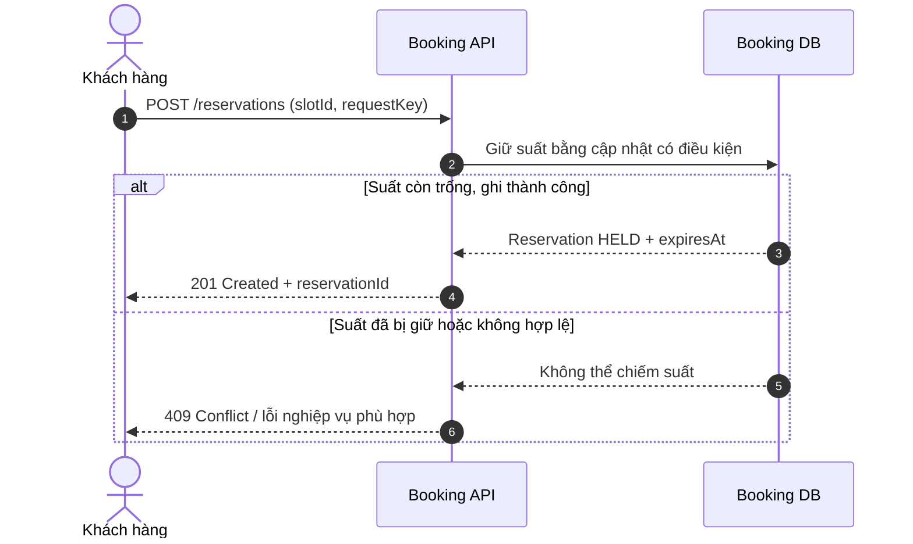
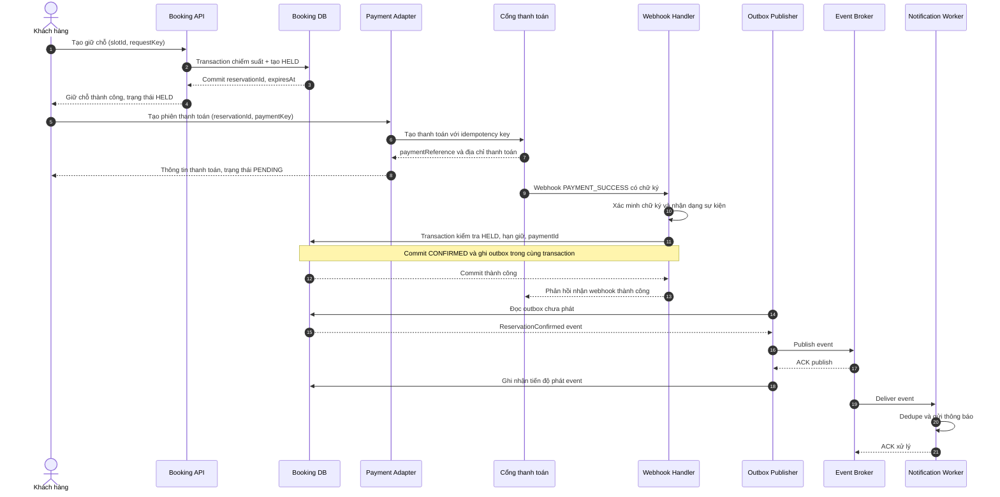
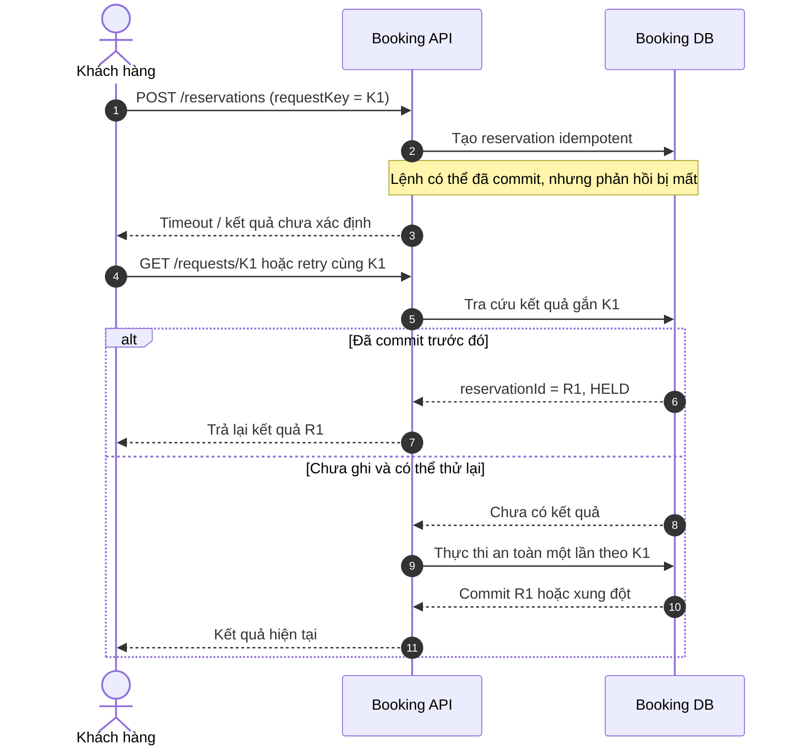
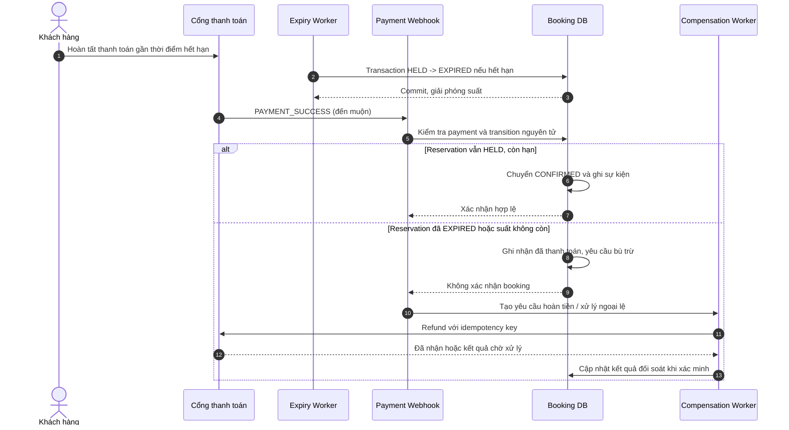
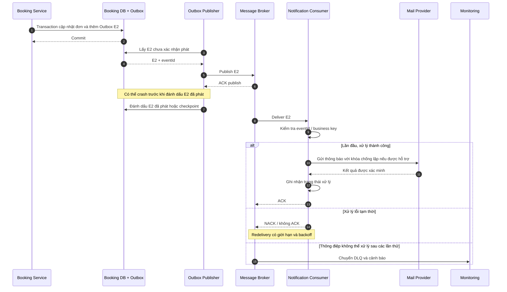
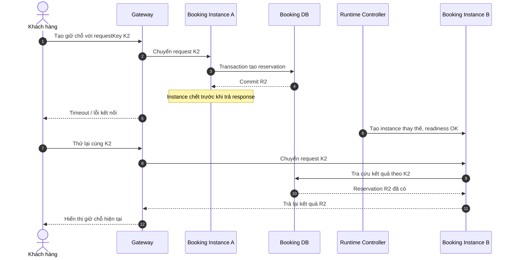

# Sơ đồ trình tự cho luồng thành công, lỗi và phục hồi

Một sơ đồ kiến trúc cho biết hệ thống gồm những thành phần nào và chúng kết nối ra sao. Nhưng khi người dùng bấm **Đặt thuê**, thành phần nào xử lý trước, khi nào dữ liệu được ghi, kết quả thanh toán đến từ đâu, và chuyện gì xảy ra nếu mạng đứt giữa hai bước? Những câu hỏi đó cần một góc nhìn khác: **sơ đồ trình tự (sequence diagram)**.

Sơ đồ trình tự mô tả **các tương tác theo thời gian** giữa người dùng, ứng dụng, dịch vụ cloud và kho dữ liệu. Trong thiết kế **CLOUD_ARCHITECTURE**, nó giúp chuyển yêu cầu nghiệp vụ thành hành vi có thể kiểm chứng, giải thích lựa chọn mạng, compute, dữ liệu và mô hình triển khai, đồng thời phơi bày các đánh đổi về **độ tin cậy, bảo mật, mở rộng, chi phí và vận hành** theo tư duy Well-Architected.

Điểm quan trọng nhất: **một luồng nghiệp vụ có ít nhất ba câu chuyện phải kể rõ**:

1. **Thành công (happy path):** mọi thành phần đáp ứng như mong đợi; điều kiện nào quyết định giao dịch hoàn tất?
2. **Lỗi (failure path):** điều gì xảy ra khi yêu cầu bị từ chối, timeout, mất kết nối, dữ liệu xung đột hoặc kết quả đến nhiều lần?
3. **Phục hồi (recovery path):** hệ thống làm gì để đạt lại trạng thái hợp lệ, báo kết quả cho người dùng và xử lý các tác động đã xảy ra?

Ba câu chuyện này liên quan nhưng không đồng nghĩa. Sơ đồ chỉ thể hiện thành công có thể che giấu một kiến trúc nhiều điểm hỏng; sơ đồ lỗi mà không có hành vi phục hồi vẫn chưa đủ để vận hành.

## 1. Sơ đồ trình tự trả lời câu hỏi gì?

Mỗi sơ đồ trình tự nên có **một kịch bản rõ ràng**: ví dụ “khách giữ chỗ và thanh toán thành công”, “cổng thanh toán timeout sau khi nhận yêu cầu”, hoặc “webhook đến sau thời điểm hết hạn giữ chỗ”.

| Thành phần trên sơ đồ | Ý nghĩa | Ví dụ trong hệ thống đặt thuê |
| --- | --- | --- |
| **Actor** | Tác nhân khởi phát hoặc nhận kết quả | Khách hàng, nhân viên vận hành |
| **Participant / lifeline** | Ứng dụng, service, database, broker hoặc hệ thống bên ngoài | Booking API, Booking DB, Payment Provider |
| **Message** | Lời gọi, kết quả, sự kiện hoặc lệnh có ngữ nghĩa | CreateReservation, PaymentSucceeded |
| **Trật tự thời gian** | Thứ tự xử lý và các điểm phụ thuộc | Ghi giữ chỗ trước khi mở phiên thanh toán |
| **Điều kiện nhánh** | Kết quả được xử lý khác nhau tùy trạng thái | Đặt thành công / suất đã bị giữ |
| **Thao tác bất đồng bộ** | Bên gửi không chờ người nhận hoàn tất xử lý nghiệp vụ | Gửi sự kiện sang Notification qua queue |
| **Điểm commit** | Thời điểm thay đổi trạng thái bền vững | Commit transaction tạo Reservation |
| **Timeout / retry / bù trừ** | Giới hạn chờ và cách phản ứng với lỗi | Kiểm tra lại trạng thái thanh toán, hoàn tiền khi cần |

Sequence diagram **không thay thế** sơ đồ C4/container, sơ đồ mạng, mô hình dữ liệu hay ADR. C4 giúp xác định thành phần và ranh giới trách nhiệm; sơ đồ trình tự giải thích cách chúng tương tác trong một kịch bản; ADR ghi lại **vì sao** nhóm chọn cách tương tác đó.

### Các quy ước nên thống nhất trước khi vẽ

- Đặt tên **theo trách nhiệm**, không chỉ theo tên VM hoặc pod. Ví dụ “Booking API” có ích hơn “EC2-01”.
- Phân biệt **lời gọi đồng bộ** với **gửi thông điệp bất đồng bộ**. Mũi tên trả lời không có nghĩa người dùng đã nhận thông báo từ tất cả consumer.
- Ghi rõ **trạng thái dữ liệu trước/sau** và **điểm commit** khi có transaction.
- Thêm **điều kiện**, **giới hạn thời gian** và **đường xử lý bất thường** cho các chỗ quan trọng.
- Ghi **owner** và **ranh giới tin cậy** ở chú thích nếu có lời gọi ra bên ngoài, qua region, qua account/project hoặc dùng dữ liệu nhạy cảm.
- Đưa tham số timeout, số lần retry, ngưỡng alert vào bảng giả định nếu chúng chưa được đo/duyệt; tránh biến số minh họa thành cam kết sản phẩm.

## 2. Đọc và vẽ Mermaid sequence diagram

Mermaid cung cấp cú pháp có thể lưu cùng Markdown và review như mã. Những cấu trúc hữu ích gồm:

| Cú pháp Mermaid | Khi sử dụng | Lưu ý |
| --- | --- | --- |
| **sequenceDiagram** | Khởi đầu sơ đồ trình tự | Thời gian thường đi từ trên xuống dưới |
| **actor / participant** | Định nghĩa tác nhân và hệ thống | Chọn cấp độ chi tiết vừa đủ |
| **A->>B: ...** | A gửi lời gọi/thông điệp tới B | Không tự hàm ý rằng A đã nhận kết quả |
| **B-->>A: ...** | B trả lời hoặc phản hồi tới A | Ghi rõ lỗi, trạng thái hoặc dữ liệu trả về |
| **alt ... else ... end** | Các nhánh loại trừ theo điều kiện | Điều kiện phải kiểm chứng được |
| **opt ... end** | Bước tùy chọn | Ví dụ ghi audit khi cần |
| **loop ... end** | Thử lại hoặc xử lý nhiều lần | Phải ghi giới hạn hoặc điều kiện dừng |
| **par ... and ... end** | Công việc có thể diễn ra song song | Cần chú ý đua tranh về dữ liệu |
| **Note over / Note right of** | Ràng buộc, giả định, bất biến | Ghi gọn; không biến sơ đồ thành tài liệu dài |

Ví dụ tối thiểu với hai nhánh:



**Lưu ý:** lời gọi “cập nhật có điều kiện” là một thao tác đồng thời an toàn bên phía dữ liệu, không phải “kiểm tra còn trống” rồi cập nhật thành hai thao tác độc lập dễ dẫn đến đặt trùng. Mã HTTP là ví dụ; hợp đồng API thực tế cần được thống nhất.

## 3. Chọn đúng độ chi tiết của sơ đồ

Trước khi vẽ, hãy xác định:

1. **Mục tiêu nghiệp vụ:** “khách hàng đặt được một suất thuê hợp lệ và chỉ trả tiền một lần”.
2. **Bất biến:** một suất không được xác nhận cho hai reservation đang hiệu lực; một thanh toán thành công không được xác nhận hai lần.
3. **Các hệ thống tham gia:** client, Booking, kho dữ liệu giao dịch, cổng thanh toán, message broker, worker thông báo.
4. **Hợp đồng:** request ID/idempotency key, reservation ID, payment ID, event ID, trạng thái và quy tắc hết hạn.
5. **Mốc hoàn tất:** khi Booking DB commit **CONFIRMED** hay khi email thông báo được gửi? Đây là hai mốc khác nhau.
6. **Giả định về lỗi:** lời gọi mạng có thể timeout; webhook và event có thể lặp; các hệ thống không nhất thiết có cùng đồng hồ hoặc cùng trạng thái tức thời.

Không cần đưa mọi lớp code, framework, load balancer và máy chủ vào cùng một sơ đồ. Nên dùng **một sơ đồ đầu cuối ở mức trách nhiệm**, rồi tách sơ đồ chuyên sâu cho transaction, lỗi thanh toán, gửi event hoặc phục hồi vùng nếu chúng quan trọng.

### Mô hình trạng thái tham chiếu

Ví dụ nền tảng cho thuê dùng:

| Trạng thái reservation | Ý nghĩa | Chuyển tiếp hợp lệ điển hình |
| --- | --- | --- |
| **HELD** | Suất đang được giữ trong khoảng thời gian cho phép | CONFIRMED, EXPIRED, CANCELLED |
| **CONFIRMED** | Đã xác nhận theo chính sách thanh toán và giữ chỗ | CANCELLED nếu nghiệp vụ cho phép |
| **EXPIRED** | Hết thời hạn giữ, đã giải phóng quyền giữ suất | Không tự chuyển lại CONFIRMED khi webhook đến trễ |
| **CANCELLED** | Đơn bị hủy theo một hành động/quy tắc có thẩm quyền | Tùy chính sách hoàn tiền và lưu lịch sử |

Trạng thái này cần được bảo vệ bằng transaction hoặc thao tác kiểm tra–cập nhật nguyên tử trên kho dữ liệu có thẩm quyền. Nếu hệ thống đặt khoảng thuê tùy ý thay vì suất cố định, cần thêm ràng buộc chống **khoảng thời gian giao nhau**; chỉ kiểm tra một mã slot sẽ không đủ.

## 4. Luồng thành công: ghi dữ liệu, nhận thanh toán và phát sự kiện

Giả sử khách được giữ suất **10 phút** để thanh toán. Đây là **giả định học tập**, không phải quy tắc chung. Nhóm thiết kế quyết định việc xác nhận chỉ hợp lệ nếu một sự kiện thanh toán được xác minh và reservation còn ở trạng thái giữ chỗ hợp lệ tại thời điểm cập nhật nguyên tử.



Những điểm cần đọc đúng:

- **Booking DB commit trước khi API trả về giữ chỗ**; nếu response bị mất, lần gọi lại cùng request key phải tra cứu kết quả thay vì tạo reservation mới.
- **Payment PENDING không đồng nghĩa CONFIRMED**. Người dùng được trả thông tin phiên thanh toán, nhưng kết quả cuối phải đến từ nguồn thanh toán đáng tin cậy hoặc quy trình reconciliation được xác minh.
- **Webhook đến từ ranh giới tin cậy bên ngoài**; kiểm tra chữ ký, sự kiện trùng và quyền chuyển trạng thái là bắt buộc.
- **Ghi outbox cùng transaction xác nhận** giúp không bỏ sót ý định phát sự kiện nếu tiến trình chết ngay sau khi commit.
- **Thông báo là bước bất đồng bộ**. Gửi email chậm không nhất thiết làm đơn đã xác nhận trở về trạng thái HELD.

**Thời điểm đáp ứng nghiệp vụ** cần định nghĩa rõ trong yêu cầu: có thể là lúc reservation **CONFIRMED** được commit, còn gửi thông báo là hành vi đi sau. Nếu nghiệp vụ bắt buộc gửi mã truy cập trước khi khách sử dụng dịch vụ, cần thêm trạng thái và cam kết phù hợp.

## 5. Luồng lỗi đồng bộ: không còn suất, mất kết nối và kết quả không chắc chắn

Lỗi đồng bộ cần phân loại trước khi chọn hành động. **Lỗi nghiệp vụ xác định được** khác với **lỗi kỹ thuật khiến chưa biết giao dịch đã hoàn tất hay chưa**.

| Tình huống | Hệ thống biết chắc điều gì? | Phản ứng phù hợp | Điều không nên làm |
| --- | --- | --- | --- |
| Suất đã được giữ và DB trả kết quả xung đột | Yêu cầu hiện tại không chiếm được suất | Trả lỗi nghiệp vụ; đề nghị chọn suất khác | Retry vô hạn cùng suất |
| Validation lỗi trước khi ghi | Request không hợp lệ | Trả lỗi có thể sửa; không gọi dịch vụ sau | Gửi lại cùng dữ liệu sai |
| DB mất kết nối trước khi gửi lệnh | Chưa gửi lệnh ghi trong phiên hiện tại | Retry theo chính sách nếu thao tác an toàn | Giả định toàn hệ thống không có thay đổi từ request khác |
| Client timeout sau khi DB có thể đã commit | **Không rõ** kết quả của request đó | Tra cứu bằng requestId/idempotency key; retry an toàn | Tạo request mới với khóa khác ngay |
| Dependency trả 429/503 | Thành phần phụ thuộc đang hạn chế hoặc tạm không sẵn sàng | Backoff, jitter, circuit breaker nếu phù hợp, báo trạng thái tạm | Fan-out nhiều retry làm quá tải thêm |

### Một chuỗi xử lý với retry có giới hạn



**Idempotency key cần được áp vào một thao tác có định danh và phạm vi cụ thể.** Ví dụ lưu kết quả theo **(khách hàng, loại thao tác, requestKey)**, ràng buộc duy nhất và fingerprint của nội dung yêu cầu. Nếu cùng key nhưng payload khác, nên từ chối theo hợp đồng thay vì âm thầm xử lý một thao tác khác. Thời gian lưu kết quả idempotency phải đủ với cửa sổ retry và chính sách nghiệp vụ, không mặc định lưu vô hạn.

Một response timeout không cho biết database đã rollback. Điều quan trọng là định nghĩa **trạng thái quan sát và đường truy vấn lại**, thay vì đơn giản hóa mọi timeout thành “thất bại”.

## 6. Timeout ở cổng thanh toán: vì sao không thể retry tùy tiện?

Giả sử Payment Adapter gọi hệ thống ngoài và không nhận được response. Có ít nhất ba khả năng: lệnh chưa đến, lệnh đã xử lý nhưng response mất, hoặc bên ngoài vẫn đang xử lý. Không thể suy ra chưa trừ tiền từ một timeout.

```mermaid
sequenceDiagram
    autonumber
    actor KH as Khách hàng
    participant PAY as Payment Adapter
    participant PSP as Cổng thanh toán
    participant DB as Payment/Booking DB
    participant JOB as Reconciliation Worker

    KH->>PAY: Yêu cầu thanh toán (paymentKey = P1)
    PAY->>DB: Ghi payment attempt PENDING với P1
    DB-->>PAY: Đã ghi
    PAY->>PSP: Tạo hoặc thu tiền với P1
    Note over PAY,PSP: Quá thời gian chờ; kết quả của PSP chưa biết
    PAY->>DB: Đánh dấu UNKNOWN/PENDING, giữ reference để đối soát
    PAY-->>KH: 202 Accepted / chờ kết quả, không xác nhận thu tiền

    JOB->>DB: Lấy các payment attempt chưa rõ kết quả
    DB-->>JOB: P1 và provider reference nếu có
    loop Retry truy vấn trong giới hạn và có backoff
        JOB->>PSP: Query status bằng P1 / provider reference
        PSP-->>JOB: Trạng thái trả về hoặc vẫn chưa có
    end
    alt PSP xác nhận đã thu tiền
        JOB->>DB: Ghi nhận thanh toán thành công, xử lý trạng thái giữ chỗ
        DB-->>JOB: Đã commit hoặc yêu cầu hoàn/bù trừ
    else PSP xác nhận thất bại hoặc hủy
        JOB->>DB: Cập nhật thất bại theo hợp đồng
    else Chưa xác định sau thời hạn đối soát
        JOB->>DB: Ghi trạng thái cần điều tra
        Note over JOB,DB: Phát cảnh báo / chuyển xử lý thủ công
    end
```

Nếu bên thanh toán hỗ trợ **idempotency key**, có thể thử lại đúng khóa theo hợp đồng của họ. Nếu không, ưu tiên truy vấn trạng thái bằng định danh giao dịch hoặc quy trình đối soát được cung cấp. Cần biết thời gian hiệu lực của khóa và tính chất API: không áp dụng chính sách retry chung cho mọi phương thức “charge”, “capture” hay “refund”.

Giao diện người dùng phải thể hiện **PENDING/UNKNOWN** rõ ràng, có cách kiểm tra trạng thái và không khuyến khích khách tạo thanh toán mới ngay khi chưa rõ lần trước. Đây là quyết định nghiệp vụ và trải nghiệm người dùng, không chỉ là cấu hình timeout của HTTP client.

## 7. Webhook đến trùng, đến sai thứ tự hoặc đến muộn

Thông điệp ngoài hệ thống có thể được giao **ít nhất một lần** hoặc bị gửi lại khi bên nhận không ACK kịp. Dù provider đưa ra cam kết cụ thể, ứng dụng vẫn nên thiết kế chịu được khả năng webhook lặp hoặc đến sau yêu cầu khác.

Quy trình nhận webhook nên:

1. Xác thực nguồn gửi bằng chữ ký/HMAC hoặc cơ chế do provider quy định; kiểm tra timestamp/khả năng replay theo hợp đồng.
2. Nhận dạng **provider event ID** và **payment transaction ID**; chống ghi trùng bằng ràng buộc dữ liệu có thẩm quyền.
3. Tìm payment attempt tương ứng, kiểm tra số tiền, đơn vị tiền, người nhận, trạng thái và điều kiện chuyển trạng thái.
4. Thay đổi trạng thái trong transaction hoặc cập nhật có điều kiện; kết hợp outbox nếu cần phát sự kiện.
5. ACK khi đã ghi nhận bền vững quyết định xử lý theo hợp đồng; nếu xử lý phức tạp, có thể ghi vào inbox/queue rồi ACK sau khi lưu thành công.

```mermaid
sequenceDiagram
    autonumber
    participant PSP as Cổng thanh toán
    participant WEB as Webhook Handler
    participant DB as Booking DB
    participant OUT as Outbox

    PSP->>WEB: Event E1: PAYMENT_SUCCESS
    WEB->>WEB: Verify signature và metadata
    WEB->>DB: Transaction: insert E1 nếu chưa có, kiểm tra transition
    alt E1 mới, giữ chỗ còn hiệu lực
        DB->>DB: CONFIRMED và thêm outbox event
        DB-->>WEB: Commit thành công
    else E1 đã được xử lý
        DB-->>WEB: Kết quả trước đó, không cập nhật lại
    else Reservation hết hạn hoặc không tương thích
        DB->>DB: Ghi nhận payment; tạo việc đối soát/bù trừ
        DB-->>WEB: Commit tình huống ngoại lệ
    end
    WEB-->>PSP: 2xx sau khi ghi bền vững
    PSP->>WEB: Retry E1 nếu từng mất ACK
    WEB->>DB: Tra cứu E1
    DB-->>WEB: Đã xử lý
    WEB-->>PSP: 2xx, không phát sinh hiệu ứng lặp
```

Chống trùng theo event ID **chưa đủ** để ngăn hai event khác nhau cho cùng một payment gây chuyển trạng thái lặp. Cần ràng buộc **payment transaction ID**, trạng thái reservation và luật nghiệp vụ. Khi event đến sai thứ tự, hãy xét **trạng thái authoritative** hoặc truy vấn nguồn có thẩm quyền; không dùng quy tắc “event đến cuối luôn thắng”.

Sơ đồ trên cho thấy **một thông điệp được giao lại không nhất thiết là một giao dịch nghiệp vụ mới**. ACK thành công cũng không chứng minh rằng email/notification đi sau đã hoàn tất; đó là các luồng riêng.

## 8. Khi giữ chỗ hết hạn trong lúc thanh toán: phục hồi nghiệp vụ

Lỗi khó không chỉ là mạng timeout. Có những tình huống mỗi thành phần đều hoạt động đúng theo hợp đồng cục bộ nhưng **tổng thể nghiệp vụ vẫn xung đột**.

Ví dụ khách bắt đầu thanh toán khi reservation **HELD** còn vài giây. Bộ xử lý hết hạn chuyển reservation sang **EXPIRED**, giải phóng suất cho khách khác, sau đó webhook **PAYMENT_SUCCESS** tới. Nếu chỉ nhìn trạng thái thanh toán thành công để ghi **CONFIRMED**, hệ thống có thể xác nhận hai đơn cho cùng một suất.



**Bất biến cần bảo vệ** là không có hai booking được xác nhận cùng chiếm một tài nguyên trong khoảng thuê xung đột. Cần một điểm quyết định có thẩm quyền và thao tác **nguyên tử** giữa chuyển trạng thái reservation và quyền chiếm suất; không đặt quyết định vào cache hay chỉ vào event đã nhận.

Đối với chính sách **cho phép thanh toán hoàn tất theo thời điểm PSP thu tiền** thay vì thời điểm nhận webhook, nhóm phải định nghĩa nguồn thời gian tin cậy và cách giải quyết tranh chấp khi nhận sự kiện trễ. Sơ đồ trên chọn chính sách **kiểm tra trạng thái giữ chỗ tại thời điểm cập nhật** để minh họa, không thay thế quyết định nghiệp vụ.

Trong luồng bù trừ, refund có thể là tác vụ bất đồng bộ, có hạn mức, lỗi hoặc yêu cầu xét duyệt. Nên có trạng thái **REFUND_PENDING / REFUNDED / NEEDS_REVIEW**, cách truy vết, chống refund trùng và quy trình hỗ trợ khách hàng. **Bù trừ không phải rollback transaction xuyên hệ thống**: tiền thật có thể đã chuyển và chỉ một giao dịch mới mới đảo ngược tác động tương ứng.

## 9. Luồng bất đồng bộ: outbox, retry, consumer và dead-letter queue

Trong kiến trúc cloud, nhiều công việc không cần chặn phản hồi của yêu cầu chính: gửi email, cập nhật báo cáo, đồng bộ chỉ mục tìm kiếm, ghi audit sang hệ thống khác. Message broker/queue giúp phân tách thời điểm xử lý, nhưng tạo ra những rủi ro mới: phát sự kiện không thành công, giao lặp, sai thứ tự và consumer không xử lý được.

### Vì sao “commit database rồi publish event” có lỗ hổng?

Giả sử Booking DB commit **CONFIRMED** thành công, sau đó tiến trình bị dừng trước khi gửi event. Database đã thay đổi nhưng Notification không biết có đơn mới. Nếu đảo thứ tự, publish trước rồi commit, consumer có thể nhận event cho một transaction sau đó bị rollback.

**Transactional outbox** giải quyết việc mất ý định phát event: cùng một transaction ghi trạng thái nghiệp vụ và một bản ghi outbox. Một worker khác publish lại các bản ghi chưa hoàn tất. Cơ chế này đạt **khả năng phục hồi việc phát**, nhưng **không bảo đảm consumer chỉ nhận đúng một lần**.



Các lưu ý triển khai:

- **Publisher có thể publish lại E2** nếu đã gửi thành công nhưng chưa cập nhật checkpoint. Consumer cần idempotency/inbox hoặc ràng buộc duy nhất theo event ID và hiệu ứng nghiệp vụ.
- **ACK consumer** sau khi đã ghi bền vững tiến độ xử lý. Với hệ thống bên ngoài không hỗ trợ idempotency (ví dụ gửi email), không thể tự hứa “chắc chắn chỉ gửi một lần” ở mọi thời điểm crash; cần chấp nhận/giảm thiểu trùng, ghi trạng thái, đối soát hoặc dùng API hỗ trợ khóa chống lặp.
- **DLQ (dead-letter queue)** không tự sửa lỗi. Phải có owner, metric tồn đọng, ngưỡng cảnh báo, khả năng xem nguyên nhân, quy trình sửa dữ liệu hoặc replay có kiểm soát.
- **Thứ tự sự kiện** phụ thuộc partition/key, broker và thiết kế producer/consumer. Nếu thứ tự là yêu cầu nghiệp vụ, cần version/sequence trên aggregate hoặc truy vấn trạng thái authoritative; không giả định mọi event toàn hệ thống luôn đúng thứ tự.
- **Backpressure** phải giới hạn số consumer/concurrency khi downstream yếu; chỉ tăng worker có thể làm nghẽn database hoặc nhà cung cấp email nhanh hơn.

### Sự kiện nên mang thông tin gì?

Một event thông báo thay đổi nên mang định danh và thông tin tối thiểu đủ cho consumer, ví dụ:

```json
{
  "eventId": "event-123",
  "eventType": "ReservationConfirmed",
  "eventVersion": 1,
  "aggregateId": "reservation-456",
  "aggregateVersion": 4,
  "occurredAt": "2026-11-18T05:00:00Z",
  "correlationId": "request-789",
  "payload": {
    "reservationId": "reservation-456"
  }
}
```

Đây là dữ liệu **minh họa**, không phải contract mặc định. Tránh đưa số thẻ, secret, token, địa chỉ hay dữ liệu cá nhân không cần thiết vào event: message thường được sao chép sang queue, retry, DLQ, log và consumer khác. Nếu cần thay đổi schema event, phải xét **tương thích phiên bản** khi producer và consumer cập nhật không đồng thời.

## 10. Timeout, retry, circuit breaker và giới hạn nguồn lực

Không thể thiết kế luồng phục hồi chỉ bằng câu “nếu lỗi thì retry”. Với lời gọi đồng bộ, cần xác định rõ **ai sở hữu retry, retry cái gì, tối đa bao lâu, liệu thao tác có an toàn khi lặp và khi nào phải dừng**.

| Cơ chế | Mục đích | Cách diễn đạt trên sơ đồ | Cảnh báo |
| --- | --- | --- | --- |
| **Timeout** | Không chờ vô hạn khi dependency chậm/hỏng | Note thể hiện deadline hoặc thời gian chờ; nhánh timeout | Timeout không đồng nghĩa giao dịch đã rollback ở bên nhận |
| **Retry + backoff/jitter** | Vượt qua lỗi tạm thời có khả năng phục hồi | Vòng lặp có điều kiện và giới hạn | Retry tại nhiều lớp có thể nhân tải, làm lỗi lan rộng |
| **Circuit breaker** | Ngừng gửi liên tục tới dependency đang hỏng | Nhánh open/half-open/closed theo health | Không khắc phục dữ liệu hoặc nghiệp vụ đã phát sinh |
| **Bulkhead** | Hạn chế lỗi của một downstream chiếm hết thread/connection | Ghi rõ pool/quota độc lập cho từng loại tác vụ | Quota quá thấp có thể làm giảm throughput hợp lệ |
| **Queue/backpressure** | Hấp thụ burst và tách tốc độ producer/consumer | Gửi vào queue, xử lý sau, metric lag | Queue không có giới hạn và tuổi thông điệp có thể tạo backlog lớn |
| **Fallback** | Duy trì một phần chức năng khi phụ thuộc lỗi | Nhánh chế độ suy giảm | Dữ liệu fallback phải được nhận diện là có thể cũ/không đầy đủ |
| **Idempotency** | Giảm tác động lặp của cùng thao tác | Dùng request/event key và kết quả đã lưu | Phải định nghĩa phạm vi khóa và trạng thái chia sẻ |

Ví dụ giả định: deadline toàn yêu cầu là **3 giây**, Booking còn **2 giây** để gọi một dependency. Nếu HTTP client thử lại ba lần và mỗi lần đợi 2 giây, ngân sách thời gian đã bị phá vỡ. Deadline cần lan truyền/điều phối giữa các lớp; số liệu 3 giây và 2 giây ở đây chỉ dùng minh họa, không phải gợi ý cấu hình mặc định.

**Retry chỉ phù hợp khi có khả năng thành công cao hơn và tác động có thể kiểm soát.** Thao tác đọc thường dễ retry hơn lệnh thu tiền. Với lệnh có hiệu ứng bên ngoài, phải dùng khóa idempotency hoặc quy trình kiểm tra kết quả trước khi lặp.

### Phân biệt lỗi tạm thời và lỗi vĩnh viễn

Một dữ liệu đầu vào vi phạm schema hoặc không có quyền là lỗi **khó thành công hơn khi chạy lại nguyên vẹn**. Những thông điệp như vậy cần bị từ chối hoặc chuyển xử lý, không retry vô hạn. Lỗi timeout, ngắt mạng, rate limit có thể là lỗi tạm thời, nhưng vẫn cần giới hạn thời gian, tổng số lần thử và quan sát.

Với batch nhiều thông điệp, cần tránh trường hợp một poison message chặn toàn bộ partition/queue. Thiết kế cơ chế cách ly và replay phù hợp với yêu cầu **thứ tự** và **chống trùng**.

## 11. Phân biệt phục hồi ứng dụng, dữ liệu và hạ tầng

Một hệ thống cloud có nhiều loại sự cố. Sequence diagram cần chỉ ra **đường đi xử lý và nơi ghi trạng thái**, đồng thời liên kết tới sơ đồ triển khai, runbook hoặc kế hoạch khôi phục nếu sự cố vượt qua một request.

| Loại sự cố | Ví dụ | Thao tác phục hồi ứng dụng | Yêu cầu hạ tầng/dữ liệu |
| --- | --- | --- | --- |
| **Instance lỗi** | Pod/VM tắt giữa request | Client retry có key; thay instance; request không rõ kết quả phải được đối soát | Health check, nhiều instance hoặc autoscaling, dữ liệu bền vững bên ngoài instance |
| **Database tạm không sẵn sàng** | Mất kết nối khi commit | Chặn ghi thiếu bảo đảm; tra cứu lại transaction; giảm tải | Cấu hình HA/failover phù hợp, connection pool và monitoring |
| **Queue/broker lỗi** | Outbox chưa publish được | Giữ outbox bền vững; publisher retry; theo dõi độ trễ | Broker có mức độ bền phù hợp, hạn mức, alert backlog |
| **PSP lỗi hoặc chậm** | Không rõ thanh toán đã thu tiền | PENDING, reconciliation, tránh thu tiền trùng | Timeout, giới hạn kết nối, phân tách tài nguyên và fallback nghiệp vụ nếu có |
| **Lỗi logic sau deploy** | Bản mới xử lý sai trạng thái | Dừng rollout, revert/roll forward ứng dụng và xử lý dữ liệu đã ảnh hưởng | Version artifact, canary, rollback runbook, migration tương thích |
| **Sự cố vùng lớn** | Region mất khả dụng | Dừng hoặc chuyển lưu lượng theo chính sách; tái đồng bộ trạng thái | DR/replication, backup đã kiểm tra, DNS/routing, kế hoạch RTO/RPO |

Một sơ đồ request không đủ để suy ra **RTO** (thời gian khôi phục mục tiêu) hoặc **RPO** (mức mất dữ liệu tối đa chấp nhận theo thời gian). Hai mục tiêu này bắt nguồn từ tác động nghiệp vụ và phải được **đo bằng thử nghiệm khôi phục**, không suy ra chỉ từ việc đã dùng dịch vụ managed hoặc có nhiều availability zone.

### Ví dụ một luồng phục hồi khi instance bị thay thế



**Điều kiện để sơ đồ đúng:** request key và kết quả được lưu bền vững, instance không giữ thông tin duy nhất cần để xác định giao dịch, gateway có đường chuyển tới instance khỏe, và tác vụ có thể lặp mà không gây thêm hiệu ứng. Nếu mọi session chỉ nằm trong RAM của Instance A, sơ đồ phục hồi phải bổ sung một chiến lược khôi phục phiên hoặc thiết kế stateless.

Với **multi-region**, sơ đồ phải chỉ thêm cách chuyển vùng, tính nhất quán dữ liệu và phòng tránh **split-brain** nếu hai region có thể đồng thời ghi. Chuyển traffic sang vùng dự phòng mà chưa xác định bản dữ liệu mới nhất có thể tạo trạng thái nghiệp vụ không hợp lệ. DR cần có quy tắc ưu tiên nguồn dữ liệu, cơ chế cô lập nơi ghi cũ và quy trình đối soát sau phục hồi.

## 12. Gắn chất lượng phi chức năng lên sơ đồ

Khi thiết kế theo Well-Architected, hãy nhìn một sequence diagram không chỉ theo chức năng, mà theo các giới hạn chất lượng mà luồng đi qua.

| Thuộc tính | Vị trí thường cần chú thích trên sơ đồ | Câu hỏi cần trả lời |
| --- | --- | --- |
| **Reliability** | DB commit, timeout, retry, outbox, xử lý trùng | Nếu message mất/đến lại thì bất biến nào vẫn đúng? |
| **Security** | Actor → API, service → service, webhook, secret, log | Danh tính nào được gọi, xác minh thế nào, dữ liệu nhạy cảm đi đâu? |
| **Performance efficiency** | Chuỗi gọi đồng bộ, query chậm, external API, queue | Tổng p95/p99 latency và throughput dưới tải thực tế có đáp ứng SLO không? |
| **Cost optimization** | Gọi dịch vụ ngoài, publish, retry, luồng qua region, số consumer | Khi lỗi, retry và backlog có làm chi phí tăng mất kiểm soát không? |
| **Operational excellence** | Log, trace, metric, alert, DLQ, runbook | Có thể biết request đang dừng ở bước nào, ai chịu trách nhiệm xử lý không? |
| **Sustainability** | Gọi lặp, xử lý thừa, worker nhàn rỗi, tài nguyên dự phòng | Có giảm tính toán hoặc lưu trữ dư thừa mà vẫn giữ đúng SLO không? |

### Tính độ trễ của chuỗi gọi

Giả sử một API thực hiện ba lời gọi đồng bộ liên tiếp và mỗi lời gọi có độ trễ riêng. Tổng thời gian từ đầu đến cuối còn có xử lý ứng dụng, mạng, thời gian chờ connection, serialize/deserialize và có thể có retry. **Không cộng trực tiếp các giá trị p95 của ba thành phần rồi tuyên bố đó là p95 đầu cuối**, vì phân phối và sự phụ thuộc giữa các độ trễ khác nhau; phải đo hoặc mô phỏng luồng thực tế.

Nếu thông báo không cần thiết cho việc xác nhận đặt thuê, chuyển nó sang xử lý bất đồng bộ có thể giảm độ trễ phản hồi. Đổi lại, hệ thống phải giải quyết **eventual consistency**, retry, DLQ và chỉ số về độ trễ xử lý thông báo. Sơ đồ giúp nêu rõ đánh đổi này.

### Bảo mật ở từng ranh giới

Sequence diagram hữu ích để đánh dấu chỗ đổi mức tin cậy:

- **Client → API:** xác thực, phân quyền theo đơn thuê, chống lặp và giới hạn lưu lượng.
- **API → Database:** danh tính workload, quyền tối thiểu, mã hóa đường truyền, truy vấn có tham số.
- **Payment Provider → Webhook:** xác thực sự kiện, signature/timestamp, chống replay, lọc payload và bảo vệ endpoint.
- **Service → Broker:** quyền publish/subscribe theo topic, encryption, retention và dữ liệu tối thiểu.
- **Logs/Tracing:** correlation ID và thông tin chẩn đoán đủ dùng; tránh lưu secret, toàn bộ token hoặc thông tin thanh toán nhạy cảm.

**Đường mũi tên hợp lệ trên sơ đồ không chứng minh quyền truy cập đã được cấu hình đúng.** Cần kết hợp kiểm thử từ chối quyền, chính sách IAM, network controls và kiểm chứng thực tế.

## 13. Quan sát và kiểm thử theo từng đường đi

Để biết hệ thống có đi đúng luồng, cần biến mỗi nhánh thành **tín hiệu quan sát và kiểm thử**:

| Đường đi | Cần quan sát | Kiểm thử có giá trị |
| --- | --- | --- |
| Giữ chỗ thành công | Số reservation HELD, thời gian tạo, tỷ lệ xung đột | Nhiều request tranh cùng suất; chỉ một giữ chỗ hợp lệ |
| Client retry khi response mất | Tỷ lệ request lặp, kết quả trả lại theo cùng key | Gây timeout sau commit rồi gửi lại cùng request key |
| PSP timeout | Payment PENDING/UNKNOWN, tuổi giao dịch chưa rõ, số lần đối soát | Giả lập PSP xử lý thành công nhưng chặn response |
| Webhook lặp/sai thứ tự | Số event lặp, lần chuyển trạng thái không hợp lệ | Gửi trùng event ID và hai event khác nhau cho một giao dịch |
| Webhook đến sau expiry | Số payment được bù trừ, thời gian hoàn/đối soát | Để reservation hết hạn rồi mới gửi PAYMENT_SUCCESS |
| Broker hoặc consumer lỗi | Outbox lag, retry count, consumer lag, DLQ depth | Ngắt broker rồi khôi phục; đảm bảo event được phát lại và consumer chống trùng |
| Instance chết sau DB commit | Timeout, thay instance, kết quả query theo request key | Kill instance tại ranh giới commit và xác minh không tạo đơn đôi |

**Correlation ID** giúp lần theo một yêu cầu qua các thành phần; **trace ID** hỗ trợ theo dõi lời gọi phân tán; **business ID** (reservationId/paymentId) giúp đối soát trạng thái lâu dài. Chúng có vai trò khác nhau và nên gắn kết bằng log/metric đủ an toàn. Không đưa thông tin cá nhân hoặc bí mật vào định danh chỉ để dễ tìm log.

Khi dữ liệu được xử lý bất đồng bộ, một trace duy nhất có thể không kéo dài suốt vòng đời nghiệp vụ; cần lưu correlation hoặc causation ID trong event/đơn hàng và liên kết trace theo khả năng của hệ thống quan sát.

## 14. Từ sequence diagram đến quyết định kiến trúc (ADR)

Sơ đồ mô tả **điều gì xảy ra**. Để reviewer hiểu **vì sao lại thiết kế như vậy**, cần ghi lại những quyết định ảnh hưởng tới độ tin cậy, bảo mật và chi phí.

| Quyết định trên sơ đồ | Các phương án cần so sánh | Lý do thường gặp | Cách xác nhận |
| --- | --- | --- | --- |
| Xác nhận đơn theo webhook đã xác minh | Đồng bộ chờ PSP / webhook / đối soát | Giảm phụ thuộc response tức thời; chấp nhận trạng thái PENDING | Test webhook trễ, mất phản hồi, event lặp |
| Giữ suất trong Booking DB bằng thao tác nguyên tử | Check-then-write / distributed lock / database transaction | Bảo vệ bất biến chống đặt trùng với số lượng thành phần tối thiểu | Stress test cạnh tranh, transaction rollback |
| Ghi outbox cùng transaction | Gửi event trực tiếp sau commit / outbox / CDC phù hợp | Tránh mất ý định phát khi service crash | Tắt publisher/broker và kiểm tra replay |
| Consumer idempotent | Tin message chỉ được giao một lần / lưu dấu xử lý | Redelivery có thể xảy ra; giảm tác động lặp | Redelivery và crash injection |
| Tách Notification khỏi đường phản hồi | Gửi đồng bộ / queue bất đồng bộ | Giảm độ trễ request và cách ly lỗi email | Test mail provider chậm, backlog |
| Thanh toán đến sau expiry → bù trừ | Xác nhận muộn / refund / hỗ trợ thủ công | Giữ bất biến chống trùng và chính sách nghiệp vụ | Kiểm thử đua tranh giữa webhook và expiry |

Một ADR ngắn có thể viết:

> **Quyết định:** Booking ghi trạng thái **CONFIRMED** và outbox event trong cùng transaction. Outbox publisher gửi sự kiện bất đồng bộ; consumer xử lý idempotent.
>
> **Bối cảnh:** hệ thống phải giữ đúng trạng thái đơn dù tiến trình bị dừng sau commit hoặc broker tạm mất kết nối.
>
> **Phương án đã xét:** publish trực tiếp từ request; sử dụng outbox; dùng CDC nếu nền tảng dữ liệu và vận hành cho phép.
>
> **Đánh đổi:** thêm bảng outbox, worker, cơ chế dọn bản ghi và metric backlog; event có thể được gửi trùng, nên consumer phải chống trùng.
>
> **Kiểm chứng:** gây lỗi giữa commit và publish, giữa publish và checkpoint; đảm bảo mọi đơn đã xác nhận cuối cùng phát event, không tạo hiệu ứng nghiệp vụ lặp.

ADR có thể liên kết tới phiên bản sơ đồ, định nghĩa dữ liệu, API contract, bảng RTO/RPO, runbook và kết quả test. Khi thay đổi chính sách nghiệp vụ hoặc cách xử lý lỗi, cập nhật cả ADR và sơ đồ liên quan.

## 15. Quy trình thiết kế sequence diagram có thể dùng trong review

### Bước 1 — Chọn một kịch bản và xác định kết quả

Viết một câu có chủ thể, hành động và điều kiện hoàn tất: “Khi khách tạo reservation và thanh toán hợp lệ trong thời gian giữ chỗ, hệ thống xác nhận một đơn và phát sự kiện thông báo”. Không bắt đầu bằng tên công cụ như Kubernetes hay API Gateway khi mục tiêu nghiệp vụ chưa rõ.

### Bước 2 — Xác định nguồn sự thật và quyền chuyển trạng thái

Ghi rõ thành phần nào sở hữu dữ liệu, thao tác nào phải nguyên tử, chỗ nào cần idempotency. Đánh dấu transaction, commit và các sự kiện mà đối tác bên ngoài có thể gửi lặp. Quyền truy cập chéo phải theo hợp đồng, không mặc định chia sẻ trực tiếp database cho mọi service.

### Bước 3 — Vẽ happy path trước

Chỉ đưa các participant cần để giải thích kết quả. Ghi request/response, correlation ID, trạng thái PENDING/CONFIRMED và điểm tách bất đồng bộ. Từ đây xác định đường nóng ảnh hưởng latency và những phụ thuộc cần bảo vệ.

### Bước 4 — Bổ sung một lỗi ở mỗi ranh giới

Với mọi lời gọi quan trọng, lần lượt hỏi:

- Nếu bên nhận trả lỗi nghiệp vụ thì trạng thái cuối là gì?
- Nếu timeout khi đang commit thì có biết chắc kết quả không?
- Nếu ACK mất hoặc cùng event đến nhiều lần thì có xử lý trùng không?
- Nếu một tiến trình khác thay trạng thái trong lúc chờ thì có vi phạm bất biến không?
- Nếu dịch vụ phụ thuộc không phục hồi sớm, luồng có dừng/retry/đưa vào hàng đợi hay chuyển người xử lý?

Không cần nhồi tất cả lỗi vào một biểu đồ. Có thể tổ chức một **họ sơ đồ** cùng định danh tình huống: **Success**, **PaymentTimeout**, **DuplicateWebhook**, **LatePayment**, **BrokerFailure**, **InstanceRecovery**.

### Bước 5 — Vẽ recovery path có điểm kết thúc rõ ràng

Recovery cần chỉ ra ai kích hoạt, kết quả cuối ở đâu, khi nào dừng retry và ai nhận cảnh báo. Ví dụ payment timeout → đối soát theo khóa → xác nhận hoặc hoàn/bù trừ → ghi trạng thái cuối. “Retry” mà không có điều kiện dừng chưa phải thiết kế phục hồi hoàn chỉnh.

### Bước 6 — Kiểm tra thuộc tính chất lượng và đánh đổi

Rà qua các yếu tố Well-Architected: bảo mật dữ liệu, quyền, độ tin cậy, quan sát, ngân sách độ trễ, tải khi retry, chi phí queue/đối soát và yêu cầu DR. Ghi những giả định chưa được xác nhận, đặc biệt là tính chất API bên thứ ba và độ tin cậy cơ chế storage/broker.

### Bước 7 — Đưa các nhánh thành test và cập nhật tài liệu

Tạo test case từ từng nhánh và biên giao dịch, gồm cả fault injection ở những vị trí hiểm: trước commit, sau commit trước response, sau publish trước checkpoint, trước/giữa refund. Giữ sơ đồ đồng bộ với API contract, trạng thái dữ liệu và ADR sau khi hệ thống thay đổi.

## 16. Bài tập thực hành

### Bài tập A — Khách bấm thanh toán hai lần

**Tình huống:** UI gửi hai request thanh toán gần nhau do khách bấm nút hai lần. Request đầu đã đến PSP, nhưng client chưa nhận response.

**Yêu cầu:** vẽ sơ đồ với actor, Payment Adapter, database và PSP. Có nhánh response thành công, response bị mất và request lặp.

**Gợi ý kiểm chứng:** cùng thao tác nghiệp vụ dùng một idempotency key; ứng dụng kiểm tra payload, lưu/tra cứu payment attempt, provider xử lý theo key nếu hỗ trợ. Khi chưa rõ kết quả, trả PENDING và đối soát, không tạo lệnh charge mới với key khác.

### Bài tập B — Broker lỗi sau khi DB đã xác nhận đơn

**Tình huống:** Reservation đã CONFIRMED, nhưng broker từ chối publish trong 20 phút. Sau khi broker phục hồi, publisher bị crash ngay sau ACK đầu tiên.

**Yêu cầu:** vẽ sơ đồ outbox với nhánh publish lỗi, retry và trường hợp publish thành công nhưng checkpoint chưa được ghi.

**Gợi ý kiểm chứng:** outbox vẫn giữ event bền vững; publisher retry có giới hạn và metric backlog; consumer chống trùng. Việc xác nhận đặt thuê không bị đảo ngược chỉ vì chưa gửi được thông báo.

### Bài tập C — Lỗi khi khôi phục sau failover

**Tình huống:** API request đã ghi dữ liệu trước khi instance chết. Vùng dự phòng nhận request retry nhưng bản sao dữ liệu chưa đồng bộ đến commit mới nhất.

**Yêu cầu:** mô tả sơ đồ bổ sung những bước xác định vùng ghi có thẩm quyền, trạng thái replication và quyết định có mở lưu lượng ghi hay không.

**Gợi ý kiểm chứng:** phải xét RPO, nguy cơ hai vùng ghi đồng thời, dữ liệu chưa replicate, cơ chế đối soát và luật chống tạo reservation trùng. Không khẳng định chuyển region là an toàn chỉ vì compute đã sẵn sàng.

### Tiêu chí tự đánh giá

| Tiêu chí | Bài đạt yêu cầu khi |
| --- | --- |
| **Kết quả nghiệp vụ** | Có điểm kết thúc rõ ràng, không nhầm PENDING với CONFIRMED |
| **Bất biến dữ liệu** | Có nguồn sự thật và thao tác nguyên tử chống trạng thái sai |
| **Lỗi kỹ thuật** | Phân biệt lỗi xác định được và kết quả không rõ sau timeout |
| **Phục hồi** | Chỉ rõ ai retry/đối soát/bù trừ, điều kiện dừng và trạng thái cuối |
| **Bất đồng bộ** | Thể hiện broker, ACK, redelivery và khả năng trùng event |
| **Bảo mật** | Có kiểm tra quyền/chữ ký khi qua trust boundary; không lộ secret |
| **Vận hành** | Có correlation ID, metric, alert, DLQ/runbook cho trường hợp chưa xử lý |
| **Đánh đổi** | Ghi giải pháp được chọn và cách kiểm chứng bằng test/ADR |

## 17. Checklist khi review sơ đồ trình tự cloud

- Có tên kịch bản và mục tiêu nghiệp vụ cụ thể?
- Mỗi participant có trách nhiệm rõ và ở đúng mức trừu tượng?
- Đường thành công ghi đúng trạng thái, điểm commit và kết quả trả về?
- Mọi hành vi bất đồng bộ có producer, consumer, ACK, retry, giới hạn và owner?
- Timeout có thể dẫn đến kết quả **không chắc chắn** đã được biểu diễn chưa?
- Yêu cầu và event lặp có cơ chế idempotency, chống ghi trùng và không vi phạm bất biến?
- Nếu giao dịch dài qua nhiều hệ thống, có compensation/đối soát thay vì giả định transaction toàn cục?
- Nếu khách thanh toán muộn, dữ liệu đến sai thứ tự hoặc tài nguyên đổi trạng thái, đã có luật xử lý rõ ràng?
- Các ranh giới mạng, danh tính, dữ liệu nhạy cảm và bên thứ ba có được nhận diện?
- Nếu một instance, DB, queue hoặc vùng gặp sự cố, có runbook và giả định RTO/RPO phù hợp?
- Có metric, log/trace, correlation ID, cảnh báo, DLQ và trách nhiệm xử lý phần chưa hoàn tất?
- Có test tương ứng với từng nhánh quan trọng, đặc biệt tại điểm trước/sau commit?
- Những quyết định ảnh hưởng kiến trúc có ADR và đánh đổi về chi phí, độ trễ, bảo mật, phục hồi?

Một sequence diagram hữu ích phải cho phép reviewer dự đoán **hệ thống sẽ làm gì khi mọi việc thuận lợi, khi một bước thất bại và sau khi thành phần phục hồi**. Khi các sơ đồ liên kết với state machine, API/event contract, ADR, test và runbook, chúng trở thành công cụ thiết kế và vận hành đáng tin cậy, chứ không chỉ là hình vẽ mô tả một luồng thành công lý tưởng.
