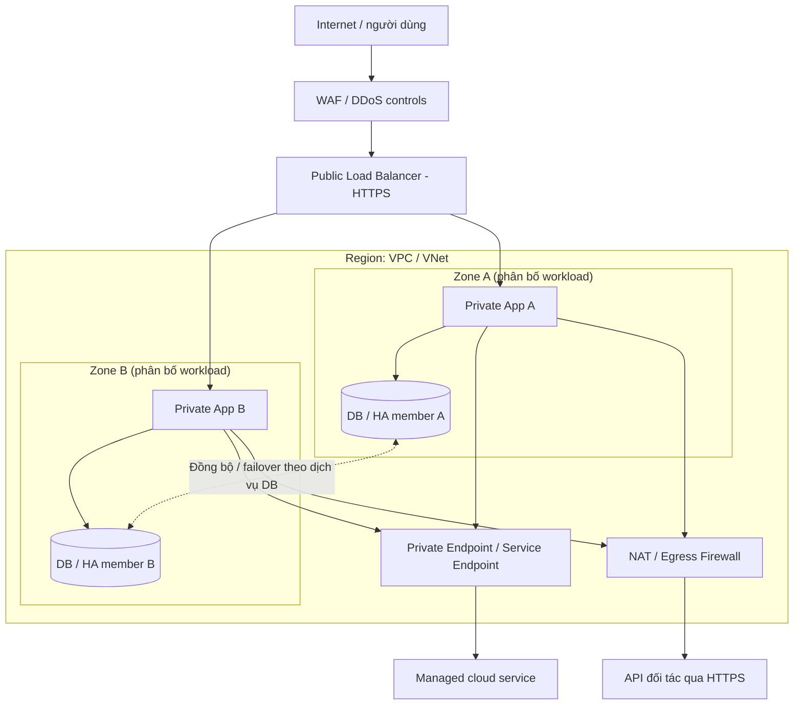
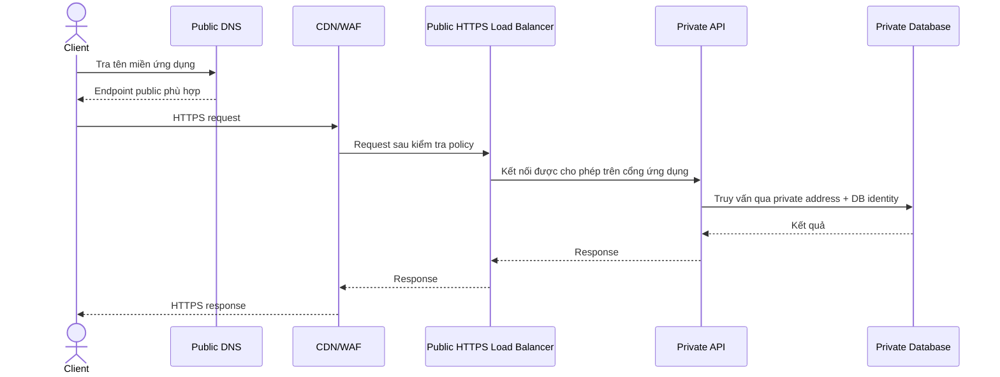
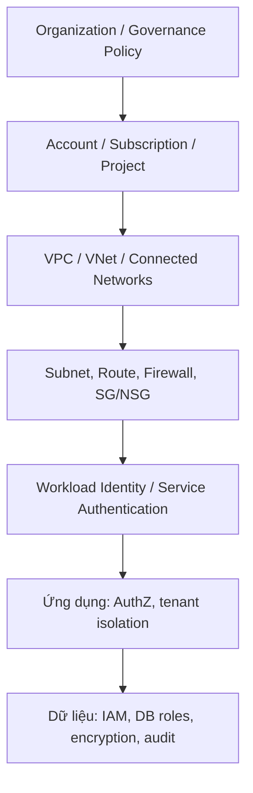
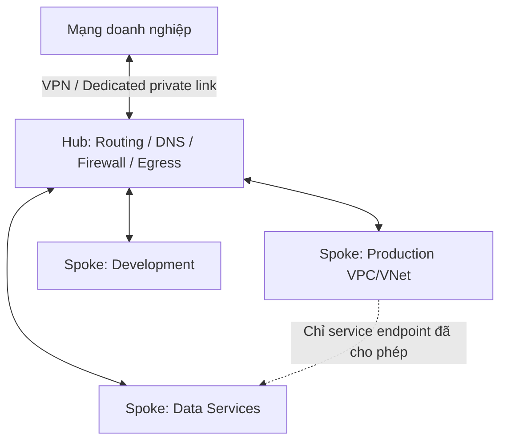
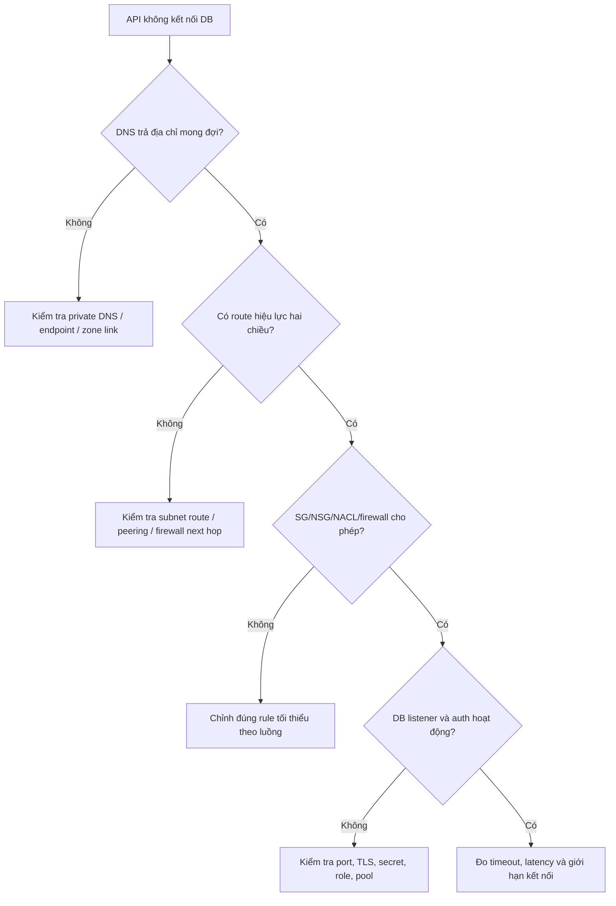

# Thiết kế VPC hoặc VNet, subnet và ranh giới cách ly

## 1. Vì sao thiết kế mạng là một quyết định kiến trúc?

Một hệ thống ứng dụng trên cloud có thể dùng compute tự động mở rộng, database được quản lý và cân bằng tải đa vùng sẵn sàng nhưng vẫn gặp sự cố nếu các thành phần giao tiếp qua những đường mạng không được dự tính. Một ứng dụng đặt hàng có thể chạy ổn trong môi trường thử nghiệm, sau đó không truy cập được database khi chuyển sang mạng riêng; hoặc database vô tình được phép nhận kết nối từ Internet do cấu hình tường lửa quá rộng.

**Thiết kế VPC/VNet là thiết kế phạm vi địa chỉ, đường đi của gói tin và những điểm được phép vượt qua ranh giới tin cậy.** Nó phải xuất phát từ yêu cầu nghiệp vụ, đặc tính lưu lượng, bảo mật, độ tin cậy, khả năng mở rộng, chi phí và năng lực vận hành. Trong module **CLOUD_ARCHITECTURE**, chương **Kiến trúc mạng** giúp người học chuyển các yêu cầu đó thành cấu trúc triển khai có thể kiểm chứng theo tư duy Well-Architected.

Sau bài này, người học có thể:

1. Phân biệt VPC/VNet, subnet, route table, gateway, endpoint và các lớp kiểm soát truy cập.
2. Thiết kế CIDR và phân bổ subnet có dự phòng tăng trưởng, tránh trùng địa chỉ giữa các môi trường và mạng kết nối.
3. Xác định vùng công khai, vùng ứng dụng riêng, vùng dữ liệu hạn chế và đường đi của lưu lượng vào/ra.
4. Thiết kế ranh giới cách ly đa lớp: tài khoản/subscription, mạng, subnet, danh tính, ứng dụng và dữ liệu.
5. Đánh giá khả năng sẵn sàng, bảo mật, vận hành, hiệu năng và chi phí của các phương án mạng.
6. Kiểm chứng thiết kế bằng ma trận kết nối, tình huống lỗi, phép đo và bài thực hành.

## 2. Mô hình tư duy: địa chỉ, đường đi, quyền truy cập và danh tính

Một thiết kế mạng đúng cần trả lời bốn câu hỏi độc lập:

| Lớp câu hỏi | Mục đích | Ví dụ |
| --- | --- | --- |
| **Địa chỉ** | Tài nguyên nằm trong dải IP nào? Các dải có chồng lấn không? | VPC `10.42.0.0/16`; subnet ứng dụng `10.42.16.0/22` |
| **Định tuyến** | Gói tin đi đến đích qua thiết bị/đường nào? | Ứng dụng ra Internet qua NAT hoặc tới dịch vụ cloud qua private endpoint |
| **Kiểm soát lưu lượng** | Quy tắc nào cho phép hoặc chặn kết nối? | Chỉ API được kết nối đến DB trên TCP 5432 |
| **Danh tính và quyền nghiệp vụ** | Ai được gọi dịch vụ hoặc thao tác dữ liệu? | API dùng danh tính workload để đọc secret; người dùng chỉ xem đơn của mình |

**Có route không có nghĩa là được phép truy cập.** Route chỉ xác định đường đi. Tường lửa và chính sách mạng có thể chặn gói tin; IAM và cơ chế ủy quyền của ứng dụng còn quyết định thao tác có được chấp nhận hay không.

**Không có IP công khai không đồng nghĩa an toàn tuyệt đối.** Máy trong private subnet vẫn có thể bị truy cập trái phép từ mạng nội bộ, đường VPN, mạng peering hoặc một workload đã bị xâm nhập. Cần kết hợp nhiều lớp kiểm soát theo nguyên tắc *least privilege* và *zero trust*.

## 3. VPC và VNet là gì? Điểm giống và khác cần nhớ

**VPC** (*Virtual Private Cloud*) thường dùng để chỉ mạng riêng ảo do khách hàng định nghĩa trong môi trường cloud. **VNet** (*Virtual Network*) là tên Azure dùng cho khái niệm gần tương đương. Chúng tạo không gian địa chỉ, subnet, route và các điểm kết nối giữa tài nguyên.

| Khái niệm | AWS (thường gọi VPC) | Azure (thường gọi VNet) | Ý nghĩa thiết kế |
| --- | --- | --- | --- |
| Không gian mạng cấp cao | VPC trong một Region | VNet trong một Region | Chọn CIDR không chồng lấn; quyết định ranh giới kết nối và quản trị |
| Subnet | Subnet gắn với **một Availability Zone** | Subnet là phạm vi trong VNet, **không gắn riêng một Availability Zone** theo cách AWS | Cách bố trí subnet đa AZ phải theo mô hình của từng cloud |
| Đường Internet | Internet Gateway và route phù hợp, cùng điều kiện public IP cho tài nguyên trực tiếp | Route Internet theo mô hình Azure; public IP, load balancer, NAT Gateway hoặc firewall theo nhu cầu | Không sao chép nguyên tên gateway giữa hai cloud |
| Kết nối outbound dùng địa chỉ công khai ổn định | NAT Gateway hoặc thiết bị NAT/egress được thiết kế riêng | NAT Gateway, Azure Firewall hoặc cơ chế egress phù hợp | Tách outbound khỏi khả năng nhận inbound |
| Lọc lưu lượng | Security Group (stateful) và Network ACL (stateless) trên AWS | Network Security Group (stateful) và các chức năng firewall khác | Quy tắc gắn vào các lớp và tài nguyên khác nhau |
| Private access đến dịch vụ được quản lý | VPC endpoint/PrivateLink và cơ chế private connectivity tương ứng | Private Endpoint/Private Link và các tùy chọn kết nối riêng | Kiểm tra DNS, định tuyến, policy và đường dữ liệu thực tế |
| Định tuyến tùy chỉnh | Route table liên kết subnet | Route table/User Defined Routes (UDR), effective routes | Nắm precedence và route hiệu lực của provider |

Bảng thể hiện những khác biệt nền tảng, **không phải danh sách đầy đủ khả năng của từng sản phẩm**. Khi triển khai thật, cần xác minh tài liệu dịch vụ theo region, phiên bản, SKU và tính năng đang sử dụng.

Một sơ đồ “hai public subnet và hai private subnet, mỗi AZ một cặp” có thể là mẫu **AWS VPC** hữu ích. Với Azure, không được suy luận mỗi subnet thuộc riêng một AZ; thay vào đó, phân bố instance hoặc dịch vụ có hỗ trợ zone qua nhiều zone bằng khả năng triển khai cụ thể, còn subnet là mạng dùng chung ở phạm vi VNet.

### 3.1. Ranh giới logic không thay thế ranh giới tổ chức

VPC/VNet có thể cùng tồn tại trong một tài khoản hoặc subscription, nhưng tổ chức cũng có thể dùng **nhiều tài khoản/subscription/project** để cách ly production, development hoặc môi trường nhạy cảm. Các ranh giới IAM, billing, policy, quota và quyền quản trị thường quan trọng không kém mạng.

Nếu hai môi trường cùng dùng một VPC/VNet, các lỗi cấu hình, route hoặc quyền quản trị có thể ảnh hưởng rộng hơn. Nếu mỗi môi trường một mạng, khả năng cách ly tăng nhưng kết nối chia sẻ, DNS và vận hành cũng phức tạp hơn. Cần chọn mô hình theo mức rủi ro và quy mô quản lý.

## 4. Thu thập yêu cầu trước khi cấp CIDR

Trước khi vẽ subnet, hãy có một danh sách luồng lưu lượng nghiệp vụ. Với ứng dụng đặt chỗ, người dùng truy cập web, API cần kết nối DB, job nền cần gọi đối tác thanh toán và đội vận hành cần truy cập qua kênh quản trị.

| Nguồn | Đích | Mục đích | Hướng/kết nối | Mức nhạy cảm |
| --- | --- | --- | --- | --- |
| Browser/mobile | Public HTTPS entrypoint | Xem và đặt chỗ | Internet inbound TCP 443 | Dữ liệu phiên, thông tin người dùng |
| Load balancer | API ứng dụng | Chuyển tiếp request hợp lệ | Trong VPC/VNet, TCP theo cấu hình ứng dụng | Dữ liệu nghiệp vụ |
| API | Database giao dịch | Đọc/ghi booking | Private, cổng DB xác định | Dữ liệu có thẩm quyền |
| API | Object storage | Đọc/ghi file nghiệp vụ | Endpoint/private path nếu được hỗ trợ | File/dữ liệu cần phân quyền |
| API/worker | Payment provider | Gọi API thanh toán | Outbound HTTPS qua egress kiểm soát | Giao dịch nhạy cảm |
| Payment provider | Public webhook endpoint | Gửi kết quả giao dịch | Inbound HTTPS, xác minh ở ứng dụng | Sự kiện tài chính |
| Đội vận hành | Công cụ quản trị | Điều tra sự cố | Đường quản trị có danh tính và audit | Quyền đặc biệt |

Với mỗi luồng, ghi rõ **ai là chủ sở hữu, data classification, giao thức/port, độ trễ cần đạt, vùng tin cậy nguồn và đích, hành vi khi mất kết nối**. Chỉ mở port vì “ứng dụng chưa kết nối được” thường dẫn tới quy tắc quá rộng.

Các dữ liệu nền khác cũng cần thu thập:

- Số lượng và loại workload hiện tại/tương lai: VM, container, node Kubernetes, managed database, private endpoint, các dịch vụ có yêu cầu IP riêng.
- Số IP dự kiến theo thời gian và nhu cầu IP của mỗi node/pod/instance tùy nền tảng.
- Mạng on-premises, chi nhánh, đối tác, môi trường khác và các CIDR đã sử dụng.
- Region, yêu cầu multi-AZ/multi-region, data residency, RTO/RPO.
- Quy định lưu lượng Internet vào/ra, egress allowlist, yêu cầu inspect hoặc ghi log.
- Thông số độ trễ, thông lượng, lưu lượng xuyên AZ/region và dự báo chi phí.
- Năng lực đội ngũ trong xử lý DNS, BGP, NAT, network security và ứng cứu sự cố.

## 5. Kế hoạch địa chỉ IP: CIDR trước, subnet sau

### 5.1. CIDR và phép tính cơ bản

Một CIDR IPv4 có dạng `10.42.0.0/16`. Phần `/16` nghĩa là 16 bit đầu dành cho tiền tố mạng; 16 bit còn lại cho địa chỉ trong phạm vi đó. Số địa chỉ lý thuyết:

```text
IPv4 addresses in a prefix /n = 2^(32 - n)

/16 = 2^16 = 65,536 địa chỉ
/22 = 2^10 = 1,024 địa chỉ
/24 = 2^8  = 256 địa chỉ
/27 = 2^5  = 32 địa chỉ
```

**Số địa chỉ cấp phát được cho workload có thể ít hơn** vì provider giữ lại địa chỉ phục vụ mạng hoặc áp đặt giới hạn dịch vụ. Không dùng phép tính lý thuyết làm cam kết rằng tất cả IP đều khả dụng.

Các khoảng IPv4 private theo RFC 1918 thường dùng:

- `10.0.0.0/8`
- `172.16.0.0/12`
- `192.168.0.0/16`

Không phải mọi địa chỉ `172.x.x.x` đều private; phạm vi private chỉ là `172.16.0.0` đến `172.31.255.255`. Tương tự, không nên chọn ngẫu nhiên một CIDR private mà không đối chiếu các mạng hiện có.

### 5.2. Tránh CIDR chồng lấn để giữ khả năng kết nối

Giả sử hệ thống dùng VPC `10.42.0.0/16`, còn mạng on-premises đã có `10.42.16.0/20`. Hai phạm vi **chồng lấn**. Khi tạo kết nối VPN hoặc peering, các router có thể không phân biệt đúng đích; nhiều kiểu kết nối không hỗ trợ định tuyến trực tiếp giữa các dải trùng nhau, hoặc cần NAT dịch địa chỉ phức tạp.

Thiết kế IPAM (*IP Address Management*) nên quản lý tập trung:

- Dải cấp cho mỗi region, môi trường, business unit, mạng cloud và on-premises.
- Phạm vi đã dùng, đang dành chỗ và có thể mở rộng.
- Owner, mục đích, vòng đời, hệ thống cấp phát và tình trạng kết nối.
- Các mạng dự kiến sẽ peering, VPN, transit hoặc đi qua firewall.
- Kế hoạch địa chỉ IPv6 nếu hỗ trợ dual-stack.

**Đừng chỉ kiểm tra các subnet trong một VPC/VNet.** Phải kiểm tra mạng dự kiến kết nối hiện tại và trong tương lai, bao gồm đối tác và địa chỉ dùng trong môi trường DR.

### 5.3. Ví dụ chia CIDR hợp lệ

Một thiết kế minh họa trên **AWS VPC**, dùng VPC `10.42.0.0/16` trong một region và hai Availability Zone (AZ A, AZ B). Mọi subnet dưới đây không chồng lấn:

| Chức năng | AZ A | AZ B | Ghi chú |
| --- | --- | --- | --- |
| Public/edge subnet | `10.42.0.0/24` | `10.42.1.0/24` | Dành cho các thành phần public-facing cần subnet theo thiết kế |
| Private application | `10.42.16.0/22` | `10.42.20.0/22` | Nhiều địa chỉ cho app/worker, scale và kết nối dịch vụ |
| Isolated data | `10.42.32.0/24` | `10.42.33.0/24` | Database/subnet có yêu cầu truy cập nghiêm ngặt |
| Hạ tầng/endpoint riêng | `10.42.40.0/24` | `10.42.41.0/24` | Dành cho hạ tầng cần IP riêng khi phù hợp |
| Dự phòng tương lai | `10.42.64.0/18` | — | Chưa phân bổ, có thể chia nhỏ tiếp |

Đối với `/22`, dải ứng dụng AZ A là `10.42.16.0` đến `10.42.19.255`; AZ B là `10.42.20.0` đến `10.42.23.255`. Các dải `/24` trong bảng nằm ngoài hai khoảng đó. Phần dự phòng `10.42.64.0/18` không đè lên dải nào đã cấp ở ví dụ.

Bảng chỉ là **kế hoạch địa chỉ tham khảo**, không nói rằng từng loại tài nguyên nhất thiết cần một subnet riêng. Khi áp dụng Azure, nên ánh xạ theo đặc điểm VNet/subnet và tính năng zone của dịch vụ Azure cụ thể, tránh ép subnet vào cấu trúc AZ của AWS.

### 5.4. Dành chỗ cho tăng trưởng và tài nguyên đặc biệt

Đánh giá số IP theo **đỉnh mở rộng**, không theo số VM hôm nay. Một cụm Kubernetes hoặc nền tảng container có thể sử dụng thêm địa chỉ cho node, pod, interface hoặc endpoint tùy chế độ networking. Managed database HA, load balancer, Private Link/Private Endpoint và network appliance cũng có thể cần IP hoặc subnet chuyên biệt.

Các câu hỏi quan trọng:

1. Mức tăng tối đa của số instance/worker trong giờ cao điểm là bao nhiêu?
2. Đã tính phần IP dự phòng cho rolling deployment, blue/green, failover chưa?
3. Provider quy định kích thước subnet tối thiểu, địa chỉ dự trữ và hạn mức interface như thế nào?
4. Có dự kiến thêm region, account hoặc môi trường kiểm thử song song không?
5. Nếu phải mở rộng CIDR sau này, route, VPN và policy cần thay đổi những gì?

Khi thiếu IP trong subnet, khả năng scale có thể thất bại dù quota compute và CPU còn dư. Vì vậy, capacity planning mạng là một phần của thiết kế khả năng mở rộng.

## 6. Các vùng mạng: public, private và isolated

Tên subnet tự thân không có quyền năng bảo mật. Một subnet thường được gọi là public/private dựa trên **đường route, loại endpoint, cách gắn IP và các quy tắc mạng**.

### 6.1. Public subnet hoặc phân đoạn dành cho thành phần Internet-facing

Trong cách thiết kế AWS thông dụng, một subnet có route `0.0.0.0/0` tới Internet Gateway được gọi là *public subnet*. Tuy nhiên, **một VM cần thêm điều kiện như public IPv4/IPv6 và security rule phù hợp mới có thể nhận kết nối trực tiếp từ Internet**. Route không tự mở port, và cũng không tự tạo public IP.

Thành phần thường đặt ở biên Internet gồm public load balancer, các thiết bị firewall/ingress phù hợp và một số tài nguyên hạ tầng. Không nên chuyển database hoặc VM nghiệp vụ vào vùng này chỉ để dễ debug.

Ở Azure, khái niệm “public subnet” thường mang nghĩa kiến trúc hơn là một thuộc tính chính thức tương tự AWS: dùng Public IP, load balancer/gateway, route hiệu lực, NSG và firewall thích hợp để xác định đường tiếp xúc Internet.

### 6.2. Private application subnet

Workload xử lý nghiệp vụ thường không cần public IP trực tiếp. Nó nhận lưu lượng từ internal/public load balancer qua đường private, đồng thời có thể cần gọi API đối tác hoặc lấy bản cập nhật.

Nếu cần outbound IPv4 ra Internet, có thể dùng **NAT/egress gateway** hoặc proxy/firewall có kiểm soát. NAT chủ yếu cho phép khởi tạo kết nối outbound và nhận phản hồi tương ứng; nó **không phải firewall ứng dụng**, không thay thế kiểm tra domain/URL, logging, kiểm soát secret hoặc chính sách deny outbound.

### 6.3. Isolated/data subnet

Vùng dữ liệu nên nhận kết nối từ các thành phần được ủy quyền, không cần default route ra Internet nếu không có yêu cầu. Ví dụ, chỉ ứng dụng được phép kết nối đến PostgreSQL trên TCP 5432, thông qua cơ chế network/security identity và quyền DB phù hợp.

“Isolated” không có nghĩa không có route nào; nó vẫn có **local route** nội bộ và có thể dùng private endpoint hoặc đường quản trị bắt buộc. Cần xác định đường backup, telemetry, key management, patching và quyền operator theo đặc tính dịch vụ. Với managed database, nhà cung cấp vận hành nhiều phần của control plane; không suy luận rằng cần mở Internet outbound trực tiếp từ database để dịch vụ được quản lý hoạt động.

### 6.4. Sơ đồ phân vùng mẫu



Sơ đồ nhấn mạnh đường đi và phân bố workload. Nó **không tự biểu diễn đầy đủ cách subnet gắn với AZ** của từng cloud, không ngụ ý đồng bộ DB trong sơ đồ là cấu hình được mọi database hỗ trợ, và không thay cho bản vẽ vật lý/logic đã được kiểm chứng.

## 7. Route table: mỗi luồng phải có đường đi hợp lệ

Route table ánh xạ **tiền tố đích → next hop/target**. Nhà cung cấp có thể thêm các route hệ thống, route kết nối mạng riêng, route gateway hoặc user-defined route. Khi có nhiều route trùng khớp, thông thường tiền tố cụ thể hơn được ưu tiên; vẫn cần tuân thủ cơ chế route priority và effective routes của provider.

Bảng route minh họa cho một VPC dạng AWS:

| Subnet/route table | Đích | Target minh họa | Ý nghĩa |
| --- | --- | --- | --- |
| Public subnet | `10.42.0.0/16` | Local | Đi đến các subnet trong VPC |
| Public subnet | `0.0.0.0/0` | Internet Gateway | Có đường IPv4 mặc định tới Internet |
| Private app A | `10.42.0.0/16` | Local | Giao tiếp nội bộ |
| Private app A | `0.0.0.0/0` | NAT Gateway A | Outbound IPv4 |
| Private app B | `0.0.0.0/0` | NAT Gateway B | Outbound IPv4 trong mẫu đa AZ |
| Isolated DB | `10.42.0.0/16` | Local | Truy cập nội bộ; không cần Internet default route |
| Subnet có route tới mạng nội bộ | `172.20.0.0/16` | VPN/Transit gateway phù hợp | Truy cập hệ thống on-premises |

Ví dụ không đưa private endpoint vào route table vì **mỗi loại endpoint có cơ chế định tuyến khác nhau**. Có endpoint dựa trên route prefix/service, có endpoint là một private IP và phụ thuộc DNS; phải đọc tài liệu của dịch vụ được chọn.

### 7.1. Vài nhầm lẫn thường gặp

- **Default route không mở kết nối được nếu security rule chặn.** Phải xét cả chiều đi và chiều trả về.
- **Có route tới Internet không có nghĩa workload nhận inbound từ Internet.** Còn phụ thuộc public addressing, firewall, listener và NAT/edge.
- **NAT không tự kiểm tra nội dung HTTP hoặc nhận biết danh tính người dùng.** Nếu cần danh sách domain cho phép, DLP, TLS inspection hoặc audit, phải thiết kế thành phần tương ứng và cân nhắc rủi ro riêng tư.
- **Peering không mặc nhiên tạo transit giữa mọi mạng.** Khả năng transitive routing phụ thuộc kiểu kết nối và cloud; cần thiết kế hub/transit nếu muốn kết nối nhiều mạng.
- **Đường phản hồi có thể đi sai tuyến.** Route bất đối xứng qua stateful firewall/inspection appliance có thể làm kết nối bị drop.
- **Quy tắc “mọi subnet đều đi qua NAT” không phải tối ưu.** DB có thể không cần Internet, còn nhiều managed services có đường private phù hợp.

### 7.2. Định tuyến AWS và Azure cần kiểm chứng riêng

Ở AWS, một bản thiết kế thường chỉ rõ association giữa subnet và route table, Internet Gateway, NAT Gateway theo AZ và VPC endpoint. Ở Azure, cần xem **system routes, UDR, NSG, NAT Gateway, Azure Firewall và effective routes** của subnet/NIC. Đặc biệt, không sao chép “Internet Gateway” của AWS thành một thành phần Azure tưởng tượng giống hệt.

## 8. Ingress: công khai một điểm vào có kiểm soát

Ingress là đường request từ ngoài vào hệ thống. Mục tiêu thường là chỉ có **lớp biên** được Internet truy cập, còn workload bên trong được gọi qua địa chỉ private.



Những quyết định cần ghi:

- **DNS và TLS:** tên miền public/private, điểm kết thúc TLS, chính sách certificate renewal, có mã hóa tiếp từ LB đến backend hay không.
- **Lớp ứng dụng:** WAF bảo vệ một số loại tấn công HTTP; cần cấu hình rule và theo dõi false positives. WAF không thay thế xác thực và kiểm tra quyền nghiệp vụ.
- **DDoS và giới hạn lưu lượng:** năng lực bảo vệ của edge, quotas, rate limiting, chống lạm dụng API/đăng nhập.
- **Load balancing:** health check, các backend ở nhiều zone, draining khi deploy, session handling và retry phù hợp.
- **Public webhook:** endpoint có thể công khai để đối tác gọi nhưng phải xác minh chữ ký/credential, chống phát lại và xử lý callback lặp. IP allowlist chỉ là lớp bổ sung nếu nhà cung cấp có danh sách đáng tin cậy.
- **Phạm vi quản trị:** không mở SSH/RDP hoặc dashboard quản lý ra Internet chỉ vì “tiện thao tác”.

Nếu một lớp biên kết nối với backend qua mạng public của provider, không nên tự gọi đó là đường private. Phải xác minh cấu hình sản phẩm, DNS và đường gói tin bằng công cụ kiểm tra thực tế.

## 9. Egress: kiểm soát luồng ra ngoài

Outbound thường được xem nhẹ trong sơ đồ mạng, dù một ứng dụng bị xâm nhập có thể dùng đường egress rộng để liên hệ máy chủ điều khiển hoặc rò rỉ dữ liệu. Hãy xác định chính xác các đích cần liên lạc:

| Nguồn | Đích | Cách kết nối cân nhắc | Kiểm soát |
| --- | --- | --- | --- |
| API/worker | Payment provider | HTTPS qua NAT hoặc egress firewall/proxy | TLS, credential, allowlist nếu có, log |
| API/worker | Object storage/cloud API | Private endpoint nếu dịch vụ hỗ trợ | Endpoint policy, IAM, private DNS |
| Build/deployment | Artifact registry | Private path hoặc egress đã được phê duyệt | Chỉ cho phép registry cần thiết |
| Workload | Monitoring/log service | Endpoint/private connectivity hoặc egress kiểm soát | Credential, telemetry retention |
| DB managed | Hệ thống quản trị nhà cung cấp | Theo cơ chế dịch vụ | Không tự mở default Internet route nếu không cần |

### 9.1. NAT Gateway và đánh đổi

NAT Gateway giúp workload IPv4 trong mạng riêng **khởi tạo kết nối outbound** mà không cần public IP trên từng instance. Trong AWS mẫu multi-AZ, có thể đặt NAT Gateway theo AZ và cấu hình private subnet của từng AZ đi qua NAT của AZ đó để hạn chế phụ thuộc liên AZ. Cấu hình này tăng khả năng chịu lỗi nhưng cũng tăng chi phí cố định và chi phí xử lý dữ liệu.

Một NAT dùng chung cho mọi AZ có thể tiết kiệm phí nền trong môi trường nhỏ, đổi lại tạo điểm phụ thuộc và có thể phát sinh dữ liệu xuyên AZ. Phải so sánh theo SLO, phương án khôi phục, phí NAT, phí data processing và data transfer thực tế.

Ở Azure, NAT Gateway không hoạt động theo cùng quan hệ “mỗi NAT đặt trong public subnet” như mẫu AWS; phải thiết kế theo cách NAT Gateway gắn với subnet và phạm vi zone của dịch vụ Azure.

### 9.2. Private endpoint giảm nhu cầu đi Internet qua NAT

Kết nối tới object storage, secret manager hoặc các managed services có thể dùng cơ chế private connectivity phù hợp của cloud. Lợi ích thường là giảm phụ thuộc vào đường Internet public và tăng khả năng kiểm soát đường dữ liệu.

Tuy nhiên, **private endpoint cần cấu hình DNS và policy đúng**. Nếu hostname vẫn phân giải thành public address, ứng dụng có thể đi đường khác với thiết kế. Nếu chỉ thiết lập endpoint nhưng IAM cho phép quá rộng, vẫn có rủi ro dữ liệu. Cần thử truy vấn DNS, route hiệu lực, access logs và thực tế kết nối từ workload.

## 10. East–west traffic: cách ly giữa các lớp nội bộ

*North–south traffic* là lưu lượng đi vào/ra hệ thống qua biên; *east–west traffic* là lưu lượng giữa các workload nội bộ, giữa subnet, VPC/VNet hoặc dịch vụ.

Một sai lầm phổ biến là “cho phép toàn bộ traffic trong dải `10.0.0.0/8` vì đều là private”. Điều đó làm giảm khả năng cô lập khi một thành phần bị xâm nhập. Thay vào đó, xây **ma trận kết nối tối thiểu**:

| Nguồn | Đích | Giao thức/cổng | Quyền | Lý do |
| --- | --- | --- | --- | --- |
| Internet | Public LB | TCP 443 | Allow | Truy cập web hợp lệ |
| Internet | Private app | Mọi cổng | Deny | Không cần inbound trực tiếp |
| Public LB | App backend | TCP 8080 hoặc cổng thực tế | Allow | Chuyển tiếp HTTP nội bộ |
| App backend | DB | TCP 5432 (ví dụ PostgreSQL) | Allow | Truy vấn dữ liệu |
| Worker | DB | TCP 5432 nếu được phép | Allow có giới hạn | Tác vụ được ủy quyền |
| App backend | Object endpoint | TCP 443 | Allow | Đọc/ghi object theo IAM |
| App backend | Payment provider | TCP 443 qua egress | Allow có kiểm soát | Thanh toán |
| Workload bất kỳ | Dashboard quản trị | Mặc định Deny | Deny | Giảm lan truyền lateral movement |

**Cổng trong bảng chỉ là ví dụ**, phải thay bằng port thực của ứng dụng. Quy tắc càng gần danh tính tài nguyên/workload càng tốt; với các dịch vụ hỗ trợ security group reference hoặc application security groups, ưu tiên nguồn/đích theo nhóm được kiểm soát hơn là dải IP quá rộng.

### 10.1. Security Group, NSG, NACL và firewall có nhiệm vụ khác nhau

- **AWS Security Group:** thường gắn với network interface/tài nguyên, hoạt động *stateful*. Cho phép traffic theo inbound/outbound rules; phản hồi của kết nối hợp lệ được theo dõi theo cơ chế stateful.
- **AWS Network ACL:** áp dụng ở ranh giới subnet, *stateless*; cần xét cả chiều đi và về, bao gồm ephemeral ports khi thiết kế rule.
- **Azure Network Security Group:** quy tắc trạng thái áp dụng cho subnet/NIC theo mô hình Azure, có mức ưu tiên; cần kiểm tra effective security rules khi hai vị trí gắn NSG.
- **Network firewall/appliance:** có thể cung cấp inspection, kiểm soát egress hoặc segmentation sâu hơn; thiết kế route, HA và logging là một phần quan trọng.
- **Kubernetes NetworkPolicy/service mesh:** có thể cô lập pod/service ở lớp workload khi CNI và nền tảng hỗ trợ. NetworkPolicy không tự thay thế NSG/SG, IAM hay kiểm soát ở cloud network.

Không có một quy tắc SG/NSG nào thay thế được bảo mật ứng dụng hoặc quyền database. Một API được phép kết nối TCP 5432 vẫn phải xác thực DB, dùng quyền tối thiểu và kiểm tra ủy quyền ở tầng nghiệp vụ.

### 10.2. Cách ly theo chức năng và độ nhạy

Một cách phân nhóm ban đầu:

1. **Edge zone:** điểm vào công khai và hệ thống chống lạm dụng.
2. **Application zone:** API và worker xử lý yêu cầu, không có public IP trực tiếp.
3. **Data zone:** database, cache chứa dữ liệu nhạy cảm; chỉ nhận từ ứng dụng có quyền.
4. **Management zone:** công cụ quản trị qua kênh được kiểm soát, có ghi audit.
5. **Shared services zone:** DNS resolver, egress inspection, identity, logging, private endpoints tùy mô hình.

Không cần tạo một VPC/VNet riêng cho mỗi zone trong mọi hệ thống. **Zone là khái niệm ranh giới tin cậy**, có thể triển khai bằng subnet, SG/NSG, firewall, tài khoản hoặc kết hợp. Chọn mức cô lập theo hậu quả khi bị xâm nhập và khả năng duy trì.

## 11. Ranh giới cách ly nhiều lớp: từ tài khoản đến dữ liệu

Thiết kế cách ly nên theo nguyên tắc *defense in depth*:



| Ranh giới | Giảm rủi ro nào? | Điều còn phải tự làm |
| --- | --- | --- |
| Account/subscription/project | Tách quyền admin, quota, audit, policy và phần nào blast radius | Landing zone, identity, role assignment, kết nối chia sẻ |
| VPC/VNet | Tách không gian địa chỉ và đường mạng | Peering/transit, CIDR, route, endpoint, DNS |
| Subnet/route | Chia vùng và quyết định đường đi | SG/NSG, firewall, IAM, cấu hình endpoint |
| SG/NSG/firewall | Lọc lưu lượng theo nguồn/đích/cổng và điều kiện | AuthN/AuthZ, mã hóa, quản lý credential |
| Workload identity | Xác nhận workload được phép gọi API/dịch vụ | Rotate secret, cấp quyền tối thiểu, audit |
| Application authorization | Chặn thao tác trái quyền dù mạng kết nối được | Kiểm thử phân quyền, kiểm tra tenant/resource ownership |
| Data controls | Bảo vệ truy cập và vòng đời dữ liệu | Backup/restore, retention, encryption, logging |

Ví dụ: tách production và development thành hai account/subscription, hai mạng không có route mặc định lẫn nhau. Nếu development cần đọc dữ liệu mẫu, hãy dùng dữ liệu đã khử nhạy cảm hoặc một API được cấp quyền cụ thể; không mở toàn bộ network giữa hai môi trường.

### 11.1. Zero trust không có nghĩa từ bỏ mạng riêng

Zero trust giả định mọi yêu cầu cần được xác minh theo danh tính, ngữ cảnh và quyền, kể cả khi xuất phát từ mạng nội bộ. Mạng riêng vẫn hữu ích để **giảm diện tấn công**, hạn chế đường đi và cô lập lỗi. Hai lớp bổ sung cho nhau: mạng kiểm soát khả năng kết nối; danh tính và ứng dụng quyết định được làm gì.

### 11.2. Multi-tenant và dữ liệu nhạy cảm

Nếu nhiều khách hàng dùng chung nền tảng, subnet riêng **không tự tạo tenant isolation**. Cần kiểm tra tenant ID và quyền trên mọi API, query, sự kiện và job nền, và cân nhắc tách database/account khi yêu cầu rủi ro đủ cao. Không đưa token, số thẻ hoặc dữ liệu cá nhân không cần thiết vào VPC Flow Logs, packet capture hoặc log tường lửa.

## 12. DNS và private name resolution là một phần của kiến trúc

Nhiều sự cố “mạng không kết nối” thực ra do DNS. Một dịch vụ có thể có public endpoint và private endpoint; cùng hostname phải phân giải đúng tùy nơi truy vấn.

Các quyết định cần có:

- **Public DNS:** domain ứng dụng, TTL, tên trỏ tới edge/load balancer, failover nếu triển khai multi-region.
- **Private DNS:** tên nội bộ của database/service, zone được liên kết với VPC/VNet nào, quyền tạo/sửa record.
- **Hybrid resolution:** forward DNS giữa on-premises và cloud theo zone nào; tránh vòng lặp forwarder.
- **Private endpoint:** hostname của managed service có được resolve sang private IP từ đúng workload không?
- **Caching:** TTL và cơ chế cache của JVM, resolver hoặc proxy ảnh hưởng thế nào khi failover endpoint?
- **Ghi nhật ký:** DNS query logs phù hợp để điều tra cấu hình sai và hành vi bất thường, đồng thời tôn trọng chính sách riêng tư.

Ví dụ sai: ứng dụng nằm trong private subnet, có private endpoint đến object storage nhưng cấu hình DNS không đúng; hostname vẫn trả public IP và request đi qua NAT. Người thiết kế cần kiểm tra cả **DNS answer, effective route, firewall policy và connection outcome**, thay vì chỉ xác nhận endpoint tồn tại trên console.

## 13. Kết nối nhiều VPC/VNet và mô hình hub–spoke

Khi có nhiều ứng dụng/môi trường, thường phải chọn cách kết nối:

| Mô hình | Phù hợp khi | Đánh đổi |
| --- | --- | --- |
| **Một mạng cho tất cả** | Hệ thống nhỏ, ranh giới quyền đơn giản | Dễ tạo blast radius lớn và khó tách ownership |
| **Nhiều VPC/VNet độc lập** | Môi trường/dịch vụ không cần giao tiếp | Vận hành DNS và đường tích hợp phức tạp hơn |
| **Peering điểm–điểm** | Ít mạng cần kết nối trực tiếp | Số quan hệ tăng nhanh; không nên giả định transitive routing |
| **Hub–spoke / Transit** | Nhiều workload cần egress, DNS, inspection, hybrid kết nối tập trung | Hub có thể trở thành điểm nghẽn hoặc blast radius nếu thiết kế kém |
| **Private service connectivity** | Chỉ cần truy cập một dịch vụ cụ thể giữa mạng/đơn vị | Tốt cho giới hạn bề mặt truy cập, nhưng có yêu cầu endpoint/DNS/policy riêng |



Mô hình hub–spoke có thể tập trung firewall, kết nối hybrid và DNS, nhưng **không nên mặc định mọi spoke có quyền truy cập lẫn nhau**. Route và policy phải xác định chính xác luồng nào được phép. Khi firewall ở hub lỗi, nhiều spoke có thể bị ảnh hưởng; cần thiết kế HA, capacity và quy trình thay đổi cẩn thận.

### 13.1. Tránh coi peering là mạng LAN mở rộng

Peering cung cấp kết nối ở mức mạng giữa hai VPC/VNet theo khả năng của cloud, nhưng không nên mặc định hỗ trợ đi qua mạng thứ ba, truy cập dịch vụ provider, giải quyết DNS hoặc áp dụng chính sách bảo mật tự động. Mỗi tính năng cần thiết kế cụ thể.

Nếu mục tiêu chỉ là để ứng dụng A dùng API của B, có thể cân nhắc **private endpoint/service exposure** ở phạm vi một dịch vụ thay vì mở quyền truy cập tới toàn bộ CIDR của B.

## 14. Hybrid network: VPN, đường riêng, định tuyến và đối tác

Khi cloud cần kết nối data center hoặc chi nhánh, phải thiết kế cả **đường đi, an ninh, băng thông, failover, DNS và quyền truy cập**.

Các lựa chọn thường gặp:

- **Site-to-site VPN:** kết nối mã hóa qua mạng công cộng, phù hợp triển khai ban đầu hoặc dự phòng tùy nhu cầu.
- **Dedicated private connectivity:** đường riêng hoặc dịch vụ kết nối chuyên dụng, có thể cung cấp thông lượng/đặc tính mạng phù hợp hơn; **đường riêng không mặc nhiên được mã hóa đầu cuối**, hãy kiểm tra yêu cầu TLS/IPsec.
- **Transit/hub networking:** tập trung kết nối nhiều VPC/VNet với on-premises và triển khai policy định tuyến rõ ràng.

### 14.1. BGP và route advertisement

Ở các mô hình hybrid động, BGP có thể giúp quảng bá route và thay đổi đường dự phòng. Phải xác định prefix được phép quảng bá, tránh route leak, tránh quảng bá quá rộng như default route không chủ đích và thiết kế failover.

Đặc biệt kiểm tra:

1. CIDR cloud, on-premises và đối tác có chồng lấn không?
2. Hai chiều có route đối xứng và firewall cho phép lưu lượng không?
3. Kết nối dự phòng có đi qua các thành phần vật lý/nhà mạng độc lập phù hợp không?
4. MTU/MSS có ảnh hưởng đến TLS hoặc kết nối tải lớn không?
5. DNS private và hệ thống định danh hoạt động khi một link mất không?
6. Khả năng chuyển đổi đường mạng có làm rớt kết nối đang mở? Ứng dụng phục hồi thế nào?

### 14.2. Ranh giới đối tác

Không cho đối tác quyền vào toàn bộ VPC chỉ vì họ cần đọc một API. Ưu tiên endpoint chuyên dụng, proxy, private connectivity ở phạm vi service hoặc API gateway có auth/rate limit. Ghi rõ quyền truy cập, hợp đồng dữ liệu, danh sách IP nếu dùng, cơ chế giám sát và thu hồi quyền khi hợp tác kết thúc.

## 15. Thiết kế đa AZ và khả năng phục hồi khi lỗi mạng

Độ tin cậy của ứng dụng phụ thuộc không chỉ vào số lượng server mà còn vào **đường kết nối**. Khi lập kế hoạch, đặt câu hỏi: “Một AZ lỗi, một NAT lỗi hoặc một route bị thay đổi thì hành trình nghiệp vụ nào còn hoạt động?”

### 15.1. Các điểm lỗi đơn cần truy tìm

| Thành phần | Tình huống lỗi | Cách giảm ảnh hưởng |
| --- | --- | --- |
| Load balancer/edge | Chỉ triển khai backend ở một zone | Dùng backend đa zone và kiểm tra health/routing |
| NAT/egress | Tất cả app phụ thuộc một đường outbound | Tùy yêu cầu, triển khai egress dự phòng theo khả năng cloud và kiểm tra route |
| Firewall tập trung | Một appliance lỗi kéo theo nhiều spoke | HA, phân bố phù hợp, health-based routing và runbook |
| DNS | Zone/forwarder nội bộ không trả lời | Resolver dự phòng, kiểm soát TTL và giám sát resolution |
| Private endpoint | DNS hoặc endpoint bị lỗi | Health checks, xác minh giải pháp dự phòng dịch vụ |
| Database | Có nhiều app node nhưng DB đơn lẻ | HA/replication/backup theo SLO và khả năng dịch vụ |
| On-prem link | Chỉ một VPN/đường riêng | Kết nối dự phòng, thử BGP route failover |
| Network policy | Một thay đổi rule khóa toàn bộ ứng dụng | IaC review, staged rollout, rollback, test connectivity |

### 15.2. Multi-AZ không đồng nghĩa multi-region

**Multi-AZ** thường xử lý lỗi của một zone trong cùng region, với độ trễ kết nối tương đối thấp và giới hạn phụ thuộc theo nền tảng. **Multi-region** có thể phục vụ DR/độ trễ địa lý hoặc yêu cầu dữ liệu, nhưng tăng phức tạp DNS, routing, sao chép và nhất quán dữ liệu.

Nếu doanh nghiệp yêu cầu RTO và RPO cụ thể, hãy kiểm tra bằng diễn tập:

- Khi lỗi một zone, backend/DB có chuyển sang zone khác không?
- DNS, NAT, firewall, private endpoints có vẫn kết nối?
- Kết nối đang mở bị reset thì client/API có retry an toàn không?
- Có mất dữ liệu hoặc tạo giao dịch trùng khi failover không?
- Việc chuyển region có đáp ứng data residency và latency chấp nhận được không?

**HA ở lớp mạng không tự bảo đảm tính đúng đắn của giao dịch.** Database replication, transaction semantics và idempotency vẫn cần được thiết kế ở lớp dữ liệu/ứng dụng.

## 16. IPv6 và dual-stack: thêm năng lực, thêm đường kiểm soát

IPv6 giúp giảm phụ thuộc vào nguồn IPv4 private bị giới hạn và có thể đơn giản hóa địa chỉ ở một số quy mô. Nhưng chuyển sang dual-stack làm tăng số đường cần kiểm soát.

| Câu hỏi | IPv4 | IPv6 |
| --- | --- | --- |
| Không gian địa chỉ | Thường dùng RFC 1918 cho private subnet, NAT cho nhiều outbound Internet | Dải địa chỉ lớn; trong cloud thường dùng prefix được cấp và subnet có kích thước theo chính sách provider |
| NAT/egress | NAT Gateway IPv4 phổ biến | Không mặc định dùng cơ chế IPv4 NAT; có thể cần egress-only gateway/firewall hoặc policy IPv6 khác |
| Security rules | SG/NSG/firewall theo IPv4 CIDR | **Phải có rule IPv6 riêng** ở các nền tảng cần cấu hình tách |
| DNS | A record | AAAA record, khả năng phân giải và ưu tiên địa chỉ |
| Kiểm thử | IPv4 connectivity | Dual-stack, IPv6-only client/backend và đường fallback |

**Bẫy bảo mật:** Chỉ chặn `0.0.0.0/0` cho IPv4 nhưng để IPv6 ingress/egress rộng là thiếu bảo vệ. Phải kiểm soát cả `::/0` nếu workload có IPv6 và xác minh loại gateway, firewall, endpoint phù hợp.

Đừng mặc định bật IPv6 giải quyết mọi thiếu hụt IP của dịch vụ cloud; một số dịch vụ/cluster/endpoint có yêu cầu riêng về dual-stack hoặc IPv4. Cần kiểm tra support matrix và thử nghiệm thực tế.

## 17. Container, Kubernetes và serverless thay đổi điều gì?

Khi dịch vụ chạy trên container hoặc nền tảng serverless, subnet có thể được sử dụng theo cách khó thấy hơn VM truyền thống.

### 17.1. Container/Kubernetes

Các yếu tố có thể ảnh hưởng đến thiết kế:

- Node, pod và CNI có thể tiêu thụ IP theo các mô hình khác nhau: IP từ VPC/VNet, prefix được cấp, overlay hoặc các kiểu networking khác.
- Cluster có thể cần subnet cho node, load balancer, endpoint, control-plane integration hoặc ingress/egress.
- Pod tăng/giảm số lượng có thể làm cạn IP dù node còn tài nguyên.
- NetworkPolicy/Service Mesh nếu được hỗ trợ có thể hạn chế east–west traffic ở mức workload.
- API server, image registry, DNS, secret store và logging cần đường kết nối; private cluster cần thiết kế các phụ thuộc này từ trước.

Với Kubernetes, **phạm vi IP pod/service CIDR** còn phải kiểm tra cùng VPC/VNet, on-prem và các mạng sẽ kết nối, đặc biệt khi route cho pod network có thể được quảng bá ra ngoài.

### 17.2. PaaS và serverless

Một dịch vụ PaaS có thể có kết nối VNet/VPC dạng **private ingress, outbound integration hoặc connector** với khả năng khác nhau. Không mặc định rằng “đã kết nối VNet” đồng nghĩa cả inbound và outbound đều đi qua VNet, hay tất cả request đều dùng cùng địa chỉ nguồn.

Cần trả lời:

- Nền tảng hỗ trợ private ingress hay chỉ private outbound?
- Workload có cần public endpoint cho webhook không?
- Serverless concurrency tăng có tạo nhiều kết nối DB hoặc tiêu thụ thêm IP không?
- Cần NAT/egress ổn định hay endpoint private cho managed service?
- Cold start, DNS, timeout và giới hạn kết nối ảnh hưởng SLO ra sao?
- Loại log/flow metrics nào khả dụng khi provider quản lý phần lớn hạ tầng?

Thiết kế mạng của PaaS/serverless phải dựa trên tính năng của **dịch vụ cụ thể**, không suy từ cách VM sử dụng subnet.

## 18. Bảo mật mạng và đường quản trị

### 18.1. Thực thi least privilege

Mỗi kết nối phải có lý do nghiệp vụ. Trình tự ra quyết định:

1. Xác định nguồn/đích, protocol, port, người sở hữu và dữ liệu liên quan.
2. Giới hạn nguồn theo SG/NSG/service identity, nhóm workload hoặc CIDR nhỏ nhất phù hợp.
3. Giới hạn đích và hướng traffic; tránh egress `0.0.0.0/0`/`::/0` không có kiểm soát trong zone nhạy cảm.
4. Dùng TLS/mTLS và xác thực dịch vụ nơi phù hợp; có quyền mạng không nghĩa có quyền API.
5. Giám sát kết nối bất thường, giữ log phù hợp và đánh giá lại rule theo thời gian.

### 18.2. Quyền quản trị

Không mở SSH/RDP ra Internet cho mọi VM chỉ để thuận tiện. Cân nhắc kết nối quản trị có danh tính, kiểm soát truy cập và audit: bastion được bảo vệ, VPN riêng, dịch vụ session/remote management của provider hoặc cách phù hợp với chính sách tổ chức.

Đường quản trị phải hoạt động khi có sự cố nhưng không trở thành “cửa sau” vượt qua kiểm soát. Tài khoản đặc quyền cần MFA, quyền tối thiểu, session logs và quy trình cấp quyền tạm thời nếu phù hợp.

### 18.3. Phòng chống exfiltration

Một ứng dụng bị xâm nhập có thể vẫn gửi dữ liệu ra ngoài qua HTTPS hợp lệ. Các biện pháp có thể gồm hạn chế đích egress, private endpoint policy, DNS/firewall monitoring, proxy kiểm soát domain, quản trị khóa và token, DLP khi cần. Phải cân nhắc ảnh hưởng đến quyền riêng tư và tính tương thích nếu áp dụng TLS inspection.

## 19. Quan sát mạng, chẩn đoán và xử lý sự cố

Hạ tầng mạng cần có **telemetry** để chứng minh hành trình mạng thực tế khớp thiết kế:

- **Flow logs** (VPC/VNet hoặc lớp tương ứng): lưu metadata về kết nối, nguồn/đích/port và trạng thái được cho phép/chặn theo khả năng dịch vụ.
- **Firewall/WAF/access logs:** biết rule nào chặn, request nào bị rate-limit, địa chỉ đích nào được truy cập.
- **DNS logs:** hỗ trợ điều tra phân giải private/public nhầm lẫn.
- **Route/effective security rule inspection:** kiểm tra route và policy thực sự có hiệu lực.
- **Load balancer metrics:** healthy targets, TLS handshake, latency, connection errors.
- **Ứng dụng:** trace từ request tới DB/đối tác, trạng thái pool, timeout, retry và lỗi nghiệp vụ.
- **Synthetic probes:** kiểm tra đường kết nối quan trọng từ đúng nguồn thực tế, không chỉ từ laptop của admin.

### 19.1. Quy trình chẩn đoán một kết nối thất bại

Giả sử API không kết nối được database:



Cần kiểm tra cả phản hồi và đường đi thực tế. Một lỗi `connection timeout` có thể xuất phát từ route, firewall, DNS hoặc backend không phản hồi; một lỗi `authentication failed` thường đã vượt qua nhiều bước mạng và cần kiểm tra credential/quyền DB. Phân biệt loại lỗi giúp tránh mở rộng firewall rule không cần thiết.

### 19.2. Bảng hiện tượng và nguyên nhân có thể

| Hiện tượng | Nguyên nhân cần kiểm tra | Bằng chứng |
| --- | --- | --- |
| App không ra Internet qua NAT | Thiếu default route, NAT sai subnet/path, SG/NSG chặn | Effective routes, connection logs, NAT metrics |
| Có private endpoint nhưng vẫn đi public | DNS resolve ra public IP; endpoint policy/route sai | DNS lookup từ workload, route trace/log |
| Một AZ kết nối được, AZ khác không | Route/NAT/SG/NSG hoặc subnet association khác | So cấu hình từng zone, flow logs |
| VPN thông nhưng ứng dụng timeout | Route chiều về, firewall state, MTU/MSS, DNS | Packet metadata, BGP route, session logs |
| Pod mới không khởi tạo | Subnet cạn IP, CNI limit, quota | IP usage, events của cluster và provider |
| Bị lỗi khi scale | DB connection limit, port exhaustion, NAT quota | Metrics NAT/connection pool/DB, trace |
| Độ trễ tăng bất thường | Hairpin qua hub, cross-AZ route, DNS, inspection | Trace, topology, transfer metrics |

## 20. Infrastructure as Code và kiểm soát thay đổi

Thiết kế chỉ nằm trong sơ đồ dễ bị lệch so với môi trường thực tế. Nên quản lý bằng **Infrastructure as Code (IaC)** và quy trình kiểm tra:

1. Định nghĩa CIDR, subnet, route, gateway và security policy trong cấu hình có version.
2. Kiểm tra subnet không chồng lấn, route tới đích đúng, các quy tắc không mở quá rộng.
3. Review thay đổi mạng như code; phân biệt thay đổi mở port với thay đổi tái cấu trúc route.
4. Triển khai có kiểm soát theo môi trường; tránh một lần thay đổi cắt đứt đường quản trị.
5. Tự động đo connectivity và phát hiện configuration drift sau triển khai.
6. Có rollback/runbook và xác nhận thứ tự hủy tài nguyên để không làm gián đoạn dữ liệu.

### 20.1. Mẫu đặc tả mạng dạng YAML minh họa

Đây là **tài liệu ý định kiến trúc**, không phải cấu hình chạy trực tiếp trên AWS hay Azure:

```yaml
network:
  environment: production
  region: example-region
  address_space: 10.42.0.0/16
  subnets:
    - name: public-a
      cidr: 10.42.0.0/24
      zone: a
      ingress: internet-edge-only
    - name: public-b
      cidr: 10.42.1.0/24
      zone: b
      ingress: internet-edge-only
    - name: app-a
      cidr: 10.42.16.0/22
      zone: a
      public_ip: false
      outbound: nat-or-approved-private-endpoints
    - name: app-b
      cidr: 10.42.20.0/22
      zone: b
      public_ip: false
      outbound: nat-or-approved-private-endpoints
    - name: data-a
      cidr: 10.42.32.0/24
      zone: a
      default_internet_route: false
    - name: data-b
      cidr: 10.42.33.0/24
      zone: b
      default_internet_route: false
  allowed_flows:
    - from: public-lb
      to: app
      protocol: tcp
      port: 8080
    - from: app
      to: database
      protocol: tcp
      port: 5432
  deny_by_default: true
```

Trường `zone` ở đây được viết để minh họa **mẫu AWS subnet theo AZ**, không có nghĩa có thể chuyển nguyên YAML này sang Azure. Khi triển khai thật cần ánh xạ sang resource type, dependency, IAM, NSG/SG và các giới hạn sản phẩm tương ứng.

### 20.2. Kiểm tra tự động có giá trị hơn việc “đếm subnet”

Những chính sách nên tự động phát hiện:

- Dải CIDR chồng lấn hoặc không thuộc kế hoạch IPAM đã duyệt.
- DB/management interface có public IP hoặc route/ingress không phù hợp.
- Rule inbound `0.0.0.0/0`, `::/0` vào cổng quản trị hoặc database.
- Thiếu route/endpoint cho dịch vụ thiết yếu hoặc lỗi private DNS.
- Thiếu log ở vùng nhạy cảm theo chính sách.
- Mất HA khi thay đổi NAT, load balancer, firewall hoặc route.
- Phát sinh egress không được ghi nhận và các quyền IAM quá rộng.

## 21. Chi phí, hiệu năng và khả năng mở rộng của kiến trúc mạng

Mạng cloud có thể tính phí theo **thời gian tồn tại gateway/appliance, dung lượng dữ liệu xử lý, data transfer xuyên AZ/region, lưu lượng ra Internet, endpoint, firewall và logging**. Giá và cách tính khác nhau theo nhà cung cấp, khu vực và loại dịch vụ; phải dùng giá thực tế của phương án đang xét.

| Quyết định | Lợi ích | Chi phí/đánh đổi cần đo |
| --- | --- | --- |
| NAT theo zone | Giảm phụ thuộc một điểm egress và lưu lượng vòng qua AZ | Phí gateway cố định, data processing, public IP |
| Egress firewall tập trung | Policy và quan sát tập trung | Phí firewall, thông lượng, inspection latency, HA, hairpin |
| Private endpoint | Đường private tới managed service | Phí endpoint và transfer (nếu có), DNS/policy phức tạp |
| Hub–spoke | Governance và hybrid connectivity tập trung | Transit/hub processing, data transfer, blast radius |
| Multi-region | DR, phạm vi địa lý | Cross-region replication, route/DNS, vận hành, tính nhất quán |
| Subnet nhỏ | Dễ kiểm soát phân đoạn ban đầu | Hết IP khi scale, khó mở rộng |
| Một VPC/VNet lớn | Ít thành phần mạng và dễ kết nối nội bộ | Khó cách ly quyền và mở rộng quản trị |
| Nhiều VPC/VNet | Cô lập và phân quyền tốt hơn | Peering/transit, DNS, IAM, quan sát và vận hành nhiều hơn |

### 21.1. Ví dụ ước lượng chi phí egress

Giả sử (dữ liệu chỉ để học, không phải báo giá):

- Mỗi ngày workload tạo **150 GB** lưu lượng outbound cần đi qua NAT.
- Một phần khác truy cập managed storage có private endpoint phù hợp.
- Nhà cung cấp tính phí theo giờ hoạt động của NAT và theo GB dữ liệu xử lý.

Công thức ước lượng:

```text
NAT monthly cost ≈ gateway_count × hourly_rate × hours_in_month
                 + data_processed_GB × processing_rate
                 + related_data_transfer_and_IP_costs

External egress cost ≈ outbound_GB × relevant_transfer_rate
```

Nếu giảm NAT bằng private endpoint, cần tính **phí endpoint và chuyển dữ liệu tương ứng**; giảm NAT usage không mặc định làm tổng chi phí thấp hơn. Nếu thêm NAT theo AZ, phải so lợi ích sẵn sàng với chi phí cố định. Chi phí ẩn thường nằm ở đường vòng qua hub/cross-AZ và lưu trữ log quá mức.

### 21.2. Không đo hiệu năng chỉ từ một điểm

Kiểm tra latency **từ client đến edge, edge đến app, app đến DB và app đến đối tác**. Lưu lượng đi vòng qua firewall hub hoặc qua region khác có thể làm tăng p95/p99. Đo bandwidth, packet drops, connection resets, DNS latency, NAT utilization, idle connection timeout và độ trễ API nghiệp vụ dưới tải thật.

## 22. Đánh giá theo Well-Architected

Một bản thiết kế mạng có thể dùng các góc nhìn phổ biến của Well-Architected để tự chất vấn:

| Trụ cột | Câu hỏi kiểm tra |
| --- | --- |
| **Operational Excellence** | Network diagram/IaC/IPAM có cập nhật không? Owner của route, firewall, DNS rõ chưa? Có rollback và runbook không? |
| **Security** | Mọi ingress/egress có lý do? DB và management endpoint có tránh public exposure? IAM, TLS, microsegmentation và logging có đủ? |
| **Reliability** | Mất một AZ/NAT/firewall/DNS resolver thì luồng trọng yếu hoạt động ra sao? Có thử failover không? |
| **Performance Efficiency** | Route có đi vòng không? Có đo độ trễ end-to-end, quota, kết nối đồng thời và áp lực IP khi scale không? |
| **Cost Optimization** | Chi phí NAT, endpoints, cross-AZ, transit, firewall và flow logs được so theo kịch bản tải chưa? |
| **Sustainability** | Có giảm chuyển dữ liệu không cần thiết và tài nguyên mạng nhàn rỗi? Cache/CDN phù hợp giúp giảm lưu lượng backend không? |

Những câu hỏi này không phải checklist mang tính hình thức. Chúng phải kết thúc bằng **đầu ra kiểm chứng được**: cấu hình, phép đo, kết quả mô phỏng sự cố, ngân sách chi phí và người chịu trách nhiệm.

## 23. Tình huống thực hành: thiết kế mạng cho dịch vụ đặt chỗ

### 23.1. Bối cảnh giả định

Một doanh nghiệp triển khai web và API đặt chỗ bằng Java. Người dùng truy cập từ Internet; hệ thống có PostgreSQL được quản lý, object storage, công cụ gửi email và cổng thanh toán bên ngoài. Tải thông thường thấp nhưng tăng nhiều lần trong các dịp khuyến mại. Yêu cầu ban đầu:

- Ứng dụng phải có đường triển khai đa AZ và không mở database trực tiếp ra Internet.
- Chỉ backend được phép truy cập database; frontend không kết nối thẳng tới DB.
- Backend cần gọi payment provider qua HTTPS và truy cập object storage.
- Đội vận hành cần truy cập được log, metrics và phiên quản trị có kiểm toán.
- Có thể kết nối hệ thống on-premises trong tương lai; chưa xác định CIDR on-premises.
- SLO checkout và RTO/RPO dữ liệu được nhóm nghiệp vụ xác nhận trước khi chốt mức HA.

### 23.2. Lựa chọn thiết kế ban đầu

**Địa chỉ:** Đề xuất `10.42.0.0/16` nếu IPAM xác nhận không chồng lấn với các mạng dự kiến kết nối. Chia public, app và data theo hai zone như bảng ở mục 5; dành dải tương lai để mở rộng.

**Ingress:** Public HTTPS endpoint ở edge (CDN/WAF/LB tùy yêu cầu), API nằm trong private app tier. Chỉ mở ingress vào backend từ lớp LB/ingress được ủy quyền.

**Dữ liệu:** PostgreSQL dùng private connectivity/endpoint theo khả năng managed database; chỉ app/worker được cấp kết nối cổng DB và quyền DB tương ứng. Không có Internet inbound trực tiếp.

**Outbound:** API có đường egress tới cổng thanh toán; dùng private endpoint để truy cập dịch vụ cloud khi khả thi. Thiết kế NAT/egress theo khả năng HA, nhu cầu allowlist và ngân sách đã đo.

**Vận hành:** Hạn chế SSH/RDP; sử dụng kênh quản trị có identity và audit, cảnh báo latency/flow/route, kiểm soát log dữ liệu nhạy cảm.

**Khả năng phục hồi:** Phân bố các instance và database HA theo năng lực từng dịch vụ, diễn tập mất một zone, lỗi egress, DNS sai và phục hồi database.

### 23.3. Ma trận kiểm chứng trước production

| Kịch bản | Bước kiểm chứng | Kết quả mong đợi |
| --- | --- | --- |
| Internet truy cập API hợp lệ | Gửi HTTPS qua tên miền public | TLS hợp lệ, đến backend đúng, có trace |
| Internet truy cập DB trực tiếp | Kiểm tra public addressing, route, SG/NSG và thử kết nối có kiểm soát | Không có đường kết nối công khai được phép |
| API kết nối DB | Truy vấn từ đúng subnet/workload identity | Kết nối được phép, DB auth và TLS theo chính sách |
| Worker không có quyền đến DB nhạy cảm | Thử kết nối từ worker khác nhóm | Bị chặn ở lớp phù hợp |
| Object storage dùng đường private | Lookup DNS từ app; kiểm tra logs/route | Resolve và kết nối theo kiến trúc đã duyệt |
| Payment provider không sẵn sàng | Giả lập timeout egress/đối tác | API lưu trạng thái có thể đối soát, không thu tiền lặp |
| Một zone bị lỗi | Ngắt backend/egress zone thử nghiệm | Hệ thống tiếp tục trong RTO đã xác nhận |
| Scaling gấp nhiều lần | Tạo tải có kiểm soát; quan sát subnet IP và quota | Không cạn IP hoặc nghẽn NAT/DB ngoài ngưỡng |
| Thay đổi rule mạng | Deploy qua IaC với review, kiểm tra luồng | Không mở cổng ngoài kế hoạch; có rollback |
| Hybrid route tương lai | Xác minh CIDR trước khi kết nối | Không có dải chồng lấn hoặc route leak |

### 23.4. ADR mẫu

```text
ADR-021: Dùng private application tier và isolated data tier

Bối cảnh:
- API Java cần public HTTPS ingress, truy cập PostgreSQL và payment API.
- Database chứa giao dịch nhạy cảm; workload cần mở rộng theo tải.
- Dự kiến triển khai đa AZ và có thể kết nối hybrid.

Quyết định:
- Chỉ public edge/load balancer có Internet-facing endpoint.
- App dùng private addressing, nhận traffic từ edge được cấp quyền.
- DB có private addressing, không công khai endpoint Internet.
- Egress app đi qua gateway/policy được kiểm soát; ưu tiên endpoint
  riêng cho managed cloud services khi phù hợp.
- Dùng IPAM, IaC, flow logs và ma trận kết nối để vận hành.

Lý do:
- Giảm bề mặt tấn công, phân rõ đường vào/ra, hỗ trợ scale và audit.

Đánh đổi:
- Thêm NAT/endpoint và quản trị DNS/route; chi phí kết nối và logging.
- Lỗi DNS, NAT hoặc policy có thể làm gián đoạn ứng dụng.

Điều kiện chấp nhận:
- Không có public DB connectivity.
- Backend chỉ cho phép nguồn truy cập được duyệt.
- DNS/private endpoint, failover, IP capacity và restore được kiểm chứng.
- Chi phí dự báo nằm trong ngân sách đã thống nhất.

Điều kiện xem lại:
- Xuất hiện hybrid network, multi-region, tăng tải vượt subnet capacity
  hoặc yêu cầu bảo mật/chi phí thay đổi.
```

## 24. Những sai lầm phổ biến và cách tránh

1. **Chọn CIDR theo cảm tính:** gây trùng lặp với mạng on-premises hoặc đối tác. Cần IPAM và kế hoạch kết nối tương lai.
2. **Cho rằng subnet tên “private” tự động an toàn:** phải kiểm tra effective routes, public IP, ingress, security rules và quyền ứng dụng.
3. **Đặt database trong public subnet rồi dựa vào password:** tăng diện tấn công; cần private access và quyền tối thiểu.
4. **Mở toàn bộ traffic nội bộ:** tạo đường lateral movement khi một workload bị xâm nhập.
5. **Dùng một NAT/firewall chung mà không kiểm tra HA:** tạo phụ thuộc lớn, đặc biệt khi có nhiều zone.
6. **Thêm private endpoint nhưng bỏ qua DNS:** ứng dụng có thể vẫn đi public hoặc không kết nối.
7. **Tưởng “route thông” là “API được phép”:** route, firewall, IAM và ứng dụng là các lớp khác nhau.
8. **Bỏ qua outbound:** ứng dụng có thể thoát dữ liệu hoặc phụ thuộc quá nhiều vào NAT/Internet.
9. **Sao chép sơ đồ AWS sang Azure nguyên xi:** subnet/AZ, Internet route, gateway và security rule khác nhau.
10. **Không tính IP cho pod, blue/green, failover:** cạn IP khi scale dù compute còn dư.
11. **Chỉ có monitoring CPU:** không phát hiện DNS lỗi, thay đổi route, dropped packets hoặc sự cố NAT.
12. **Coi multi-AZ là DR hoàn chỉnh:** thiếu thử failover, khôi phục dữ liệu và đánh giá single point of failure.
13. **Cho phép toàn bộ IPv6 do chỉ xem rule IPv4:** tạo đường truy cập không được đánh giá.
14. **Để tài liệu sơ đồ khác cấu hình thật:** cần IaC, drift detection và test sau mỗi thay đổi quan trọng.
15. **Bỏ qua chi phí đường dữ liệu:** cross-AZ, NAT, firewall, endpoints, transit và logs có thể lớn hơn dự kiến.

## 25. Bài tập áp dụng

Thiết kế mạng cho một nền tảng thương mại điện tử với các yêu cầu sau:

- Web public, Java API, worker xử lý đơn hàng, managed PostgreSQL, Redis và object storage.
- 2 Availability Zone theo mô hình có hỗ trợ, và định hướng mở sang region thứ hai sau một năm.
- Công ty có mạng văn phòng `172.20.0.0/16`, trung tâm dữ liệu `10.10.0.0/16` và đối tác sẽ dùng VPN.
- Peak có thể gấp 8 lần thông thường; hệ thống container cần thêm IP trong lúc rolling deployment.
- Chỉ API và worker có quyền tới DB; không có SSH/RDP công khai; payment API chỉ cho phép nguồn egress đã đăng ký.
- Production và development cần cách ly có thể kiểm toán.

**Yêu cầu thực hiện:**

1. Chọn VPC/VNet CIDR **không chồng lấn** với hai mạng hiện hữu; phân chia subnet và dành khoảng dự phòng IP.
2. Vẽ sơ đồ ingress, app tier, data tier, egress, DNS/private endpoint và đường dự kiến kết nối hybrid.
3. Viết **ma trận lưu lượng** gồm ít nhất 8 dòng: nguồn, đích, protocol/port, allow/deny, chủ sở hữu.
4. Phân biệt chính xác phần thiết kế cho AWS VPC và Azure VNet nếu triển khai cùng yêu cầu trên hai nền tảng.
5. Đề xuất cách làm cho API có **địa chỉ egress được allowlist** tại payment provider; mô tả ảnh hưởng HA/chi phí.
6. Thiết kế ranh giới production/development ở cấp tài khoản/subscription, mạng, quyền và dữ liệu.
7. Nêu bốn phép thử: Internet không vào DB, private DNS đúng, một AZ lỗi, và peak scale không cạn IP.
8. Phác thảo kế hoạch phát hiện sự cố và rollback một thay đổi route hoặc firewall khiến checkout không truy cập được DB.
9. Đánh giá thiết kế theo Security, Reliability, Performance Efficiency, Operational Excellence và Cost Optimization.

### Hướng tự kiểm tra

Một phương án có chất lượng khi giải thích được **vì sao subnet có kích thước đó**, **gói tin đi đường nào**, **quy tắc nào cho phép/chặn**, **ai sở hữu từng lớp**, và **mất một thành phần sẽ ảnh hưởng gì**. Các bản vẽ phải đi kèm bảng route, security policy và phương án kiểm chứng; tên tài nguyên đơn thuần không đủ để chứng minh thiết kế.

## 26. Checklist trước khi duyệt thiết kế mạng

- [ ] CIDR của VPC/VNet, subnet, on-premises, đối tác và DR không chồng lấn.
- [ ] Có bảng phân bổ IP hiện tại, đỉnh tải và vùng dự phòng tăng trưởng.
- [ ] Bố trí zone/region đúng đặc tính của provider; không sao chép giả định AWS/Azure.
- [ ] Public endpoint được giới hạn ở lớp biên thật sự cần công khai.
- [ ] Ứng dụng, database và điểm quản trị có chính sách inbound riêng, tối thiểu.
- [ ] Route table/effective routes đã xác minh cho từng luồng quan trọng.
- [ ] Outbound tới Internet, cloud services và đối tác có đường đi và kiểm soát rõ.
- [ ] Private endpoint đi cùng DNS và IAM/policy phù hợp.
- [ ] Mạng quản trị, production/development và vùng dữ liệu nhạy cảm được cách ly theo rủi ro.
- [ ] SG/NSG/NACL/firewall và các quyền ứng dụng không được đánh đồng.
- [ ] IPv4 và IPv6 đều được đưa vào security review khi bật dual-stack.
- [ ] Hub/peering/VPN có đường hai chiều, DNS và kế hoạch HA.
- [ ] Có flow logs, telemetry kết nối, cảnh báo thay đổi route/firewall và runbook.
- [ ] Đã diễn tập lỗi một AZ/NAT/DNS và thử restore theo RTO/RPO.
- [ ] Chi phí NAT, egress, cross-AZ, endpoints, transit/firewall và logging được dự báo.
- [ ] Cấu hình IaC được review, có policy kiểm tra, test sau deploy và cách rollback.

---

**Ghi nhớ:** VPC/VNet và subnet là công cụ tổ chức địa chỉ và phạm vi kết nối, còn **ranh giới cách ly thực sự** được tạo bởi phối hợp nhiều lớp: route, firewall, quyền dịch vụ, danh tính workload, mã hóa và kiểm tra ủy quyền của ứng dụng. Thiết kế tốt giúp luồng nghiệp vụ đi đúng đường, ngăn truy cập ngoài phạm vi, chịu được lỗi hợp lý và kiểm soát được chi phí vận hành khi hệ thống cloud phát triển.
