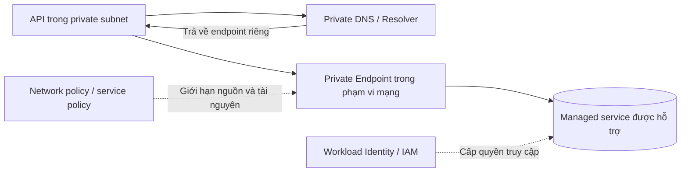
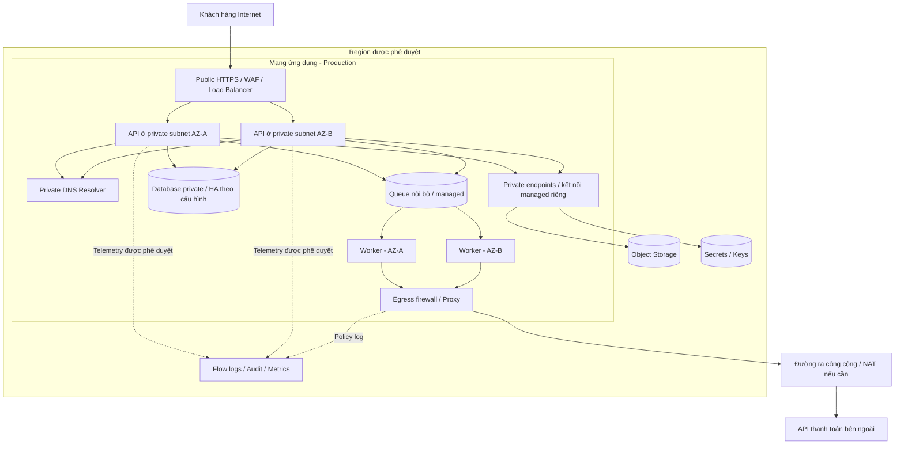

# Private endpoint, dịch vụ nội bộ và kiểm soát đường ra

## 1. Bài toán kiến trúc: kết nối đủ dùng, hạn chế đường không cần thiết

Một ứng dụng trên đám mây có thể nhận yêu cầu từ Internet nhưng không có nghĩa mọi thành phần phía sau phải có địa chỉ public hoặc được phép truy cập Internet tự do. Ví dụ, hệ thống đặt lịch có một API phục vụ khách hàng, một cơ sở dữ liệu chứa thông tin cá nhân, một kho đối tượng lưu tài liệu và một worker gọi cổng thanh toán. Nếu tất cả tài nguyên đều mở đường mạng công cộng, bề mặt tấn công và nguy cơ gửi dữ liệu nhầm ra ngoài sẽ tăng; ngược lại, chặn mọi kết nối mà không kiểm tra phụ thuộc có thể khiến ứng dụng không đọc được secret, tải image container hoặc xác thực được người dùng.

Trong chương **Kiến trúc mạng** của module **CLOUD_ARCHITECTURE**, bài học này tập trung vào ba quyết định có quan hệ chặt chẽ:

1. **Private endpoint:** cho phép workload truy cập một dịch vụ được quản lý hoặc dịch vụ được công bố qua đường kết nối riêng theo khả năng của nền tảng.
2. **Dịch vụ nội bộ:** đặt API, database, queue, công cụ quản trị hoặc dịch vụ dùng chung sau ranh giới truy cập được kiểm soát.
3. **Kiểm soát đường ra (egress control):** xác định workload được chủ động kết nối đến đâu, qua đường nào, bằng danh tính nào và có thể quan sát/giới hạn lưu lượng ra ngoài ra sao.

Mục tiêu là chuyển yêu cầu nghiệp vụ thành lựa chọn **mạng, compute, dữ liệu và mô hình triển khai**, có xét **độ tin cậy, bảo mật, mở rộng, chi phí và vận hành** theo các nguyên tắc **Well-Architected**.

Sau bài này, người học có thể phân biệt public/private endpoint, thiết kế kết nối dịch vụ nội bộ, xây dựng ma trận luồng mạng, kết hợp DNS–routing–firewall–identity để kiểm soát đường ra và xác minh kiến trúc bằng kiểm thử thực tế.

## 2. Phân biệt các luồng và ranh giới mạng

Trước khi chọn một sản phẩm cloud, hãy phân loại lưu lượng:

| Nhóm luồng | Ý nghĩa | Ví dụ | Câu hỏi cần trả lời |
|---|---|---|---|
| **Ingress** | Lưu lượng đi **vào** ứng dụng từ client/hệ thống bên ngoài | Khách hàng → HTTPS load balancer → API | Điểm public nào bắt buộc? TLS, WAF, xác thực và rate limit ở đâu? |
| **East-west** | Lưu lượng giữa các workload/dịch vụ bên trong phạm vi kiểm soát | API → database, API → queue, worker → API nội bộ | Những nguồn nào được gọi đích nào? Có phân vùng theo môi trường/đội không? |
| **Egress** | Kết nối do workload **khởi tạo đi ra ngoài** mạng hoặc ranh giới tin cậy | Worker → API thanh toán, API → dịch vụ SaaS | Có cần Internet không? Chặn đích không được duyệt bằng cách nào? |
| **Control/management plane** | Trao đổi để cấp cấu hình, danh tính, triển khai, vận hành | Node → registry, workload → token/secret service, agent → telemetry | Các endpoint điều khiển cần đi qua mạng nào? Chặn đường ra có ảnh hưởng vận hành không? |

Một kết nối đến dịch vụ managed **có thể đi ra khỏi subnet nhưng vẫn ở trên đường kết nối riêng**, hoặc được định tuyến qua endpoint được cung cấp trong VPC/VNet. Do đó, cần phân biệt **egress ra Internet** với **lưu lượng đi tới dịch vụ ngoài subnet/VPC**; không nên đánh đồng mọi kết nối outbound với truy cập Internet công cộng.

Ví dụ luồng **Internet → public load balancer → API private** là mô hình phổ biến: API nhận request thông qua load balancer nhưng instance/container API không nhất thiết phải sở hữu public IP. Khi API gọi database, kết nối có thể diễn ra hoàn toàn trong mạng riêng với quyền truy cập giới hạn.

## 3. Private endpoint là gì, giải quyết vấn đề nào?

**Private endpoint** thường là cơ chế cung cấp một điểm truy cập tới dịch vụ bằng địa chỉ/đường kết nối riêng trong mạng của bên sử dụng, thay vì yêu cầu workload truy cập endpoint public qua Internet. Tên và cách triển khai khác nhau giữa nhà cung cấp: ví dụ **AWS PrivateLink/interface VPC endpoint**, **Azure Private Endpoint**, hoặc **Google Cloud Private Service Connect**. Các dịch vụ và tính năng được hỗ trợ khác nhau; không coi đây là một API hay mô hình mạng giống hệt trên mọi cloud.

Mục tiêu thường gồm:

- Giảm nhu cầu dùng public IP và đường ra Internet cho các kết nối đến dịch vụ được hỗ trợ.
- Tạo ranh giới kết nối từ subnet/VPC/VNet đã được kiểm soát, kết hợp với IAM và chính sách của dịch vụ.
- Đơn giản hóa việc áp dụng quy tắc cho nơi gọi dịch vụ, nhất là khi workload đặt trong private subnet.
- Trong một số dịch vụ, tạo đường truy cập riêng từ mạng khác được kết nối phù hợp (VPN/đường truyền riêng, peering/transit), tùy khả năng định tuyến và DNS.

Tuy nhiên, **có private endpoint không đồng nghĩa dịch vụ đã trở thành private hoàn toàn**. Một dịch vụ managed có thể vẫn giữ endpoint public hoạt động; phải cấu hình riêng để vô hiệu hóa hoặc giới hạn đường public nếu yêu cầu. Private endpoint cũng không thay thế **IAM, quyền truy cập dữ liệu, TLS, mã hóa, logging hoặc policy chống gửi dữ liệu ra ngoài**.

### 3.1. Phân biệt các cơ chế dễ bị nhầm

| Cơ chế | Đường truy cập điển hình | Khi nào phù hợp | Giới hạn cần kiểm chứng |
|---|---|---|---|
| **Public service endpoint + TLS/IAM** | Workload gọi tên dịch vụ public, có thể ra qua NAT/egress | Nhu cầu thông thường khi bảo mật và chính sách cho phép | Đường public phải được bảo vệ; cần kiểm soát nguồn, đích, quyền và egress |
| **Private endpoint / private service connection** | Kết nối đến dịch vụ thông qua điểm truy cập riêng được nền tảng hỗ trợ | Truy cập managed database, secrets, storage hoặc service cung cấp riêng | Phạm vi region, zone, DNS, quota, chi phí và trạng thái public endpoint tùy sản phẩm |
| **Service endpoint / private API access** | Cơ chế định tuyến và nhận dạng subnet tới dịch vụ theo nhà cung cấp | Truy cập một số dịch vụ cloud mà không cần public IP cho workload | **Không nhất thiết cấp địa chỉ IP riêng cho dịch vụ**; khác private endpoint ở nhiều nền tảng |
| **Gateway endpoint / route-based endpoint** | Route chuyên dụng từ VPC đến dịch vụ hỗ trợ | Dịch vụ có tích hợp định tuyến native của nền tảng | Không áp dụng cho mọi dịch vụ; cách bảo vệ DNS/policy khác interface endpoint |
| **Internal load balancer / private ingress** | Client nội bộ truy cập IP/DNS private của ứng dụng | Công bố API nội bộ giữa các subnet/VPC/đơn vị dùng chung | Cần network reachability, IAM/mTLS khi phù hợp, health check và HA |
| **NAT gateway / outbound proxy** | Workload khởi tạo kết nối đến đích bên ngoài qua điểm trung chuyển | Dịch vụ phải gọi API công cộng hoặc tải gói cập nhật | NAT chỉ thực hiện chuyển địa chỉ/đường ra; **không tự cung cấp lọc đích theo ứng dụng** |

Một ví dụ quan trọng: ở một số nền tảng, **service endpoint** cho phép subnet truy cập dịch vụ thông qua tuyến mạng cloud và chính sách subnet, nhưng địa chỉ của dịch vụ vẫn có thể là public. Không được vẽ hoặc mô tả mọi service endpoint như một NIC/private IP nằm trong subnet.

### 3.2. Đường đi khi ứng dụng gọi dịch vụ managed qua private endpoint

Mô hình logic:

**Giải thích:** ứng dụng sử dụng tên dịch vụ, bộ phân giải DNS cung cấp địa chỉ/đường truy cập tương ứng theo cấu hình, network policy cho phép kết nối, còn dịch vụ xác thực danh tính và quyền truy cập. Bốn yếu tố này phải hoạt động cùng nhau; chỉ tạo tài nguyên endpoint nhưng thiếu DNS, route hoặc IAM vẫn có thể khiến request thất bại hoặc đi theo đường ngoài dự kiến.

## 4. DNS: thành phần quyết định client thực sự gọi endpoint nào

Nhiều sự cố private endpoint xuất hiện ở **phân giải tên**, không phải do endpoint hỏng. Ứng dụng thường gọi bằng hostname để TLS xác minh chứng chỉ và tránh phụ thuộc địa chỉ IP cố định. Khi bật private endpoint, cần hiểu tên dịch vụ được giải như thế nào từ từng mạng.

### 4.1. Các bước cần xác minh

1. **Tên gọi chuẩn (FQDN):** ứng dụng có sử dụng hostname được dịch vụ hỗ trợ khi truy cập riêng không?
2. **Vùng DNS riêng:** private zone/record hoặc cơ chế private DNS được liên kết đúng với VPC/VNet hay không?
3. **Truy vấn từ đúng nguồn:** kết quả trả về cho workload trong cloud, CI runner, VPN client và on-prem có thể khác nhau. Phải kiểm tra từng phía cần kết nối.
4. **Chuyển tiếp DNS:** nếu dùng DNS tự quản hoặc hybrid, conditional forwarder và resolver có hỗ trợ tên dịch vụ private không?
5. **TLS và SNI:** không thay tên dịch vụ bằng địa chỉ IP tùy tiện nếu khiến xác minh chứng chỉ thất bại. Giữ kiểm tra certificate/hostname theo mô hình dịch vụ được hỗ trợ.
6. **Vòng đời endpoint:** theo dõi thay đổi endpoint, IP, bản ghi, TTL và hành vi cache khi failover/triển khai lại.

Ví dụ minh họa: một API gọi `storage.example.invalid`. Trong mạng production, DNS được cấu hình trả về private IP của điểm truy cập. Tại máy không thuộc phạm vi private DNS, cùng tên có thể trả lời khác hoặc không truy cập được. **Tên và IP chỉ minh họa; cần tuân thủ mẫu DNS thực tế của dịch vụ cloud**.

### 4.2. Lỗi thường gặp

- Endpoint tạo thành công nhưng private DNS chưa được liên kết với VPC nên client vẫn resolve endpoint public.
- Môi trường staging dùng resolver khác production, dẫn đến thử nghiệm thành công ở một nơi nhưng thất bại ở nơi khác.
- Kết nối từ on-prem vào cloud đã thông về route nhưng DNS on-prem không biết chuyển tiếp tên private; client nhận IP public.
- Tự tạo bản ghi DNS trùng với vùng của nhà cung cấp và làm hỏng đường truy cập tới các dịch vụ khác.
- Dùng một private endpoint/địa chỉ làm phụ thuộc đơn điểm, chưa xem khả năng phục hồi theo AZ/region của dịch vụ.

**Kiểm tra DNS ngay tại runtime** (pod, container, VM hoặc job) thay vì suy luận từ máy tính cá nhân. Nếu đường kiểm soát egress yêu cầu DNS nội bộ, DNS resolver phải có HA, giám sát và chính sách ngăn dùng resolver không được phê duyệt khi khả thi.

## 5. Tổ chức dịch vụ nội bộ

**Dịch vụ nội bộ** là dịch vụ chỉ dành cho các client thuộc phạm vi được phép, ví dụ `inventory-api`, cơ sở dữ liệu, worker admin API hoặc hệ thống xử lý sự kiện. “Nội bộ” được xác định bởi **chính sách truy cập và phạm vi tin cậy**, không chỉ bởi việc gắn IP thuộc dải RFC 1918.

### 5.1. Mô hình kết nối phổ biến

| Mô hình | Cách công bố | Điều cần bảo vệ |
|---|---|---|
| Cùng VPC/VNet | Internal load balancer, service discovery, private DNS; có thể kết nối trực tiếp nếu phù hợp | Ingress chỉ từ workload được phép, xác thực dịch vụ, phân đoạn mạng |
| Giữa các VPC/VNet | Peering/transit/hub-and-spoke hoặc dịch vụ công bố riêng được nền tảng hỗ trợ | Tránh mạng phẳng, địa chỉ chồng lấn, route lan truyền, quyền xuyên môi trường |
| Từ on-prem vào cloud | VPN hoặc đường kết nối riêng, routing và DNS hybrid | Định tuyến hai chiều, IP overlap, TLS, danh tính, khả năng chịu lỗi đường truyền |
| Giữa đội sản phẩm/tenant | API gateway/private service exposure và chính sách theo consumer | Không cho consumer truy cập toàn bộ mạng nhà cung cấp; quota, audit và hợp đồng API |

Trong một cụm Kubernetes, **ClusterIP Service** thường chỉ định tuyến nội bộ cụm; nếu cần client ở mạng khác, phải có cơ chế công bố phù hợp, chính sách mạng và xác thực. Không suy ra ClusterIP có thể truy cập từ toàn bộ VPC/on-prem mà không có các điều kiện bổ sung.

### 5.2. Không biến mạng riêng thành mạng tin cậy tuyệt đối

Đặt dịch vụ sau internal load balancer hoặc private endpoint chỉ giảm phạm vi tiếp cận; nếu workload bị chiếm quyền, kẻ tấn công vẫn có thể gọi dịch vụ mà workload đó truy cập được. Vì vậy, nên kết hợp:

- **Mạng:** security group/firewall/network policy chỉ cho đúng nguồn và cổng; phân chia subnet và môi trường.
- **Danh tính:** workload identity, IAM, mTLS hoặc xác thực ứng dụng theo nhu cầu; role chỉ được làm thao tác nghiệp vụ cần thiết.
- **Dữ liệu:** mã hóa khi truyền và lưu, phân loại dữ liệu, chính sách truy cập tài nguyên, bảo vệ bản sao lưu.
- **Quan sát:** log truy cập, network flow logs, audit, cảnh báo bất thường và truy vết liên dịch vụ.

Nếu hệ thống dùng service mesh, cần ghi rõ nơi thực thi mTLS và policy (proxy hoặc ứng dụng), cách xoay vòng chứng chỉ và hành vi khi control plane không sẵn sàng. Thêm mesh chỉ hợp lý nếu đội có năng lực vận hành và bài toán thực sự cần.

## 6. Kiểm soát đường ra Internet và dịch vụ bên ngoài

Một workload đặt trong **private subnet** không có public IP trực tiếp vẫn có thể ra Internet qua NAT, proxy, firewall hoặc một cổng egress dùng chung. Vì vậy, tuyên bố “API ở private subnet nên không thể gọi Internet” thường là sai nếu chưa xem **route table, gateway, policy và luồng IPv4/IPv6**.

### 6.1. Chọn chiến lược egress theo nhu cầu

| Chiến lược | Cách vận hành | Ưu điểm | Rủi ro/đánh đổi |
|---|---|---|---|
| **Không có đường Internet outbound** | Không tạo route/đường đi tới Internet; dùng kết nối riêng cho dependency bắt buộc | Giảm bề mặt tấn công và nguy cơ gửi dữ liệu đi ngoài ý muốn | Nhiều dependency như registry, update, identity, telemetry có thể cần thiết kế lại |
| **NAT/gateway cho outbound** | Private workload đi ra qua địa chỉ/đường dịch vụ NAT | Đơn giản khi cần kết nối public; workload không cần public IP | NAT không lọc URL/FQDN theo mặc định; phí gateway và truyền dữ liệu |
| **Egress firewall** | Đường ra bắt buộc đi qua thiết bị/dịch vụ kiểm soát policy và ghi log | Có thể lọc theo rule hỗ trợ, audit và quản lý tập trung | Chi phí, throughput, failover, quản lý rule, khả năng tạo điểm lỗi |
| **HTTP(S) proxy/secure web gateway** | Ứng dụng dùng proxy để gọi đích được phép | Chính sách theo đích/domain và khả năng ghi nhận request tùy nền tảng | Có workload không hỗ trợ proxy; cần ngăn đường kết nối trực tiếp bỏ qua proxy |
| **Private endpoint cho dịch vụ hỗ trợ** | Kết nối riêng đến một dịch vụ managed/producer | Giảm nhu cầu NAT/public egress cho đường này | Cần DNS, policy, endpoint theo region và tính phí nếu có |

**NAT gateway không phải firewall ứng dụng**: NAT chuyển đổi địa chỉ/port và hỗ trợ kết nối outbound, nhưng tự nó không đảm bảo chỉ gọi được tên miền thanh toán được duyệt. Tương tự, cấu hình DNS allowlist chỉ giúp phân giải tên; nếu route và firewall vẫn cho phép kết nối trực tiếp đến IP bất kỳ thì chính sách đó có thể bị vượt qua.

### 6.2. Quy trình thiết kế chính sách đường ra

1. **Liệt kê đích được phép theo chức năng:** ví dụ API thanh toán, dịch vụ định danh, email provider, container registry, secret manager, telemetry và cập nhật hệ điều hành.
2. **Phân loại đường đi:** đích nào có private endpoint, kết nối riêng, endpoint native; đích nào buộc dùng HTTPS qua Internet.
3. **Chọn điểm cưỡng chế policy:** route bắt buộc qua firewall/proxy khi cần; áp dụng rule nguồn–đích–cổng, policy danh tính/dịch vụ và giới hạn subnet.
4. **Thiết kế allowlist:** ghi FQDN/domain, port, giao thức, URL/path nếu công cụ hỗ trợ; cân nhắc IP thay đổi bởi CDN/load balancing. Rule theo IP cố định chỉ dùng khi nhà cung cấp bảo đảm dải IP và có quy trình cập nhật.
5. **Đặt mặc định chặn theo phạm vi áp dụng được:** chỉ mở những đích đã phê duyệt; thử cả trường hợp đích hợp lệ và bị từ chối. Với nhu cầu bất thường, có quy trình cấp ngoại lệ có thời hạn.
6. **Quan sát và vận hành:** flow log, proxy log, DNS log theo chính sách, cảnh báo blocked traffic và audit thay đổi rule. Không lưu nội dung nhạy cảm vào log nếu không được phép.
7. **Kiểm thử khả năng chịu lỗi:** kiểm tra gateway/firewall/proxy/DNS khi mất một instance hoặc AZ; xác minh route dự phòng và hiệu năng tại tải đỉnh.

### 6.3. Những điểm dễ bỏ sót

**IPv6:** nếu subnet hoặc workload có IPv6, một chính sách chỉ kiểm soát NAT IPv4 sẽ không kiểm soát được mọi đường ra. Xác minh route IPv6, firewall tương ứng và loại gateway; đừng suy luận rằng NAT IPv4 tự bao phủ IPv6.

**DNS và lưu lượng mã hóa:** lọc theo FQDN đôi khi dựa vào DNS, TLS SNI hoặc khả năng proxy của sản phẩm; không phải mọi công cụ đều nhìn được URL/path bên trong HTTPS. Nếu có TLS inspection, phải đánh giá tác động đến tin cậy chứng chỉ, quyền riêng tư, hiệu năng và các ứng dụng dùng certificate pinning.

**Phụ thuộc vận hành:** node/pod có thể cần registry, time service, token service, KMS, log ingestion, package repository hoặc API điều khiển của cloud. Việc chặn outbound hoàn toàn mà không đưa các phụ thuộc này vào ma trận luồng có thể làm triển khai, autoscaling hoặc khởi động workload thất bại.

**Đường phụ:** nếu một workload vẫn có public IP, route phụ hoặc gateway khác ngoài firewall/proxy chính, lưu lượng có thể đi vòng chính sách egress. Cần đối chiếu route, policy, network ACL/security rule và thực tế flow logs, không chỉ dựa trên sơ đồ tổng quan.

## 7. Kiến trúc tham khảo: API private, dữ liệu riêng và egress có kiểm soát

Giả sử dịch vụ đặt lịch có website/API công khai, PostgreSQL chứa dữ liệu khách hàng, object storage cho tài liệu, secrets manager, queue gửi thông báo và worker gọi cổng thanh toán bên ngoài. Yêu cầu minh họa:

- Chỉ điểm vào web/API được công bố ra Internet. Database, queue, secrets và bucket không được truy cập trực tiếp từ Internet ngoài phạm vi được phê duyệt.
- API chạy trong hai AZ của một region, cần đánh giá khả năng chịu sự cố một AZ.
- Các dịch vụ managed có cơ chế private endpoint được ưu tiên xem xét; địa điểm và tính sẵn có của cơ chế phải được xác minh.
- Worker chỉ được gọi cổng thanh toán đã phê duyệt; không có yêu cầu tải dữ liệu lên website bất kỳ.
- Team cần có log đủ truy lỗi mạng, cảnh báo và quy trình thay đổi policy; chi phí vận hành có giới hạn.

### 7.1. Sơ đồ luồng mức kiến trúc

**Sơ đồ là mô hình khái niệm, không phải topology mặc định của một cloud.** Vai trò và vị trí thực tế của DNS resolver, WAF/load balancer, endpoint, queue và database phải được diễn đạt theo dịch vụ đang dùng. Chữ “private” trên hộp DB **không đảm bảo database tự có HA**; cần xác minh chế độ backup/failover, AZ, đường kết nối và bảo mật riêng. Tương tự, firewall/proxy và NAT có thể là một dịch vụ kết hợp hoặc nằm ở mạng hub, không bắt buộc là hai thiết bị nối tiếp.

### 7.2. Ma trận luồng mạng mẫu

| ID | Nguồn | Đích | Mục đích, giao thức | Cơ chế cho phép / giới hạn |
|---|---|---|---|---|
| F-01 | Internet client | Public entry | HTTPS 443 vào API | TLS, WAF/rate limit, xác thực ứng dụng |
| F-02 | Public entry | API private replicas | HTTPS hoặc kết nối được LB hỗ trợ | Ingress chỉ từ LB; health check theo đúng nguồn |
| F-03 | Booking API | PostgreSQL private | TLS/TCP đến cổng DB **được cấu hình** | Network allowlist từ API, DB identity và quyền SQL tối thiểu |
| F-04 | Booking API | Object Storage qua endpoint riêng | API storage qua HTTPS | Endpoint/DNS đúng vùng, IAM chỉ đúng bucket/prefix, public access policy |
| F-05 | Booking API/worker | Secret service qua endpoint riêng | Đọc secret qua HTTPS | Role workload riêng, audit, secret rotation |
| F-06 | Booking API | Queue | Publish sự kiện đặt lịch | Identity được publish, retry có giới hạn |
| F-07 | Worker | Queue | Consume sự kiện | Identity consume, DLQ, idempotency |
| F-08 | Worker | Payment API public | HTTPS 443 qua policy egress | Chỉ FQDN/đích được phê duyệt, timeout, log metadata, rate limit |
| F-09 | Workload | DNS / telemetry cần thiết | Truy vấn DNS, gửi log/metrics | Chỉ resolver/endpoint được phê duyệt, log retention |
| F-10 | CI/CD runner | Control-plane/deploy endpoint | Triển khai ứng dụng, image, IaC | Identity triển khai riêng; môi trường và quyền được giới hạn |

Các giá trị giao thức/port trong bảng là **ví dụ cần xác nhận**. Ví dụ PostgreSQL thường dùng TCP 5432, nhưng cổng có thể cấu hình khác; không nên cố định port mà không biết môi trường. Ma trận nên bổ sung **owner**, vùng dữ liệu, trạng thái phê duyệt, bằng chứng thử kết nối và thời điểm xem lại.

### 7.3. Chuỗi xử lý một giao dịch đặt lịch

1. Client truy cập public entry qua HTTPS; ingress chuyển yêu cầu tới API replica trong private subnet.
2. API xác thực người dùng, đọc thông tin kết nối từ secret manager bằng workload identity qua private endpoint khi dịch vụ hỗ trợ.
3. API kết nối PostgreSQL theo đường nội bộ được giới hạn; quyền ghi chỉ trên dữ liệu nghiệp vụ cần thiết.
4. API ghi sự kiện xác nhận vào queue; worker xử lý bất đồng bộ, có cơ chế tránh gửi trùng khi retry.
5. Nếu nghiệp vụ cần thanh toán, worker đi qua đường egress được kiểm soát đến đúng API của đối tác qua HTTPS.
6. Log/metric/trace ghi nhận sự thành công/thất bại và điểm chặn policy; không để token, dữ liệu cá nhân hoặc payload nhạy cảm bị ghi tràn lan.

Đường private tới storage/secret **không làm mất nhu cầu egress ra đối tác thanh toán**. Mỗi luồng được quyết định và kiểm tra riêng theo yêu cầu nghiệp vụ.

## 8. Các yếu tố bảo mật cần kiểm chứng

Thiết kế chỉ dùng private endpoint hoặc firewall sẽ chưa đủ nếu thiếu các lớp khác:

| Lớp | Kiểm tra tối thiểu | Dấu hiệu thiết kế chưa đạt |
|---|---|---|
| **Đường public** | Tài nguyên nào có public endpoint, đã tắt/giới hạn khi không cần? | Storage/DB vẫn cho mọi nguồn trên Internet truy cập |
| **Network policy** | Security group, route, firewall, endpoint policy giới hạn đúng nguồn–đích–cổng? | API dev truy cập được DB prod; mọi subnet gọi mọi dịch vụ |
| **IAM và dữ liệu** | Role theo workload, phân quyền bucket/secret/database, mã hóa và backup? | Token một service đọc toàn bộ secret hoặc bucket của tổ chức |
| **DNS** | FQDN trong môi trường private resolve đúng, có chống đường vòng không? | Hostname trả về IP public ngoài dự kiến, resolver không kiểm soát |
| **Egress policy** | Có allowlist cho đích bắt buộc, chặn đích không duyệt và kiểm soát IPv6? | NAT đi được mọi nơi, proxy có thể bị bỏ qua |
| **Ứng dụng** | Kiểm tra SSRF, input URL, redirect, token và webhook; kết nối TLS đúng? | API nhận URL tùy ý từ user rồi fetch với quyền mạng cao |
| **Giám sát** | Có flow logs, audit, cảnh báo bất thường và khả năng truy vết? | Không biết ai gọi đích nào sau sự cố |

**Chống rò rỉ dữ liệu (data exfiltration)** phải dựa trên nhiều lớp. Egress filtering có thể giảm những đường truyền không mong muốn nhưng không chứng minh rằng dữ liệu không thể rò rỉ: dữ liệu vẫn có thể đi qua một endpoint được phép nếu chính sách ứng dụng/IAM sai. Những kết nối nhận dữ liệu từ bên ngoài như webhook, proxy hoặc API gateway cũng cần xác thực và kiểm tra payload.

## 9. Độ tin cậy, hiệu năng và chi phí khi tăng kiểm soát

Một private endpoint hoặc egress gateway có thể trở thành thành phần trong **đường găng phục vụ**. Cần xem xét:

- **Sự cố AZ:** endpoint, resolver, firewall/NAT/proxy, load balancer và worker có cần triển khai đa AZ không? Một thiết kế đa AZ ở compute nhưng chỉ có một egress gateway theo AZ có thể ngừng gọi đối tác khi mất AZ.
- **Sự cố dịch vụ/region:** endpoint riêng không tự tạo phương án phục hồi multi-region; cần biết DNS, replication, quyền truy cập và đường chuyển vùng tại region dự phòng.
- **Tải và throughput:** endpoint/network appliance có giới hạn kết nối/băng thông, NAT có giới hạn cổng/kết nối, firewall/proxy có độ trễ xử lý. Kiểm tra dựa trên tải đỉnh và retry storm khi phụ thuộc lỗi.
- **Hành vi lỗi:** khi đích egress hoặc DNS bị chặn, ứng dụng cần timeout, backoff, circuit breaker khi phù hợp, hàng đợi và thông báo lỗi rõ ràng; tránh retry liên tục làm nghẽn hệ thống.
- **Chi phí:** một số private endpoint tính phí thời gian tồn tại và/hoặc dữ liệu truyền, egress gateway/NAT/firewall/proxy có phí riêng, thêm chi phí cross-AZ, logs và truyền ra Internet. Mức phí thay đổi theo nhà cung cấp, vùng và loại dịch vụ.
- **Vận hành:** chính sách allowlist thay đổi khi đối tác thay đổi FQDN/IP; cần người quản lý và quy trình test để không gây sự cố vì rule lỗi thời.

### 9.1. So sánh quyết định khi phải tối ưu chi phí

| Lựa chọn | Có thể phù hợp nếu | Đánh đổi phải chấp nhận |
|---|---|---|
| Managed service qua private endpoint | Dữ liệu nhạy cảm, hạn chế public egress, dịch vụ được hỗ trợ và ngân sách đủ | Quản lý DNS, endpoint, IAM, phí kết nối và khả năng phục hồi |
| Managed service qua public HTTPS + IAM chặt | Dịch vụ chưa có endpoint riêng hoặc phạm vi rủi ro cho phép | Cần kiểm soát public access, đường egress và chính sách chặt chẽ |
| Egress đi qua một NAT | Ứng dụng ít yêu cầu lọc đích, phạm vi thử nghiệm/đánh giá rủi ro cho phép | Không đáp ứng tự động yêu cầu allowlist đích theo FQDN |
| Egress qua firewall/proxy có policy | Quy định bắt buộc hạn chế đích truy cập, cần audit và quản trị tập trung | Thêm phí, độ phức tạp, yêu cầu HA và runbook |

Không có một lựa chọn tối ưu cho mọi ứng dụng. Nếu yêu cầu nghiệp vụ là “mọi kết nối outbound tới Internet phải được allowlist và audit”, **chỉ tạo NAT** chưa giải quyết yêu cầu. Nếu yêu cầu là “DB không công bố public”, **chỉ chặn outbound từ API** cũng chưa đủ; phải cấu hình chính bản thân DB và đường inbound.

## 10. Thiết kế và kiểm thử theo một quy trình có thể lặp lại

### Bước 1 — Thu thập nhu cầu và phân loại dữ liệu

Liệt kê người dùng, API, database, queue, object storage, secret manager, hệ thống on-prem, dịch vụ bên thứ ba và các luồng control plane. Đánh dấu dữ liệu cá nhân, dữ liệu thanh toán, vị trí được phép lưu và yêu cầu truy vết.

### Bước 2 — Vẽ đường đi hiện tại và đường đi dự kiến

Tách ít nhất ba góc nhìn: **ingress**, **east-west/private service access**, **egress**. Trên sơ đồ ghi rõ môi trường, account/project, VPC/VNet, subnet, region/AZ, DNS, routing, firewall/endpoint và dịch vụ bên ngoài. Mũi tên phải có chiều và nhãn chức năng.

### Bước 3 — Chọn kết nối riêng nơi phù hợp

Kiểm tra dịch vụ có hỗ trợ private endpoint, endpoint policy, private DNS và truy cập từ mạng cần dùng hay không. Xác minh đường public của dịch vụ có thể vô hiệu hóa/giới hạn, chi phí và các ràng buộc zone/region. Với API nội bộ, đánh giá internal LB, service discovery, mạng chia sẻ hoặc cơ chế publish dịch vụ.

### Bước 4 — Thiết kế egress policy theo ma trận

Đối với mỗi đích public được cho phép, xác nhận owner, hostname/IP, port/giao thức, loại dữ liệu truyền, tần suất và yêu cầu log. Cấu hình route qua điểm cưỡng chế phù hợp; kết hợp network rules với IAM và xác thực ứng dụng. Xem cả luồng IPv6, đường ra phụ và nhu cầu DNS/control plane.

### Bước 5 — Đưa cấu hình vào IaC và quản trị thay đổi

Quản lý network, DNS zone/link, endpoint, route, firewall rule, IAM policy, tags và logging bằng hạ tầng dưới dạng mã khi nền tảng hỗ trợ. Tách state/quyền của dev, test, staging, prod. Thay đổi rule phải qua review và có khả năng quay lại; không mở toàn bộ Internet vĩnh viễn chỉ để xử lý một lỗi tạm thời.

### Bước 6 — Kiểm thử chấp nhận có bằng chứng

| Kịch bản kiểm thử | Hành động | Kết quả kỳ vọng |
|---|---|---|
| **DNS private** | Resolve FQDN dịch vụ từ workload trong từng subnet và mạng hybrid cần truy cập | Trả lời theo đường private đã thiết kế, không vô tình dùng endpoint public |
| **Private service access** | Gọi storage/secret từ API bằng workload identity hợp lệ | Thành công qua đường được phê duyệt; không cần Internet public cho luồng đó nếu dịch vụ hỗ trợ |
| **Quyền sai** | Dùng identity không được cấp quyền gọi cùng dịch vụ | Bị từ chối bởi IAM/service policy dù đường mạng thông |
| **Public bypass** | Thử gọi đường public khi yêu cầu bắt buộc dùng private | Bị chặn theo policy; không có đường đi khác vượt ranh giới |
| **Đích Internet hợp lệ** | Gọi sandbox của đối tác được phê duyệt từ worker | Thành công, TLS xác thực đúng, có log metadata |
| **Đích Internet không duyệt** | Gọi hostname minh họa không có trong allowlist | Bị chặn; log xác định nguồn, rule và lý do |
| **Mất AZ / gateway** | Mô phỏng sự cố một AZ hoặc đường egress trong môi trường thử nghiệm | Lưu lượng tự chuyển hoặc lỗi có kiểm soát theo mục tiêu SLO/RTO đã thống nhất |
| **Tăng tải** | Kiểm tra số kết nối, throughput, timeout, log ở tải đỉnh | Không nghẽn NAT/firewall/proxy/endpoint; chi phí và giới hạn được đo |

Không cần dùng dịch vụ thật của đối tác khi chạy bài kiểm thử phá lỗi; hãy dùng sandbox hoặc endpoint thử nghiệm được chủ hệ thống cho phép. Phải xác định trước **tiêu chí đạt**, người quan sát, kế hoạch rollback và ranh giới tác động.

### Bước 7 — Theo dõi liên tục

Theo dõi số lượng kết nối bị từ chối theo ứng dụng, thay đổi DNS, chi phí endpoint/NAT, throughput egress, lỗi kết nối do timeout, security audit, trạng thái private endpoint và các rule sắp hết hạn. Khi thêm dịch vụ mới hoặc region mới, cập nhật ma trận mạng và ADR thay vì âm thầm thêm rule toàn quyền.

## 11. ADR mẫu: dùng private endpoint cho dữ liệu và lọc egress đối tác

> **ADR-NET-007 — Private service access và egress qua policy tập trung.**
>
> **Bối cảnh:** Booking API xử lý thông tin khách hàng, storage và secrets không cần được gọi từ Internet; worker phải gọi một API thanh toán public. Nhóm muốn hạn chế đường đi ngoài dự kiến và có bằng chứng audit.
>
> **Quyết định đề xuất:** triển khai API/worker trên private subnet ở các AZ cần thiết; dùng private endpoint cho storage/secret khi dịch vụ hỗ trợ; database chỉ cho workload được cấp quyền kết nối; định tuyến kết nối Internet của worker qua policy egress để chỉ cho các đích được duyệt. Giữ public HTTPS entry riêng cho khách hàng.
>
> **Lý do:** giảm bề mặt public ở lớp dữ liệu, giới hạn đường outbound theo nhu cầu thực tế và tạo điểm quan sát thay đổi mạng.
>
> **Đánh đổi:** thêm quản trị private DNS, endpoint policy, firewall/proxy, khả năng chịu lỗi của DNS/egress và phí vận hành/truyền dữ liệu.
>
> **Điều kiện phê duyệt:** đã xác minh support/region của dịch vụ, kiểm tra DNS và TLS, chứng minh identity sai bị từ chối, test chặn đích chưa duyệt, test luồng thanh toán hợp lệ, đo tải đỉnh/HA và dự toán chi phí. Mọi ngoại lệ có owner và ngày rà soát.

ADR giúp người đọc hiểu quyết định mạng dựa trên yêu cầu nào và **khi nào cần đánh giá lại**, ví dụ đổi đối tác thanh toán, thêm region, thay data classification hoặc phát hiện quá tải NAT/proxy.

## 12. Đánh giá theo Well-Architected

| Trụ cột | Câu hỏi quan trọng |
|---|---|
| **Operational Excellence** | Mạng, endpoint, DNS và firewall có được quản lý bằng IaC và theo dõi drift không? Ai phê duyệt rule mới và ứng cứu sự cố DNS/egress? |
| **Security** | DB/storage/secrets có public path không cần thiết? Network policy và IAM có giới hạn đúng workload? Egress có chặn đường vòng và đích không được duyệt không? |
| **Reliability** | DNS, private endpoint và egress gateway có là điểm lỗi duy nhất không? Mất AZ có làm mất khả năng gọi dịch vụ thiết yếu? |
| **Performance Efficiency** | Endpoint/NAT/firewall có chịu số kết nối và lưu lượng giờ cao điểm? Có độ trễ phát sinh qua proxy hoặc cross-AZ không? |
| **Cost Optimization** | Có tính phí endpoint theo giờ/dữ liệu, NAT, firewall, logs, egress Internet và cross-AZ? Có endpoint không được dùng tới không? |
| **Sustainability** | Có bỏ tài nguyên mạng nhàn rỗi, right-size gateway, gom luồng hợp lý và tránh truyền dữ liệu không cần thiết qua nhiều AZ/region không? |

### Những sai lầm thường gặp

1. **“Private subnet là không có đường ra Internet.”** Kiểm tra route, NAT/proxy, firewall và IPv6 trước khi kết luận.
2. **“Private endpoint có nghĩa dịch vụ không còn public.”** Phải kiểm chứng/tắt đường public và giới hạn policy ở chính dịch vụ.
3. **“Có private endpoint không cần IAM.”** Kết nối mạng và quyền truy cập dữ liệu là hai lớp độc lập.
4. **“NAT gateway là bộ lọc FQDN.”** NAT không tự tạo chính sách đích theo tên miền.
5. **“Dùng private endpoint là khỏi cần DNS.”** Phân giải tên sai có thể làm request đi đường public hoặc thất bại.
6. **“Chặn mọi outbound sẽ an toàn tuyệt đối.”** Có thể làm hỏng triển khai, identity, updates, telemetry; cũng không thay thế kiểm soát SSRF và IAM.
7. **“Đã có egress firewall thì dữ liệu không thể rò rỉ.”** Dữ liệu vẫn có thể rò rỉ qua đích hợp lệ nếu cấp quyền hoặc kiểm tra nghiệp vụ sai.
8. **“API đa AZ nên đường ra cũng đa AZ.”** Đường egress, resolver, endpoint và các dependency cần được kiểm chứng độc lập.

## 13. Bảng kiểm trước khi phê duyệt kiến trúc mạng

- [ ] Đã phân loại ingress, east-west, egress và control-plane traffic cho từng môi trường.
- [ ] Có ma trận nguồn–đích–giao thức/cổng–mục đích–owner và chính sách cấp quyền tương ứng.
- [ ] Dịch vụ nội bộ có ranh giới network/identity; database, storage và secret không mở public ngoài yêu cầu được phê duyệt.
- [ ] Với mỗi private endpoint, đã kiểm tra hỗ trợ dịch vụ/vùng, private DNS, route, TLS, IAM, endpoint/service policy và đường public còn tồn tại.
- [ ] Có thiết kế DNS và kết nối hybrid nếu client ở nhiều VPC/VNet hoặc on-prem.
- [ ] Những đích Internet cần thiết có đường egress được kiểm soát; các đường vòng IPv4/IPv6, proxy và public IP đã được rà soát.
- [ ] Các phụ thuộc registry, identity, KMS, telemetry, DNS và phần mềm cập nhật được liệt kê để không chặn nhầm.
- [ ] Sự cố một AZ/gateway/DNS được thử, có giám sát và runbook; không tạo điểm lỗi duy nhất không được chấp nhận.
- [ ] Đã tính chi phí endpoint, NAT, firewall/proxy, lưu lượng Internet/cross-AZ, logging và nhân lực vận hành.
- [ ] Có kiểm thử luồng được phép và bị chặn, audit policy, hồ sơ ADR và kế hoạch xem lại khi yêu cầu thay đổi.

**Điểm cần ghi nhớ:** private endpoint giúp tạo đường kết nối riêng tới một dịch vụ, dịch vụ nội bộ giới hạn phạm vi tiếp cận, còn kiểm soát egress quản lý nơi workload được phép chủ động kết nối. Chúng chỉ phát huy hiệu quả khi **DNS, routing, network policy, IAM, bảo vệ dữ liệu và vận hành** được thiết kế như một hệ thống thống nhất và kiểm chứng bằng tình huống thực tế.
