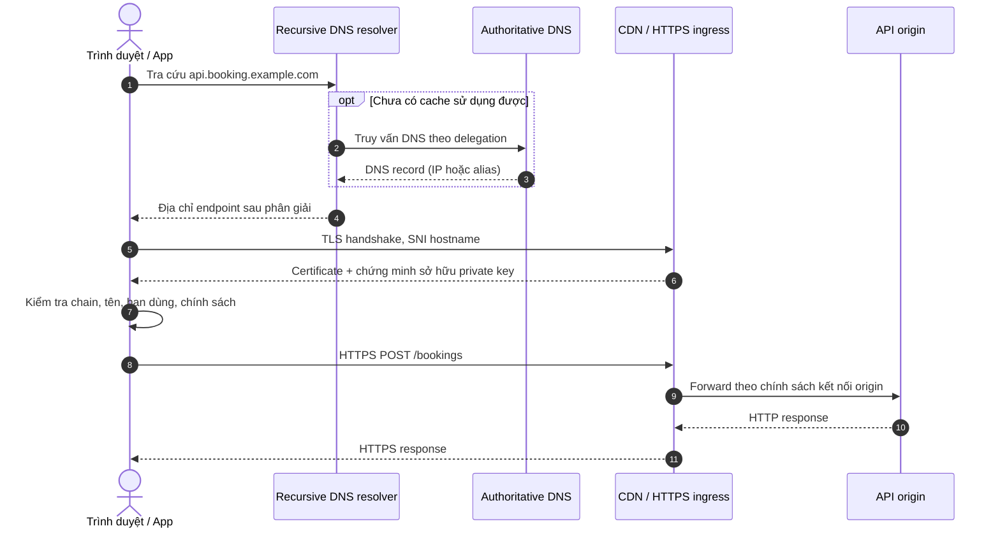
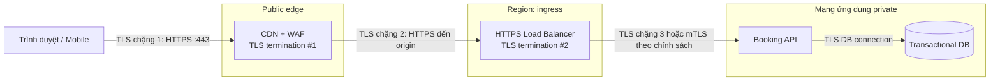
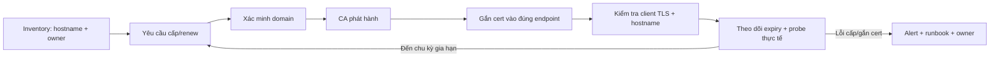
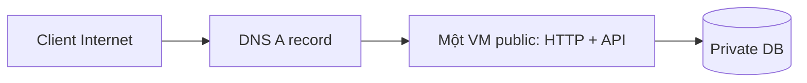

# Thiết kế tên miền, chứng chỉ và chấm dứt kết nối TLS

## 1. Điểm vào hệ thống là một quyết định kiến trúc

Người dùng thường biết địa chỉ như `https://booking.example.com` chứ không biết địa chỉ IP, tên máy ảo, container hay load balancer phía sau. Để một yêu cầu HTTPS đi đến đúng ứng dụng, hệ thống phải giải quyết ít nhất ba việc:

1. **Tên miền và DNS:** xác định hostname thuộc ai và phân giải hostname đó đến điểm vào nào.
2. **Chứng chỉ số:** cho phép client xác minh danh tính của endpoint HTTPS thông qua chứng chỉ và chuỗi tin cậy phù hợp.
3. **Chấm dứt kết nối TLS (TLS termination):** xác định thành phần nào nhận, giải mã và xử lý phiên TLS của client; dữ liệu đi tiếp tới dịch vụ phía sau có được mã hóa và xác thực lại không.

Trong module **CLOUD_ARCHITECTURE**, thiết kế cloud bắt đầu từ yêu cầu nghiệp vụ rồi chọn mạng, compute, dữ liệu và cách triển khai. Điểm vào ảnh hưởng trực tiếp đến **bảo mật, độ tin cậy, hiệu năng, khả năng mở rộng, chi phí và vận hành**. Một DNS record hoặc chứng chỉ sai có thể khiến toàn bộ ứng dụng không truy cập được dù API và database vẫn khỏe mạnh.

Sau bài này, bạn có thể:

- Thiết kế hệ thống hostname rõ ràng cho web, API, tài nguyên tĩnh và quản trị.
- Đọc đường phân giải DNS và đường kết nối HTTPS, phân biệt hai đường này.
- Giải thích vai trò của chứng chỉ, TLS handshake, SNI, chuỗi tin cậy và các mô hình TLS termination.
- Chọn nơi đặt TLS termination và bảo vệ **tất cả các chặng truyền dữ liệu** cần thiết.
- Lập quy trình cấp, triển khai, tự động gia hạn và giám sát chứng chỉ.
- Phân tích lỗi DNS/TLS, tình huống chuyển vùng và việc thay đổi endpoint theo tư duy **Well-Architected**.

## 2. Bối cảnh xuyên suốt: ứng dụng đặt lịch trên cloud

Giả sử doanh nghiệp triển khai **BookingCloud**, ứng dụng cho thuê thiết bị theo khung giờ. Khách hàng truy cập web, ứng dụng web gọi API để xem lịch và tạo đơn; ảnh thiết bị được phân phối qua CDN; nhân viên dùng giao diện quản trị riêng.

Các số liệu sau **chỉ là giả định để học thiết kế**, không phải SLA hoặc benchmark thực tế:

| Mã | Yêu cầu | Hệ quả tới điểm vào |
|---|---|---|
| F1 | Khách truy cập web và đặt lịch qua API | Hostname ổn định, định tuyến đúng về web/API, HTTPS bắt buộc |
| F2 | Ảnh thiết bị tải nhanh và có thể cache | Hostname tài nguyên tĩnh, CDN, chính sách cache phù hợp |
| F3 | Nhân viên truy cập giao diện quản trị | Endpoint quản trị có xác thực mạnh và giới hạn truy cập theo chính sách |
| S1 | Thông tin liên hệ và đơn thuê phải được bảo vệ | TLS, kiểm tra hostname/chứng chỉ, phân quyền ở ứng dụng, kiểm soát log |
| R1 | Mục tiêu minh họa: API cốt lõi đạt 99,9% trong một tháng | Theo dõi DNS, chứng chỉ, edge, load balancer, health check và failover |
| P1 | Mục tiêu minh họa: p95 tra cứu dưới 400 ms | Cân nhắc CDN, vị trí edge/origin, tái sử dụng kết nối, thời gian handshake |
| O1 | Đội vận hành nhỏ, cần tự động hóa | Managed certificate, IaC, cảnh báo hết hạn và runbook có chủ sở hữu |
| C1 | Có giới hạn ngân sách | So chi phí CDN/WAF/LB, kết nối, truyền dữ liệu và chứng chỉ với lợi ích |

**Phân chia endpoint đề xuất:**

| Hostname ví dụ | Mục đích | Điểm vào logic | Mức tiếp cận |
|---|---|---|---|
| `booking.example.com` | Giao diện web | CDN → web origin | Công khai qua HTTPS |
| `api.booking.example.com` | API đặt lịch | CDN/WAF hoặc API gateway/LB → API | Công khai qua HTTPS, có xác thực/quyền ở API |
| `assets.booking.example.com` | Ảnh và tài nguyên tĩnh | CDN → object storage | Công khai hoặc dùng signed URL tùy dữ liệu |
| `admin.booking.example.com` | Quản trị | Ingress riêng hoặc chung có policy chặt | Người dùng được phép; cân nhắc identity-aware proxy, VPN/Zero Trust, MFA |

Miền `example.com` là miền dành cho ví dụ tài liệu. Khi triển khai thật, phải dùng domain thuộc quyền kiểm soát của tổ chức và xem xét quy tắc riêng của cloud/provider. “Ẩn” trang admin bằng hostname khó đoán không phải biện pháp phân quyền.

## 3. Phân biệt domain, hostname, DNS và endpoint

| Thuật ngữ | Ý nghĩa | Ví dụ |
|---|---|---|
| **Domain đăng ký** | Tên do tổ chức đăng ký tại registrar | `example.com` |
| **DNS zone** | Phạm vi các bản ghi được DNS authoritative server quản lý | Zone `example.com` hoặc một subzone được ủy quyền |
| **Hostname/FQDN** | Tên đầy đủ dùng để truy cập dịch vụ | `api.booking.example.com` |
| **DNS record** | Chỉ dẫn phân giải hostname | `CNAME`, `A`, `AAAA`, hoặc loại record khác |
| **Endpoint** | Địa chỉ tiếp nhận kết nối thật ở mức mạng/ứng dụng | Public LB, CDN distribution, API gateway |
| **Certificate** | Chứng chỉ liên kết danh tính tên miền/endpoint với public key theo chuỗi tin cậy | Chứng chỉ cho `api.booking.example.com` |
| **TLS termination** | Nơi phiên TLS của một chặng được giải mã/kiểm tra | CDN edge, HTTPS LB, ingress gateway hoặc API |

Đăng ký domain, quản lý DNS, phát hành chứng chỉ và chạy ứng dụng có thể do **những hệ thống khác nhau** thực hiện. Cần một owner chịu trách nhiệm phối hợp để tránh domain tự hết hạn trong khi máy chủ vẫn hoạt động.

### 3.1. Đường phân giải tên không phải đường truyền request

Khi người dùng mở `https://api.booking.example.com/bookings`:

1. Client hoặc hệ điều hành hỏi bộ phân giải DNS (recursive resolver), có thể dùng cache đã có.
2. Resolver tìm bản ghi từ hệ thống DNS authoritative khi cache không còn dùng được. Việc tìm có thể qua root/TLD/delegation, hoặc đã có thông tin được cache.
3. DNS trả kết quả phù hợp: IP của dịch vụ, hoặc hostname đích của `CNAME` để phân giải tiếp.
4. Client kết nối tới địa chỉ được phân giải và bắt đầu phiên TLS, đồng thời xác định hostname cần truy cập.
5. Sau khi TLS xác minh thành công, client gửi HTTP request qua kết nối được bảo vệ.



Sơ đồ trên **rút gọn quá trình DNS/TLS**, không mô tả mọi bản tin handshake. DNS không “chuyển tiếp” HTTP request; nó chỉ giúp tìm endpoint. DNSSEC, nếu được bật và xác thực đúng, cung cấp cơ chế xác thực dữ liệu DNS; **không mã hóa** nội dung DNS và không thay thế TLS. DNS-over-HTTPS/TLS là cơ chế bảo vệ đường truy vấn DNS khác, không tự bảo đảm ứng dụng HTTPS an toàn.

### 3.2. Chọn bản ghi DNS đúng loại

| Loại | Vai trò | Khi nào dùng | Cảnh báo |
|---|---|---|---|
| `A` / `AAAA` | Ánh xạ tên sang IPv4 / IPv6 | Endpoint có địa chỉ IP được nhà cung cấp xác nhận ổn định/phù hợp | Không hardcode IP ngẫu nhiên của instance autoscale |
| `CNAME` | Trỏ tên sang **một hostname khác** | Alias cho CDN/LB có DNS name do provider cấp, thường ở subdomain | Không dùng CNAME chuẩn tại zone apex có SOA/NS; xem ALIAS/ANAME/flattening của provider |
| `ALIAS` / `ANAME` / flattening | Cơ chế do DNS provider cung cấp để ánh xạ alias thành record trả lời phù hợp | Thường dùng cho apex hoặc endpoint managed | Không phải một loại DNS record chuẩn phổ quát; khác nhau theo provider |
| `CAA` | Cho biết CA nào được phép phát hành chứng chỉ cho domain | Giảm rủi ro phát hành ngoài ý muốn khi policy được cấu hình đúng | Cấu hình sai có thể khiến phát hành/gia hạn hợp lệ thất bại |
| `TXT` | Lưu thông tin văn bản; dùng cho nhiều xác minh sở hữu domain | ACME DNS-01, xác minh domain, một số policy khác | TXT cho thử thách ACME phải được quản lý đúng quyền, vòng đời |
| `NS` / `DS` | Delegation authoritative DNS và chuỗi tin cậy DNSSEC | Quản trị zone hoặc ủy quyền subzone | Thay NS/DS sai có thể gây mất phân giải tên trên diện rộng |

Một cấu hình **logic** cho môi trường ví dụ:

```text
booking.example.com          CNAME  web-edge.provider.example.net
api.booking.example.com      CNAME  api-edge.provider.example.net
assets.booking.example.com   CNAME  assets-edge.provider.example.net
admin.booking.example.com    CNAME  admin-ingress.provider.example.net
```

Những hostname `provider.example.net` cũng chỉ là minh họa. DNS record thực tế dùng mục tiêu do provider cấp. Hãy kiểm tra cách provider xử lý IPv6, apex record, tên tùy chỉnh, chứng chỉ và cách tạo alias trước khi chọn record.

### 3.3. TTL, cache và chuyển đổi endpoint

**TTL (Time to Live)** quy định thời gian một bản ghi có thể được lưu ở DNS cache theo cơ chế DNS. TTL thấp có thể giúp **nhiều resolver** cập nhật nhanh hơn sau khi record đổi, nhưng không có nghĩa mọi client sẽ chuyển ngay lập tức: có cache hệ điều hành, ứng dụng, resolver không tuân thủ kỳ vọng và kết nối HTTPS đang mở.

Chẳng hạn, trước một lần chuyển CDN, nhóm có thể giảm TTL từ 3.600 giây xuống 300 giây từ sớm, chờ những cache cũ hết hạn rồi mới đổi record. Đây là ví dụ phương pháp, **không phải cam kết cutover hoàn tất sau đúng 300 giây**. Cần duy trì endpoint cũ đủ lâu để phục vụ client còn dùng DNS/kết nối cũ và có kế hoạch rollback.

DNS failover có thể giúp chuyển traffic **sau khi phân giải lại** nhưng không tự khôi phục cơ sở dữ liệu, sự kiện giao dịch, session hay kết nối đang mở. Kiến trúc HA/DR phải xác định cả đường dữ liệu phía sau endpoint.

## 4. TLS hoạt động ở đâu trong đường request?

**TLS (Transport Layer Security)** là giao thức tạo kênh truyền được mã hóa và kiểm tra tính toàn vẹn; trong HTTPS, HTTP chạy qua TLS hoặc cơ chế truyền an toàn tương ứng, ví dụ HTTP/3 dùng QUIC tích hợp TLS 1.3. Cần phân biệt:

- **Server authentication:** client xác minh server đại diện đúng hostname mong muốn; server chứng minh có private key phù hợp.
- **Encryption và integrity:** bảo vệ dữ liệu trên kết nối đã thỏa thuận, không đồng nghĩa dữ liệu ở mọi máy trung gian đều luôn được mã hóa.
- **Application authentication/authorization:** người dùng, service account và quyền truy cập đơn hàng vẫn phải được kiểm tra ở lớp ứng dụng.

HTTPS không tự ngăn SQL injection, lỗi phân quyền theo object, lộ dữ liệu trong log, mã độc phía client hoặc máy chủ bị chiếm quyền.

### 4.1. Client kiểm tra chứng chỉ gì?

Khi thiết lập TLS tới `api.booking.example.com`, client thông thường kiểm tra:

1. Chứng chỉ server có chuỗi tin cậy dẫn tới CA phù hợp với trust store/chính sách của client.
2. **Tên hostname** khớp danh tính trong chứng chỉ, thường qua **Subject Alternative Name (SAN)**; tên được so theo quy tắc xác minh hostname.
3. Chứng chỉ đang trong thời hạn hiệu lực và thỏa các giới hạn sử dụng/chính sách kiểm tra tương ứng.
4. Server chứng minh sở hữu **private key** thích hợp trong quá trình bắt tay TLS.
5. Phiên TLS sử dụng phiên bản và thuật toán phù hợp với chính sách bảo mật; có thể có các bước kiểm tra trạng thái chứng chỉ khác tùy client.

Nếu chứng chỉ dành cho `booking.example.com` nhưng không bao phủ `api.booking.example.com`, client sẽ gặp lỗi **hostname mismatch**, ngay cả khi hai hostname cùng trỏ tới một load balancer.

**SAN, wildcard và phạm vi:** chứng chỉ cho `*.booking.example.com` thường bao phủ một nhãn con như `api.booking.example.com` hoặc `admin.booking.example.com`, nhưng **không** tự bao phủ `booking.example.com` hoặc `deep.api.booking.example.com`. Cần kiểm tra SAN đúng các hostname thực tế. Dùng wildcard có thể đơn giản hóa quản lý một số endpoint nhưng tăng phạm vi ảnh hưởng nếu private key bị lộ; certificate per-service phù hợp hơn khi cần tách quyền và vòng đời.

### 4.2. SNI và nhiều tên miền trên một ingress

**Server Name Indication (SNI)** là phần mở rộng TLS cho phép client cho biết tên hostname mong muốn khi bắt đầu kết nối, để một ingress có thể chọn chứng chỉ phù hợp cho nhiều hostname trên cùng điểm tiếp nhận. Tên trong SNI cần được đối chiếu với chứng chỉ và định tuyến đúng virtual host.

Sau bắt tay, server có thể dùng HTTP `Host`/`:authority` để định tuyến request. Không được tin vô điều kiện các header này từ client; cần **allowlist hostname**, bảo vệ khỏi host-header injection hoặc định tuyến sai tenant. Khi đi qua proxy, chỉ tin `Forwarded`/`X-Forwarded-*` nếu chúng do proxy tin cậy thiết lập hoặc ghi đè theo chính sách. Bản thân hostname/SNI không thay thế xác thực người dùng.

### 4.3. Ví dụ các hop TLS



Mỗi mũi tên là **một kết nối riêng**. Nếu CDN chấm dứt TLS rồi mở phiên TLS mới tới LB, dữ liệu được giải mã tại CDN và được mã hóa lại khi đi tới origin: đây thường gọi là **TLS re-encryption**. Không nên diễn đạt thành “một phiên TLS liên tục từ trình duyệt tới DB”.

Nếu LB → API dùng HTTP thuần trong private subnet, phải nêu rõ đây là **một đoạn không được TLS bảo vệ**, xác định mô hình đe dọa và yêu cầu chính sách; việc nằm trong VPC **không tự tạo mã hóa**. Với dữ liệu nhạy cảm hoặc yêu cầu tuân thủ, thường cần TLS cho các chặng truyền phù hợp, xác minh chứng chỉ backend, hoặc **mTLS** khi cần xác thực hai chiều giữa các dịch vụ.

Đường CDN → LB cũng phải **xác minh chứng chỉ origin và hostname đích**. Chế độ chỉ mã hóa mà không xác minh danh tính origin khiến kẻ tấn công hoặc cấu hình DNS sai có thể đưa traffic tới endpoint không mong muốn. Cần chống truy cập trực tiếp vượt qua CDN/WAF ở origin bằng giới hạn network/identity, ví dụ chỉ cho phép traffic từ edge tin cậy hoặc cơ chế xác thực origin phù hợp.

## 5. Chọn nơi TLS termination: ba mô hình thường gặp

### 5.1. Chấm dứt ở CDN/edge

Client giao tiếp HTTPS với CDN/WAF; edge giải mã request để thực thi các chức năng như cache, WAF, routing và giới hạn tốc độ. CDN mở một kết nối mới đến origin, tốt nhất là HTTPS với xác minh chứng chỉ và kiểm soát nguồn truy cập.

**Phù hợp:** ứng dụng Internet công khai, nhiều người dùng phân tán địa lý, cần cache nội dung và bảo vệ lưu lượng ở edge.

**Đánh đổi:** thêm chi phí CDN và egress, phụ thuộc hoạt động DNS/edge, phải quản lý chứng chỉ cho hostname công khai và origin. Do edge có thể xem nội dung request sau khi giải mã, cần chính sách phù hợp cho dữ liệu nhạy cảm và quyền truy cập log/WAF.

### 5.2. Chấm dứt tại HTTPS load balancer hoặc API gateway

Client kết nối HTTPS tới LB/gateway; tầng này chọn backend, kiểm tra health, có thể xác thực/giới hạn request tùy dịch vụ, rồi chuyển tiếp đến API bằng HTTP hoặc HTTPS.

**Phù hợp:** hệ thống trong một region, cần managed ingress và autoscaling API mà không nhất thiết cần CDN cho mọi luồng.

**Đánh đổi:** LB/gateway chịu tải handshake và có thể tạo thêm một hop; cần quyết định chính sách backend TLS, chứng chỉ, hostname và route health. Nếu có CDN ở phía trước, **cả edge và LB đều có thể là điểm TLS termination ở các chặng khác nhau**.

### 5.3. TLS passthrough đến ứng dụng

Load balancer lớp truyền tải chuyển lưu lượng TLS chưa giải mã đến ứng dụng/ingress phía sau; ứng dụng sở hữu private key/chứng chỉ và chấm dứt TLS.

**Phù hợp:** nhu cầu kiểm soát handshake/chứng chỉ trong ứng dụng hoặc dùng giao thức không thể xử lý bằng HTTP proxy thông thường.

**Đánh đổi:** khó áp WAF hoặc routing dựa trên HTTP tại điểm passthrough vì tầng này không đọc HTTP payload; cần quản lý cert/key trên nhiều replica, rollout/rotation thận trọng và quan sát ở nơi phù hợp. Passthrough không có nghĩa mọi công cụ/endpoint đều hỗ trợ mọi tính năng L7.

| Tiêu chí | CDN/edge termination | LB/API gateway termination | Passthrough tới ứng dụng |
|---|---|---|---|
| Có thể xử lý HTTP tại điểm termination | Có | Có | Không ở tầng passthrough |
| Certificate ở đâu? | Edge và thường cả origin | LB/gateway; backend tùy chính sách | Ở ứng dụng/ingress chấm dứt thật |
| Cache / WAF HTTP | Thuận tiện tại edge | Tùy LB/gateway và dịch vụ bổ sung | Cần đặt tại điểm khác đã giải mã hoặc cơ chế tương đương |
| Triển khai chứng chỉ lên nhiều API replica | Thường không cần cho kết nối client | Thường không cần cho kết nối client | Có thể cần, tùy mô hình chấm dứt |
| Độ phức tạp vận hành | Quản lý hai chặng edge→origin | Quản lý ingress→backend | Quản lý vòng đời khóa/chứng chỉ ở workload |
| Rủi ro chính | Origin bypass, cache/chính sách edge sai | Hop nội bộ để plaintext, sai proxy header | Key phân tán, khó quan sát và policy ở L7 |

**Quy tắc lựa chọn:** lấy yêu cầu bảo mật/kiểm soát truy cập, độ trễ đo được, mô hình vận hành và chi phí làm đầu vào; không chọn chỉ vì “TLS ở càng sâu càng bảo mật”. Một cấu hình edge bảo vệ client **và** origin, với backend TLS xác minh chặt và IAM phù hợp, có thể vừa dễ vận hành vừa đáp ứng yêu cầu. Ngược lại, kiến trúc có nhiều hop mã hóa nhưng không kiểm tra quyền người dùng vẫn không an toàn.

## 6. Quy hoạch chứng chỉ theo hostname, trust zone và vòng đời

### 6.1. Lập certificate inventory

Trước khi cấp chứng chỉ, ghi các trường:

| Trường | Ý nghĩa | Ví dụ |
|---|---|---|
| `hostname/SAN` | Các tên mà chứng chỉ cần bảo vệ | `booking.example.com`, `api.booking.example.com` |
| `terminating service` | Nơi dùng chứng chỉ | CDN edge, HTTPS LB hoặc ingress |
| `certificate source` | Managed public CA, ACME public CA hoặc internal PKI | Managed certificate cho CDN |
| `owner` | Nhóm chịu trách nhiệm gia hạn/sự cố | `team-platform` / `team-booking` |
| `expiry/renewal method` | Hạn dùng, tự động cấp lại, cảnh báo | Managed rotation và cảnh báo 30/14/7 ngày trước hạn theo chính sách |
| `private-key control` | Nơi tạo, lưu, phân quyền hoặc chứng chỉ managed không export key | Secret store/HSM hoặc nhà cung cấp giữ khóa |
| `deployment/rollback` | Làm sao cập nhật chứng chỉ không gián đoạn | Triển khai cert mới trước, test, chuyển từng bước |

**Bảo vệ private key quan trọng hơn che giấu public certificate**. Chứng chỉ public có thể được client xem; private key cần hạn chế truy cập, tránh đặt trong repository, image/container layer, bản ghi log hoặc file cấu hình có quyền quá rộng. Với chứng chỉ managed, provider có thể giữ khóa không xuất được, giảm một phần gánh nặng vận hành.

### 6.2. Domain validation và phát hành chứng chỉ

**CA (Certificate Authority)** xác minh quyền kiểm soát domain theo phương pháp hỗ trợ rồi phát hành chứng chỉ public được các client phù hợp tin cậy. Với **ACME** (giao thức tự động hóa cấp chứng chỉ), những phương thức phổ biến là:

- **DNS-01:** đặt TXT ở tên `_acme-challenge.<domain>` theo yêu cầu của ACME, cho phép kiểm tra quyền kiểm soát tên miền. Thường cần cho chứng chỉ wildcard; phù hợp khi ứng dụng chưa có HTTP endpoint công khai. Cần giữ quyền cập nhật DNS đủ hẹp và xử lý propagation/challenge cleanup.
- **HTTP-01:** phục vụ token tại đường `http://<domain>/.well-known/acme-challenge/<token>` để CA xác minh qua HTTP theo quy tắc của ACME. Khi dùng cần cho phép đường xác minh qua cổng phù hợp (thường port 80) và tránh để WAF/redirect/router chặn sai.
- **Phương thức khác:** một số CA/client và cloud managed certificate có cơ chế validation riêng. Cần làm theo cách provider hỗ trợ thực tế thay vì giả định mọi chứng chỉ tự động dùng ACME giống nhau.

Chứng chỉ public cho hostname phải khớp **đúng domain** mà client gọi. Chứng chỉ origin/internal có thể do private CA phát hành nếu client của hop đó tin cậy CA này và kiểm tra hostname thích hợp. Không dùng chứng chỉ tự ký không tin cậy cho browser công khai rồi bảo người dùng “bỏ qua cảnh báo”.

**CAA** có thể giới hạn CA được phép phát hành chứng chỉ; nếu định dùng nhiều CA cho edge/origin hoặc chuyển CA khi sự cố, chính sách CAA cần tính đến các nguồn hợp lệ. Đừng sửa CAA tùy tiện trong lúc gia hạn, vì có thể chặn cả chứng chỉ đang cần.

### 6.3. Vòng đời chứng chỉ phải tự động và quan sát được



Quy trình khuyến nghị:

1. **Đăng ký tên và owner:** hostname, môi trường, nơi chấm dứt TLS, quyền sở hữu domain, CA và người trực sự cố.
2. **Cấp chứng chỉ:** dùng managed certificate hoặc automation có cơ chế domain validation, hạn chế quyền sửa DNS/secret.
3. **Gắn vào endpoint đúng:** tránh nhầm chứng chỉ của staging với production, hoặc cert client-facing với cert origin.
4. **Kiểm tra từ bên ngoài:** client thật phải xác minh được hostname, full chain, thời hạn và TLS policy; kiểm tra mọi hostname/SNI và các endpoint dự phòng.
5. **Gia hạn trước khi hết hạn:** không chờ tới sát hạn; dùng gia hạn tự động và có retry/runbook, chú ý CA rate limit và chính sách mới.
6. **Theo dõi hai nguồn:** inventory/CA báo trạng thái chứng chỉ **và** probe HTTPS kiểm tra chứng chỉ **thực sự đang được phục vụ** ở edge/origin. Gia hạn thành công nhưng quên attach cert mới vẫn gây outage.
7. **Thu hồi/thay khóa khi có sự cố:** nếu nghi private key lộ, thay khóa/chứng chỉ, cập nhật endpoint, đánh giá thu hồi và kiểm tra phụ thuộc; chỉ đổi tên file cert không khắc phục sự cố.

Chỉ số vận hành hữu ích: **số hostname không có owner**, số cert sắp hết hạn, tỷ lệ renew thành công, thời gian propagate chứng chỉ, số lần hostname mismatch và số endpoint dùng TLS policy ngoài chuẩn. Cảnh báo 30/14/7 ngày là **ví dụ chính sách nội bộ**, không phải thời gian chuẩn cố định cho mọi CA/cert.

## 7. Bảo vệ ingress và những cấu hình thường bị bỏ sót

### 7.1. HTTP → HTTPS, HSTS và cookie

- Ưu tiên công bố trực tiếp URL `https://...` và thiết lập TLS ổn định. Có thể dùng redirect từ HTTP sang HTTPS cho request phù hợp; **redirect không bảo mật một request nhạy cảm đã gửi qua HTTP**. Không dựa vào redirect để cho phép client gửi credentials hoặc body chứa dữ liệu cá nhân bằng HTTP.
- Chọn mã redirect có ý nghĩa phù hợp: `301`/`308` là chuyển vĩnh viễn; `307`/`308` giữ phương thức và body theo quy tắc HTTP. Cần tránh redirect loop giữa CDN và origin khi mỗi bên hiểu scheme khác nhau.
- **HSTS (HTTP Strict Transport Security)** giúp browser ghi nhớ chỉ dùng HTTPS cho host sau khi đã nhận header hợp lệ qua HTTPS. Chỉ tăng `max-age` và cân nhắc `includeSubDomains` hoặc preload khi **tất cả** subdomain liên quan đã sẵn sàng HTTPS, có owner và kế hoạch phục hồi. Cấu hình HSTS sai có thể khiến người dùng không truy cập được những subdomain vẫn dùng HTTP.
- Với ứng dụng web, cookie phiên cần có `Secure`, `HttpOnly` và `SameSite` phù hợp theo mục đích; đây là bảo vệ bổ sung, không được thay bằng TLS hoặc DNS.

### 7.2. Phiên bản TLS, cipher và đặc tính hiệu năng

Ưu tiên **TLS 1.3** và khi cần tương thích có thể cho **TLS 1.2** với cấu hình thuật toán hiện đại được provider và chính sách bảo mật chấp nhận. Không bật các phiên bản TLS lỗi thời chỉ để “hỗ trợ mọi client”. Theo dõi thành phần client thực tế trước khi thay chính sách.

TLS handshake có chi phí vòng mạng và tính toán. Kết nối keep-alive, HTTP/2 multiplexing, HTTP/3/QUIC khi phù hợp và tái sử dụng kết nối có thể giảm overhead trong một số đường truyền; hiệu quả phải được đo bằng p95/p99 đầu cuối, tỉ lệ handshake lỗi, connection reuse và độ trễ edge→origin.

**TLS 1.3 early data (0-RTT)** có rủi ro request bị phát lại (replay) theo đặc tính giao thức. Không cho phép 0-RTT xử lý trực tiếp request **không idempotent** như `POST /bookings` nếu chưa có biện pháp ngăn replay đúng đắn; thông thường nên vô hiệu hóa/loại trừ early data ở đường ghi nhạy cảm.

### 7.3. Không được mở đường đi tắt bypass WAF

Nếu API được bảo vệ bởi CDN/WAF nhưng origin LB vẫn công khai và chấp nhận request trực tiếp, người gọi có thể bỏ qua rate limit hoặc quy tắc của edge. Vì vậy cần một hoặc nhiều kiểm soát phù hợp:

- Chỉ cho phép nguồn kết nối từ edge đáng tin cậy hoặc private connectivity khi provider hỗ trợ.
- Xác thực origin ở mức service, ví dụ mTLS/secret được quản lý đúng cách, không chỉ dựa vào một header client có thể giả mạo.
- Từ chối hostname không được cấu hình, kiểm tra chính sách `Host`/`:authority` và chuẩn hóa proxy header.
- Đặt authentication/authorization nghiệp vụ ở API và kiểm thử gọi trực tiếp origin theo chính sách **deny**.

Không mặc định IP allowlist CDN bất biến vĩnh viễn: nếu dùng dải IP của provider, cần cơ chế cập nhật có kiểm soát hoặc dùng phương án identity/private endpoint do provider hỗ trợ.

## 8. Độ tin cậy: DNS/TLS cũng là một phần của đường quan trọng

Điểm vào có thể hỏng do những nguyên nhân độc lập với API:

| Sự cố | Biểu hiện đối với người dùng | Chẩn đoán và phản ứng |
|---|---|---|
| Domain hết hạn hoặc bị đổi delegation | Không phân giải được tên, hoặc trỏ sai | Registrar owner, gia hạn tự động, MFA, kiểm tra NS/DS và lịch sử thay đổi |
| Record DNS sai / xóa nhầm | `NXDOMAIN`, sai IP/alias, truy cập nhầm môi trường | Tra authoritative DNS, kiểm tra change log, restore record theo IaC |
| TTL/cache khiến cutover chưa đồng đều | Một phần người dùng vào endpoint cũ | Probe từ nhiều resolver/vị trí, giữ endpoint cũ hoạt động, rollback có kế hoạch |
| Certificate hết hạn | Browser/SDK từ chối kết nối HTTPS | Theo dõi cert đang được serve qua SNI, renew và attach cert mới, điều tra automation |
| Sai SAN hoặc chain | `hostname mismatch` / chain validation failure | Kiểm tra danh tính cert của từng hostname, full chain và trust store client |
| Edge → origin không xác minh TLS / origin lỗi | 502/503/525/526 tùy provider hoặc mã lỗi origin tương ứng | Kiểm tra handshake origin, SNI/hostname, LB health và network policy |
| WAF chặn request hợp lệ | 403/429, tăng lỗi sau thay rule | Xem log rule, test với traffic mẫu, điều chỉnh rate limit có kiểm soát |
| Chuyển TLS policy không tương thích | Client cũ handshake thất bại | Theo dõi phiên bản TLS, tập client hỗ trợ và rollout theo giai đoạn |
| Redirect loop | Quá nhiều redirect hoặc không vào được app | Kiểm tra scheme từng hop, `X-Forwarded-Proto` từ proxy tin cậy và config HTTPS origin |
| Mất một region | Endpoint còn resolve nhưng origin không phục vụ | Kiểm tra health routing **và** DB/queue/data recovery; DNS failover không tự bảo đảm RTO/RPO |

### 8.1. Health check không nên chỉ hỏi “port 443 có mở không?”

Một endpoint có thể bắt tay TLS thành công nhưng API đã mất DB. Nên phân biệt:

- **Liveness:** instance có đang hoạt động đủ để được xem là còn sống?
- **Readiness:** instance có thể nhận request thật không; có nên tạm rút khỏi load balancer?
- **External synthetic probe:** DNS resolve, TLS verify và một request đại diện có còn hoàn tất đúng cách từ góc nhìn người dùng?
- **Business health / SLI:** tỷ lệ request hợp lệ đạt kết quả nghiệp vụ, p95, lỗi auth và latency bất thường.

Health check có quyền hạn chế, không làm thay đổi dữ liệu và không đòi hỏi phải công khai endpoint quản trị. Nếu kiểm tra deep dependency quá chặt có thể gây failure cascade; cần chọn readiness policy phù hợp và tách cảnh báo dependency.

### 8.2. Failover giữa các region: quyết định về dữ liệu trước DNS

Giả sử một ngày BookingCloud cần phục hồi khi **mất toàn region**. DNS có thể là một thành phần của cơ chế đưa traffic sang region dự phòng, nhưng cần giải quyết:

1. Cấu hình region dự phòng có sẵn hostname, certificate và TLS policy hợp lệ chưa?
2. Dữ liệu booking có được replication/khôi phục theo **RPO** đã cam kết không? Hệ thống có writer nào được phép nhận đặt chỗ?
3. Các event outbox/queue chưa xử lý, idempotency key và đơn đã commit sẽ ra sao?
4. DNS routing, health check và cơ chế cắt traffic có tạo **split-brain** không?
5. Client đang giữ kết nối hoặc DNS cache cũ sẽ gặp gì khi primary chết?
6. Có diễn tập đo **RTO**, số request lỗi và tính đúng đắn nghiệp vụ không?

Không viết “TTL 60 giây nên RTO 60 giây”. TTL chỉ là một yếu tố; ứng dụng, dữ liệu, kết nối, cơ chế phát hiện và vận hành đều đóng góp vào thời gian khôi phục.

## 9. Triển khai và chuyển đổi domain an toàn

Ví dụ doanh nghiệp đổi ingress của `api.booking.example.com` từ LB cũ sang CDN/WAF mới. Quy trình cần phối hợp DNS, chứng chỉ, routing, bảo mật và client:

1. **Inventory:** ghi hostname, DNS hiện tại, owner, cert đang dùng, TTL, origin, WAF rules, health check, endpoint phụ thuộc, ngưỡng SLO/rollback.
2. **Dựng endpoint mới:** provision CDN/WAF/LB và network policy qua IaC; origin chỉ chấp nhận traffic theo đường hợp lệ.
3. **Cấp/gắn cert:** xác minh quyền sở hữu domain, gắn chứng chỉ đúng hostname, thử cả cert client-facing lẫn cert origin; đảm bảo auto-renew.
4. **Thử trước cutover:** dùng môi trường thử hoặc cơ chế định tuyến/test host phù hợp để kiểm tra DNS/TLS/HTTP, SNI, authorization, WAF, tải và các luồng ghi. Không bỏ qua xác minh chứng chỉ chỉ để “test nhanh”.
5. **Chuẩn bị DNS:** giảm TTL đủ sớm nếu cần, xem giới hạn resolver và giữ endpoint cũ có thể phục vụ.
6. **Thay traffic từng bước:** dùng weighted routing hoặc chính sách CDN/cutover DNS nếu hỗ trợ; theo dõi p95, lỗi 4xx/5xx, TLS handshake, cert, WAF false positive, origin health và tỷ lệ đặt thành công.
7. **Rollback có điều kiện:** quy định ngưỡng và người quyết định; để endpoint cũ và cert còn hợp lệ cho các client dùng cache cũ. Rollback DNS cũng có độ trễ.
8. **Kết thúc:** kiểm tra log và chi phí, thu hồi origin/record/secret cũ khi hết phụ thuộc, cập nhật sơ đồ, inventory, ADR và runbook.

Một mẫu cấu hình **mang tính thiết kế, không phải manifest triển khai trực tiếp**:

```yaml
application: booking
environment: production
endpoints:
  - hostname: booking.example.com
    purpose: public-web
    dnsTarget: web-edge.provider.example.net
    tlsTerminations: [cdn, web-origin]
    owner: team-platform
  - hostname: api.booking.example.com
    purpose: customer-api
    dnsTarget: api-edge.provider.example.net
    tlsTerminations: [cdn, origin-lb, backend-if-required]
    owner: team-booking
    requirements:
      enforceHttps: true
      validateOriginCertificate: true
      protectOriginFromBypass: true
      redactSensitiveLogs: true
  - hostname: admin.booking.example.com
    purpose: staff-console
    dnsTarget: admin-ingress.provider.example.net
    owner: team-platform
    access: authenticated-and-authorized-staff
certificateOperations:
  renewal: automated
  externalTlsProbe: enabled
  expiryAlertDays: [30, 14, 7]
```

Đây là bản mô tả chính sách để các nhóm thảo luận. Khi triển khai thật, cấu hình IaC, chứng chỉ, DNS, LB, WAF và secret manager phụ thuộc cloud/provider. Không lưu private key, token CA, credential DNS hoặc dữ liệu người dùng vào file metadata mẫu.

## 10. Kiểm thử và điều tra DNS/TLS từ phía client

Các lệnh sau giúp phân biệt **lỗi phân giải tên** và **lỗi thiết lập HTTPS**. Chúng có thể cần công cụ được cài đặt trước và cú pháp thay đổi theo hệ điều hành. Thay hostname ví dụ bằng hostname thật khi thực hành.

```bash
# Kiểm tra DNS từ resolver đang dùng (lệnh có thể sẵn trên hệ điều hành)
nslookup api.booking.example.com

# Nếu có dig, xem bản ghi cụ thể và TTL trong phản hồi
dig api.booking.example.com A
dig api.booking.example.com CNAME

# Xem phản hồi HTTP/TLS từ phía client; lỗi verify không nên bị bỏ qua
curl -Iv https://api.booking.example.com/

# Với OpenSSL, kiểm tra SNI, chain và khả năng xác minh chứng chỉ
openssl s_client \
  -connect api.booking.example.com:443 \
  -servername api.booking.example.com \
  -verify_return_error
```

Lưu ý, `curl -I` gửi request HEAD; API có thể hợp lệ nhưng **không hỗ trợ HEAD cho URL gốc** và trả 404/405. Khi đó cần test endpoint health hợp lệ, không coi riêng mã 404 là bằng chứng TLS hỏng. `openssl s_client` hữu ích để xem cert/handshake nhưng phải đối chiếu hostname, chuỗi tin cậy, thời hạn và chính sách client thực tế; không suy từ một dòng “handshake succeeded” rằng mọi kiểm tra đều đạt.

**Quy trình khoanh vùng nhanh:**

1. **DNS:** domain còn tồn tại, delegation NS/DS đúng, record authoritative đúng và resolver client nhận gì?
2. **Kết nối:** có route tới IP/port 443, load balancer/edge healthy, firewall chặn gì?
3. **TLS:** SNI, SAN, chain, thời hạn, TLS version và origin certificate validation có đúng không?
4. **HTTP:** hostname/route, redirects, WAF, auth, upstream errors và proxy headers có đúng không?
5. **Nghiệp vụ:** xác thực/phân quyền, DB, trạng thái booking, p95 và tỉ lệ request thành công có đạt mục tiêu không?

Việc phân lớp giúp tránh thay DNS khi lỗi thật nằm ở certificate hoặc thay certificate khi API bị DB timeout.

## 11. Đánh giá theo Well-Architected

| Góc nhìn | Câu hỏi cần kiểm tra ở điểm vào | Bằng chứng mong đợi |
|---|---|---|
| **Operational Excellence** | Ai sở hữu domain/cert/DNS? Gia hạn lỗi thì ai nhận cảnh báo và có runbook không? | Inventory, IaC, expiry alert, change log, diễn tập renew/rollback |
| **Security** | TLS đủ chuẩn? Origin có bị bypass không? Private key và DNS credentials được bảo vệ không? | TLS scan, IAM, network policy, origin auth, WAF/audit và kiểm thử phân quyền |
| **Reliability** | Khi CA, DNS provider, edge hoặc AZ lỗi, người dùng gặp gì? | External probes, failover test, RTO/RPO theo phạm vi sự cố |
| **Performance Efficiency** | TLS handshake, edge→origin latency, cache hit và connection reuse tác động p95 ra sao? | RUM, synthetic probe, distributed trace, handshake latency và load test |
| **Cost Optimization** | CDN, WAF, LB, cross-zone/region egress và chứng chỉ có được tính đủ không? | Breakdown hóa đơn, cost per request, traffic/egress forecast |
| **Sustainability** | Có redirect/handshake lặp không cần thiết, tài nguyên edge/origin nhàn rỗi hay cache kém hiệu quả không? | Connection reuse, cache metrics, tài nguyên theo tải và chính sách retention |

Các góc nhìn này tương ứng với sáu trụ cột của **AWS Well-Architected Framework**; cách đặt câu hỏi vẫn hữu ích với kiến trúc cloud không phụ thuộc một nhà cung cấp. Một sơ đồ có ghi “TLS 1.3”, “multi-AZ” hay “managed cert” chưa phải bằng chứng đạt chuẩn; cấu hình chạy thật và bài kiểm thử mới xác nhận kết quả.

## 12. ADR minh họa: nơi chấm dứt TLS cho API công khai

```markdown
# ADR-001: TLS termination cho api.booking.example.com

Trạng thái: Proposed

## Bối cảnh
BookingCloud phục vụ API công khai, yêu cầu HTTPS, WAF và giới hạn
tốc độ. Đội nhỏ cần chứng chỉ tự động gia hạn và khả năng scale API.
Không được cho phép truy cập trực tiếp origin để bỏ qua edge policy.

## Phương án
A. TLS terminate tại ứng dụng, LB làm passthrough.
B. TLS terminate ở HTTPS LB, backend TLS theo chính sách.
C. TLS terminate tại CDN/WAF, re-encrypt HTTPS tới origin LB;
   origin LB dùng TLS phù hợp tới API.

## Đề xuất
Chọn C cho luồng Internet công khai nếu phép thử chứng minh phù hợp
với latency, bảo mật và ngân sách. Giao cert công khai cho managed
certificate service; origin cert được xác minh đúng hostname.

## Hệ quả
CDN có quyền xử lý nội dung HTTP tại edge và phát sinh thêm một
chặng TLS, chi phí/billing và trách nhiệm kiểm soát WAF/log.
Origin phải giới hạn đường truy cập và quản lý cert backend.

## Kiểm chứng
Probe HTTPS từ nhiều vị trí, test SNI/cert/expiry, thử gọi bypass origin,
load test p95 và đo TLS handshake; giả lập cert renewal failure.

## Xem xét lại
Khi yêu cầu mTLS end-user, dữ liệu nhạy cảm, lưu lượng, giá CDN
hoặc vùng phục vụ thay đổi.
```

Đề xuất trên là một **quyết định có điều kiện**, chưa phải lời khẳng định CDN luôn tốt hơn LB trực tiếp. ADR cần liên kết sơ đồ đường truyền, bảng quyền sở hữu, chính sách TLS và kết quả test khi phê duyệt.

## 13. Bài thực hành: review thiết kế điểm vào

Một nhóm đề xuất kiến trúc:



Nhóm nói: “Có thể mở cổng 80, dùng redirect sang HTTPS sau; đặt certificate thủ công trên VM, hết hạn thì thay; khi VM lỗi chỉ việc sửa DNS trỏ sang VM khác. Như vậy vừa rẻ vừa đủ HA.”

Hãy giải các tình huống:

**Bài 1 — Thiết kế hostname.** Đề xuất tối thiểu ba hostname cho web, API và tài nguyên tĩnh, kèm ingress tương ứng. Nêu cách phân biệt domain/zone/hostname và khi nào cần kiểm tra CNAME ở apex.

**Bài 2 — Vẽ đúng đường request.** Vẽ sơ đồ DNS resolution riêng với kết nối HTTPS, sau đó đánh dấu **mọi TLS termination** và nơi dữ liệu được mã hóa lại. Nếu CDN xuất hiện trước LB, chứng chỉ nào cần có ở edge, origin và giữa LB–API?

**Bài 3 — Certificate operations.** Thiết kế inventory và runbook gia hạn. Giả sử chứng chỉ `api.booking.example.com` còn 10 ngày và job renew báo “success” nhưng probe HTTPS vẫn hiển thị cert cũ: cần kiểm tra gì và ai chịu trách nhiệm?

**Bài 4 — Security.** Chỉ ra rủi ro nếu origin nhận request trực tiếp qua Internet, sử dụng sai `X-Forwarded-Proto`, bật HSTS `includeSubDomains` khi vẫn có một subdomain HTTP, hoặc cho phép TLS 1.3 0-RTT tạo đơn không kiểm soát replay.

**Bài 5 — Reliability.** Nhóm chọn TTL 60 giây và kết luận RTO 60 giây. Phản biện giả định này; bổ sung kiểm thử sự cố AZ, DNS, certificate, origin và DB. Khi nào DNS failover vẫn không thể tạo booking thành công?

**Bài 6 — Trade-off.** So sánh CDN termination, HTTPS LB termination và passthrough theo bảo mật, p95, chi phí và khối lượng vận hành; viết một ADR có điều kiện và ít nhất ba số liệu cần thu thập.

**Gợi ý tự đánh giá:** một thiết kế tốt sẽ không để certificate expiry là việc nhớ thủ công; không coi private subnet tự mã hóa traffic; không dùng DNS failover thay cho khôi phục dữ liệu; không bỏ kiểm tra hostname để “fix nhanh”; và không hứa “client sẽ chuyển sau đúng TTL” khi còn cache/kết nối chưa đóng.

## 14. Checklist trước khi đưa điểm vào vào production

- [ ] Mọi hostname có owner, purpose, DNS zone, record, endpoint và môi trường rõ ràng.
- [ ] Domain/registrar có cơ chế gia hạn, MFA, quản lý quyền DNS/NS/DS và kiểm soát thay đổi.
- [ ] Phân biệt đường DNS resolution với đường HTTPS request; mọi hop đều được ghi rõ.
- [ ] Chứng chỉ đang serve đúng hostname/SAN, chain, hạn dùng; có phương án renew và cảnh báo tự động.
- [ ] TLS policy hỗ trợ phiên bản/thuật toán an toàn; kiểm tra SNI, HTTP protocol và client tương thích.
- [ ] Phần client→edge, edge→origin, LB→API, API→DB có chính sách TLS/identity phù hợp; không giấu hop plaintext không mong muốn.
- [ ] Origin được bảo vệ khỏi bypass; WAF, rate limit, `Host` và proxy header được cấu hình/kiểm thử đúng.
- [ ] HSTS, redirects, cookie security và 0-RTT được đánh giá theo ứng dụng, tránh làm gián đoạn request nhạy cảm.
- [ ] DNS TTL, cutover, rollback và endpoint dự phòng được thử từ nhiều góc nhìn; không suy RTO chỉ từ TTL.
- [ ] Có external TLS/DNS/HTTP synthetic probe, metrics handshake, WAF false positive, p95 và tỉ lệ API thành công.
- [ ] Có runbook cho chứng chỉ hết hạn, record sai, CA/edge/origin lỗi và thay đổi endpoint.
- [ ] Tài liệu có ADR, người chịu trách nhiệm và bằng chứng Well-Architected thay vì chỉ có các biểu tượng cloud.

Thiết kế tên miền, chứng chỉ và TLS termination tốt giúp người dùng đến **đúng điểm vào, nhận đúng danh tính server và có đường truyền được bảo vệ theo yêu cầu**. Để đạt mục tiêu thực tế, các quyết định về DNS/TLS còn phải gắn với quyền truy cập, mạng, dữ liệu, quy trình tự động hóa, thử nghiệm khôi phục và chi phí của toàn hệ thống.
