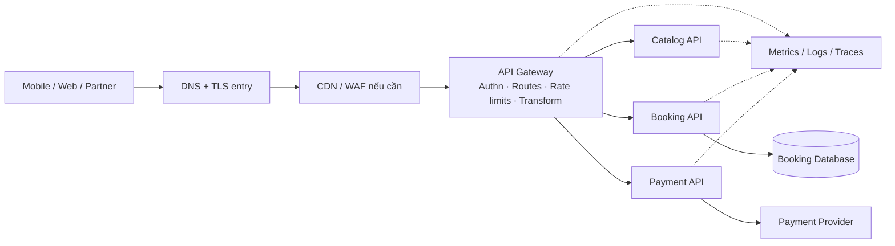
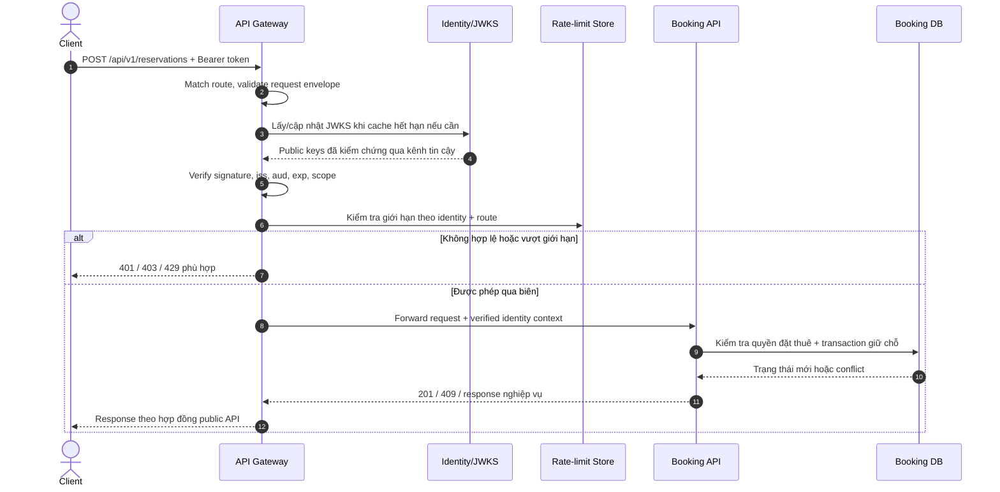
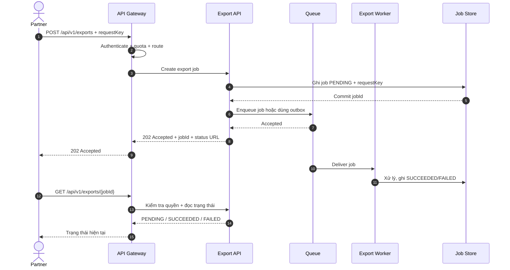
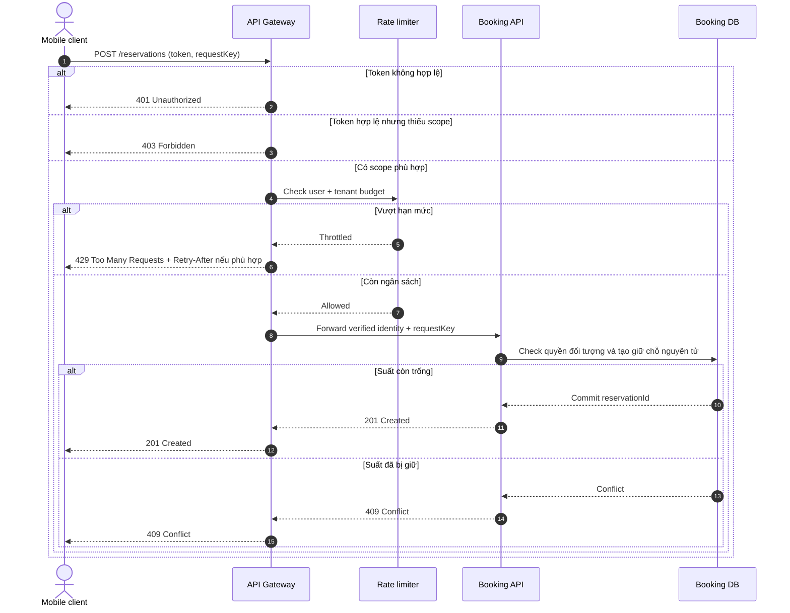

# API Gateway: xác thực, định tuyến, hạn mức và chuyển đổi giao thức

Khi nhiều ứng dụng web, mobile và đối tác gọi vào một hệ thống trên đám mây, mỗi lời gọi cần đi qua một **điểm vào** có thể quản lý được. Điểm vào phải biết yêu cầu đang gọi API nào, danh tính người gửi là ai, có được phép đi tiếp không, có vượt mức sử dụng hay không, và dịch vụ đích có nhận được đúng hợp đồng giao tiếp không. **API Gateway** là một thành phần thường được dùng để tập trung các chức năng ở biên API và giảm sự lặp lại giữa nhiều dịch vụ.

Trong module **CLOUD_ARCHITECTURE**, chủ đề này thuộc phần **Điểm vào hệ thống**. Thiết kế gateway bắt đầu từ yêu cầu nghiệp vụ và đặc tính lưu lượng, rồi dẫn đến các quyết định về mạng, compute, dữ liệu, cách triển khai và vận hành. Không có cấu hình gateway tối ưu cho mọi hệ thống: phải đánh đổi giữa **độ tin cậy, bảo mật, khả năng mở rộng, chi phí và công sức vận hành**, đồng thời kiểm chứng theo tư duy Well-Architected.

Ví dụ xuyên suốt: một nền tảng cho thuê thiết bị cung cấp API để xem danh mục, giữ chỗ và thanh toán. Người dùng cuối gọi từ ứng dụng mobile; đối tác tích hợp dùng API riêng. Một gateway có thể xử lý xác thực token, chọn phiên bản dịch vụ, giới hạn lưu lượng và chuyển đổi định dạng yêu cầu mà không buộc mỗi backend sao chép toàn bộ logic biên.

## 1. API Gateway nằm ở đâu trong kiến trúc?

Một API Gateway là điểm vào logic cho **API traffic**. Nó nhận yêu cầu, áp chính sách phù hợp và chuyển tới hệ thống ở phía sau. Cần phân biệt **gateway quản lý API** với những thành phần khác cũng có thể đứng trước ứng dụng:

| Thành phần | Nhiệm vụ thường gặp | Quan hệ với API Gateway |
| --- | --- | --- |
| **DNS** | Phân giải tên miền sang endpoint | Đưa client tới điểm vào; không tự xác thực API |
| **CDN** | Phân phối/caching nội dung gần người dùng, đôi khi hỗ trợ bảo vệ biên | Có thể đứng trước gateway và giảm lưu lượng đọc |
| **WAF** | Áp quy tắc lọc lưu lượng web độc hại theo chính sách | Có thể được tích hợp hoặc đặt trước gateway; không thay thế phân quyền nghiệp vụ |
| **Load balancer** | Phân phối kết nối/yêu cầu tới backend khỏe | Có thể đặt ở biên hoặc sau gateway; một số loại hỗ trợ routing và TLS |
| **Reverse proxy** | Chuyển tiếp HTTP, có thể rewrite, cache hoặc cân bằng tải | Là cơ chế nền của nhiều gateway; không nhất thiết có API management |
| **API Gateway** | Chính sách API: route, authentication, quota, transform, version, telemetry | Điều phối các xử lý chung trước khi gọi backend |
| **Ingress/Gateway trong Kubernetes** | Khai báo và triển khai đường vào cluster theo khả năng controller | Có thể đóng vai gateway API, nhưng tính năng phụ thuộc controller/sản phẩm |
| **Service mesh** | Quản trị giao tiếp giữa các workload, thường ở phía trong hệ thống | Bổ sung chính sách east-west; không mặc nhiên thay thế điểm vào north-south |
| **Backend service** | Thực thi nghiệp vụ, kiểm tra quyền trên từng đối tượng, quản lý dữ liệu | Vẫn chịu trách nhiệm cuối cùng về bất biến và quyền nghiệp vụ |

Các chức năng có thể **chồng lấn**. Chẳng hạn một sản phẩm API Gateway có sẵn load balancing, WAF integration hoặc service discovery. Không nhất thiết phải triển khai tất cả hộp trong bảng; hãy chỉ chọn thành phần giải quyết yêu cầu cụ thể.



Sơ đồ chỉ thể hiện luồng logic. Việc tách public/private subnet, multi-AZ, danh tính workload, vị trí WAF và loại gateway được quyết định sau khi biết mục tiêu bảo mật, độ trễ, khả năng khôi phục và ngân sách.

## 2. Bốn chức năng trọng tâm

| Chức năng | Gateway cần quyết định | Ví dụ | Ranh giới cần nhớ |
| --- | --- | --- | --- |
| **Xác thực (authentication)** | Request do danh tính hoặc client nào gửi? Thông tin xác thực có đáng tin không? | Xác minh JWT của người dùng; kiểm tra mTLS của đối tác | Không tự thay thế **authorization** theo tài nguyên/nghiệp vụ |
| **Định tuyến (routing)** | Chuyển request hợp lệ đến dịch vụ, phiên bản, vùng nào? | /api/v1/catalog tới Catalog; /api/v1/reservations tới Booking | Route đúng chưa đảm bảo backend có khả năng xử lý an toàn |
| **Hạn mức (rate limits/quotas)** | Ai được gọi bao nhiêu lần trong một khoảng hoặc ngân sách? | Đối tác có giới hạn request theo client và API | Giới hạn request không phải cơ chế chống đặt trùng hay bảo vệ toàn bộ tài nguyên |
| **Chuyển đổi giao thức/hợp đồng** | Có cần đổi representation hoặc cách giao tiếp với backend không? | Public REST/JSON tới backend gRPC; mapping trường/header | Chuyển đổi phức tạp có thể làm mất ngữ nghĩa và tạo phụ thuộc phiên bản |

Ngoài bốn chức năng này, gateway thường có thể hỗ trợ TLS termination, CORS, caching, validation, request/response logging, tracing, canary routing và API lifecycle. Tính năng cụ thể khác nhau theo nền tảng và phiên bản sản phẩm; không nên mặc định mọi gateway đều hỗ trợ giống nhau.

## 3. Thiết kế luồng xử lý một request

Một request có thể đi qua các bước theo thứ tự **khái niệm** như sau; một số cơ chế thực tế chạy trước, sau hoặc song song tùy gateway:

1. Nhận kết nối, hoàn tất **TLS handshake** và áp các kiểm soát ở biên cần thiết.
2. Chọn virtual host, đường dẫn, method và chính sách API tương ứng.
3. Kiểm tra kích thước/định dạng đầu vào, giới hạn tài nguyên và chính sách lọc sớm.
4. Xác minh danh tính/token/API key hoặc chứng thư client theo quy tắc của route.
5. Kiểm tra **quyền coarse-grained**, scope, audience và client policy; giữ nguyên trách nhiệm **object-level authorization** cho backend.
6. Áp rate limit, quota, kiểm soát đồng thời và các rào chắn khác tùy loại request.
7. Chuyển đổi yêu cầu ở phạm vi cần thiết, chọn backend khỏe và chuyển tiếp với timeout phù hợp.
8. Nhận phản hồi, thực hiện response mapping có kiểm soát, tạo thông tin quan sát và trả về client.



**Lưu ý về JWKS:** nếu JWT được xác minh cục bộ bằng public key đã cache, gateway không cần gọi hệ thống danh tính trên từng request. Tra cứu khóa mới, key rotation và hành vi khi không lấy được khóa phải được thiết kế rõ. Khi dùng token opaque cần introspection, luồng xác minh có thể khác.

**Lưu ý về hạn mức:** sơ đồ cho thấy rate-limit store như một participant để giải thích. Gateway managed có thể sử dụng cơ chế nội bộ; nhiều hạn mức được thực thi gần đúng ở môi trường phân tán. Không mặc định mọi request đều gây ra một lời gọi mạng tới kho đếm chung.

## 4. Xác thực tại gateway: ai đang gọi API?

**Authentication (Authn)** trả lời *danh tính người dùng, ứng dụng hoặc workload là gì?*; **authorization (Authz)** trả lời *danh tính đó được thực hiện hành động nào trên đối tượng nào?*

Đối với API công khai, có thể gặp:

| Cơ chế | Thường phù hợp | Cần kiểm tra | Giới hạn cần hiểu |
| --- | --- | --- | --- |
| **OAuth 2.0 access token dạng JWT** | Mobile/web qua nhà cung cấp danh tính | Chữ ký, thuật toán cho phép, issuer, audience, exp/nbf, scope/claim phù hợp | JWT hợp lệ không đồng nghĩa người dùng có quyền truy cập mọi reservation |
| **Opaque access token + introspection** | Hệ thống cần tra cứu trạng thái token từ authorization server | TLS, kết quả introspection, audience/scope, cache và timeout | Phụ thuộc đường mạng/availability tới hệ thống introspection |
| **API key** | Định danh ứng dụng tiêu thụ, đo usage, gắn gói dịch vụ | Key hợp lệ, trạng thái kích hoạt, quota, cách quay vòng | API key thường không đại diện danh tính người dùng cuối; không đủ làm Authz cho dữ liệu nhạy cảm |
| **mTLS client certificate** | Giao tiếp hệ thống hoặc đối tác B2B cần chứng thực client ở tầng TLS | Chuỗi tin cậy, validity, revocation/rotation, ràng buộc định danh | Xác thực client certificate không tự xác nhận quyền nghiệp vụ |
| **Session cookie** | Ứng dụng web có session ở biên | Cookie flags, session validation, CSRF khi dùng cookie tự gửi | Cần cẩn trọng nếu giao diện và API khác nguồn hoặc nhiều client |

Với OAuth 2.0 và OpenID Connect, cần phân biệt **access token dùng để truy cập API** và **ID token dùng cho client xác nhận đăng nhập**. Không tự dùng ID token làm access token trừ khi thiết kế/protocol và issuer quy định rõ điều đó. Một gateway phải kiểm tra token được cấp **cho API của mình** qua audience, cùng chính sách về issuer và scope.

### JWT validation đúng nghĩa

Khi nhận JWT, gateway cần áp chính sách cụ thể:

1. Chỉ chấp nhận thuật toán ký được cấu hình và khóa phù hợp; không tin trực tiếp trường algorithm do người gửi tự khai để hạ yêu cầu an toàn.
2. Lấy khóa từ issuer/JWKS endpoint được cấu hình trước trên kết nối đáng tin; không tải khóa tùy ý từ URL nằm trong token.
3. Xác minh **issuer (iss)**, **audience (aud)**, **expiration (exp)** và các ràng buộc thời gian liên quan; có clock skew nhỏ, được kiểm soát nếu cần.
4. Kiểm tra **scope/permission claim**, client ID, tenant context hoặc những ràng buộc route cần thiết.
5. Xác định chiến lược **revoke/rotation**. JWT có chữ ký hợp lệ chưa chắc bị thu hồi ngay khi quyền đổi; TTL ngắn, token introspection hoặc cơ chế revoke khác là các đánh đổi.
6. Sau xác thực, chuyển identity context theo cơ chế gateway-backend đã bảo vệ; backend không được tin header có thể do client tự gửi.

### Ai kiểm tra quyền đặt thuê?

Gateway có thể chặn route **POST /reservations** nếu token không có scope **booking:create**. Nhưng khi client gọi **GET /reservations/R123**, backend phải xác minh người dùng có được xem **R123** không. Nếu chỉ kiểm tra scope ở gateway mà bỏ object-level authorization, người dùng có thể đổi ID để đọc dữ liệu của người khác (**BOLA/IDOR**).

Giải pháp phù hợp là **defense in depth**: gateway làm xác thực và policy dùng chung ở biên; backend kiểm tra quyền trên thực thể, điều kiện nghiệp vụ, trạng thái dữ liệu và những trường được phép đọc/sửa. Với route nhạy cảm, service nội bộ có thể tự xác minh access token hoặc xác thực assertion/identity context do gateway tin cậy chuyển vào, tùy trust model.

### Trust boundary và header giả mạo

Nếu gateway chuyển header **X-User-Id: 123** sang backend, không được phép để client tự gửi **X-User-Id: admin** rồi gateway chuyển nguyên văn. Cần **xóa/ghi đè** các header danh tính đầu vào và chỉ dựng identity context từ thông tin đã xác minh. Tương tự, các header địa chỉ client như **X-Forwarded-For** phải dựa trên danh sách proxy tin cậy và quy tắc append/overwrite phù hợp, không dùng một giá trị tùy ý từ Internet làm cơ sở duy nhất cho chính sách bảo mật.

Backend phải được bảo vệ khỏi đường truy cập bỏ qua gateway nếu chính sách yêu cầu đi qua biên. Có thể áp private networking, resource policy, workload identity, mTLS và kiểm tra xác thực tại backend. **Gateway không phải lá chắn nếu backend vẫn public và chấp nhận lời gọi không xác thực.**

## 5. Định tuyến: đưa request tới đúng dịch vụ và đúng phiên bản

Định tuyến tại gateway sử dụng các tiêu chí như **host, method, path, header**, đôi khi dựa trên version, locale, tenant, region hoặc đặc điểm client. Routing rule cần dễ đọc, không chồng lấn mơ hồ, có default behavior an toàn và kiểm thử được.

| Quy tắc public API | Backend logic | Đặc điểm thiết kế |
| --- | --- | --- |
| **GET /api/v1/equipment** | Catalog API | Có thể cache GET theo chính sách và tính riêng tư dữ liệu |
| **GET /api/v1/equipment/{id}** | Catalog API | Xử lý path variable và 404 nhất quán |
| **POST /api/v1/reservations** | Booking API | Cần danh tính người dùng, hạn mức ghi, idempotency |
| **GET /api/v1/reservations/{id}** | Booking API | Backend kiểm tra chủ sở hữu reservation |
| **POST /api/v1/payments/sessions** | Payment API | Rate limit thận trọng, key chống gửi trùng |
| **POST /webhooks/payments/provider** | Payment webhook handler | Xác minh chữ ký provider; không dùng JWT người dùng để xác thực webhook |
| **GET /api/v2/equipment** | Catalog API v2 hoặc adapter tương thích | Cần chính sách versioning và migration client |

Với hệ thống cloud có nhiều instance, gateway có thể route tới **logical service endpoint**; phía sau có load balancer hoặc service discovery chọn instance khỏe. Không hard-code IP của từng pod/VM trong cấu hình public API nếu vòng đời compute thay đổi thường xuyên.

### Chọn phiên bản API: path, host hay header?

- **Path version** dễ thấy và debug; ví dụ **/api/v1/**, **/api/v2/**. Phải quản lý route cũ khi migration.
- **Host version** có thể phù hợp nếu hệ sinh thái client hoặc chính sách vòng đời yêu cầu tên miền riêng, nhưng phát sinh DNS, certificate và tài liệu.
- **Header/media-type version** giữ URL ổn định nhưng có thể khó quan sát, cache và debug nếu thiếu công cụ phù hợp.

Chọn một chiến lược có tính nhất quán; không có kiểu version tốt nhất cho mọi API. Versioning **không giải quyết** thay đổi không tương thích nếu không có hợp đồng, thử nghiệm tương thích và kế hoạch ngừng hỗ trợ bản cũ.

### Canary và weighted routing

Gateway có thể hỗ trợ chuyển một phần lưu lượng tới bản mới theo trọng số hoặc quy tắc chọn client. Ví dụ đưa **5% request catalog** tới v2 và quan sát lỗi, latency trước khi tăng dần. Cần chú ý:

- Quy tắc phân phối phải **ổn định theo phiên/khách** nếu đường đi đòi hỏi sticky behavior.
- **Database schema, idempotency và trạng thái nghiệp vụ** phải tương thích khi hai bản cùng tồn tại.
- Nếu API vừa ghi vừa đọc liên tiếp, gửi ngẫu nhiên từng request tới hai phiên bản khác nhau có thể tạo hành vi khó hiểu.
- Khi canary lỗi, rollback routing không tự khôi phục những bản ghi dữ liệu đã thay đổi.

Weighted routing thường dựa trên xác suất hoặc thuật toán cân bằng tải, nên tỷ lệ thực tế có thể sai khác ở lưu lượng thấp. Đánh giá bằng số request và chỉ số thực đo, không mặc định chính xác từng request.

## 6. Hạn mức: rate limit, quota và kiểm soát đồng thời

Ba cơ chế này giải quyết những vấn đề khác nhau:

| Cơ chế | Câu hỏi | Ví dụ | Phạm vi điển hình |
| --- | --- | --- | --- |
| **Rate limiting** | Trong một khoảng thời gian, client được gửi nhanh đến mức nào? | 60 requests/phút cho API tra cứu | Token/IP/client/route |
| **Quota** | Tổng mức sử dụng được phép trong một kỳ là bao nhiêu? | 50.000 requests/tháng cho gói đối tác | Subscription/client/product |
| **Concurrency limit** | Có tối đa bao nhiêu request đồng thời đang xử lý? | 100 request search đang chạy | Route/backend/tenant |
| **Request size/connection cap** | Mỗi request/connection dùng tối đa bao nhiêu tài nguyên? | Giới hạn payload và thời gian đọc body | Gateway/backend |
| **Backend capacity protection** | Khi downstream quá tải, phải giảm/làm phẳng tải thế nào? | Throttle khi queue lag hoặc database saturation | Toàn hệ thống, thường cần phối hợp backend |

Các giới hạn phải xuất phát từ **năng lực dịch vụ, mục tiêu độ trễ, ngân sách, hợp đồng đối tác và khả năng chịu lỗi**, không đơn thuần chọn một con số cho đẹp cấu hình.

### Token bucket và sliding window

**Token bucket** cho phép burst ngắn trong giới hạn dung lượng xô và bổ sung token theo tốc độ định trước:

- Dung lượng xô **B** quyết định số request có thể được chấp nhận liên tiếp khi xô đầy.
- Tốc độ nạp **r** token/giây xác định mức duy trì trung bình dài hạn.
- Mỗi request tiêu thụ một hoặc nhiều token tùy chính sách. Không đủ token thì từ chối hoặc trì hoãn, tùy khả năng gateway.

Ví dụ giả định **B = 20** và **r = 2 token/giây**: một client có thể gửi burst tối đa khoảng 20 request khi xô đang đầy; khi hết token, lưu lượng duy trì bị giới hạn khoảng 2 request/giây. Đây là cách giải thích thuật toán, **không phải cấu hình khuyến nghị cho API đặt thuê**.

**Fixed window** đếm theo khoảng lịch đơn giản nhưng có thể cho burst mạnh ngay tại ranh giới cửa sổ. **Sliding window** hoặc thuật toán tương đương có thể giảm độ lệch tại ranh giới, đổi lại cách lưu/ước lượng phức tạp hơn.

### Khóa hạn mức theo danh tính nào?

| Khóa | Dùng khi | Điểm dễ sai |
| --- | --- | --- |
| **IP nguồn** | Chặn abuse thô ở biên trước Authn, kết hợp WAF | NAT/proxy khiến nhiều người chung IP; header địa chỉ nguồn dễ bị giả nếu không chuẩn hóa |
| **API key/client ID** | Đối tác B2B, ứng dụng có subscription | Một key bị chia sẻ/lộ; phải có rotation và hạn mức theo API |
| **User ID** | Giới hạn theo người dùng đã xác thực | Người dùng có nhiều thiết bị; cần tính chính sách công bằng |
| **Tenant/organization** | Hạn chế một tenant chiếm tài nguyên chung | Một tenant có nhiều user/key có thể vượt nếu chỉ kiểm soát ở cấp user |
| **Route + client tier** | API có chi phí xử lý khác nhau | Phải cập nhật khi hợp đồng và tải backend thay đổi |

Thông thường cần **nhiều lớp**: limit theo IP để giảm flood chưa xác thực; limit theo client/user/tenant sau xác thực; limit theo concurrency hoặc queue ở backend để bảo vệ tài nguyên đắt đỏ. Nên tách route đọc rẻ và route tạo thanh toán có hiệu ứng bên ngoài; một policy chung cho mọi API có thể chặn sai nhu cầu hoặc không bảo vệ điểm nóng.

### Phản hồi khi vượt giới hạn

Với HTTP, **429 Too Many Requests** phù hợp cho tình huống bị rate limit. Có thể thêm **Retry-After** khi biết thời điểm/thời lượng hợp lý để thử lại; header cung cấp gợi ý, không buộc client chắc chắn thành công lần sau.

```http
HTTP/1.1 429 Too Many Requests
Content-Type: application/problem+json
Retry-After: 10

{
  "type": "https://api.example.com/problems/rate-limit",
  "title": "Too many requests",
  "status": 429,
  "detail": "Please retry after the advised interval.",
  "requestId": "req-123"
}
```

Ví dụ trên chỉ minh họa hợp đồng; URL kiểu problem type là placeholder. Nếu API sử dụng rate-limit metadata headers, phải thống nhất đơn vị, ngữ nghĩa và hỗ trợ client. Tránh rò rỉ quota của tenant khác.

**429 không phải 503:** 429 thường biểu đạt chính sách giới hạn client; **503 Service Unavailable** phù hợp khi backend hoặc hạ tầng tạm không sẵn sàng. Tuy nhiên mapping còn tùy nguyên nhân và hợp đồng API; không biến mọi lỗi từ backend thành 429 vì sẽ che khuất sự cố dịch vụ.

### Hạn mức phân tán và sai số

Khi nhiều gateway instance hoặc region đồng thời phục vụ cùng client, bộ đếm mỗi instance có thể cho tổng vượt giới hạn mong muốn. Có ba lựa chọn phổ biến:

1. **Bộ đếm cục bộ:** độ trễ thấp và ít phụ thuộc nhưng chỉ đảm bảo mỗi instance, khó giới hạn toàn cục chính xác.
2. **Kho đếm chia sẻ:** nhất quán tốt hơn trong một số kiến trúc, nhưng thêm latency, phụ thuộc availability và chi phí.
3. **Phân bổ ngân sách cục bộ/đồng bộ theo chu kỳ:** giảm độ trễ nhưng chấp nhận sai số hoặc có cơ chế thu hồi quota.

Nếu đây là **quota thương mại** với hậu quả tài chính, cần thiết kế cơ chế đo đếm/đối soát ở hệ thống authoritative; không mặc định rate-limit cache là nguồn sự thật cho hóa đơn. Tương tự, không dùng bộ đếm gateway để đảm bảo “mỗi suất thuê chỉ đặt một lần” vì bất biến đó phải do kho dữ liệu nghiệp vụ bảo vệ.

### Fail-open hay fail-closed khi kho hạn mức hỏng?

Đây là quyết định **theo rủi ro từng API**:

- **Fail-open** tạm cho request đi tiếp nếu thành phần giới hạn hỏng, giúp duy trì availability nhưng có thể làm quá tải downstream hoặc bị lạm dụng.
- **Fail-closed** từ chối khi không kiểm chứng được quota, giảm nguy cơ abuse/cost nhưng làm gián đoạn người dùng hợp lệ.
- **Graceful degradation** dùng ngưỡng cục bộ dự phòng hoặc chế độ giới hạn chặt hơn trong thời gian ngắn, kèm alert và cơ chế phục hồi.

API tra cứu công khai có thể chấp nhận chính sách khác route liên quan thanh toán. Cần mô tả quyết định trong ADR, thử nghiệm sự cố kho đếm và theo dõi tỉ lệ 429, latency, chi phí, lỗi downstream.

## 7. Chuyển đổi giao thức và chuyển đổi hợp đồng

API Gateway có thể cung cấp giao diện công khai ổn định trong khi backend sử dụng cách giao tiếp khác. Tuy nhiên, cần tách hai khái niệm:

- **Protocol translation:** đổi giao thức hoặc kiểu tương tác, ví dụ **HTTP/JSON ↔ gRPC/Protobuf**, **HTTP ↔ WebSocket** ở các điểm hỗ trợ phù hợp, hoặc request HTTP thành lệnh gửi queue.
- **Message transformation:** đổi **đường dẫn, header, query, body, status code, tên trường hoặc schema**. Hai bên có thể vẫn dùng HTTP nhưng hợp đồng dữ liệu khác nhau.

Gateway **không tự biến một lời gọi bất đồng bộ thành giao dịch đồng bộ hoàn tất**. Nếu request HTTP được đẩy vào queue, phản hồi thông thường chỉ chứng minh hệ thống đã chấp nhận và lưu công việc theo hợp đồng, chưa chứng minh tác vụ nghiệp vụ hoàn thành.

| Chuyển đổi | Ví dụ | Lợi ích | Rủi ro cần thiết kế |
| --- | --- | --- | --- |
| REST/JSON → gRPC | GET /equipment/123 gọi Catalog.GetEquipment | Client không cần biết Protobuf; backend dùng RPC nội bộ | Mapping lỗi/status, timeout, metadata, streaming và phiên bản schema |
| Public URL → internal URL | /api/v1/catalog → /catalog-service/items | Giữ cấu trúc public ổn định khi nội bộ đổi tên | Rewrite sai có thể làm thay đổi semantics, query encoding |
| Header/claim mapping | Token hợp lệ → metadata danh tính đã xác minh | Giảm lặp xử lý common identity | Header spoofing, mất tenant context, leak token vào log |
| Body/field mapping | Public JSON field → trường contract nội bộ | Che cấu trúc backend | Mất trường, validation không khớp, backward compatibility |
| HTTP → asynchronous queue | POST /exports → enqueue job → 202 | Hấp thụ tác vụ dài, tránh HTTP timeout | Cần job ID, bền vững, polling/webhook, chống gửi trùng |
| HTTP → WebSocket upgrade | Client mở kết nối realtime tới dịch vụ phù hợp | Duy trì kênh hai chiều | Idle timeout, connection quota, load balancing, auth trên kết nối |
| HTTP → GraphQL gateway | Client query một graph có nhiều nguồn | Aggregation và contract tập trung | N+1 query, độ sâu/chi phí query, authorization từng field |

**Không phải dịch vụ API Gateway nào cũng hỗ trợ tất cả phép chuyển đổi.** Chẳng hạn việc transcode REST sang gRPC thường cần cấu hình mapping Protobuf hoặc một lớp proxy/adapter riêng. Gateway chỉ nên thực hiện phần translation có thể kiểm soát và quan sát được; orchestration nghiệp vụ phức tạp nên đặt ở backend hoặc lớp BFF chuyên biệt.

### REST/JSON sang gRPC: cần giữ nguyên ngữ nghĩa

Ví dụ public API:

```http
GET /api/v1/equipment/eq-123 HTTP/1.1
Host: api.example.com
Authorization: Bearer <access-token>
Accept: application/json
```

Backend logic có thể khai báo service gRPC:

```proto
syntax = "proto3";

package rental.catalog.v1;

service CatalogService {
  rpc GetEquipment(GetEquipmentRequest) returns (GetEquipmentResponse);
}

message GetEquipmentRequest {
  string equipment_id = 1;
}

message GetEquipmentResponse {
  string equipment_id = 1;
  string display_name = 2;
  bool available_for_listing = 3;
}
```

Gateway/adapter ánh xạ **equipment_id = eq-123** sang lời gọi gRPC và biến phản hồi Protobuf thành JSON theo contract public. Nhưng vẫn phải định nghĩa:

- **Lỗi:** gRPC NOT_FOUND nên thành HTTP 404 hay một response ứng dụng cụ thể? Không biến INTERNAL thành 404 che khuất lỗi.
- **Deadline:** HTTP timeout và gRPC deadline được truyền thế nào để upstream không tiếp tục xử lý vô hạn sau khi client bỏ cuộc?
- **Metadata:** Authorization, correlation ID và tracing được chuyển thế nào mà không lộ token vào log?
- **Streaming:** một lời gọi streaming không thể luôn chuyển thành một response JSON hữu hạn mà không làm đổi semantics và mức dùng tài nguyên.
- **Version:** field mới hoặc đổi tên trường phải tương thích với client cũ theo hợp đồng đã công bố.

Một số nhà cung cấp có **transcoding tự động** từ annotation hoặc API definition; số khác cần adapter hoặc chức năng riêng. Phải xác minh hỗ trợ thực tế, payload limit và khả năng xử lý lỗi trước khi cam kết kiến trúc.

### HTTP sang queue: tại sao thường trả 202?

Giả sử API tạo báo cáo định kỳ mất vài phút:



Ở đây **202** phản ánh rằng yêu cầu đã được chấp nhận để xử lý **sau**, không có nghĩa báo cáo đã hoàn tất. Nếu API ghi job xong nhưng mất kết nối queue, cần cơ chế outbox/retry phù hợp để job không “mắc kẹt” mà client không biết. Backend phải kiểm tra **quyền đọc trạng thái của jobId**, dù gateway đã xác thực token. Hạn mức ở gateway giảm abuse, nhưng job store/worker vẫn cần quota tài nguyên và concurrency.

### Chuyển đổi dữ liệu phải giảm phụ thuộc, không tạo logic nghiệp vụ thứ hai

Những thay đổi hợp lý thường là **đổi URL, chuẩn hóa header, mapping tên trường đơn giản, validate envelope hoặc thêm correlation ID**. Các quyết định như “khách VIP được giữ thiết bị bao lâu”, “đơn nào có thể hoàn tiền”, “suất thuê đã thuộc ai” phụ thuộc dữ liệu và quy tắc nghiệp vụ; nên đặt tại service có trách nhiệm và cơ chế transaction phù hợp.

Đặt quá nhiều transformation trong gateway gây các hậu quả: khó test và version; một thay đổi nhỏ ảnh hưởng nhiều API; log có thể vô tình chứa dữ liệu nhạy cảm; backend và gateway có thể bất đồng validation. Nếu phải viết workflow dài trong gateway, hãy cân nhắc một **Backend For Frontend (BFF)** hoặc adapter/service rõ trách nhiệm để dễ kiểm thử và giám sát.

## 8. Cấu hình gateway dưới dạng chính sách có phiên bản

API Gateway nên được khai báo và quản lý bằng **Infrastructure as Code/configuration as code**, có review, phân tách môi trường, kiểm thử cấu hình và phương án rollback.

Ví dụ dưới đây là **YAML khái niệm, không phải cú pháp triển khai của AWS, Azure, Google Cloud hay sản phẩm gateway cụ thể**:

```yaml
gateway:
  host: api.example.com
  tls:
    required: true
  routes:
    - id: public-equipment-v1
      methods: [GET]
      path: /api/v1/equipment/**
      upstream: catalog-service
      auth:
        mode: optional
      limits:
        key: trusted-client-ip
        algorithm: token-bucket
        capacity: 60
        refillPerSecond: 2
      cache:
        enabled: true
        varyBy: public-representation

    - id: create-reservation-v1
      methods: [POST]
      path: /api/v1/reservations
      upstream: booking-service
      auth:
        mode: jwt
        issuer: https://identity.example.com/
        audience: rental-api
        requiredScopes: [booking:create]
      limits:
        key: verified-user-plus-tenant
        algorithm: token-bucket
        capacity: 10
        refillPerSecond: 0.2
      request:
        requireIdempotencyKey: true
        maxBodyBytes: 32768

    - id: partner-export-v1
      methods: [POST]
      path: /partners/v1/exports
      upstream: export-api
      auth:
        mode: mtls-and-client-credential
      limits:
        key: verified-partner-id
        maxConcurrent: 5
        monthlyQuota: 50000
      timeoutSeconds: 10
```

Các con số và URL trong ví dụ chỉ giúp diễn giải cấu hình, **không phải chuẩn mặc định**. Các tên như **trusted-client-ip**, **verified-user-plus-tenant** hoặc **mtls-and-client-credential** là ý tưởng chính sách, không chắc có sẵn dưới dạng tùy chọn của nhà cung cấp. **Yêu cầu idempotency key ở gateway không đảm bảo idempotency** nếu Booking API không lưu dấu và cập nhật dữ liệu có điều kiện.

Trước khi áp dụng, kiểm tra:

- Mỗi route có **owner** và contract: API nào, scope nào, consumer nào, môi trường nào.
- Không có route wildcard ngoài ý muốn, route không phù hợp được mặc định từ chối.
- TLS/certificate, secret reference, key rotation và chính sách bảo vệ API được triển khai ở nơi phù hợp.
- Cấu hình staging/prod có cùng nguyên tắc bảo mật, khác tham số theo rủi ro và nhu cầu tải.
- Thay đổi có **diff/review**, test route/authorization/limit/transform và canary hoặc rollback nếu cần.
- Gateway tự nó có quota, HA, log, cảnh báo, capacity và disaster recovery phù hợp.

## 9. Tối ưu điểm vào mà không phá hỏng độ tin cậy

API Gateway thường nằm trên đường đi của gần như mọi request. Điều này làm nó trở thành nơi hữu ích để áp chính sách tập trung, đồng thời là nơi có thể làm **tăng blast radius** nếu sự cố xảy ra.

### High availability và failure modes

| Sự cố | Ảnh hưởng có thể xảy ra | Biện pháp cần cân nhắc |
| --- | --- | --- |
| Một gateway instance lỗi | Một phần request bị timeout hoặc mất kết nối | Nhiều instance/zone, health check, connection draining, autoscaling theo khả năng nền tảng |
| Cấu hình route sai | Một hoặc nhiều API trả lỗi dù backend khỏe | Review IaC, kiểm thử route, canary cấu hình, rollback nhanh |
| Identity provider/JWKS không sẵn sàng | Token mới hoặc khóa mới không xác minh được | Cache JWKS có TTL/rotation an toàn; xác định chính sách fail-secure; theo dõi lỗi xác thực |
| Shared rate-limit store lỗi | Các route có limit phụ thuộc cùng kho có thể bị ảnh hưởng | Chọn fail-open/fail-closed theo rủi ro, fallback được kiểm soát, tránh làm gateway treo |
| Backend quá chậm | Hàng đợi/kết nối gateway tích tụ | Deadline, circuit breaking, connection limits, backpressure, autoscale có kiểm soát |
| Gateway/region không sẵn sàng | Nhiều API ngoài Internet cùng mất đường vào | Thiết kế multi-AZ/multi-region theo SLO, routing dự phòng, diễn tập failover |
| Cấu hình bảo mật cấp toàn cục sai | Chặn client hợp lệ hoặc vô tình mở quá rộng | Policy test, staged rollout, audit config, cơ chế emergency rollback |

**HA không chỉ là nhiều instance.** Nếu mọi instance dùng cùng kho cấu hình hỏng, cùng dependency bị nghẽn hoặc bị cập nhật policy sai đồng loạt, sự cố vẫn lan rộng. Cần đánh giá cả **control plane** (nơi quản lý cấu hình) và **data plane** (nơi xử lý request); cách từng gateway managed tách hai phần này khác nhau và phải kiểm chứng theo hợp đồng nhà cung cấp.

### Cache tại gateway: khi nào có lợi?

Các route đọc nội dung công khai và ít thay đổi có thể sử dụng CDN hoặc gateway cache để giảm latency, tải backend và chi phí. Nhưng cache phải xét:

- **Cache key** gồm host/path/query và các header thực sự ảnh hưởng representation.
- **Thông tin cá nhân** hoặc phản hồi phụ thuộc identity/tenant không được vô tình phục vụ cho người khác.
- **TTL và invalidation** phù hợp với độ mới dữ liệu; cache không là nguồn sự thật cho quyền đặt thuê.
- **HTTP Cache-Control, Vary, ETag** và sự tương tác với CDN/browser; hiểu cache nào đang giữ response.
- **Lỗi backend:** có được phục vụ dữ liệu cũ hay không? Nếu có, client phải biết kết quả có thể chưa mới.

Với **GET /equipment**, cache công khai có thể hữu ích nếu chỉ chứa mô tả thiết bị. Với **GET /reservations/{id}** chứa thông tin khách, cần thiết kế cache private hoặc tắt shared caching theo hợp đồng. Với **POST /reservations**, cache thường không có ý nghĩa để bảo vệ bất biến giao dịch.

## 10. Bảo vệ gateway và backend theo mô hình nhiều lớp

Khi API public, hệ thống cần phòng vệ trước abuse, credential theft, tấn công payload và lỗi cấu hình. Một gateway được cấu hình tốt thường kết hợp:

1. **TLS** trên kết nối từ client và trên đường tới backend theo mức rủi ro; quản lý certificate, cipher/protocol policy và gia hạn.
2. **Authentication** trước khi cấp quyền tới route nhạy cảm; không chấp nhận token sai issuer, audience, thời hạn hoặc chữ ký.
3. **Authorization ở nhiều cấp:** gateway kiểm tra route/scope/client policy; backend kiểm tra quyền trên từng object, field và transaction.
4. **Rate/size/concurrency limits** theo client và backend; bảo vệ cả route public chưa đăng nhập.
5. **Schema/content-type validation** cho trường hợp phù hợp; không để payload tùy ý đi vào backend tin cậy.
6. **WAF và bảo vệ DDoS** khi hệ thống có yêu cầu; lưu ý không phải mọi tấn công ở tầng ứng dụng đều bị WAF chặn.
7. **Mạng và danh tính backend:** service không được bị bypass qua endpoint công khai ngoài chính sách; áp least privilege và mTLS hoặc request signing nơi thích hợp.
8. **Bảo vệ nhật ký:** che token, cookie, API key, dữ liệu thanh toán/PII; hạn chế truy cập log và retention theo phân loại dữ liệu.

### CORS không phải xác thực hay phân quyền

**CORS** là cơ chế dựa trên trình duyệt để kiểm soát quyền đọc phản hồi cross-origin của JavaScript. Nó không bảo vệ API khỏi script server-side, ứng dụng mobile hoặc curl; cũng không chứng minh client là ai. Một cấu hình **Access-Control-Allow-Origin** hợp lệ **không thay** kiểm tra access token và quyền nghiệp vụ.

Nếu ứng dụng dùng cookie tự động gửi, cần thiết kế chống CSRF phù hợp, cùng chính sách SameSite, Secure, HttpOnly và domain. Nếu API dùng bearer token trong header, vấn đề và mô hình đe dọa có thể khác, nhưng vẫn cần bảo vệ token khỏi bị đánh cắp.

### Webhook bên ngoài cần chính sách riêng

Webhook từ nhà cung cấp thanh toán thường **không mang access token của người dùng cuối**. Gateway nên route tới handler có kiểm soát và áp các giới hạn phù hợp. Handler phải xác minh chữ ký hoặc cơ chế xác thực đã ký với provider, chống replay, kiểm tra event ID và xử lý idempotent.

Danh sách IP nguồn có thể hỗ trợ nếu nhà cung cấp công bố dải IP ổn định, nhưng không nên coi IP allowlist là biện pháp xác thực duy nhất cho một webhook có tác động tài chính. Rate limiting webhook quá chặt cũng có thể làm provider retry liên tục; cần ước lượng lưu lượng sự kiện hợp lệ và cách nhà cung cấp xử lý 429/5xx.

## 11. Quan sát: biết request bị chặn ở đâu và vì sao

Gateway có thể tạo telemetry giàu giá trị vì nó nhìn thấy request trước khi vào backend:

| Tín hiệu | Ý nghĩa | Gợi ý sử dụng |
| --- | --- | --- |
| **Request count theo route/method/status** | Sản lượng và tỷ lệ lỗi tại điểm vào | Theo dõi 2xx/4xx/5xx riêng; không gộp lỗi client với lỗi dịch vụ |
| **Latency client-to-gateway và gateway-to-upstream** | Chậm ở biên hay backend | Theo dõi phân phối p50/p95/p99, timeout và connection wait |
| **Auth failures 401/403** | Token không hợp lệ hoặc thiếu quyền | Cảnh báo thay đổi bất thường; tránh log token |
| **Throttled requests 429** | Client vượt giới hạn hoặc chính sách quá chặt | So sánh theo client/tier/route; đo tác động hợp lệ |
| **Upstream 502/503/504** | Lỗi kết nối, không sẵn sàng hoặc timeout tùy gateway | Phân biệt lỗi backend với lỗi gateway; xem metric health |
| **Request/trace ID** | Nối log gateway và backend | Dùng ID tin cậy, truyền context, giới hạn nội dung log |
| **Config revision / deployment version** | Xác định thay đổi gây lỗi | Gắn revision vào sự kiện deploy và dashboard |
| **Cache hit/miss, bytes transferred** | Hiệu quả cache và chi phí truyền dữ liệu | Theo dõi cache key, hit ratio và an toàn dữ liệu |
| **Connection count, saturation, quota store errors** | Điểm vào hoặc phụ thuộc gần giới hạn | Capacity planning, autoscaling, failover test |

Lưu ý các HTTP status có ý nghĩa đặc thù tùy sản phẩm. Ví dụ **504 Gateway Timeout** thường chỉ gateway không nhận phản hồi upstream trong deadline; nó **không chứng minh** thao tác ghi ở backend chưa commit. Với lệnh tạo đơn hoặc thanh toán, client retry phải dùng khóa chống lặp hoặc truy vấn trạng thái.

**Trace propagation:** có thể dùng W3C Trace Context theo hệ thống quan sát hỗ trợ, nhưng không cho phép client tùy ý quyết định quyền hoặc tenant bằng header trace. Chỉ chấp nhận những trường liên quan debug, giới hạn kích thước và tránh đưa token vào baggage/log.

### SLO đo ở đâu?

Nếu mục tiêu là “99,9% request API hợp lệ được phục vụ thành công trong tháng”, cần định nghĩa **request hợp lệ**, cửa sổ đo và những mã lỗi nào tính vào availability. Sự khác biệt giữa lỗi xác thực hợp lệ **401**, client tự vượt limit **429** và lỗi gateway **503** ảnh hưởng cách đo SLI. Không lấy số tổng request 2xx chia toàn bộ response mà không xét ý nghĩa nghiệp vụ.

Một gateway có thể khỏe trong khi backend trả lỗi, hoặc backend khỏe nhưng cấu hình route khiến mọi request thất bại. Do đó cần đo **SLI từ góc nhìn client**, kết hợp metric gateway, backend và kiểm thử synthetic từ bên ngoài.

## 12. Đánh đổi Well-Architected khi dùng API Gateway

| Trụ cột | Giá trị của gateway | Đánh đổi cần quản lý | Câu hỏi kiểm chứng |
| --- | --- | --- | --- |
| **Operational excellence** | Chính sách route/auth/limit tập trung, log và version rõ | Thay đổi toàn cục tác động nhiều API, cần test và owner | Có diff/review, canary cấu hình, alert và rollback không? |
| **Security** | Chặn token sai, giới hạn abuse, thống nhất TLS/chính sách | Một cấu hình lỗi mở quyền rộng; backend vẫn cần authz | Backend có bị truy cập bypass? Có kiểm tra object-level authorization? |
| **Reliability** | Health routing, throttling, giảm tải backend | Gateway và phụ thuộc của nó thành điểm lỗi chung | Khi gateway/JWKS/rate-limit store hỏng, chính sách phục hồi là gì? |
| **Performance efficiency** | Cache, compression khi phù hợp, route gần backend | Thêm network hop, JWT introspection, transform tốn CPU | Độ trễ p95/p99 tăng bao nhiêu khi qua gateway? |
| **Cost optimization** | Ngăn abuse, giảm lưu lượng qua cache, thu thập usage | Chi phí request, data transfer, logging, WAF, vùng và dịch vụ phụ | Cost/request của gateway và các thành phần đi kèm là bao nhiêu? |
| **Sustainability** | Giảm request thừa/cache hiệu quả, tránh overprovision | Transform và log quá mức tiêu tốn xử lý/lưu trữ | Có giảm tài nguyên không cần thiết nhưng giữ SLO? |

Không nên đánh giá gateway chỉ dựa trên tính năng quảng bá. Kiểm tra **phạm vi SLA, giới hạn payload, throughput, connection/websocket duration, số route, latency ở region đã chọn, các lớp tính phí, quota và khả năng xuất log/trace**. Với API có yêu cầu rất đặc biệt, một reverse proxy nhẹ hoặc routing trực tiếp tới load balancer có thể đủ; hệ thống có nhiều consumer, gói hạn mức và hợp đồng API sẽ hưởng lợi rõ hơn từ gateway quản lý API.

## 13. Thiết kế gateway cho nền tảng cho thuê: đi từ nghiệp vụ đến chính sách

Giả định doanh nghiệp có ba loại consumer:

1. **Khách hàng mobile** dùng API tra cứu và đặt thuê; cần xác thực người dùng cho thao tác liên quan đơn.
2. **Đối tác tích hợp** truy vấn tồn kho và đăng ký yêu cầu đặt thuê qua API được cấp quyền theo tổ chức.
3. **Nhà cung cấp thanh toán** gửi webhook về trạng thái giao dịch; cần cơ chế xác minh sự kiện riêng.

### 13.1. Ma trận chính sách theo route

| Route | Authn/Authz ở biên | Hạn mức minh họa | Chuyển tiếp/transform | Kiểm soát cuối ở backend |
| --- | --- | --- | --- | --- |
| GET /equipment | Public hoặc token tùy phạm vi dữ liệu | IP/client; có thể cache nội dung công khai | Catalog API; response JSON | Không lộ thông tin hàng tồn hoặc giá theo khách nếu không có quyền |
| POST /reservations | User access token + scope | Theo user/tenant; bảo vệ ghi | Booking API; forward idempotency key | Quyền đặt thuê, chống trùng suất bằng transaction |
| GET /reservations/{id} | User access token | Theo user/tenant | Booking API | Chủ sở hữu/nhân viên được phép xem đơn |
| POST /partner/reservations | Credential của đối tác, scope và tenant mapping | Theo partner + quota hợp đồng | Partner adapter/Booking API | Đối tác được tạo đơn cho tài nguyên phù hợp; idempotency |
| POST /webhooks/payments | Xác thực sự kiện từ PSP (gateway + handler) | Theo lưu lượng provider và khả năng retry | Payment webhook handler | Chữ ký/event ID/trạng thái giao dịch, đối soát |

Các con số hạn mức phải lấy từ **lưu lượng dự kiến, hợp đồng, SLO và thử tải**, không từ một template. Đồng thời cần xác định ai là chủ sở hữu chính sách route và xử lý incident: nhóm API Platform thường vận hành gateway, còn Booking/Payment chịu trách nhiệm contract và chính sách nghiệp vụ.

### 13.2. Nhánh lỗi khi tạo đơn



Trong sơ đồ này, gateway **không quyết định suất thuê còn trống**. Nó chặn request sai danh tính/quyền ở mức route và hạn chế tải; Booking API vẫn sở hữu bất biến dữ liệu và quyền đặt thuê cụ thể. Nếu client nhận timeout sau commit, retry cùng request key phải cho ra kết quả an toàn thay vì tạo đơn mới.

### 13.3. Lựa chọn nơi đặt hạn mức thương mại

Đối tác được mua gói API có thể cần **quota theo tháng**, theo dõi mức sử dụng và quyết toán. Gateway thuận tiện để gắn rate/quota theo client và trả response nhất quán; tuy nhiên quota dùng để tính tiền phải có **nguồn đo có thể đối soát**, quy tắc tính request thành công/thất bại, xử lý đồng hồ và giao dịch lặp. Với trường hợp vượt chính sách nhưng còn nhu cầu xử lý, có thể cung cấp cơ chế nâng gói hoặc giới hạn burst theo thỏa thuận.

Tác vụ đặt thuê thành công ảnh hưởng tồn kho nên backend vẫn phải bảo vệ concurrency. “Đối tác còn 100 request trong quota” không có nghĩa có 100 thiết bị còn trống.

## 14. Những sai lầm kiến trúc thường gặp

### 14.1. “Có JWT ở gateway là hệ thống đã được phân quyền”

Gateway biết token hợp lệ và scope phù hợp, nhưng không tự biết reservation nào thuộc người dùng nào. Nếu backend không kiểm tra quyền ở mức object, một ID bị đoán có thể cho truy cập trái phép. **Authn ở gateway + Authz nghiệp vụ tại service** là mô hình thường cần thiết; khi có delegation, phải bảo đảm identity context không bị giả mạo.

### 14.2. “API key chính là đăng nhập người dùng”

API key thường xác định ứng dụng hoặc subscription, có thể bị chia sẻ giữa nhiều người và khó đại diện cho quyền từng cá nhân. Dùng nó để phân bổ quota hoặc xác thực client theo chính sách, nhưng không mặc nhiên cấp quyền xem thông tin khách hàng. Với dữ liệu nhạy cảm cần xác định danh tính và quyền phù hợp.

### 14.3. “Đặt limit 100 request/giây là backend chắc chắn an toàn”

Một request search phức tạp có thể gây nhiều truy vấn DB hoặc gọi downstream nhiều lần; 100 request nhẹ và 100 request nặng tiêu thụ tài nguyên khác nhau. Cần đo **cost per operation**, bảo vệ concurrency ở backend, query timeout, connection pool và các điểm nghẽn dữ liệu.

### 14.4. “Gateway trả 504 thì tạo lại request mới”

Khi backend đã commit nhưng gateway hết deadline trước response, client chỉ nhìn thấy timeout. Retry với request ID mới có thể đặt trùng hoặc thu tiền hai lần. Phải dùng **idempotency key**, thao tác nguyên tử, và cơ chế tra cứu lại trạng thái cho request có tác động.

### 14.5. “Mọi transformation nên viết ngay trong gateway”

Mapping HTTP header đơn giản có thể phù hợp; phối hợp đặt thuê, kiểm tra tín dụng, tính giá, hoàn tiền là quy tắc nghiệp vụ. Khi gateway chứa luồng nghiệp vụ phức tạp, logic dễ khó kiểm thử, khó version, gateway trở thành nút cổ chai của cả tổ chức.

### 14.6. “Gateway chặn truy cập thì backend có thể public”

Nếu backend chấp nhận truy cập trực tiếp và không xác thực, chính sách gateway có thể bị bypass. Tạo boundary mạng/private endpoint, workload identity và xác thực phù hợp ở backend; kiểm tra thử đường đi không qua gateway.

### 14.7. “Tất cả lỗi gateway đều phải trả 500”

**401** thường nói chưa có thông tin xác thực hợp lệ; **403** nói không đủ quyền; **404** có thể là route/tài nguyên không tồn tại; **409** là xung đột trạng thái nghiệp vụ; **429** do chính sách giới hạn; **502/503/504** phản ánh các loại vấn đề gateway/upstream. Mapping lỗi cần nhất quán, không che thông tin chẩn đoán quan trọng, và không tiết lộ thông tin nội bộ không cần thiết cho client.

### 14.8. “Khi có gateway, có thể tắt kiểm soát ở backend”

Gateway giảm công việc trùng ở biên nhưng là một **lớp** trong kiến trúc phòng vệ. Backend vẫn cần validation, authorization, an toàn dữ liệu, transaction, idempotency, giới hạn tài nguyên và logging. Đặc biệt, service-to-service calls có thể không đi qua gateway công khai và cần chính sách riêng.

### 14.9. “Một gateway cho toàn tổ chức luôn tiết kiệm và đơn giản”

Tập trung có thể giảm công vận hành và chuẩn hóa chính sách, nhưng mọi route cùng chia sẻ blast radius cấu hình, quota, quyền operator và đôi khi cùng hạn mức hạ tầng. Với sản phẩm rủi ro cao, môi trường khác nhau hoặc yêu cầu tenant isolation, có thể cần nhiều gateway hoặc API domain riêng, kèm mô hình quản trị chung. Không tách chỉ để tách; quyết định dựa trên rủi ro và khả năng vận hành.

## 15. Quy trình ra quyết định khi thiết kế API Gateway

### Bước 1 — Thu thập yêu cầu từ consumer và nghiệp vụ

Liệt kê client (web, mobile, đối tác, webhook), API và dữ liệu, mức nhạy cảm, phương thức xác thực, các hợp đồng cần version. Xác định lưu lượng bình thường/đỉnh, số client, phân bố region, chỉ tiêu p95/p99, availability, quy tắc hạn mức và ngân sách.

### Bước 2 — Vẽ ranh giới tin cậy và đường đi

Đánh dấu điểm kết thúc TLS, WAF/CDN nếu có, gateway, backend và kho dữ liệu. Ghi rõ backend public hay private, ai xác minh client, header nào được phép chuyển tiếp, route nào có quyền đặc biệt và nơi thực hiện object-level authorization.

### Bước 3 — Lập bảng chính sách cho từng nhóm route

Không dùng một cấu hình chung cho mọi API khi mục đích khác nhau. Quy định Authn, coarse-grained Authz, limit/quota, timeout, body size, cache, transform, CORS, observability và owner tương ứng. Với webhook cần chính sách xác thực đối tác và retry khác API người dùng.

### Bước 4 — Chọn mức chức năng gateway vừa đủ

So sánh gateway managed, gateway tự vận hành, reverse proxy/ingress và khả năng tích hợp với nền tảng đang có. Đánh giá chi phí theo request, throughput, egress, logging, WAF, high availability, vendor-specific transformations và công sức nâng cấp. Nếu mục tiêu chỉ là route vài API nội bộ, không nhất thiết cần một nền tảng API management đầy đủ.

### Bước 5 — Thiết kế đường đi lỗi

Với mỗi phụ thuộc gateway, hỏi điều gì xảy ra khi: JWT/JWKS hết hạn, identity provider chậm, rate-limit store mất kết nối, backend trả 503, kết nối tới backend timeout sau khi ghi, certificate cần rotate hoặc quy tắc route bị cấu hình sai. Định nghĩa chính sách **fail-safe/fail-open theo rủi ro**; riêng bước xác thực danh tính không được tự động coi việc không kiểm tra được là đã xác thực.

### Bước 6 — Tạo cấu hình có phiên bản và chính sách phát hành

Sử dụng IaC/config as code, review diff, unit/policy test và kiểm thử tích hợp trước khi áp production. Triển khai canary cấu hình khi có hỗ trợ, có bản cấu hình trước để rollback và cơ chế khẩn cấp được kiểm toán. Bảo vệ quyền đổi route và quyền xem secret của gateway.

### Bước 7 — Thử tải và diễn tập lỗi

Đo latency gateway và upstream, request burst, traffic từ nhiều tenant, độ chính xác tương đối của limit phân tán, trường hợp backend chậm, xác thực lỗi và hệ thống phụ trợ không sẵn sàng. Kiểm chứng không có đường bypass backend và không có cache lẫn dữ liệu giữa người dùng.

### Bước 8 — Theo dõi, hiệu chỉnh và ghi quyết định

Theo dõi 401/403/429, 5xx, p95/p99, cost/request, key rotation, cache hit ratio và số request bị bỏ. Khi chính sách thay đổi do hành vi client hoặc tải thực tế, cập nhật hợp đồng và ADR cùng cấu hình.

### ADR ví dụ: xác thực và giới hạn tại gateway

> **Bối cảnh:** Mobile client và nhiều đối tác cùng gọi Booking API. Cần giảm logic kiểm tra access token lặp lại và hạn chế đối tác tạo tải bất thường.
>
> **Quyết định:** gateway xác thực access token và kiểm tra scope trên route; hạn mức áp theo user, client và tenant tùy loại API. Booking API tiếp tục kiểm tra quyền trên từng đơn thuê và thực thi thao tác giữ chỗ có idempotency.
>
> **Lựa chọn đã cân nhắc:** xác thực và throttle ở từng backend; gateway managed; reverse proxy tự vận hành cộng dịch vụ policy chung.
>
> **Đánh đổi:** tăng một hop và điểm cấu hình tập trung; có chi phí tính theo request và phụ thuộc vào hệ thống xác minh danh tính/hạn mức. Đổi lại giảm trùng lặp chính sách và dễ quan sát lưu lượng ở biên.
>
> **Kiểm chứng:** token sai issuer/audience bị từ chối; user khác không đọc được reservation; partner vượt quota nhận 429 theo hợp đồng; backend không thể truy cập trái phép khi bỏ qua gateway; lỗi gateway và rate-limit store được diễn tập.

## 16. Bài tập đánh giá thiết kế

### Tình huống A — JWT hợp lệ nhưng đọc được đơn người khác

Mobile app gọi **GET /reservations/R789** với JWT do hệ thống phát hành và scope **booking:read** hợp lệ. R789 thuộc người khác, nhưng Booking API chỉ kiểm tra gateway đã xác thực.

**Câu hỏi:** chính sách nào thiếu và đặt ở đâu?

**Gợi ý:** thiếu object-level authorization trong Booking API. Gateway có thể kiểm tra scope chung; backend phải xác định người gọi có quyền xem R789 hay không. Test gồm hai user, hai reservation và lời gọi chéo bị từ chối. Không giải quyết bằng việc thêm rate limit.

### Tình huống B — Một đối tác gửi burst gây sập database

Gateway cấu hình **1.000 requests/phút** cho mọi route. Partner A gửi 100 request tạo báo cáo nặng trong vài giây, mỗi request mở nhiều truy vấn, database pool đạt giới hạn. Các client khác bắt đầu timeout.

**Câu hỏi:** thêm những kiểm soát nào và ở đâu?

**Gợi ý:** limit theo partner/route; token bucket có burst phù hợp; concurrency cap ở route/worker; timeout, backpressure và quota sử dụng; tối ưu truy vấn, pool, queue tác vụ dài. Đánh giá bằng thử tải thay vì chỉ đặt ngưỡng request cố định.

### Tình huống C — REST được chuyển sang queue nhưng client hiểu nhầm thành công

Đối tác gọi **POST /exports**. Gateway trả **200 Success** ngay sau khi enqueue, nhưng worker có thể thất bại sau đó. Đối tác coi 200 là file đã sẵn sàng.

**Câu hỏi:** cần thay đổi hợp đồng gì?

**Gợi ý:** định nghĩa API bất đồng bộ với **202 Accepted** (nếu phù hợp), jobId, location/status endpoint và trạng thái PENDING/SUCCEEDED/FAILED. Chỉ trả kết quả hoàn tất khi tác vụ thực sự đã xong theo hợp đồng; đảm bảo job và việc phát queue bền vững.

### Tình huống D — Hạn mức bị vượt khi tăng từ một lên năm gateway instance

Mỗi gateway instance duy trì một bộ đếm cục bộ **20 requests/giây** cho cùng API key. Sau khi autoscale thành năm instance, tổng request được nhận có thể vượt mong đợi.

**Câu hỏi:** thiết kế lại sao cho hạn mức toàn cục có thể chấp nhận được?

**Gợi ý:** cân nhắc shared rate-limit service/store, phân bổ quota theo instance hoặc dùng cơ chế managed giới hạn theo scope phù hợp. Phải xác định độ chính xác cần thiết, hậu quả vượt ngưỡng, độ trễ, chi phí và fail-open/fail-closed khi store lỗi. Với quota thương mại, bổ sung hệ thống ghi nhận usage có thể đối soát.

### Tình huống E — Gateway trả 504 sau khi Booking DB đã commit

Client tạo reservation; backend đã commit nhưng response đến gateway quá muộn. Gateway trả 504. Mobile tự động gửi lại với request ID mới và tạo thêm reservation.

**Câu hỏi:** đây là lỗi ở gateway hay hợp đồng ứng dụng?

**Gợi ý:** lỗi đầu cuối. Gateway có thể điều chỉnh timeout và quan sát, nhưng backend phải hỗ trợ idempotency dựa trên khóa ổn định, client retry đúng khóa và có đường truy vấn kết quả. Không nên dựa vào việc tăng timeout để bảo đảm không trùng.

## 17. Checklist trước khi đưa API Gateway vào production

- **Phạm vi:** gateway phục vụ những consumer, sản phẩm, route và phiên bản API nào? Ai là owner?
- **Xác thực:** từng route yêu cầu token/API key/mTLS/chữ ký gì? Đã xác minh issuer, audience, hạn dùng và rotation chưa?
- **Phân quyền:** policy ở gateway có kết hợp với kiểm tra quyền object/tenant trong backend không? Có đường bypass endpoint không?
- **Định tuyến:** host, method, path, wildcard và precedence có test không? Có chiến lược versioning/canary và rollback?
- **Hạn mức:** limit theo IP/user/client/tenant/route đã dựa trên tải thực tế chưa? Đã xử lý burst, concurrency, 429 và fail mode?
- **Giao thức:** mọi mapping HTTP/gRPC/queue/WebSocket có giữ đúng semantics, status, timeout, metadata, streaming và phiên bản không?
- **Bảo vệ dữ liệu:** TLS, secret handling, request/response logging, cache key, redaction, CORS/CSRF và retention phù hợp?
- **Độ tin cậy:** gateway, JWKS, limit store và backend được thử lỗi chưa? Multi-AZ/DR có đáp ứng RTO/RPO nếu yêu cầu?
- **Hiệu năng:** p95/p99 end-to-end, connection/payload limits, cache hit, transform overhead và throughput đã đo?
- **Vận hành:** metric 401/403/429/5xx, tracing, config revision, audit, alert và runbook có owner rõ?
- **Chi phí:** đã ước tính request, egress, WAF, cache, log, quota store, HA và chi phí rollout?
- **Kiểm chứng:** test auth bypass, IDOR/BOLA, rate burst, cache leakage, timeout sau commit, gateway route drift và webhook retry?

API Gateway tạo ra **một nơi kiểm soát thống nhất cho các lời gọi API**, nhưng hệ thống chỉ an toàn và đáng tin cậy khi ranh giới trách nhiệm được giữ rõ: **gateway xác minh và điều tiết lưu lượng ở biên; backend bảo vệ bất biến nghiệp vụ và dữ liệu; hạ tầng bảo đảm kết nối, khả dụng và quan sát; đội ngũ vận hành kiểm chứng các giả định bằng thử nghiệm thực tế.**
