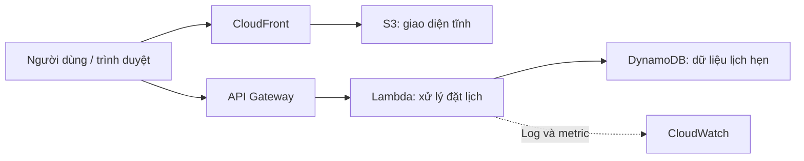

# AWS là gì và mô hình điện toán đám mây

Điện toán đám mây (*cloud computing*) cho phép tổ chức sử dụng tài nguyên công nghệ thông tin theo nhu cầu, thông qua mạng và các giao diện quản lý, thay vì phải tự mua và vận hành toàn bộ hạ tầng vật lý. **Amazon Web Services (AWS)** là nền tảng điện toán đám mây của Amazon, cung cấp các dịch vụ tính toán, lưu trữ, cơ sở dữ liệu, mạng, bảo mật, tích hợp và vận hành.

Bài học mở đầu của module **CLOUD_PROVIDERS_AWS** xây dựng nền tảng để người học tiếp tục tìm hiểu Region/Availability Zone, IAM, VPC, dịch vụ tính toán, lưu trữ, cơ sở dữ liệu, tích hợp và serverless; từ đó lựa chọn dịch vụ, thiết kế hệ thống an toàn, có khả năng giám sát, phục hồi và kiểm soát chi phí.

## Mục tiêu học tập

Sau bài học, bạn có thể:

1. Giải thích điện toán đám mây là gì, cách vận hành và sự khác biệt với hạ tầng tự quản.
2. Phân biệt **IaaS, PaaS, SaaS** và hiểu **serverless/FaaS** nằm ở đâu.
3. So sánh các mô hình triển khai **public cloud, private cloud, hybrid cloud** và khái niệm multi-cloud.
4. Nhận biết cấu trúc **Region – Availability Zone (AZ)** và các nhóm dịch vụ AWS phổ biến.
5. Áp dụng **mô hình trách nhiệm chia sẻ**, nguyên tắc thiết kế sẵn sàng, bảo mật và quản lý chi phí vào tình huống thực tế.

## 1. Điện toán đám mây thực chất là gì?

Hãy hình dung một nhóm phát triển muốn chạy ứng dụng đặt lịch. Theo cách truyền thống, nhóm có thể phải mua máy chủ, đặt thiết bị tại trung tâm dữ liệu, cấu hình mạng, cấp điện, làm mát, thay phần cứng hỏng và dự trù năng lực cho lượng truy cập cao nhất. Với cloud, nhóm có thể tạo máy chủ ảo, cơ sở dữ liệu hoặc một hàm xử lý sự kiện bằng công cụ quản lý hay API; nhà cung cấp vận hành phần hạ tầng nằm dưới những dịch vụ đó.

Điện toán đám mây thường có **năm đặc tính cốt lõi**:

| Đặc tính | Ý nghĩa | Ví dụ trên AWS |
|---|---|---|
| Tự phục vụ theo nhu cầu (*on-demand self-service*) | Chủ động cấp phát tài nguyên khi được phân quyền, không cần đặt mua thiết bị vật lý | Tạo một phiên bản EC2 qua Console, CLI hoặc API |
| Truy cập qua mạng (*broad network access*) | Sử dụng và quản lý dịch vụ qua giao diện mạng chuẩn | Gửi yêu cầu tới API Gateway bằng HTTPS |
| Tài nguyên được dùng chung (*resource pooling*) | Nhà cung cấp phân bổ hạ tầng vật lý cho nhiều khách hàng, với các cơ chế cô lập thích hợp | Nhiều tài khoản dùng dịch vụ trên cùng nền tảng AWS |
| Co giãn nhanh (*rapid elasticity*) | Có thể tăng/giảm tài nguyên theo tải và cơ chế của dịch vụ | Tăng số EC2 qua Auto Scaling hoặc để Lambda tự mở rộng thực thi trong giới hạn cấu hình |
| Đo lường mức sử dụng (*measured service*) | Mức tiêu thụ được ghi nhận để quản lý và tính phí | Theo dõi giờ sử dụng, lượng lưu trữ, yêu cầu API hoặc dữ liệu truyền |

**Điểm mấu chốt:** cloud không đơn thuần là “máy chủ đặt ở nơi khác”. Sự khác biệt nằm ở khả năng cấp phát bằng phần mềm, tự động hóa, co giãn và đo lường tiêu thụ. Ứng dụng chạy trên cloud vẫn cần thiết kế kiến trúc, phân quyền, bảo mật dữ liệu và giám sát.

### 1.1. Các thuật ngữ dễ nhầm

- **Scalability (khả năng mở rộng):** hệ thống có thể xử lý tải lớn hơn bằng cách tăng năng lực. *Vertical scaling* tăng CPU/RAM cho một máy; *horizontal scaling* tăng số máy hoặc phiên bản xử lý.
- **Elasticity (khả năng co giãn):** năng lực tăng và giảm linh hoạt theo nhu cầu, lý tưởng là gần sát mức tải thực tế để tránh lãng phí.
- **Availability (tính sẵn sàng):** mức độ dịch vụ có thể phục vụ khi người dùng cần. Hai máy cùng một điểm lỗi chưa chắc mang lại tính sẵn sàng cao.
- **Durability (độ bền dữ liệu):** xác suất dữ liệu được giữ nguyên, không bị mất. Một đối tượng lưu bền không đồng nghĩa ứng dụng luôn truy cập được.
- **Disaster recovery (khôi phục thảm họa):** kế hoạch và biện pháp đưa dịch vụ hoạt động trở lại sau sự cố lớn; cần xác định **RTO** (thời gian khôi phục mục tiêu) và **RPO** (mức mất dữ liệu tối đa chấp nhận được, tính theo thời gian).

## 2. Tại sao tổ chức sử dụng cloud?

| Tiêu chí | Hạ tầng tự quản (*on-premises*) | Sử dụng dịch vụ cloud |
|---|---|---|
| Khởi tạo | Mua sắm, giao nhận, lắp đặt và cấu hình thiết bị | Cấp phát qua Console, API hoặc công cụ hạ tầng dưới dạng mã |
| Năng lực dự phòng | Thường phải mua trước theo dự báo | Có thể mở rộng hoặc thu hẹp tùy dịch vụ và hạn mức |
| Chi phí | Đầu tư thiết bị, không gian, điện, nhân sự; vẫn có chi phí vận hành | Thường trả theo mức sử dụng hoặc cam kết; vẫn có phí vận hành và truyền dữ liệu |
| Vận hành vật lý | Đơn vị sở hữu chịu trách nhiệm | Nhà cung cấp chịu trách nhiệm cho hạ tầng vật lý của cloud |
| Khả năng kiểm soát | Kiểm soát sâu phần cứng và môi trường tại chỗ | Kiểm soát theo lớp và khả năng cấu hình của dịch vụ đã chọn |
| Tốc độ thử nghiệm | Có thể chậm nếu phải bổ sung tài nguyên | Thường nhanh hơn nhờ tài nguyên và dịch vụ được cung cấp sẵn |

Ví dụ, một ứng dụng bán vé chỉ có đợt cao điểm theo chiến dịch có thể hưởng lợi từ việc mở rộng công suất trong thời gian ngắn. Ngược lại, khối lượng xử lý rất ổn định, yêu cầu phần cứng đặc biệt hoặc có chi phí truyền dữ liệu lớn cần được tính toán kỹ trước khi chuyển sang cloud.

### 2.1. Lợi ích và đánh đổi

**Lợi ích thường gặp:** đưa sản phẩm ra thị trường nhanh hơn; tiếp cận hạ tầng nhiều khu vực địa lý; tự động hóa triển khai; giảm công việc bảo trì vật lý; có thêm lựa chọn cho tính sẵn sàng, dự phòng và quan sát hệ thống.

**Đánh đổi cần quản lý:** chi phí biến động nếu không giám sát; cấu hình sai có thể tạo lỗ hổng bảo mật; độ trễ phụ thuộc vị trí người dùng và hạ tầng; phụ thuộc một số giao diện/dịch vụ của nhà cung cấp (*vendor lock-in*); yêu cầu về dữ liệu, tuân thủ và kỹ năng vận hành không tự biến mất.

Không có kết luận “cloud luôn rẻ hơn” hoặc “đưa lên cloud là tự động an toàn”. Hai nhận định đó đều phụ thuộc vào thiết kế và cách vận hành.

## 3. Ba mô hình dịch vụ: IaaS, PaaS, SaaS

Mô hình dịch vụ trả lời câu hỏi: **nhà cung cấp quản lý đến lớp nào, và nhóm phát triển còn phải quản lý những gì?**

| Mô hình | Bên sử dụng thường quản lý | Nhà cung cấp quản lý | Ví dụ và trường hợp phù hợp |
|---|---|---|---|
| **IaaS** – *Infrastructure as a Service* | Hệ điều hành, bản vá, phần mềm trung gian, ứng dụng, dữ liệu và cấu hình truy cập | Phần cứng, trung tâm dữ liệu, lớp ảo hóa và hạ tầng nền | **Amazon EC2**: cần tùy chỉnh hệ điều hành hoặc chạy ứng dụng cũ |
| **PaaS** – *Platform as a Service* | Mã ứng dụng, dữ liệu và cấu hình ứng dụng | Nhiều lớp nền tảng triển khai, môi trường chạy và tài nguyên bên dưới | **AWS Elastic Beanstalk**: muốn triển khai ứng dụng mà bớt công việc dựng môi trường |
| **SaaS** – *Software as a Service* | Tài khoản/người dùng, quyền sử dụng, dữ liệu nhập và thiết lập nghiệp vụ theo sản phẩm | Ứng dụng hoàn chỉnh cùng phần lớn nền tảng vận hành | Phần mềm email hoặc CRM dùng qua web: cần **sử dụng** chức năng, không xây dựng ứng dụng |

Các mô hình này mô tả mức độ trừu tượng hóa, **không phải ba loại hạ tầng tách biệt tuyệt đối**. AWS có nhiều dịch vụ quản lý ở mức khác nhau. Ví dụ, **Amazon RDS** là cơ sở dữ liệu được quản lý: AWS vận hành nhiều công việc liên quan tới hạ tầng và cơ sở dữ liệu, nhưng khách hàng vẫn quản lý dữ liệu, quyền truy cập, cấu hình phù hợp và cách ứng dụng dùng dữ liệu.

### 3.1. Serverless và FaaS là gì?

**Serverless** là cách sử dụng dịch vụ mà nhà phát triển không phải cấp phát và quản lý máy chủ như một đơn vị vận hành chính. Máy chủ vật lý vẫn tồn tại và do nhà cung cấp quản lý. **Function as a Service (FaaS)** là một dạng serverless cho phép chạy mã đáp ứng sự kiện.

Ví dụ với **AWS Lambda**:

1. Một yêu cầu HTTPS đi vào Amazon API Gateway.
2. API Gateway kích hoạt hàm Lambda.
3. Lambda xử lý nghiệp vụ và ghi/đọc dữ liệu.
4. Nhóm phát triển trả phí theo mô hình định giá áp dụng cho tài nguyên và số lần/thời gian thực thi, cùng chi phí các dịch vụ liên quan.

Ưu điểm: ít quản lý máy chủ, phù hợp tác vụ theo sự kiện và lưu lượng thay đổi. Đánh đổi: giới hạn thời gian/tài nguyên, thời gian khởi động trong một số tình huống, quản lý kết nối, quan sát hệ thống phân tán và rủi ro chi phí ở quy mô lớn.

**Phân biệt:** IaaS/PaaS/SaaS mô tả mức dịch vụ được bàn giao; serverless mô tả cách trừu tượng hóa việc vận hành máy chủ. Một hệ thống có thể kết hợp EC2, cơ sở dữ liệu quản lý và Lambda.

### 3.2. Chọn mô hình qua tình huống

- Cần cấu hình thư viện hệ thống đặc thù, cài phần mềm trên OS, kiểm soát tiến trình lâu dài: cân nhắc **EC2/IaaS**.
- Có ứng dụng web thông thường và muốn nền tảng hỗ trợ triển khai, vận hành: cân nhắc **PaaS** hoặc dịch vụ container quản lý.
- Có tác vụ gửi email sau khi đơn hàng được tạo: cân nhắc **Lambda** và dịch vụ hàng đợi/sự kiện.
- Chỉ cần công cụ quản lý khách hàng có sẵn: cân nhắc **SaaS** thay vì tự phát triển toàn bộ.

## 4. Các mô hình triển khai cloud

Mô hình triển khai trả lời câu hỏi: **hạ tầng cloud được tổ chức, sở hữu và kết nối thế nào?**

| Mô hình | Mô tả | Tình huống điển hình |
|---|---|---|
| **Public cloud** | Tài nguyên đám mây được nhà cung cấp đưa ra cho nhiều khách hàng, có cơ chế cô lập và phân quyền | Xây ứng dụng trên AWS; tài khoản riêng sử dụng dịch vụ AWS |
| **Private cloud** | Môi trường cloud dành riêng cho một tổ chức, có thể đặt tại chỗ hoặc do đơn vị khác vận hành | Tổ chức muốn tự kiểm soát môi trường cloud dành riêng |
| **Hybrid cloud** | Kết hợp các môi trường riêng biệt, ví dụ hạ tầng tại chỗ và public cloud, có tích hợp/di chuyển dữ liệu hoặc ứng dụng | Giữ hệ thống lõi tại trung tâm dữ liệu, triển khai dịch vụ web trên AWS |
| **Multi-cloud** | Sử dụng dịch vụ từ từ hai nhà cung cấp cloud trở lên; đây là cách tổ chức chiến lược vận hành, không đồng nhất với ba mô hình trên | Ứng dụng A chạy trên AWS, ứng dụng B chạy trên nền tảng cloud khác |

**AWS Outposts** là một ví dụ sản phẩm hỗ trợ các mô hình lai bằng cách mang một số hạ tầng và dịch vụ AWS tới địa điểm của khách hàng. Việc dùng nhiều **AZ**, nhiều **Region**, nhiều **VPC** hoặc nhiều **tài khoản AWS** vẫn là sử dụng một nhà cung cấp cloud; tự nó không phải multi-cloud.

Không nên chọn hybrid hay multi-cloud chỉ vì nghe “an toàn hơn”: lợi ích phải đủ bù cho độ phức tạp mạng, nhận dạng, đồng bộ dữ liệu, triển khai và hỗ trợ sự cố.

## 5. AWS tổ chức hạ tầng như thế nào?

AWS triển khai dịch vụ tại nhiều khu vực trên thế giới. Ba khái niệm nền tảng cần phân biệt:

- **Region:** khu vực địa lý AWS cung cấp tập hợp dịch vụ (ví dụ `ap-southeast-1` tại Singapore). Khi tạo phần lớn tài nguyên, bạn chọn Region; giá, độ trễ, khả năng cung cấp dịch vụ và yêu cầu lưu trú dữ liệu có thể khác nhau giữa các Region.
- **Availability Zone (AZ):** một hoặc nhiều trung tâm dữ liệu với nguồn điện, mạng và kết nối riêng, được thiết kế cô lập lỗi đáng kể so với AZ khác trong cùng Region. Nhiều kiến trúc dùng **ít nhất hai AZ** để tránh phụ thuộc một AZ.
- **Edge location:** các điểm hiện diện gần người dùng hơn, phục vụ một số dịch vụ như mạng phân phối nội dung Amazon CloudFront, góp phần giảm độ trễ khi phân phối nội dung.

```text
AWS
├── Region A
│   ├── AZ A1
│   ├── AZ A2
│   └── AZ A3
└── Region B
    ├── AZ B1
    └── AZ B2
```

*Sơ đồ là minh họa khái niệm; số lượng AZ thực tế tùy Region và thời điểm.*

**Tài khoản AWS** là một ranh giới quản lý tài nguyên, quyền và thanh toán quan trọng. **Amazon VPC** là mạng logic trong một Region; **subnet** được gắn với một AZ. Vì vậy, hai máy EC2 trong hai subnet thuộc hai AZ có thể giúp giảm rủi ro ngừng dịch vụ do mất một AZ, nếu ứng dụng, cân bằng tải, cơ sở dữ liệu và các phụ thuộc khác cũng được thiết kế chịu lỗi.

Lưu ý:

- Một máy EC2 trong một AZ vẫn có điểm lỗi đơn.
- Nhiều AZ giúp tăng khả năng chịu lỗi trong Region nhưng không thay thế kế hoạch ứng phó sự cố cả Region.
- Sao lưu, phục hồi, khả năng chống xóa nhầm và triển khai đa AZ giải quyết **những loại rủi ro khác nhau**.
- Dịch vụ AWS có thể mang phạm vi *global*, *regional* hoặc *zonal*; cần kiểm tra phạm vi riêng của từng dịch vụ, không mặc định mọi tài nguyên đều thuộc một AZ.

## 6. Bản đồ nhanh hệ sinh thái AWS

AWS cung cấp nhiều dịch vụ; ở giai đoạn nhập môn, hãy ghi nhớ **nhóm bài toán** trước khi nhớ tên sản phẩm:

| Bài toán | Dịch vụ tiêu biểu | Gợi ý sử dụng |
|---|---|---|
| Danh tính và quyền truy cập | **IAM**, **IAM Identity Center** | Ai có quyền thực hiện hành động nào trên tài nguyên nào? |
| Quản trị nhiều tài khoản | **AWS Organizations** | Tách môi trường, quản trị tài khoản và áp dụng chính sách ở cấp tổ chức |
| Mạng và phân phối | **VPC**, **Elastic Load Balancing**, **CloudFront**, **Route 53** | Phân vùng mạng, nhận và phân phối lưu lượng |
| Tính toán | **EC2**, **ECS**, **EKS**, **Lambda** | Chạy ứng dụng trên VM, container hoặc hàm xử lý sự kiện |
| Lưu trữ | **S3**, **EBS**, **EFS** | Lưu đối tượng; ổ khối cho máy; hệ thống tệp chia sẻ |
| Cơ sở dữ liệu | **RDS**, **DynamoDB** | Cơ sở dữ liệu quan hệ được quản lý hoặc NoSQL dạng khóa/giá trị và tài liệu |
| Tích hợp bất đồng bộ | **SQS**, **EventBridge**, **SNS** | Tách các thành phần bằng hàng đợi, sự kiện hoặc thông báo |
| Giám sát và kiểm toán | **CloudWatch**, **CloudTrail**, **AWS Config** | Xem metric/log/cảnh báo, hoạt động API và trạng thái cấu hình tài nguyên |
| Bảo vệ dữ liệu | **KMS**, các tính năng mã hóa và kiểm soát truy cập | Quản lý khóa, mã hóa và quyền liên quan |
| Quản lý chi phí | **AWS Budgets**, **Cost Explorer**, **Cost and Usage Report** | Cảnh báo ngân sách, phân tích sử dụng và hóa đơn |

Không phải ứng dụng nào cũng cần tất cả các dịch vụ. Một website giới thiệu đơn giản có thể chỉ cần S3 và CloudFront; một hệ thống giao dịch phức tạp có thể cần mạng riêng, nhiều lớp tính toán, cơ sở dữ liệu dự phòng, hàng đợi, bảo mật và giám sát.

## 7. Trách nhiệm chia sẻ: ai phải bảo mật điều gì?

AWS vận hành theo **Shared Responsibility Model** (*mô hình trách nhiệm chia sẻ*).

- **AWS chịu trách nhiệm về bảo mật *của* cloud:** bảo vệ trung tâm dữ liệu, phần cứng và các lớp hạ tầng nền thuộc phạm vi dịch vụ AWS vận hành.
- **Khách hàng chịu trách nhiệm về bảo mật *trong* cloud:** dữ liệu, danh tính, quyền truy cập, cấu hình dịch vụ, ứng dụng và các lớp phần mềm còn do khách hàng quản lý.

Phạm vi cụ thể thay đổi tùy loại dịch vụ:

| Dịch vụ | AWS chủ yếu quản lý | Khách hàng cần quan tâm |
|---|---|---|
| **EC2** | Hạ tầng vật lý, phần cứng và ảo hóa | Bản vá OS, phần mềm, cấu hình mạng, IAM, dữ liệu và giám sát |
| **RDS** | Nhiều công việc vận hành hạ tầng và engine CSDL theo dịch vụ/cấu hình | Tài khoản CSDL, dữ liệu, thiết kế schema, truy cập mạng, sao lưu/phục hồi phù hợp |
| **S3** | Hệ thống lưu trữ nền và cơ sở hạ tầng vận hành | Chính sách bucket/đối tượng, quyền truy cập, phân loại dữ liệu, vòng đời và phòng xóa nhầm |
| **Lambda** | Hạ tầng chạy và quản lý môi trường thực thi theo dịch vụ | Mã hàm, dependency, quyền IAM, bí mật, cấu hình và xử lý dữ liệu |

Ví dụ, nếu bạn vô tình cấu hình bucket S3 cho phép truy cập công khai dữ liệu nhạy cảm thì đây vẫn là lỗi trong phần trách nhiệm khách hàng. Ngược lại, bạn không phải tự sửa máy chủ vật lý nằm dưới dịch vụ S3.

**Thói quen an toàn từ ngày đầu:**

1. Bảo vệ tài khoản gốc (*root*), bật MFA và tránh dùng root cho công việc thường ngày; ưu tiên cấp quyền phù hợp qua IAM Identity Center/role.
2. Áp dụng **least privilege**: mỗi người và ứng dụng chỉ được quyền cần thiết.
3. Không lưu khóa truy cập, mật khẩu hay secret trong mã nguồn; dùng cơ chế quản lý danh tính/bí mật phù hợp.
4. Chỉ mở cổng mạng và truy cập dữ liệu cần thiết; mã hóa dữ liệu khi truyền và khi lưu theo yêu cầu.
5. Bật và xem xét cơ chế log, cảnh báo, sao lưu và thử khôi phục. **Sao lưu chỉ hữu ích khi có thể phục hồi được.**

## 8. Ví dụ kiến trúc: ứng dụng đặt lịch nhỏ trên AWS

Giả sử một nhóm xây hệ thống đặt lịch gồm giao diện web, API ghi nhận lịch hẹn và nơi lưu dữ liệu. Kiến trúc khởi đầu có thể là:



Luồng xử lý:

1. Người dùng tải HTML/CSS/JavaScript qua CloudFront, với nội dung gốc nằm trên S3.
2. Giao diện gọi API Gateway bằng HTTPS để tạo hoặc xem lịch hẹn.
3. API Gateway chuyển yêu cầu tới Lambda; hàm kiểm tra dữ liệu, xác thực/quyền theo thiết kế và xử lý quy tắc nghiệp vụ.
4. Lambda truy cập DynamoDB bằng **IAM role có quyền giới hạn**.
5. Nhóm vận hành xem log, metric và cảnh báo qua CloudWatch, đồng thời cấu hình các cơ chế kiểm toán và bảo vệ dữ liệu phù hợp.

**Tại sao có thể chọn cách này?** Nhóm giảm công việc quản trị máy chủ, các thành phần có khả năng mở rộng theo mô hình riêng và dễ thử nghiệm một phiên bản đầu tiên. Tuy nhiên, phải thiết kế cách xác thực người dùng, giới hạn yêu cầu, chống thao tác trùng, kiểm soát quyền, sao lưu/khôi phục dữ liệu và ngân sách.

Cách triển khai khác cũng hợp lý:

- Nếu ứng dụng là phần mềm cũ cần tiến trình chạy liên tục và thư viện hệ điều hành đặc thù, **EC2** có thể thuận tiện hơn Lambda.
- Nếu dữ liệu có quan hệ phức tạp, nhiều ràng buộc giao dịch và truy vấn SQL, có thể xem xét **RDS** thay DynamoDB.
- Nếu các công việc xử lý kéo dài hoặc cần tránh mất yêu cầu khi hệ thống tạm thời quá tải, có thể bổ sung **SQS** giữa bộ phận nhận yêu cầu và bộ phận xử lý.

Không có một “dịch vụ AWS tốt nhất” cho mọi tình huống. Quyết định phải dựa trên tải, dữ liệu, chi phí, khả năng phục hồi, yêu cầu bảo mật và kỹ năng nhóm.

### 8.1. Cách suy nghĩ về độ tin cậy

Với ứng dụng phục vụ người dùng thật, tự hỏi:

- **Điểm lỗi đơn ở đâu?** Một EC2 duy nhất, một database không dự phòng hay một cấu hình mạng có thể làm toàn hệ thống ngừng hoạt động.
- **Nếu một AZ gặp sự cố?** Cân nhắc cân bằng tải qua nhiều AZ, nhiều instance và tùy chọn Multi-AZ của dịch vụ CSDL thích hợp.
- **Nếu dữ liệu bị xóa nhầm?** Cần chiến lược sao lưu, versioning, điểm khôi phục hoặc bảo vệ phù hợp; triển khai nhiều AZ đơn thuần không khắc phục mọi lỗi logic.
- **Nếu cần phục hồi sau thảm họa diện rộng?** Xác định RTO/RPO rồi cân nhắc kiến trúc, sao chép hoặc khôi phục giữa các Region, cùng chi phí tương ứng.

## 9. Thanh toán và kiểm soát chi phí

Cloud thường áp dụng cơ chế **trả theo mức sử dụng**, song một số tài nguyên còn có phương án đặt trước/cam kết để tối ưu chi phí. Tổng tiền phụ thuộc không chỉ vào số máy mà còn thời gian chạy, dung lượng, request, truy xuất dữ liệu, băng thông ra ngoài và tài nguyên phụ trợ.

Có thể lập mô hình ước tính đơn giản:

```text
Tổng chi phí kỳ ≈
    chi phí tính toán
  + chi phí lưu trữ và truy xuất dữ liệu
  + chi phí cơ sở dữ liệu
  + chi phí truyền dữ liệu / mạng
  + chi phí giám sát, bảo mật và dịch vụ phụ trợ
  - ưu đãi hoặc chiết khấu hợp lệ
```

Đây là **cách chia nhóm để lập dự toán**, không phải công thức bảng giá cố định. Đơn vị tính, định mức và giá phụ thuộc dịch vụ, Region, cấu hình, gói sử dụng và thời điểm; cần kiểm tra thông tin giá chính thức hoặc **AWS Pricing Calculator** trước khi chốt quyết định.

Những khoản dễ bị bỏ sót gồm: máy chạy cả đêm dù không có người dùng; ổ đĩa và bản sao lưu vẫn được giữ sau khi xóa máy; dữ liệu truyền ra Internet hoặc giữa các thành phần; dịch vụ NAT Gateway; log lưu quá lâu; cơ sở dữ liệu chạy liên tục.

Một quy trình kiểm soát chi phí tối thiểu:

1. Chọn **Region**, loại dịch vụ và kích thước phù hợp với nhu cầu thực tế.
2. Gắn **tag** như `project`, `environment`, `owner` để hỗ trợ phân bổ chi phí (với các tag chi phí cần được kích hoạt theo cơ chế AWS).
3. Thiết lập **AWS Budgets** và thông báo, theo dõi bằng Cost Explorer, xem hóa đơn định kỳ.
4. Gỡ tài nguyên không còn dùng, tối ưu lịch chạy, dung lượng lưu trữ và retention log.
5. Với tải ổn định, đánh giá phương án cam kết so với On-Demand; với tải biến động, đánh giá khả năng tự co giãn.

**Lưu ý quan trọng:** cảnh báo của AWS Budgets **không mặc nhiên là giới hạn cứng** ngăn tất cả chi phí mới. Chương trình Free Tier/tín dụng, điều kiện miễn phí và ưu đãi có thể khác nhau tùy tài khoản, dịch vụ và thời điểm. Không xem việc tạo tài khoản hay đặt ngân sách là bảo đảm không phát sinh phí.

## 10. Bài thực hành nhập môn

### Bài A — Chọn dịch vụ từ yêu cầu

Một công ty có ba nhu cầu:

| Nhu cầu | Lựa chọn khởi đầu hợp lý | Lý do |
|---|---|---|
| Lưu ảnh sản phẩm và tài liệu có thể truy xuất bằng API | **S3** | Lưu trữ đối tượng, tách khỏi vòng đời của máy chủ |
| Chạy ứng dụng kế toán cũ cần tùy chỉnh hệ điều hành | **EC2** | Có quyền kiểm soát cấu hình máy ảo và OS |
| Xử lý sự kiện “đơn hàng đã tạo” để gửi thông báo | **EventBridge/SQS kết hợp Lambda** | Tách rời luồng xử lý, thực thi theo sự kiện |

Đây là lựa chọn sơ bộ. Khi thiết kế thật, còn phải làm rõ tải, quyền truy cập, độ bền dữ liệu, khả năng mất/trùng sự kiện, giới hạn dịch vụ và chi phí.

### Bài B — Quan sát tài khoản bằng AWS CLI (tùy chọn)

Nếu có tài khoản học tập và được cấp quyền, bạn có thể dùng **AWS CLI v2** với IAM Identity Center để kiểm tra danh tính hiện tại và danh sách AZ trong Region Singapore. Những lệnh sau **chỉ đọc thông tin, không tạo tài nguyên**:

```bash
# Cấu hình hồ sơ đăng nhập một lần theo chỉ dẫn của tổ chức
aws configure sso --profile aws-learning

# Đăng nhập và xác minh danh tính được cấp quyền
aws sso login --profile aws-learning
aws sts get-caller-identity --profile aws-learning

# Quan sát AZ trong Region đã chọn
aws ec2 describe-availability-zones \
  --region ap-southeast-1 \
  --profile aws-learning \
  --query 'AvailabilityZones[].ZoneName' \
  --output table
```

Lệnh cuối cần quyền EC2 DescribeAvailabilityZones. Tên AZ như `ap-southeast-1a` có thể ánh xạ tới các AZ vật lý khác nhau giữa các tài khoản; không dùng tên chữ cái để suy rằng hai tài khoản chắc chắn cùng một AZ vật lý. Nếu chưa có tài khoản, bạn vẫn có thể hoàn thành Bài A và phần câu hỏi bên dưới mà không tốn phí.

### Bài C — Tự đánh giá

1. Vì sao “thuê một máy chủ của công ty khác” chưa chắc đã có đầy đủ đặc tính điện toán đám mây?
2. Với một máy EC2 tự quản, bên nào chịu trách nhiệm cập nhật bản vá hệ điều hành?
3. Hai ứng dụng chạy ở hai AZ trong cùng Region có phải là multi-cloud không?
4. Vì sao sao lưu dữ liệu và triển khai nhiều AZ không thay thế được nhau?
5. Nhóm muốn chạy API ngắn, ít truy cập vào ban đêm. Lambda có thể là ứng viên vì sao, và còn phải kiểm tra những yếu tố nào?
6. Vì sao đặt ngân sách AWS Budgets chưa bảo đảm hóa đơn sẽ không vượt mức đó?

**Gợi ý đáp án:** (1) Cloud cần thêm cấp phát theo nhu cầu, tự động hóa, co giãn, đo lường, v.v.; (2) khách hàng; (3) không; (4) chúng xử lý các dạng lỗi khác nhau; (5) giảm quản lý máy chủ và co giãn theo yêu cầu, nhưng phải kiểm tra giới hạn, độ trễ, tải, phụ thuộc, bảo mật, giá; (6) Budgets chủ yếu theo dõi/cảnh báo và không phải mọi loại chi phí đều bị chặn tự động.

## 11. Ghi nhớ trước khi chuyển sang bài tiếp theo

- **AWS** là hệ sinh thái dịch vụ cloud; điện toán đám mây là mô hình cung cấp tài nguyên theo nhu cầu, co giãn và đo lường mức sử dụng.
- **IaaS/PaaS/SaaS** khác nhau ở ranh giới quản trị; **serverless** tiếp tục giảm phần việc vận hành máy chủ đối với một số kiểu xử lý.
- **Public/private/hybrid** mô tả cách triển khai; **multi-cloud** nói về việc dùng nhiều nhà cung cấp.
- **Region, AZ, VPC, IAM** là các khái niệm nền để thiết kế vị trí tài nguyên, kết nối và phân quyền.
- **Trách nhiệm chia sẻ** và **quản lý chi phí** bắt đầu từ bước lựa chọn dịch vụ, không chỉ sau khi ứng dụng đã triển khai.
- Một hệ thống đáng tin cậy cần thiết kế **giám sát, chịu lỗi, sao lưu và khôi phục** phù hợp với mục tiêu nghiệp vụ.

### Tài liệu tham khảo chính thức

- [AWS — What is Cloud Computing?](https://aws.amazon.com/what-is-cloud-computing/)
- [AWS — Cloud Computing Types](https://aws.amazon.com/types-of-cloud-computing/)
- [AWS — Global Infrastructure](https://aws.amazon.com/about-aws/global-infrastructure/)
- [AWS — Shared Responsibility Model](https://aws.amazon.com/compliance/shared-responsibility-model/)
- [AWS — Pricing](https://aws.amazon.com/pricing/)
- [AWS Well-Architected Framework](https://docs.aws.amazon.com/wellarchitected/latest/framework/welcome.html)
