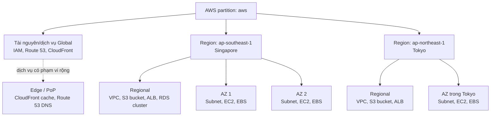
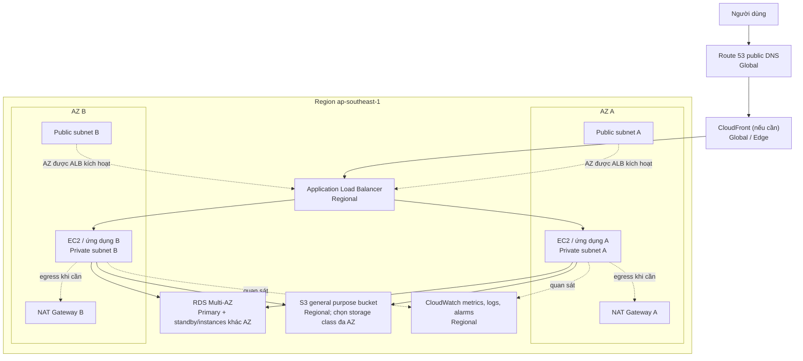

# Phạm vi tài nguyên toàn cục, theo Region và theo AZ trên AWS

## 1. Vì sao phải phân biệt phạm vi tài nguyên?

Khi triển khai ứng dụng trên Amazon Web Services (AWS), chọn đúng dịch vụ mới chỉ là một phần của thiết kế. Cần biết **tài nguyên tồn tại ở phạm vi nào**, **lỗi tại vị trí nào có thể ảnh hưởng đến nó**, **dữ liệu được lưu ở đâu** và **có phải tạo thêm bản sao ở nơi khác hay không**.

Ví dụ:

- Tạo một **IAM role** để ứng dụng được phép truy cập S3: vai trò này thuộc phạm vi toàn cục của tài khoản trong một AWS partition; không cần tạo lại chỉ vì ứng dụng chạy ở Region khác.
- Tạo một **VPC** tại Singapore (`ap-southeast-1`): VPC đó là tài nguyên của Region Singapore, không tự xuất hiện tại Tokyo (`ap-northeast-1`).
- Tạo một **subnet** trong VPC: subnet chỉ nằm trong **một Availability Zone (AZ)**.
- Tạo một **EC2 instance** hoặc **EBS volume**: chúng được đặt trong một AZ cụ thể; muốn gắn trực tiếp EBS vào EC2, cả hai phải cùng AZ.
- Tạo một **S3 general purpose bucket**: bucket có Region lưu trữ cụ thể, dù tên bucket mặc định phải duy nhất trong không gian tên dùng chung của cả AWS partition.

Phân biệt ba phạm vi **Global – Regional – Zonal** giúp chọn vị trí triển khai, thiết kế dự phòng, giới hạn ảnh hưởng khi xảy ra sự cố (*blast radius*), kiểm soát độ trễ, chi phí và yêu cầu lưu trú dữ liệu.

## 2. Mô hình địa lý và phân vùng của AWS

### 2.1. AWS partition, Region, AZ và edge location

| Khái niệm | Ý nghĩa | Tác động khi thiết kế |
|---|---|---|
| **AWS partition** | Ranh giới lớn phân tách một nhóm Region và hệ thống nhận dạng, ví dụ `aws`, `aws-cn`, `aws-us-gov` | IAM và tài nguyên không mặc nhiên dùng chung xuyên partition; ARN có thành phần partition |
| **Global** | Phạm vi của một số dịch vụ hoặc tài nguyên dùng chung qua nhiều Region trong cùng phạm vi dịch vụ/partition | Không phải tạo bản sao từng Region cho đối tượng đó; vẫn cần xét các phụ thuộc và điểm lỗi của control plane |
| **Region** | Khu vực địa lý AWS vận hành hạ tầng, ví dụ `ap-southeast-1` (Singapore) | Ranh giới chính để chọn vị trí dữ liệu, triển khai hệ thống, tính giá và phục hồi ở cấp vùng |
| **Availability Zone (AZ)** | Một hoặc nhiều trung tâm dữ liệu được thiết kế cách ly lỗi trong một Region | Nơi đặt tài nguyên zonal; trải ứng dụng qua nhiều AZ giúp chịu lỗi một AZ |
| **Edge location / Point of Presence (PoP)** | Điểm hiện diện mạng ở gần người dùng để cung cấp các chức năng như phân phối nội dung hoặc DNS | Hỗ trợ giảm độ trễ, nhưng không đồng nghĩa ứng dụng và cơ sở dữ liệu đã được triển khai đa Region |

Sơ đồ khái niệm (các thành phần minh họa, không biểu diễn vị trí vật lý chính xác):



Các AZ trong một Region có kết nối mạng băng thông cao, độ trễ thấp và được thiết kế để giảm rủi ro cùng bị ảnh hưởng bởi một sự cố hạ tầng. Tuy vậy, **nhiều AZ vẫn thuộc cùng một Region**. Nếu cả Region gặp sự cố quy mô lớn, chỉ trải tài nguyên qua nhiều AZ là chưa đủ để bảo đảm dịch vụ vẫn hoạt động.

### 2.2. Cách đọc tên Region và AZ

- `ap-southeast-1`: mã của Region Singapore.
- `ap-southeast-1a`: tên một AZ trong Region đó.
- `ap-southeast-1b`: tên AZ khác trong cùng Region.
- `apse1-az1`: ví dụ về định dạng **AZ ID**, định danh ổn định để đối chiếu vị trí AZ giữa các tài khoản.

**Lưu ý về nhiều tài khoản:** tại một số Region, với tài khoản được tạo trước tháng 11/2025, cùng tên AZ như `ap-southeast-1a` có thể tương ứng với vị trí vật lý khác giữa hai tài khoản. AWS sử dụng ánh xạ nhất quán hơn cho các tài khoản mới; khi cần phối hợp subnet, chia sẻ tài nguyên hoặc so sánh AZ giữa tài khoản, **hãy đối chiếu AZ ID**, không suy ra chỉ từ hậu tố `a`/`b`.

Một tài khoản chỉ nhìn thấy và sử dụng được những Region/AZ đang được hỗ trợ, có quyền truy cập và đã được bật khi cần. Khả dụng của loại instance hoặc dịch vụ cụ thể cũng có thể khác nhau theo Region và AZ.

### 2.3. Ba câu hỏi riêng biệt

Cần tách ba câu hỏi thường bị gộp làm một:

1. **Resource scope:** một đối tượng được tạo và quản lý ở phạm vi Global, Region hay AZ?
2. **Data placement:** dữ liệu và bản sao thực tế nằm ở đâu? Một tài nguyên *regional* có thể sao chép dữ liệu qua nhiều AZ hoặc chỉ lưu theo một lớp lưu trữ đặc biệt.
3. **Endpoint/control plane:** gọi API ở endpoint nào và phụ thuộc vào control plane ở đâu? Endpoint toàn cục hoặc endpoint có tên Region không tự quyết định nơi dữ liệu được lưu.

Ví dụ, S3 bucket có Region lưu trữ xác định; tên bucket general purpose theo mặc định thuộc không gian tên toàn cục trong partition. Hai đặc điểm này không mâu thuẫn vì **phạm vi tên** khác **phạm vi lưu dữ liệu**.

## 3. Tài nguyên Global: dùng chung, nhưng không có nghĩa bất khả lỗi

**Global resource/service** ở đây nghĩa là không bị định danh hoặc tạo riêng theo mỗi Region theo cách thông thường. Phạm vi cụ thể luôn phụ thuộc dịch vụ, tài khoản và AWS partition.

| Dịch vụ hoặc tài nguyên | Phạm vi cần nhớ | Ví dụ áp dụng |
|---|---|---|
| **AWS IAM** (user, group, role, managed policy) | Global trong tài khoản của một partition | Role `AppRole` có thể được ứng dụng tại Singapore và Tokyo sử dụng nếu chính sách, trust policy và quyền truy cập cho phép |
| **AWS Organizations** | Quản trị tổ chức và tài khoản ở phạm vi rộng, không tạo một organization riêng trong mỗi Region | Áp dụng Service Control Policy (SCP) cho nhiều tài khoản; SCP là giới hạn quyền, không tự cấp quyền |
| **Amazon Route 53 public hosted zone** | Quản trị DNS công khai ở phạm vi global | Bản ghi DNS điều hướng người dùng đến endpoint ở các Region khác nhau |
| **Amazon CloudFront distribution** | Dịch vụ phân phối nội dung có mạng edge toàn cầu | Cache nội dung gần người dùng; origin vẫn có thể là ALB/S3 tại một Region |
| **AWS Global Accelerator** | Cung cấp entry point toàn cầu và điều hướng đến endpoint tại các Region được cấu hình | Tăng tính sẵn sàng và tối ưu định tuyến đến ứng dụng đa Region |

**Điểm dễ nhầm:**

- Một IAM role dùng được ở nhiều Region **không** đồng nghĩa role đó có mọi quyền. Chính sách IAM, resource policy, điều kiện Region và các lớp giới hạn khác vẫn quyết định hành động nào được phép.
- Route 53 là tên dịch vụ, nhưng **không phải mọi đối tượng của Route 53 đều global**: Route 53 Resolver endpoints gắn với VPC trong Region.
- CloudFront phục vụ lưu lượng qua mạng edge, nhưng việc origin hoặc cơ sở dữ liệu tại một Region gặp lỗi vẫn có thể làm ứng dụng lỗi. Muốn failover phải cấu hình nguồn và quy trình khôi phục phù hợp.
- Các dịch vụ global cũng có **control plane** (nơi thao tác tạo/sửa/xóa cấu hình). Sự cố control plane có thể làm các thao tác quản trị không khả dụng, kể cả khi đường phục vụ dữ liệu hiện hữu vẫn hoạt động. Vì vậy không nên thiết kế phương án phục hồi phụ thuộc vào việc phải tạo mới một tài nguyên global ngay trong lúc xảy ra sự cố.

**Ngoại lệ về API:** một AWS WAF web ACL dùng để bảo vệ CloudFront có phạm vi `CLOUDFRONT` và thao tác API tại `us-east-1`; web ACL bảo vệ ALB hoặc API Gateway regional có phạm vi `REGIONAL` tại Region của tài nguyên. Nơi gọi API không nên bị nhầm với việc toàn bộ CloudFront chỉ chạy tại `us-east-1`.

## 4. Tài nguyên Regional: nằm trong một Region, có thể trải nhiều AZ

Một tài nguyên **regional** được tạo trong một Region cụ thể. Muốn có tài nguyên tương tự ở Region khác, thông thường cần triển khai, cấu hình hoặc sao chép phù hợp tại Region đó.

| Tài nguyên/dịch vụ | Phạm vi | Ghi chú kiến trúc |
|---|---|---|
| **VPC** | Region | Một VPC có thể chứa các subnet ở nhiều AZ trong cùng Region; không trải sang Region khác |
| **Route table, Network ACL, Security Group** trong VPC | Region/VPC | Luật và liên kết có thể áp dụng với tài nguyên ở nhiều AZ thuộc VPC; không tự xuất hiện trong VPC của Region khác |
| **Application Load Balancer (ALB)** | Region | Kích hoạt các AZ thông qua subnet; chuyển lưu lượng tới target khỏe mạnh theo cấu hình |
| **EC2 Auto Scaling group** | Region | Có thể đặt EC2 vào nhiều AZ bằng cách chọn nhiều subnet/AZ |
| **AWS Lambda function** | Region | Function được tạo theo Region; với cấu hình VPC, chọn subnet/AZ phù hợp; người dùng không ghim một lần chạy Lambda thông thường vào một EC2/AZ cố định |
| **Amazon S3 general purpose bucket** | Region đối với vị trí bucket/dữ liệu | Tên theo mặc định phải duy nhất trong namespace dùng chung của partition; storage class quyết định cách đặt và dự phòng dữ liệu |
| **Amazon DynamoDB table** | Region | Global Tables là cấu hình tạo và đồng bộ các bản sao bảng ở nhiều Region, không làm một bảng đơn lẻ thành tài nguyên global |
| **AWS KMS key** | Region | Multi-Region key gồm các khóa liên quan tại các Region, mỗi khóa vẫn là tài nguyên theo Region |
| **Amazon CloudWatch metric/alarm** | Region | Muốn quan sát nhiều Region cần thu thập/tổng hợp dữ liệu tương ứng; đừng tìm alarm ở nhầm Region |
| **Amazon RDS DB cluster** (ví dụ Aurora) | Region | Các instance của cluster nằm trong AZ; cấu hình replica và failover ảnh hưởng mức chịu lỗi |
| **Amazon EBS snapshot** | Region | Snapshot không bị ràng buộc vào AZ của volume gốc; có thể dùng để tạo volume ở AZ khác trong cùng Region |
| **Amazon EFS Regional file system** | Region | Dữ liệu loại Regional được lưu dư thừa qua nhiều AZ; mount target lại là đối tượng theo AZ |

### 4.1. VPC và subnet: quan hệ quan trọng nhất

Một VPC là ranh giới mạng **trong Region**. Mỗi subnet của VPC lại thuộc **đúng một AZ**. Ví dụ:

```text
Region ap-southeast-1
└── VPC 10.20.0.0/16
    ├── AZ a (theo tài khoản)
    │   ├── public-subnet-a   10.20.0.0/24
    │   └── private-subnet-a  10.20.10.0/24
    ├── AZ b
    │   ├── public-subnet-b   10.20.1.0/24
    │   └── private-subnet-b  10.20.11.0/24
    └── AZ c
        ├── public-subnet-c   10.20.2.0/24
        └── private-subnet-c  10.20.12.0/24
```

Mạng trong VPC cho phép các tài nguyên ở các subnet/AZ khác nhau giao tiếp theo route table, security group, network ACL và các cấu hình mạng liên quan. **Public/private subnet** là cách gọi dựa trên thiết kế định tuyến, đặc biệt đường đến Internet Gateway; tên subnet tự đặt không quyết định việc subnet có truy cập Internet hay không.

Nếu tạo VPC cùng CIDR tại Tokyo, đây vẫn là **VPC khác**, có ID, subnet, route, security group và các kết nối riêng. Hai VPC khác Region cần cơ chế kết nối thích hợp như inter-Region VPC peering hoặc AWS Transit Gateway peering, tùy nhu cầu.

### 4.2. Dịch vụ có giao diện Regional nhưng thành phần Zonal

ALB là ví dụ: **đối tượng load balancer** thuộc Region, nhưng khi triển khai người dùng chọn subnet tại các AZ khác nhau. Auto Scaling group tương tự: nhóm thuộc Region nhưng các EC2 do nhóm quản lý thuộc từng AZ cụ thể.

Amazon RDS cũng có nhiều cấp: API và nhiều cấu hình ở phạm vi Region; **DB instance** chạy trong AZ; triển khai **Multi-AZ** đặt thành phần dự phòng ở AZ khác theo loại triển khai. Chỉ đặt một DB instance trong Region có nhiều AZ sẽ không tự tạo dự phòng liên AZ.

## 5. Tài nguyên Zonal: ràng buộc vào một Availability Zone

| Tài nguyên | Phạm vi | Hệ quả |
|---|---|---|
| **EC2 instance** | Một AZ | Khi AZ bị ảnh hưởng, instance tại đó có thể không phục vụ; phải chạy bản sao hoặc cơ chế tự khôi phục ở AZ khác |
| **Subnet** | Một AZ | Không thể kéo một subnet qua hai AZ; muốn đa AZ cần nhiều subnet |
| **EBS volume** | Một AZ | Volume chỉ gắn trực tiếp với EC2 tương thích trong cùng AZ; muốn chuyển AZ dùng snapshot/khôi phục hoặc cơ chế sao chép thích hợp |
| **NAT Gateway** (loại đặt trong AZ) | Một AZ | Đặt NAT Gateway theo AZ và định tuyến subnet tương ứng để tránh phụ thuộc chéo AZ trong thiết kế chịu lỗi |
| **RDS DB instance** | Một AZ | Multi-AZ tạo thành phần dự phòng ở AZ khác theo cấu hình; instance đơn lẻ không tự có bản sao |
| **EFS mount target** | Một AZ | Với EFS Regional, có thể tạo mount target theo AZ để client truy cập gần; One Zone chỉ có một mount target trong AZ của file system |
| **S3 Express One Zone directory bucket** | Một AZ | Cấu hình storage hướng đến truy cập độ trễ thấp trong một AZ; khác general purpose bucket thông thường |

Hệ quả quan trọng: **gắn một EC2 vào subnet nào là chọn AZ cho EC2 đó**. Nếu trong ứng dụng cả web server, NAT Gateway và database đều phụ thuộc vào cùng một AZ, rủi ro mất dịch vụ do lỗi AZ vẫn cao, dù Region có nhiều AZ.

Một Region có thể cung cấp tính năng hoặc loại instance không đồng đều giữa các AZ. Luôn kiểm tra dịch vụ, quota và AZ thực tế trước khi cố định sơ đồ triển khai.

## 6. Những trường hợp kết hợp nhiều phạm vi

### 6.1. S3: namespace toàn cục, bucket có Region, storage class quyết định độ dư thừa

Đối với **S3 general purpose bucket**:

1. Bucket được tạo tại **một Region**. Không thể đổi Region trực tiếp sau khi tạo.
2. Tên bucket trong **shared global namespace** mặc định phải duy nhất trong **AWS partition**, không chỉ trong Region. AWS cũng có tùy chọn **account regional namespace** với quy tắc riêng; vì vậy khi kiểm tra tính duy nhất phải biết đang dùng loại namespace nào.
3. Các storage class thông dụng như **S3 Standard** phân phối dữ liệu dư thừa giữa nhiều AZ trong một Region.
4. **S3 One Zone-IA** lưu dữ liệu ở một AZ, có mức chịu lỗi khác với lớp đa AZ. **S3 Express One Zone** sử dụng directory bucket và có phạm vi AZ.
5. Nếu cần bản sao ở Region khác, cấu hình các cơ chế như **S3 Cross-Region Replication** (và xử lý dữ liệu có sẵn nếu cần). Việc bucket thuộc Region không tự động có bản sao ở Region thứ hai.

Vì vậy câu “S3 là global” chỉ có thể đúng trong ngữ cảnh nói về *namespace hoặc một số giao diện*, và **không đúng** nếu dùng để khẳng định mọi object được sao lưu toàn cầu.

### 6.2. IAM: phạm vi rộng nhưng quyền vẫn bị ràng buộc

IAM user/role không cần tạo một bản cho mỗi Region của cùng tài khoản/partition. Tuy nhiên, quyền đối với `ec2:RunInstances` hoặc `s3:GetObject` vẫn cần được cấp phù hợp; policy có thể hạn chế bằng ARN, điều kiện, Organizations SCP và các cơ chế kiểm soát liên quan.

Ví dụ, một ứng dụng dùng cùng IAM role để đọc bucket tại Singapore và bucket khác tại Tokyo sẽ chỉ thành công nếu quyền, bucket policy, mã hóa và kết nối đều cho phép. **Global identity không tương đương global access.**

### 6.3. EBS, snapshot và khôi phục liên AZ

EBS volume là **zonal**, còn EBS snapshot là **regional**. Nếu EC2 tại AZ A hỏng và đã có snapshot phù hợp:

1. Chọn AZ B trong cùng Region.
2. Tạo EBS volume mới từ snapshot tại AZ B.
3. Khởi tạo EC2 tại AZ B, gắn volume mới và phục hồi ứng dụng.

Quy trình thực tế còn cần cấu hình ứng dụng, quyền truy cập, khóa mã hóa, mạng và dữ liệu phát sinh sau snapshot. Snapshot không có nghĩa là EC2 tự động chuyển AZ; **RPO** phụ thuộc vào thời điểm và tần suất tạo bản sao dữ liệu.

### 6.4. RDS/Aurora và Multi-AZ

- **Single-AZ:** instance chính hoạt động tại một AZ; không nên coi đây là kiến trúc có failover tự động giữa các AZ.
- **RDS Multi-AZ:** AWS đặt các thành phần dự phòng theo mô hình triển khai; cung cấp khả năng failover trong Region khi có sự cố phù hợp. Cơ chế đọc/ghi và số instance khác nhau theo loại Multi-AZ.
- **Aurora:** cluster thuộc Region, lưu trữ phân tán nhiều AZ theo thiết kế của dịch vụ; bố trí reader instance khác AZ giúp cải thiện khả năng phục vụ và chuyển đổi khi lỗi.
- **Phục hồi mất toàn Region:** cần chiến lược cross-Region độc lập, ví dụ sao chép snapshot, replica hoặc tính năng replication phù hợp từng engine.

Không nhầm **Multi-AZ** (tăng độ sẵn sàng khi lỗi một AZ) với **Multi-Region** (chuẩn bị khi cả Region không khả dụng).

### 6.5. Global endpoint không bảo đảm dữ liệu đa Region

Một tên miền dùng Route 53 hoặc CDN dùng CloudFront có thể phục vụ người dùng trên toàn thế giới nhưng vẫn có đúng **một origin** hay **một database** ở Singapore. Tầng truy cập toàn cầu không thay thế cho việc triển khai thêm workload và dữ liệu tại Region dự phòng.

## 7. Nhận diện phạm vi bằng ARN và AWS CLI

### 7.1. Đọc ARN để xác định Region

ARN thường có cấu trúc:

```text
arn:partition:service:region:account-id:resource
```

Ví dụ minh họa (ID/tên không tương ứng tài nguyên thực):

```text
arn:aws:iam::123456789012:role/AppRole
arn:aws:ec2:ap-southeast-1:123456789012:instance/i-0123456789abcdef0
arn:aws:elasticloadbalancing:ap-southeast-1:123456789012:loadbalancer/app/app-alb/1234567890abcdef
arn:aws:s3:::example-bucket-name
```

- ARN IAM role có phần Region trống vì role không được định danh riêng theo Region.
- ARN EC2 và ALB có phần `ap-southeast-1`, thể hiện Region.
- ARN của S3 general purpose bucket không chứa Region, **nhưng bucket vẫn được tạo trong một Region cụ thể**.
- ARN của EC2 instance không mã hóa trực tiếp tên AZ. Muốn biết instance thuộc AZ nào, tra cứu thuộc tính `Placement.AvailabilityZone`.

**Không dùng cấu trúc ARN như quy tắc duy nhất để xác định phạm vi.** Mỗi dịch vụ có kiểu ARN và quy tắc riêng; cần kết hợp tài liệu dịch vụ và API mô tả tài nguyên.

### 7.2. Các lệnh kiểm tra không tạo tài nguyên

Yêu cầu: cài AWS CLI v2, cấu hình profile/credentials phù hợp và có quyền đọc tài nguyên. Các ví dụ dùng Region Singapore; thay Region theo tài khoản thực tế. Lệnh dưới đây chỉ thực hiện truy vấn.

**Xem Region và trạng thái bật của tài khoản:**

```bash
aws ec2 describe-regions \
  --all-regions \
  --region ap-southeast-1 \
  --query "Regions[].[RegionName,OptInStatus]" \
  --output table
```

**Xem AZ name, AZ ID và trạng thái trong Region:**

```bash
aws ec2 describe-availability-zones \
  --region ap-southeast-1 \
  --filters Name=zone-type,Values=availability-zone \
  --query "AvailabilityZones[].[ZoneName,ZoneId,State]" \
  --output table
```

**Liệt kê VPC, subnet và AZ tương ứng:**

```bash
aws ec2 describe-vpcs \
  --region ap-southeast-1 \
  --query "Vpcs[].[VpcId,CidrBlock]" \
  --output table

aws ec2 describe-subnets \
  --region ap-southeast-1 \
  --query "Subnets[].[SubnetId,VpcId,AvailabilityZone,AvailabilityZoneId]" \
  --output table
```

**Xem vị trí EC2 instance và EBS volume:**

```bash
aws ec2 describe-instances \
  --region ap-southeast-1 \
  --query "Reservations[].Instances[].[InstanceId,Placement.AvailabilityZone,State.Name]" \
  --output table

aws ec2 describe-volumes \
  --region ap-southeast-1 \
  --query "Volumes[].[VolumeId,AvailabilityZone,State]" \
  --output table
```

**Xem Region của một S3 general purpose bucket đã biết:**

```bash
aws s3api get-bucket-location \
  --bucket ten-bucket-cua-ban \
  --query LocationConstraint \
  --output text
```

Ở một số trường hợp, kết quả rỗng/`None` tương ứng `us-east-1`; cần diễn giải theo quy ước API S3. Lệnh có thể lỗi nếu không có quyền truy cập bucket.

**Tự kiểm chứng giả thuyết:** so sánh kết quả `describe-vpcs` giữa `ap-southeast-1` và `ap-northeast-1`. Danh sách VPC khác nhau vì VPC là regional; ngược lại, truy vấn danh sách IAM role thuộc tài khoản không tương ứng với một VPC hay AZ.

## 8. Thiết kế mẫu: ứng dụng web chịu lỗi một AZ

Giả sử một ứng dụng bán hàng cần đăng nhập, API, lưu file và cơ sở dữ liệu. Yêu cầu là hoạt động tại Singapore và tiếp tục phục vụ nếu một AZ gặp sự cố.

**Thiết kế trong một Region:**



Trong triển khai thực tế, ALB được gắn vào các subnet public của những AZ đã bật; các EC2 ứng dụng có thể nằm trong private subnet và được quản lý bằng Auto Scaling group. NAT Gateway là tùy chọn theo nhu cầu truy cập ra ngoài và nên được cấu hình route rõ ràng cho từng AZ. Một số truy cập dịch vụ AWS có thể dùng VPC endpoint thay vì đi qua NAT.

### 8.1. Khi AZ A gặp sự cố

- ALB có thể tiếp tục gửi request đến target khỏe mạnh ở AZ B nếu health check, target group và cấu hình định tuyến phù hợp.
- Auto Scaling group có thể bổ sung capacity tại AZ khả dụng, tùy quota, năng lực còn trống và cấu hình.
- RDS Multi-AZ có thể failover theo loại triển khai; ứng dụng cần xử lý lỗi kết nối, retry có giới hạn và kết nối lại.
- Bucket S3 dùng lớp lưu trữ đa AZ tiếp tục có cơ chế bảo vệ dữ liệu trước lỗi một AZ theo đặc tính của storage class.
- Phần mềm vẫn có thể ngừng phục vụ nếu dùng session chỉ lưu trên một EC2, hàng đợi nội bộ chỉ có một bản, khóa cấu hình hoặc NAT bị tập trung ở AZ lỗi.

**Đa AZ là đặc tính của toàn bộ đường phụ thuộc**, không chỉ là việc tạo hai EC2.

### 8.2. Khi toàn Region Singapore gặp sự cố

Thiết kế trên **chưa bảo đảm** ứng dụng còn chạy. Để có phương án multi-Region, cần:

1. Một bản triển khai đủ các thành phần cần thiết ở Region thứ hai (ví dụ Tokyo), gồm mạng, compute, quyền và giám sát.
2. Cơ chế sao chép/khôi phục dữ liệu phù hợp: S3 replication, bản sao cơ sở dữ liệu, backup cross-Region hoặc dịch vụ hỗ trợ multi-Region.
3. Phương án chuyển hướng lưu lượng với Route 53/Global Accelerator/CloudFront theo khả năng từng dịch vụ và cấu hình health check.
4. Quy trình kiểm thử failover, failback, tính nhất quán dữ liệu, vận hành hệ thống ở Region dự phòng.
5. **RTO** (thời gian phục hồi mục tiêu) và **RPO** (mức mất dữ liệu tối đa mục tiêu) do yêu cầu kinh doanh xác định.

Ví dụ, nếu hệ thống chịu được tối đa **30 phút gián đoạn** và tối đa **5 phút mất dữ liệu**, đó là **mục tiêu RTO = 30 phút, RPO = 5 phút**, không phải mức bảo đảm mà việc tạo hai Region tự động đem lại. Phải chọn công nghệ sao chép, thời điểm chuyển vùng, kiểm thử và đo đạt để chứng minh mục tiêu.

## 9. Hệ quả của phạm vi với bảo mật, giám sát và chi phí

| Khía cạnh | Điều cần quyết định |
|---|---|
| **Bảo mật/IAM** | IAM role dùng rộng trong partition, nhưng resource policy, VPC, KMS key và điều kiện giới hạn quyền vẫn có phạm vi riêng; không suy luận “global role có quyền toàn cầu” |
| **Vị trí dữ liệu** | Chọn Region theo người dùng, pháp lý và dịch vụ khả dụng; rà soát tính năng replication và loại storage cụ thể |
| **Tính sẵn sàng** | Tài nguyên zonal cần dự phòng liên AZ; yêu cầu chống sự cố Region cần chiến lược multi-Region |
| **Giám sát** | Metric, log group và alarm CloudWatch thường được vận hành theo Region; cần dashboard/tổng hợp phù hợp khi chạy đa Region |
| **Độ trễ** | Đặt compute gần dữ liệu và người dùng; truy cập chéo AZ/Region tạo thêm đường mạng và có thể tăng độ trễ |
| **Chi phí** | Tính phí transfer theo hướng và dịch vụ, đặc biệt dữ liệu giữa AZ/Region; nhiều NAT Gateway, bản sao DB và Region dự phòng tạo chi phí tăng thêm |
| **Khả dụng dịch vụ** | Loại instance, quota, storage class, mức giá và tính năng có thể khác theo Region/AZ; cần xác minh trước khi áp sơ đồ mẫu |

Một thiết kế có chi phí thấp nhất tại thời điểm đầu có thể tạo điểm lỗi đơn khi triển khai mọi tài nguyên vào một AZ. Ngược lại, sao chép toàn bộ ứng dụng sang hai Region ngay từ đầu có thể quá tốn kém nếu yêu cầu thực tế chỉ cần chịu lỗi một AZ. **Bắt đầu từ yêu cầu về tính sẵn sàng, dữ liệu và chi phí**, sau đó chọn đúng phạm vi.

## 10. Các nhầm lẫn thường gặp

| Nhận định | Đánh giá và cách hiểu đúng |
|---|---|
| “Tạo VPC một lần là dùng ở mọi Region.” | **Sai.** VPC thuộc một Region; mỗi Region muốn có VPC cần triển khai riêng. |
| “Subnet chạy qua nhiều AZ.” | **Sai.** Mỗi subnet thuộc chính xác một AZ. |
| “S3 bucket có tên global nên object luôn có bản sao ở mọi Region.” | **Sai.** Namespace tên và nơi lưu dữ liệu là hai khái niệm riêng; S3 bucket có Region. |
| “EC2 và EBS cùng Region là gắn volume trực tiếp được.” | **Chưa đủ.** Phải ở cùng AZ và đáp ứng các điều kiện tương thích. |
| “Chọn Region có nhiều AZ thì một EC2 tự thành Multi-AZ.” | **Sai.** Cần triển khai bản sao và cơ chế định tuyến, failover, dữ liệu tương ứng. |
| “IAM role là global nên mặc định được truy cập mọi resource.” | **Sai.** Quyền phụ thuộc policy và các giới hạn áp dụng. |
| “CloudFront global nên origin chỉ cần một Region cũng đủ chịu lỗi Region.” | **Sai.** Nên cấu hình origin dự phòng và chiến lược dữ liệu nếu yêu cầu chống lỗi Region. |
| “Hai tài khoản đều dùng AZ tên `us-east-1a` thì luôn là cùng AZ vật lý.” | **Không phải lúc nào cũng đúng.** Kiểm tra AZ ID khi cần đối chiếu giữa tài khoản. |
| “Mọi tài nguyên của một dịch vụ đều có cùng scope.” | **Sai.** Ví dụ EFS Regional file system và mount target theo AZ; S3 Standard và S3 Express One Zone có cách đặt dữ liệu khác nhau. |

## 11. Tình huống tự kiểm tra

**Tình huống 1 — Di chuyển ứng dụng giữa AZ.** Một EC2 và EBS volume đang ở AZ A, muốn chạy phiên bản thay thế tại AZ B mà vẫn dùng dữ liệu đã lưu. Có thể gắn nguyên EBS volume tại A sang instance tại B không?

**Gợi ý:** Không. Volume là zonal. Có thể tạo snapshot, sau đó tạo volume mới tại B; đánh giá dữ liệu thay đổi từ snapshot gần nhất và khả năng khôi phục ứng dụng.

**Tình huống 2 — Hai Region dùng chung IAM role.** Một Lambda chạy ở Singapore và một Lambda chạy ở Tokyo cần đọc cùng bucket S3 tại Singapore. Có cần tạo cùng IAM role hai lần theo Region không?

**Gợi ý:** Không, IAM role có phạm vi global trong tài khoản/partition; mỗi Lambda có thể tham chiếu role thích hợp nếu đúng quan hệ tin cậy, quyền, bucket policy và các điều kiện khác. Hai Lambda vẫn là hai tài nguyên regional riêng.

**Tình huống 3 — Ứng dụng “Multi-AZ” nhưng vẫn chết khi một AZ lỗi.** Hệ thống có hai EC2 ở hai AZ, nhưng cả hai đều dùng một NAT Gateway ở AZ A và một database Single-AZ cũng tại A. Tại sao vẫn có thể gián đoạn?

**Gợi ý:** Đường phụ thuộc vẫn tập trung vào AZ A. Cần xem xét NAT/route theo AZ hoặc VPC endpoint phù hợp, database Multi-AZ, lưu session/state bên ngoài một instance và kiểm tra toàn bộ luồng nghiệp vụ khi AZ A không khả dụng.

## 12. Nguyên tắc ghi nhớ khi thiết kế trên AWS

1. **Global:** hỏi “dịch vụ/tài nguyên dùng chung đến đâu, control plane và partition có giới hạn gì?”.
2. **Regional:** hỏi “tài nguyên này được tạo ở Region nào, Region khác có cần một bản riêng không?”.
3. **Zonal:** hỏi “nếu AZ này lỗi, tài nguyên và tất cả phụ thuộc quan trọng có bản thay thế ở AZ khác chưa?”.
4. **Dữ liệu:** kiểm tra lớp lưu trữ, vị trí bản sao, sao chép và khôi phục — không suy ra chỉ từ tên dịch vụ.
5. **Khả năng phục hồi:** phân biệt rõ lỗi một instance, lỗi một AZ và lỗi toàn Region; thiết kế, vận hành và kiểm thử cho từng mức.
6. **Chi phí:** đánh giá lưu lượng chéo AZ/Region và chi phí duy trì capacity dự phòng, không bỏ qua chi phí khi chọn phạm vi.

Nắm chắc những ranh giới này tạo nền tảng để tiếp tục học **IAM, VPC, EC2, EBS, S3, RDS, Lambda, CloudWatch**, cũng như lựa chọn dịch vụ và triển khai ứng dụng an toàn, có thể giám sát, phục hồi và kiểm soát chi phí.

### Tài liệu AWS tham khảo

- [AWS Regions and Availability Zones — AWS Global Infrastructure](https://docs.aws.amazon.com/global-infrastructure/latest/regions/aws-availability-zones.html)
- [Availability Zone IDs](https://docs.aws.amazon.com/global-infrastructure/latest/regions/az-ids.html)
- [AWS service endpoints — AWS General Reference](https://docs.aws.amazon.com/general/latest/gr/rande.html)
- [General purpose bucket naming rules — Amazon S3](https://docs.aws.amazon.com/AmazonS3/latest/userguide/bucketnamingrules.html)
- [Amazon S3 general purpose buckets overview](https://docs.aws.amazon.com/AmazonS3/latest/userguide/UsingBucket.html)
- [Creating EFS file systems — Regional và One Zone](https://docs.aws.amazon.com/efs/latest/ug/creating-using-create-fs.html)
- [Global services — AWS Fault Isolation Boundaries](https://docs.aws.amazon.com/whitepapers/latest/aws-fault-isolation-boundaries/global-services.html)
- [AWS WAF và phạm vi bảo vệ CloudFront/Regional](https://docs.aws.amazon.com/waf/latest/developerguide/how-aws-waf-works-resources.html)
