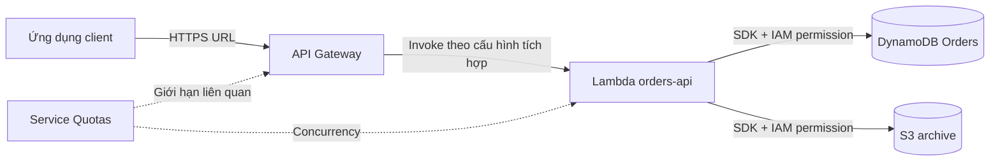

# ARN, resource ID, endpoint và service quota trong AWS

> **Thuộc chương:** Tổng quan AWS  
> **Phạm vi:** Các khái niệm nền tảng dùng xuyên suốt IAM, VPC, EC2, S3, RDS, DynamoDB, Lambda, API Gateway và các dịch vụ AWS khác.

## Mục tiêu học tập

Sau bài này, người học có thể:

1. Phân biệt **ARN**, **resource ID**, **endpoint** và **service quota**; chọn đúng khái niệm cho từng công việc.
2. Đọc cấu trúc ARN, nhận biết `partition`, dịch vụ, Region, AWS Account và tên/ID tài nguyên; giải thích các trường hợp để trống.
3. Xác định phạm vi của định danh tài nguyên, endpoint và quota trong kiến trúc nhiều tài khoản, nhiều Region.
4. Sử dụng AWS CLI để tra cứu ARN, resource ID, endpoint và quota mà không cần tạo tài nguyên.
5. Chẩn đoán những lỗi thường gặp: sai ARN trong IAM, gọi sai endpoint, không kết nối được dịch vụ và vượt giới hạn tài nguyên hoặc tốc độ yêu cầu.

## 1. Bốn khái niệm trả lời bốn câu hỏi khác nhau

Khi triển khai ứng dụng trên AWS, một tài nguyên có thể có **tên**, **ID**, **ARN**, **địa chỉ kết nối**, đồng thời bị chi phối bởi **quota**. Những thông tin này liên quan nhau nhưng không thể thay thế cho nhau.

| Khái niệm | Câu hỏi cần trả lời | Ví dụ minh họa | Thường dùng ở đâu |
|---|---|---|---|
| **Resource ID** | “Tài nguyên cụ thể nào?” | `i-0123456789abcdef0`, `vpc-0123456789abcdef0` | API/CLI, cấu hình hạ tầng, tra cứu và vận hành |
| **ARN (Amazon Resource Name)** | “Tài nguyên nào trong ngữ cảnh AWS để tham chiếu hoặc cấp quyền?” | `arn:aws:lambda:ap-southeast-1:123456789012:function:orders-api` | Chính sách IAM, tích hợp giữa dịch vụ, cấu hình sự kiện |
| **Endpoint** | “Gửi yêu cầu tới địa chỉ mạng nào?” | `https://lambda.ap-southeast-1.amazonaws.com` | AWS SDK/CLI, DNS, API client, kết nối cơ sở dữ liệu |
| **Service quota** | “Được sử dụng bao nhiêu tài nguyên/yêu cầu trong phạm vi áp dụng?” | Giới hạn số VPC, số vCPU EC2, số lần thực thi Lambda đồng thời | Thiết kế sức chứa, mở rộng, giám sát và xin tăng giới hạn |

**Hình dung ngắn gọn:** ID hoặc ARN cho biết *đối tượng*; endpoint cho biết *đường để gọi đến dịch vụ*; quota cho biết *mức sử dụng được phép*. Có endpoint hợp lệ không có nghĩa là được cấp quyền truy cập; có ARN hợp lệ không có nghĩa là tài nguyên còn tồn tại hoặc đang hoạt động.

Ví dụ, một ứng dụng muốn truy cập bảng DynamoDB `Orders` cần xác định bảng trong đúng Account và Region, gọi DynamoDB ở đúng endpoint, có quyền IAM tương ứng và không vượt các giới hạn liên quan đến yêu cầu/thông lượng.

## 2. ARN: định danh tài nguyên trong hệ sinh thái AWS

### 2.1 Cấu trúc tổng quát

ARN thường có khuôn dạng:

```text
arn:partition:service:region:account-id:resource
```

Ý nghĩa từng phần:

| Thành phần | Ý nghĩa |
|---|---|
| `arn` | Tiền tố xác định đây là Amazon Resource Name |
| `partition` | Phân vùng AWS, ví dụ `aws` (AWS thương mại), `aws-us-gov`, `aws-cn` |
| `service` | Mã dịch vụ, như `ec2`, `s3`, `iam`, `lambda`, `dynamodb` |
| `region` | Region của tài nguyên nếu dịch vụ định nghĩa ARN theo Region, ví dụ `ap-southeast-1` |
| `account-id` | AWS Account ID, thường là chuỗi 12 chữ số, nếu loại ARN yêu cầu |
| `resource` | Phần định danh tài nguyên theo cú pháp của dịch vụ |

Phần cuối không có một hình thức duy nhất. AWS có thể sử dụng:

```text
resource-id
resource-type/resource-id
resource-type:resource-id
```

Không tự ghép ARN bằng cách đoán cú pháp của mọi dịch vụ. Khi có thể, lấy ARN do AWS trả về qua API, CLI, CloudFormation/Terraform output hoặc console.

### 2.2 Phân tích các ARN thường gặp

Các giá trị dưới đây chỉ phục vụ học tập; `123456789012` là Account ID giả định.

**EC2 instance**, có Region, Account và instance ID:

```text
arn:aws:ec2:ap-southeast-1:123456789012:instance/i-0123456789abcdef0
```

**Lambda function**, dùng tên function:

```text
arn:aws:lambda:ap-southeast-1:123456789012:function:orders-api
```

ARN của **phiên bản hoặc alias Lambda** có thêm thành phần cuối, chẳng hạn:

```text
arn:aws:lambda:ap-southeast-1:123456789012:function:orders-api:prod
```

**DynamoDB table**:

```text
arn:aws:dynamodb:ap-southeast-1:123456789012:table/Orders
```

**IAM role** là tài nguyên có phạm vi tài khoản; phần Region để trống:

```text
arn:aws:iam::123456789012:role/AppReadOnlyRole
```

**S3 bucket** và **S3 object** có cú pháp đặc thù, không ghi Account hoặc Region vào hai vị trí tương ứng của ARN thông thường:

```text
arn:aws:s3:::example-orders-archive
arn:aws:s3:::example-orders-archive/2026/11/order-001.json
```

Ở đây `example-orders-archive` là tên bucket và `2026/11/order-001.json` là object key. Đừng suy rằng ARN không chứa Region nghĩa là không cần quan tâm Region: bucket vẫn được tạo tại một Region cụ thể, và yêu cầu API phải sử dụng cấu hình Region phù hợp.

**Quy tắc quan trọng:** Không phải ARN nào cũng chứa đủ Region và Account ID. Dịch vụ quyết định cú pháp và phạm vi của từng loại ARN.

### 2.3 ARN được dùng như thế nào trong IAM?

Trường `Resource` của chính sách IAM thường dùng ARN để chỉ rõ tài nguyên chịu tác động. Ví dụ, chính sách sau cho phép đọc các object dưới tiền tố `production/` của một bucket S3 giả định:

```json
{
  "Version": "2012-10-17",
  "Statement": [
    {
      "Sid": "ReadProductionObjects",
      "Effect": "Allow",
      "Action": "s3:GetObject",
      "Resource": "arn:aws:s3:::example-orders-archive/production/*"
    }
  ]
}
```

Lưu ý hai mức tài nguyên S3 khác nhau:

- `s3:GetObject` áp dụng cho **object ARN**, chẳng hạn `arn:aws:s3:::bucket-name/path/*`.
- `s3:ListBucket` áp dụng cho **bucket ARN**, chẳng hạn `arn:aws:s3:::bucket-name`; nếu chỉ muốn liệt kê một tiền tố thì cần thêm điều kiện thích hợp như `s3:prefix`.

Cấp `s3:GetObject` **không mặc nhiên cấp** `s3:ListBucket`. Chính sách minh họa trên cũng chưa tính đến những lớp kiểm soát khác như bucket policy, AWS Organizations SCP, permissions boundary, KMS key policy hoặc explicit deny. Quyền thực tế được quyết định bởi toàn bộ cơ chế đánh giá quyền liên quan.

Trong chính sách IAM, ký tự đại diện `*` có thể giúp biểu diễn một nhóm tài nguyên khi hành động và dịch vụ hỗ trợ. Chỉ nên mở rộng phạm vi khi thực sự cần và hiểu rõ các đối tượng sẽ khớp. Một số hành động IAM không hỗ trợ quyền ở cấp tài nguyên cụ thể, khi đó có thể cần `Resource: "*"` kết hợp điều kiện phù hợp; phải kiểm tra tài liệu **Service Authorization Reference** của từng dịch vụ.

### 2.4 ARN khác với Account ID và principal ARN

Account ID `123456789012` xác định một tài khoản AWS; bản thân nó không phải ARN của EC2, Lambda hoặc S3. Một IAM role có ARN riêng; khi ứng dụng dùng AWS STS để **assume role**, identity ARN trong phiên thực thi có thể có dạng `arn:aws:sts::123456789012:assumed-role/AppReadOnlyRole/session-name`. Vì vậy, ARN từ `sts get-caller-identity` không nhất thiết trùng với ARN của IAM role gốc.

Phân biệt này rất hữu ích khi điều tra log, cấu hình trust policy hoặc xử lý lỗi `AccessDenied` trong môi trường nhiều tài khoản.

## 3. Resource ID: cách dịch vụ chỉ đến một đối tượng cụ thể

AWS thường sinh ID khi tạo tài nguyên. Một số ví dụ:

| Dịch vụ / tài nguyên | ID hoặc tên thường gặp | Lưu ý về phạm vi |
|---|---|---|
| EC2 instance | `i-0123456789abcdef0` | Tra cứu trong đúng Account và Region |
| VPC | `vpc-0123456789abcdef0` | Tài nguyên VPC theo Region |
| Subnet | `subnet-0123456789abcdef0` | Subnet nằm trong một Availability Zone của một VPC |
| Security group | `sg-0123456789abcdef0` | Gắn với VPC |
| EBS volume | `vol-0123456789abcdef0` | Tài nguyên theo Region, gắn với một AZ |
| Lambda function | `orders-api` | Thường tham chiếu bằng tên hoặc ARN; có thể dùng alias/version |
| DynamoDB table | `Orders` | Tên bảng cần được hiểu trong Account và Region |
| S3 object | `2026/11/order-001.json` | Object key mang ý nghĩa trong một bucket cụ thể |

Các chuỗi trên mang tính minh họa. ID thường **không tự chứa đủ thông tin** để biết tài khoản, Region, quyền truy cập hay địa chỉ mạng. Ví dụ `i-0123456789abcdef0` không phải một URL và cũng không thể đưa nguyên ID vào mọi trường `Resource` của IAM.

Mỗi dịch vụ có thể chấp nhận các loại đầu vào khác nhau. Chẳng hạn, một lệnh EC2 thường nhận `--instance-ids`, trong khi nhiều API tích hợp hoặc chính sách IAM cần ARN; Lambda có API chấp nhận tên function hoặc ARN. Đọc hợp đồng API thay vì cho rằng mọi trường đều dùng được cả hai.

**Tên tài nguyên không phải lúc nào cũng là ID do AWS sinh.** Bucket S3 dùng tên bucket, DynamoDB dùng tên bảng, còn EC2 dùng instance ID. Tên bucket S3 thông thường cần duy nhất trong namespace/partition áp dụng, nhưng không nên lấy quy tắc đặt tên S3 để suy ra quy tắc của dịch vụ khác.

## 4. Endpoint: địa chỉ thực hiện kết nối mạng

### 4.1 Endpoint không phải ARN

Endpoint là tên DNS hoặc URL mà client kết nối để sử dụng một API hay dịch vụ. Ví dụ các endpoint AWS công khai theo Region:

```text
https://ec2.ap-southeast-1.amazonaws.com
https://lambda.ap-southeast-1.amazonaws.com
https://dynamodb.ap-southeast-1.amazonaws.com
```

Một ứng dụng dùng AWS SDK thường chỉ cần khai báo Region; SDK sẽ chọn endpoint phù hợp và ký yêu cầu bằng thông tin xác thực AWS. Bạn không phải gắn ARN vào vị trí URL.

AWS có nhiều mẫu endpoint tùy dịch vụ: Regional, global, dual-stack, FIPS, endpoint riêng cho loại tài nguyên hoặc endpoint do khách hàng tạo. Không suy diễn một công thức DNS chung cho tất cả dịch vụ, nhất là với các partition như `aws-cn` hoặc `aws-us-gov`. Tra cứu **AWS General Reference – Service endpoints and quotas** khi cấu hình cụ thể.

### 4.2 Endpoint dịch vụ, endpoint ứng dụng và endpoint cơ sở dữ liệu

Ba loại thường gặp:

| Trường hợp | Ví dụ | Cách sử dụng |
|---|---|---|
| **AWS service API endpoint** | `https://dynamodb.ap-southeast-1.amazonaws.com` | SDK/CLI gửi API requests tới dịch vụ |
| **Application/API endpoint** | `https://a1b2c3d4e5.execute-api.ap-southeast-1.amazonaws.com/prod/orders` | Client gọi API Gateway REST API đã triển khai |
| **Database endpoint** | `mydb.abc123.ap-southeast-1.rds.amazonaws.com` với cổng `5432` | Ứng dụng PostgreSQL client kết nối DB nếu mạng và quyền cho phép |

URL API Gateway ở trên chỉ minh họa cú pháp của REST API sử dụng stage `prod`. HTTP API có thể dùng kiểu stage hoặc mapping khác. Endpoint của RDS là địa chỉ kết nối cơ sở dữ liệu, không phải ARN của DB instance. DB thường cần cơ chế xác thực của engine hoặc IAM DB authentication nếu đã cấu hình.

### 4.3 Region, Availability Zone và định tuyến

Region như `ap-southeast-1` quyết định nơi một dịch vụ Regional triển khai tài nguyên và nơi client nên gửi yêu cầu. Một AZ như `ap-southeast-1a` là đơn vị hạ tầng trong Region, **thường không phải** thành phần của hostname endpoint API thông thường.

Lưu ý:

- Chọn đúng Region khi tạo/tra cứu tài nguyên; sai Region có thể khiến API báo không tìm thấy đối tượng dù ID hoặc ARN đúng ở Region khác.
- S3 bucket có Region xác định; dùng sai Region có thể dẫn tới redirect hoặc lỗi endpoint/chữ ký tùy API và client.
- Một endpoint tồn tại và phân giải DNS được **không đồng nghĩa** request có quyền IAM, route mạng phù hợp hay dịch vụ đang khả dụng.
- Endpoint công khai có thể yêu cầu HTTPS/TLS và xác thực AWS SigV4; khả năng truy cập mạng với khả năng được phép thao tác là hai vấn đề riêng.

### 4.4 VPC endpoint: truy cập dịch vụ qua đường mạng riêng

Trong VPC, một workload chạy tại private subnet có thể cần truy cập các dịch vụ AWS mà không đưa lưu lượng ra Internet công khai. **VPC endpoint** là một giải pháp tùy loại dịch vụ:

- **Gateway endpoint:** áp dụng cho Amazon S3 và DynamoDB, liên kết với route table phù hợp; không tạo elastic network interface dạng interface endpoint trong subnet.
- **Interface endpoint (AWS PrivateLink):** tạo các network interface riêng trong subnet đã chọn; thường hỗ trợ private DNS nếu dịch vụ và cấu hình cho phép.
- Một số kiểu endpoint khác như Gateway Load Balancer endpoint phục vụ mục đích riêng; không thể thay thế tùy ý hai kiểu trên.

Ví dụ: Lambda được cấu hình chạy trong private subnet của VPC, cần đọc DynamoDB. Có thể cấu hình DynamoDB gateway endpoint và route table thích hợp. Nếu sử dụng service API qua interface endpoint, đồng thời cần xem xét security group, DNS và endpoint policy. Cấu hình endpoint **không tự động cấp** quyền DynamoDB cho Lambda; execution role vẫn phải được ủy quyền thao tác.

Không phải Lambda nào cũng cần VPC. Khi không được gắn vào VPC của khách hàng, Lambda vẫn có thể gọi các AWS service API phù hợp bằng cơ chế kết nối do dịch vụ quản lý. Khi Lambda **đã được** gắn vào private subnet, cần thiết kế đường đi mạng thích hợp (NAT hoặc endpoint phù hợp) cho các điểm đến bên ngoài VPC.

## 5. Service quota: giới hạn năng lực và mức sử dụng

**Service quota** là giới hạn do AWS áp dụng cho số lượng tài nguyên, sức chứa, thông lượng hoặc một dạng sử dụng khác. Quota là đặc tính của **dịch vụ + loại quota + phạm vi áp dụng**, không phải thuộc tính chung của ARN.

Các ví dụ quan trọng:

| Dịch vụ | Loại quota cần tìm hiểu | Ảnh hưởng thực tế |
|---|---|---|
| Amazon EC2 | Số vCPU của các nhóm On-Demand instance đang chạy trong mỗi Region | Có thể chặn việc khởi chạy thêm instance |
| Amazon VPC | Số VPC mỗi Region; các giới hạn liên quan subnet, route table hoặc endpoint | Ảnh hưởng thiết kế mạng nhiều môi trường |
| AWS Lambda | Concurrent executions trong Region và các giới hạn khác | Bùng tải có thể bị throttling |
| Amazon API Gateway | Request rate, burst và các hạn mức cấu hình API | API có thể trả phản hồi throttling khi vượt ngưỡng |
| Amazon DynamoDB | Thông lượng, tài nguyên và các giới hạn cho bảng/chỉ mục hoặc API | Ảnh hưởng quy mô và hành vi throttling |
| Amazon S3 | Số bucket, các giới hạn request/API hoặc cấu hình tùy loại | Ảnh hưởng kế hoạch phân chia dữ liệu và vận hành |

### 5.1 Phạm vi và khả năng tăng quota

Mỗi quota có thể áp dụng theo **Account và Region**, theo tài nguyên, hoặc với phạm vi rộng hơn. Có quota áp dụng toàn cục cho tài khoản; có quota theo từng Region; có quota theo AZ, API hoặc tài nguyên cụ thể. Không được giả định mọi quota đều Regional.

Một số quota có thể yêu cầu tăng qua **Service Quotas** hoặc AWS Support, trong khi quota khác cố định, không thể điều chỉnh. Trên AWS Service Quotas, cần phân biệt:

- **AWS default quota:** giá trị mặc định được công bố cho quota.
- **Applied quota:** giá trị áp dụng thực tế đối với tài khoản trong phạm vi đang xem.
- **Adjustable:** quota có hỗ trợ yêu cầu tăng hay không. “Có thể tăng” không đồng nghĩa yêu cầu sẽ luôn được phê duyệt.

Các giá trị có thể thay đổi theo dịch vụ, Region, tài khoản hoặc thời điểm. Vì thế bài này không cố định số lượng vCPU, số VPC hoặc concurrency mặc định. Hãy kiểm tra **quota hiện tại trong tài khoản/Region thực tế** trước khi triển khai.

### 5.2 Quota tài nguyên và giới hạn tốc độ API

Cần phân biệt hai kiểu giới hạn:

1. **Giới hạn số lượng/sức chứa tài nguyên**, ví dụ số VPC, concurrent executions của Lambda, số vCPU EC2.
2. **Giới hạn tốc độ yêu cầu (rate limit/throttling)**, ví dụ số request mỗi giây và burst cho một API.

Việc tăng quota tài nguyên không nhất thiết làm tăng rate limit, và ngược lại. Một API vẫn có thể bị throttling ngay cả khi số lượng tài nguyên nằm dưới quota. Xử lý throttling thường cần exponential backoff có jitter, retry có giới hạn, giới hạn tốc độ từ phía client và kiến trúc hàng đợi hoặc cơ chế điều hòa tải phù hợp.

Các lỗi có thể xuất hiện như `ThrottlingException`, `TooManyRequestsException`, `ServiceQuotaExceededException` hoặc mã lỗi đặc thù của dịch vụ. Cần đọc **error code thực tế**, quota liên quan và biểu đồ sử dụng, thay vì kết luận rằng mọi lỗi 4xx đều do quota.

### 5.3 Theo dõi và xin tăng quota

Luồng triển khai khuyến nghị:

1. Xác định dịch vụ, Region, Account và loại quota liên quan.
2. Tra **applied quota** trên Service Quotas console/API; nếu chưa được hỗ trợ ở đó, kiểm tra tài liệu và AWS Support.
3. Đo mức sử dụng hiện tại và dự kiến tăng trưởng. Với quota có metric usage, có thể giám sát qua tích hợp Service Quotas với CloudWatch; không phải quota nào cũng cung cấp metric như nhau.
4. Đặt cảnh báo trước khi tới giới hạn. Chẳng hạn, dùng mốc nội bộ 70–80% cho một quota mà bạn đo được; đây là **ngưỡng vận hành gợi ý**, không phải một mặc định AWS.
5. Xin tăng quota sớm nếu hỗ trợ điều chỉnh, rồi kiểm tra trạng thái yêu cầu và giá trị được áp dụng.
6. Khi yêu cầu không được đáp ứng, xem xét phân tán workload, tối ưu mức tiêu thụ, điều tiết tải hoặc sửa kiến trúc.

**Quota không phải hạn mức chi phí.** Được tăng quota có thể làm tăng khả năng phát sinh chi phí. Dùng AWS Budgets, Cost Explorer, tag phân bổ chi phí và cảnh báo thanh toán để quản trị chi phí; ngay cả budget alert cũng không tự động chặn mọi khoản phát sinh.

## 6. Ví dụ tổng hợp: API đặt hàng chạy trên AWS

Giả sử một ứng dụng xử lý đơn hàng tại Region `ap-southeast-1`, Account `123456789012`, gồm API Gateway → Lambda → DynamoDB, đồng thời lưu dữ liệu lưu trữ trên S3.



Trong mô hình này:

| Thành phần | ARN / ID dùng để xác định | Endpoint dùng để kết nối | Quota cần kiểm tra |
|---|---|---|---|
| API Gateway | API ID `a1b2c3d4e5`; API/stage có ARN theo cú pháp API Gateway khi cần | `https://a1b2c3d4e5.execute-api.ap-southeast-1.amazonaws.com/prod/orders` | Request rate, burst, số API/stage tùy nhu cầu |
| Lambda | `arn:aws:lambda:ap-southeast-1:123456789012:function:orders-api` | API Gateway gọi Lambda qua integration; SDK quản lý service endpoint | Concurrent executions, giới hạn theo function/Region |
| DynamoDB | `arn:aws:dynamodb:ap-southeast-1:123456789012:table/Orders` | `https://dynamodb.ap-southeast-1.amazonaws.com` | Thông lượng, bảng/chỉ mục, API |
| S3 bucket | `arn:aws:s3:::example-orders-archive` | Endpoint S3 phù hợp Region và cách truy cập | Số bucket, các giới hạn theo loại request/cấu hình |

**Một yêu cầu từ client đi qua các lớp khác nhau:**

1. Client gọi **URL endpoint** của API Gateway; API ID nằm trong hostname nhưng URL không phải ARN.
2. API Gateway dựa vào integration đã cấu hình để gọi Lambda; quyền invoke Lambda và cơ chế xác thực client cần được thiết kế riêng.
3. Lambda thực thi bằng **execution role**. IAM policy của role dùng **ARN bảng DynamoDB** và **ARN bucket/object S3** để xác định tài nguyên được phép truy cập.
4. AWS SDK chọn **endpoint dịch vụ** phù hợp để Lambda gọi DynamoDB hoặc S3.
5. Khi lưu lượng tăng, **quota concurrency của Lambda** và **giới hạn request/thông lượng** của các dịch vụ liên quan phải được giám sát.

Đọc cấu trúc theo cách này giúp tránh nhầm lẫn “đã có endpoint nên truy cập được” hoặc “có ARN tức là biết URL để gọi”.

### 6.1 Biến thể nhiều Account và nhiều Region

Nếu tách tài khoản `dev` và `prod`, ARN của những tài nguyên như Lambda hoặc DynamoDB sẽ khác nhau theo Account, dù tên có thể giống nhau. Phải cập nhật IAM policy và mối quan hệ trust/integration phù hợp. Nếu triển khai dự phòng tại Region khác, endpoint dịch vụ, ARN của tài nguyên Regional và nhiều quota Regional cũng thay đổi.

Đối với S3, bucket ARN không hiện Region trong cấu trúc thông thường, nhưng Region của bucket và cấu hình client vẫn quan trọng. Đối với IAM role, ARN không chứa Region, vì IAM là dịch vụ có nhiều tài nguyên mang phạm vi toàn cục trong partition. Không áp dụng máy móc một quy tắc duy nhất cho tất cả dịch vụ.

## 7. Thực hành AWS CLI: tra cứu không tạo tài nguyên

**Điều kiện:** AWS CLI v2 đã được cấu hình profile/credential có quyền chỉ đọc tương ứng. Các lệnh dưới đây dùng Account và Region đang cấu hình hoặc truyền tường minh, không tạo hạ tầng. Không chia sẻ access key, secret key hay session token.

### 7.1 Xác định identity hiện tại

```bash
aws sts get-caller-identity
```

Kết quả thường chứa `Account`, `Arn` và `UserId`. Kiểm tra `Account` trước khi đọc/sửa môi trường nhiều tài khoản; lưu ý `Arn` có thể là assumed-role session ARN.

### 7.2 Xem resource ID và thuộc tính EC2

```bash
aws ec2 describe-instances \
  --region ap-southeast-1 \
  --query 'Reservations[].Instances[].{Id:InstanceId,RegionAZ:Placement.AvailabilityZone,VpcId:VpcId,State:State.Name}' \
  --output table
```

Lệnh trả về instance ID, AZ, VPC ID và trạng thái nếu có quyền cùng tài nguyên trong Region đó. Nó không chứng minh những instance này tồn tại ở Region khác.

### 7.3 Xem ARN của Lambda hoặc IAM role

```bash
aws lambda get-function \
  --function-name orders-api \
  --region ap-southeast-1 \
  --query 'Configuration.FunctionArn' \
  --output text
```

```bash
aws iam get-role \
  --role-name AppReadOnlyRole \
  --query 'Role.Arn' \
  --output text
```

Hai lệnh chỉ thành công nếu tên tài nguyên giả định thực sự tồn tại và người gọi có quyền. So sánh phần Region trong ARN Lambda với việc để trống Region trong ARN IAM role.

### 7.4 Xem quota được áp dụng và quota mặc định

Liệt kê quota của Lambda trong Region đích:

```bash
aws service-quotas list-service-quotas \
  --service-code lambda \
  --region ap-southeast-1 \
  --query 'Quotas[].[QuotaName,QuotaCode,Value,Adjustable]' \
  --output table
```

Sau khi tra được `QuotaCode` chính xác của quota muốn xem, dùng:

```bash
aws service-quotas get-service-quota \
  --service-code lambda \
  --quota-code QUOTA_CODE \
  --region ap-southeast-1
```

Để xem **AWS default** nếu API hỗ trợ quota đó:

```bash
aws service-quotas get-aws-default-service-quota \
  --service-code lambda \
  --quota-code QUOTA_CODE \
  --region ap-southeast-1
```

Thay `QUOTA_CODE` bằng mã thực tế, không gõ nguyên placeholder trong môi trường sản xuất. Không phải mọi hạn chế dịch vụ đều hiển thị qua Service Quotas API; tài liệu từng dịch vụ vẫn là nguồn đối chiếu cần thiết.

### 7.5 Kiểm tra VPC endpoint đã được tạo

```bash
aws ec2 describe-vpc-endpoints \
  --region ap-southeast-1 \
  --query 'VpcEndpoints[].{Id:VpcEndpointId,Type:VpcEndpointType,Service:ServiceName,State:State}' \
  --output table
```

Kết quả cho biết endpoint ID, loại endpoint, dịch vụ liên quan và trạng thái. Khi cần chẩn đoán mạng, tiếp tục kiểm tra route table, subnet, security group và DNS theo loại endpoint.

## 8. Chẩn đoán lỗi bằng đúng khái niệm

| Hiện tượng | Nguyên nhân nên kiểm tra trước | Hướng xử lý |
|---|---|---|
| `AccessDenied` khi đọc S3 | IAM policy dùng bucket ARN cho `GetObject`, thiếu object ARN; explicit deny hoặc các policy khác | Kiểm tra action, Resource ARN, principal, điều kiện và toàn bộ lớp chính sách |
| `ResourceNotFound`, `InvalidInstanceID.NotFound` | Sai ID/tên, Account hoặc Region; tài nguyên đã xóa | Kiểm tra `sts get-caller-identity`, `--region` và trạng thái tài nguyên |
| DNS không phân giải / connection timeout | Endpoint sai; thiếu NAT/VPC endpoint; DNS, route, security group hoặc firewall | Tách kiểm tra DNS, route, TLS và kết nối mạng trước khi kết luận lỗi IAM |
| `403` hoặc chữ ký không hợp lệ khi gọi API | Credential/quyền không đủ; ký request sai Region, service, thời gian hoặc endpoint | Kiểm tra SDK/CLI Region, SigV4, đồng hồ hệ thống và policy |
| Lambda bị `TooManyRequestsException` | Có thể chạm concurrency hoặc throttling theo cấu hình | Đối chiếu CloudWatch, reserved concurrency và applied quota; áp dụng retry/backoff |
| Không khởi chạy được thêm EC2 | Có thể chạm quota vCPU hoặc thiếu capacity/điều kiện khác | Đọc chính xác error code; xem quota EC2, loại instance và tình trạng capacity |
| API chậm hoặc bị throttling dù quota tổng còn dư | Rate limit, burst limit hoặc giới hạn cấp tài nguyên/API riêng | Phân tích metric theo API, điều tiết tải, tối ưu retry và request pattern |

**Thứ tự điều tra hữu ích:** Xác định **đối tượng** (ID/ARN) → xác nhận **Account và Region** → kiểm tra **endpoint/đường mạng** → kiểm tra **quyền** → đối chiếu **quota, rate limit và metric**. Đây là trình tự gợi ý, có thể thay đổi theo mã lỗi thực tế.

## 9. Bài tập áp dụng

**Bài 1 — Phân tích ARN.** Với:

```text
arn:aws:dynamodb:ap-southeast-1:123456789012:table/Invoices
```

Hãy chỉ ra partition, service, Region, Account ID và tài nguyên. ARN có chứa địa chỉ mạng để ứng dụng gửi request không?

**Bài 2 — Kiểm tra chính sách.** Một policy cho phép `s3:GetObject` nhưng đặt `Resource` là `arn:aws:s3:::example-orders-archive`. Chính sách đã trỏ đúng loại ARN chưa? Bạn sẽ sửa như thế nào để đọc các object trong `invoices/`?

**Bài 3 — Chọn endpoint.** Ứng dụng ở private subnet cần truy cập DynamoDB mà không đi qua NAT. Bạn cân nhắc kiểu VPC endpoint nào? Sau khi tạo endpoint, Lambda execution role có tự động có quyền `dynamodb:GetItem` không?

**Bài 4 — Tăng tải.** Lambda trong `ap-southeast-1` bị throttling khi traffic tăng. Bạn cần đo và kiểm tra những gì trước khi xin tăng quota? Nếu tăng concurrency nhưng DynamoDB bắt đầu bị throttling, kết luận nào hợp lý?

**Bài 5 — Nhiều Region.** Hai tài khoản triển khai Lambda cùng tên `orders-api` tại hai Region. ARN của chúng có giống nhau không? Endpoint gọi AWS Lambda API có giống nhau không? Có thể lấy quota của Region A áp dụng mặc nhiên cho Region B không?

<details>
<summary>Gợi ý đáp án</summary>

1. `aws` / `dynamodb` / `ap-southeast-1` / `123456789012` / `table/Invoices`. ARN định danh bảng, không phải URL.
2. Chưa đúng với `GetObject`; cần object ARN như `arn:aws:s3:::example-orders-archive/invoices/*`, đồng thời kiểm tra các lớp quyền liên quan.
3. Có thể dùng DynamoDB gateway endpoint và route table phù hợp. Vẫn phải cấu hình IAM permissions; endpoint không tự cấp quyền.
4. Kiểm tra CloudWatch concurrency, throttles, reserved concurrency, applied quota và request patterns; đồng thời xem thông lượng và lỗi DynamoDB. Tăng một quota có thể dồn nghẽn sang tầng sau.
5. ARN Lambda khác khi Account hoặc Region khác. Endpoint API Regional cũng có thể khác; phải kiểm tra quota theo phạm vi áp dụng của từng dịch vụ, không suy từ Region khác.

</details>

## 10. Checklist trước khi triển khai thực tế

- [ ] Đã xác nhận **AWS Account**, partition và **Region** đích.
- [ ] Đã phân biệt **resource name/ID** và **ARN**; kiểm tra ARN đúng theo tài liệu dịch vụ.
- [ ] IAM policy dùng đúng **Action**, **Resource** và điều kiện; đã xem xét least privilege và các lớp deny.
- [ ] AWS SDK/CLI hoặc ứng dụng sử dụng **endpoint** và **Region** phù hợp.
- [ ] Nếu workload ở private subnet, đã kiểm tra **DNS, route, NAT/VPC endpoint, security group** và quyền.
- [ ] Đã xem **applied quota** liên quan đến tài nguyên và **rate limit** của API, đồng thời có metric/cảnh báo khi mở rộng.
- [ ] Đã có phương án **retry/backoff**, phục hồi, tăng quota hoặc điều chỉnh kiến trúc.
- [ ] Đã đánh giá tác động chi phí khi nâng quota hoặc mở rộng hạ tầng; có cảnh báo ngân sách phù hợp.

## Tài liệu chính thức để tra cứu

- [AWS IAM — IAM ARNs](https://docs.aws.amazon.com/IAM/latest/UserGuide/reference-arns.html)
- [AWS General Reference — AWS service endpoints and quotas](https://docs.aws.amazon.com/general/latest/gr/rande.html)
- [AWS Service Quotas — What is Service Quotas?](https://docs.aws.amazon.com/servicequotas/latest/userguide/intro.html)
- [AWS PrivateLink — VPC endpoints](https://docs.aws.amazon.com/vpc/latest/privatelink/what-is-privatelink.html)
- [AWS CLI — Service Quotas commands](https://docs.aws.amazon.com/cli/latest/reference/service-quotas/index.html)

Việc đọc được ARN/ID chính xác, chọn endpoint phù hợp và dự báo quota là nền tảng để thiết kế ứng dụng AWS an toàn, có khả năng mở rộng, giám sát, phục hồi và kiểm soát chi phí.

