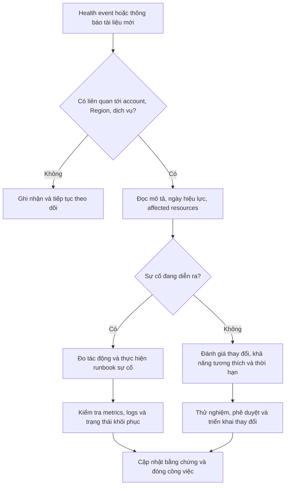
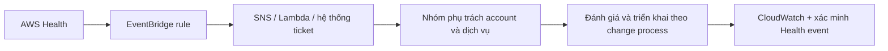

# Tra cứu tài liệu, AWS Health và thay đổi vòng đời dịch vụ

## 1. Vì sao cần theo dõi cả tài liệu lẫn trạng thái dịch vụ AWS?

AWS là một hệ sinh thái liên tục thay đổi: một tính năng của Amazon EC2 có thể được bổ sung, Amazon RDS có thể ngừng hỗ trợ một phiên bản cơ sở dữ liệu, AWS Lambda có thể ngừng hỗ trợ một runtime, hoặc một Availability Zone có thể gặp sự cố tạm thời. Kỹ sư cloud không thể dựa hoàn toàn vào kiến thức đã học ở một thời điểm. Họ cần **tra cứu nguồn chính thức**, **nhận biết thay đổi ảnh hưởng tới tài khoản của mình** và **chuyển thông tin thành hành động kỹ thuật có kiểm soát**.

Trong phạm vi mô-đun **CLOUD_PROVIDERS_AWS**, kỹ năng này xuyên suốt việc lựa chọn và vận hành Region/AZ, IAM, VPC, dịch vụ tính toán, lưu trữ, cơ sở dữ liệu, tích hợp và serverless. Ví dụ, trước khi đưa một ứng dụng chạy trên Amazon EKS vào production, đội ngũ phải biết chính sách hỗ trợ phiên bản Kubernetes; khi dịch vụ có cảnh báo, họ phải xác định cluster nào bị ảnh hưởng, đánh giá khả năng gián đoạn, lên lịch nâng cấp, kiểm thử, giám sát và dự toán chi phí.

Sau bài học, người học có thể:

1. Chọn đúng tài liệu AWS cho câu hỏi về kiến trúc, API, tính năng, giá và khả năng hỗ trợ theo Region.
2. Phân biệt sự cố công khai với sự kiện AWS Health dành riêng cho tài khoản hoặc tổ chức.
3. Đọc các trường quan trọng trong một AWS Health event và xác định hành động cần thực hiện.
4. Theo dõi vòng đời dịch vụ, phiên bản và runtime; lập kế hoạch chuyển đổi trước mốc ngừng hỗ trợ.
5. Thiết kế quy trình cảnh báo, phân công xử lý và xác minh sau thay đổi theo nguyên tắc an toàn, có giám sát và kiểm soát chi phí.

## 2. Bản đồ nguồn thông tin AWS

Không có một trang duy nhất trả lời tốt mọi câu hỏi. Cần hiểu **mỗi nguồn trả lời loại câu hỏi nào**.

| Nguồn | Dùng khi nào? | Ví dụ câu hỏi |
| --- | --- | --- |
| [AWS Documentation](https://docs.aws.amazon.com/) | Tìm User Guide, Developer Guide, hướng dẫn cấu hình, API Reference, ví dụ CLI/SDK, quota và giới hạn dịch vụ. | IAM policy cần quyền nào? AWS Lambda truy cập tài nguyên trong VPC ra sao? |
| [AWS What's New](https://aws.amazon.com/new/) | Xác định một tính năng, Region hoặc thay đổi sản phẩm vừa được công bố. | Tính năng mới có áp dụng cho Region đang dùng không? |
| Trang **Release notes / Version history / Runtime support** của từng dịch vụ | Xem thay đổi có thể ảnh hưởng tới tương thích, bản vá và hạn hỗ trợ. | Phiên bản Amazon EKS hoặc Lambda runtime này còn được hỗ trợ bao lâu? |
| [AWS Health Dashboard – Service health](https://health.aws.amazon.com/health/status) | Xem sự cố vận hành **công khai**, theo dịch vụ và Region, không cần đăng nhập. | AWS có công bố sự cố Amazon S3 ở Region đang sử dụng không? |
| [AWS Health Dashboard – Account health](https://health.aws.amazon.com/health/home) | Xem sự kiện ảnh hưởng tới tài khoản, tài nguyên hoặc tổ chức đã đăng nhập. | Instance, cluster hay database nào cần thao tác? |
| [AWS Well-Architected](https://docs.aws.amazon.com/wellarchitected/) | Kiểm tra nguyên tắc thiết kế hệ thống về vận hành, bảo mật, độ tin cậy, hiệu năng, chi phí và phát triển bền vững. | Kiến trúc này có đáp ứng mục tiêu khôi phục và kiểm soát chi phí không? |
| Trang **Pricing**, **Service Quotas**, **Regional Services** của dịch vụ | Xác minh điều kiện triển khai và chi phí thực tế trước khi đưa ra quyết định. | Tính năng có sẵn ở Region đích không, quota hiện tại là bao nhiêu, chi phí mở rộng thế nào? |

**Độ tin cậy và tính mới:** Ưu tiên tài liệu chính thức cho hành vi của dịch vụ; kiểm tra ngày cập nhật, Region, phiên bản, điều kiện áp dụng và các ghi chú về preview/generally available. Bài blog hoặc câu trả lời cộng đồng có thể gợi ý hướng điều tra, nhưng cần đối chiếu lại với tài liệu đang có hiệu lực. Không coi ví dụ viết cho một Region, SDK hoặc phiên bản cũ là hướng dẫn đúng cho mọi môi trường.

### 2.1. Quy trình tra cứu có thể lặp lại

1. **Viết câu hỏi có điều kiện rõ ràng.** Ví dụ: “Ứng dụng Java trên AWS Lambda cần truy cập Amazon RDS trong VPC ở `ap-southeast-1`; các điều kiện mạng và IAM là gì?”.
2. **Xác định tài liệu nền.** Tìm hướng dẫn VPC cho Lambda, tài liệu kết nối RDS, Security Group, IAM execution role và cách xử lý secrets.
3. **Kiểm tra phạm vi.** So sánh Region, runtime, kiến trúc tài khoản, phiên bản, tính khả dụng, quota, yêu cầu bảo mật và chi phí.
4. **Đọc cả giới hạn và lưu ý.** Ví dụ: các ảnh hưởng tới truy cập Internet, DNS, timeout, kết nối database, quyền tạo network interface và phân quyền truy cập credentials.
5. **Thử nghiệm trong môi trường có thể phục hồi.** Lưu cấu hình, kiểm tra kết nối, ghi nhận metrics/logs và phương án rollback trước khi đổi production.
6. **Ghi bằng chứng.** Lưu URL nguồn, thời điểm kiểm tra, điều kiện áp dụng, quyết định, người chịu trách nhiệm và kết quả kiểm thử vào tài liệu kỹ thuật hoặc phiếu thay đổi.

Một kết quả tra cứu tốt không dừng ở “dịch vụ hỗ trợ tính năng X”, mà phải trả lời “**X dùng được với workload của chúng ta trong điều kiện nào, có rủi ro gì và kiểm chứng thế nào?**”.

### 2.2. Khi tài liệu có vẻ mâu thuẫn

Giả sử bài viết cũ cho rằng một phiên bản EKS sẽ còn được hỗ trợ lâu hơn, nhưng bảng vòng đời Kubernetes hiện tại đưa ra ngày kết thúc cụ thể. Hãy lấy **bảng hỗ trợ chính thức hiện hành** làm mốc lập kế hoạch, kiểm tra múi giờ của ngày hiệu lực, sau đó xác minh trong AWS Health liệu tài nguyên của mình có bị ảnh hưởng hay không. Tránh suy ra rằng thông báo “dịch vụ hoạt động bình thường” nghĩa là một runtime cũ vẫn được hỗ trợ.

## 3. Hiểu AWS Health

**AWS Health** cung cấp thông tin về những sự kiện vận hành, thay đổi theo lịch và thông báo liên quan tới dịch vụ/tài khoản AWS. Nó giúp trả lời ba câu hỏi: *đã xảy ra hoặc sắp xảy ra điều gì; tài nguyên nào bị ảnh hưởng; chúng ta cần làm gì?*

AWS Health khác với **Amazon CloudWatch**: CloudWatch chủ yếu thu thập metrics, logs, traces và cảnh báo dựa trên hệ thống đang chạy; AWS Health truyền thông tin về sự kiện và thay đổi từ phía AWS. Khi điều tra sự cố, kết hợp **Health event + metrics/logs của workload + lịch triển khai nội bộ** để tránh kết luận sai nguyên nhân.

### 3.1. Public service health và account health

| Góc nhìn | Dữ liệu chính | Đối tượng sử dụng | Giới hạn cần nhớ |
| --- | --- | --- | --- |
| **Service health (công khai)** | Sự cố dịch vụ AWS đã được công bố theo Region. | Bất kỳ ai, kể cả khi chưa có tài khoản. | Không cho biết chính xác tài nguyên của bạn có bị ảnh hưởng hay không. |
| **Your account health** | Sự kiện liên quan tới tài khoản, thay đổi theo lịch, thông báo và danh sách tài nguyên chịu ảnh hưởng (nếu AWS cung cấp). | Người dùng đăng nhập có quyền phù hợp. | Không thay thế giám sát ứng dụng hoặc xác minh thủ công. |
| **Your organization health** | Góc nhìn tổng hợp sự kiện trên các tài khoản thuộc AWS Organizations. | Đơn vị vận hành nhiều tài khoản, khi đã cấu hình organizational view và quyền thích hợp. | Phải xác định **account owner** và **resource owner** để xử lý đúng nơi. |

Giao diện account health có các khu vực thường dùng:

- **Open and recent issues:** Sự cố đang diễn ra hoặc gần đây.
- **Scheduled changes:** Bảo trì và thay đổi sắp tới, bao gồm những mốc vòng đời cần xử lý.
- **Other notifications:** Thông báo vận hành, bảo mật, billing và các vấn đề tài khoản khác.
- **Event log:** Tra cứu lịch sử với bộ lọc dịch vụ, Region, thời gian, trạng thái, loại sự kiện.

Ở mỗi sự kiện, đọc **description và timeline**, service, Region/AZ, start/end time, category, status, số tài nguyên bị ảnh hưởng và danh sách **Affected resources** (resource ID hoặc ARN). Danh sách có thể chưa đầy đủ ngay lập tức; luôn đối chiếu thêm với inventory thực tế.

### 3.2. Phân loại sự kiện và mức độ cần hành động

| Event category | Ý nghĩa | Cách phản ứng phù hợp |
| --- | --- | --- |
| `issue` | Sự cố ngoài kế hoạch ảnh hưởng tới dịch vụ hoặc tài nguyên. | Đánh giá tác động hiện tại, kiểm tra tín hiệu CloudWatch, triển khai kế hoạch giảm thiểu/khôi phục nếu cần. |
| `scheduledChange` | Thay đổi hoặc bảo trì đã được lên lịch, có thể bao gồm kết thúc hỗ trợ và nâng cấp tự động. | Ghi thời hạn, liệt kê tài nguyên, kiểm thử và thực hiện thay đổi trước mốc ảnh hưởng. |
| `accountNotification` | Thông tin quản trị, an ninh, billing hoặc việc cần chú ý ở cấp tài khoản. | Xác minh nội dung, xác định người xử lý và hoàn tất yêu cầu nếu có. |

**Actionability** giúp ưu tiên sự kiện: `ACTION_REQUIRED` là cần hành động; `ACTION_MAY_BE_REQUIRED` đòi hỏi kiểm tra theo kiến trúc cụ thể; `INFORMATIONAL` chủ yếu để nắm tình hình. Sự kiện loại `issue` có thể không có trường này, do hành động khôi phục phụ thuộc thiết kế ứng dụng. **Event status** (`open`, `upcoming`, `closed`) phản ánh tiến trình sự kiện và **khác với trạng thái từng tài nguyên** như `PENDING` hoặc `RESOLVED` trong Planned Lifecycle Events.

Ví dụ: Public Service Health thông báo lỗi API của EC2 tại một Region. Đội ngũ cần kiểm tra error rate và khả năng launch instance của Auto Scaling Group tại Region đó. Nếu hệ thống không gặp ảnh hưởng, vẫn theo dõi; nếu có, áp dụng runbook khôi phục. Việc AWS đăng một sự kiện công khai không tự động chứng minh ứng dụng cụ thể bị lỗi.

### 3.3. Khi vận hành nhiều tài khoản AWS

Một doanh nghiệp thường tách tài khoản phát triển, thử nghiệm và production. Có thể bật **organizational view** để tổng hợp sự kiện AWS Health từ AWS Organizations vào một nơi. Sau khi cấu hình, phân loại theo account ID, OU, service, Region và affected resources. Đừng để sự kiện quan trọng chỉ nằm trong tài khoản người triển khai ban đầu. Tính năng xem organizational view trong Health console được AWS cung cấp cho các gói AWS Support; **quyền dùng AWS Health API có điều kiện riêng theo gói Support**.

Ví dụ sơ đồ luồng xử lý:



## 4. Thay đổi vòng đời dịch vụ: đọc đúng mốc và hệ quả

**Vòng đời** có thể áp dụng ở nhiều mức: toàn bộ dịch vụ, API, tính năng, phiên bản database engine, Kubernetes minor version, runtime, AMI, loại instance hoặc chứng chỉ. Mỗi dịch vụ có chính sách riêng. Không được suy diễn rằng “deprecated”, “end of standard support”, “end of extended support”, “end of life” hay “service retirement” luôn dẫn tới cùng một hành vi.

Một chuỗi tình huống điển hình:

1. **Đang hỗ trợ:** Tài liệu nêu phiên bản và điều kiện sử dụng hiện tại.
2. **Thông báo thay đổi:** AWS thông báo sắp có mốc nâng cấp, bảo trì hoặc thay đổi cách hoạt động; có thể xuất hiện sự kiện `scheduledChange` trong AWS Health.
3. **Hết hỗ trợ tiêu chuẩn:** Một số dịch vụ cho phép tiếp tục chạy trong giai đoạn hỗ trợ mở rộng, có thể phát sinh phí. Dịch vụ khác có thể ngừng vá hoặc hạn chế tạo/cập nhật tài nguyên.
4. **Hết hỗ trợ mở rộng / ngừng cung cấp:** Có thể cần chuyển phiên bản, thay service hoặc chấp nhận cơ chế tự nâng cấp theo chính sách của dịch vụ; mốc và hành vi phải được kiểm tra từ tài liệu chính thức.

### 4.1. Planned Lifecycle Events trong AWS Health

AWS Health hỗ trợ nhóm **Planned Lifecycle Events** cho những thay đổi có thể yêu cầu phía khách hàng phối hợp, chẳng hạn kết thúc hỗ trợ phiên bản Amazon RDS hoặc Amazon EKS, hay thay đổi chứng chỉ CA của RDS. Đây thường là sự kiện loại `scheduledChange`, với kiểu mã có dạng:

```text
AWS_{SERVICE}_PLANNED_LIFECYCLE_EVENT
```

Đọc kỹ bốn thành phần:

- **Event start time:** thời điểm sớm nhất mà thay đổi có thể bắt đầu ảnh hưởng tới tài nguyên. Cần coi đây là **mốc cần sẵn sàng**, không đợi tới end time.
- **Event end time:** thời điểm thay đổi kết thúc trên các tài nguyên AWS, có thể không được cung cấp.
- **Affected resources / ARN:** tài nguyên cụ thể hoặc nhóm tài nguyên bị ảnh hưởng; dùng để giao việc cho đúng chủ sở hữu.
- **Resource status:** với những sự kiện có theo dõi trạng thái, `PENDING` nghĩa là tài nguyên còn cần xử lý; `RESOLVED` nghĩa là AWS đã ghi nhận hành động cần thiết hoặc tài nguyên không còn tồn tại. Trạng thái cập nhật bất đồng bộ, có thể trễ tới 72 giờ trong một số trường hợp; cần kiểm tra trực tiếp tài nguyên để xác nhận.

AWS mô tả Planned Lifecycle Events hướng tới thời gian thông báo trước **tối thiểu 180 ngày cho thay đổi/phiên bản lớn và 90 ngày cho thay đổi/phiên bản nhỏ khi có thể**. Đây là mục tiêu cung cấp thông tin sớm, **không phải bảo đảm cho mọi sự kiện**. Vì thế, không chờ thông báo mới bắt đầu quản lý phiên bản. Nếu một sự kiện đã quá ngày ảnh hưởng nhưng còn tài nguyên chưa được xử lý, sự kiện có thể vẫn mở; không suy ra rằng sau ngày này việc nâng cấp không còn cần thiết.

### 4.2. Hai ví dụ vòng đời khác nhau

**Ví dụ A — Amazon EKS:** Một Kubernetes minor version có giai đoạn standard support và có thể chuyển sang extended support, với chi phí tăng. Theo chính sách EKS tại thời điểm biên soạn, standard support kéo dài 14 tháng, sau đó có 12 tháng extended support. Đội vận hành cần xem [bảng vòng đời phiên bản EKS](https://docs.aws.amazon.com/eks/latest/userguide/kubernetes-versions.html), rà soát phiên bản cluster, node group, add-on và tương thích workload; chuẩn bị nâng cấp trước ngày kết thúc standard support để tránh phát sinh phí không mong muốn. Các mốc cụ thể có thể thay đổi và phải đọc lại trước khi lập lịch.

**Ví dụ B — AWS Lambda:** Khi runtime tiến tới deprecation, hành vi sau mốc đó khác EKS. Runtime không còn được AWS cập nhật hoặc hỗ trợ như trước; các giai đoạn hạn chế tạo mới/cập nhật function có mốc riêng. Đội vận hành phải đối chiếu [chính sách deprecation của Lambda](https://docs.aws.amazon.com/lambda/latest/dg/runtime-support-policy.html), phát hiện function đang dùng runtime liên quan, cập nhật dependencies, thử nghiệm và chuyển sang runtime được hỗ trợ. Một function vẫn chạy được sau ngày deprecation **không có nghĩa** nó còn an toàn hoặc nhận bản vá từ AWS.

**Quy tắc:** Sau khi thấy thông báo vòng đời, luôn mở **tài liệu version/runtime chính thức của dịch vụ đó**. AWS Health cho biết tác động với tài nguyên của bạn; tài liệu dịch vụ giải thích chính xác hành vi và lộ trình nâng cấp.

## 5. Từ thông báo đến thay đổi an toàn trong production

Một thông báo AWS Health cần được chuyển thành một công việc có **deadline, owner, bằng chứng và tiêu chí hoàn tất**.

| Bước | Câu hỏi cần trả lời | Đầu ra mong đợi |
| --- | --- | --- |
| **Tiếp nhận** | Nguồn thông báo là gì? Event ARN, service, Region, mã sự kiện, ngày giờ và múi giờ? | Bản ghi sự kiện kèm link nguồn chính thức. |
| **Khoanh vùng** | Account, VPC, AZ, cluster, DB, Lambda function hoặc ARN nào bị ảnh hưởng? | Danh sách tài nguyên và người sở hữu; so khớp inventory. |
| **Phân tích** | Tác động bảo mật, downtime, tính tương thích, chi phí, dữ liệu và dependency? | Đánh giá mức độ ưu tiên và phương án xử lý. |
| **Chuẩn bị** | Có môi trường thử nghiệm, backup, cấu hình IaC, phương án rollback hay failover không? | Kế hoạch thay đổi được xem xét, lịch bảo trì và tiêu chí thành công. |
| **Thực hiện** | Thứ tự thay đổi giữa application, IAM, network, compute, storage, database, serverless? | Nhật ký triển khai, người thực hiện, thời điểm và kết quả. |
| **Xác minh** | Ứng dụng còn đáp ứng SLO? Health event và trạng thái tài nguyên đã được cập nhật? | Bằng chứng smoke test, metrics/logs, tài nguyên đã được xử lý; đóng công việc. |

### 5.1. Ưu tiên theo rủi ro

Không nhất thiết nâng cấp mọi tài nguyên cùng lúc. Ưu tiên nơi có **ngày ảnh hưởng gần**, có **hành động bắt buộc**, đang phục vụ production, có exposure bảo mật cao hoặc ít khả năng phục hồi. Những thay đổi mang rủi ro dữ liệu (cơ sở dữ liệu, lưu trữ), kết nối (VPC, IAM, certificate) hoặc runtime (Lambda, container) phải có kiểm thử và phương án hồi phục phù hợp. Khi AWS thay đổi Region/AZ hoặc một tính năng không còn hỗ trợ tại địa điểm triển khai, xem xét chiến lược đa AZ/đa Region theo mục tiêu độ tin cậy và chi phí thực tế, thay vì tự động nhân đôi mọi tài nguyên.

### 5.2. Ví dụ tình huống: EKS sắp hết standard support

Giả sử production có một cluster Amazon EKS đang dùng phiên bản Kubernetes gần hết standard support; Health gửi thông báo liên quan. Nhóm có thể xử lý như sau:

1. Vào **AWS Health → Your account health → Scheduled changes**; ghi event, Region, ngày hiệu lực và ARN cluster bị ảnh hưởng.
2. Tra [Amazon EKS Kubernetes release calendar](https://docs.aws.amazon.com/eks/latest/userguide/kubernetes-versions.html) để xác định ngày hết standard/extended support và chính sách nâng cấp.
3. Dùng CLI với danh tính có quyền đọc phù hợp để kiểm tra cluster hiện tại:

   ```bash
   aws eks describe-cluster \
     --name my-production-cluster \
     --region ap-southeast-1 \
     --query 'cluster.{Name:name,Version:version,Status:status}' \
     --output table
   ```

   Tên cluster và Region trong ví dụ chỉ là giá trị minh họa; thay bằng tài nguyên thật khi thực hành.
4. Kiểm kê cluster add-ons, node groups, ingress/controller, ứng dụng và API Kubernetes có nguy cơ không tương thích. Chuẩn bị bản backup/cấu hình khôi phục và môi trường staging tương đương.
5. Nâng cấp thử theo **hướng dẫn EKS ứng với phiên bản nguồn và đích**. Kiểm thử deployment, scheduling, network, secret access, database connections, alerting và traffic trước khi thao tác production.
6. Lên lịch production, công bố thời gian thay đổi, theo dõi tỷ lệ lỗi, độ trễ và trạng thái node/pod. Nếu phát sinh lỗi, thực hiện phương án khôi phục **phù hợp với giới hạn rollback của phiên bản EKS hiện hành**.
7. Xác minh phiên bản, chi phí hỗ trợ, Health event và danh sách tài nguyên còn `PENDING`; lưu kết quả kiểm chứng. Nếu AWS Health chưa cập nhật ngay, không coi đó là bằng chứng thay đổi thất bại.

**Bài học về chi phí:** Một cluster vẫn hoạt động trong extended support có thể khiến phí vận hành tăng. Thời hạn nâng cấp vì thế ảnh hưởng cả độ an toàn, khả năng phục hồi và ngân sách; cần đưa nhóm platform, application và FinOps vào cùng kế hoạch.

## 6. Tự động nhận sự kiện qua Amazon EventBridge

Trong thực tế, không thể mong một kỹ sư mở Health Dashboard liên tục. **Amazon EventBridge** có thể nhận sự kiện với `source` là `aws.health`, lọc theo loại/sự kiện và chuyển tới mục tiêu như Amazon SNS, AWS Lambda hoặc hệ thống quản lý công việc. Đây là cách tạo thông báo kịp thời và gắn sự kiện với quy trình vận hành.

Ví dụ **event pattern** lọc những sự kiện tài khoản hoặc thay đổi theo lịch được AWS đánh dấu cần hành động (theo mẫu chính thức của AWS):

```json
{
  "source": ["aws.health"],
  "detail-type": ["AWS Health Event"],
  "detail": {
    "eventTypeCategory": ["accountNotification", "scheduledChange"],
    "actionability": ["ACTION_REQUIRED"]
  }
}
```

Mẫu này thích hợp cho hàng đợi thay đổi **cần xử lý**. Nó **không bắt mọi sự cố** `issue` và không bao phủ mọi sự kiện có `ACTION_MAY_BE_REQUIRED` hay sự kiện thiếu nhãn actionability. Trong hệ thống production, cân nhắc thêm rule nhận `issue` để ứng phó sự cố, và một rule/nhóm lọc cho thông báo cần con người đánh giá. Kiểm thử mẫu bằng sự kiện AWS Health trong EventBridge trước khi áp dụng.

Một luồng xử lý thực tế:



Để tránh cảnh báo thiếu hoặc trùng, cần chú ý:

- Kiểm tra **Region đặt EventBridge rule**, quyền của rule/target, thông báo công khai và thông báo account-specific. AWS có cơ chế phát tới Region dự phòng trong một số tình huống; nếu hệ thống nhận từ nhiều nơi, cần **khử trùng** bằng `eventARN` cùng `communicationId` theo hướng dẫn AWS.
- Không dùng EventBridge event làm lệnh xóa, restart hoặc nâng cấp production tự động khi chưa xác minh tác động. Lọc cảnh báo và định tuyến người xử lý trước; muốn tự động khắc phục phải thiết kế điều kiện an toàn, giám sát và rollback.
- Bảo vệ thông tin account/resource trong payload; áp dụng IAM least privilege, không gửi secrets qua email hoặc chat.
- Theo dõi lỗi xử lý và cơ chế retry của target; cân nhắc chi phí EventBridge, SNS, Lambda và lưu lịch sử sự kiện theo nhu cầu tổ chức.

### 6.1. AWS User Notifications và AWS Health API

**AWS User Notifications** hỗ trợ quản lý thông báo AWS Health và lựa chọn kênh nhận như email, chat hoặc push trên ứng dụng di động. Tuy nhiên, **public service events không đi qua các AWS-managed notifications mặc định**; nếu muốn nhận cảnh báo public, cấu hình EventBridge rule hoặc user-configured notification phù hợp. Khi cần chi tiết về ARN, tài nguyên và trạng thái cập nhật, ưu tiên mở Health Dashboard hoặc nguồn sự kiện đầy đủ.

**AWS Health API** hữu ích để đọc event, event detail, affected entities hoặc tổng hợp báo cáo nhiều account. API này yêu cầu một **gói AWS Support đủ điều kiện** (tại thời điểm biên soạn, bao gồm Business Support+, Enterprise Support hoặc Unified Operations; một số khu vực/tài khoản chưa chuyển gói có điều kiện tương đương theo tài liệu AWS). Nếu không đủ điều kiện, lệnh gọi API có thể trả `SubscriptionRequiredException`; Health Console và EventBridge vẫn là các hướng khai thác thông báo cần đánh giá theo cấu hình cụ thể.

Ví dụ lệnh **chỉ đọc** danh sách sự kiện qua AWS CLI khi tài khoản đáp ứng điều kiện API và có quyền IAM tương ứng:

```bash
aws health describe-events --region us-east-1
```

AWS Health API dùng endpoint và signing Region riêng; `us-east-1` ở đây là Region cho lời gọi API trong ví dụ, **không phải bộ lọc Region của tài nguyên cần kiểm tra**. Để khoanh vùng một sự kiện cụ thể, cần dùng bộ lọc API phù hợp và đọc `affectedEntities`/`eventScopeCode`; không nhầm vị trí gọi API với vị trí tài nguyên. Xem [AWS Health API](https://docs.aws.amazon.com/health/latest/ug/health-api.html) để kiểm tra điều kiện gói Support và endpoint hiện hành.

## 7. Runbook tra cứu và phản ứng: mẫu có thể áp dụng

Khi tiếp nhận một thông báo, đội ngũ có thể tạo bản ghi theo mẫu sau (nội dung chỉ minh họa):

```yaml
health_event:
  source: "AWS Health / Scheduled changes"
  event_arn: "<event ARN from dashboard>"
  service: "EKS"
  region: "ap-southeast-1"
  account_id: "<account id>"
  affected_resources:
    - "<cluster ARN>"
  event_start_utc: "<date-time copied from AWS Health>"
  actionability: "ACTION_REQUIRED"
  owner: "platform-team"
  impact: "Kubernetes version support deadline; possible extra cost"
  actions:
    - "Read official EKS version calendar and upgrade guide"
    - "Test version upgrade and dependencies in staging"
    - "Schedule production change and monitor SLOs"
  evidence:
    - "<URL to official AWS documentation>"
    - "<change ticket / test result>"
  verification: "<resource version, metrics and Health status>"
```

Mẫu trên là **bản ghi vận hành**, không phải schema AWS Health và không nên chứa thông tin xác thực. Mục đích là liên kết rõ *thông tin AWS → tài nguyên bị ảnh hưởng → quyết định → người thực hiện → kiểm chứng*. Cập nhật tài liệu IaC và runbook nếu bài học từ sự kiện làm thay đổi thiết kế Region/AZ, IAM, VPC, tính toán, lưu trữ hoặc database.

## 8. Bài tập thực hành

### Bài tập 1 — Tra cứu có dẫn chứng

Bạn cần triển khai ứng dụng Java dùng AWS Lambda, Amazon RDS và Amazon S3. Hãy xác định tài liệu chính thức về (a) quyền IAM tối thiểu, (b) kết nối VPC tới RDS, (c) mã hóa dữ liệu và quyền truy cập S3, (d) sự sẵn có trong Region đích, (e) thành phần chi phí, và (f) chính sách runtime Lambda. Với mỗi mục, ghi URL, điều kiện áp dụng và cách kiểm thử. Không cần triển khai tài nguyên có phí để hoàn thành bài tập này.

### Bài tập 2 — Phân loại AWS Health event

Cho ba tình huống: (1) AWS thông báo độ trễ API EC2 tăng bất thường; (2) một phiên bản RDS engine sắp hết hỗ trợ; (3) AWS gửi thông báo cần cập nhật cấu hình bảo mật tài khoản. Hãy xác định category gần đúng, nơi cần tra cứu, ai nên nhận cảnh báo, dữ liệu nào phải kiểm tra và tiêu chí đóng công việc. Sau đó giải thích tại sao chỉ xem Service Health công khai là chưa đủ cho (2) và (3).

### Bài tập 3 — Thiết kế cảnh báo vòng đời

Vẽ luồng **AWS Health → EventBridge → thông báo/ticket → owner → kiểm thử → thay đổi → xác minh**. Viết event pattern cho `scheduledChange` với `ACTION_REQUIRED`, sau đó giải thích những sự kiện nào có thể bị bỏ sót bởi pattern đó. Nêu cách chống trùng lặp thông báo và ít nhất ba metrics dùng xác minh thay đổi ở production.

### Câu hỏi tự kiểm tra

1. Vì sao thời điểm kết thúc sự kiện không nhất thiết là deadline an toàn để nâng cấp?
2. Sự khác biệt giữa AWS Health `closed` và một tài nguyên `RESOLVED` là gì?
3. Một Lambda function còn chạy sau ngày runtime deprecation có đủ chứng minh nó an toàn và được hỗ trợ không?
4. Khi thiếu quyền sử dụng AWS Health API, vẫn có những cách nào theo dõi Health event?
5. Vì sao việc kiểm tra ngày kết thúc hỗ trợ còn quan trọng đối với **chi phí**, ngoài bảo mật và độ tin cậy?

## 9. Tài liệu chính thức để theo dõi tiếp

- [AWS Documentation — trang chủ](https://docs.aws.amazon.com/)
- [AWS What's New](https://aws.amazon.com/new/)
- [AWS Health — Concepts and terms](https://docs.aws.amazon.com/health/latest/ug/aws-health-concepts-and-terms.html)
- [AWS Health — Viewing account events](https://docs.aws.amazon.com/health/latest/ug/aws-health-account-views.html)
- [AWS Health — Planned lifecycle events](https://docs.aws.amazon.com/health/latest/ug/aws-health-planned-lifecycle-events.html)
- [AWS Health — EventBridge rules and event patterns](https://docs.aws.amazon.com/health/latest/ug/creating-event-bridge-events-rule-for-aws-health.html)
- [AWS Health — Monitoring public and account-specific events](https://docs.aws.amazon.com/health/latest/ug/about-public-events.html)
- [AWS Health — AWS User Notifications](https://docs.aws.amazon.com/health/latest/ug/manage-user-notifications.html)
- [AWS Health — API access and endpoints](https://docs.aws.amazon.com/health/latest/ug/health-api.html)
- [Amazon EKS — Kubernetes version lifecycle](https://docs.aws.amazon.com/eks/latest/userguide/kubernetes-versions.html)
- [AWS Lambda — Runtime deprecation](https://docs.aws.amazon.com/lambda/latest/dg/runtime-support-policy.html)

**Ghi nhớ:** Tài liệu chính thức là nơi xác nhận *dịch vụ hoạt động như thế nào*; AWS Health cho biết *điều gì đang hoặc sắp ảnh hưởng tới môi trường của bạn*; quy trình vận hành biến hai nguồn đó thành *thay đổi có người chịu trách nhiệm, kiểm thử, giám sát và kiểm soát chi phí*.
