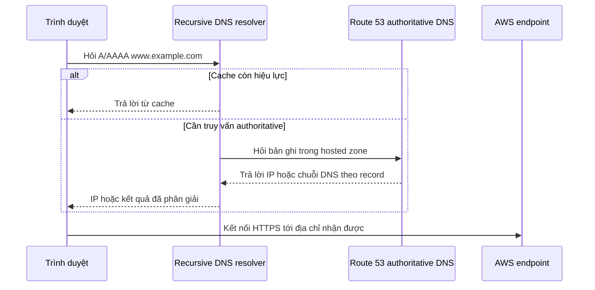
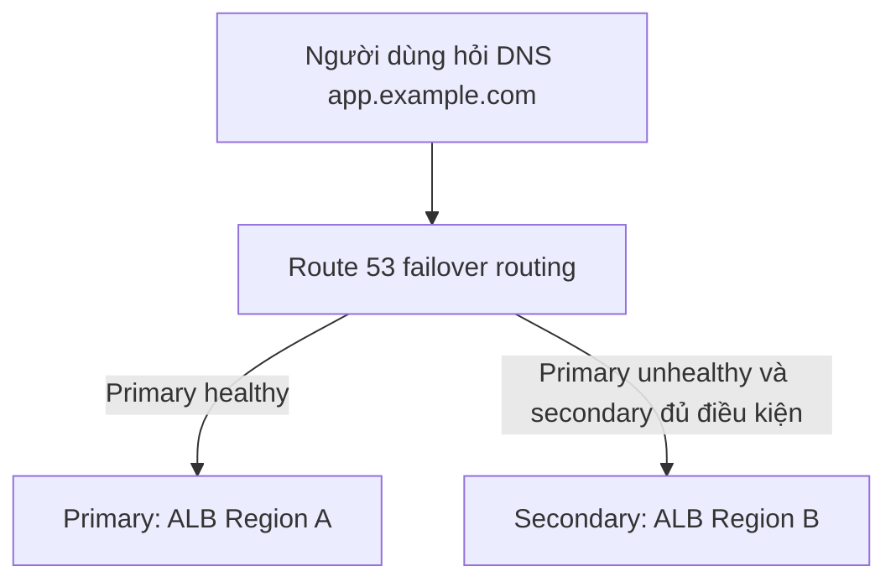
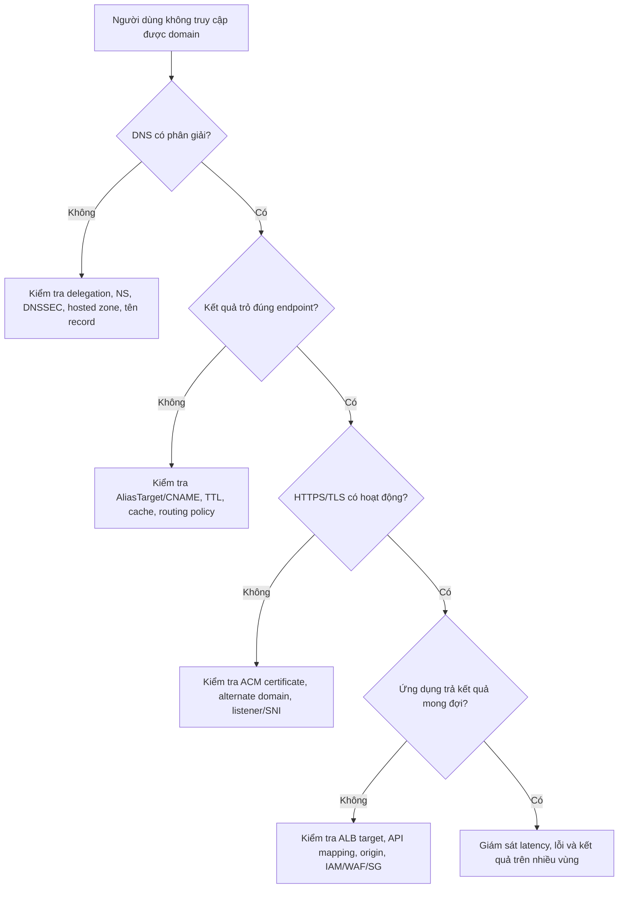

# Alias record, CNAME và định tuyến đến tài nguyên AWS

## 1. Tình huống và mục tiêu học tập

Một doanh nghiệp đưa hệ thống bán hàng lên AWS. Ứng dụng chạy sau **Application Load Balancer (ALB)**, ảnh sản phẩm được phân phối qua **Amazon CloudFront**, còn API do **Amazon API Gateway** cung cấp. Doanh nghiệp muốn khách hàng truy cập bằng các tên dễ nhớ:

```text
example.com          → Trang bán hàng
www.example.com      → Trang bán hàng hoặc CloudFront
api.example.com      → API Gateway
static.example.com   → CloudFront phân phối ảnh/CSS/JS
```

Các tài nguyên AWS có tên miền do AWS cấp, nhưng địa chỉ IP phía sau có thể thay đổi. Ghi cứng địa chỉ IP vào DNS có thể làm website ngừng hoạt động sau khi AWS điều chỉnh hạ tầng. Trong khi đó, bản ghi **CNAME** không thể dùng tại tên gốc vùng DNS (*zone apex*), nơi đã có các bản ghi bắt buộc như `SOA` và `NS`.

**Amazon Route 53 Alias records** giải quyết nhiều tình huống này bằng cách cho phép DNS trỏ tên miền tới những tài nguyên AWS được hỗ trợ hoặc tới bản ghi khác trong cùng hosted zone, kể cả tại zone apex khi chọn đúng loại bản ghi.

Bài học thuộc chương **DNS và phân phối nội dung** của lộ trình **CLOUD_PROVIDERS_AWS**. Việc định tuyến truy cập đến CloudFront, ELB, API Gateway hay S3 phải phù hợp với kiến trúc Region/AZ, IAM, VPC, compute/serverless, bảo mật TLS, giám sát, phục hồi và chi phí.

Sau bài này, bạn có thể:

- Giải thích DNS resolution, hosted zone, `A`, `AAAA`, `CNAME` và **Route 53 Alias**.
- Phân biệt cách trỏ `example.com` (*apex*) và `www.example.com` (*subdomain*) đến tài nguyên AWS.
- Tạo và kiểm tra Alias/CNAME bằng AWS CLI, xác định đúng `DNSName` và `HostedZoneId` của target.
- Chọn routing policy phù hợp: Simple, Weighted, Latency, Failover, Geolocation/Geoproximity và Multivalue Answer.
- Hiểu giới hạn DNS failover, TTL/cache, health checks, HTTPS certificate, S3 website hosting và private DNS.
- Thiết kế cấu hình quan sát được, an toàn và có kế hoạch khôi phục khi thay đổi DNS.

## 2. DNS hoạt động như thế nào trong ứng dụng AWS?

**Domain Name System (DNS)** ánh xạ tên miền và các loại thông tin DNS sang các bản ghi mà ứng dụng cần để kết nối. Khi truy cập `https://www.example.com`, trình duyệt cần xác định IP đích để mở kết nối TCP/TLS hoặc giao thức phù hợp. DNS giải quyết phần **tên → thông tin kết nối**, nhưng **không quyết định ứng dụng có chấp nhận request hay certificate có hợp lệ**.



Quy trình phân giải thực tế có thể gồm root DNS, TLD và các authoritative name servers; sơ đồ tập trung vào bước mà **Route 53 trả lời cho hosted zone** của doanh nghiệp. Recursive resolver có thể cache kết quả theo TTL, nên thay đổi DNS **không lập tức** đến mọi client.

### 2.1. Public hosted zone và private hosted zone

| Thuộc tính | Public hosted zone | Private hosted zone |
| --- | --- | --- |
| Mục đích | Trả lời DNS công khai cho domain | Trả lời DNS nội bộ trong những VPC liên kết và đường phân giải được cấu hình |
| Client thường gặp | Người dùng Internet | EC2/ECS/EKS, hệ thống đi qua Route 53 Resolver và mạng doanh nghiệp |
| Ví dụ | `www.example.com` → internet-facing ALB | `db.internal.example.com` → endpoint nội bộ |
| Điều kiện quan trọng | Domain được **delegate** tới đúng NS của hosted zone | VPC association, DNS resolution, Route 53 Resolver và rule chuyển tiếp phù hợp |

Tạo public hosted zone trên Route 53 **chưa đủ** để domain hoạt động. Registrar hoặc authoritative parent zone phải trỏ delegation (`NS`, và `DS` nếu dùng DNSSEC) đến đúng hệ thống name server. Đồng thời, public hosted zone có thể trả lời một tên trỏ đến **internal ALB**, nhưng điều đó không làm ALB trở nên truy cập được từ Internet; mạng và security group vẫn quyết định reachability.

### 2.2. DNS record không phải HTTP redirect

Một record `A`, `AAAA`, `CNAME` hoặc Alias **không tự thay đổi** `http://` thành `https://`, không tự đổi đường dẫn `/old` thành `/new`, cũng không tự chuyển trình duyệt từ `example.com` sang `www.example.com`. Các thao tác này cần **HTTP redirect** ở CloudFront, ALB, web server, API Gateway hoặc cơ chế ứng dụng thích hợp.

Ví dụ, nếu `example.com` và `www.example.com` đều phân giải đến một ALB, trình duyệt vẫn gửi giá trị `Host` tương ứng. TLS certificate và listener/application phải xử lý được cả hai tên, hoặc trả redirect đúng chuẩn.

## 3. Những record type cần biết

| Loại bản ghi | Dữ liệu DNS trả về | Tình huống sử dụng |
| --- | --- | --- |
| **A** | Một hoặc nhiều địa chỉ **IPv4** | `api.example.com → 203.0.113.10` (IP ví dụ) |
| **AAAA** | Một hoặc nhiều địa chỉ **IPv6** | Dùng khi endpoint thực sự hỗ trợ IPv6 |
| **CNAME** | Tên miền đích (*canonical name*) | `www.example.com → dxxxx.cloudfront.net` |
| **NS** | Authoritative name servers | Delegate zone cho DNS provider |
| **SOA** | Thông tin gốc và quản trị zone | Bản ghi bắt buộc của DNS zone |
| **MX** | Máy chủ nhận email | `example.com` dùng email theo domain |
| **TXT** | Chuỗi phục vụ nhiều mục đích | Xác minh domain, SPF và cơ chế liên quan |
| **CAA** | CA được cho phép phát hành chứng chỉ | Hạn chế nhà cung cấp chứng chỉ được phê duyệt |

Các địa chỉ thuộc dải tài liệu như `203.0.113.10` chỉ là ví dụ, không phải IP thật của ALB hoặc CloudFront. Khi AWS endpoint được quản lý và IP có thể đổi, nên trỏ tới **DNS endpoint được dịch vụ công bố** thay vì tạo record A với IP lấy từ một lần tra cứu.

## 4. CNAME: trỏ một tên sang tên khác

**CNAME (Canonical Name)** chỉ định một tên DNS là alias ở cấp giao thức DNS của một **tên khác**. Ví dụ:

```dns
www.example.com.  300  IN  CNAME  d111111abcdef8.cloudfront.net.
```

Khi client cần địa chỉ của `www.example.com`, resolver làm theo CNAME đến tên CloudFront rồi lấy địa chỉ A/AAAA của endpoint đó. **CNAME không trực tiếp chứa IPv4 hoặc IPv6**, và không phải lệnh chuyển hướng trang web. Số `300` trong ví dụ là **TTL tính bằng giây** của CNAME, không phải thời gian cố định CloudFront giữ IP.

### 4.1. Vì sao CNAME không được đặt tại zone apex?

**Zone apex** là tên gốc của một DNS zone, ví dụ `example.com` đối với hosted zone `example.com`. Tên này phải có các bản ghi **SOA** và **NS**. Theo quy tắc DNS, tên có **CNAME không được đồng thời có các bản ghi dữ liệu khác** cùng tên. Vì vậy không thể đặt CNAME thông thường ngay tại `example.com` nếu đó là apex.

```text
Hosted zone: example.com

example.com.       NS      ns-xxxx.awsdns-...
example.com.       SOA     ...

Không hợp lệ ở apex:
example.com.       CNAME   d111111abcdef8.cloudfront.net.

Hợp lệ về vị trí tên (nếu không có record xung đột cùng tên):
www.example.com.   CNAME   d111111abcdef8.cloudfront.net.
```

Đây không phải giới hạn tùy ý chỉ của AWS. Nguyên tắc CNAME không đồng tồn tại với record cùng tên xuất phát từ chuẩn DNS. Một số nhà cung cấp khác hỗ trợ giải pháp riêng như **ANAME/ALIAS/CNAME flattening** tại apex; cách triển khai và hành vi của chúng tùy nhà cung cấp. Trong Route 53, cơ chế tương ứng là **Alias record** của Route 53.

### 4.2. Những hạn chế khi sử dụng CNAME

- CNAME trỏ tới **hostname** (ví dụ DNS name của CloudFront), không trỏ trực tiếp tới URL như `https://example.com/shop`, không kèm port hoặc đường dẫn.
- Không tạo `CNAME` cùng tên với `TXT`, `MX`, `A` hay record khác nếu cấu hình vi phạm quy tắc CNAME. Điều này ảnh hưởng đặc biệt tới tên cần xác minh domain hoặc email.
- CNAME cho subdomain có thể trỏ tới tên **ngoài AWS** khi target là một hostname hợp lệ. Đối với zone apex, dùng Alias thích hợp hoặc cơ chế được DNS provider hỗ trợ.
- TTL của record CNAME có thể điều chỉnh. Thời gian client thấy endpoint mới còn chịu TTL/cache của target và resolver.
- CNAME không tự cấp certificate TLS, không cho phép một tên tự động xuất hiện trong CloudFront alternate domain names hoặc API Gateway custom domain.

## 5. Route 53 Alias record là gì?

**Alias** là một khả năng đặc biệt của **Amazon Route 53**, không phải record type riêng trong giao thức DNS công khai. Ở phía quản trị, bạn tạo record `A`/`AAAA` (và một số trường hợp alias tới record cùng loại trong hosted zone), kèm **AliasTarget** để Route 53 biết target AWS hoặc record cần trả lời.

Ví dụ:

```text
Tên cần trỏ:       example.com
Loại:              A (Alias = Yes)
Alias target:      ALB do AWS quản lý
Kết quả DNS:       IPv4 của ALB được AWS quản lý
```

Resolver bên ngoài nhận câu trả lời DNS A/AAAA phù hợp; nó **không cần hiểu** khái niệm Alias nội bộ của Route 53. Nhờ vậy Alias có thể dùng tại **zone apex**, nơi CNAME thông thường không được phép.

### 5.1. Target Alias được hỗ trợ

Route 53 hỗ trợ tạo Alias đến nhiều loại AWS resource, tùy loại record và kiến trúc. Các target thường gặp gồm:

| AWS target | Tình huống | Điều kiện cần chú ý |
| --- | --- | --- |
| **Elastic Load Balancing**: ALB/NLB/Classic LB | Web/API phân phối request cho nhiều target | Dùng đúng DNS name và **canonical hosted zone ID** của load balancer |
| **Amazon CloudFront distribution** | CDN, static site, caching và edge delivery | Domain phải là **alternate domain name** của distribution; TLS certificate phù hợp |
| **API Gateway custom domain** | `api.example.com` gọi REST/HTTP API | Phải cấu hình **custom domain** và API mapping/base path mapping |
| **Amazon S3 website endpoint** | Static website hosting (trong những trường hợp được hỗ trợ) | Website bucket/endpoint cần cấu hình đúng; **S3 website endpoint chỉ dùng HTTP** |
| **Elastic Beanstalk environment** | Trỏ tới môi trường ứng dụng được AWS quản lý | Khả năng Alias phụ thuộc môi trường/endpoint hỗ trợ; không phải mọi CNAME đều hợp lệ làm target resource |
| **AWS Global Accelerator** | Endpoint IP ổn định/định tuyến toàn cầu tới application endpoint | Cấu hình accelerator/listener/endpoint group và loại IP phù hợp |
| **VPC interface endpoint** | Truy cập dịch vụ riêng trong kiến trúc phù hợp | Route 53 private DNS/networking, đúng endpoint/DNS/zone ID |
| **Record cùng hosted zone** | Tái sử dụng một bản ghi DNS đã cấu hình | Target phải là bản ghi hợp lệ **trong cùng hosted zone** và đúng loại theo quy tắc Route 53 |

**Không phải hostname bất kỳ đều có thể trở thành Route 53 AliasTarget.** Nếu bạn muốn trỏ `app.example.com` tới DNS name của bên cung cấp SaaS không thuộc nhóm target được hỗ trợ, thường dùng **CNAME tại subdomain**. Nếu cần zone apex trỏ tới bên thứ ba, phải kiểm tra xem nhà cung cấp hỗ trợ địa chỉ IP ổn định, DNS flattening hay cấu hình tương đương nào không; Route 53 Alias không mặc nhiên giải quyết mọi target ngoài AWS.

### 5.2. So sánh CNAME và Alias

| Tiêu chí | CNAME | Route 53 Alias |
| --- | --- | --- |
| Chuẩn DNS | Record DNS chuẩn | Tính năng quản trị riêng của Route 53, trả lời bằng record type DNS thông thường |
| Dùng tại `example.com` (apex)? | **Không** | **Có**, với Alias A/AAAA hợp lệ |
| Dùng tại subdomain? | Có | Có |
| Target | Một hostname DNS bất kỳ theo quy tắc DNS | AWS resource/record trong cùng hosted zone thuộc danh sách hỗ trợ |
| Kiểu trả lời | CNAME để resolver truy theo tên khác | Trả lời địa chỉ/giá trị theo target record; client không cần biết Alias |
| TTL | Tự cấu hình TTL cho CNAME | **Không tự đặt TTL** khi Alias trỏ AWS resource; dùng TTL do target quyết định hoặc kế thừa record đích |
| Health evaluation | Không có `EvaluateTargetHealth` của Alias | Có tùy chọn theo target/routing policy **khi dịch vụ hỗ trợ** |
| Chi phí truy vấn | Tính theo quy tắc Route 53 DNS query | Nhiều Alias queries tới AWS resources đủ điều kiện **được miễn phí truy vấn Alias**; không mặc định miễn mọi loại query/target |
| Thay đổi khi AWS cập nhật IP | Resolver tiếp tục theo DNS target | Route 53 tiếp tục trả lời theo target được AWS quản lý |

Chi phí thực tế còn bao gồm hosted zone, health checks, routing policy/Resolver và các tài nguyên đích. Phải đối chiếu bảng giá **Amazon Route 53** ở thời điểm thiết kế; Alias không đồng nghĩa toàn bộ hệ thống DNS/CDN miễn phí.

## 6. Chọn bản ghi cho từng loại tài nguyên AWS

### 6.1. ALB và Network Load Balancer

Ví dụ cần định tuyến `example.com` tới một **internet-facing ALB**. ALB cung cấp DNS name như:

```text
shop-prod-alb-123456789.ap-southeast-1.elb.amazonaws.com
```

DNS name này do ELB quản lý; không nên lấy địa chỉ IP hiện tại của ALB rồi viết A record tĩnh. Với Route 53, tạo **Alias A** tại `example.com`; nếu ALB có hỗ trợ IPv6/dualstack theo cấu hình, cân nhắc **Alias AAAA** tương ứng cho người dùng IPv6.

Một record alias có thể trỏ đến ALB ở Region khác nơi bạn đang quản trị DNS, miễn target và hosted zone/record type được hỗ trợ. Route 53 là dịch vụ DNS toàn cầu; load balancer và tài nguyên ứng dụng vẫn thuộc Region/AZ cụ thể.

**`EvaluateTargetHealth`** có thể được bật với Alias đến ELB trong trường hợp được hỗ trợ. Khi dùng failover routing, Route 53 có thể dựa trên trạng thái target/target groups của ELB theo cơ chế được AWS mô tả. Đừng chỉ xét health của DNS: ALB có thể healthy ở tầng listener nhưng ứng dụng hoặc dependency bên dưới vẫn gặp lỗi theo cách health check không phát hiện.

### 6.2. CloudFront và website dùng HTTPS

CloudFront cung cấp distribution domain như `d111111abcdef8.cloudfront.net`. Để người dùng truy cập `www.example.com`:

1. Thêm `www.example.com` vào **Alternate domain names (CNAMEs)** của CloudFront distribution.
2. Gắn chứng chỉ TLS từ **AWS Certificate Manager (ACM)** hoặc chứng chỉ phù hợp theo quy định của CloudFront. Với certificate ACM dùng cho CloudFront, chứng chỉ cần ở **`us-east-1`**.
3. Trong Route 53, tạo **Alias A** tới distribution (hoặc CNAME tại subdomain nếu chọn mô hình đó). Với IPv6, thêm AAAA nếu distribution hỗ trợ và đã bật IPv6.
4. Kiểm tra origin, hành vi cache, HTTPS viewer protocol policy, quyền truy cập nội dung, WAF khi cần và end-to-end TLS.

**Không chỉ cần DNS.** Nếu trỏ `www.example.com` tới CloudFront distribution nhưng quên alternate domain name hoặc certificate, DNS có thể phân giải bình thường mà HTTPS vẫn lỗi. Với website trên S3, nên sử dụng **CloudFront với S3 origin và Origin Access Control (OAC)** trong kiến trúc private bucket khi phù hợp, thay vì tự động công khai S3 bucket chỉ để có website.

**Alias đến CloudFront không hỗ trợ `EvaluateTargetHealth=true`.** Nếu cần DNS failover cho ứng dụng sau CloudFront, phải thiết kế đúng health/routing ở tầng phù hợp, ví dụ health checks ngoài, CloudFront origin failover trong những tình huống được hỗ trợ hoặc cơ chế failover của ứng dụng.

### 6.3. API Gateway custom domain

Để `api.example.com` gọi API Gateway, không nên tùy tiện trỏ DNS về một **execute-api endpoint** và mong host tùy chỉnh tự hoạt động. Cần tạo **custom domain name** trong API Gateway, chọn endpoint type, cấp certificate và cấu hình mapping để hostname đó tìm được API/stage phù hợp.

Với **Regional custom domain**, chứng chỉ ACM thường cần ở cùng Region với API Gateway endpoint. Với **edge-optimized custom domain**, hạ tầng CloudFront do API Gateway sử dụng có yêu cầu chứng chỉ ở `us-east-1` trong phạm vi hỗ trợ. Sau đó tạo Alias A trong Route 53 tới **API Gateway domain name target** được AWS trả về, với đúng hosted zone ID của target.

Ví dụ:

```text
https://api.example.com/v1/orders
   |
   +-- DNS Alias A -> API Gateway custom domain target
   +-- TLS certificate -> hợp lệ cho api.example.com
   +-- API mapping -> API/stage phù hợp
   +-- IAM/JWT/Lambda authorizer hoặc bảo mật ứng dụng -> cho phép request
```

DNS chỉ hỗ trợ tìm endpoint. Cấu hình API mapping và quyền gọi API vẫn là trách nhiệm riêng. Một bản ghi Alias hợp lệ **không tạo** custom domain trong API Gateway.

### 6.4. S3 static website endpoint

S3 **website endpoint** có thể được dùng làm Alias target khi bucket và website hosting được cấu hình phù hợp. Với tên miền tùy chỉnh, tên bucket thông thường phải **khớp hostname** mà website phục vụ. Nhưng website endpoint của S3 **chỉ hỗ trợ HTTP**, không cung cấp HTTPS trực tiếp như CloudFront.

Vì vậy nếu ứng dụng cần `https://example.com`, thường nên đặt **CloudFront phía trước S3**. Khi dùng S3 **REST endpoint** làm origin, CloudFront OAC giúp giữ bucket private. Nếu cố dùng S3 **website endpoint** làm custom origin, OAC không áp dụng theo cách của S3 REST origin; cần hiểu rõ chính sách truy cập và hạn chế bảo mật trước khi chọn.

### 6.5. RDS và endpoint không thuộc danh sách Alias resource

Amazon RDS cung cấp DNS endpoint được quản lý, ví dụ endpoint của DB instance hoặc cluster. Khi cần tên tiện dụng `db.internal.example.com`, bạn có thể sử dụng **CNAME ở subdomain** trỏ tới endpoint DB phù hợp với kiến trúc mạng riêng. Không tự cho rằng mọi endpoint AWS đều có trong danh sách Route 53 Alias target tương tự ALB.

Đối với database, ngoài DNS còn phải xem VPC/private connectivity, security group, authentication, TLS hostname verification, failover và cách client giữ connection pool. **Tên miền tùy chỉnh có thể làm phức tạp xác minh TLS hostname** nếu phần mềm client kiểm tra certificate theo endpoint RDS gốc; hãy thử nghiệm cấu hình TLS trước khi dùng CNAME trong production.

## 7. Ví dụ AWS CLI: Alias A tới ALB

Giả sử doanh nghiệp quản lý public hosted zone `example.com` trên Route 53, có ALB `shop-prod-alb` tại Singapore và muốn dùng **apex** `example.com`.

### 7.1. Đọc thông tin thật trước khi sửa

Đầu tiên xác minh tài khoản đang sử dụng, hosted zone và target load balancer:

```bash
# Đọc AWS account/role hiện hành
aws sts get-caller-identity

# Tìm hosted zone có tên example.com (cần xác nhận đúng public zone)
aws route53 list-hosted-zones-by-name \
  --dns-name example.com \
  --max-items 10

# Lấy DNSName và CanonicalHostedZoneId của ALB
aws elbv2 describe-load-balancers \
  --names shop-prod-alb \
  --region ap-southeast-1 \
  --query 'LoadBalancers[0].[DNSName,CanonicalHostedZoneId,Scheme,Type]' \
  --output table
```

**Phân biệt hai hosted zone IDs:**

1. `HostedZoneId` của **Route 53 hosted zone `example.com`**: dùng cho tham số `--hosted-zone-id` khi thay record.
2. `CanonicalHostedZoneId` của **ALB**: dùng làm `AliasTarget.HostedZoneId` trong JSON. **Hai ID không giống nhau**, dù cùng xuất hiện trong lệnh cấu hình.

Đối với CloudFront, API Gateway hay S3 website endpoint, cần lấy **hosted zone ID của đúng target** theo API/tài liệu của dịch vụ. Không sao chép ID của ALB sang target khác.

### 7.2. Tạo JSON thay đổi DNS

Sau khi lấy thông tin thật, tạo file `alias-alb-change.json` với cấu trúc:

```json
{
  "Comment": "Route apex domain to production ALB",
  "Changes": [
    {
      "Action": "UPSERT",
      "ResourceRecordSet": {
        "Name": "example.com.",
        "Type": "A",
        "AliasTarget": {
          "HostedZoneId": "ZREPLACE_WITH_ALB_CANONICAL_ZONE_ID",
          "DNSName": "dualstack.shop-prod-alb-123456789.ap-southeast-1.elb.amazonaws.com.",
          "EvaluateTargetHealth": true
        }
      }
    }
  ]
}
```

Trong đó:

- `Name` là tên bản ghi cần tạo, có dấu chấm cuối theo quy ước tên FQDN.
- `Type: "A"` tạo record trả kết quả IPv4 cho apex; nếu cần IPv6 và ALB hỗ trợ, thêm record `AAAA` với target tương ứng.
- `AliasTarget.DNSName` phải trỏ tới **DNS name do ELB trả về**; có thể có prefix `dualstack.` trong những trường hợp cấu hình phù hợp. Không tự bịa hostname.
- `AliasTarget.HostedZoneId` dùng **canonical hosted zone ID của ALB**, không phải ID hosted zone `example.com`.
- `EvaluateTargetHealth` thể hiện có muốn Route 53 xem health của ELB trong những chính sách định tuyến có hỗ trợ hay không.
- `UPSERT` tạo hoặc thay bản ghi cùng name/type/identifier phù hợp; **không dùng khi chưa kiểm tra bản ghi cũ và tác động tới traffic**.

Lưu ý: các ID/hostname trong JSON là **placeholder**; lệnh sẽ lỗi hoặc trỏ sai nếu dùng nguyên mẫu. Lấy dữ liệu thực từ tài khoản được cấp quyền trước khi triển khai.

### 7.3. Gửi thay đổi và xác nhận

```bash
aws route53 change-resource-record-sets \
  --hosted-zone-id ZREPLACE_WITH_PUBLIC_ZONE_ID \
  --change-batch file://alias-alb-change.json

# Sau khi API trả ChangeInfo.Id, tra cứu trạng thái áp dụng
aws route53 get-change \
  --id /change/REPLACE_WITH_CHANGE_ID

# Đọc lại record trong hosted zone
aws route53 list-resource-record-sets \
  --hosted-zone-id ZREPLACE_WITH_PUBLIC_ZONE_ID \
  --query "ResourceRecordSets[?Name=='example.com.']"
```

Khi `get-change` báo `INSYNC`, thay đổi đã được Route 53 triển khai trên các authoritative DNS servers của Route 53. **Điều này không xóa cache tại các recursive resolvers**: người dùng có thể còn nhận câu trả lời cũ cho đến khi TTL/cache kết thúc. Trước thay đổi production, nên xuất và lưu cấu hình record hiện tại, xác định phương án rollback và kiểm tra certificate/listener của target đã sẵn sàng.

## 8. Ví dụ CNAME cho subdomain và Alias CloudFront

### 8.1. CNAME cho `www.example.com`

Nếu đã cấu hình CloudFront alternate domain name `www.example.com` với certificate hợp lệ, có thể tạo bản ghi CNAME từ `www.example.com` đến distribution domain:

```json
{
  "Comment": "Map www to CloudFront distribution",
  "Changes": [
    {
      "Action": "UPSERT",
      "ResourceRecordSet": {
        "Name": "www.example.com.",
        "Type": "CNAME",
        "TTL": 300,
        "ResourceRecords": [
          { "Value": "d111111abcdef8.cloudfront.net." }
        ]
      }
    }
  ]
}
```

Lưu thành `cname-www-change.json` rồi sử dụng `aws route53 change-resource-record-sets` cho đúng hosted zone ID như phần trước. **Không dùng mẫu này tại `example.com`** vì đó là zone apex. Trước `UPSERT`, hãy kiểm tra tên `www.example.com` không có các record xung đột theo quy tắc CNAME.

### 8.2. Alias A cho CloudFront

Với Route 53, cùng tên `www.example.com` có thể dùng **Alias A** thay cho CNAME. Đặc biệt, khi muốn CDN phục vụ **`example.com` ngay tại apex**, Alias A là một lựa chọn tự nhiên:

```json
{
  "Comment": "Route apex domain to CloudFront distribution",
  "Changes": [
    {
      "Action": "UPSERT",
      "ResourceRecordSet": {
        "Name": "example.com.",
        "Type": "A",
        "AliasTarget": {
          "HostedZoneId": "Z2FDTNDATAQYW2",
          "DNSName": "d111111abcdef8.cloudfront.net.",
          "EvaluateTargetHealth": false
        }
      }
    }
  ]
}
```

Ở ví dụ này, `Z2FDTNDATAQYW2` là hosted zone ID được AWS dùng cho CloudFront distribution trong cấu hình Alias tương ứng. **Luôn kiểm tra tài liệu AWS tại thời điểm triển khai**. `EvaluateTargetHealth` phải là `false` đối với CloudFront target. Domain và distribution phải tồn tại, được gán alternate domain và chứng chỉ hợp lệ; DNS name trong mẫu chỉ minh họa.

### 8.3. Khi nào chọn Alias thay cho CNAME?

Với target được Route 53 hỗ trợ, Alias thường hợp lý vì dùng được tại apex, không cần người dùng theo tên CNAME ở cấp DNS công khai và có các lợi ích theo cách AWS quản lý target. Nhưng **không nên đổi CNAME thành Alias chỉ vì thấy giá hoặc độ trễ hấp dẫn** mà không kiểm tra target, HTTPS, TTL, khả năng rollback, routing policy và DNS provider đang authoritative.

Nếu DNS authoritative của domain đang đặt ở **nhà cung cấp khác** chứ không phải Route 53, không thể thêm Route 53 Alias vào hosted zone chưa được delegate rồi mong toàn Internet nhìn thấy nó. Cần thao tác trên DNS provider hiện đang authoritative hoặc thực hiện kế hoạch chuyển delegation có kiểm soát.

## 9. TTL, DNS caching và thời gian áp dụng thay đổi

**TTL (Time to Live)** là thời gian bản ghi được phép cache trong DNS resolver theo giá trị được cấp. Nó không phải thời gian CloudFront cache nội dung web, cũng không quyết định cookie/session của người dùng.

Ví dụ:

```text
09:00  Recursive resolver nhận www.example.com CNAME TTL 300 giây
09:01  Người quản trị đổi CNAME sang target mới
09:02  Client dùng resolver đó vẫn có thể thấy target cũ
09:05  Cache hết TTL, resolver mới hỏi lại authoritative DNS
```

Trong thực tế, nhiều lớp cache (resolver, hệ điều hành, ứng dụng, proxy) có hành vi khác nhau. **TTL nhỏ chỉ làm giảm cửa sổ cache mong muốn, không bảo đảm mọi người dùng đổi tức thì**.

### 9.1. TTL của CNAME và Alias

| Loại | Ai điều khiển TTL? | Tác động vận hành |
| --- | --- | --- |
| CNAME thông thường | Chủ record thiết lập TTL trong DNS | Có thể hạ TTL trước khi chuyển target để hỗ trợ migration |
| Alias tới AWS resource | Route 53 dùng TTL do **resource target** cung cấp; không đặt TTL riêng trong Alias record | Không thêm trường `TTL` khi tạo AliasTarget tới AWS resource |
| Alias tới record khác trong cùng hosted zone | Thừa hưởng hành vi TTL của record target theo cơ chế Route 53 | Muốn kiểm soát TTL, xem record đích và cách Alias được đánh giá |

Khi thay đổi production, hạ TTL của **CNAME cũ** trước thời điểm cutover có thể hữu ích, nhưng phải làm **sớm hơn ít nhất một chu kỳ TTL cũ** để tránh cache giữ giá trị dài. Với Alias tới AWS resource, không thể tự đặt `TTL: 30` trong Alias record theo cách làm với CNAME.

### 9.2. DNS caching không giống CDN caching

CloudFront cache HTML, CSS, JavaScript, image và response theo **cache policy** và HTTP headers. Route 53/recursive DNS cache **record DNS**. Một site đổi Alias sang distribution mới nhưng người dùng vẫn thấy nội dung cũ có thể do **CloudFront cache**, browser cache, CDN invalidation hoặc origin behavior — không nhất thiết do Route 53 DNS.

## 10. Routing policies: Route 53 chọn câu trả lời như thế nào?

**Routing policy** xác định cách Route 53 trả lời khi có nhiều record cùng vai trò. Routing policies có thể kết hợp với **Alias** theo loại target và tình huống được hỗ trợ. Một câu trả lời DNS có thể khác nhau theo trọng số, Region gần người dùng, vị trí địa lý hoặc health của endpoint.

| Routing policy | Mục tiêu | Ví dụ |
| --- | --- | --- |
| **Simple** | Trả lời theo một cấu hình không yêu cầu điều khiển traffic phức tạp | `example.com` → một ALB |
| **Weighted** | Phân bổ câu trả lời theo trọng số tương đối | 90% đến ALB v1, 10% đến ALB v2 ở mức DNS response |
| **Latency-based** | Chọn Region có latency mạng thấp hơn theo đo lường của AWS | Client gần Singapore → endpoint Singapore |
| **Failover** | Chọn primary/secondary tùy health | Primary ALB tại Region A, secondary ALB Region B |
| **Geolocation** | Chọn theo vị trí địa lý nguồn truy vấn được xác định | Khách tại một số nước → site/endpoint phù hợp |
| **Geoproximity** | Định tuyến theo khoảng cách địa lý, có thể chỉnh bias trong mô hình hỗ trợ | Phân chia vùng phục vụ giữa hai Region |
| **Multivalue answer** | Trả về nhiều giá trị được chọn, có thể kiểm tra health từng record | Nhiều endpoint có IP tĩnh |
| **IP-based routing** | Chọn câu trả lời theo CIDR của nguồn truy vấn được xác định | Mạng doanh nghiệp hoặc ISP cụ thể → endpoint phù hợp |

**Không phải routing policy nào cũng hỗ trợ mọi kiểu record hoặc target.** Ví dụ, tính năng Multivalue Answer có những giới hạn riêng đối với Alias; phải kiểm tra tài liệu Route 53 và trường hợp sử dụng thực tế. Ngoài ra, một record trỏ tới load balancer **không thay thế** thuật toán phân phối request thực tế của ALB/NLB.

### 10.1. Weighted routing: triển khai thay đổi từng phần

Giả sử có `api.example.com` trỏ tới **hai ALB** đại diện phiên bản ứng dụng cũ/mới. Tạo hai **weighted Alias A records** cùng name/type nhưng khác `SetIdentifier` và `Weight`.

```json
{
  "Comment": "Example weighted Alias records for two ALBs",
  "Changes": [
    {
      "Action": "UPSERT",
      "ResourceRecordSet": {
        "Name": "api.example.com.",
        "Type": "A",
        "SetIdentifier": "stable-v1",
        "Weight": 90,
        "AliasTarget": {
          "HostedZoneId": "ZREPLACE_WITH_ALB_V1_ZONE_ID",
          "DNSName": "dualstack.stable-alb-111111.ap-southeast-1.elb.amazonaws.com.",
          "EvaluateTargetHealth": true
        }
      }
    },
    {
      "Action": "UPSERT",
      "ResourceRecordSet": {
        "Name": "api.example.com.",
        "Type": "A",
        "SetIdentifier": "canary-v2",
        "Weight": 10,
        "AliasTarget": {
          "HostedZoneId": "ZREPLACE_WITH_ALB_V2_ZONE_ID",
          "DNSName": "dualstack.canary-alb-222222.ap-southeast-1.elb.amazonaws.com.",
          "EvaluateTargetHealth": true
        }
      }
    }
  ]
}
```

Các hostname và IDs chỉ là placeholder. `SetIdentifier` phân biệt bản ghi có cùng name/type, còn `Weight` tạo tỷ lệ **trọng số tương đối trong việc chọn câu trả lời DNS đủ điều kiện**, **không đảm bảo chính xác 90%/10% request HTTP thực tế**. Recursive resolver caching, lưu lượng không đều và connection reuse có thể khiến tỷ lệ request khác đáng kể.

Để dùng canary deployment an toàn, kết hợp weighted routing với health checks, monitoring ứng dụng, rollback nhanh và chiến lược triển khai/phiên người dùng. Nếu cần kiểm soát tỉ lệ request chính xác hơn, xem xét cách định tuyến của ALB/CloudFront hoặc nền tảng triển khai thay vì chỉ dựa vào DNS.

### 10.2. Latency-based routing: chọn Region dựa trên latency đo lường

Khi một hệ thống có endpoint ở Singapore và Sydney, latency-based routing có thể hướng người dùng tới endpoint Region mà Route 53 dự đoán có latency tốt hơn. Điều này **không đảm bảo** client luôn tới Region gần nhất theo khoảng cách địa lý, cũng không bảo đảm kết quả thấp nhất ở cấp ứng dụng vì còn phụ thuộc resolver location, network path và tải của dịch vụ.

Lưu ý: **DNS route đến Region khác không tự replicate dữ liệu, database session hoặc user state**. Nếu triển khai ứng dụng đa Region, phải có kiến trúc dữ liệu, xác thực và khả năng failover phù hợp.

### 10.3. Failover routing: primary và secondary

Failover routing cho phép cấu hình **primary** và **secondary** record. Route 53 sử dụng health checks hoặc `EvaluateTargetHealth` khi hỗ trợ để xác định endpoint nào đủ điều kiện nhận DNS answer.



**Giới hạn của DNS failover:** không tự chuyển những TCP/TLS connections đang tồn tại, không bảo đảm khách hàng hết cache DNS ngay, không nhân bản dữ liệu và không sửa endpoint backend đang lỗi logic mà health check chưa phát hiện. RTO thực tế cần tính thêm TTL/cache, thời gian phát hiện health, thời gian ứng dụng vùng đích sẵn sàng và quá trình phục hồi dữ liệu.

### 10.4. Geolocation và geoproximity không đồng nghĩa tuân thủ dữ liệu

Geolocation routing chọn theo vị trí được xác định ở DNS query; resolver và cách phát hiện địa lý có thể khiến kết quả khác với vị trí thật của người dùng cuối. Geoproximity dùng logic khoảng cách và bias trong những cấu hình được hỗ trợ.

Nếu tổ chức có yêu cầu **data residency**, chỉ đổi DNS theo quốc gia chưa đủ: client có thể dùng VPN, dữ liệu backend vẫn được truyền tới Region khác, hoặc dịch vụ lưu dữ liệu tại vị trí không phù hợp. Cần kiểm soát lớp lưu trữ, ứng dụng, IAM, mạng, logging và quy trình vận hành đồng thời.

## 11. Health checks và `EvaluateTargetHealth`

Có hai ý tưởng cần phân biệt:

1. **Route 53 health check resource**: kiểm tra endpoint HTTP/HTTPS/TCP công khai hoặc theo cơ chế CloudWatch alarm/calculated health check được hỗ trợ. Health checker của Route 53 **không thể trực tiếp gọi IP private trong VPC** như một máy EC2 không được Internet định tuyến tới; muốn kiểm tra dịch vụ private, cần phương án quan sát và alarm thích hợp.
2. **`EvaluateTargetHealth` trên Alias**: Route 53 đánh giá health của Alias target theo khả năng hỗ trợ của dịch vụ đích hoặc record mục tiêu. Đây **không phải** tùy chọn dùng được cho mọi target AWS.

### 11.1. Khi nào bật `EvaluateTargetHealth`?

| Alias target | Định hướng sử dụng | Ghi chú |
| --- | --- | --- |
| ELB (ALB/NLB/Classic LB) | Có thể bật nếu muốn Route 53 đánh giá health theo ELB trong routing phù hợp | Health dựa trên cơ chế/target groups của LB, cần kiểm thử nhiều target groups |
| CloudFront distribution | **Đặt `false`** | Không hỗ trợ Evaluate Target Health như ELB |
| S3 website endpoint | **Đặt `false`** | Không kỳ vọng Route 53 kiểm tra sức khỏe S3 website qua Alias target |
| Alias tới record khác trong hosted zone | Có thể dùng khi muốn đánh giá bản ghi được trỏ đến trong mô hình được hỗ trợ | Kiểm tra health check và chuỗi Alias để tránh điều kiện sai |
| API Gateway custom domain | Không suy luận luôn hỗ trợ health tự động giống ALB | Chọn cơ chế theo docs và quan sát ứng dụng thật |

**Health check phải đo đúng điều người dùng cần.** Nếu `/health` trả 200 nhưng database bị lỗi hoặc hàng đợi downstream bị nghẽn, DNS có thể tiếp tục định tuyến tới Region/ALB không phục vụ được nghiệp vụ. Nên có synthetic transaction, application metrics và lựa chọn health endpoint phản ánh những dependency tối quan trọng.

### 11.2. Failover khi primary healthy sai

Một primary ALB có target group được đánh dấu healthy vì kiểm tra HTTP 200 trên path tĩnh, nhưng API thanh toán liên tục trả 500. Route 53 `EvaluateTargetHealth` không nhất thiết nhận thấy lỗi nghiệp vụ đó. Các biện pháp có thể gồm:

- Điều chỉnh ALB target group health check phù hợp nhưng không tạo vòng lặp phụ thuộc không cần thiết.
- Dùng Route 53 health check riêng cho public synthetic endpoint hoặc CloudWatch alarm với chỉ số phản ánh sức khỏe thực.
- Xây dựng canary/synthetic monitor truy cập API quan trọng và đưa vào quyết định vận hành failover.
- Kiểm thử chuyển vùng trong môi trường giả lập sự cố, đo thời gian và tổn thất dữ liệu.

Không nên tạo health check kiểm tra IP nội bộ bằng public Route 53 checker rồi cho rằng nó sẽ truy cập được qua VPC. Hãy thiết kế cơ chế quan sát tương thích với phạm vi mạng của endpoint.

## 12. DNS riêng và kết nối từ mạng doanh nghiệp

Khi ứng dụng sử dụng **internal ALB**, RDS, dịch vụ nội bộ qua VPC endpoint hoặc private API, thường không muốn public DNS phơi bày topology hoặc nhầm client có thể truy cập từ Internet. Route 53 **private hosted zone** và Route 53 Resolver hỗ trợ phân giải tên cho những VPC liên kết.

Ví dụ:

```text
Public hosted zone: example.com
  www.example.com -> CloudFront/ALB public

Private hosted zone: internal.example.com
  api.internal.example.com -> Alias A tới internal ALB
  db.internal.example.com  -> CNAME tới RDS endpoint

On-premises DNS server
  -> Route 53 Resolver inbound endpoint qua VPN/Direct Connect
  -> Phân giải tên thuộc private hosted zone theo rule phù hợp
```

Các chi tiết cần lưu ý:

- VPC phải bật các tùy chọn DNS cần thiết và được **association** với private hosted zone hoặc kiến trúc phân giải tương ứng.
- Với on-premises, cần đường mạng (Site-to-Site VPN/Direct Connect), **Route 53 Resolver inbound endpoint**, DNS forwarding và security group cho UDP/TCP 53.
- Cả hai hướng truy vấn DNS và kết nối ứng dụng phải có route/firewall phù hợp. DNS trả IP riêng **không khiến VPN tự xuất hiện**.
- Có thể dùng **split-horizon DNS**, trong đó cùng một tên được trả kết quả khác nhau cho client nội bộ và Internet. Cần kiểm tra hosted zone precedence/resolver rules để tránh trả `NXDOMAIN` bất ngờ.

## 13. TLS, IAM, WAF và bảo mật tên miền

DNS giúp tìm đích nhưng **không thay thế TLS, xác thực hay phân quyền**. Các lớp cần kiểm tra khi đưa custom domain vào production:

| Lớp | Câu hỏi cần trả lời |
| --- | --- |
| **Domain ownership và delegation** | Registrar và NS/DS trỏ đúng authoritative DNS chưa? Ai có quyền đổi record? |
| **TLS certificate** | Certificate có SAN cho `example.com`, `www.example.com`, `api.example.com` theo nhu cầu không? Certificate ở đúng Region? |
| **Application routing** | ALB host/path rules, CloudFront behaviors hoặc API Gateway mapping đã cấu hình chưa? |
| **Network access** | ALB public hay internal? VPC SG/NACL/firewall và private connectivity có đúng không? |
| **Identity/authorization** | IAM, JWT, API keys, app auth và quyền tài nguyên backend đã phù hợp chưa? |
| **Edge protection** | AWS WAF, Shield, rate limits, logging và giám sát có cần bật không? |
| **DNS security** | Quyền Route 53 `ChangeResourceRecordSets`, account MFA, audit, DNSSEC nếu phù hợp có được kiểm soát không? |

### 13.1. Chứng chỉ ACM theo từng endpoint

- **ALB**: chứng chỉ TLS dùng cho HTTPS listener phải được đặt/cấp tại **Region của ALB** theo cơ chế của Elastic Load Balancing.
- **CloudFront**: certificate ACM liên kết với alternate domain name thường cần ở **`us-east-1`**.
- **API Gateway**: certificate phụ thuộc Regional hay edge-optimized custom domain; phải chọn vùng và điều kiện được dịch vụ hỗ trợ.

Route 53 Alias **không cấp phát, gia hạn hay gắn certificate** cho các dịch vụ này. Khi client truy cập `https://api.example.com`, certificate phải hợp lệ cho tên mà client gửi, không chỉ cho DNS hostname gốc do AWS cấp.

### 13.2. Rủi ro khi sửa DNS không kiểm soát

Một thay đổi `UPSERT` sai vào apex có thể chuyển toàn bộ khách hàng sang endpoint không có HTTPS hoặc nơi không thuộc quyền kiểm soát. Cần:

- Giới hạn quyền thay hosted zone qua IAM và quy trình phê duyệt, đặc biệt các record ở apex hoặc login/payment.
- Dùng Infrastructure as Code hoặc change batch được review, lưu lại cấu hình trước sửa.
- Kiểm tra CloudTrail các API thay DNS, cảnh báo khi record quan trọng đổi bất thường.
- Quản lý đăng ký domain, renewal và delegation. Nếu dùng DNSSEC, cân nhắc quy trình bảo vệ khóa và `DS` ở registrar.
- Không trỏ tên miền đến resource đã bị xóa hoặc không còn kiểm soát. **Dangling DNS records** có thể tạo nguy cơ subdomain takeover nếu tên trỏ vào endpoint mà kẻ khác có thể chiếm quyền cấu hình theo loại dịch vụ.

## 14. Quy trình triển khai và kiểm tra DNS an toàn

### Bước 1 — Vẽ bản đồ tên miền

Liệt kê các hostname, mức công khai và target mong muốn:

| Hostname | Mục đích | Gợi ý record |
| --- | --- | --- |
| `example.com` | Website chính | Alias A đến CloudFront hoặc ALB |
| `www.example.com` | Website chính hoặc redirect | Alias A hoặc CNAME tại subdomain; redirect HTTP nếu cần |
| `static.example.com` | CDN | Alias A/AAAA hoặc CNAME đến CloudFront |
| `api.example.com` | API | Alias A đến API Gateway custom domain hoặc ALB |
| `db.internal.example.com` | Database nội bộ | CNAME trong private hosted zone tới RDS endpoint nếu tương thích TLS |

### Bước 2 — Kiểm tra target

Xác nhận target đã sẵn sàng: ALB có listener/target group healthy, CloudFront có alternate domain/certificate hợp lệ, API Gateway có custom domain/API mapping, S3 website có phương án HTTPS an toàn. Nếu dùng private target, xác nhận VPC/network/security phù hợp.

### Bước 3 — Chọn Alias hay CNAME

- **Zone apex:** ưu tiên Alias A/AAAA khi target Route 53 hỗ trợ.
- **Subdomain trỏ AWS resource hỗ trợ:** Alias có thể phù hợp; CNAME cũng là lựa chọn tùy mục tiêu.
- **Subdomain trỏ hostname bên thứ ba:** CNAME nếu không có xung đột record; tuân thủ hướng dẫn của bên nhận.
- **IP tĩnh tự quản lý:** A/AAAA phù hợp nếu địa chỉ thật sự ổn định và có quy trình cập nhật.

### Bước 4 — Chọn routing policy, health và TTL

Một endpoint đơn giản có thể dùng Simple routing. Cần canary dùng Weighted; cần multi-Region có thể cân nhắc Latency hoặc Failover. Chọn health checks theo khả năng hỗ trợ và đặc tính ứng dụng. Với CNAME có thể chủ động chọn TTL; với Alias AWS resource, TTL theo target.

### Bước 5 — Triển khai thay đổi và quan sát

Dùng ChangeBatch/Infrastructure as Code có review, lưu version/rollback. Xác minh Route 53 `get-change`, truy vấn authoritative và public recursive resolvers, kiểm thử HTTPS thật từ nhiều mạng. Đo API latency, status code, CloudFront error rate hoặc ALB target health sau cutover.

### Bước 6 — Kiểm thử phục hồi

Tạo kịch bản target lỗi trong môi trường kiểm soát, kiểm tra DNS failover, thời gian cache, health evaluation, endpoint đích, dữ liệu và khả năng trở về primary. Đo RTO/RPO của ứng dụng, không chỉ trạng thái `INSYNC` của DNS change.

## 15. Dùng `dig` và AWS CLI để chẩn đoán

Sau khi đã cấu hình, dùng một số lệnh đọc để xác minh **tầng DNS trước**, rồi mới kiểm tra **tầng HTTPS/ứng dụng**:

```bash
# Kiểm tra A/AAAA trả về cho apex
dig +noall +answer example.com A
dig +noall +answer example.com AAAA

# Kiểm tra CNAME cho www nếu cấu hình dùng CNAME
dig +noall +answer www.example.com CNAME

# Kiểm tra NS của domain
dig +noall +answer example.com NS

# Kiểm tra DNS record theo Route 53 API
aws route53 list-resource-record-sets \
  --hosted-zone-id ZREPLACE_WITH_PUBLIC_ZONE_ID \
  --query "ResourceRecordSets[?Name=='example.com.' || Name=='www.example.com.']"

# Thử câu trả lời từ Route 53 hosted zone (không thay thế truy vấn public thực)
aws route53 test-dns-answer \
  --hosted-zone-id ZREPLACE_WITH_PUBLIC_ZONE_ID \
  --record-name example.com \
  --record-type A
```

`dig` không phải công cụ có sẵn trên mọi hệ điều hành; nếu không cài, có thể dùng `nslookup`, `Resolve-DnsName` trên PowerShell hoặc công cụ chẩn đoán DNS tương đương. Với `dig`, việc truy vấn recursive resolver công khai chỉ phản ánh góc nhìn của resolver đó tại thời điểm hỏi, không chứng minh mọi người dùng trên toàn cầu đã nhìn thấy thay đổi.

**Khi Alias được cấu hình đúng**, `dig example.com A` thường hiển thị **A answers**, chứ không phải một bản ghi DNS có tên loại `ALIAS`. Đó là hành vi bình thường vì Alias thuộc khả năng quản trị Route 53; recursive resolver không thấy `AliasTarget` trong phản hồi DNS chuẩn.

### 15.1. Sơ đồ tìm lỗi theo tầng



### 15.2. Triệu chứng và nguyên nhân phổ biến

| Triệu chứng | Nghi vấn chính | Cách tiếp cận |
| --- | --- | --- |
| `example.com` không cho tạo CNAME | Zone apex có SOA/NS | Dùng Alias A/AAAA đến target được hỗ trợ |
| Alias record tạo thành công nhưng public DNS không đổi | Hosted zone chưa được delegate, resolver cache | Kiểm tra registrar NS/DS, authoritative NS, TTL/cache |
| `www` phân giải tới CloudFront nhưng TLS lỗi | Alternate domain/certificate chưa hợp lệ | Kiểm tra CloudFront distribution, ACM `us-east-1`, hostname/SAN |
| `api.example.com` DNS đúng nhưng 403/404 | API Gateway mapping, auth, stage hoặc WAF | Kiểm tra custom domain/API mapping và application logs |
| DNS trả private IP nhưng truy cập từ Internet timeout | Internal ALB/private endpoint | Kiểm tra phân tách public/private, VPN/Resolver, SG/route |
| DNS failover chậm | TTL/cache, health check interval, endpoint chưa healthy | Đo cả thời gian phát hiện lỗi, cache và khởi động Region đích |
| Weighted 90/10 nhưng traffic thật 70/30 | Resolver caching, client distribution, session reuse | Đo tại application; không coi DNS weights là request-level split tuyệt đối |
| Alias tới ELB báo lỗi target | Sai `CanonicalHostedZoneId`, DNSName, account/Region | Lấy thông tin target từ ELB API thay vì đoán ID |
| Đổi DNS mà nội dung vẫn cũ | CloudFront/browser cache, origin behavior | Phân biệt TTL DNS với HTTP/CDN caching |

## 16. Tình huống tổng hợp: website bán hàng đa Region

Một doanh nghiệp bán hàng tại Đông Nam Á chạy frontend ở CloudFront và API ở ALB Singapore. Để tăng khả năng phục hồi, công ty chuẩn bị API dự phòng ở Sydney. Doanh nghiệp có domain `example.com` quản lý qua Route 53, cần HTTPS và phải triển khai thay đổi không gián đoạn.

**Thiết kế được đề xuất:**

1. **Frontend:** tạo CloudFront distribution với alternate domain names `example.com` và `www.example.com`; cấu hình certificate ACM phù hợp ở `us-east-1`. Dùng Alias A ở apex, Alias A/AAAA hoặc CNAME hợp lệ ở `www` tùy nhu cầu IPv6.
2. **API chính:** `api.example.com` trỏ Alias A tới ALB Singapore, có certificate ACM ở Region đó và health checks phản ánh ứng dụng.
3. **API dự phòng:** tạo ALB và bản ứng dụng Sydney, thiết lập database/dữ liệu/secret/network phù hợp để thực sự phục vụ được. Không chỉ tạo DNS record rồi xem là có disaster recovery.
4. **DNS failover:** dùng routing policy primary/secondary cho `api.example.com` hoặc cơ chế phù hợp khác; kiểm tra EvaluateTargetHealth/health checks và hành vi khi primary bất thường.
5. **Bảo mật:** bật HTTPS, quản lý ACM renewal, phân quyền Route 53, ALB security groups, IAM role, WAF, logging và audit.
6. **Vận hành:** lưu Infrastructure as Code và cấu hình record trước thay đổi; thử failover, quan sát CloudWatch, đánh giá thời gian cache và rollback.
7. **Chi phí:** tính hosted zone, DNS queries có phí, health checks, ALB ở hai Region, CloudFront/WAF, dữ liệu truyền và replication database, không chỉ tiền record DNS.

Trong trường hợp frontend và API đều có nhiều Region hoạt động, có thể cân nhắc latency routing hoặc routing tại lớp CDN/application. Nhưng phải xử lý tính nhất quán dữ liệu, session và khả năng idempotent của thao tác ghi. **Route 53 không đồng bộ database hay state giữa hai Region**.

## 17. Câu hỏi tự kiểm tra

**Câu 1.** Vì sao `example.com` trong hosted zone `example.com` không thể đặt record CNAME thông thường đến CloudFront?

**Gợi ý:** `example.com` là zone apex, nơi cần NS và SOA; CNAME không thể cùng tồn tại với các record đó. Dùng Alias A/AAAA được Route 53 hỗ trợ.

**Câu 2.** `www.example.com` có thể trỏ CNAME tới một SaaS hostname không thuộc AWS không? Có thể đổi thành Route 53 Alias tới mọi SaaS hostname đó không?

**Gợi ý:** CNAME ở subdomain thường được phép khi không có record xung đột. Route 53 Alias không trỏ tùy ý tới mọi hostname bên ngoài; phải thuộc loại target hỗ trợ.

**Câu 3.** Bạn tạo Alias A tới ALB nhưng dùng HostedZoneId của `example.com` bên trong `AliasTarget`. Tại sao sai?

**Gợi ý:** `AliasTarget.HostedZoneId` của ALB phải dùng `CanonicalHostedZoneId` do ELB cung cấp; hosted zone ID `example.com` chỉ dùng để xác định zone cần cập nhật trong Route 53.

**Câu 4.** `dig www.example.com A` trả IP CloudFront nhưng browser báo certificate mismatch. Nên sửa DNS trước không?

**Gợi ý:** Kiểm tra CloudFront alternate domain và ACM certificate hợp lệ cho `www.example.com`, ở Region certificate được CloudFront yêu cầu. DNS có thể hoàn toàn chính xác.

**Câu 5.** `EvaluateTargetHealth=true` có thể dùng với Alias CloudFront không?

**Gợi ý:** Không. CloudFront Alias yêu cầu `false`; nếu cần failover phải thiết kế health/routing theo cơ chế khác được hỗ trợ.

**Câu 6.** Weighted DNS 90/10 có bảo đảm đúng 90% HTTP requests đến ứng dụng A không?

**Gợi ý:** Không. Trọng số quyết định lựa chọn DNS answers, trong khi resolver caching, session persistence và connection reuse ảnh hưởng traffic thực.

**Câu 7.** Một API failover tới ALB Sydney đã healthy, nhưng người dùng bị lỗi đọc đơn hàng. Có chắc Route 53 hỏng không?

**Gợi ý:** Không. DNS chỉ chọn endpoint; database/dữ liệu, IAM, secret, network, API mapping, TLS hoặc business logic ở Region B có thể chưa sẵn sàng.

**Câu 8.** Bạn có private hosted zone `internal.example.com`; vì sao nhân viên tại văn phòng không phân giải được `api.internal.example.com` dù VPN đã UP?

**Gợi ý:** Cần DNS forwarding/Route 53 Resolver inbound endpoint, security group 53, route phù hợp và VPC association. VPN chỉ cung cấp đường mạng, không tự giải quyết DNS private.

## 18. Ghi nhớ

**CNAME** là record DNS tiêu chuẩn trỏ một **hostname** tới hostname khác; nó phù hợp tại subdomain nhưng **không hợp lệ ở zone apex** vì xung đột với các bản ghi bắt buộc. **Route 53 Alias** cho phép trỏ record `A`/`AAAA` đến **AWS resources được hỗ trợ** hoặc record tương thích trong hosted zone, kể cả ở apex, và trả lời resolver bằng dữ liệu DNS bình thường.

Khi định tuyến tới **ALB, CloudFront, API Gateway hoặc S3 website endpoint**, luôn kiểm tra DNS name/hosted zone ID của target, TLS certificate, custom domain, HTTPS, VPC networking và quyền ứng dụng. **Routing policies** của Route 53 hỗ trợ các chiến lược như Weighted, Latency và Failover, nhưng **không thay thế** cân bằng tải cấp request, nhân bản dữ liệu hay kế hoạch khôi phục đa Region. Thay đổi DNS production cần có giám sát, dự toán chi phí, kiểm thử TTL/cache và phương án rollback.

### Tài liệu AWS tham khảo

- [Amazon Route 53 — Choosing between alias and non-alias records](https://docs.aws.amazon.com/Route53/latest/DeveloperGuide/resource-record-sets-choosing-alias-non-alias.html)
- [Amazon Route 53 — Alias records](https://docs.aws.amazon.com/Route53/latest/DeveloperGuide/resource-record-sets-values-alias-common.html)
- [Amazon Route 53 — Values specific for alias records](https://docs.aws.amazon.com/Route53/latest/DeveloperGuide/resource-record-sets-values-alias.html)
- [Amazon Route 53 — Supported DNS record types](https://docs.aws.amazon.com/Route53/latest/DeveloperGuide/ResourceRecordTypes.html)
- [Amazon Route 53 — Routing policy](https://docs.aws.amazon.com/Route53/latest/DeveloperGuide/routing-policy.html)
- [Amazon Route 53 — Configuring DNS failover](https://docs.aws.amazon.com/Route53/latest/DeveloperGuide/dns-failover-configuring.html)
- [Amazon Route 53 — Checking the health of resources](https://docs.aws.amazon.com/Route53/latest/DeveloperGuide/dns-failover.html)
- [Route 53 — Routing traffic to an ELB load balancer](https://docs.aws.amazon.com/Route53/latest/DeveloperGuide/routing-to-elb-load-balancer.html)
- [Route 53 — Routing traffic to a CloudFront distribution](https://docs.aws.amazon.com/Route53/latest/DeveloperGuide/routing-to-cloudfront-distribution.html)
- [Route 53 — Routing traffic to an API Gateway API](https://docs.aws.amazon.com/Route53/latest/DeveloperGuide/routing-to-api-gateway.html)
- [Route 53 — Routing traffic to an S3 bucket website endpoint](https://docs.aws.amazon.com/Route53/latest/DeveloperGuide/RoutingToS3Bucket.html)
- [CloudFront — Use custom URLs with CNAMEs](https://docs.aws.amazon.com/AmazonCloudFront/latest/DeveloperGuide/CNAMEs.html)
- [Route 53 Resolver — Forwarding inbound DNS queries](https://docs.aws.amazon.com/Route53/latest/DeveloperGuide/resolver-forwarding-inbound-queries.html)
- [Amazon Route 53 pricing](https://aws.amazon.com/route53/pricing/)
