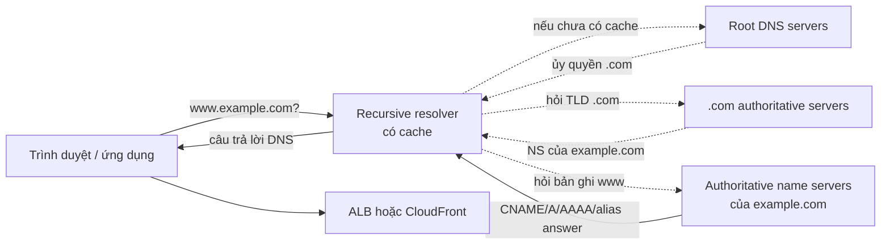
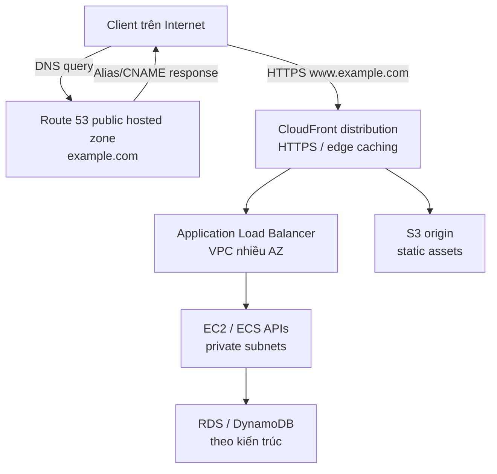
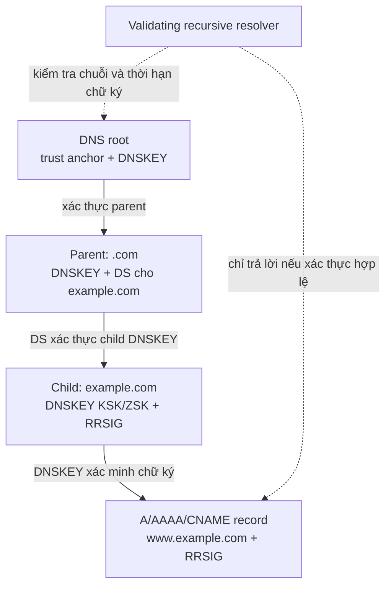
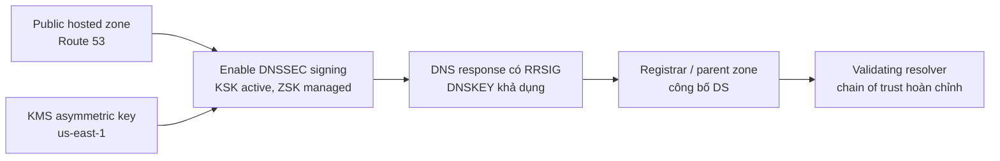

# Đăng ký tên miền và cấu hình DNSSEC trên Amazon Route 53

> **Chương:** DNS và phân phối nội dung  
> **Module:** CLOUD_PROVIDERS_AWS  
> **Mục tiêu:** nắm quy trình đăng ký và quản lý tên miền, thiết lập DNS authoritative, kích hoạt DNSSEC đúng thứ tự và duy trì tính khả dụng của ứng dụng AWS. Nội dung liên hệ với IAM, VPC, ALB, CloudFront, giám sát, phục hồi và kiểm soát chi phí.

## 1. Bài toán thực tế: có tên miền chưa có nghĩa đã có DNS an toàn

Một doanh nghiệp triển khai trang web bán hàng tại AWS:

- Tên miền công cộng: `example.com` và `www.example.com`.
- Website được phân phối qua **Amazon CloudFront**, nguồn nội dung là S3 hoặc Application Load Balancer (ALB).
- API chạy trên EC2/ECS trong VPC, đi qua ALB.
- Email doanh nghiệp sử dụng dịch vụ thư điện tử có các bản ghi MX, SPF, DKIM và DMARC.
- Bộ phận bảo mật muốn giảm rủi ro kẻ tấn công giả mạo câu trả lời DNS để hướng người dùng đến website giả.

Doanh nghiệp phải giải quyết **bốn câu hỏi độc lập**:

1. **Ai là bên đăng ký và duy trì quyền sử dụng tên miền?** Đó là bài toán của **domain registrar**.
2. **Máy chủ tên miền nào giữ bản ghi DNS authoritative?** Đó là **DNS hosting** với authoritative name servers.
3. **Tên miền được trỏ đến CloudFront, ALB hoặc ứng dụng như thế nào?** Đó là cấu hình **DNS resource records**.
4. **Resolver có thể xác minh câu trả lời DNS là nguyên vẹn không?** Đó là cơ chế **DNSSEC** kết hợp việc ký zone với **chuỗi tin cậy từ vùng cha**.

Amazon Route 53 có thể cung cấp dịch vụ **đăng ký tên miền** và **authoritative DNS**, nhưng hai vai trò không nhất thiết phải nằm ở cùng nhà cung cấp.

> **Quy ước ví dụ:** `example.com` là tên miền dành cho tài liệu theo tiêu chuẩn Internet, **không dùng để đăng ký thật**. Các tên máy chủ, ID hosted zone và dữ liệu mật mã trong bài chỉ là minh họa.

### 1.1. Kết quả mong đợi sau bài học

Người học có thể:

- Phân biệt **registrar, registry, authoritative DNS, hosted zone, resolver, NS và DS**.
- Đăng ký tên miền qua Route 53 và hiểu những cấu hình nào được tạo tự động.
- Cấu hình bản ghi DNS cho ALB/CloudFront mà không trộn lẫn vai trò DNS và chứng chỉ TLS.
- Giải thích **RRSIG, DNSKEY, DS, KSK, ZSK** và **chain of trust** trong DNSSEC.
- Thiết lập DNSSEC signing trên **Route 53 public hosted zone**, rồi đăng ký DS đúng nơi.
- Dùng AWS CLI và `dig` để kiểm tra không làm thay đổi production.
- Lập kế hoạch thay khóa, đổi nhà cung cấp DNS, rollback, giám sát và chi phí.

## 2. Các khái niệm nền tảng của hệ thống DNS

### 2.1. Registrar, registry, DNS provider và resolver

| Thành phần | Vai trò | Ví dụ |
|---|---|---|
| **Domain name** | Tên mà tổ chức đăng ký sử dụng trong thời hạn nhất định | `example.com` |
| **TLD** (top-level domain) | Đuôi tên miền | `.com`, `.org`, `.net` |
| **Registry** | Đơn vị vận hành cơ sở dữ liệu đăng ký của một TLD | Registry quản lý `.com` |
| **Registrar** | Bên tiếp nhận đăng ký/gia hạn/quản lý tên miền cho khách hàng | Amazon Route 53 Domains, nhà đăng ký khác |
| **Authoritative DNS provider** | Hệ thống giữ và trả lời bản ghi DNS chính thức của zone | Amazon Route 53 hosted zone hoặc DNS provider khác |
| **Recursive resolver** | Máy chủ nhận truy vấn từ người dùng, đi tìm và cache câu trả lời DNS | Resolver của ISP, tổ chức hoặc public resolver |
| **Parent zone** | Vùng DNS cấp trên quyết định ủy quyền và DS cho zone con | `com.` là parent của `example.com.` |
| **Hosted zone** | Tập bản ghi DNS authoritative cho một tên miền hoặc subdomain | Public hosted zone `example.com` |

**Registrar quản lý đăng ký** không đồng nghĩa **registrar đang lưu bản ghi A/CNAME/MX của website**. Ngược lại, sử dụng Route 53 để lưu DNS không buộc phải chuyển tên miền về Route 53 Registrar.

### 2.2. Luồng phân giải DNS



Sơ đồ đơn giản hóa cơ chế **recursive resolution**. Khi có dữ liệu trong cache, resolver có thể không cần hỏi lại toàn bộ hệ thống.

Điểm cần phân biệt:

- **NS record ở parent:** nói tên miền con được ủy quyền cho authoritative name servers nào.
- **NS record trong hosted zone con:** công bố những name servers của chính zone.
- **TTL (Time To Live):** thời gian resolver có thể giữ câu trả lời trong cache trước khi hỏi lại; thay TTL không làm mọi cache trên Internet lập tức thay đổi.

### 2.3. Public hosted zone và private hosted zone

**Public hosted zone** phục vụ DNS được truy vấn công khai từ Internet. Đây là loại zone có thể bật **DNSSEC signing** của Route 53.

**Private hosted zone** dùng với Amazon VPC để trả lời tên nội bộ theo phạm vi các VPC đã associate. **Route 53 không hỗ trợ DNSSEC signing cho private hosted zone**. Nếu nhu cầu là **kiểm tra DNSSEC khi VPC resolver truy vấn domain công cộng**, đó là chức năng **DNSSEC validation của Route 53 Resolver**, tách biệt với việc ký public hosted zone.

Một tổ chức có thể vận hành song song:

- `example.com` trong public hosted zone cho website công cộng.
- `internal.example.com` trong private hosted zone cho ứng dụng nội bộ.

Không dùng việc bật signing cho public zone để suy rằng các bản ghi private tự động cũng được ký.

## 3. Đăng ký tên miền bằng Route 53

### 3.1. Trước khi bấm Register domain

Hãy kiểm tra:

1. **Tên và TLD cần mua:** spelling, thương hiệu, nguy cơ trùng tên, yêu cầu pháp lý và phạm vi thị trường.
2. **TLD có được Route 53 hỗ trợ không:** không phải mọi TLD đều được bán bởi mọi registrar; điều kiện và giá theo TLD có thể khác nhau.
3. **Quy tắc của TLD:** một số yêu cầu xác minh doanh nghiệp/cư trú hoặc thông tin liên hệ bổ sung.
4. **Tài khoản sở hữu:** sử dụng tài khoản AWS do tổ chức quản lý, phân quyền qua IAM và cơ chế đăng nhập mạnh.
5. **Thông tin registrant/admin/technical contact:** địa chỉ email còn hoạt động để nhận yêu cầu xác minh và thông báo gia hạn.
6. **Bảo vệ vòng đời tên miền:** auto-renew, registrar lock khi phù hợp, theo dõi ngày hết hạn và chi phí.
7. **Domain sử dụng cho địa chỉ email root:** nên tránh phụ thuộc vòng vào domain của chính tài khoản AWS đó khi domain có thể bị tạm ngưng nếu tài khoản gặp sự cố.

**Không đăng ký thử tên miền thật chỉ để học.** Hành động đăng ký có chi phí và thường không thể đổi tên hoặc hoàn tiền chỉ vì nhập sai.

### 3.2. Quy trình đăng ký trên Route 53 Console

Ở mức khái niệm:

1. Vào **Amazon Route 53 → Registered domains → Register domains**.
2. Tìm tên miền và kiểm tra có thể đăng ký hay không.
3. Chọn số năm đăng ký, tùy chọn gia hạn và các thiết lập theo TLD.
4. Nhập chính xác thông tin liên hệ; bật privacy protection khi có hỗ trợ và phù hợp chính sách.
5. Xem lại tên, phí, contact và hoàn tất yêu cầu đăng ký.
6. Theo dõi email xác minh người đăng ký hoặc yêu cầu từ registry nếu có.
7. Chờ trạng thái đăng ký hoàn tất, rồi kiểm tra Name Servers và hosted zone.

**Điểm đặc biệt:** khi đăng ký **tên miền mới qua Route 53**, AWS thường **tự động tạo một public hosted zone cùng tên**, gán bốn name servers cho zone và cập nhật NS delegation của domain registration để sử dụng những name servers đó. Hosted zone và domain registration là **hai tài nguyên được tính phí theo mô hình khác nhau**.

Nếu bạn tạo **một hosted zone khác** cho cùng tên miền, các NS của zone mới có thể khác. Tên miền sẽ không tự động phân giải theo zone mới cho đến khi **parent/registrar delegation** được cập nhật chính xác.

### 3.3. Đăng ký ≠ duy trì DNS records

| Thao tác | Nơi thực hiện | Kết quả |
|---|---|---|
| Mua/gia hạn tên miền | **Registered domains / registrar** | Tổ chức giữ quyền đăng ký trong thời hạn thanh toán |
| Đổi contact, auto-renew, registrar lock | **Registrar** | Quản trị vòng đời và an toàn tên miền |
| Tạo A/AAAA/CNAME/MX/TXT/alias | **Authoritative DNS hosted zone** | Quyết định nơi request được điều hướng đến |
| Đổi NS delegation | **Registrar / parent zone** | Chọn DNS provider authoritative của tên miền |
| Bật DNSSEC signing | **DNS provider / hosted zone** | Ký DNS responses trong zone |
| Đưa DS/public key tới parent | **Registrar / parent-zone owner** | Nối zone đã ký vào chain of trust |

**Sai lầm thường gặp:** chỉ đổi bản ghi NS trong hosted zone mới mà không đổi delegation tại registrar. Resolver công cộng vẫn có thể đi tới name servers cũ ở parent.

### 3.4. Trường hợp tên miền đăng ký ở nhà cung cấp khác

Nếu tên miền đã đăng ký tại registrar X, vẫn có thể dùng Route 53 authoritative DNS:

1. Tạo **Route 53 public hosted zone** cho domain.
2. Sao chép/thiết lập đầy đủ bản ghi web, API, email và TXT xác minh.
3. Kiểm tra bản ghi trực tiếp bằng các Route 53 authoritative NS trước khi đổi delegation.
4. Cập nhật **NS tại registrar X** sang bốn NS của hosted zone Route 53.
5. Theo dõi phân giải và cache theo NS TTL.

Không bắt buộc **transfer domain registration** về Route 53 để sử dụng hosted zone. Nếu domain đang có DNSSEC ở provider cũ, việc đổi NS phải có kế hoạch **DS/rollover** riêng, nếu không có thể khiến validating resolvers trả `SERVFAIL`.

## 4. Cấu hình DNS records cho ứng dụng AWS

### 4.1. Những record cần biết

| Record | Vai trò | Ví dụ |
|---|---|---|
| **A** | Trỏ hostname tới IPv4 | `api.example.com → 203.0.113.10` |
| **AAAA** | Trỏ hostname tới IPv6 | `api.example.com → 2001:db8::10` |
| **CNAME** | Một hostname trỏ tới hostname khác | `www.example.com → d111111abcdef8.cloudfront.net` |
| **Alias (Route 53)** | Record đặc thù Route 53 để trỏ tới tài nguyên AWS được hỗ trợ | `example.com → CloudFront distribution/ALB` |
| **NS** | Xác định authoritative name servers | `example.com → ns-...awsdns-...` |
| **SOA** | Thông tin quản trị zone, có ảnh hưởng đến caching câu trả lời âm | SOA do hosted zone quản lý |
| **MX** | Mail exchanger | `example.com → mail provider` |
| **TXT** | Chuỗi dữ liệu để xác minh và chính sách email | SPF, DKIM, DMARC |
| **CAA** | Giới hạn CA được phép phát hành chứng chỉ cho domain | `example.com CAA ...` |
| **DS** | Bản ghi ở parent zone tham chiếu DNSKEY của child zone | `example.com DS ...` |
| **DNSKEY / RRSIG / NSEC** | Thành phần DNSSEC | Public key, chữ ký, chứng minh không tồn tại |

**Alias** là một tính năng của Route 53, không phải một DNS resource record type chuẩn giống A/CNAME. Route 53 trả lời theo kiểu A/AAAA thích hợp cho nhiều AWS resources được hỗ trợ, kể cả tại **zone apex** `example.com`, nơi CNAME truyền thống không được dùng như record thông thường.

### 4.2. Ví dụ website với CloudFront, ALB và VPC



Một bộ records minh họa:

| Tên | Record | Đích |
|---|---|---|
| `example.com` | A Alias | CloudFront hoặc ALB theo kiến trúc |
| `www.example.com` | A/AAAA Alias | CloudFront distribution |
| `api.example.com` | A/AAAA Alias | ALB internet-facing |
| `example.com` | MX/TXT | Dịch vụ email và chính sách xác minh |
| `_dmarc.example.com` | TXT | Chính sách DMARC phù hợp |

Khi dùng CloudFront với custom domain, cần cấu hình **alternate domain name** và chứng chỉ TLS phù hợp, thường trong **ACM us-east-1** theo yêu cầu CloudFront. Chứng chỉ HTTPS và DNSSEC là hai cơ chế khác nhau; site vẫn cần HTTPS ngay cả khi tên miền đã bật DNSSEC.

## 5. DNSSEC giải quyết vấn đề gì?

**DNS Security Extensions (DNSSEC)** sử dụng chữ ký số để giúp những DNS resolver có chức năng xác thực kiểm tra **nguồn gốc và tính toàn vẹn của câu trả lời DNS**.

Kịch bản tấn công không có validation: một attacker giả mạo bản ghi `www.example.com A` để trình duyệt nhận IP máy chủ lừa đảo thay vì địa chỉ chính thức.

Với DNSSEC được thiết lập **đúng chain of trust**, validating resolver có thể phát hiện chữ ký không hợp lệ và từ chối kết quả giả mạo thay vì tiếp tục trả IP sai.

### 5.1. DNSSEC làm được và không làm được

| Khả năng | DNSSEC |
|---|---|
| Giúp xác minh DNS response chưa bị thay đổi trái phép | **Có**, khi validating resolver và chain of trust hợp lệ |
| Bảo vệ khỏi một số hình thức DNS spoofing/cache poisoning | **Có**, trong phạm vi cơ chế xác thực DNS |
| Mã hóa DNS query và DNS response | **Không** — đây là mục tiêu của DoT/DoH hoặc cơ chế khác |
| Thay HTTPS/TLS certificate cho website | **Không** |
| Chứng minh người dùng đang nhìn đúng nội dung ứng dụng | **Không hoàn toàn**; app, TLS, IAM và backend vẫn cần bảo vệ |
| Chặn domain takeover, phishing có tên gần giống | **Không** |
| Tăng tốc DNS hoặc cache | **Không**, DNSSEC còn có thể làm câu trả lời lớn hơn |
| Ép mọi resolver trên Internet xác thực DNSSEC | **Không**, chỉ validating resolvers kiểm tra chữ ký |

**Kết luận:** DNSSEC là một lớp bảo vệ **DNS authenticity/integrity**, không phải hệ thống mã hóa truyền tải hay công cụ bảo vệ toàn bộ website.

### 5.2. Những record và khóa quan trọng

| Thành phần | Ý nghĩa |
|---|---|
| **DNSKEY** | Public key trong zone được ký |
| **RRSIG** | Chữ ký số trên một tập bản ghi DNS (RRset) |
| **DS (Delegation Signer)** | Bản ghi trong **parent zone** tham chiếu DNSKEY của **child zone**, thường chứa key tag, algorithm, digest type và digest |
| **KSK (Key-Signing Key)** | Khóa dùng để ký DNSKEY RRset, tạo điểm liên kết với parent DS |
| **ZSK (Zone-Signing Key)** | Khóa ký các record sets khác trong zone |
| **NSEC / NSEC3** | Cơ chế chứng minh có xác thực rằng tên hoặc record không tồn tại; tính năng và định dạng tùy DNS provider |
| **Trust anchor** | Điểm tin cậy ban đầu của validating resolver, thường xuất phát từ DNS root |

**DS không phải private key.** DS chứa thông tin để xác thực DNSKEY, thường dưới dạng digest. Private key **không bao giờ** được đưa vào record DNS hay trang quản lý registrar.

### 5.3. Chain of trust từ root đến website



Quá trình khái niệm:

1. Resolver có trust anchor của root.
2. Resolver xác minh chữ ký và delegation đi đến **`.com`**.
3. Parent `.com` xuất bản **DS record** dành cho `example.com`.
4. Resolver dùng DS để xác minh **DNSKEY** ở child `example.com`.
5. DNSKEY hợp lệ được dùng xác minh **RRSIG** của các record trả lời như A/AAAA.
6. Nếu không xác minh được một mắt xích đã được khai báo là secure, validating resolver thường trả lỗi **`SERVFAIL`** thay vì trả dữ liệu không đáng tin.

**Điểm tối quan trọng:** zone có RRSIG nhưng **parent chưa có DS** có thể mới chỉ là **signed island**, chưa hình thành DNSSEC validation từ root. Ngược lại, parent có DS nhưng child zone không ký đúng hoặc không còn key tương ứng có thể khiến domain ngừng phân giải tại validating resolvers.

## 6. Cách Route 53 triển khai DNSSEC signing

### 6.1. DNSSEC signing nằm ở authoritative hosted zone

Route 53 hỗ trợ DNSSEC signing cho **public hosted zones**. Khi bật:

- Route 53 ký các DNS responses từ zone bằng khóa phù hợp.
- Hệ thống sử dụng **KSK**, dựa vào **asymmetric customer managed KMS key** do tài khoản quản lý.
- **ZSK** được Route 53 quản lý và xoay vòng theo cơ chế dịch vụ.
- Bạn vẫn cần **thiết lập DS ở parent** để có chain of trust hoàn chỉnh.
- Route 53 giới hạn **TTL của record trong signed hosted zone không quá một tuần**; nếu cấu hình dài hơn, Route 53 áp dụng giới hạn này đối với câu trả lời.

Đây là một cơ chế trên lớp DNS authoritative. Không có nghĩa private hosted zones, AWS Resolver trong VPC hay mọi DNS domain khác tự động được ký.

### 6.2. KMS key dành cho KSK có những điều kiện gì?

Theo hướng dẫn AWS Route 53 hiện hành, KMS key của DNSSEC phải đáp ứng:

- Là **AWS KMS customer managed key** dạng **asymmetric**.
- Key spec **`ECC_NIST_P256`**, key usage để ký và xác minh.
- Phải đặt ở **Region `us-east-1` (US East / N. Virginia)**, bất kể EC2/ALB/CloudFront origin của ứng dụng chạy tại Region nào.
- Key policy phải cho phép Route 53 thực hiện những thao tác KMS cần thiết theo hướng dẫn AWS.
- Có thể chọn **key hiện có** đáp ứng điều kiện hoặc để Route 53 tạo customer managed key phù hợp khi bật signing.
- Key có chi phí AWS KMS riêng; thay đổi trạng thái, permissions hoặc xóa key có thể khiến signing hoạt động lỗi.

**Không dùng KMS symmetric key mã hóa EBS/S3** làm KSK. DNSSEC cần khóa bất đối xứng đúng loại, không phải cứ thấy tên “KMS key” là dùng được.

### 6.3. KSK và ZSK trong Route 53

- **KSK:** người vận hành có trách nhiệm quản lý, theo dõi trạng thái và rotate khi cần. Route 53 hỗ trợ **tối đa hai KSK cho một hosted zone** theo giới hạn hiện hành.
- **ZSK:** do Route 53 quản lý để ký các RRsets trong hosted zone.
- Trong mô hình Route 53, chữ ký dùng thuật toán **ECDSAP256SHA256 (algorithm 13)**; khi xuất DS thông dụng, digest type là **SHA-256 (type 2)**.
- Nếu KSK báo **`ACTION_NEEDED`**, cần điều tra ngay, đặc biệt quyền truy cập KMS key, key state và key policy.

**Không xóa/disable KMS key ngay sau khi đăng ký DS.** Parent zone sẽ tiếp tục yêu cầu một DNSKEY hợp lệ tương ứng, trong khi resolver có thể giữ DS trong cache.

### 6.4. Vì sao us-east-1 xuất hiện dù workload chạy Singapore?

Ví dụ:

| Thành phần | Phạm vi/vị trí | Giải thích |
|---|---|---|
| Domain registration | Dịch vụ đăng ký toàn cầu theo tên miền | Không phải EC2 ở AZ nào |
| Public hosted zone | Route 53 authoritative DNS, phạm vi dịch vụ toàn cầu | Trả lời DNS qua hệ thống authoritative name servers |
| **KMS key cho DNSSEC KSK** | **`us-east-1`** | Yêu cầu cụ thể của Route 53 DNSSEC |
| Application Load Balancer | Một **Region**, nhiều AZ theo cấu hình | Ví dụ `ap-southeast-1` |
| CloudFront distribution | Global edge delivery | Nguồn nội dung có thể ở nhiều Region |
| Route 53 Resolver DNSSEC validation | Cấu hình Resolver/VPC phù hợp | Khác với authoritative zone signing |

Nếu bộ phận bảo mật cho rằng **KMS key phải ở cùng Region với ứng dụng**, cần làm rõ yêu cầu của dịch vụ Route 53: KSK KMS key cho DNSSEC vẫn bắt buộc ở **`us-east-1`**. Đây không phải bằng chứng dữ liệu ứng dụng ở Singapore được chuyển sang Virginia.

## 7. Hai bước độc lập: ký zone và công bố DS

Đây là mô hình vận hành phải nhớ:



**Bước A: Zone signing.** DNS provider tạo và công bố chữ ký/DNSKEY.  
**Bước B: DS delegation.** Parent zone công bố DS khớp key của child để resolver biết cần xác minh chữ ký.

Phải ký zone và xác nhận hoạt động trước **khi** công bố DS. Nếu công bố DS quá sớm, validating resolvers có thể coi child zone là **bogus** và trả `SERVFAIL`.

Khi tắt DNSSEC, nguyên tắc thứ tự **đảo ngược**: loại bỏ DS ở parent, chờ TTL/caches ổn định, **sau đó** mới tắt signing ở child.

## 8. Quy trình triển khai DNSSEC khi đăng ký và DNS đều ở Route 53

Giả sử tên miền mới được đăng ký qua Route 53, và dịch vụ authoritative DNS cũng là Route 53. Quy trình sau là **hướng dẫn vận hành có kiểm soát**, không nên thực hiện trực tiếp trên domain production nếu thiếu quyền và kế hoạch khôi phục.

### 8.1. Bước 0 — Kiểm tra trước khi thay đổi

Xác nhận:

1. Tên miền đã đăng ký và đang active; contact email đã xác minh.
2. Public hosted zone đúng; **NS tại registrar trùng những NS của hosted zone thực sự phục vụ domain**.
3. Các record A/AAAA/Alias/CNAME/MX/TXT hiện có được phân giải đúng.
4. **TLD hỗ trợ DNSSEC**; Route 53 Registrar hỗ trợ thêm DNSSEC key cho TLD đó.
5. Không có conflicting DS từ lần triển khai DNSSEC cũ.
6. Có quyền IAM để bật signing, quản lý KMS, xem/đổi DS tại registrar.
7. Có người trực xử lý lỗi, hệ thống monitoring và kế hoạch rollback.
8. TTL các record và caching của resolver được ghi nhận để lập thời gian chờ phù hợp.

**Không tiếp tục nếu domain đang bị lỗi DNS trước khi bật signing.** DNSSEC không sửa được sai NS, thiếu bản ghi, lỗi route hoặc app không hoạt động.

### 8.2. Bước 1 — Chuẩn bị TTL và giám sát

Theo quy trình AWS, để giảm thời gian rollback:

- Theo dõi availability của DNS qua nhiều recursive resolvers và địa điểm.
- Xác định **maximum TTL** của các record trong zone.
- Cân nhắc giảm maximum record TTL về **khoảng 1 giờ** trước khi bật signing (theo hướng dẫn AWS), nếu mô hình cache và vận hành phù hợp.
- Kiểm tra **SOA TTL** và **SOA minimum** dùng cho negative caching.
- Chờ TTL/`GetChange` propagation theo quy trình trước khi coi thay đổi đã có hiệu lực.

Không đồng nhất TTL của record A/AAAA với **TTL của NS delegation** hoặc **DS** ở parent. Chúng thuộc các mắt xích khác nhau và có thể cần thời gian chờ khác nhau.

### 8.3. Bước 2 — Chọn hoặc tạo KMS key, bật signing

Trên **Route 53 Console**:

1. Mở **Hosted zones → chọn public hosted zone**.
2. Chọn tab **DNSSEC signing → Enable DNSSEC signing**.
3. Đặt **tên KSK** duy nhất theo quy ước vận hành.
4. Chọn customer managed KMS key đủ điều kiện hoặc để Route 53 tạo key.
5. Xác nhận KMS key ở **`us-east-1`**, asymmetric `ECC_NIST_P256`, key policy đúng.
6. Bật DNSSEC signing và theo dõi trạng thái KSK/hosted zone.

Nếu thao tác bằng API/CLI, các operation quan trọng là:

- `CreateKeySigningKey` — tạo KSK tham chiếu customer managed KMS key.
- `EnableHostedZoneDNSSEC` — bật signing cho public hosted zone.
- `GetChange` — xem thay đổi đã `INSYNC` hay chưa.
- `GetDNSSEC` — xem signing status/KSK/DS information.

Các operation tạo/sửa **chỉ nên thực hiện qua quy trình thay đổi đã phê duyệt**; phần thực hành CLI phía dưới cố ý chỉ dùng lệnh đọc.

### 8.4. Bước 3 — Xác minh zone đã được ký

Trước khi công bố DS:

- Kiểm tra Route 53 `DNSSEC signing` ở trạng thái hoạt động.
- Kiểm tra KSK **ACTIVE** và không có cảnh báo cần hành động.
- Truy vấn DNSKEY và record có RRSIG từ authoritative name server.
- Dùng `GetChange` bảo đảm thay đổi đã đồng bộ theo AWS.
- **Chờ ít nhất maximum TTL cũ** theo khuyến nghị AWS để giảm rủi ro cache dữ liệu chưa ký.

Khi chưa có DS ở parent, một số validating resolvers vẫn có thể coi zone là **insecure** chứ chưa bắt buộc xác thực; đó là trạng thái chuyển tiếp bình thường trước khi liên kết chain.

### 8.5. Bước 4 — Thiết lập DS tại parent qua Route 53 Registrar

Trong public hosted zone, mở **DNSSEC signing → View information to create DS record** để lấy dữ liệu như:

- Key type: KSK.
- Signing algorithm: **ECDSAP256SHA256 / 13**.
- Public key (base64).
- DS record (key tag, algorithm, digest type, digest) cho trường hợp cần nhập trực tiếp DS.

Khi **Route 53 là registrar**:

1. Vào **Registered domains → tên miền → DNSSEC keys → Add key**.
2. Chọn key type và algorithm theo thông tin do zone signing cung cấp.
3. **Nhập public key dạng base64** đúng như hướng dẫn giao diện Route 53 Registrar.
4. Xác nhận yêu cầu; registrar chuyển thông tin đến **TLD registry**, nơi **DS** được công bố trong **parent zone**.

**Cảnh báo dễ nhầm:** trong giao diện **Route 53 Registrar**, bạn thường cung cấp **public key**, **không** dán chuỗi digest DS vào trường public key. Route 53 Registrar tạo/cập nhật DS ở TLD dựa trên dữ liệu public key được cung cấp. Khi registrar khác, giao diện có thể yêu cầu **DS record trực tiếp**.

**DS cho `example.com` thuộc `.com`**, không phải một DS record tùy ý thêm vào chính hosted zone `example.com`. Thêm nhầm DS ở child không tạo chuỗi tin cậy từ TLD.

### 8.6. Bước 5 — Xác minh chain of trust và theo dõi

Sau khi DS được parent công bố:

1. Hỏi parent zone để kiểm tra có DS đúng.
2. Hỏi authoritative DNS để kiểm tra DNSKEY/RRSIG.
3. Dùng **validating resolver** hoặc `delv` xác minh kết quả.
4. Kiểm tra A/AAAA/alias, CNAME, MX, các TXT quan trọng qua nhiều resolvers.
5. Theo dõi `SERVFAIL`, cảnh báo DNSSEC, tỷ lệ lỗi người dùng và CloudWatch.
6. Giữ quy trình hỗ trợ và rollback sẵn sàng trong thời gian theo dõi.

Việc cập nhật DS tại registry có thể có độ trễ theo TLD/registrar. Không suy rằng trạng thái “đã nhấn Add key” đồng nghĩa mọi resolver đã dùng DS mới ngay lập tức.

## 9. Các biến thể triển khai quan trọng

### 9.1. Registrar bên ngoài, authoritative DNS là Route 53

Giả sử domain được mua ở Registrar X nhưng records do Route 53 public hosted zone quản lý:

1. Kiểm tra NS delegation ở Registrar X trỏ đúng Route 53 hosted zone.
2. Bật signing trong Route 53, tạo KSK dựa trên KMS key đủ điều kiện.
3. Đợi signing/DNSKEY/RRSIG hoạt động và TTL/cache ổn định.
4. Lấy **DS record value** do Route 53 cung cấp.
5. Vào Registrar X và cung cấp DS theo yêu cầu của registrar/registry (key tag, algorithm, digest type, digest hoặc thông tin public key tương ứng).
6. Kiểm tra DS trực tiếp tại parent và validation của resolver.

Không giả định registrar nào cũng chấp nhận cùng định dạng hoặc cùng thuật toán. Nếu Registrar X/TLD không hỗ trợ DNSSEC ở cấp parent, signing ở child chưa đủ tạo chain từ root.

### 9.2. Registrar Route 53, authoritative DNS ở nhà cung cấp khác

Tên miền do Route 53 Registrar quản lý nhưng records authoritative nằm ở DNS Provider Y:

1. DNS Provider Y phải hỗ trợ **DNSSEC signing** và xuất thông tin signing/public key.
2. Bật signing đúng theo quy trình của Provider Y.
3. Xác nhận **parent NS** thực sự trỏ tới Provider Y, không phải một hosted zone Route 53 không sử dụng.
4. Vào **Route 53 Registered domains → DNSSEC keys** để thêm **public key/algorithm** của Provider Y.
5. Kiểm tra parent DS và DNSSEC validation.

**Route 53 Registrar hỗ trợ DNSSEC cho domain registration không đồng nghĩa bắt buộc dùng Route 53 DNS.** Phần ký zone được thực hiện bởi DNS provider đang authoritative.

### 9.3. Signed subdomain: `app.example.com`

Nếu muốn ủy quyền `app.example.com` cho hosted zone độc lập:

- **Parent `example.com`** chứa NS delegation cho `app.example.com`.
- **Child `app.example.com`** có DNSKEY/RRSIG sau khi signing.
- **DS của `app.example.com`** được **thêm ở parent `example.com`**.
- Nếu parent cũng được ký, validating resolver có thể đi tiếp theo chain root → TLD → `example.com` → `app.example.com`.

Ví dụ có nhiều AWS accounts: account DNS trung tâm sở hữu parent zone, account ứng dụng sở hữu child zone. Hai nhóm phải phối hợp DS/KSK/NS và IAM change control. Không cấp quyền sửa toàn bộ parent hosted zone cho mọi application team chỉ để thêm một DS.

### 9.4. TLD hoặc DNS provider không hỗ trợ DNSSEC

Nếu TLD không hỗ trợ DS/DNSSEC, không thể có chain of trust chuẩn từ DNS root tới domain đó theo mô hình phổ biến. Cần xem danh sách TLD hỗ trợ và lựa chọn nhà cung cấp phù hợp.

Nếu DNS provider không hỗ trợ zone signing, chỉ thêm DS tại registrar mà không có DNSKEY/RRSIG hợp lệ là **nguy hiểm**. Cần chuyển DNS hosting tới provider hỗ trợ DNSSEC theo kế hoạch migration đúng thứ tự.

## 10. Quản lý vòng đời KSK, DS và thay đổi DNSSEC

### 10.1. Đổi KSK không phải chỉ thay KMS key

Rollover KSK cần bảo đảm validating resolvers luôn có **ít nhất một chuỗi tin cậy hợp lệ** trong thời gian chuyển tiếp.

Tư duy an toàn:

1. Kiểm tra trạng thái signing/KSK hiện tại, metrics và TTL.
2. Chuẩn bị **KMS key mới** đúng điều kiện và quyền.
3. Tạo **KSK mới** được hỗ trợ song song KSK cũ; không vượt quota hai KSK của Route 53.
4. Đợi DNSKEY/RRSIG và các thay đổi được phân phối.
5. Cập nhật **DS/public key mới** ở parent/registrar mà vẫn giữ DS cũ trong giai đoạn chuyển tiếp khi khả thi.
6. Đợi DS/NS TTL và kiểm chứng validation qua nhiều resolvers.
7. Chỉ khi chain mới đã ổn định mới gỡ DS cũ và deactive/delete KSK cũ theo quy trình.
8. Không hủy KMS key cũ trước khi hoàn tất việc giải phóng phụ thuộc và thời gian cache.

**Không copy nguyên quy trình rollover không rõ nguồn vào production.** Các bước chính xác và thời gian giữ song song phụ thuộc DNS provider, TLD/registrar, TTL và giới hạn keys.

### 10.2. Tắt DNSSEC đúng thứ tự

Tắt DNSSEC **không bắt đầu bằng nút Disable signing** nếu parent vẫn có DS.

Thứ tự an toàn tổng quát:

1. Xác định tất cả **DS ở child/parent** liên quan nếu zone có những zone con đã ký.
2. Xóa hoặc cập nhật DS tại các **parent zones** theo quy trình AWS, bao gồm các DS child nếu cần gỡ chain.
3. Xác nhận DS đã biến mất tại parent và **chờ đủ DS TTL/cache**.
4. **Sau đó mới tắt hosted zone DNSSEC signing**.
5. Deactivate/delete KSK và KMS key khi không còn được sử dụng, theo quy trình quản lý khóa và chi phí.
6. Giám sát DNS resolution sau thay đổi.

**Tắt ký trước, để DS cũ ở parent** có thể khiến mọi validating resolver đánh dấu child là bogus và trả `SERVFAIL`. Thêm một A record mới không sửa được lỗi chain trust.

### 10.3. Đổi name servers khi domain đã bật DNSSEC

Việc chuyển authoritative DNS từ Provider A sang Provider B có rủi ro khác việc đổi một record A:

- Parent NS có thể trỏ đến A hoặc B ở các cache trong giai đoạn chuyển tiếp.
- Parent DS có thể vẫn mô tả DNSKEY của A, trong khi B dùng keys khác.
- Cả DNS provider cũ/mới có thể phục vụ những record/chữ ký khác nhau.

Quy trình cần đánh giá **đồng bộ dữ liệu DNS, chiến lược DS/keys, NS TTL và thời gian chuyển tiếp**, theo hướng dẫn của cả hai provider. Khi không thể duy trì validation xuyên suốt, có thể cân nhắc **gỡ DS, chờ cache, chuyển delegation rồi ký/lập chain mới** theo kế hoạch đã phê duyệt, đồng nghĩa khoảng thời gian domain không có DNSSEC trust chain hoàn chỉnh. Mức độ chấp nhận phải do đội bảo mật quyết định.

Đừng chỉ đổi NS và mong DNSSEC tự đi theo.

## 11. Kiểm tra bằng AWS CLI — chỉ đọc, không sửa tên miền

Các ví dụ dưới đây là **read-only**. Cần AWS CLI v2, credentials/profile có quyền xem Route 53, Route 53 Domains, KMS khi cần và các công cụ DNS như `dig` hoặc `delv` trên máy kiểm thử.

**Vùng dịch vụ:** Route 53 hosted zones là dịch vụ toàn cầu; CLI có thể dùng `--region us-east-1` cho các API Route 53/Domains trong ví dụ. Riêng **KMS key DNSSEC bắt buộc ở us-east-1**. Các tên miền và IDs đều là ví dụ; không thực thi nếu không có tài nguyên tương ứng.

### 11.1. Danh sách domain đã đăng ký bằng Route 53 Registrar

```bash
aws route53domains list-domains \
  --region us-east-1 \
  --query "Domains[].[DomainName,AutoRenew,Expiry]" \
  --output table
```

Nếu domain đăng ký tại registrar khác, lệnh này **không có domain đó**, dù DNS authoritative của domain đang chạy trên Route 53.

### 11.2. Xem domain detail và NS delegation ở registrar

```bash
aws route53domains get-domain-detail \
  --region us-east-1 \
  --domain-name example.com \
  --query "{Domain:DomainName,Status:StatusList,AutoRenew:AutoRenew,Nameservers:Nameservers}" \
  --output json
```

Kiểm tra nameservers mà registrar đang lưu; đối chiếu với authoritative name servers của hosted zone hiện dùng. Dữ liệu domain contact có thể nhạy cảm, nên tránh log/chia sẻ JSON đầy đủ không cần thiết.

### 11.3. Danh sách hosted zones cùng tên

```bash
aws route53 list-hosted-zones-by-name \
  --dns-name example.com \
  --query "HostedZones[].[Id,Name,Config.PrivateZone]" \
  --output table
```

**Chú ý:** có thể có nhiều hosted zones trùng tên trong các tài khoản hoặc thậm chí một tài khoản. Phải chọn **hosted zone ID có NS đang được parent delegate**, không chỉ chọn ID đầu tiên có tên giống nhau.

### 11.4. Xem name servers của một hosted zone

```bash
aws route53 get-hosted-zone \
  --id Z0123456789EXAMPLE \
  --query "{Zone:HostedZone.Name,Private:HostedZone.Config.PrivateZone,NameServers:DelegationSet.NameServers}" \
  --output json
```

Nếu đây là public hosted zone, `DelegationSet.NameServers` giúp đối chiếu với nameservers tại registrar. ID `Z0123456789EXAMPLE` chỉ là giá trị mẫu.

### 11.5. Xem các record trong hosted zone

```bash
aws route53 list-resource-record-sets \
  --hosted-zone-id Z0123456789EXAMPLE \
  --query "ResourceRecordSets[].[Name,Type,TTL,AliasTarget.DNSName]" \
  --output table
```

Ví dụ này nhằm xem name/type/TTL và alias target. Muốn đọc đầy đủ ResourceRecords/record values, bỏ `--query` hoặc truy vấn JSON phù hợp. Không suy rằng không có A record thường nghĩa domain chưa trỏ đâu: **AliasTarget** có thể được dùng thay.

### 11.6. Kiểm tra DNSSEC signing và KSK

```bash
aws route53 get-dnssec \
  --hosted-zone-id Z0123456789EXAMPLE \
  --output json
```

Kết quả giúp kiểm tra **Status.ServeSignature**, **KeySigningKeys**, trạng thái và các thuộc tính KSK, DS record được công bố để cấu hình parent. Nếu trạng thái signing/keys không như dự kiến, không đăng DS cho đến khi đã xác định nguyên nhân.

### 11.7. Xem trạng thái KMS key của DNSSEC

Chỉ thực hiện khi đã có ARN/ID KMS key thực tế:

```bash
aws kms describe-key \
  --region us-east-1 \
  --key-id arn:aws:kms:us-east-1:111122223333:key/00000000-1111-2222-3333-444444444444 \
  --query "KeyMetadata.{Arn:Arn,State:KeyState,Spec:KeySpec,Usage:KeyUsage}" \
  --output json
```

Kỳ vọng key có **`ECC_NIST_P256`**, dùng cho **`SIGN_VERIFY`** và ở trạng thái cho phép Route 53 sử dụng. Lệnh `DescribeKey` **không đủ** chứng minh key policy đúng; cần xem xét quyền KMS theo quy trình IAM được phê duyệt.

### 11.8. Kiểm tra DNS từ resolver và authoritative server

Ví dụ dành cho hệ điều hành có `dig`:

```bash
# Parent có DS record hay không?
dig example.com DS +dnssec

# Child công bố DNSKEY và RRSIG?
dig example.com DNSKEY +dnssec

# www có A record/RRSIG?
dig www.example.com A +dnssec

# Name servers công khai
dig example.com NS

# Kiểm tra từ validating public resolver
dig @1.1.1.1 www.example.com A +dnssec
dig @8.8.8.8 www.example.com A +dnssec

# Chi tiết đường ủy quyền DNS
dig +trace example.com NS
```

**Diễn giải đúng:**

- `+dnssec` chủ yếu đặt **DO bit** để yêu cầu DNSSEC records; bản thân `dig` **không tự xác thực toàn bộ chữ ký** chỉ vì bật tùy chọn này.
- Bit **AD (Authenticated Data)** trong câu trả lời từ **validating resolver đáng tin cậy** có thể cho thấy dữ liệu đã được xác thực; phải hiểu cấu hình resolver, cache và cách gọi.
- **`delv`** có thể thực hiện DNSSEC validation thực sự khi dùng trust anchor/resolver phù hợp.
- `SERVFAIL` ở validating resolver, trong khi truy vấn authoritative hoặc resolver không validate trả dữ liệu, là dấu hiệu đáng điều tra về **DNSSEC chain**, nhưng có thể có nguyên nhân mạng/DNS khác.
- **Truy vấn DS cần kiểm tra tại parent zone**; một recursive resolver cũng có thể cung cấp kết quả có cache. Khi nghi ngờ stale record, truy vấn trực tiếp authoritative TLD theo loại tên miền.

Ví dụ trực tiếp authoritative name server của Route 53 (**thay tên NS thật**):

```bash
dig @ns-123.awsdns-45.net example.com DNSKEY +dnssec
dig @ns-123.awsdns-45.net www.example.com A +dnssec
```

Không sử dụng một tên `ns-...` giả từ tài liệu để khẳng định hệ thống đã được ký thành công.

### 11.9. Phân biệt “record tồn tại” và “được tin cậy”

| Quan sát | Ý nghĩa có thể |
|---|---|
| Có A record trả IP mong muốn | Có cấu hình DNS hoặc cache tương ứng, chưa chắc DNSSEC hợp lệ |
| Child có DNSKEY và RRSIG | Zone đang phát dữ liệu ký, chưa chứng minh parent có DS |
| Parent có DS phù hợp | Bước nối chain tồn tại; vẫn phải kiểm tra chữ ký/keys |
| Validating resolver báo AD hoặc `delv` validation OK | Bằng chứng tốt hơn cho chain of trust với truy vấn cụ thể |
| Validating resolver trả `SERVFAIL` | Có thể lỗi DNSSEC, DNS network hoặc authoritative server; cần kiểm tra thêm |
| IP/website hoạt động nhưng `https` báo certificate mismatch | Lỗi TLS/hostname, không phải DNSSEC trực tiếp |

## 12. Xử lý lỗi DNSSEC và DNS sau khi triển khai

### 12.1. Bảng chẩn đoán

| Triệu chứng | Nguyên nhân đáng kiểm tra | Hành động điều tra an toàn |
|---|---|---|
| Đăng ký tên miền thành công nhưng web chưa mở | Thiếu A/Alias/CNAME, thiếu TLS/cấu hình origin | Kiểm tra hosted zone, NS delegation, CloudFront/ALB và HTTPS |
| DNS record sửa nhưng người dùng vẫn nhận IP cũ | TTL và resolver cache | Hỏi authoritative NS và nhiều recursive resolvers; kiểm tra TTL |
| Parent NS vẫn trỏ provider cũ | Chỉ sửa NS record trong child zone, chưa đổi registrar delegation | Đối chiếu `get-domain-detail` với `get-hosted-zone` và parent NS |
| DNSKEY/RRSIG có nhưng DNSSEC không được validate | DS chưa công bố ở parent hoặc chain còn thiếu | `dig DS` tại parent, `GetDNSSEC`, `delv` |
| Cập nhật DS xong tên miền `SERVFAIL` | DS không khớp KSK/DNSKEY; ký zone chưa ổn định | So sánh key tag/algorithm/digest, authoritative DNSKEY/RRSIG, TTL |
| Một số resolver hoạt động, một số lỗi | Cache NS/DS khác nhau, DNSSEC packet size/network issue | So sánh validating resolvers và kiểm tra EDNS/UDP fragmentation |
| KSK báo `ACTION_NEEDED` | KMS key disabled, xóa key hoặc đổi key policy | Kiểm tra KMS state, quyền cho Route 53 và CloudWatch alarm |
| Website có certificate TLS hợp lệ nhưng DNS `SERVFAIL` | DNSSEC chain lỗi hoặc DNS resolution lỗi | Không đổi cert bừa; kiểm tra resolver và parent DS |
| Email doanh nghiệp đột nhiên không nhận | Sai MX/TXT hoặc DNSSEC validation với record email | Truy vấn MX/TXT qua validating resolver, kiểm tra mail provider |
| Sau chuyển DNS provider site mất truy cập | NS và DS của provider cũ/mới không đồng bộ | Kiểm tra parent delegation, DS, DNSKEY/RRSIG trên từng provider |
| DNSSEC signing bị tắt trong khi DS còn tồn tại | Parent yêu cầu validation nhưng child không còn chữ ký | Thực hiện quy trình rollback/khôi phục signing hoặc gỡ DS theo kế hoạch |
| Website hoạt động qua IP nhưng domain không phân giải | DNS outage, NS/DS/record lỗi | Tách kiểm tra IP/TLS ứng dụng khỏi DNS resolution |

### 12.2. Hai trạng thái cần phân biệt: insecure và bogus

- **Insecure:** resolver không có chain DS bắt buộc tới zone, nên không coi đó là một zone cần DNSSEC validation theo trust chain. Zone có thể phân giải được nhưng không có bảo đảm DNSSEC theo chain đầy đủ.
- **Bogus:** parent khai báo DS cho child, nhưng dữ liệu child không xác thực được (ví dụ chữ ký sai, key không khớp, chữ ký hết hạn). Validating resolver thường trả `SERVFAIL`.

Sự khác nhau này giải thích tại sao **một signed zone chưa có DS vẫn truy cập được**, nhưng **vừa thêm DS sai thì tên miền có thể ngừng hoạt động**.

### 12.3. Rủi ro DNSSEC response size

DNSSEC bổ sung DNSKEY/RRSIG/NSEC và có thể làm câu trả lời DNS lớn hơn. Một số thiết bị mạng, middlebox hoặc resolver cũ xử lý EDNS/UDP fragmentation không đúng có thể làm truy vấn thất bại.

Khi một số mạng người dùng gặp lỗi nhưng những mạng khác không gặp:

1. Kiểm tra kích thước DNS response và khả năng EDNS0.
2. Kiểm tra traffic UDP/TCP 53 giữa recursive resolver và authoritative servers.
3. Kiểm tra middlebox có loại bỏ DNSSEC records không.
4. Đối chiếu lời khuyên AWS về kiểm tra DNS reply size.
5. Không vội **tắt DNSSEC** khi chưa đánh giá cách gỡ parent DS đúng thứ tự.

## 13. Giám sát, IAM và vận hành tên miền an toàn

### 13.1. CloudWatch alarms cho DNSSEC

AWS khuyến nghị tạo cảnh báo khi phát hiện các metric/điều kiện như:

- **`DNSSECInternalFailure`** — lỗi nội bộ DNSSEC signing.
- **`DNSSECKeySigningKeysNeedingAction`** — KSK cần can thiệp.

Cần kiểm tra namespace, dimensions, Region hiển thị CloudWatch và hướng dẫn metric cho Route 53 trước khi tạo alarm. Đừng suy từ việc console không thấy cảnh báo rằng mọi validating resolver bên ngoài đều không có lỗi.

Kết hợp với:

- Health checks/availability probes tại nhiều resolver và vị trí.
- Giám sát HTTPS response từ website, API, email routing khi phù hợp.
- **Route 53 query logging** khi đã bật, theo mô hình log/dịch vụ hỗ trợ.
- **CloudTrail** cho API thay đổi DNS/registrar/KMS.
- AWS Health/notification về registrar hoặc hạ tầng liên quan.

### 13.2. IAM và bảo mật tài khoản

Phân chia quyền:

| Vai trò | Quyền nên có | Giới hạn nên giữ |
|---|---|---|
| **Domain owner** | Quản lý đăng ký, renew, contact, lock và DNSSEC keys ở registrar | Không cấp cho ứng dụng runtime |
| **DNS administrator** | Đọc/sửa hosted zone, record và DNSSEC signing theo yêu cầu | Tách approval cho sửa NS/SOA/DS/KSK |
| **Security/KMS owner** | Quản lý customer managed key, key policy và rotation | Không cho phép xóa/disable key tùy tiện |
| **Application team** | Cập nhật records trong phạm vi được ủy quyền | Hạn chế tới domain/subdomain thích hợp |
| **Audit/monitoring** | Read-only Route 53/Domains/KMS/CloudTrail metrics | Không cần quyền đăng ký hoặc sửa DNS |

Các API cần kiểm soát chặt có thể gồm:

- `route53:ChangeResourceRecordSets`, `route53:CreateHostedZone`, `route53:DeleteHostedZone`.
- `route53:EnableHostedZoneDNSSEC`, `route53:DisableHostedZoneDNSSEC`, `route53:CreateKeySigningKey`.
- `route53domains:UpdateDomainNameservers`, `route53domains:UpdateDomainContact` và các API quản lý DNSSEC key/transfer.
- `kms:DisableKey`, `kms:ScheduleKeyDeletion`, `kms:PutKeyPolicy`, `kms:Sign` theo phạm vi cần thiết.

Cần phối hợp **least privilege**, IAM MFA/SSO, Organizations SCP khi phù hợp, CloudTrail và quy trình approval hai người đối với thao tác làm domain mất phân giải.

### 13.3. Registrar lock, auto-renew và email liên hệ

Một website có DNSSEC vẫn có thể ngừng hoạt động vì **domain hết hạn** hoặc contact không nhận được email xác minh.

Nên:

- Bật **auto-renew** khi chính sách và ngân sách cho phép, theo dõi ngày hết hạn thực.
- Giữ payment method và contact email hoạt động.
- Dùng registrar lock/transfer protection khi phù hợp.
- Theo dõi yêu cầu xác minh contact của registry/registrar.
- Quản lý domain ở tài khoản AWS có quyền sở hữu lâu dài, không gắn vào tài khoản thử nghiệm dễ bị xóa.
- Có phương án truy cập khẩn cấp cho người quản trị domain và KMS key.

### 13.4. Backup cấu hình DNS và phương án phục hồi

Hosted zone không thay thế hoàn toàn **backup versioned của cấu hình DNS**. Nên lưu một bản được kiểm soát của:

- Danh sách A/AAAA/CNAME/Alias/MX/TXT/CAA quan trọng.
- NS delegation hiện hành tại registrar và authoritative provider.
- KSK identifier, KMS key ARN và DS metadata (không lưu private key).
- DNSSEC status, thời điểm thay đổi và TTL/NS/DS trước đó.
- IaC/CloudFormation/Terraform nếu tổ chức dùng, theo quy trình kiểm soát thay đổi.

Khi khôi phục, không đơn thuần tạo hosted zone mới rồi mặc định domain sẽ chạy: zone mới có thể có **name servers khác**, và **DS cũ** có thể không khớp DNSKEY mới.

## 14. Chi phí cần dự toán

Chi phí không chỉ nằm ở giá mua tên miền:

| Khoản | Nguồn phát sinh |
|---|---|
| **Domain registration/renewal** | Phí đăng ký và gia hạn theo TLD/số năm, dịch vụ tùy chọn |
| **Public hosted zone** | Phí hosted zone theo mô hình Route 53 |
| **DNS queries** | Số truy vấn và loại routing/records có thể ảnh hưởng phí |
| **DNSSEC KMS key** | Customer managed KMS key và hoạt động theo bảng giá KMS hiện hành |
| **Route 53 health checks/query logs** | Phí tính năng giám sát và lưu trữ log tùy cấu hình |
| **Application delivery** | CloudFront, ALB, public IPv4, traffic, WAF, ACM Private CA (nếu dùng) |
| **Vận hành** | Kiểm soát thay đổi, key rotation, diễn tập rollback và hỗ trợ sự cố |

**Đăng ký tên miền qua Route 53 thường tạo public hosted zone tự động**, nên hóa đơn có thể có cả phí domain và hosted zone. Xóa hosted zone không tự hủy quyền đăng ký tên miền; ngược lại, giữ domain registration không đồng nghĩa website đang có authoritative DNS hoạt động.

Không ghi cứng một mức USD vì chi phí thay đổi theo TLD, Region, số truy vấn, KMS, thời điểm và loại bản ghi. Cần xem **Route 53 Pricing**, **AWS KMS Pricing**, **Cost Explorer** và **AWS Budgets**.

## 15. Bài tập tình huống và đáp án

### Bài 1 — Mua tên miền xong có luôn DNS?

Đội phát triển đăng ký `shop-demo.example` qua Route 53 và tưởng đã có ngay A record trỏ tới ALB.

**Đáp án:** Đăng ký mới qua Route 53 thường **tự tạo public hosted zone và thiết lập NS**, nhưng **chưa tự biết ALB nào ứng dụng muốn trỏ tới**. Cần thêm A Alias/CNAME hoặc records phù hợp.

### Bài 2 — Có hai hosted zones giống tên

Một tài khoản có hai public hosted zones cùng tên `example.com`. Team sửa A Alias ở zone B nhưng resolver vẫn trả giá trị zone A.

**Đáp án:** Kiểm tra NS delegation ở parent/registrar và name servers của từng hosted zone. Chỉ zone có authoritative NS được parent delegate mới là nơi DNS internet đang hỏi, trừ cấu hình đặc biệt khác.

### Bài 3 — Ký zone nhưng không có DS

Route 53 public hosted zone đã có DNSKEY/RRSIG, nhưng tại `.com` không có DS cho domain.

**Đáp án:** Zone đã được ký nhưng **chưa hoàn chỉnh chain of trust từ root**. Cần công bố DS đúng qua registrar/parent sau khi xác minh zone signing.

### Bài 4 — Thêm DS trước khi ký

Team đăng DS vào parent nhưng quên bật DNSSEC signing ở child zone.

**Đáp án:** Validating resolver có thể trả `SERVFAIL` vì parent yêu cầu xác thực nhưng child không cung cấp chữ ký/khóa hợp lệ. Cần xử lý theo quy trình khôi phục DS/signing có kiểm soát.

### Bài 5 — Chọn sai loại KMS key

Nhóm có KMS key đối xứng mã hóa EBS tại Singapore và muốn dùng làm Route 53 KSK.

**Đáp án:** Không phù hợp. DNSSEC Route 53 yêu cầu **asymmetric customer managed key `ECC_NIST_P256` ở `us-east-1`** với key policy đúng.

### Bài 6 — Tắt DNSSEC gấp

Một nhân viên tắt signing ở Route 53 nhưng không xóa DS đã có trong parent.

**Đáp án:** Đây là thứ tự nguy hiểm. Phải xử lý chain of trust: gỡ DS ở parent, đợi TTL/cache, **sau đó mới tắt signing**. Nếu đang xảy ra sự cố, dùng runbook recovery đã chuẩn bị.

### Bài 7 — Registrar khác với DNS provider

Domain đăng ký ở một registrar bên ngoài, DNS hosted zone ở Route 53. Ai tạo DS?

**Đáp án:** Route 53 **ký zone** và cung cấp DS information; **registrar/parent zone** công bố DS. Không buộc transfer registration về Route 53.

### Bài 8 — Route 53 Registrar nhưng DNS ở provider ngoài

Domain đăng ký qua Route 53 nhưng NS trỏ DNS Provider X. Muốn DNSSEC cần làm gì?

**Đáp án:** Bật DNSSEC signing tại Provider X, lấy public key/algorithm đúng, thêm DNSSEC key trong **Route 53 Registered domains**, xác minh DS do TLD registry công bố. Không ký một hosted zone Route 53 không phải authoritative rồi coi như đã hoàn tất.

### Bài 9 — DNSSEC có thay HTTPS?

Website có DNSSEC hợp lệ nhưng certificate HTTPS hết hạn.

**Đáp án:** Không. DNSSEC chỉ xác thực DNS data; website vẫn cần certificate TLS hợp lệ và cấu hình HTTPS/ACM đúng.

### Bài 10 — Một số mạng trả SERVFAIL

Sau khi bật signing, người dùng tại vài mạng cũ không truy cập được domain, còn resolver khác hoạt động.

**Đáp án:** Điều tra DS/DNSKEY/signature và khả năng EDNS/UDP response size của resolver/middlebox; không tự kết luận là lỗi ALB. Đối chiếu phản hồi từ nhiều validating resolvers.

### Bài 11 — DNSSEC cho private hosted zone

Team muốn bật DNSSEC signing cho `internal.example.com` ở private hosted zone.

**Đáp án:** Route 53 **không hỗ trợ signing private hosted zone**. DNSSEC validation trong Resolver cho các truy vấn public là tính năng khác. Cần đánh giá bảo mật DNS nội bộ theo cách khác.

### Bài 12 — Thay KSK và xóa key cũ ngay

Team thêm KSK mới và cập nhật registrar, sau đó disable KMS key cũ ngay lập tức.

**Đáp án:** Có rủi ro resolver vẫn cache DS/DNSKEY cũ. Phải thực hiện quy trình rollover có **giai đoạn overlap và chờ TTL**, theo dõi validation rồi mới gỡ key cũ.

### Bài 13 — Subdomain delegation

Parent `example.com` được ký, child `payments.example.com` cũng được ký bằng key riêng và name servers riêng.

**Đáp án:** Parent cần NS delegation đến child và **DS dành cho child**. Chỉ thêm DS vào hosted zone child không tạo chuỗi tin cậy.

### Bài 14 — Lỗi sau khi đổi nhà cung cấp DNS

Tên miền đang signed ở Provider A. Doanh nghiệp đổi NS sang Provider B, nơi có DNSKEY khác, nhưng không đổi DS.

**Đáp án:** DS parent có thể chỉ phù hợp khóa của A; validating resolver sẽ từ chối zone B. Cần kế hoạch migration DNSSEC/NS và TTL đúng thứ tự.

### Bài 15 — Câu hỏi chi phí

Một doanh nghiệp có ba tên miền, ba hosted zones và DNSSEC KSK riêng cho mỗi zone. Nên dự toán những khoản nào?

**Đáp án:** Phí đăng ký/gia hạn theo TLD, hosted zones, DNS queries/routing, AWS KMS customer managed keys, monitoring/logs/health checks và hạ tầng web/mail đi kèm. Không coi DNSSEC signing là chi phí bằng 0 cho toàn hệ thống.

## 16. Checklist trước khi triển khai production

1. **Quyền sở hữu:** registrar, registry, tài khoản AWS, contact email và ngày hết hạn đều rõ ràng.
2. **DNS authoritative:** biết chính xác hosted zone nào đang được parent delegate; sao lưu records và NS hiện tại.
3. **Records ứng dụng:** A/AAAA/Alias/CNAME/MX/TXT/CAA đã được kiểm thử, CloudFront/ALB/ACM đúng.
4. **Điều kiện DNSSEC:** TLD và DNS provider hỗ trợ, **public hosted zone**, không có DS cũ sai.
5. **KMS:** customer managed key asymmetric `ECC_NIST_P256` ở `us-east-1`, chính sách quyền đúng.
6. **Signing:** KSK ACTIVE, DNSKEY/RRSIG được công bố, thay đổi đã đồng bộ.
7. **Thứ tự triển khai:** **ký zone trước**, chờ cache/TTL phù hợp, **công bố DS sau**.
8. **Validation:** kiểm tra parent DS, DNSKEY, RRSIG, validating resolvers và các records quan trọng.
9. **Giám sát:** CloudWatch DNSSEC alarms, kiểm tra availability đa resolver, CloudTrail, thông báo registrar.
10. **Rollback:** biết cách loại DS ở parent và chờ TTL trước khi tắt signing; lưu runbook rõ trách nhiệm.
11. **Rotation/migration:** kế hoạch KSK rollover, nhà cung cấp DNS, NS/DS và các cache trong thời gian chuyển tiếp.
12. **Bảo mật quản trị:** IAM least privilege, MFA/SSO, approval, registrar lock, auto-renew và contact verification.
13. **Chi phí:** domain, hosted zone, queries, KMS, logs, health checks, CloudFront/ALB và các dịch vụ bổ sung.
14. **Diễn tập:** test môi trường không phục vụ production, mô phỏng key policy lỗi và tình huống validation thất bại theo cách không gián đoạn người dùng thật.

**Ghi nhớ:** **đăng ký domain** xác lập quyền sử dụng tên; **Route 53 public hosted zone** trả lời bản ghi; **DNSSEC signing** cung cấp DNSKEY/RRSIG; **DS ở parent zone** hoàn tất chain of trust. Bốn bước này có trách nhiệm, vòng đời và rủi ro khác nhau. Cấu hình đúng thứ tự giúp ứng dụng AWS được truy cập qua DNS đáng tin cậy, có giám sát và có phương án phục hồi.

## Tài liệu AWS tham khảo

- [Registering a new domain — Amazon Route 53](https://docs.aws.amazon.com/Route53/latest/DeveloperGuide/domain-register.html)
- [Adding or changing name servers and glue records](https://docs.aws.amazon.com/Route53/latest/DeveloperGuide/domain-name-servers-glue-records.html)
- [Configuring DNSSEC for a domain — Route 53 Registrar](https://docs.aws.amazon.com/Route53/latest/DeveloperGuide/domain-configure-dnssec.html)
- [Configuring DNSSEC signing in Amazon Route 53](https://docs.aws.amazon.com/Route53/latest/DeveloperGuide/dns-configuring-dnssec.html)
- [Enabling DNSSEC signing and establishing a chain of trust](https://docs.aws.amazon.com/Route53/latest/DeveloperGuide/dns-configuring-dnssec-enable-signing.html)
- [Working with customer managed keys for DNSSEC](https://docs.aws.amazon.com/Route53/latest/DeveloperGuide/dns-configuring-dnssec-cmk-requirements.html)
- [Working with key-signing keys (KSKs)](https://docs.aws.amazon.com/Route53/latest/DeveloperGuide/dns-configuring-dnssec-ksk.html)
- [Disabling DNSSEC signing](https://docs.aws.amazon.com/Route53/latest/DeveloperGuide/dns-configuring-dnssec-disable.html)
- [Troubleshooting DNSSEC signing](https://docs.aws.amazon.com/Route53/latest/DeveloperGuide/dns-configuring-dnssec-troubleshoot.html)
- [Enabling DNSSEC validation in Amazon Route 53 Resolver](https://docs.aws.amazon.com/Route53/latest/DeveloperGuide/resolver-dnssec-validation.html)
- [Route 53 routing records and alias records](https://docs.aws.amazon.com/Route53/latest/DeveloperGuide/rrsets-working-with.html)
- [Amazon Route 53 pricing](https://aws.amazon.com/route53/pricing/)
- [AWS Key Management Service pricing](https://aws.amazon.com/kms/pricing/)
