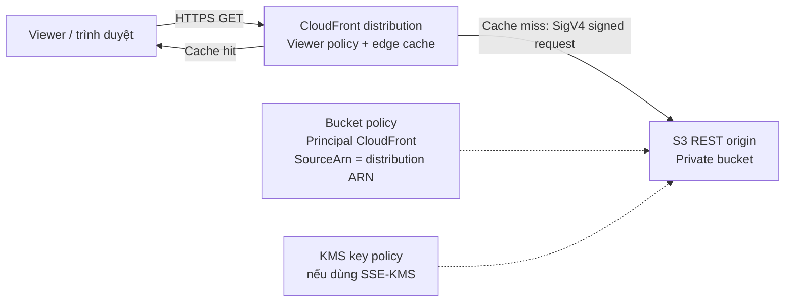
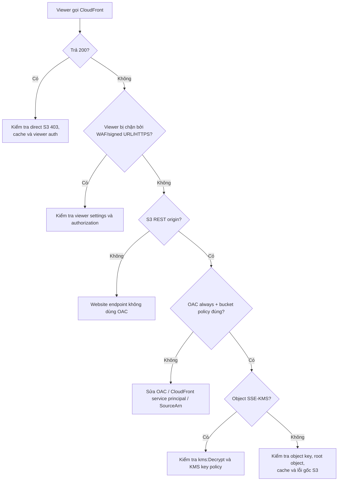

# Origin Access Control và bảo vệ S3 origin

## Mục tiêu học tập

Sau bài học, bạn có thể:

1. Giải thích tại sao dùng **Amazon CloudFront Origin Access Control (OAC)** để truy cập S3 mà vẫn giữ bucket private.
2. Phân biệt **viewer → CloudFront** với **CloudFront → S3**, cách SigV4 hoạt động và vì sao OAC không tự xác thực người dùng cuối.
3. Cấu hình **S3 bucket policy** giới hạn `cloudfront.amazonaws.com` bằng `AWS:SourceArn` của đúng CloudFront distribution.
4. Nhận diện khác biệt giữa **S3 REST origin** và **S3 website endpoint**, giữa OAC và **Origin Access Identity (OAI)**.
5. Giải thích cách bảo vệ object dùng **SSE-KMS**, các quyền cần thêm khi dùng PUT/DELETE qua CloudFront.
6. Triển khai mô hình private S3 origin qua CloudFormation, kiểm tra bằng AWS CLI và HTTP, rồi chẩn đoán lỗi 403, 404, cache và DNS.
7. Áp dụng least privilege, Block Public Access, CloudFront signed URL/cookie, logging, backup và kiểm soát chi phí.

## 1. Bài toán: phát nội dung qua CDN mà không công khai S3

Một công ty đặt ảnh sản phẩm, CSS, JavaScript và tài liệu trong Amazon S3. Người dùng ở nhiều quốc gia cần tải các object qua HTTPS với độ trễ thấp. Nếu cấp `Principal: "*"` cho phép `s3:GetObject` để trình duyệt tải trực tiếp từ S3, nội dung có thể bị đọc ngoài những kênh phân phối mà công ty muốn quản lý.

Mô hình đề xuất:

- **S3 general purpose bucket** là nơi lưu object; giữ **Block Public Access** bật.
- **CloudFront distribution** phục vụ viewer tại edge locations, có cache, HTTPS, DNS và chính sách truy cập theo nhu cầu.
- **Origin Access Control (OAC)** cho CloudFront ký origin requests gửi tới S3 bằng **AWS Signature Version 4 (SigV4)**.
- **S3 bucket policy** cấp quyền có điều kiện cho CloudFront service principal, chỉ khi origin request đến từ **distribution được phép**.
- Nếu nội dung riêng tư đối với viewer, ứng dụng cần thêm xác thực/ủy quyền và **CloudFront signed URL/cookie**.



Khi object còn trong cache, CloudFront có thể trả nội dung ngay mà **không gọi S3**. Khi cần lấy dữ liệu mới, CloudFront tạo request đã ký theo OAC; S3 kiểm tra chữ ký và quyền truy cập.

**OAC chỉ bảo vệ chặng CloudFront → S3.** OAC không biến CloudFront thành trang đăng nhập, không thay thế WAF, không tự cấp backup/versioning và không khiến mọi object đều có thể đọc được nếu bucket policy hoặc KMS key policy chưa phù hợp.

## 2. Thành phần và phạm vi trách nhiệm

| Thành phần | Mục đích | Cần nhớ |
| --- | --- | --- |
| **S3 bucket** | Lưu object, metadata, versioning, lifecycle và mã hóa. | Bucket phải có policy/permissions đúng và nên chặn public access. |
| **S3 origin** | Endpoint mà CloudFront sử dụng để gọi S3. | Phải là **REST bucket endpoint** để dùng OAC theo mô hình này. |
| **CloudFront distribution** | Nhận viewer request; định tuyến cache behavior tới origin. | Có distribution ID và ARN dùng trong bucket policy. |
| **OAC** | Cấu hình kiểu origin và cách ký request. | `SigningBehavior=always` được khuyến nghị. |
| **S3 bucket policy** | Cấp quyền GetObject (hoặc quyền khác cần thiết) cho CloudFront service. | Giới hạn `AWS:SourceArn` theo distribution cụ thể. |
| **S3 Block Public Access** | Chặn các đường mở quyền công khai ngoài ý muốn. | Không tắt chỉ để khắc phục 403 của OAC. |
| **AWS KMS key policy** | Cho CloudFront dùng khóa nếu origin object mã hóa SSE-KMS. | Thiếu `kms:Decrypt` có thể gây 403 dù S3 GetObject được phép. |
| **Signed URL/cookie** | Giới hạn **viewer** được truy cập CloudFront. | Khác chữ ký SigV4 mà OAC dùng với origin. |

### 2.1. Phân biệt S3 REST endpoint và S3 website endpoint

REST endpoint ví dụ:

```text
storefront-assets-demo.s3.ap-southeast-1.amazonaws.com
```

Website endpoint ví dụ:

```text
storefront-assets-demo.s3-website-ap-southeast-1.amazonaws.com
```

**Website endpoint là một custom origin trong CloudFront; OAC và OAI không hỗ trợ loại endpoint này.** Nếu cần private bucket qua OAC, dùng S3 REST endpoint và triển khai phần default root object, redirect hoặc SPA routing tại CloudFront.

Website endpoint phục vụ S3 static website với hành vi index/error/redirect đặc thù. Không thể chuyển origin sang website endpoint rồi kỳ vọng chữ ký OAC tiếp tục làm việc.

### 2.2. OAC khác Origin Access Identity (OAI)

OAI là cơ chế cũ dùng danh tính origin access để cấp quyền S3 cho CloudFront. AWS hiện **khuyến nghị OAC** cho hệ thống mới.

| Tiêu chí | OAC | OAI (legacy) |
| --- | --- | --- |
| Xác thực origin | SigV4, CloudFront service principal và policy giới hạn theo distribution. | Cấp quyền cho OAI qua S3 policy. |
| S3 trong các Region mới/opt-in | Hỗ trợ theo phạm vi AWS hiện hành. | Hạn chế với Region ra mắt sau năm 2022. |
| SSE-KMS | **Hỗ trợ** khi key policy cho phép. | Không hỗ trợ đầy đủ theo cách chuẩn. |
| PUT/DELETE động | Có thể dùng nếu CloudFront, bucket/KMS và viewer permissions phù hợp. | Có nhiều hạn chế, cần workaround. |
| Triển khai mới | **Ưu tiên.** | Duy trì khi cần tương thích hệ thống cũ. |

OAI không tự ngừng hoạt động chỉ vì có OAC. Khi migrate, cần chuyển bucket policy và distribution cẩn thận để tránh gây 403 ở các edge chưa cập nhật.

## 3. Luồng request và hai ranh giới xác thực

Giả sử viewer mở `https://d123example.cloudfront.net/images/p-42.webp`:

1. Viewer kết nối **CloudFront** bằng HTTP/HTTPS theo viewer protocol policy; CloudFront có thể kiểm tra signed URL/cookie, WAF, cache behavior.
2. Nếu **cache hit**, CloudFront trả object mà không tạo yêu cầu mới đến S3.
3. Nếu **cache miss**, CloudFront gửi request tới **S3 REST origin**. Với `SigningBehavior=always`, CloudFront ký request bằng **SigV4**.
4. S3 xác minh chữ ký và đánh giá **bucket policy**. Statement cho `cloudfront.amazonaws.com` chỉ có hiệu lực khi `AWS:SourceArn` đúng với CloudFront distribution được chỉ định.
5. Nếu object dùng **SSE-KMS**, còn phải có quyền phù hợp từ KMS key policy.
6. CloudFront trả dữ liệu cho viewer và có thể lưu cache tùy TTL/cache policy.

| Request | Người gọi | Vai trò OAC | Kết quả điển hình |
| --- | --- | --- | --- |
| GET tới CloudFront URL | Viewer không có AWS credentials. | OAC ký request khi CDN cần lấy object từ S3. | `200` nếu object tồn tại và viewer được phép. |
| GET S3 REST URL trực tiếp, không đăng nhập | Người dùng Internet. | Không tham gia. | **`403 AccessDenied`** nếu bucket private. |
| `aws s3api get-object` với IAM role quản trị có quyền | Principal đã được AWS xác thực. | Không cần. | Có thể thành công nếu IAM, bucket policy, KMS và các điều kiện cho phép. |

**Lưu ý về cách diễn đạt “chỉ qua CloudFront”:** mục tiêu là không cho **viewer ẩn danh** đi thẳng đến bucket. OAC không tự thu hồi các quyền IAM hợp lệ mà hệ thống vận hành vẫn cần để upload, backup hoặc đọc dữ liệu.

### 3.1. Hai loại chữ ký không giống nhau

- **OAC SigV4 signature** chứng minh **CloudFront** có quyền gọi **S3** thay mặt distribution.
- **CloudFront signed URL/cookie** chứng minh một **viewer** có quyền nhận nội dung từ distribution trong thời gian/điều kiện được ứng dụng xác định.

Nếu object là hóa đơn riêng tư, chỉ cấu hình OAC vẫn có thể khiến hóa đơn được mọi viewer tải qua URL CloudFront nếu viewer access chưa giới hạn. Cần có lớp ứng dụng xác thực khách hàng và cấp signed URL/cookie phù hợp.

## 4. OAC SigningBehavior và cơ chế SigV4

Một OAC dành cho S3 thường có:

```yaml
OriginAccessControlOriginType: s3
SigningBehavior: always
SigningProtocol: sigv4
```

| SigningBehavior | Ý nghĩa | Khuyến nghị |
| --- | --- | --- |
| **`always`** | CloudFront luôn ký request tới origin bằng SigV4. | **Nên dùng** cho private S3 origin. |
| `no-override` | CloudFront giữ `Authorization` có sẵn từ viewer nếu được chuyển tiếp; nếu không thì tự ký. | Trường hợp đặc biệt, yêu cầu cấu hình chuyển tiếp Authorization trong cache policy đúng. |
| `never` | CloudFront không ký origin requests. | Không phù hợp nếu S3 chỉ tin cậy quyền do OAC cung cấp. |

Với `always`, chặng **CloudFront → S3 dùng HTTPS** theo quy định của OAC. Không dùng `never` như một cách “tối ưu” cho private bucket và không thay đổi một OAC dùng chung nếu chưa kiểm tra tất cả distributions đang tham chiếu nó.

CloudFront dùng thông tin xác thực tạm thời/được quản lý để ký request, khác việc ghi access key tĩnh của IAM user vào origin configuration.

## 5. S3 bucket policy theo đúng CloudFront distribution

Ví dụ:

- AWS account sở hữu distribution: `111122223333`.
- CloudFront distribution ID: `E1ABC2DEF34567`.
- Bucket: `storefront-prod-assets-ap-southeast-1-a1b2c3d4`.
- Mục tiêu: chỉ cấp quyền đọc object cho CloudFront, không cho PUT/DELETE.

```json
{
  "Version": "2012-10-17",
  "Statement": [
    {
      "Sid": "AllowReadFromThisCloudFrontDistribution",
      "Effect": "Allow",
      "Principal": {
        "Service": "cloudfront.amazonaws.com"
      },
      "Action": "s3:GetObject",
      "Resource": "arn:aws:s3:::storefront-prod-assets-ap-southeast-1-a1b2c3d4/*",
      "Condition": {
        "StringEquals": {
          "AWS:SourceArn": "arn:aws:cloudfront::111122223333:distribution/E1ABC2DEF34567"
        }
      }
    }
  ]
}
```

Giải thích:

1. `Principal.Service` là CloudFront service principal, không phải account root và không phải viewer.
2. `s3:GetObject` áp dụng trên **ARN object** `arn:aws:s3:::bucket/*`, không phải chỉ bucket ARN.
3. `AWS:SourceArn` kiểm tra **ARN của distribution**. Trong ARN CloudFront, phần Region để trống, ví dụ `arn:aws:cloudfront::111122223333:distribution/...`.
4. `AWS:SourceArn` **không phải** ID/ARN của OAC. Một OAC có thể được dùng lại nhưng quyền S3 vẫn nên giới hạn đúng distribution.
5. Không có `s3:PutObject`, `s3:DeleteObject` hoặc `s3:ListBucket`: đây là cách giảm quyền cho trường hợp chỉ phân phối static assets.

**Vì sao phải có SourceArn?** Nếu chỉ cấp `s3:GetObject` cho `cloudfront.amazonaws.com` mà không giới hạn distribution, phạm vi tin cậy có thể rộng quá mức; `AWS:SourceArn` giúp giảm rủi ro **confused deputy**.

### 5.1. Public Access Block và Object Ownership

Với general purpose bucket:

```text
BlockPublicAcls       = true
IgnorePublicAcls      = true
BlockPublicPolicy     = true
RestrictPublicBuckets = true
ObjectOwnership      = BucketOwnerEnforced
```

`Bucket owner enforced` (mặc định với bucket mới) vô hiệu hóa ACL, để quyền do IAM và bucket policy kiểm soát. Nếu bắt buộc dùng ACL cho workload cũ, AWS có hướng dẫn về `Bucket owner preferred`; không bật ACL chỉ để xử lý lỗi 403.

**Giữ Block Public Access bật.** Một statement giới hạn CloudFront service principal và ARN distribution cụ thể được thiết kế khác policy cho phép public access; không cần mở `Principal: "*"` để OAC hoạt động.

### 5.2. Quyền trên prefix

Khi một bucket chứa nhiều nhóm dữ liệu, có thể giới hạn `Resource` ở:

```text
arn:aws:s3:::example-bucket/public-assets/*
```

Thay vì `bucket/*`. Tuy nhiên, phải bảo đảm CloudFront origin path, cache behavior và application routing trùng với prefix. Nếu CloudFront thực sự yêu cầu `/images/a.webp` mà bucket policy chỉ cho `public-assets/*` thì có thể nhận 403.

## 6. Object dùng SSE-KMS: phải cấp quyền KMS riêng

S3 mặc định mã hóa object ở trạng thái lưu. Khi chọn **SSE-KMS**, object phụ thuộc thêm vào KMS key. OAC hỗ trợ SSE-KMS nhưng CloudFront cần quyền dùng key.

Với **customer managed KMS key**, thêm statement theo mẫu AWS vào **key policy hiện có**, không thay toàn bộ key policy:

```json
{
  "Sid": "AllowCloudFrontSpecificDistributionSSEKMS",
  "Effect": "Allow",
  "Principal": {
    "Service": "cloudfront.amazonaws.com"
  },
  "Action": [
    "kms:Decrypt",
    "kms:Encrypt",
    "kms:GenerateDataKey*"
  ],
  "Resource": "*",
  "Condition": {
    "StringEquals": {
      "AWS:SourceArn": "arn:aws:cloudfront::111122223333:distribution/E1ABC2DEF34567"
    }
  }
}
```

Với luồng chỉ đọc, `kms:Decrypt` là quyền trọng tâm; `kms:Encrypt` và `kms:GenerateDataKey*` phục vụ các thao tác cần mã hóa/ghi. Hãy cấp tối thiểu theo nhu cầu thật. **Không nhầm KMS key policy với S3 bucket policy**: được phép `s3:GetObject` chưa có nghĩa được giải mã object.

AWS managed key như `aws/s3` không cho phép bạn sửa key policy giống customer managed key. Nếu cần OAC truy cập SSE-KMS, hãy lên kế hoạch **customer managed KMS key** có quyền phù hợp, hoặc chọn SSE-S3 nếu đáp ứng yêu cầu bảo vệ dữ liệu.

Để tránh mất quyền quản trị key, đừng thay toàn bộ key policy bằng ví dụ chỉ có CloudFront principal: vẫn phải giữ quyền của chủ sở hữu/administrators và khả năng khôi phục theo chính sách tổ chức.

## 7. Bảo vệ người xem là một yêu cầu khác

| Loại nội dung | Viewer được phép? | Bổ sung trên CloudFront |
| --- | --- | --- |
| CSS/JavaScript/ảnh sản phẩm công khai | Mọi người được xem qua CDN. | HTTPS, cache policy, WAF khi cần; S3 vẫn private. |
| Video khóa học chỉ dành cho học viên | Viewer đã được xác thực và có quyền. | CloudFront **signed URLs hoặc signed cookies**, ứng dụng cấp quyền. |
| Hóa đơn cá nhân | Chỉ chủ hóa đơn hoặc role được phép. | Xác thực/ủy quyền nghiệp vụ, thời hạn URL ngắn, chính sách cache đúng. |
| Upload tài liệu | Chỉ người dùng được phép upload đúng object. | Xác thực viewer, allowed methods, quyền S3/KMS ghi và kiểm tra input. |

Không dùng object key chứa `private`, một đường URL khó đoán hoặc bucket policy OAC như bằng chứng rằng viewer đã được xác thực. Nếu cache nội dung theo từng người, cần thiết kế cache key, TTL, header/cookie và cơ chế truy cập đủ chặt để không rò rỉ dữ liệu giữa người dùng.

**CloudFront signed URL/cookie là phương án giới hạn viewer ở edge; OAC là phương án xác thực CloudFront với origin.** Có thể dùng cả hai khi cần private content.

## 8. Thiết lập private S3 origin bằng AWS Console

### Bước 1 — Chuẩn bị bucket

Tạo S3 **general purpose bucket** có tên duy nhất tại Region phù hợp. Giữ **Block Public Access** bật và chọn **Object Ownership: Bucket owner enforced**. Upload file `index.html`, `images/p-42.webp` hoặc object thử nghiệm bằng IAM principal có quyền; không gắn public-read ACL.

### Bước 2 — Chọn đúng origin

Trong **CloudFront → Distributions**, tạo hoặc mở distribution và chọn **S3 bucket REST endpoint** làm origin. Không dùng `s3-website-...`. Với website tĩnh:

- **Viewer protocol policy:** `Redirect HTTP to HTTPS` hoặc `HTTPS only`.
- **Allowed methods:** `GET`/`HEAD` cho nội dung read-only.
- **Default root object:** `index.html` nếu cần URL `/`.
- **Cache policy:** chọn theo tính chất file tĩnh hoặc dữ liệu động.
- **Alternate domain name:** nếu dùng tên miền riêng, chuẩn bị certificate trên **AWS Certificate Manager (ACM) tại `us-east-1`**.

### Bước 3 — Tạo và gắn OAC

Trong CloudFront console, mở phần **Origin access control** để tạo OAC với:

```text
Origin type: S3
Signing behavior: Sign requests (recommended)
Signing protocol: SigV4
```

Ở distribution → **Origins** → chọn origin → **Edit**, chọn **Origin access control settings** và gắn OAC. Ghi lại **distribution ID** và ARN.

### Bước 4 — Cập nhật bucket policy

Vào S3 bucket → **Permissions → Bucket policy** và thêm statement ở mục 5 với tên bucket, account ID và **distribution ARN thực tế**. Một số giao diện CloudFront có chức năng **Copy policy**, nhưng vẫn cần đối chiếu bucket ARN, phương thức truy cập và điều kiện.

Nếu đang chuyển từ OAI, hãy bổ sung quyền OAC nhưng **giữ quyền OAI tạm thời** cho tới khi CloudFront cập nhật ở tất cả edge locations và kiểm tra thành công.

### Bước 5 — Chờ triển khai và kiểm thử

CloudFront thay đổi cấu hình theo thời gian. Khi distribution chuyển sang **Deployed**:

1. Truy cập object qua HTTPS ở CloudFront domain, mong đợi `200` nếu viewer và origin được phép.
2. Gửi HTTP request không có AWS credentials tới URL S3 REST trực tiếp, mong đợi `403`.
3. Kiểm tra bucket policy không có public read ngoài ý muốn và Block Public Access vẫn bật.
4. Kiểm tra trạng thái OAC, các hành vi `always`, object tồn tại, Region và KMS khi cần.
5. Xem cache headers và CloudFront metrics khi kết quả khác mong đợi.

## 9. Thực hành hạ tầng bằng AWS CloudFormation

Ví dụ sau tạo **một bucket S3 private**, OAC, CloudFront distribution và bucket policy read-only giới hạn đúng distribution. Viewer của website mẫu có thể đọc nội dung **công khai qua CloudFront**, trong khi bucket không public. Đây không phải mẫu dành cho file bí mật hoặc ứng dụng yêu cầu signed URLs.

Lưu template dưới tên `secure-site-oac.yml`. Mọi resource do template tạo đều có thể phát sinh chi phí theo mức sử dụng.

```yaml
AWSTemplateFormatVersion: '2010-09-09'
Description: Private S3 origin behind CloudFront OAC

Resources:
  SiteBucket:
    Type: AWS::S3::Bucket
    Properties:
      PublicAccessBlockConfiguration:
        BlockPublicAcls: true
        IgnorePublicAcls: true
        BlockPublicPolicy: true
        RestrictPublicBuckets: true
      OwnershipControls:
        Rules:
          - ObjectOwnership: BucketOwnerEnforced

  SiteOAC:
    Type: AWS::CloudFront::OriginAccessControl
    Properties:
      OriginAccessControlConfig:
        Name: !Sub '${AWS::StackName}-oac'
        Description: Sign requests from CloudFront to private S3
        OriginAccessControlOriginType: s3
        SigningBehavior: always
        SigningProtocol: sigv4

  SiteDistribution:
    Type: AWS::CloudFront::Distribution
    Properties:
      DistributionConfig:
        Enabled: true
        DefaultRootObject: index.html
        Comment: CloudFront OAC example for static assets
        Origins:
          - Id: PrivateS3Origin
            DomainName: !GetAtt SiteBucket.RegionalDomainName
            OriginAccessControlId: !Ref SiteOAC
            S3OriginConfig:
              OriginAccessIdentity: ''
        DefaultCacheBehavior:
          TargetOriginId: PrivateS3Origin
          ViewerProtocolPolicy: redirect-to-https
          AllowedMethods: [GET, HEAD]
          CachedMethods: [GET, HEAD]
          Compress: true
          # Managed policy: CachingOptimized
          CachePolicyId: 658327ea-f89d-4fab-a63d-7e88639e58f6

  SiteBucketPolicy:
    Type: AWS::S3::BucketPolicy
    Properties:
      Bucket: !Ref SiteBucket
      PolicyDocument:
        Version: '2012-10-17'
        Statement:
          - Sid: AllowGetObjectOnlyFromThisDistribution
            Effect: Allow
            Principal:
              Service: cloudfront.amazonaws.com
            Action: s3:GetObject
            Resource: !Sub '${SiteBucket.Arn}/*'
            Condition:
              StringEquals:
                AWS:SourceArn: !Sub
                  'arn:${AWS::Partition}:cloudfront::${AWS::AccountId}:distribution/${SiteDistribution}'

Outputs:
  BucketName:
    Value: !Ref SiteBucket
  DistributionId:
    Value: !Ref SiteDistribution
  DistributionDomainName:
    Value: !GetAtt SiteDistribution.DomainName
```

### Vì sao mẫu này bảo vệ được origin?

- Bucket có cấu hình Block Public Access ở cả bốn tùy chọn, **không có ACL public**.
- `!GetAtt SiteBucket.RegionalDomainName` là **S3 REST origin**.
- `SiteOAC` dùng `SigningProtocol=sigv4` và `SigningBehavior=always`.
- Distribution gắn OAC bằng `OriginAccessControlId`; `S3OriginConfig.OriginAccessIdentity: ''` là giá trị trống khi chuyển khỏi OAI.
- Bucket policy chỉ có `s3:GetObject`, với `Principal.Service=cloudfront.amazonaws.com` và `AWS:SourceArn` được tạo từ **distribution ID**, không phải OAC ID.
- `CachingOptimized` là **managed CloudFront cache policy**; muốn phân phối dữ liệu cá nhân hóa phải thiết kế viewer authorization và cache policy riêng.
- Template không tạo KMS key hoặc viewer signed URL. Object mặc định dùng cơ chế mã hóa S3; không coi mẫu này đáp ứng mọi yêu cầu bảo mật.

**Lưu ý:** CloudFormation có thể tạo CloudFront distribution trước khi hoàn tất bucket policy, nên trong giai đoạn triển khai ban đầu có thể có khoảng thời gian trả `403` nếu gửi traffic quá sớm. Chỉ công bố domain cho người dùng sau khi stack hoàn tất và đã kiểm thử.

### Triển khai và kiểm tra

Thực hiện từ account/thư mục lab đã được cấp quyền, với AWS CLI:

```bash
aws sts get-caller-identity

aws cloudformation deploy \
  --template-file secure-site-oac.yml \
  --stack-name secure-site-oac-lab \
  --region ap-southeast-1

aws cloudformation describe-stacks \
  --stack-name secure-site-oac-lab \
  --region ap-southeast-1 \
  --query 'Stacks[0].Outputs' \
  --output table
```

Lấy **BucketName**, **DistributionId**, **DistributionDomainName** từ Outputs và điền các biến ở shell:

```bash
# Thay giá trị minh họa bằng Outputs từ stack của chính bạn
BUCKET="ten-bucket-do-stack-tao"
DIST="E1ABC2DEF34567"
DOMAIN="d123example.cloudfront.net"
REGION="ap-southeast-1"

printf '<h1>CloudFront OAC lab</h1>\n' > index.html

aws s3 cp ./index.html "s3://${BUCKET}/index.html" \
  --content-type text/html \
  --region "$REGION"

# Chờ CloudFront có Status=Deployed
aws cloudfront get-distribution \
  --id "$DIST" \
  --query 'Distribution.Status'

# Qua CDN: HTTP 200 nếu object tồn tại và cấu hình đúng
curl -I "https://${DOMAIN}/index.html"

# Đường S3 REST trực tiếp, không AWS credentials: thường 403
curl -I "https://${BUCKET}.s3.${REGION}.amazonaws.com/index.html"
```

HTTP `403` ở S3 direct URL và `200` ở CloudFront URL là **kết quả mong đợi** của bài. Nếu `curl -I` trả kết quả khác, cần kiểm tra cả việc upload đúng key, trạng thái CloudFront, quyền và cache.

Để đối chiếu policy:

```bash
aws s3api get-public-access-block --bucket "$BUCKET" --region "$REGION"
aws s3api get-bucket-policy --bucket "$BUCKET" --region "$REGION"
aws cloudfront get-distribution --id "$DIST"
```

**Không sử dụng `aws s3api get-object` bằng một IAM administrator để chứng minh bucket public/private.** Lệnh có AWS credentials hợp lệ có thể đọc S3 trực tiếp; phép kiểm tra viewer ẩn danh cần request **không mang credentials**, như `curl`.

### Dọn lab

Chỉ sau khi xác nhận bucket thuộc **lab riêng**, không có dữ liệu thật:

1. Xóa `index.html` và mọi object lab, gồm version/delete marker nếu bật versioning.
2. Xóa CloudFormation stack; S3 bucket **không rỗng** sẽ khiến stack deletion thất bại.
3. Chờ CloudFront disable/delete hoàn tất và kiểm tra bucket, distribution, OAC, policy đã được xóa.

```bash
aws s3 rm "s3://${BUCKET}/index.html" --region "$REGION"

aws cloudformation delete-stack \
  --stack-name secure-site-oac-lab \
  --region ap-southeast-1
```

Không xóa bucket/stack hiện hữu của production bằng các lệnh dọn thử nghiệm. CloudFront có thời gian triển khai/xóa, và S3/CloudFront có các thành phần tính phí khác nhau.

## 10. Tạo OAC với AWS CLI cho distribution đã tồn tại

Khi đã có CloudFront distribution và S3 bucket REST origin, bạn có thể tạo OAC bằng CLI:

```bash
aws cloudfront create-origin-access-control \
  --origin-access-control-config \
    Name=storefront-assets-oac,Description="OAC for private S3",SigningProtocol=sigv4,SigningBehavior=always,OriginAccessControlOriginType=s3
```

Lưu `Id` được trả về, sau đó **sửa distribution origins** để gắn `OriginAccessControlId` và bảo đảm `S3OriginConfig.OriginAccessIdentity` trống. Trong production, thường dùng CloudFormation/Terraform hoặc giao diện CloudFront để tránh sửa nhầm các trường khác.

**Cẩn trọng với `aws cloudfront update-distribution`:** API yêu cầu **toàn bộ DistributionConfig** và tham số `IfMatch` từ ETag hiện tại. Không gửi một JSON chỉ chứa `OriginAccessControlId`; đọc cấu hình hiện tại, sửa đúng origin, kiểm tra diff, rồi mới cập nhật.

Bucket policy phải được cấp quyền phù hợp **trước hoặc cùng lúc** chuyển traffic đến OAC. Nếu có OAI cũ, vẫn giữ quyền OAI trong giai đoạn CloudFront đang phân phối cấu hình mới.

## 11. Upload, SSE-KMS và điều khiển các HTTP methods

OAC không chỉ hỗ trợ `GET`. CloudFront có thể ký các **dynamic methods** được hỗ trợ, gồm `PUT` và `DELETE`, nhưng thiết kế an toàn đòi hỏi:

1. **CloudFront cache behavior** bật AllowedMethods tương ứng.
2. **Viewer authorization** xác minh quyền upload/xóa; không để mọi viewer tự ghi S3 vì CloudFront đã có OAC.
3. **S3 bucket policy** thêm `s3:PutObject`, `s3:DeleteObject` chỉ trong prefix cần thiết.
4. **KMS policy** cấp thêm `kms:Encrypt`, `kms:GenerateDataKey*` nếu cần với SSE-KMS.
5. Kiểm soát key, kích thước, loại file, quota, nội dung độc hại và hành vi upload/retry của ứng dụng.

Bucket policy `s3:GetObject` trong mục 5 **không** cho phép PUT hoặc DELETE. Đây là giới hạn đúng cho bộ static assets read-only.

### Khi nào dùng S3 presigned URL?

Ứng dụng có thể xác thực người dùng rồi cấp **S3 presigned PUT/POST URL** để người dùng upload trực tiếp lên S3. Đây là cơ chế IAM/S3 riêng: request tới S3 dùng quyền của principal ký URL, **không đi qua OAC**. Nó phù hợp nhiều workflow upload trình duyệt và giúp tránh chuyển toàn bộ file qua CloudFront, nhưng vẫn cần kiểm soát key, kích thước, nội dung, CORS và thời hạn URL.

Không nhầm ba loại chữ ký: **CloudFront viewer signed URL**, **OAC SigV4 giữa CloudFront và S3**, và **S3 presigned URL** cấp quyền trực tiếp cho S3 request.

## 12. DNS, HTTPS, cache và hành vi website

### 12.1. Tên miền riêng qua Route 53

Khi muốn `assets.example.com` trỏ tới CloudFront:

1. Cấp **ACM certificate tại `us-east-1`** cho domain được dùng với CloudFront.
2. Trong distribution, cấu hình alternate domain name và certificate.
3. Trong **Amazon Route 53**, tạo **Alias A** và **AAAA** nếu phù hợp để trỏ domain tới CloudFront.
4. Chọn viewer protocol policy `Redirect HTTP to HTTPS` hoặc `HTTPS only` và kiểm tra TLS.

CloudFront là dịch vụ global nhưng S3 origin vẫn ở Region mà bucket được tạo. OAC bảo vệ origin requests; DNS và TLS của viewer là các lớp cấu hình riêng.

### 12.2. Cache làm giảm origin requests

Khi CloudFront có object trong cache, việc thay đổi S3 bucket policy **không tự xóa ngay nội dung đã cache** tại mọi edge. Nếu cần cập nhật object:

- Dùng tên file bất biến theo phiên bản/hash, ví dụ `main.9f42c8.js`.
- Đặt `Cache-Control` và cache policy phù hợp.
- Dùng CloudFront invalidation khi thật sự cần làm mới URL đã có.

```bash
aws cloudfront create-invalidation \
  --distribution-id "$DIST" \
  --paths "/index.html"
```

Invalidation có thể phát sinh chi phí sau ngưỡng miễn phí được công bố. Với dữ liệu riêng tư hoặc thay đổi quyền, ngoài invalidation phải đánh giá viewer authorization và khả năng người dùng đã tải file trước đó.

### 12.3. SPA routing và lỗi 403 từ key không tồn tại

`DefaultRootObject=index.html` thường giải quyết đường dẫn root `/`. Một Single-Page Application gọi URL `/dashboard` khiến CloudFront thử truy cập S3 key `dashboard`. Nếu không có key ấy, S3 có thể trả **403**, do CloudFront chỉ có `GetObject` và không có `ListBucket`.

Có thể dùng **CloudFront Functions** để rewrite những đường dẫn cần thiết thành `/index.html` hoặc thiết lập custom error response có kiểm soát. **Không ánh xạ mọi `403` thành `200` một cách mù quáng**, vì có thể che mất lỗi quyền truy cập thực sự.

## 13. Troubleshooting theo lớp

| Triệu chứng | Nguyên nhân thường gặp | Cần kiểm tra |
| --- | --- | --- |
| CloudFront trả `403` cho object đã upload | Chưa gắn OAC, `SigningBehavior` sai, bucket policy thiếu hoặc sai `SourceArn`. | Distribution origin, OAC, bucket policy, deployment status. |
| Chỉ những object SSE-KMS bị `403` | KMS key policy thiếu `Decrypt`, dùng AWS managed key không chỉnh được policy. | Encryption metadata, customer managed key policy. |
| `/` trả 403 | Thiếu `index.html`/default root object hoặc sai quyền object. | Key, DefaultRootObject, policy và cache. |
| SPA route `/dashboard` trả 403 | S3 REST origin coi path là object key; key không tồn tại. | Rewrite/custom error, quyền `ListBucket` không cần cấp rộng. |
| Direct S3 URL vẫn trả 200 ẩn danh | Bucket/object còn public qua policy/ACL hoặc cấu hình cũ. | Account/bucket Block Public Access, policy, Object Ownership. |
| CloudFront vẫn trả nội dung cũ | Cache TTL chưa hết hoặc invalidation chưa hoàn tất. | Cache behavior, `Age`, `x-cache`, versioned filenames. |
| Origin trỏ `s3-website-*` | Đây là custom origin, không hỗ trợ OAC. | Chuyển sang S3 REST origin nếu cần bucket private. |
| PUT qua CloudFront trả 403 | AllowedMethods, viewer authorization, S3/KMS write permissions chưa đúng. | Behavior, policy và key permissions. |
| `no-override` không chuyển tiếp Authorization | Authorization chưa được đưa vào cache policy theo hướng dẫn OAC. | Signing behavior và cache policy. |
| Direct S3 403, CloudFront 200 | **Đúng mong đợi** trong mô hình OAC read-only. | Chỉ điều tra nếu viewer không được phép mà vẫn tải được. |

### 13.1. Hướng điều tra 403, 404



S3 có thể trả **`403` thay vì `404` cho object không tồn tại** nếu principal không có quyền `s3:ListBucket`. Điều này không phải lý do để mở quyền ListBucket rộng cho CloudFront.

Nếu CloudFront trả 403, **không tắt Block Public Access** và không thêm `Principal: "*"` để thử cho “chạy trước”. Hãy xác định đúng lớp lỗi trước.

## 14. Giám sát, bảo mật vận hành và kiểm soát chi phí

### 14.1. Nguồn dữ liệu nên theo dõi

| Nguồn | Tín hiệu có ích | Mục đích |
| --- | --- | --- |
| **CloudFront metrics** | `Requests`, `4xxErrorRate`, `5xxErrorRate`, `CacheHitRate`, `BytesDownloaded`. | Theo dõi lỗi/khả dụng và hiệu quả cache. |
| **CloudFront logs** | URI, status, cache result, viewer details theo cấu hình. | Điều tra origin/cache/viewer access. |
| **S3 request metrics/server access logs** | GET/PUT, 4xx, object requests, storage. | Hiểu lưu lượng origin và audit. |
| **CloudTrail data events** | Các API thao tác object S3 nếu đã bật. | Audit truy cập chi tiết với phạm vi và chi phí phù hợp. |
| **AWS KMS / CloudTrail** | Request sử dụng KMS key, AccessDenied. | Phân tích lỗi SSE-KMS. |
| **AWS Config/Security Hub** | Kiểm soát bucket public và CloudFront OAC. | Phát hiện cấu hình sai/drift. |
| **Synthetic test** | CDN 200 khi hợp lệ, anonymous S3 direct 403. | Xác minh yêu cầu bảo vệ origin. |

Log URL có thể chứa query string, path, token hoặc dữ liệu riêng tư. Hãy kiểm soát dữ liệu nhạy cảm trong log, quyền đọc log, thời hạn lưu và mã hóa.

### 14.2. Chi phí cần tính

- **S3 storage** theo storage class, GET/PUT/LIST requests, versioning, replication và lifecycle.
- **CloudFront data transfer**, request và các tính năng bổ sung theo bảng giá.
- **CloudFront invalidation** vượt mức miễn phí, real-time logs, CloudFront Functions/Lambda@Edge, AWS WAF nếu sử dụng.
- **KMS key và KMS requests** khi dùng customer managed SSE-KMS.
- **CloudWatch alarms, logs, CloudTrail data events**, Route 53 và các tài nguyên liên quan.

**Cache có thể giảm origin requests và độ trễ**, nhưng workload có cache hit rate thấp vẫn có thể tốn phí request/transfer. Dùng CloudWatch và Cost Explorer để xác định chi phí thực tế, tránh gán con số USD cố định cho mọi Region.

### 14.3. Biện pháp bảo vệ bổ sung

1. Giữ HTTPS giữa viewer và CloudFront; `always` bảo đảm HTTPS CloudFront → S3 origin.
2. Cấp IAM least privilege cho role triển khai và quản trị, dùng MFA/IAM Identity Center, ghi audit qua CloudTrail.
3. Không đưa secret, email khách hàng hoặc token vào object key/URL nếu có thể tránh.
4. Đặt AWS WAF ở CloudFront khi cần giảm các tấn công tầng HTTP; OAC không có chức năng WAF.
5. Cấu hình S3 versioning, backup/replication phù hợp RPO/RTO; **edge cache không phải backup**.
6. Đặt CloudFront alarms theo `4xxErrorRate`/`5xxErrorRate` và diễn tập test direct S3 URL ẩn danh sau mỗi lần sửa chính sách.

## 15. Migrate từ OAI sang OAC

Với distribution hiện hữu sử dụng **Origin Access Identity**:

1. Ghi lại distribution ID, S3 origin domain, OAI identity, bucket policy, SSE-KMS và hành vi cache.
2. Tạo OAC `always` cho S3 origin.
3. **Bổ sung quyền OAC** vào bucket policy bằng CloudFront service principal và distribution `AWS:SourceArn`. Tạm giữ statement cho OAI hiện có.
4. Cập nhật distribution origin để dùng OAC và bỏ OriginAccessIdentity theo quy trình; chờ **Deployed**.
5. Thử CloudFront GET với các object quan trọng, SSE-KMS, các cache behaviors, direct S3 URL, log và error metrics.
6. **Sau khi xác minh thành công**, gỡ quyền OAI cũ. Lưu cấu hình/nhật ký để phục hồi khi cần.

Việc đồng thời cho phép **OAI và OAC trong giai đoạn chuyển tiếp** giúp tránh lỗi 403 ở những edge nodes chưa cập nhật. Nếu chuyển quá sớm bằng cách xóa OAI policy trước, người dùng có thể bị gián đoạn.

## 16. Tình huống thiết kế: assets công khai và hóa đơn riêng tư

**Bối cảnh:** hệ thống bán hàng chạy tại Singapore, lưu ảnh sản phẩm và hóa đơn trên S3, phân phối qua CloudFront. Hóa đơn có thông tin khách hàng, một phần dùng SSE-KMS. Yêu cầu không có truy cập trực tiếp S3 từ Internet, có log/audit, khả năng phục hồi và kiểm soát phí.

### Kiến trúc đề xuất

1. **Tách bucket/prefix và CloudFront behaviors** cho assets công khai với hóa đơn riêng tư, vì chính sách cache/retention khác nhau.
2. Với mỗi S3 REST origin, gắn OAC và bucket policy `GetObject` giới hạn chính xác distribution ARN và prefix cần thiết; bật Block Public Access/BucketOwnerEnforced.
3. Với hình ảnh công khai, viewer có thể dùng CloudFront HTTPS trực tiếp; dùng immutable filenames và cache TTL phù hợp.
4. Với hóa đơn, backend xác thực **chủ sở hữu hóa đơn**, phát CloudFront signed URL/cookie có thời gian ngắn; không chỉ dựa vào key khó đoán.
5. Với SSE-KMS, dùng customer managed key policy cấp `kms:Decrypt` cho CloudFront distribution, cùng quyền quản trị và khôi phục phù hợp.
6. Ghi CloudFront 4xx/5xx, S3/KMS access events và test quyền; không log secret từ URL.
7. Lập kế hoạch versioning/backup/restore cho hóa đơn, quy trình vô hiệu hóa quyền viewer và xem xét hiệu lực cache khi thay đổi.
8. Dùng Cost Explorer và metrics để theo dõi S3 requests, CloudFront transfer, hit ratio, invalidations, KMS và logging costs.

### Điểm kiểm thử bắt buộc

| Phép kiểm thử | Mong đợi |
| --- | --- |
| Viewer ẩn danh tải ảnh qua CloudFront | `200` khi object tồn tại. |
| Viewer ẩn danh tải cùng ảnh qua S3 REST URL | `403`. |
| Viewer không có signed URL tải hóa đơn qua CloudFront | Bị từ chối theo viewer policy. |
| Viewer có quyền và URL hợp lệ tải hóa đơn | `200` nếu S3/KMS permissions đúng. |
| Thay sai KMS key policy trong môi trường lab | CloudFront đọc object SSE-KMS thất bại; test chứng minh cần quyền KMS. |
| Đổi object version/key | CloudFront trả đúng phiên bản theo TTL/invalidation hoặc versioned URL. |

## 17. Sai lầm phổ biến

**Sai lầm 1: “Tạo CloudFront là S3 bucket tự private.”** Sai. Cần Block Public Access, OAC và bucket policy đúng; kiểm tra những quyền S3 khác còn tồn tại.

**Sai lầm 2: “OAC bắt viewer phải đăng nhập.”** Sai. OAC xác thực CloudFront với S3; dùng signed URL/cookie và ứng dụng để kiểm soát viewer.

**Sai lầm 3: “Website endpoint S3 hỗ trợ OAC.”** Sai. Chọn S3 REST origin khi cần private bucket qua OAC.

**Sai lầm 4: “Dùng OAC phải tắt Block Public Access.”** Sai. Bucket có điều kiện CloudFront phù hợp không cần public access.

**Sai lầm 5: “Cứ cho principal cloudfront.amazonaws.com là đủ.”** Chưa đủ least privilege; giới hạn bằng `AWS:SourceArn` của distribution.

**Sai lầm 6: “`AWS:SourceArn` là OAC ID.”** Sai. Đây là **CloudFront distribution ARN**.

**Sai lầm 7: “SSE-KMS luôn chạy với bucket policy GetObject.”** Sai. Còn cần KMS key permissions phù hợp.

**Sai lầm 8: “SigningBehavior=never vẫn tạo chữ ký.”** Sai. `never` nghĩa là CloudFront không ký origin requests.

**Sai lầm 9: “Direct S3 trả 403, CDN trả 200 là sự cố.”** Sai. Đó là trạng thái bảo vệ origin mong đợi.

**Sai lầm 10: “CloudFront cache có thể thay thế backup hoặc chính sách quyền viewer.”** Sai. Cache và backup/authorization là những cơ chế khác nhau.

**Sai lầm 11: “Có thể gỡ ngay OAI policy trước khi OAC deploy xong.”** Sai. Cần giai đoạn chuyển tiếp và xác minh.

## 18. Câu hỏi tự kiểm tra

**Câu 1.** OAC ký request nào?

**Đáp án:** CloudFront **origin request** tới S3; không trực tiếp xác thực viewer.

**Câu 2.** Bucket policy OAC nên giới hạn CloudFront theo thuộc tính gì?

**Đáp án:** `AWS:SourceArn` bằng **CloudFront distribution ARN**, cùng action/resource cụ thể.

**Câu 3.** Viewer không xác thực tải CloudFront `index.html` được, nhưng truy cập S3 URL không credentials nhận 403. Có đúng không?

**Đáp án:** Đúng nếu nội dung công khai qua CDN và bucket private.

**Câu 4.** OAC signing behavior nào được khuyến nghị và vì sao?

**Đáp án:** `always`; CloudFront ký SigV4 và dùng HTTPS tới S3 origin.

**Câu 5.** Có thể gắn OAC cho `bucket.s3-website-region.amazonaws.com` không?

**Đáp án:** Không. Website endpoint là custom origin, không hỗ trợ OAC.

**Câu 6.** Một object SSE-KMS bị 403 qua CDN dù bucket policy đúng; cần kiểm tra gì?

**Đáp án:** KMS key policy, quyền `kms:Decrypt`, customer managed key và distribution `SourceArn`.

**Câu 7.** Hóa đơn yêu cầu chỉ người mua được tải trong 5 phút. OAC đã đủ chưa?

**Đáp án:** Chưa. Backend phải xác thực/ủy quyền và cấp CloudFront signed URL/cookie phù hợp; cache cũng cần an toàn.

**Câu 8.** Tại sao đã sửa `index.html` mà CDN vẫn trả bản cũ?

**Đáp án:** Cache TTL; cần chờ hết hạn, dùng versioned filename hoặc invalidation có kiểm soát.

**Câu 9.** Khi migrate từ OAI, tại sao tạm giữ statement OAI trong bucket policy?

**Đáp án:** CloudFront triển khai cấu hình dần qua edge; bỏ quyền cũ quá sớm có thể khiến các edge chưa cập nhật bị 403.

**Câu 10.** Nếu muốn upload qua CloudFront thì ngoài OAC cần thêm gì?

**Đáp án:** Viewer authorization, allowed methods, `s3:PutObject` giới hạn theo key/prefix, KMS write permissions khi cần, và kiểm soát file ở ứng dụng.

## Tài liệu tham khảo AWS chính thức

- [CloudFront — Restrict access to an Amazon S3 origin](https://docs.aws.amazon.com/AmazonCloudFront/latest/DeveloperGuide/private-content-restricting-access-to-s3.html)
- [CloudFront — Serving private content with signed URLs and signed cookies](https://docs.aws.amazon.com/AmazonCloudFront/latest/DeveloperGuide/PrivateContent.html)
- [CloudFront — Origin settings](https://docs.aws.amazon.com/AmazonCloudFront/latest/DeveloperGuide/DownloadDistS3AndCustomOrigins.html)
- [CloudFormation — AWS::CloudFront::OriginAccessControl](https://docs.aws.amazon.com/AWSCloudFormation/latest/TemplateReference/aws-resource-cloudfront-originaccesscontrol.html)
- [CloudFormation — AWS::CloudFront::Distribution](https://docs.aws.amazon.com/AWSCloudFormation/latest/TemplateReference/aws-resource-cloudfront-distribution.html)
- [CloudFront — Cache policies](https://docs.aws.amazon.com/AmazonCloudFront/latest/DeveloperGuide/controlling-the-cache-key.html)
- [CloudFront — Custom error responses](https://docs.aws.amazon.com/AmazonCloudFront/latest/DeveloperGuide/GeneratingCustomErrorResponses.html)
- [Amazon S3 — Block Public Access](https://docs.aws.amazon.com/AmazonS3/latest/userguide/access-control-block-public-access.html)
- [Amazon S3 — Object Ownership](https://docs.aws.amazon.com/AmazonS3/latest/userguide/about-object-ownership.html)
- [Amazon S3 — Troubleshooting AccessDenied 403](https://docs.aws.amazon.com/AmazonS3/latest/userguide/troubleshoot-403-errors.html)
- [AWS Security Hub — CloudFront controls](https://docs.aws.amazon.com/securityhub/latest/userguide/cloudfront-controls.html)
- [CloudFront — Standard logs](https://docs.aws.amazon.com/AmazonCloudFront/latest/DeveloperGuide/AccessLogs.html)
- [CloudFront pricing](https://aws.amazon.com/cloudfront/pricing/)

**Ghi nhớ:** **S3 REST origin + CloudFront OAC ký SigV4 + bucket policy giới hạn distribution ARN** cho phép phân phối nội dung mà giữ S3 bucket private. Tiếp tục bật Block Public Access; nếu dùng SSE-KMS, cần cấp quyền KMS riêng. **Viewer authorization, HTTPS, cache, WAF, backup, logging và chi phí** là các lớp phải thiết kế bổ sung.
