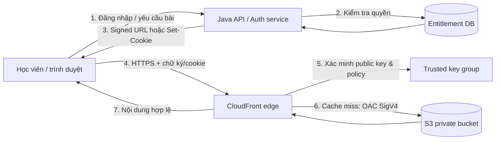
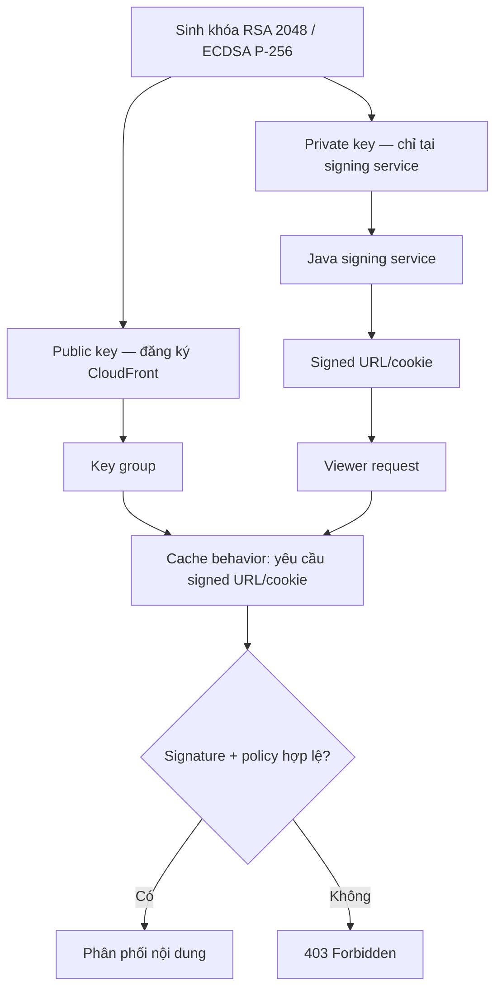

# Signed URL, signed cookie và bảo vệ nội dung

Một nền tảng học trực tuyến lưu video bài giảng và tài liệu PDF trên **Amazon S3**, sau đó phân phối qua **Amazon CloudFront**. Người dùng phải đăng nhập và có quyền học khóa tương ứng, nhưng nếu chỉ gửi cho trình duyệt đường dẫn `https://media.example.com/private/lesson-01.mp4`, người khác có thể sao chép đường dẫn và tiếp tục tải nội dung nếu cache behavior hoặc nguồn gốc cho phép truy cập công khai.

**CloudFront signed URL** và **CloudFront signed cookie** giải quyết việc **cấp quyền truy cập có thời hạn tại lớp phân phối nội dung**: ứng dụng xác minh quyền của người dùng rồi phát hành bằng chứng được ký; CloudFront kiểm tra chữ ký và các điều kiện trước khi trả nội dung từ edge cache hoặc origin. Để tránh đi vòng qua CloudFront, **origin cũng phải được bảo vệ**, chẳng hạn bằng **Origin Access Control (OAC)** cho bucket S3 riêng tư.

Bài học thuộc chương **DNS và phân phối nội dung** của module **CLOUD_PROVIDERS_AWS**. Đây là một chủ đề nối các lớp **IAM, S3, Route 53, VPC, EC2/Java, Lambda, CloudFront, giám sát, phục hồi và kiểm soát chi phí** thành kiến trúc phân phối nội dung an toàn.

## 1. Mục tiêu học tập

Sau bài học, bạn có thể:

1. Phân biệt **signed URL**, **signed cookie**, **S3 presigned URL** và quyền truy cập dựa trên IAM.
2. Giải thích quy trình **xác thực người dùng → kiểm tra entitlement → tạo chữ ký → CloudFront xác minh → phân phối nội dung**.
3. Cấu hình về mặt kiến trúc **trusted key group**, **public key**, **cache behavior yêu cầu chữ ký** và **S3 OAC**.
4. Chọn **canned policy** hay **custom policy** theo thời hạn, đường dẫn, giờ bắt đầu và IP nguồn.
5. Tạo signed URL/signed cookie bằng **AWS SDK for Java v2**, hiểu cách bảo vệ khóa riêng.
6. Thiết kế signed cookies cho **nhiều tệp**, ví dụ HLS playlist và các segments, với cookie attributes phù hợp.
7. Chẩn đoán lỗi **403, chữ ký sai, URL hết hạn, cookie không được gửi, CORS và origin access**.
8. Lập kế hoạch logging, giám sát, thu hồi quyền, cache và chi phí CDN.

## 2. Cần bảo vệ những gì?

Có ba lớp quyền khác nhau trong hệ thống phân phối nội dung:

| Lớp | Câu hỏi | Thành phần chủ yếu |
|---|---|---|
| **Người dùng/ứng dụng** | Ai đã đăng nhập? Ai sở hữu khóa học, gói thuê bao hoặc tài liệu? | Ứng dụng Java/API, Cognito/IdP, database quyền truy cập |
| **Viewer → CloudFront** | Request này có chữ ký hợp lệ, đúng tài nguyên và thời hạn không? | CloudFront trusted key groups, signed URL/cookie, cache behavior |
| **CloudFront → origin** | CloudFront có thể đọc file private từ S3/ALB không? Ai khác có thể truy cập origin trực tiếp? | S3 OAC + bucket/KMS policy hoặc bảo vệ custom origin |

**Một chữ ký CloudFront hợp lệ chỉ xác nhận request đáp ứng policy đã được ký**, chứ không tự hỏi lại database học viên mỗi lần request. Vì vậy ứng dụng phải kiểm tra entitlement **trước khi ký**, thiết kế TTL phù hợp và có phương án khi quyền bị thu hồi.

**Mã hóa nội dung trên đường truyền** bằng HTTPS là lớp riêng. HTTPS không tự giới hạn ai được tải tệp; signed URL/cookie không tự mã hóa tệp. Với nội dung có yêu cầu chống sao chép mạnh, còn cần xem xét DRM, watermark hoặc công nghệ bảo vệ nội dung phù hợp.

### 2.1. Kiến trúc điển hình



- Trình duyệt **không cần AWS access key** để tải nội dung từ CloudFront.
- **Private key** chỉ nằm ở hệ thống phát hành chữ ký; CloudFront giữ **public key** trong key group.
- Nội dung có sẵn trong edge cache vẫn phải qua **kiểm tra chữ ký viewer** khi cache behavior yêu cầu.
- Khi có **cache miss**, CloudFront lấy object từ origin qua cơ chế được cho phép.

## 3. Signed URL và signed cookie khác nhau thế nào?

| Tiêu chí | **CloudFront signed URL** | **CloudFront signed cookie** |
|---|---|---|
| Đơn vị cấp quyền tự nhiên | Một URL/tài nguyên cụ thể, hoặc pattern nếu custom policy | Một hoặc nhiều tài nguyên theo policy |
| Cách mang thông tin | Query parameters trong URL | Các cặp tên/giá trị ở header `Cookie` |
| Phù hợp | Tải PDF, bản cài đặt, email link có hạn, client không dùng cookie | Khu vực thành viên, trang có nhiều ảnh, HLS/DASH có nhiều segments |
| Có phải đổi URL hiện có? | Có thêm query parameters | URL media có thể giữ nguyên |
| Rủi ro dễ gặp | URL bị chép vào log, lịch sử, chia sẻ hoặc referrer | Cookie scope/Domain/Path/SameSite sai, hoặc cookie bị đánh cắp |
| Khi thu hồi | TTL và key rotation; không mặc định có thu hồi riêng từng URL ngay tức thì | TTL và key rotation; xóa cookie phía browser không thu hồi bản sao đã bị lấy |
| Cách kiểm thử | Gọi URL có/không có chữ ký, sửa URL, chờ hết hạn | Gọi URL có/không có ba cookie, kiểm tra headers và policy |

**Quy tắc chọn nhanh:** cấp quyền cho **một file** thì ưu tiên signed URL; muốn trình duyệt được phép tải **nhiều file trong một vùng** mà không chỉnh từng URL thì signed cookie thường thuận tiện hơn.

### 3.1. Khi cùng tồn tại URL và cookie

**Signed URL được ưu tiên hơn signed cookie.** Nếu một request tới tài nguyên được bảo vệ có các query parameters mà CloudFront nhận diện là signed URL, CloudFront kiểm tra **signed URL**, không dùng signed cookie để cứu một URL đã hết hạn hoặc sai chữ ký.

Các tên query parameters có ý nghĩa đặc biệt: `Expires`, `Policy`, `Signature`, `Key-Pair-Id` và `Hash-Algorithm`. Không tùy tiện sử dụng các tên này cho query parameters nghiệp vụ của URL được bảo vệ, vì CloudFront có thể coi chúng là thành phần signed URL.

[Nguồn: AWS — Decide to use signed URLs or signed cookies](https://docs.aws.amazon.com/AmazonCloudFront/latest/DeveloperGuide/private-content-choosing-signed-urls-cookies.html).

## 4. Trusted key group: CloudFront biết tin chữ ký của ai?

CloudFront dùng cơ chế **chữ ký số bất đối xứng**:

1. Đội nền tảng tạo cặp **private/public key** theo thuật toán được CloudFront hỗ trợ.
2. Đưa **public key** vào CloudFront và thêm vào **trusted key group**.
3. Gắn key group với **cache behavior** cần hạn chế truy cập.
4. Ứng dụng ký policy bằng **private key** tương ứng.
5. CloudFront dùng public key trong trusted key group để xác minh chữ ký khi viewer yêu cầu nội dung.



### 4.1. Vì sao nên dùng trusted key groups?

CloudFront có phương án **trusted signers theo AWS account** mang tính legacy. AWS khuyến nghị **trusted key groups** vì public keys/key groups có thể quản lý bằng API và IAM, tự động hóa rotation mà không phải đăng nhập bằng AWS root user.

**CloudFront hỗ trợ chữ ký RSA 2048-bit hoặc ECDSA 256-bit** theo tài liệu hiện hành. Chọn thuật toán phù hợp với công cụ signer được dùng; không lấy `Key-Pair-Id` từ một access key IAM hoặc AWS KMS key ID rồi cho rằng đó là CloudFront public key ID.

### 4.2. Quản trị private key

- **Không** đưa private key vào frontend JavaScript, mobile app, URL, Git hoặc Docker image public.
- Giới hạn quyền đọc private key cho **signing service**; có thể dùng hệ thống quản lý bí mật được tổ chức chấp thuận.
- Không log private key, toàn bộ signed URL/cookie, hoặc headers chứa bearer credential.
- Giữ nhật ký **ai cấp quyền, resource nào, thời hạn nào** ở phía ứng dụng, tránh ghi token thô nếu không cần.
- Định kỳ **rotate key**: thêm public key mới, triển khai signer mới, để link cũ hết hạn rồi mới gỡ key cũ.
- Có runbook khi private key bị lộ: vô hiệu hóa public key liên quan để chặn chữ ký tương ứng và đánh giá ảnh hưởng tới người dùng hợp lệ.

**Một signed URL/cookie hoạt động như bearer credential**: bất kỳ ai có được giá trị hợp lệ đều có thể dùng trong giới hạn policy. TTL ngắn chỉ giảm thời gian lạm dụng, không buộc request phải đến từ đúng người đã đăng nhập.

Nguồn: [Specify signers and rotate keys](https://docs.aws.amazon.com/AmazonCloudFront/latest/DeveloperGuide/private-content-trusted-signers.html).

## 5. Cấu hình cache behavior yêu cầu chữ ký

Một CloudFront distribution có thể phục vụ cả nội dung công khai và riêng tư bằng **các cache behaviors** khác nhau.

Ví dụ:

| Path pattern | Mục đích | Có yêu cầu signed URL/cookie? | Origin |
|---|---|---|---|
| `/public/*` | Ảnh/JS/CSS công khai | Không | S3 public-assets hoặc origin thích hợp |
| `/premium/*` | Video, HLS segments, PDF có bản quyền | **Có** | S3 private-content |
| `/login/*` | Trang đăng nhập/API phiên người dùng | Không theo cơ chế CloudFront signing, nhưng API có auth riêng | ALB/API origin |
| Default behavior | Phần còn lại | Xác định chính sách rõ, tránh rơi về hành vi public không mong muốn | Origin được chọn |

**Thứ tự ưu tiên path patterns quan trọng.** Nếu behavior không được bảo vệ khớp URL riêng tư trước behavior được bảo vệ, viewer có thể đi qua đường public. Hãy kiểm tra cụ thể **mỗi URL có thể được yêu cầu**, nhất là đường dẫn có prefix gần giống nhau, URL rewrite hoặc nhiều origins.

### 5.1. Những gì cần cấu hình

- Distribution và **alternate domain name** nếu dùng `media.example.com`.
- **Viewer protocol policy**: thường dùng HTTPS only hoặc redirect HTTP → HTTPS.
- **Trusted key groups** trong behavior tương ứng; bật hạn chế viewer access bằng signed URL/cookie.
- **Allowed HTTP methods** và cache/origin request policies phù hợp; với tải nội dung thường chỉ cần `GET`, `HEAD`, đôi khi `OPTIONS`.
- Origin phù hợp (S3 bucket private có OAC, custom origin có biện pháp giới hạn truy cập).
- Cache policy/TTL theo tính chất nội dung; cập nhật object bằng versioned keys hoặc invalidation khi thật sự cần.
- Logging, WAF và cảnh báo theo chính sách.

**Không chỉ thêm public key rồi kết luận tài nguyên đã private.** Signed access được thực thi theo **cache behavior**, và origin phải chống truy cập trực tiếp.

## 6. Không cho phép đi vòng qua CloudFront: S3 Origin Access Control

Nếu bucket S3 vẫn public, người dùng có thể mở **S3 URL trực tiếp** và bỏ qua kiểm tra signed URL/cookie tại CloudFront. Giải pháp đề xuất cho S3 bucket origin thông thường:

1. Giữ **S3 bucket private** và **Block Public Access** theo yêu cầu.
2. Đặt **S3 Object Ownership: Bucket owner enforced** nếu không có ngoại lệ legacy.
3. Tạo **CloudFront OAC** cho S3 origin, thường chọn **Sign requests (recommended)**.
4. Bucket policy chỉ cho **CloudFront service principal** đọc objects **khi yêu cầu đến từ distribution cụ thể** thông qua `AWS:SourceArn`.
5. Nếu dùng **SSE-KMS**, cấu hình quyền KMS tương ứng cho CloudFront OAC.
6. Kiểm tra **S3 URL trực tiếp không cho người dùng vô danh lấy object**, trong khi CloudFront signed request hợp lệ vẫn trả nội dung.

### 6.1. Ví dụ bucket policy cho CloudFront

Mẫu minh họa chỉ cấp quyền đọc tới objects trong prefix `premium/*`:

```json
{
  "Version": "2012-10-17",
  "Statement": [
    {
      "Sid": "AllowSpecificCloudFrontDistributionReadPremium",
      "Effect": "Allow",
      "Principal": {
        "Service": "cloudfront.amazonaws.com"
      },
      "Action": "s3:GetObject",
      "Resource": "arn:aws:s3:::private-course-example/premium/*",
      "Condition": {
        "StringEquals": {
          "AWS:SourceArn": "arn:aws:cloudfront::111122223333:distribution/E1EXAMPLECF"
        }
      }
    }
  ]
}
```

Các tên bucket, account ID và distribution ID chỉ là **giá trị mô phỏng**. Khi áp dụng thật cần kiểm tra policy hiện có, KMS, prefix, vai trò ghi nội dung và quyền của pipeline. Nếu ứng dụng khác cũng cần đọc object, phải cấp riêng quyền theo nguyên tắc least privilege.

**OAC sử dụng chữ ký SigV4 để CloudFront truy cập S3 origin.** Đây là cơ chế khác với chữ ký **CloudFront signed URL/cookie** ở phía viewer. Đừng nhầm hai chữ ký hoặc hai cặp khóa với nhau.

### 6.2. Lưu ý với S3 website endpoint và custom origin

**S3 website endpoint** được CloudFront xem như **custom origin** và không dùng được OAC/OAI kiểu S3 bucket origin. Nếu cần S3 OAC, chọn **S3 REST endpoint**, không sử dụng chế độ origin website có redirect/hosting public.

Với origin là **ALB, EC2 hoặc HTTP server khác**, cần thiết kế cách hạn chế truy cập trực tiếp, ví dụ CloudFront VPC origins ở trường hợp được hỗ trợ, security groups/prefix lists hoặc xác thực secret custom header và policy mạng. **Chỉ có signed URL tại CloudFront mà custom origin vẫn public không đủ để bảo vệ nội dung**.

Nguồn: [Restrict access to an Amazon S3 origin](https://docs.aws.amazon.com/AmazonCloudFront/latest/DeveloperGuide/private-content-restricting-access-to-s3.html).

## 7. CloudFront signed URL hoạt động như thế nào?

Giả sử học viên đã mua một tài liệu PDF:

```text
URL nội dung:
https://media.example.com/premium/course-42/slides.pdf

URL có chữ ký (rút gọn, giá trị chỉ minh họa):
https://media.example.com/premium/course-42/slides.pdf
  ?Expires=EXPIRY_UNIX_SECONDS
  &Signature=ENCODED_SIGNATURE
  &Key-Pair-Id=CLOUDFRONT_PUBLIC_KEY_ID
```

Giá trị `Expires` là **Unix epoch time tính theo giây**. `Signature` được ứng dụng tạo bằng private key; `Key-Pair-Id` chỉ ra public key tương ứng mà CloudFront dùng để xác minh. Với custom policy, URL mang `Policy` thay `Expires`; các chữ ký theo thuật toán hash mới có thể đi kèm `Hash-Algorithm` khi áp dụng.

### 7.1. Luồng phát hành URL

1. Ứng dụng xác thực học viên bằng session/token và kiểm tra học viên được tải `slides.pdf`.
2. Backend xây **resource URL chuẩn**, chọn thời điểm hết hạn (ví dụ 5 phút).
3. Backend tạo policy và ký bằng private key; gửi signed URL về client.
4. Client thực hiện `GET` tới CloudFront, thường qua HTTPS.
5. CloudFront xác thực chữ ký, resource/time/IP conditions nếu có.
6. Nếu hợp lệ, CloudFront phục vụ từ cache hoặc origin; nếu không hợp lệ, request bị từ chối.

**Không nên để trình duyệt tự nhận một arbitrary URL rồi yêu cầu backend ký**. Signing API phải ánh xạ object key từ entitlement/tenant được server kiểm tra. Nếu không, người dùng có thể yêu cầu ký URL của khóa học chưa mua.

### 7.2. Tránh thay đổi URL sau khi ký

CloudFront so sánh URL với resource được ký. Nếu URL ban đầu có query parameters nghiệp vụ, phải đưa chúng vào phần URL được ký. **Thêm/sửa các query parameters sau khi ký** có thể khiến chữ ký không hợp lệ và trả 403.

Ví dụ, nếu ký `/premium/report.pdf?version=3` nhưng client sửa thành `?version=4`, chữ ký cũ **không được coi là hợp lệ** cho phiên bản mới.

### 7.3. Khi nào hết hạn?

CloudFront **kiểm tra hạn dùng ở thời điểm mỗi HTTP request bắt đầu**. Nếu một lượt tải file lớn bắt đầu ngay trước khi hết hạn, lượt tải đó thường có thể tiếp tục; nhưng nếu kết nối đứt và client gửi request mới sau khi hết hạn, request mới thất bại.

Với **Range GETs** hoặc player tải từng video segment, mỗi request bắt đầu sau hạn cần có bằng chứng hợp lệ. Chọn TTL theo cách client thực sự tải nội dung; với video dài nên xem xét signed cookie và cơ chế refresh.

Nguồn: [Use signed URLs](https://docs.aws.amazon.com/AmazonCloudFront/latest/DeveloperGuide/private-content-signed-urls.html).

## 8. Signed cookie cho nhiều tài nguyên

Một khóa học HLS có playlist `master.m3u8`, các playlist con và nhiều segments `.ts`/`.m4s`. Nếu tạo một signed URL cho playlist nhưng segment URLs bên trong **không có chữ ký**, viewer có thể tải playlist nhưng nhận 403 cho segments.

**Signed cookie với custom policy** thường phù hợp hơn:

- Người dùng đăng nhập ứng dụng.
- Backend kiểm tra quyền truy cập khóa học.
- Backend phát **ba cookies** cho domain/path phù hợp, với policy cho phép `https://media.example.com/premium/course-42/*`.
- Player tải playlist, key file và segments trong cùng phạm vi; browser tự gửi cookies.
- CloudFront xác minh các request và trả file theo phạm vi/timestamp đã ký.

### 8.1. Ba cookie bắt buộc

**Canned policy**:

- `CloudFront-Expires`
- `CloudFront-Signature`
- `CloudFront-Key-Pair-Id`

**Custom policy**:

- `CloudFront-Policy`
- `CloudFront-Signature`
- `CloudFront-Key-Pair-Id`

Theo khả năng chữ ký hiện hành, khi dùng SHA-256 có thể cần thêm cookie `CloudFront-Hash-Algorithm=SHA256`; nếu không chỉ định, một số luồng ký mặc định SHA-1. Hãy dùng phiên bản SDK hỗ trợ và kiểm tra hướng dẫn hash algorithm tương ứng, **không tự trộn thông số của các thuật toán khác nhau**.

**Mỗi cookie cần một `Set-Cookie` header riêng.** Chuyển cả ba cặp thành một chuỗi `Set-Cookie` tùy tiện sẽ không có ngữ nghĩa cookie đúng theo chuẩn HTTP.

### 8.2. Ví dụ headers minh họa với custom policy

```http
HTTP/1.1 200 OK
Set-Cookie: CloudFront-Policy=BASE64_POLICY; Domain=example.com; Path=/premium/; Secure; HttpOnly; SameSite=Lax
Set-Cookie: CloudFront-Signature=ENCODED_SIGNATURE; Domain=example.com; Path=/premium/; Secure; HttpOnly; SameSite=Lax
Set-Cookie: CloudFront-Key-Pair-Id=KEXAMPLEPUBLICKEY; Domain=example.com; Path=/premium/; Secure; HttpOnly; SameSite=Lax
Cache-Control: no-store
```

Ví dụ giả định response từ `app.example.com` hoặc `api.example.com`: chúng có quyền set cookie `Domain=example.com`, từ đó browser có thể gửi tới `media.example.com`. **Không thể** từ `app.example.com` đặt cookie cho `d123.cloudfront.net`, vì đây không phải domain cha hợp lệ của ứng dụng.

Một số lưu ý:

- `Path=/premium/` là phạm vi browser gửi cookie, **không phải điều kiện chính xác thay thế policy Resource**. Dùng custom policy đúng tài nguyên khóa học.
- `Secure` yêu cầu HTTPS; `HttpOnly` giảm rủi ro JavaScript đọc cookie.
- `SameSite=Lax` thường phù hợp ứng dụng cùng site; với tình huống thực sự cross-site có thể cần `SameSite=None; Secure` và cấu hình CORS/credentials đúng.
- Nếu dùng `Domain=example.com`, cookie có thể được gửi đến các subdomain phù hợp ngoài `media`; cân nhắc ranh giới tin cậy của mọi subdomain.
- Response phát hành cookie/token phải có `Cache-Control: no-store` hoặc chính sách tương đương để tránh CDN/proxy cache và phát lại credential giữa người dùng.
- Browser giới hạn cookie theo domain/kích thước; custom policy quá dài có thể gây vấn đề header.

### 8.3. Canned cookie và custom cookie

Canned cookie phù hợp thời hạn đơn giản cho resource được chỉ định; **custom cookie** cho phép pattern nhiều file, ngày bắt đầu và giới hạn IP khi có lý do cụ thể. Với HLS/DASH nhiều segments, custom policy dùng wildcard Resource thường là lựa chọn thực tế.

Nguồn: [Use signed cookies](https://docs.aws.amazon.com/AmazonCloudFront/latest/DeveloperGuide/private-content-signed-cookies.html), [Canned signed cookies](https://docs.aws.amazon.com/AmazonCloudFront/latest/DeveloperGuide/private-content-setting-signed-cookie-canned-policy.html).

## 9. Canned policy và custom policy

| Điều kiện | **Canned** | **Custom** |
|---|---|---|
| Thời điểm hết hạn | Có | Có |
| Thời điểm bắt đầu hợp lệ | Không | Có thể có |
| Giới hạn IP nguồn viewer | Không | Có thể có |
| Pattern wildcard cho nhiều URL | Không | Có |
| Policy JSON được gửi trong URL/cookie | Không | Có |
| Độ phức tạp/độ dài token | Thường thấp | Cao hơn, có thể dài |

### 9.1. Canned policy

Hợp lý cho một PDF chỉ cần hết hạn sau 5 phút. Signing utility sẽ tạo policy có tài nguyên URL và `DateLessThan` tương ứng. Không phải đưa JSON policy vào query/cookie của viewer.

### 9.2. Custom policy JSON

Ví dụ khái niệm cho một vùng nội dung, thời gian bắt đầu và hết hạn được tính bằng Unix epoch seconds:

```json
{
  "Statement": [
    {
      "Resource": "https://media.example.com/premium/course-42/*",
      "Condition": {
        "DateLessThan": {
          "AWS:EpochTime": 1924992000
        },
        "DateGreaterThan": {
          "AWS:EpochTime": 1795000000
        }
      }
    }
  ]
}
```

Các mốc thời gian là **số minh họa**; khi tạo token thật, backend tính ngày bắt đầu/hết hạn từ đồng hồ đáng tin cậy và quy tắc nghiệp vụ. Không sao chép thời hạn nhiều năm cho đường link nội dung nhạy cảm.

Nếu cần giới hạn IP nguồn, custom policy hỗ trợ `IpAddress` theo dạng `AWS:SourceIp` với **IPv4/CIDR**, ví dụ:

```json
"IpAddress": {
  "AWS:SourceIp": "203.0.113.0/24"
}
```

**Giới hạn quan trọng:** CloudFront custom policy kiểu `IpAddress` không hỗ trợ IPv6. AWS hướng dẫn không bật IPv6 cho distribution dùng điều kiện IP này; nếu cần một nhóm nội dung IPv4-only và nhóm khác IPv6, cân nhắc tách distributions. IP restriction cũng gây trục trặc cho khách hàng di động, VPN hoặc mạng doanh nghiệp nhiều NAT khi IP thay đổi.

**Không coi IP allowlist là xác thực người dùng.** Nó chỉ giới hạn nơi gửi request trong phạm vi policy.

### 9.3. Resource wildcard không phải quyền vô hạn

`Resource: "https://media.example.com/premium/course-42/*"` có thể bao gồm **mọi đối tượng khớp pattern đó**. Tránh wildcard `*` toàn distribution khi học viên chỉ có quyền một khóa học. Nếu dùng cùng bucket cho nhiều tenant, hãy kiểm tra canonical URL, key normalization và việc mở rộng prefix/wildcard để không vô tình cấp tài nguyên tenant khác.

[Nguồn: Set signed cookies using a custom policy](https://docs.aws.amazon.com/AmazonCloudFront/latest/DeveloperGuide/private-content-setting-signed-cookie-custom-policy.html).

## 10. Java SDK v2: tạo signed URL

AWS SDK for Java v2 cung cấp **`CloudFrontUtilities`** để tạo CloudFront signed URLs và cookies. Signer thực hiện tính toán ở phía ứng dụng với private key; không cần đưa AWS credentials của browser vào URL.

### 10.1. Ví dụ Java signed URL theo canned policy

```java
import java.nio.file.Path;
import java.time.Duration;
import java.time.Instant;

import software.amazon.awssdk.services.cloudfront.CloudFrontUtilities;
import software.amazon.awssdk.services.cloudfront.model.CannedSignerRequest;
import software.amazon.awssdk.services.cloudfront.url.SignedUrl;

public final class PrivateDownloadLink {
    // Chỉ được gọi SAU KHI xác thực user và kiểm tra quyền tải file.
    public static String issueForAuthorizedReport(
            Path privateKeyFile, String cloudFrontPublicKeyId) {

        String resourceUrl =
                "https://media.example.com/premium/course-42/slides.pdf";

        CannedSignerRequest request = CannedSignerRequest.builder()
                .resourceUrl(resourceUrl)
                .privateKey(privateKeyFile)
                .keyPairId(cloudFrontPublicKeyId)
                .expirationDate(Instant.now().plus(Duration.ofMinutes(5)))
                .build();

        SignedUrl signed = CloudFrontUtilities.create()
                .getSignedUrlWithCannedPolicy(request);

        return signed.url();
    }
}
```

**Điều kiện:** module `software.amazon.awssdk:cloudfront` phiên bản được duy trì, key ở định dạng mà SDK hỗ trợ, public key thuộc trusted key group đang được behavior tin cậy. Code không tự kiểm tra user entitlement, không tạo public key trên CloudFront và không thay thế xử lý exception, kiểm soát secrets, kiểm tra URL input hoặc tests.

Ví dụ dùng `resourceUrl` cố định để không trao quyền ký URL tùy ý. Trong ứng dụng thật, có thể xây từ **object key đã được backend xác thực**; phải chặn path traversal, ký tự đặc biệt không hợp lệ và kiểm tra quyền theo khóa học/tenant trước khi ký.

### 10.2. Lưu ý an toàn cho Java SDK

Với các giá trị tài nguyên do người dùng ảnh hưởng, luôn kiểm tra và chuẩn hóa đầu vào trước khi đưa vào signing utility. **AWS SDK for Java v2 từ 2.41.30 đã có bản vá tăng cường xử lý ký tự đặc biệt** (các bản 2.18.33–2.41.29 bị ảnh hưởng bởi advisory công bố năm 2026). Nên dùng bản SDK được bảo trì mới hơn và chạy kiểm thử URL chứa dấu ngoặc kép, gạch chéo ngược, percent-encoding và dấu hỏi khi môi trường hỗ trợ.

Tài liệu: [CloudFrontUtilities Java API](https://docs.aws.amazon.com/java/api/latest/software/amazon/awssdk/services/cloudfront/CloudFrontUtilities.html); [AWS SDK Java v2 security advisory GHSA-443w-3rq3-5m5h](https://github.com/aws/aws-sdk-java-v2/security/advisories/GHSA-443w-3rq3-5m5h).

## 11. Java SDK v2: phát hành signed cookies

Để cấp quyền cho **nhiều đối tượng** trong `/premium/course-42/`, có thể dùng `CustomSignerRequest`.

### 11.1. Ví dụ tạo ba cookie headers

```java
import java.nio.file.Path;
import java.time.Duration;
import java.time.Instant;

import software.amazon.awssdk.services.cloudfront.CloudFrontUtilities;
import software.amazon.awssdk.services.cloudfront.cookie.CookiesForCustomPolicy;
import software.amazon.awssdk.services.cloudfront.model.CustomSignerRequest;

public final class CourseCookies {
    public static String[] createHeaders(
            Path privateKey, String publicKeyId) {

        String resourceUrl =
                "https://media.example.com/premium/course-42/master.m3u8";
        String resourcePattern =
                "https://media.example.com/premium/course-42/*";

        CustomSignerRequest request = CustomSignerRequest.builder()
                .resourceUrl(resourceUrl)
                .resourceUrlPattern(resourcePattern)
                .privateKey(privateKey)
                .keyPairId(publicKeyId)
                .expirationDate(Instant.now().plus(Duration.ofMinutes(30)))
                .build();

        CookiesForCustomPolicy signed = CloudFrontUtilities.create()
                .getCookiesForCustomPolicy(request);

        String attributes =
                "; Domain=example.com; Path=/premium/; Secure; HttpOnly; SameSite=Lax";

        return new String[] {
                signed.policyHeaderValue() + attributes,
                signed.signatureHeaderValue() + attributes,
                signed.keyPairIdHeaderValue() + attributes
        };
    }
}
```

Mỗi phần tử trả về phải được gửi thành **một HTTP `Set-Cookie` header riêng**, ví dụ qua `HttpServletResponse.addHeader("Set-Cookie", value)`. Hàm không tự trả response HTTP, không xác thực người dùng và không tạo secret. Code nên được gọi **sau kiểm tra quyền khóa học**; giá trị path/tenant phải do server kiểm soát.

**Lưu ý khi triển khai:** `CloudFrontUtilities` tạo các name/value cookie và policy signature, còn `Domain`, `Path`, `Secure`, `HttpOnly`, `SameSite` do ứng dụng HTTP quyết định. Ở production, quản lý domain theo tenant và tránh sử dụng `Domain=example.com` rộng hơn mức thực sự cần.

### 11.2. Phát hành cookie xong vẫn cần định nghĩa refresh

Với video dài 90 phút, cookie sống 30 phút có thể khiến player nhận 403 cho segment mới sau khi hết hạn. Ứng dụng có thể:

1. Giữ một **session đăng nhập** riêng, được refresh theo chính sách.
2. Khi còn đủ quyền khóa học, phát lại bộ signed cookies với thời gian mới.
3. Nếu entitlement đã bị thu hồi, dừng cấp mới; song cookie cũ vẫn có thể được dùng đến lúc hết hạn.
4. Theo dõi các request bị từ chối và UX khi người xem bị hết hạn.

Không dùng gia hạn vô hạn để thay việc xác thực người dùng hoặc giới hạn thời gian khóa học.

Nguồn: [CloudFront SDK code examples — Java 2.x](https://docs.aws.amazon.com/sdk-for-java/latest/developer-guide/java_cloudfront_code_examples.html).

## 12. Trình duyệt, cookie scope và video streaming

### 12.1. Thiết kế domain

Giả sử:
- `app.example.com`: trang web và phiên đăng nhập.
- `api.example.com`: backend kiểm tra quyền và cấp cookie.
- `media.example.com`: CloudFront CNAME phục vụ nội dung.

Backend tại `api.example.com` có thể phát cookie cho `Domain=example.com` nếu chính sách browser cho phép. Browser sẽ gửi cookie tới `media.example.com` với Path tương ứng. Nếu thay bằng domain mặc định `d123.cloudfront.net`, API ở `example.com` **không thể thiết lập cookie cho tên ngoài domain của mình**; cần đổi thiết kế domain hoặc dùng signed URL.

### 12.2. Khi frontend gọi API khác origin

Nếu frontend gọi API bằng `fetch` để nhận `Set-Cookie`, browser yêu cầu cấu hình **credentials** và CORS phù hợp trong trường hợp cross-origin:

```javascript
// Ví dụ chỉ minh họa flow trình duyệt, không tự tạo chữ ký.
const response = await fetch(
  "https://api.example.com/session/course-42/cdn-access",
  { method: "POST", credentials: "include" }
);

if (!response.ok) {
  throw new Error("Không cấp được quyền tải nội dung");
}

// Sau khi browser nhận cookie, player có thể tải URL media bình thường.
videoPlayer.load("https://media.example.com/premium/course-42/master.m3u8");
```

Mỗi player/browser khác nhau có khả năng gửi credentials cho requests/segments khác nhau. Kiểm tra Network tab để xác minh cookie đi cùng **cả playlist và từng segment** khi cần. Với HLS library dựa trên XHR/fetch, có thể cần cấu hình credentials/crossOrigin riêng; không suy luận chỉ từ request đầu tiên thành công.

### 12.3. Những nguồn tạo 403 rất thường gặp

- Cookie `Domain` không khớp hostname CloudFront.
- Cookie `Path` quá hẹp, browser không gửi khi request segment path khác.
- `SameSite` hoặc third-party cookie restrictions chặn request.
- Ba cookies không có đủ bộ hoặc có giá trị từ **hai lần ký khác nhau**.
- HLS manifest dùng absolute URLs sang hostname khác với Resource pattern được ký.
- Cache behavior của playlist và segment khác nhau về chính sách signed access.
- Token hết hạn giữa các requests.
- Dùng query parameter `Expires` hoặc `Signature` nghiệp vụ trên URL khiến signed URL được ưu tiên hơn cookie.

### 12.4. HLS/DASH có nhiều loại tệp

Đối với video HLS, bảo vệ **cả playlist, segment, subtitle, audio track và encryption key endpoint** tùy kiến trúc. Nếu playlist được bảo vệ nhưng phân đoạn public, người có link segment vẫn có thể lấy nội dung. Nếu segment được bảo vệ nhưng key file mở công khai, chính sách bảo mật có thể thiếu nhất quán.

**Signed cookies không phải DRM.** Client đã được cấp quyền vẫn có thể tải và lưu những byte được giải mã/phân phối cho họ. Khi cần chống chia sẻ bản sao ở mức cao hơn, nghiên cứu DRM, forensic watermark và giới hạn đồng thời phiên phát theo chính sách sản phẩm.

## 13. Thời hạn, thu hồi quyền và giới hạn của chữ ký

### 13.1. Chữ ký có hạn không đồng nghĩa chỉ dùng được một lần

CloudFront signed URL/cookie có thể được sử dụng **nhiều lần trong thời hạn hợp lệ** theo policy. Nó không mặc định là token dùng một lần, không gắn mật mã với trình duyệt ban đầu và không tự thu hồi khi user logout.

Để giảm rủi ro:

- Dùng TTL ngắn tương xứng với thời gian tải nội dung.
- Cấp theo resource/prefix nhỏ nhất có thể, không ký `/premium/*` nếu user chỉ có một khóa học.
- Không ghi signed URL vào analytics, access logs ứng dụng, link chia sẻ, referrer hay bug reports.
- Thêm headers `Cache-Control: no-store` cho response chứa thông tin cấp chữ ký/cookie.
- Với tài liệu rất nhạy cảm, cân nhắc kiểm tra phiên người dùng ở tầng ứng dụng hoặc chính sách truy cập động bổ sung.
- Xây quy trình rotate/revoke key nếu bị lộ khóa, cân đối tác động tới mọi token cùng key.

### 13.2. Thu hồi tức thời khó hơn phát hành

Nếu học viên bị hủy quyền sau khi đã được cấp cookie còn hạn 30 phút, **CloudFront không tự truy vấn entitlement DB để thu hồi cookie đó**. Người dùng có thể tiếp tục tải nội dung trong phần thời hạn còn lại trừ khi thêm một cơ chế kiểm tra khác hoặc thay cấu hình/key có ảnh hưởng rộng hơn.

**Xóa cookie phía browser** chỉ ảnh hưởng thiết bị/browser hiện tại. Người đã sao chép cookie trước đó vẫn có thể sử dụng khi còn hợp lệ.

### 13.3. Cache không phải nơi lưu danh tính

CloudFront có thể dùng chung **nội dung tĩnh đã cache** cho nhiều viewer hợp lệ. CloudFront xác minh signed URL/cookie **trước khi phục vụ nội dung được bảo vệ**, kể cả từ cache; phần “được phép xem” nằm ở signature/policy, không cần tạo một bản sao file cho mỗi học viên.

Tuy nhiên, nếu origin trả **nội dung cá nhân hóa** theo user hoặc cookie và CloudFront cache phản hồi chung, có nguy cơ lộ dữ liệu giữa người dùng. Khi đó phải thiết kế cache key đúng hoặc không cache response cá nhân hóa, đồng thời dùng origin authentication phù hợp. Signed cookies một mình không bảo đảm dữ liệu biến đổi theo user được cache cách ly.

### 13.4. IP range không phù hợp mọi trường hợp

Custom policy có thể giới hạn IPv4 nguồn, nhưng IP của người dùng di động thay đổi, VPN/proxy hoạt động phức tạp và IPv6 không được hỗ trợ trong điều kiện `IpAddress` theo mô hình này. Chỉ thêm điều kiện IP khi có use case đã kiểm thử và chấp nhận tác động đến trải nghiệm.

## 14. CloudFront signed URL khác S3 presigned URL

Đây là nhầm lẫn quan trọng:

| Đặc điểm | **CloudFront signed URL/cookie** | **S3 presigned URL** |
|---|---|---|
| Đích request | CloudFront distribution/CNAME | S3 bucket/object endpoint |
| Ai xác minh chữ ký? | CloudFront tại viewer request | S3 theo AWS Signature Version 4 và principal liên quan |
| Khóa tạo chữ ký | Private key tương ứng public key trong trusted key group | AWS credentials của IAM principal ký S3 request |
| Phân phối CDN/cache | Qua CloudFront edge cache | Truy cập S3 trực tiếp; không tự có CloudFront CDN |
| Phạm vi điển hình | Signed URL/cookie có thời gian và có thể custom Resource/IP | Một hành động S3 cụ thể (`GET`, `PUT`...), hạn sử dụng |
| Dùng cho nhiều files | Custom policy và signed cookies rất phù hợp | Thường cấp presigned URL theo object/hành động |
| Rủi ro bypass CloudFront | Cần khóa origin bằng OAC/chính sách phù hợp | Cơ chế này truy cập trực tiếp S3 theo thiết kế |

**S3 presigned URL** được ký bằng AWS credentials và thời hạn thực tế còn bị ràng buộc bởi thời gian tồn tại của credentials. Nếu dùng temporary IAM role credentials, URL có thể hết hạn sớm hơn thông số `expiresIn`.

**Không thay CloudFront signed URL bằng một S3 presigned URL** trong kịch bản cần CloudFront CDN, host/custom domain, WAF và kiểm tra quyền tại edge — trừ khi quyết định kiến trúc thật sự là truy cập S3 trực tiếp.

Nguồn: [S3 presigned URLs](https://docs.aws.amazon.com/AmazonS3/latest/userguide/using-presigned-url.html).

## 15. Defense in depth: không phụ thuộc riêng chữ ký

Một hệ thống phân phối nội dung trả phí cần các lớp bổ sung:

| Lớp | Biện pháp | Tại sao cần |
|---|---|---|
| **Viewer HTTPS** | TLS/ACM certificate, HTTPS only, HSTS khi phù hợp | Ngăn lộ token và nội dung trên đường truyền |
| **Auth/entitlement** | Session an toàn, kiểm tra subscription/course, ít đặc quyền | Không ký URL cho người chưa có quyền |
| **CloudFront signer** | Trusted key group, giới hạn Resource/TTL, key rotation | Giới hạn thời gian và phạm vi cấp phép |
| **Origin protection** | S3 OAC, private bucket/BPA, bucket/KMS policy | Tránh tải trực tiếp từ S3 bỏ qua CDN |
| **API bảo mật** | IAM role, Secrets Manager, input validation, rate limiting | Ngăn API ký URL tùy ý và lộ private key |
| **Application/network** | VPC, SG, WAF, Shield, throttling, TLS nội bộ khi cần | Bảo vệ API/origin khỏi tấn công, lạm dụng |
| **Logging** | CloudFront standard/real-time logs, WAF, CloudTrail, app audit | Điều tra 403, hành vi phát token bất thường |
| **Resilience** | Multi-AZ cho API, key backup/rotation, origin failover phù hợp | Hạn chế mất khả năng phát quyền hoặc tải file |
| **Data protection** | S3 encryption, versioning, backup/restore, lifecycle | Bảo vệ dữ liệu tại rest, tránh xóa hoặc mất nhầm |
| **Cost governance** | Budgets, Cost Explorer, CDN traffic/cache hit ratio | Phát hiện tải tăng, lạm dụng và chi phí |

**Chú ý CORS `OPTIONS`:** theo tài liệu AWS hiện hành, CloudFront **không yêu cầu signed URL/cookie cho `OPTIONS`** để trình duyệt có thể thực hiện CORS preflight. Nếu behavior cho phép OPTIONS, origin phải **không trả dữ liệu riêng tư trong OPTIONS response**; hoặc giới hạn allowed methods về GET/HEAD nếu workload không cần preflight.

## 16. Quy trình triển khai từng giai đoạn

### Giai đoạn A — Phân loại nội dung và thiết kế URI

1. Xác định nội dung nào là public, nội dung nào cần đăng nhập hoặc subscription.
2. Quy hoạch prefix theo quyền, ví dụ `/premium/course-42/*` và `/premium/course-43/*`.
3. Chọn **signed URL** cho file đơn lẻ hoặc **signed cookie** cho nhóm file.
4. Định nghĩa TTL, quy tắc gia hạn, logout và chiến lược khi quyền bị thu hồi.
5. Xác định domain và ranh giới cookie; với browser dùng `media.example.com` thay vì CloudFront domain khác site nếu cần shared cookie.

### Giai đoạn B — Khóa origin

1. Dùng S3 general purpose bucket private, bật Block Public Access.
2. Xác định đối tượng thuộc bucket owner, tránh phụ thuộc ACL legacy.
3. Tạo CloudFront S3 origin và OAC với signing behavior `always` khi phù hợp.
4. Cập nhật bucket policy cho CloudFront service principal và đúng distribution ARN.
5. Nếu dùng SSE-KMS, cấp quyền key phù hợp cho CloudFront.
6. Kiểm thử truy cập S3 URL trực tiếp không có quyền; kiểm thử CloudFront origin fetch vẫn thành công sau khi cấu hình đầy đủ.

### Giai đoạn C — Cấu hình CloudFront signed access

1. Tạo key pair theo thuật toán được hỗ trợ, giữ private key trong signing service.
2. Đăng ký public key và trusted key group.
3. Gắn key group với protected cache behavior; kiểm tra thứ tự path rules.
4. Bật HTTPS/certificate cho custom domain.
5. Cấu hình cache, allowed methods, CORS, logging và WAF phù hợp.
6. Kiểm tra URL không chữ ký bị từ chối ở protected behavior.

### Giai đoạn D — Tích hợp signing service

1. API xác thực user và kiểm tra entitlement từ database.
2. Chọn object key/resource pattern được phép, tính expiration.
3. Phát signed URL hoặc ba signed cookies; không trả private key.
4. Browser/client dùng credential để tải file; HLS player gửi cookie cho segment requests.
5. Bật audit event cho việc cấp quyền, tránh ghi token nhạy cảm vào logs.
6. Chạy integration tests cùng account/domain và behavior thật trong môi trường được phê duyệt.

### Giai đoạn E — Vận hành

- Giám sát 403/4xx, 5xx, cache hit ratio, bytes served, origin fetches và log application.
- Theo dõi hết hạn cert HTTPS, khóa ký, IAM role và policy drift.
- Diễn tập **key rotation** giữ hoạt động cho token cũ tới khi hết hạn.
- Kiểm tra không có public S3 access hoặc origin bypass sau thay đổi IaC.
- Đánh giá chi phí CDN, request volume, data transfer, logging, WAF và S3.

## 17. Kiểm thử có kiểm soát

### 17.1. Ma trận test signed URL

| Tình huống | Kết quả mong đợi |
|---|---|
| `GET` tới protected URL **không có chữ ký** | `403` từ CloudFront |
| URL có chữ ký hợp lệ, đúng domain/path, chưa hết hạn | `200` hoặc response hợp lệ từ origin |
| Thay `/course-42/` thành `/course-43/` nhưng giữ chữ ký cũ | `403` vì resource không khớp |
| Thay/loại `Signature` hoặc dùng `Key-Pair-Id` không hợp lệ | `403` |
| Sau thời gian `Expires` hoặc `DateLessThan` | `403` cho **request mới** |
| Custom policy có `DateGreaterThan` trong tương lai | Từ chối trước thời điểm bắt đầu |
| Cố truy cập S3 object qua URL trực tiếp không có AWS quyền | Bị từ chối nếu OAC/bucket policy khóa đúng |
| URL hợp lệ nhưng object không tồn tại | `403` hoặc `404` tùy origin/cấu hình; xem logs |
| URL hợp lệ, ký đúng nhưng origin/KMS không cho phép | Có thể trả `403` từ origin; chữ ký viewer không giải quyết được |

### 17.2. Ma trận test signed cookie

| Tình huống | Kết quả |
|---|---|
| Request không có cookies tới protected path | Bị từ chối |
| Có đủ ba cookies hợp lệ, đúng resource pattern | Có thể truy cập |
| Thiếu `CloudFront-Policy`/`CloudFront-Expires` | Bị từ chối |
| Mọi cookie hợp lệ nhưng browser không gửi vì `Domain`/`Path` | Bị từ chối; xem browser Network tab |
| Cookies hợp lệ cho course 42, truy cập course 43 | Bị từ chối nếu Resource chỉ cấp course 42 |
| Có signed URL **sai** cùng cookies **đúng** | Signed URL ưu tiên; request vẫn bị từ chối |
| Cookie hết hạn giữa playback | Segment request mới có thể nhận 403 |
| User logout nhưng sao chép cookie trước đó | Cookie có thể tiếp tục được dùng tới hạn; cần hiểu chính sách thu hồi |

### 17.3. Ví dụ lệnh kiểm tra chỉ đọc

```bash
# Một protected URL không token: thông thường 403 nếu behavior bảo vệ đúng.
curl -I https://media.example.com/premium/course-42/slides.pdf

# URL đã ký: truyền nguyên chuỗi, giữ đúng query và encoding.
# Thay bằng signed URL được ứng dụng cấp trong môi trường được phép.
curl -i 'https://media.example.com/premium/course-42/slides.pdf?Expires=...&Signature=...&Key-Pair-Id=...'

# Thử cookies: chỉ nhập giá trị test do hệ thống phát; không lưu token thật vào shell history.
curl -i https://media.example.com/premium/course-42/master.m3u8 \
  -H 'Cookie: CloudFront-Policy=...; CloudFront-Signature=...; CloudFront-Key-Pair-Id=...'
```

Đây là các URL/giá trị **giả**, không thể trả 200 vì `...` không phải chữ ký hợp lệ. Trong kiểm thử thực tế nên lấy token từ môi trường thử nghiệm, tránh ghi token vào terminal logs, shell history hoặc ticket. Khi test request download lớn, `HEAD` qua `curl -I` có thể không phản ánh đủ vấn đề `GET`/Range GET; kiểm tra loại request thật.

### 17.4. AWS CLI chỉ đọc cấu hình

```bash
# Xem danh sách CloudFront distributions
aws cloudfront list-distributions \
  --query "DistributionList.Items[].{Id:Id,DomainName:DomainName,Status:Status}"

# Xem cấu hình distribution cụ thể (ID minh họa)
aws cloudfront get-distribution-config \
  --id E1EXAMPLECF

# Xem key groups/public keys; cần quyền CloudFront tương ứng
aws cloudfront list-key-groups
aws cloudfront list-public-keys

# Xem bucket policy của S3 origin nếu được cấp quyền
aws s3api get-bucket-policy \
  --bucket private-course-example
```

Các lệnh `list/get` chỉ đọc cấu hình; không tạo tài nguyên hoặc token. Khi xem distribution config, kiểm tra **`TrustedKeyGroups`** trong cache behavior tương ứng, `Origins`, cấu hình OAC, `ViewerProtocolPolicy` và path patterns. `list-public-keys` không tiết lộ private key; private key không phải dữ liệu được CloudFront lưu để truy xuất.

## 18. Chẩn đoán lỗi 403 và vấn đề tải nội dung

| Triệu chứng | Khả năng nguyên nhân | Cách xác minh |
|---|---|---|
| Tất cả requests protected trả `403` | Behavior yêu cầu signature, signer chưa được thiết lập hoặc không phát token | Kiểm tra trusted key groups, behavior và token thực |
| Token hợp lệ ở một path nhưng path khác 403 | Resource/path wildcard không khớp hoặc behavior khác | So sánh URL đầy đủ, cache behavior, custom policy |
| `SignatureDoesNotMatch` hoặc tương đương | Sai key, encoding, URL bị sửa, hash algorithm không khớp | Kiểm tra signing library/SDK version, key ID, canonical URL |
| Tải được vài phút rồi 403 | Token hết hạn; player tiếp tục GET/Ranges | Xem expiration và request time từng segment |
| Browser 403, `curl` với cookie test lại thành công | Domain/Path/SameSite/credentials/CORS | Xem cookie storage và request headers trong DevTools |
| CloudFront signer pass nhưng origin trả 403 | OAC/bucket policy/KMS/metadata ownership lỗi | Xem S3 policy, KMS, CloudFront origin logs |
| Có người tải qua S3 trực tiếp không cần CloudFront | S3 bucket public hoặc policy khác cho phép | Kiểm tra BPA/OAC, S3 Access Analyzer, principal trực tiếp |
| Sau rotate key, URL cũ lập tức 403 | Public key cũ bị gỡ trước khi token hết hạn | Kiểm tra key group và lịch rotation |
| URL có chữ ký đúng nhưng gọi thêm query `?download=1` bị 403 | Query thay đổi sau signing | Ký chính xác resource URL cuối |
| Có login nhưng `/premium/*` vẫn public | Behavior không có trusted key group hoặc precedence sai | Kiểm tra cấu hình distribution và rule matching |
| CORS preflight `OPTIONS` đi qua nhưng GET thất bại | OPTIONS không yêu cầu signature, GET thì có | Xem browser requests và sự hiện diện token ở GET |

### 18.1. Cách phân tách lỗi theo từng chặng

1. **Request vào CloudFront:** hostname, TLS, path, method và query có đúng không?
2. **Auth tại edge:** behavior nào khớp? Token có đủ field? Public key có nằm trong trusted key group?
3. **Policy:** Resource, expiration, active time và IPv4 condition có phù hợp?
4. **Browser:** cookies có thực sự được gửi? Request HLS segment có đúng domain/path?
5. **Origin:** OAC, bucket policy, S3 object key, SSE-KMS hoặc custom origin có cho phép?
6. **Cache/logging:** response xuất phát từ edge hay origin? Có lỗi cache config hoặc nội dung cá nhân hóa?
7. **Application:** signing API đã kiểm tra entitlement và log đúng resource/user chưa?

Chẩn đoán theo thứ tự sẽ tránh việc **mở public bucket** chỉ vì CloudFront trả 403. Một lỗi 403 có thể là dấu hiệu hệ thống đang chặn đúng yêu cầu không hợp lệ.

## 19. Giám sát và chi phí vận hành

### 19.1. Các nguồn quan sát

| Tín hiệu | Mục đích | Giới hạn |
|---|---|---|
| **CloudFront standard access logs** | Host, URI, HTTP status, request metadata, edge result | Cần bật và bảo vệ log; tránh lưu token/raw cookies quá mức |
| **CloudFront real-time logs** | Phân tích nhanh hơn khi cần, theo cấu hình sampling | Phát sinh chi phí, cần pipeline tiêu thụ log |
| **CloudWatch metrics** | Requests, bytes, 4xx/5xx rate, cache hit ratio | Tổng 403 không đủ phân biệt nguồn lỗi |
| **S3 access logs/CloudTrail data events** | Truy vấn origin và hành vi S3 trong phạm vi bật | S3 data events không tự bật cho mọi bucket, có phí |
| **Application audit** | User nào được cấp token, resource nào, thời hạn nào | Không nên ghi token hoặc private key |
| **AWS WAF logs** | Request bị chặn vì rule mạng/rate/bot | WAF 403 khác signed-policy 403 |

### 19.2. Mô hình chi phí

```text
Chi phí phân phối nội dung trong kỳ ≈
    CloudFront data transfer ra người dùng
  + CloudFront request/feature charges
  + S3 storage + origin GET/PUT + data/replication charges liên quan
  + AWS WAF và bảo vệ bổ sung
  + real-time logs / CloudWatch / S3 logs
  + chi phí API/Java signing service, database entitlement, secrets
  + phí tạo/giữ tài nguyên network và vận hành (nếu có)
```

Đây chỉ là **khung ước tính**, không phải báo giá. Giá CloudFront phụ thuộc geography, traffic, loại tính phí/gói sử dụng; S3 có giá lưu trữ và request riêng. Signed URL/cookie verification là phần cơ chế phân phối, nhưng tổng hệ thống còn có phí API, logging, WAF và origin.

Biện pháp tiết kiệm có kiểm soát:

- Tăng cache hit ratio cho **file tĩnh giống nhau** giữa những người dùng hợp lệ.
- Dùng **versioned paths** thay invalidation hàng loạt cho bản mới nếu phù hợp.
- Không đặt TTL quá ngắn khiến API phải ký/refresh quá thường xuyên nếu không cần.
- Không dùng TTL quá dài làm tăng cửa sổ lộ token.
- Giữ S3 origin private, ngăn hotlinking/lạm dụng qua WAF/rate limit theo nhu cầu.
- Theo dõi top paths, khu vực traffic, 4xx spikes và cost anomalies.

## 20. Tình huống thiết kế: khóa học trả phí trên Java + S3 + CloudFront

**Bối cảnh:** ứng dụng Spring Boot phục vụ học viên ở nhiều Region. Mỗi khóa học có PDF bài tập, video HLS nhiều segments và ảnh thumbnail công khai. Dữ liệu nội dung đặt ở S3. Yêu cầu:

- Chỉ người đã mua khóa được tải tài liệu/video.
- Người đã mua khóa A không xem được nội dung khóa B.
- Nội dung tĩnh tải nhanh qua CDN.
- Không truy cập được object trực tiếp bằng S3 URL vô danh.
- Có cơ chế xử lý khi học viên bị thu hồi quyền, logging và quản lý chi phí.

### 20.1. Thiết kế URI và quyền

| Tài nguyên | Đường dẫn ví dụ | Cơ chế |
|---|---|---|
| Thumbnail công khai | `/public/course-42/cover.jpg` | Public behavior riêng |
| PDF riêng lẻ | `/premium/course-42/worksheet.pdf` | **Signed URL** 5 phút |
| HLS master playlist | `/premium/course-42/master.m3u8` | **Signed cookie** custom policy 30 phút |
| HLS media segments | `/premium/course-42/720p/seg-0001.ts` | Cùng signed cookie có Resource `/premium/course-42/*` |
| API cấp quyền | `/api/courses/42/cdn-access` | Spring Boot session/JWT + entitlement check, no-store |
| S3 origin | `s3://private-course-example/premium/...` | S3 private, OAC/SourceArn; không cấp public ACL |

### 20.2. Luồng tải PDF

1. Client đã đăng nhập gọi `POST /api/courses/42/download-link`.
2. Spring Boot xác minh quyền, sinh URL ký cho `worksheet.pdf`, TTL 5 phút.
3. Browser tải PDF qua CloudFront, có thể lưu xuống máy.
4. Nếu URL bị chia sẻ, người khác có thể dùng trong 5 phút — đó là **giới hạn của bearer URL**.
5. Nếu cần gắn việc tải với người dùng cụ thể, thiết kế thêm cơ chế kiểm tra quyền/nhận dạng thay vì chỉ dựa vào signed URL.

### 20.3. Luồng xem video

1. API xác minh học viên được xem course 42.
2. API phát **ba signed cookies** cho Resource pattern chỉ `course-42/*`.
3. Player tải playlist và segments qua cùng domain/path; browser tự gửi cookies.
4. Khi cookie gần hết hạn, ứng dụng re-check entitlement và phát bộ cookies mới nếu còn quyền.
5. Nếu bị thu hồi, API không phát mới; credential cũ có thể còn dùng cho tới expiration. Nếu cần dừng tức thời, phải chọn kiến trúc xác thực động/DRM hoặc cơ chế thu hồi có phạm vi phù hợp.
6. CloudFront vẫn cache shared immutable segments; S3 chỉ được CloudFront đọc qua OAC.

### 20.4. Tiêu chí nghiệm thu

- Không có request vô danh nào tải `/premium/*` được qua CloudFront.
- Không có user course 42 xem được `course-43/*` bằng token đã cấp.
- Link hết hạn và token tamper trả 403.
- S3 direct anonymous access bị từ chối.
- Player hoạt động qua cả playlist và segments, gồm request sau refresh token.
- Auth API chịu được lỗi một AZ hoặc có cơ chế phục hồi theo SLO.
- Log không vô tình lưu full tokens/private key.
- Metrics và ngân sách phản ánh traffic CDN/403/egress thật.

## 21. Bài tập tự đánh giá

### Bài A — Chọn signed URL hay signed cookie

Cho các nhu cầu:

| Nhu cầu | Lựa chọn khởi đầu | Vì sao? |
|---|---|---|
| Link tải một hóa đơn PDF còn hạn 2 phút | Signed URL | Một đối tượng, có URL riêng |
| Truy cập playlist và 400 video segments | Signed cookie custom policy | Không phải ký từng URL segment |
| Công cụ CLI tải một file, không lưu cookie | Signed URL | Client đơn giản |
| Trang thành viên có nhiều ảnh/tài liệu, URL cố định | Signed cookie | Tái dùng quyền trên nhóm URL |
| Upload tệp vào S3 từ thiết bị bên ngoài | S3 presigned `PUT` (nếu phù hợp) | CloudFront signed URL/cookie chủ yếu phục vụ content distribution |

### Bài B — Tìm lỗ hổng bypass origin

Distribution yêu cầu signed URL cho `/premium/*`, nhưng bucket S3 bật `public-read` với cùng object.

**Câu hỏi:** hệ thống đã bảo vệ nội dung chưa?

**Đáp án:** chưa. Người dùng có thể bỏ qua CloudFront bằng S3 URL. Cần private bucket, OAC và bucket policy giới hạn CloudFront distribution; cân nhắc Block Public Access và KMS.

### Bài C — Vì sao HLS chỉ phát được 30 phút?

Một player dùng signed cookies hết hạn sau 30 phút, video dài 90 phút. Người xem xem được đầu video rồi segment mới nhận 403.

**Đáp án:** CloudFront kiểm tra hạn **mỗi request**, gồm segment requests. Cần refresh signed cookies sau khi xác minh entitlement hoặc thiết kế TTL phù hợp, cùng cách xử lý UX khi hết hạn.

### Bài D — Signed URL và cookie xung đột

Browser có signed cookies hợp lệ cho `course-42/*`, nhưng request URL còn `?Expires=...&Signature=EXPIRED&Key-Pair-Id=...`.

**Đáp án:** CloudFront ưu tiên signed URL; request thất bại dù cookie hợp lệ. Không gắn query parameters dành riêng cho chữ ký vào URL chung của signed-cookie flow.

### Bài E — User có URL của khóa học khác

Client gửi `courseId=43` vào API ký URL dù chỉ có quyền khóa học 42. Backend lấy nguyên `courseId` từ request rồi ký `/premium/course-43/*`.

**Đáp án:** lỗi **ủy quyền ứng dụng**, không phải lỗi mật mã. Backend phải xác minh entitlement cho course 43, chuẩn hóa object key và chỉ ký phạm vi được phép.

### Bài F — Điều kiện IP của custom policy

Đội bảo mật muốn giới hạn viewer bằng IPv4 `203.0.113.0/24`, nhưng trang có khách hàng dùng IPv6 và di động.

**Đáp án:** `IpAddress` trong custom policy CloudFront chỉ hỗ trợ IPv4, gây xung đột với IPv6/distribution settings và IP di động thay đổi. Cần đánh giá kỹ thay vì mặc định bật; nếu cần tách phạm vi IPv4-only, thiết kế distribution tương ứng.

### Câu hỏi ôn tập

1. Signed URL và signed cookie khác nhau chủ yếu ở cách mang credential hay ở thuật toán bắt buộc khác nhau?
2. Vì sao chỉ khóa cache behavior mà không khóa S3 origin là chưa đủ?
3. Private key và public key của CloudFront cần được lưu ở đâu?
4. Key group được gắn với distribution ở mức nào?
5. Có bao nhiêu cookie names cơ bản trong canned và custom policy?
6. Kể tên hai điều kiện custom policy có mà canned policy không có.
7. CloudFront xác minh expiration khi request bắt đầu hay khi download kết thúc?
8. Tại sao ký playlist HLS thôi có thể chưa đủ?
9. Cookie Path và Resource trong signed policy có vai trò giống nhau không?
10. Khi vừa có signed URL vừa có signed cookie, cái nào được ưu tiên?
11. Signed CloudFront URL có dùng AWS SigV4 credentials giống S3 presigned URL không?
12. Người dùng logout có vô hiệu ngay signed URL/cookie đã được sao chép không?
13. OAC yêu cầu bucket policy hạn chế bằng thông tin nào của distribution?
14. Nếu signing service mất private key, người xem đã có token hợp lệ còn truy cập được không?
15. Tại sao CloudFront không yêu cầu ký `OPTIONS` và điều đó ảnh hưởng gì tới origin?

**Đáp án nhanh:** (1) cách mang credential/phạm vi, đều dùng xác minh chữ ký CloudFront; (2) người xem có thể bypass CloudFront; (3) private tại server, public tại CloudFront key group; (4) cache behavior; (5) 3 cặp chính; (6) start time, IPv4 range, wildcard Resource; (7) lúc request bắt đầu; (8) segments và keys/subtitles cũng cần bảo vệ; (9) không, một bên browser scope, một bên CloudFront authorization; (10) signed URL; (11) không, là chữ ký khóa riêng/public key của CloudFront; (12) không mặc định; (13) `AWS:SourceArn` đúng distribution; (14) có thể, đến hết hạn nếu public key vẫn được tin cậy; (15) để CORS preflight hoạt động, origin không được trả private content trong OPTIONS.

## 22. Checklist triển khai production

- [ ] Nội dung đã được phân loại **public/private**, URI có cấu trúc theo tenant/course.
- [ ] API kiểm tra **đăng nhập và entitlement** trước mọi thao tác ký.
- [ ] Signing service không nhận arbitrary resource URL không qua xác thực quyền.
- [ ] Trusted key group và public keys đúng; private key giữ trong hệ thống an toàn.
- [ ] Cache behaviors bảo vệ mọi prefix private với thứ tự/path matching đã kiểm thử.
- [ ] Không có phương án truy cập origin trực tiếp bỏ qua CloudFront.
- [ ] S3 bucket private, OAC có bucket policy theo distribution; SSE-KMS được cấp quyền nếu dùng.
- [ ] Viewer HTTPS và custom domain/certificate đúng; cookies dùng `Secure`/`HttpOnly` khi cần.
- [ ] Phân biệt signed URL file đơn lẻ với signed cookie nhiều file.
- [ ] Policy Resource, expiration, active date và IP condition đã được kiểm tra.
- [ ] Browser gửi đủ cookies tới playlist/segments; CORS/credentials/SameSite phù hợp.
- [ ] Signed URL được ký với toàn bộ query parameters cuối cùng, không bị client sửa sau khi ký.
- [ ] Token/Private key không xuất hiện trong log, analytics, source code hoặc cache response của API.
- [ ] Có quy trình gia hạn credential cho session dài và giải thích rõ khả năng thu hồi.
- [ ] Key rotation có giai đoạn giữ key cũ đến khi URL/cookie hết hạn; có runbook sự cố lộ key.
- [ ] Đã thử không chữ ký, sai chữ ký, sai path, hết hạn, key cũ và origin deny.
- [ ] CloudFront/WAF/S3/application logging và CloudWatch alerts hoạt động theo SLO.
- [ ] Đã đánh giá chi phí transfer, requests, cache miss, logging, WAF và auth service.
- [ ] Cơ chế bảo vệ dữ liệu lưu trữ, sao lưu, phục hồi và vòng đời object đã có.

## 23. Tổng kết

**CloudFront signed URL** phù hợp cấp quyền tạm thời cho một URL hoặc đối tượng cụ thể. **CloudFront signed cookie** phù hợp khi người dùng phải truy cập nhiều tệp trong một phạm vi nội dung, chẳng hạn HLS segments hoặc khu vực thành viên. Cả hai cơ chế dựa trên **chữ ký private key được CloudFront kiểm tra bằng public key trong trusted key group**, cùng những giới hạn về URL, thời gian và có thể cả IPv4.

**S3 OAC**, IAM/bucket policy, TLS, xác thực ứng dụng, quản lý khóa, logging và WAF bảo vệ các lớp còn lại. Chính sách riêng tư sẽ không đạt nếu bucket còn public hoặc signing API ký mọi resource được client yêu cầu. Tương tự, TTL không bảo đảm thu hồi tức thời và signed cookie không thay thế DRM.

Một thiết kế tốt phải kiểm thử **đường đi hợp lệ lẫn các đường bypass**, đo trải nghiệm video/tải file, theo dõi 403 và chi phí. Nhờ đó hệ thống nội dung trên AWS vừa mở rộng qua CDN, vừa kiểm soát được truy cập, tính sẵn sàng và ngân sách.

### Tài liệu AWS chính thức để đọc tiếp

1. [CloudFront — Serve private content with signed URLs and signed cookies](https://docs.aws.amazon.com/AmazonCloudFront/latest/DeveloperGuide/PrivateContent.html)
2. [Decide to use signed URLs or signed cookies](https://docs.aws.amazon.com/AmazonCloudFront/latest/DeveloperGuide/private-content-choosing-signed-urls-cookies.html)
3. [Use signed URLs](https://docs.aws.amazon.com/AmazonCloudFront/latest/DeveloperGuide/private-content-signed-urls.html)
4. [Use signed cookies](https://docs.aws.amazon.com/AmazonCloudFront/latest/DeveloperGuide/private-content-signed-cookies.html)
5. [Create a signed URL using a canned policy](https://docs.aws.amazon.com/AmazonCloudFront/latest/DeveloperGuide/private-content-creating-signed-url-canned-policy.html)
6. [Create a signed URL using a custom policy](https://docs.aws.amazon.com/AmazonCloudFront/latest/DeveloperGuide/private-content-creating-signed-url-custom-policy.html)
7. [Set signed cookies using a custom policy](https://docs.aws.amazon.com/AmazonCloudFront/latest/DeveloperGuide/private-content-setting-signed-cookie-custom-policy.html)
8. [Specify signers and rotate key pairs](https://docs.aws.amazon.com/AmazonCloudFront/latest/DeveloperGuide/private-content-trusted-signers.html)
9. [Restrict access to an Amazon S3 origin with OAC](https://docs.aws.amazon.com/AmazonCloudFront/latest/DeveloperGuide/private-content-restricting-access-to-s3.html)
10. [AWS SDK for Java 2.x — CloudFront examples](https://docs.aws.amazon.com/sdk-for-java/latest/developer-guide/java_cloudfront_code_examples.html)
11. [CloudFrontUtilities API](https://docs.aws.amazon.com/java/api/latest/software/amazon/awssdk/services/cloudfront/CloudFrontUtilities.html)
12. [Amazon S3 presigned URLs](https://docs.aws.amazon.com/AmazonS3/latest/userguide/using-presigned-url.html)
13. [CloudFront — Restrict access and protect content](https://docs.aws.amazon.com/AmazonCloudFront/latest/DeveloperGuide/SecurityAndPrivateContent.html)
14. [Amazon CloudFront Pricing](https://aws.amazon.com/cloudfront/pricing/)
