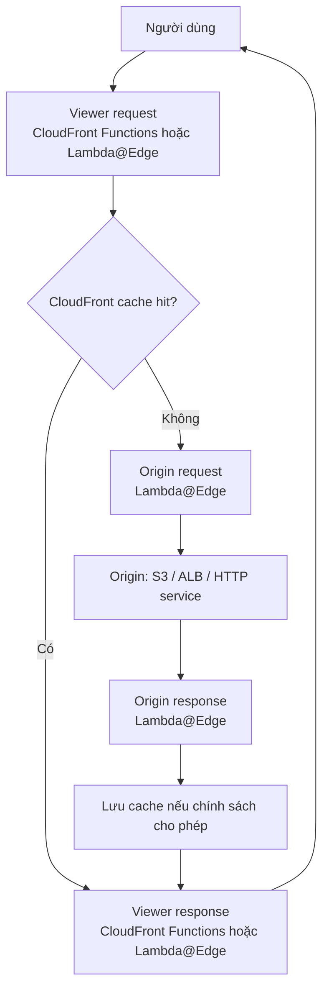
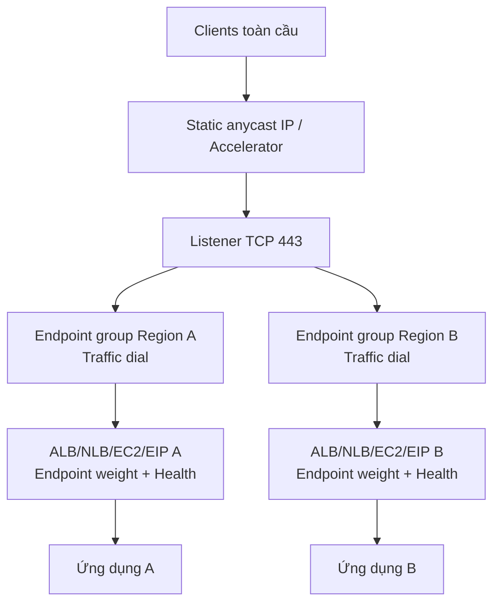
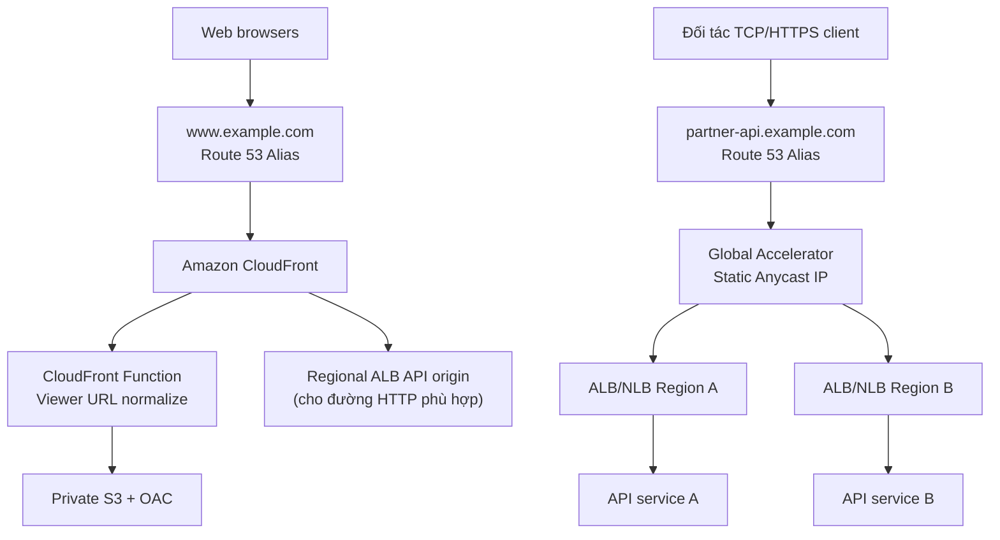

# CloudFront Functions, Lambda@Edge và Global Accelerator

Trong ứng dụng có người dùng ở nhiều quốc gia, đưa máy chủ EC2 hoặc Application Load Balancer (ALB) ra Internet mới giải quyết **khả năng truy cập**, chưa bảo đảm độ trễ thấp, khả năng phục hồi và kiểm soát request ở quy mô toàn cầu. AWS cung cấp hai hướng bổ sung: **Amazon CloudFront** để phân phối nội dung và xử lý HTTP gần người dùng, cùng **AWS Global Accelerator** để đưa lưu lượng TCP/UDP vào mạng toàn cầu AWS tới endpoint phù hợp.

Bên trong CloudFront, **CloudFront Functions** và **Lambda@Edge** cho phép chạy mã theo từng giai đoạn xử lý request/response. Hai dịch vụ cùng thuộc khái niệm *edge computing* nhưng khác trigger, khả năng xử lý và chi phí. Global Accelerator là lớp tăng tốc/định tuyến mạng, **không phải một kiểu edge function của CloudFront**.

Bài học thuộc chương **DNS và phân phối nội dung** của mô-đun **CLOUD_PROVIDERS_AWS**, nối với kiến thức AWS Region/AZ, IAM, VPC, EC2, ALB/NLB, S3, Route 53, Lambda, giám sát, khả năng phục hồi và kiểm soát chi phí. Qua bài học, bạn sẽ biết chọn dịch vụ, triển khai logic ở edge an toàn và thiết kế điểm vào toàn cầu cho ứng dụng.

## 1. Mục tiêu học tập

Sau bài học, bạn có thể:

1. Trình bày luồng **viewer → CloudFront edge → cache → origin** và vị trí chạy của các edge function.
2. Phân biệt **CloudFront Functions** với **Lambda@Edge** theo event, ngôn ngữ, khả năng truy cập mạng, body, thời gian xử lý và vòng đời triển khai.
3. Viết một CloudFront Function JavaScript cho viewer request để chuẩn hóa URL trước khi cache lookup.
4. Giải thích bốn Lambda@Edge events và cấu hình một Lambda version được publish từ `us-east-1`.
5. Mô tả Global Accelerator standard accelerator, anycast IP, listener, endpoint group, endpoint, health checks và traffic dial.
6. Chọn CloudFront, Lambda@Edge, Global Accelerator hoặc kết hợp những dịch vụ phù hợp cho web/API/TCP/UDP.
7. Kiểm tra cấu hình bằng AWS Console/CLI; nhận biết lỗi HTTP, routing, cache key, IAM và sức khỏe endpoint.
8. Thiết kế cách giám sát, ứng phó sự cố, failover, bảo mật TLS/WAF và ước tính chi phí.

## 2. Những khái niệm phải phân biệt trước

| Khái niệm | Chức năng | Ví dụ |
| --- | --- | --- |
| **DNS / Route 53** | Trả lời tên miền trỏ đến dịch vụ hoặc địa chỉ | `www.example.com` |
| **CloudFront distribution** | CDN có cache, TLS, chính sách request/response và origin | CloudFront phân phối ảnh S3 hoặc API ALB |
| **Edge location** | Điểm hiện diện gần người dùng của mạng AWS | Nơi CloudFront xử lý/cache nội dung |
| **Origin** | Nguồn nội dung khi CDN chưa có cache hoặc phải chuyển request | S3, ALB, custom HTTP origin |
| **Cache behavior** | Quy tắc áp cho nhóm đường dẫn, cache policy và edge association | `/assets/*`, `/api/*` |
| **CloudFront Functions** | JavaScript nhẹ chạy ở viewer request/response | Chuẩn hóa URI, redirect |
| **Lambda@Edge** | Lambda code thực thi tại edge/Regional Edge Cache theo CloudFront event | Logic ở origin request/response |
| **Global Accelerator** | Điểm vào IP anycast, chọn endpoint vùng cho TCP/UDP | Chuyển TCP 443 tới ALB tốt nhất |
| **ALB / NLB** | Phân tải tới target trong phạm vi dịch vụ Regional | ALB HTTP(S), NLB TCP/UDP |
| **AWS WAF** | Lọc HTTP(S) theo quy tắc bảo mật | Rate-based rules, managed rules |

**DNS không đồng nghĩa với CDN, CDN không đồng nghĩa với load balancer, và Global Accelerator không thay thế chức năng cache của CloudFront.** Mỗi lớp xử lý một phần khác nhau trong hành trình request.

Ví dụ: ứng dụng Java trong private subnets, phía trước là ALB, có ảnh trên S3. Đặt CloudFront trước S3/ALB sẽ giúp cache nội dung, áp WAF và thay đổi HTTP tại edge. Nếu một hệ thống khác dùng giao thức TCP riêng hoặc UDP, Global Accelerator có thể phù hợp hơn để đưa client tới NLB/EC2 tại Region khỏe mạnh.

## 3. Luồng xử lý CloudFront và các event

Khi client gọi `https://www.example.com/docs/guide.html`:

1. DNS trả về tên/địa chỉ của CloudFront distribution, client kết nối TLS tới CloudFront.
2. **Viewer request** event diễn ra khi CloudFront nhận request, trước khi kiểm tra cache.
3. CloudFront dùng cache key/policy để tìm bản cache phù hợp.
4. Nếu **cache hit**, CloudFront không cần gọi origin và không chạy **origin request/response** của yêu cầu đó.
5. Nếu **cache miss**, CloudFront chạy **origin request** trước khi gửi request tới origin, sau đó chạy **origin response** khi nhận phản hồi của origin.
6. **Viewer response** có thể diễn ra trước khi trả kết quả về client theo quy tắc event và giới hạn áp dụng.



Sơ đồ mô tả luồng điển hình; trong thực tế còn có AWS WAF, các lớp cache trung gian, origin failover, error caching và các quy tắc không kích hoạt edge function. **CloudFront không gọi viewer-response edge function khi origin trả HTTP status từ 400 trở lên**; Lambda@Edge tại origin-response vẫn có thể xử lý origin response lỗi trong phạm vi được hỗ trợ.

### 3.1. Event nào chạy mỗi request, event nào chạy khi cache miss?

| Event | Thời điểm | CloudFront Functions | Lambda@Edge |
| --- | --- | --- | --- |
| **Viewer request** | Trước kiểm tra cache | Có | Có |
| **Origin request** | Khi cần chuyển request tới origin | Không có trigger này | Có |
| **Origin response** | Sau phản hồi của origin khi được gọi | Không có trigger này | Có |
| **Viewer response** | Trước trả phản hồi tới viewer, theo giới hạn event | Có | Có |

**Ý nghĩa hiệu năng/chi phí:** viewer request thường chạy trên mỗi request thuộc behavior, trong khi origin request thường chỉ chạy trên cache miss. Nếu nhiệm vụ là biến đổi khi cache miss, Lambda@Edge origin-request có thể giảm số lần chạy so với logic viewer chạy mọi request. Nhưng nếu cần chuẩn hóa URI **trước** cache lookup, viewer-request lại là điểm đúng.

### 3.2. Hạn chế khi kết hợp edge functions

Trên **cùng một cache behavior**:

- Mỗi event chỉ gán tối đa **một** edge function.
- **Không** kết hợp CloudFront Functions với Lambda@Edge trong hai loại **viewer events** của cùng behavior.
- Có thể kết hợp **CloudFront Functions ở viewer request/response** với **Lambda@Edge ở origin request/response** khi cấu hình đúng.
- Edge function và CloudFront distribution được gán phải nằm trong **cùng AWS account**.
- Một URI được rewrite không tự thay đổi **cache behavior** đã chọn từ đường dẫn request ban đầu.

Vì vậy, hãy lập bảng trigger cho từng cache behavior trước khi gán nhiều function; không thử thêm một function mới vào viewer response khi viewer request của cùng behavior đã dùng Lambda@Edge.

## 4. CloudFront Functions: khi nào sử dụng?

**CloudFront Functions** là cách viết JavaScript gọn nhẹ để xử lý request/response của CloudFront tại viewer events. Thích hợp với thao tác nhanh, quy mô rất lớn và yêu cầu độ trễ thấp như:

- Chuyển hướng `/old` sang `/new`.
- Chuẩn hóa chữ thường, thêm `index.html` cho URL thư mục, hoặc đơn giản hóa query string phục vụ cache.
- Thêm/chỉnh header HTTP hợp lệ.
- Kiểm tra token/header đơn giản theo cơ chế an toàn đã thiết kế.
- Áp dụng feature flags/redirect mapping qua **CloudFront KeyValueStore**.
- Chọn/chỉnh origin bằng helper dành cho **viewer request** khi dùng runtime phù hợp.

### 4.1. Khả năng và giới hạn theo tính năng hiện hành

| Thuộc tính | CloudFront Functions |
| --- | --- |
| Ngôn ngữ | JavaScript với runtime hỗ trợ của CloudFront, trong đó có **JavaScript runtime 2.0** |
| Triggers | `viewer-request` và `viewer-response` |
| Truy cập request body | **Không đọc được** body request của viewer |
| Thời lượng và tài nguyên | Xử lý rất ngắn, memory/code size có quota riêng; không phù hợp tác vụ tính toán nặng |
| CloudFront KeyValueStore | Có, cần **runtime 2.0** |
| Truy cập file system / environment variables | Không |
| Gọi mạng | Runtime hiện hành hỗ trợ **tối đa một network call mỗi invocation** tới origin được cấu hình trong **cùng distribution**, kèm quota riêng |
| Thay đổi origin | Runtime 2.0 có helper `cf.updateRequestOrigin()`, `cf.selectRequestOriginById()` hoặc origin group tại **viewer request** |
| Triển khai | Tạo → kiểm thử `DEVELOPMENT` → Publish → gán `LIVE` với CloudFront behavior |

**Lưu ý cập nhật:** Một số tài liệu/tài nguyên học cũ mô tả CloudFront Functions “không thể gọi mạng hoặc đổi origin”. AWS hiện hỗ trợ một network call trong giới hạn và các helper sửa/chọn origin qua runtime 2.0. Điều này **không** biến Functions thành Lambda@Edge: không có origin-request/origin-response trigger, không truy cập body viewer, không có môi trường Node.js đầy đủ, không gọi API mạng tùy ý như Lambda thông thường.

Các giới hạn về size code, compute utilization và network calls có thể được AWS điều chỉnh; trước khi dùng production, tra [CloudFront Functions quotas](https://docs.aws.amazon.com/AmazonCloudFront/latest/DeveloperGuide/cloudfront-limits.html) và [Restrictions on CloudFront Functions](https://docs.aws.amazon.com/AmazonCloudFront/latest/DeveloperGuide/cloudfront-function-restrictions.html).

### 4.2. Ví dụ 1: rewrite URL thư mục thành index.html

Yêu cầu: với request `/docs/`, origin lưu file tại `/docs/index.html`. Ta dùng viewer-request function:

```javascript
// CloudFront Functions JavaScript runtime 2.0.
// Gắn vào viewer-request của cache behavior thích hợp.
function handler(event) {
  var request = event.request;
  var uri = request.uri;

  if (uri === "/" || uri.endsWith("/")) {
    request.uri = uri + "index.html";
  }

  return request;
}
```

Ví dụ:

| Request URI | URI chuyển tới phần xử lý tiếp theo |
| --- | --- |
| `/` | `/index.html` |
| `/docs/` | `/docs/index.html` |
| `/docs/guide.html` | Giữ nguyên |
| `/api/orders` | Giữ nguyên |

Đây là **rewrite nội bộ**, không gửi HTTP 301/302 cho browser. Đường dẫn hiển thị ở address bar vẫn như cũ. Query string được lưu trong thuộc tính khác của request; code này không sửa query string.

**Cần kiểm tra cache:** rewrite URI có thể ảnh hưởng cache key, nhưng không tự chuyển request sang cache behavior khác. Nếu behavior `/docs/*` và behavior `/api/*` có origin, auth hoặc cache policy khác nhau, hãy kiểm thử từng đường dẫn và không dùng rewrite để vượt ranh giới bảo mật.

### 4.3. Ví dụ 2: redirect URL cũ

Một function viewer-request có thể trả HTTP response trực tiếp:

```javascript
function handler(event) {
  var request = event.request;

  if (request.uri === "/legacy") {
    return {
      statusCode: 301,
      statusDescription: "Moved Permanently",
      headers: {
        "location": { value: "/new-home" },
        "cache-control": { value: "public, max-age=300" }
      }
    };
  }

  return request;
}
```

Kết quả khác rewrite: browser nhận **301** và có thể chuyển sang `/new-home`. Không xây redirect đích bằng query param không kiểm soát, ví dụ `?next=https://attacker.example`, vì có thể tạo **open redirect**.

Với ép HTTP sang HTTPS, trước tiên xem **Viewer protocol policy** của CloudFront; không cần viết function cho tính năng CloudFront đã cung cấp trực tiếp.

### 4.4. CloudFront KeyValueStore và feature flags

**CloudFront KeyValueStore (KVS)** là kho key-value toàn cầu cho CloudFront Functions runtime 2.0 đọc nhanh dữ liệu cấu hình tại edge. Nó giúp thay đổi mapping mà không cần publish lại code mỗi lần.

Ví dụ dữ liệu logic:

```json
{
  "redirect:/help": "/support",
  "feature:checkout-v2": "enabled",
  "maintenance:region-ap": "false"
}
```

Mẫu trên là mô tả dữ liệu, không phải JSON bắt buộc của API nhập KVS. Code thực tế dùng helper KVS qua module `cloudfront` với quyền và cấu hình KVS phù hợp.

**Đặt bí mật ở đâu?** Không dùng KVS để thay thế hạ tầng lưu secrets. Với auth ở edge, chỉ lưu dữ liệu công khai/ít nhạy cảm hoặc khóa theo cơ chế được AWS hỗ trợ, sử dụng kiểm chứng chữ ký và chính sách cập nhật phù hợp. Không hard-code private key, API token hoặc thông tin cá nhân vào mã function.

### 4.5. Chọn origin động ở viewer request

CloudFront Functions **runtime 2.0** hỗ trợ thay origin bằng helper của module `cloudfront`, ví dụ chọn một origin đã cấu hình:

```javascript
import cf from "cloudfront";

// Chỉ là mẫu minh họa.
// Trong distribution phải có origin ID "origin-maintenance".
function handler(event) {
  var request = event.request;

  if (request.uri.startsWith("/maintenance/")) {
    cf.selectRequestOriginById("origin-maintenance");
  }

  return request;
}
```

Ứng dụng thực tế cần kiểm tra **origin ID, cache behavior, host header, TLS certificate, origin access control (OAC), quyền S3/ALB và cache policy**. Helper `updateRequestOrigin()` còn có giới hạn riêng, chẳng hạn không thể dùng nó để cập nhật VPC origin; chọn VPC origin đã cấu hình bằng `selectRequestOriginById()` khi trường hợp được hỗ trợ.

Khả năng thay origin ở **viewer request** khác Lambda@Edge **origin request**: viewer request chạy thường xuyên hơn; origin request chỉ chạy lúc CloudFront cần gửi về origin. Quyết định dựa trên tính cacheable của traffic và công việc logic.

## 5. Kiểm thử và triển khai CloudFront Functions

### 5.1. Các bước Console

1. Mở [CloudFront Console](https://console.aws.amazon.com/cloudfront/), vào **Functions → Create function**.
2. Đặt tên có ý nghĩa, ví dụ `normalize-docs-url`; chọn JavaScript runtime phù hợp (ví dụ **2.0**).
3. Dán code đã review vào function ở **DEVELOPMENT stage**.
4. Dùng **Test** với sự kiện viewer-request mô phỏng nhiều URI, header và query string.
5. Kiểm tra `request.uri` hoặc `response.statusCode` trả về như mong muốn, cùng **compute utilization**.
6. Chọn **Publish function** để tạo phiên bản **LIVE** sau khi kiểm thử đạt.
7. Trong **Distributions → Behaviors → Edit**, chọn đúng behavior và gán function LIVE vào event **Viewer request** hoặc **Viewer response**.
8. Chờ distribution cập nhật xong, kiểm tra URL thực tế qua HTTPS và theo dõi tỷ lệ lỗi/latency.

**Không sửa trực tiếp production behavior để thử một ý tưởng chưa được xác minh.** Nếu origin có dữ liệu cá nhân hoặc API auth, cần kiểm tra toàn bộ cache key và quyền truy cập trước khi publish.

### 5.2. Kiểm tra ví dụ bằng test event

Một payload viewer-request mô phỏng có các trường chính như sau; có thể dùng dạng phù hợp giao diện test/CLI do AWS yêu cầu:

```json
{
  "version": "1.0",
  "context": {
    "eventType": "viewer-request"
  },
  "viewer": {
    "ip": "203.0.113.10"
  },
  "request": {
    "method": "GET",
    "uri": "/docs/",
    "headers": {
      "host": {
        "value": "www.example.com"
      }
    },
    "querystring": {},
    "cookies": {}
  }
}
```

Đây là **mẫu cấu trúc minh họa**; khi chạy `TestFunction` thực tế, sử dụng format đúng theo [CloudFront Functions event structure](https://docs.aws.amazon.com/AmazonCloudFront/latest/DeveloperGuide/functions-event-structure.html) và phiên bản test API. Kết quả kỳ vọng của ví dụ 4.2: `request.uri` trở thành `/docs/index.html`.

### 5.3. Cách kiểm thử kỹ hơn

| Tình huống | Kỳ vọng |
| --- | --- |
| `/` | Rewrite thành `/index.html` |
| `/docs/` | Rewrite thành `/docs/index.html` |
| `/docs/example.html` | Không thay |
| `/api/orders` | Không vô tình sửa API |
| Request có query string | Giữ query string nếu không chủ động thay |
| Path Unicode/URL-encoded | Xác nhận không phá encoding |
| Function error | Có cảnh báo và phương án rollback |
| Origin chưa sẵn sàng | Không để function tạo vòng redirect hoặc đường dẫn không tồn tại |

## 6. Lambda@Edge: chức năng và khác biệt với Lambda Region

**Lambda@Edge** là phần mở rộng của AWS Lambda tích hợp với CloudFront. Bạn viết **Node.js** hoặc **Python** theo runtime được hỗ trợ, xuất bản function từ **US East (N. Virginia), mã Region `us-east-1`**, rồi associate một **numbered function version** với distribution. CloudFront sao chép mã đến các vị trí AWS thích hợp để thực thi gần người dùng.

Lambda@Edge phù hợp khi logic phức tạp hơn:

- Cần xử lý ở **origin request** hoặc **origin response**.
- Cần thư viện ứng dụng, logic xác thực/chuyển đổi phức tạp hoặc tích hợp AWS service bên ngoài (trong giới hạn và độ trễ cho phép).
- Cần đọc request body theo tùy chọn **Include body**, có giới hạn kích thước/truncation.
- Cần thực hiện nhiều network calls hoặc logic chạy dài hơn CloudFront Functions.
- Cần thay đổi request trước khi gọi origin hoặc xử lý origin response trước khi trả/cache.

### 6.1. Bốn event của Lambda@Edge

| Trigger | Khi xảy ra | Bài toán phù hợp |
| --- | --- | --- |
| **Viewer request** | Mỗi viewer request thuộc behavior, trước cache lookup | Xác thực request phức tạp cần trước cache |
| **Origin request** | Khi cache miss và chuẩn bị gọi origin | Tạo header gửi origin, origin routing, kiểm tra backend |
| **Origin response** | Khi origin trả response cho lần gọi origin | Biến đổi response từ origin, xử lý một số lỗi origin |
| **Viewer response** | Khi trả tới viewer, theo quy tắc hỗ trợ | Thêm header đáp ứng yêu cầu đặc biệt |

Nếu mục tiêu đơn giản chỉ là HTTP response security headers, hãy kiểm tra **CloudFront Response Headers Policy** trước khi viết Lambda@Edge. Logic không cần chạy code thì policy quản lý sẵn thường dễ vận hành hơn.

### 6.2. Ví dụ Node.js cho origin request

Ví dụ bổ sung một header gắn nhãn môi trường vào request được chuyển tới origin:

```javascript
// Lambda@Edge origin-request handler.
// Publish function version tại us-east-1, sau đó associate với CloudFront.
exports.handler = async (event) => {
  const request = event.Records[0].cf.request;

  request.headers["x-edge-environment"] = [
    {
      key: "X-Edge-Environment",
      value: "production"
    }
  ];

  return request;
};
```

Sự khác biệt với CloudFront Functions:

- Sự kiện Lambda@Edge có cấu trúc `event.Records[0].cf.request`, không phải `event.request`.
- Header trong Lambda@Edge là **mảng các object** chứa `key/value`.
- Vì trigger là **origin request**, function thường được gọi khi CloudFront cần gửi request tới origin, **không phải trên mọi cache hit**.
- Header này chỉ là nhãn minh họa; **không dùng để quyết định quyền truy cập** nếu origin không có cơ chế tin cậy riêng để xác thực nguồn và chống giả mạo.

### 6.3. Các hạn chế triển khai quan trọng

| Giới hạn | Hệ quả thực tế |
| --- | --- |
| Tạo và publish Lambda@Edge function trong **`us-east-1`** | Lambda function chỉ ở Region ứng dụng như `ap-southeast-1` sẽ không dùng trực tiếp làm Lambda@Edge |
| Gán **numbered version** | Không dùng `$LATEST` hoặc alias làm CloudFront association |
| IAM trust policy | Execution role phải cho `lambda.amazonaws.com` và `edgelambda.amazonaws.com` assume |
| Không cấu hình function chạy trong VPC | Không truy cập tài nguyên private như Lambda VPC-attached thông thường; cần kiến trúc kết nối khác |
| Không dùng Lambda Layers, container image, provisioned concurrency theo giới hạn Lambda@Edge | Đóng gói dependencies phù hợp |
| Không dùng environment variables tùy chỉnh (trừ reserved) | Cấu hình qua phương án hỗ trợ, tránh hard-code bí mật |
| Giới hạn body | Viewer request body bị truncate đến **40 KB**, origin request đến **1 MB** ở cơ chế include body |
| Viewer response | Không được sửa HTTP status code ở Lambda@Edge viewer-response |
| Replication | Thay đổi và xóa function version có tác động tới replicas; không xóa version đang được distribution sử dụng |

Trước khi triển khai, xác minh runtime Node.js/Python nào đang được AWS hỗ trợ. **Không đóng đinh một phiên bản Node.js cũ** chỉ vì tutorial mẫu dùng nó. Tham khảo [Restrictions on Lambda@Edge](https://docs.aws.amazon.com/AmazonCloudFront/latest/DeveloperGuide/lambda-at-edge-function-restrictions.html).

### 6.4. Quy trình phát hành

1. Tạo Lambda function ở **`us-east-1`** với runtime được Lambda@Edge hỗ trợ.
2. Tạo execution role có đúng trust principals; giới hạn quyền IAM theo chức năng.
3. Viết code, chạy unit test, kiểm tra structured logs với dữ liệu giả lập; không log Authorization/Cookie/token.
4. Chọn **Publish new version** để có ARN dạng `arn:aws:lambda:us-east-1:123456789012:function:edge-origin-header:1`.
5. Mở CloudFront distribution, gán **ARN có suffix phiên bản** vào cache behavior và event phù hợp.
6. Chờ CloudFront distribution triển khai; test từ nhiều điểm và kiểm tra logs tại Region mà Lambda@Edge thực thi.
7. Khi thay đổi code, publish **version mới**, cập nhật association, kiểm tra propagation và có kế hoạch rollback về version cũ đã hoạt động.

**Không kỳ vọng sửa `$LATEST` sẽ thay thế ngay code đang chạy ở edge.** Bản đang được CloudFront sử dụng là **published numbered version**; CloudFront quản lý việc replicate và cập nhật deployment.

## 7. Chọn CloudFront Functions hay Lambda@Edge?

| Tiêu chí | CloudFront Functions | Lambda@Edge |
| --- | --- | --- |
| Trigger | Viewer request/response | Viewer + origin request/response |
| Ngôn ngữ | JavaScript runtime CloudFront | Node.js/Python |
| Công việc phù hợp | Rewrite, redirect, header, logic ngắn; KVS/ origin helper giới hạn | Xử lý phức tạp, body, nhiều network calls, origin events |
| Request body | Không | Có với Include body và giới hạn |
| Network | Một call tới configured origin trong hạn mức; không tùy ý | Truy cập mạng theo runtime/quyền và hạn mức |
| File system | Không | Có trong giới hạn runtime Lambda@Edge |
| Dữ liệu cấu hình | KeyValueStore runtime 2.0 | Cần thiết kế nguồn config phù hợp, không có custom env vars |
| Deployment | Phát hành LIVE trong CloudFront | Lambda function version tại `us-east-1`, replicate |
| Chi phí chính | Function invocations và thành phần liên quan | Invocations + duration/compute và thành phần liên quan |
| Debug | Test Function/compute utilization/logs | Lambda logs/CloudWatch tại Region thực thi |
| Rủi ro | Code lỗi trên lượng request lớn, thay cache key/redirect | Cold start, dependencies, thời gian chạy, IAM và replication |

### 7.1. Quy tắc ra quyết định

- Chỉ thêm `index.html` hoặc redirect `/old`: dùng **CloudFront Functions**.
- Header theo chính sách cố định: ưu tiên **CloudFront Response Headers Policy** nếu đủ.
- Feature flags/mapping ngắn cần cập nhật độc lập: **CloudFront Functions + KVS**.
- Đổi origin ngay ở viewer request với helper hỗ trợ: xem **CloudFront Functions runtime 2.0**.
- Muốn chạy khi **origin response** và sửa dữ liệu/metadata theo logic code: **Lambda@Edge**.
- Cần SDK/thư viện và request body theo hạn mức: **Lambda@Edge**, kèm chi phí/độ trễ đo được.
- Dịch vụ phải xử lý request TCP/UDP không phải HTTP CDN: xem **Global Accelerator**, không chọn CloudFront Functions làm TCP proxy.

## 8. Global Accelerator: tăng tốc ở lớp mạng

**AWS Global Accelerator** là dịch vụ toàn cầu cung cấp điểm vào ổn định bằng **địa chỉ IP anycast**. Client kết nối tới IP được công bố từ các AWS edge locations; traffic đi qua **AWS global network** tới endpoint thích hợp ở một hoặc nhiều Region.

**Standard accelerator** chuyển traffic dựa trên:

- Vị trí mạng của client và điều kiện đường đi qua AWS global network.
- Trạng thái **healthy** của regional endpoints.
- Các chính sách như **traffic dial** của endpoint group và **endpoint weight**.
- Listener protocol/port và các giới hạn dịch vụ.

Global Accelerator **không lưu cache object**, không thực thi JavaScript edge code, và **không tự terminate HTTP/TLS như CloudFront/ALB**. Đối với HTTPS/TCP, TLS termination thường nằm ở ALB/NLB ứng dụng hoặc backend phù hợp.

### 8.1. Static anycast IP là gì?

Địa chỉ **anycast** là địa chỉ IP được quảng bá từ nhiều điểm mạng. Gói của client tới IP đó được đưa vào điểm phù hợp trong mạng toàn cầu.

Global Accelerator standard accelerator:

- Loại **IPv4** mặc định nhận **hai static IPv4 anycast addresses**.
- Loại **dual-stack** nhận **hai static IPv4 và hai static IPv6 addresses**; endpoint dual-stack phải đáp ứng yêu cầu tương ứng.
- Có thể dùng **BYOIP** cho trường hợp IPv4 được hỗ trợ.
- IP ổn định trong suốt vòng đời accelerator, kể cả khi **disabled**; **xóa accelerator** sẽ mất các địa chỉ mặc định đó.
- Có DNS name do Global Accelerator cấp, ví dụ `a1234567890abcdef.awsglobalaccelerator.com`.

Điều này hữu ích khi doanh nghiệp hoặc đối tác cần **allowlist IP cố định**, trong khi các regional load balancer hoặc EC2 đích thay đổi theo hoạt động scaling/failover.

### 8.2. Các thành phần của standard accelerator



| Thành phần | Ý nghĩa |
| --- | --- |
| **Accelerator** | Đối tượng toàn cầu sở hữu IP anycast và các listener |
| **Listener** | Chấp nhận **TCP hoặc UDP** trên một hoặc nhiều port/port range |
| **Endpoint group** | Nhóm endpoint trong **một AWS Region**, gắn với listener |
| **Endpoint** | Tài nguyên nhận traffic: **ALB, NLB, EC2 instance, Elastic IP** trong standard accelerator |
| **Traffic dial** | Tùy chỉnh phần lưu lượng đi tới một **Region endpoint group** |
| **Endpoint weight** | Phân phối traffic giữa endpoints trong một group khi có nhiều endpoint |
| **Health check** | Đánh giá sức khỏe đích để điều hướng traffic phù hợp |

**Traffic dial 50% không có nghĩa toàn thế giới sẽ chia đúng 50:50 giữa hai Region.** Nó được áp lên lượng traffic vốn đã được Global Accelerator định hướng tới endpoint group đó; lựa chọn Region còn phụ thuộc vị trí client, sức khỏe endpoint và chính sách khác. Muốn thử chia tải cần đo số kết nối/bytes thực tế.

### 8.3. Standard và custom routing accelerator

| Loại | Cách chọn đích | Phạm vi |
| --- | --- | --- |
| **Standard accelerator** | Global Accelerator chọn endpoint khỏe mạnh/tối ưu theo chính sách | Web/API, TCP/UDP service cần HA và điểm vào cố định |
| **Custom routing accelerator** | Client dùng mapping **IP + port** được cung cấp để đến một EC2 đích xác định trong các VPC subnet được cấu hình | Ứng dụng có yêu cầu client gắn tới server đích, ví dụ một số workload game/session |

Custom routing không dùng cùng mô hình routing/health check/endpoint với standard; bài thực hành dưới đây tập trung **standard accelerator**.

### 8.4. Health checks và failover

Khi standard accelerator có endpoints tại hai Region:

1. Global Accelerator theo dõi sức khỏe endpoints theo cấu hình.
2. Nếu endpoint không healthy, traffic có thể được chuyển sang endpoint healthy khác theo chính sách.
3. Khi dùng ALB/NLB endpoint, health check được cấu hình tại **load balancer**; với EC2/EIP endpoints, cấu hình health check ở Global Accelerator endpoint group.
4. Endpoint group và traffic dial/weight ảnh hưởng phân phối khi endpoint đang healthy.
5. **Nếu không còn endpoint nào healthy**, Global Accelerator có thể route traffic tới **tất cả endpoints** theo hành vi fail-open được AWS mô tả; không coi điều này là một cơ chế chặn traffic tuyệt đối.

**Health check không phải backup dữ liệu.** Nếu Region A bị lỗi cơ sở dữ liệu hoặc dữ liệu chưa replicate sang Region B, Global Accelerator không tự chuyển/đồng bộ dữ liệu. Failover ứng dụng còn đòi hỏi chiến lược **RPO/RTO**, consistency, database replication và khả năng hoạt động độc lập của đích.

### 8.5. Client IP và bảo mật mạng

Một số endpoint types hỗ trợ **client IP preservation** theo điều kiện riêng; không giả định mọi kiểu endpoint đều nhìn thấy source IP gốc như nhau. Kiểm tra loại endpoint, security group và hướng dẫn AWS trước khi dùng IP làm tín hiệu bảo mật.

Có thể có **internal ALB** làm endpoint của Global Accelerator trong kiến trúc được hỗ trợ. Khi thiết kế, vẫn phải kiểm tra yêu cầu IGW/định tuyến của VPC, security group và cách AWS đưa traffic tới endpoint. **Không hiểu nhầm rằng mọi private IP bất kỳ trong VPC đều tự trở thành endpoint hỗ trợ**.

WAF bảo vệ HTTP(S) ở các lớp được hỗ trợ như CloudFront hoặc ALB; Global Accelerator bản thân là đường vào TCP/UDP và không thay bộ lọc HTTP nâng cao.

## 9. Route 53 và Global Accelerator: phối hợp DNS

Global Accelerator cấp **DNS name** và static IPs. Nếu tổ chức dùng `api.example.com`:

1. Tạo accelerator với listener và endpoints.
2. Trong **Amazon Route 53**, tạo **Alias A** đến Global Accelerator cho domain IPv4.
3. Nếu dùng dual-stack và cần IPv6, cấu hình **AAAA/alias** phù hợp.
4. Nếu DNS provider khác Route 53, có thể cấu hình bản ghi theo tài liệu DNS của nhà cung cấp.
5. Chờ thay đổi DNS lan truyền và kiểm tra phân giải bằng `dig`/`nslookup`.

**Lưu ý quan trọng:** DNS chỉ giúp tìm **điểm vào cố định**. Global Accelerator quyết định điều hướng endpoint cho connection sau đó; bạn không nhất thiết phải đổi DNS record khi chuyển traffic giữa các Region. Việc thay IP của accelerator do **xóa accelerator** hoặc thay chính accelerator là thao tác có ảnh hưởng lớn, cần quản lý riêng.

### 9.1. Global Accelerator khác Route 53 routing policies thế nào?

| Khía cạnh | Route 53 DNS routing | Global Accelerator |
| --- | --- | --- |
| Điểm điều khiển | Kết quả truy vấn DNS | TCP/UDP traffic vào static anycast IP |
| Cơ chế chuyển hướng | Trả địa chỉ/alias khác theo policy/health | Điều hướng qua mạng AWS tới endpoint thích hợp |
| Ảnh hưởng cache | DNS TTL và resolver/browser/client cache | Điểm vào IP vẫn giữ, thay mapping endpoint |
| Phạm vi | Tên miền | Kết nối TCP/UDP |
| Tính năng | Weighted, latency, failover, geolocation DNS... | Health, network routing, regional traffic dial/weights |
| Dữ liệu ứng dụng | Không cache body HTTP | Không cache body HTTP |

**Không hứa hẹn failover tức thì cho mọi phiên TCP đang mở.** Health check và thay mapping cần thời gian; phiên cũ có thể lỗi và client phải reconnect. Ứng dụng cần retry an toàn và cơ chế tránh ghi dữ liệu trùng khi reconnect.

## 10. CloudFront và Global Accelerator: nên chọn gì?

| Câu hỏi | **CloudFront (+ edge functions)** | **Global Accelerator** |
| --- | --- | --- |
| Cần cache ảnh, CSS, JavaScript, video hoặc HTTP responses? | **Có** | Không |
| Cần sửa URL/header hoặc auth ở gần viewer? | **Có** | Không có HTTP edge function |
| Cần ổn định địa chỉ IP anycast để đối tác allowlist? | Không phải cách dùng chính | **Có** |
| Ứng dụng dùng giao thức UDP hoặc TCP không phải HTTP? | Không phù hợp như CDN thông thường | **Có**, qua listener/endpoint hỗ trợ |
| Tự động chọn endpoint khỏe mạnh ở nhiều AWS Regions? | Có origin failover theo chức năng CloudFront cho HTTP khi cấu hình | Có routing/health theo endpoint và chính sách |
| Cần giảm tải origin bằng edge cache? | **Có** | Không |
| Cần Route 53 custom domain? | Có thể dùng alias đến CloudFront distribution | Có thể dùng alias đến Global Accelerator |
| Bảo mật HTTP bằng AWS WAF? | Hỗ trợ WAF integration | WAF thường áp ở ALB, không trực tiếp thay bởi GA |
| Chi phí thường tính | Request, data transfer, edge invocations/compute | Hourly accelerator + data transfer premium + phí mạng khác |

### 10.1. Ba tình huống chọn dịch vụ

**Tình huống A — Trang thương mại điện tử có ảnh trên S3 và API trên ALB.** CloudFront làm CDN và cache tĩnh; CloudFront Functions rewrite đường dẫn hoặc redirect; Lambda@Edge chỉ cần nếu có xử lý HTTP phức tạp ở origin events. Bảo vệ S3 origin bằng **Origin Access Control (OAC)**, kiểm soát cache của API.

**Tình huống B — API giao tiếp HTTPS đa Region, khách hàng doanh nghiệp cần allowlist IP cố định.** Global Accelerator standard với ALB/NLB endpoints có thể phù hợp; vẫn cần thiết kế failover database, SSL/TLS, health và IAM. Nếu API muốn cache GET response, có thể cân nhắc CloudFront như một lớp giải quyết cache theo kiến trúc riêng.

**Tình huống C — Ứng dụng game dùng TCP/UDP phải giữ điểm kết nối ổn định.** Global Accelerator hướng traffic tới NLB/EC2 endpoint là hướng phù hợp hơn CloudFront Functions; chú ý tính chất **session** và reconnect khi failover.

**Không thể dùng trực tiếp CloudFront distribution làm một endpoint loại standard accelerator**: endpoint được hỗ trợ là ALB, NLB, EC2 hoặc Elastic IP. Do đó khi xây dựng hệ thống kết hợp, cần vẽ **hai luồng traffic** hoặc thiết kế origin cụ thể, không vẽ một mũi tên “GA endpoint → CloudFront distribution” như cấu hình standard endpoint hợp lệ.

## 11. Thiết kế mẫu toàn cầu: hai đường truy cập

Giả sử ứng dụng có phần web tĩnh và API yêu cầu IP cho đối tác:



Sơ đồ giản lược cho mục đích lựa chọn dịch vụ. CloudFront function thực tế được gọi **trước hoặc sau cache** tùy trigger; nó không phải một “máy chủ trung gian” độc lập. Hai tên miền có thể dùng backend giống hoặc khác nhau nhưng cần tách cache policy, authentication, CORS, TLS và lưu lượng để tránh tạo vòng lặp.

## 12. Console: tạo standard Global Accelerator

> **Chi phí:** Tạo Global Accelerator có thể phát sinh phí ngay cả khi không có traffic, kể cả khi accelerator bị disable. Các bước này dành cho sandbox đã được cấp quyền/ngân sách; phần thực hành mô phỏng ở mục 17 không yêu cầu tạo tài nguyên thật.

1. Truy cập [Global Accelerator Console](https://console.aws.amazon.com/globalaccelerator/) bằng account được ủy quyền.
2. Chọn **Create accelerator → Standard**, đặt tên ví dụ `partner-api-global`.
3. Chọn **IPv4** hoặc **Dual-stack** theo yêu cầu endpoint và client.
4. Ghi lại **two static IPv4 addresses** (và IPv6 nếu có) cùng DNS name sau khi tạo.
5. Thêm **listener** `TCP 443` (hoặc UDP/port khác thực sự cần).
6. Tạo **endpoint group** cho các Region cần phục vụ, ví dụ `ap-southeast-1` và `us-east-1`.
7. Với mỗi Region, chọn endpoint **ALB/NLB/EC2/EIP** hợp lệ đã có, kiểm tra listener target và health check.
8. Xác định **traffic dial** ở cấp Region, **endpoint weights** ở cấp endpoint nếu cần.
9. Chờ accelerator/endpoint vào trạng thái phù hợp; kiểm tra với client thật ở phạm vi được phép.
10. Trong Route 53, tạo alias domain ứng dụng tới accelerator nếu muốn dùng custom hostname.

**Kiểm tra trước khi cấp traffic:** TLS certificate trên ALB/backend, health check path/port, Security Group/NACL, target group, database replication và retry behavior của client.

### 12.1. Về mức traffic dial

Một ví dụ triển khai cân bằng theo chính sách:

| Endpoint group | Traffic dial | Mục tiêu |
| --- | ---: | --- |
| Region A | 100% | Phục vụ traffic đủ điều kiện |
| Region B | 100% | Có thể phục vụ traffic đủ điều kiện |
| Region B khi canary | 10% | Giới hạn phần traffic vốn được hướng về group B |

Giảm traffic dial giúp kiểm soát traffic khi thử nghiệm hoặc sự cố, nhưng **không phải thuật toán chia tỉ lệ tuyệt đối giữa các Region**. Nếu muốn so sánh tỉ lệ phân phối, cần lấy CloudWatch metrics/tracing theo thực tế.

## 13. AWS CLI: đọc cấu hình CloudFront, Lambda@Edge và Global Accelerator

Dùng AWS CLI v2 với profile IAM Identity Center/role được cấp quyền. Các lệnh trong mục này **chỉ đọc** và cần thay tên, ARN, Region theo tài khoản thực tế.

### 13.1. CloudFront và CloudFront Functions

```bash
# Kiểm tra danh tính.
aws sts get-caller-identity --profile training

# Liệt kê CloudFront distributions.
aws cloudfront list-distributions \
  --profile training

# Liệt kê các CloudFront Functions ở LIVE stage.
aws cloudfront list-functions \
  --stage LIVE \
  --profile training

# Xem thông tin cấu hình Function đã có.
aws cloudfront describe-function \
  --name normalize-docs-url \
  --stage LIVE \
  --profile training
```

CloudFront là dịch vụ phân phối toàn cầu; AWS CLI có thể dùng cấu hình Region mặc định phù hợp. Trong phân tích thực tế, quan trọng là **distribution ID, behavior, viewer event association, function stage và trạng thái deployment**.

### 13.2. Lambda@Edge

```bash
# Lambda@Edge function được publish từ us-east-1.
aws lambda list-functions \
  --region us-east-1 \
  --profile training

# Xem các numbered published versions.
aws lambda list-versions-by-function \
  --function-name edge-origin-header \
  --region us-east-1 \
  --profile training
```

Nếu thấy function ở `ap-southeast-1` mà không thấy ở `us-east-1`, đó có thể là Lambda Regional thông thường, không phải version có thể associate theo yêu cầu Lambda@Edge.

### 13.3. Global Accelerator

**Global Accelerator là dịch vụ toàn cầu, nhưng AWS CLI/API cho quản lý accelerator dùng Region `us-west-2`.** Đây là Region control plane, **không có nghĩa endpoint phải đặt ở Oregon**.

```bash
# Liệt kê accelerators.
aws globalaccelerator list-accelerators \
  --region us-west-2 \
  --profile training

# Xem listeners của accelerator.
aws globalaccelerator list-listeners \
  --accelerator-arn "arn:aws:globalaccelerator::123456789012:accelerator/EXAMPLE-ID" \
  --region us-west-2 \
  --profile training

# Xem endpoint groups sau khi có Listener ARN thật.
aws globalaccelerator list-endpoint-groups \
  --listener-arn "arn:aws:globalaccelerator::123456789012:accelerator/EXAMPLE-ID/listener/EXAMPLE-LISTENER" \
  --region us-west-2 \
  --profile training
```

ARN là placeholder. Nếu lệnh báo ResourceNotFound, kiểm tra account/ARN, quyền xem và control-plane Region trước khi kết luận accelerator chưa tồn tại.

### 13.4. Mẫu lệnh tạo accelerator (có tính phí)

Ví dụ cú pháp để hiểu API; **không chạy** khi chưa có ngân sách và endpoint design được phê duyệt:

```bash
# GHI TÀI NGUYÊN, CÓ THỂ PHÁT SINH PHÍ NGAY.
aws globalaccelerator create-accelerator \
  --name partner-api-global \
  --ip-address-type IPV4 \
  --enabled \
  --region us-west-2 \
  --profile training
```

Lệnh chỉ tạo accelerator, **chưa có listener, endpoint group hay endpoint**. Tạo accelerator không đủ để ứng dụng hoạt động. Việc xóa lại có thể làm mất static IPs đã cấp; không dùng accelerator production cho bài tập thử nghiệm.

## 14. Kiểm soát bảo mật khi xử lý tại edge

### 14.1. TLS, WAF và quyền origin

- CloudFront custom domain dùng TLS certificate phù hợp với cơ chế CloudFront (thường ACM certificate tại **`us-east-1`**).
- Với **S3 private bucket origin**, dùng **Origin Access Control (OAC)** và bucket policy chỉ cho phép CloudFront distribution truy cập theo nguyên tắc tối thiểu.
- Với custom origin/ALB, cấu hình HTTPS tới origin và hạn chế truy cập bypass CDN khi kiến trúc yêu cầu.
- Dùng **AWS WAF** trên CloudFront hoặc ALB theo phạm vi hỗ trợ; không tự viết bộ chống DDoS đầy đủ trong một function JavaScript.
- Với Global Accelerator, endpoint phải có TLS/health, SG/NACL và quyền truy cập phù hợp; GA không tự thay Certificate Manager, WAF, IAM hoặc kiểm soát ứng dụng.

### 14.2. Cache policy và dữ liệu nhạy cảm

**Rủi ro lớn nhất của CDN API:** cache một response chứa dữ liệu của user A và phục vụ nhầm cho user B do cache key thiếu yếu tố phân biệt.

Ví dụ `GET /api/profile` trả nội dung riêng của user. Nếu response có `Cache-Control: public` hoặc CloudFront cache policy cho phép caching trong khi cache key không tách theo danh tính, người dùng có thể nhận dữ liệu không đúng.

Hướng xử lý:

1. Phân loại endpoint: tĩnh/public, dynamic/public, private/personalized.
2. Thiết kế cache policy/origin request policy đúng cho mỗi behavior.
3. Với response cá nhân, cấu hình **không cache** hoặc bảo đảm cache key và authorization an toàn ở tất cả lớp liên quan; phương án mặc định thường là không cache.
4. Tránh đưa raw token, Authorization, Cookie/PII vào cache key, logs hoặc response header không cần thiết.
5. Kiểm thử **hai người dùng khác nhau** để phát hiện rò rỉ do cache.
6. Khi thay cache policy hoặc edge logic, thực hiện kiểm tra bảo mật và cơ chế rollback/invalidation nếu cần.

### 14.3. Giới hạn quyền triển khai

- IAM role cho nhóm Dev chỉ được phát hành CloudFront Function của dự án trong account được giao.
- Nhóm vận hành review association/function version trên distribution.
- Lambda@Edge execution role chỉ có quyền AWS API thực sự cần; không dùng AdministratorAccess để tiện.
- Bảo vệ Global Accelerator khỏi thay đổi endpoint/traffic dial bất thường bằng IAM policy/CloudTrail và phê duyệt.
- Đặt tag Owner/Environment/CostCenter cho tài nguyên có hỗ trợ, tăng khả năng kiểm toán.
- Không log credential, JWT, cookie session hoặc dữ liệu cá nhân trong Function/Lambda logs.

## 15. Quan sát, giám sát và chi phí

### 15.1. CloudFront Functions

| Tín hiệu | Ý nghĩa |
| --- | --- |
| **Invocations** | Số lần function chạy theo traffic |
| **Function execution errors** | Lỗi thực thi hoặc validation |
| **Compute utilization** | Tỷ lệ thời gian xử lý so với ngân sách compute của Function |
| **CloudFront 4XX/5XX** | Có thể phản ánh lỗi origin, WAF, edge function hoặc viewer |
| **CacheHitRate** | Giúp đánh giá hiệu quả caching khi rewrite/cache key được điều chỉnh |
| **Logs** | Hỗ trợ debug; giới hạn dung lượng log mỗi invocation |

Chi phí có thể gồm **CloudFront Functions invocations**, KVS khi sử dụng, network call theo tính năng, CloudFront requests/data transfer và logs/monitoring. Kiểm tra [CloudFront pricing](https://aws.amazon.com/cloudfront/pricing/) theo Region và usage.

### 15.2. Lambda@Edge

Giám sát:

- Invocations, errors, duration/throttles và CloudWatch logs.
- Chi phí Lambda@Edge theo invocations và compute duration/GB-seconds theo bảng giá tương ứng.
- Độ trễ do logic, downstream API/DNS, timeout và code startup.
- Những Region nơi code được invoke có thể tạo log groups ở Region đó; kiểm tra đúng Region và policy log retention.

Lambda@Edge chạy ở vị trí AWS thích hợp và logs có thể phân tán; không giới hạn tìm log trong Region `us-east-1` chỉ vì Lambda source được publish ở đó.

### 15.3. Global Accelerator

Theo dõi:

- Trạng thái accelerator và endpoint group/endpoint health.
- **CloudWatch metrics** về traffic xử lý, kết nối, chất lượng mạng theo những metric AWS cung cấp.
- **Flow logs** theo tính năng được hỗ trợ để chẩn đoán traffic.
- **CloudTrail** cho thao tác tạo/sửa accelerator, listener, endpoint group, traffic dial và endpoints.
- Health của **ALB/NLB/EC2** thực tế và thông tin retry của client.
- Chi phí theo accelerator, data transfer premium, public IPv4 address và dịch vụ endpoint.

**Điểm chi phí dễ quên:** Global Accelerator có **phí theo giờ cho accelerator đã provision, kể cả disabled**, cộng phí dữ liệu theo quy định và **phí public IPv4 addresses** phù hợp, ngoài phí ALB/NLB/EC2 và dữ liệu. Đừng giữ accelerator thử nghiệm tồn tại chỉ vì “đã tắt” mà tưởng không tốn phí. Tham khảo [Global Accelerator pricing](https://aws.amazon.com/global-accelerator/pricing/).

### 15.4. Bảng chọn thứ tự tối ưu

| Triệu chứng | Dữ liệu cần quan sát | Hành động |
| --- | --- | --- |
| Cache hit thấp | Cache policy, URL/query normalization, object headers | Sửa cache key/TTL với kiểm thử bảo mật |
| 5XX tăng sau deploy Function | Function errors, CloudFront logs, version/stage | Rollback association/LIVE theo quy trình |
| Lambda@Edge latency cao | Duration, downstream calls, cold start, logs | Tối ưu code, giảm network calls, cân nhắc Functions nếu đủ |
| Global Accelerator route sang Region không mong đợi | Health, endpoint weights, traffic dial, client location | Kiểm tra định tuyến, endpoint health và policy |
| Failover vẫn trả lỗi | Endpoints đều unhealthy, DB/data không sẵn sàng, client retry | Kiểm tra dependency, fail-open, RPO/RTO |
| Hóa đơn tăng | Edge invocations, data transfer, GA hourly phí | Đối chiếu Cost Explorer/Budgets và traffic thực tế |

## 16. Troubleshooting: các lỗi thường gặp

| Triệu chứng | Nguyên nhân có thể | Kiểm tra ưu tiên |
| --- | --- | --- |
| CloudFront Function mới không chạy | Chưa publish **LIVE** hoặc chưa associate đúng behavior/event | Xem stage, association, distribution deployment |
| Function trả HTTP 502 | Function lỗi, trả object sai schema, chỉnh header bị cấm | TestFunction, CloudFront function logs và event restrictions |
| Rewrite URL không tới origin mong muốn | Rewrite `uri` không thay cache behavior đã chọn | Xem cache behavior path pattern, origin ID và cache policy |
| Function ở viewer response không chạy với 4XX/5XX origin | Giới hạn event với origin status từ 400 trở lên | Kiểm tra origin response status và event trigger |
| KVS không hoạt động | Function không dùng runtime 2.0 hoặc chưa gán store | Xem runtime, association, KVS permission/quota |
| Network call Functions thất bại | Destination không phải configured origin hoặc vượt quota | Kiểm tra one-call limit, timeout và origin config |
| Lambda@Edge không associate được | Function ở sai Region, dùng `$LATEST`/alias, thiếu IAM role | Xem `us-east-1`, numbered version, trust principals |
| Lambda@Edge không đọc được private VPC resource | Lambda@Edge không được cấu hình VPC như Lambda Regional | Thiết kế endpoint công khai có bảo mật hoặc kiến trúc khác |
| Lambda@Edge origin-request không chạy khi cache hit | Origin event chỉ xảy ra khi request cần origin | Kiểm tra cache hit/miss, behavior và trigger |
| Global Accelerator chưa nhận request | Chưa có listener, endpoint group/endpoint hoặc sai port | Xem listener TCP/UDP, endpoint health, SG/NACL |
| Traffic không chia đúng 50:50 giữa Region | Traffic dial không biểu diễn global traffic share cố định | Xem client location, health, dial/weight |
| Client gặp lỗi dù GA IP vẫn hoạt động | Endpoint unhealthy hoặc toàn bộ endpoints unhealthy, app/DB fail | Xem health check, fail-open và app logs |
| Global Accelerator CLI không tìm thấy accelerator | Dùng sai AWS account hoặc control-plane Region | Dùng `--region us-west-2` |
| Domain giải sai | Route 53 alias sai hoặc DNS caching | `dig`/`nslookup`, hosted zone, alias target |
| HTTPS lỗi certificate | CloudFront custom-domain certificate hoặc ALB/backend TLS sai | Xem ACM Region, host, SNI và certificate chain |

### Quy trình xử lý lỗi theo từng lớp

1. **DNS:** Client giải đúng host và tên/địa chỉ entrypoint không?
2. **TLS:** Certificate có phù hợp host, chain và protocol không?
3. **Edge/accelerator:** Đúng CloudFront distribution hoặc GA accelerator, listener/event?
4. **Function:** Code đang ở stage/version nào, trigger đã associate chưa, có error?
5. **Cache:** Cache hit/miss, cache policy, origin request policy, URI rewrite?
6. **Regional endpoint:** ALB/NLB/EC2 healthy, listener/target group/SG/NACL đúng không?
7. **Ứng dụng:** API/DB/downstream có sẵn sàng, có state replication và retry an toàn không?
8. **Giám sát/chi phí:** Metrics, CloudTrail, logs và invoices có chỉ ra thay đổi gần đây không?

**Không tự tăng TTL, tắt WAF hoặc bật public access của S3 để “sửa tạm” lỗi chưa hiểu rõ.** Đó có thể làm lỗi bảo mật nặng hơn và che nguyên nhân gốc.

## 17. Thực hành có hướng dẫn (không cần tạo tài nguyên tính phí)

**Bối cảnh:** một nhóm có frontend JavaScript tĩnh và API Java. Frontend có tài nguyên tại S3; API chạy sau ALB tại `ap-southeast-1`. Nhóm dự kiến mở thêm Region khác cho khách hàng và có đối tác yêu cầu allowlist IP cố định.

### Nhiệm vụ A — Chọn dịch vụ

Xác định giải pháp cho từng yêu cầu:

| Yêu cầu | Giải pháp tham khảo | Giải thích |
| --- | --- | --- |
| Cache ảnh/CSS/JS trên Internet | CloudFront + S3 private origin | Giảm request tới S3/origin |
| Rewrite `/docs/` → `/docs/index.html` | CloudFront Function viewer-request | Sửa URI trước cache lookup |
| Đọc request body hoặc xử lý tại origin response | Lambda@Edge theo event phù hợp | Functions không đọc viewer body/không có origin event |
| Thay header bảo mật tĩnh | CloudFront Response Headers Policy | Không cần code |
| Dùng KVS để đổi redirect mapping | CloudFront Functions runtime 2.0 + KVS | Cập nhật dữ liệu ngoài code |
| TCP service cần IP allowlist ổn định và failover Region | Global Accelerator standard | Anycast IP + healthy endpoints |
| API có kết quả riêng cho từng user | Behavior không cache hoặc policy xác thực an toàn | Tránh cache leak |

### Nhiệm vụ B — Dự đoán event

Một CloudFront behavior có:

- Viewer-request CloudFront Function rewrite `/docs/`.
- Origin-request Lambda@Edge thêm `X-Edge-Environment`.
- TTL cache cho `/docs/index.html`.

Trả lời:

1. Khi viewer đầu tiên gọi `/docs/` và cache miss, **function nào chạy**?
2. Khi viewer thứ hai gọi cùng đường dẫn và cache hit, **origin-request Lambda@Edge có chạy không**?
3. Nếu origin trả HTTP 404, viewer-response edge function có chắc chạy không?
4. Có thể gắn thêm Lambda@Edge viewer-response vào cùng behavior đã dùng CloudFront Functions viewer-request không?
5. Vì sao rewrite URI không có nghĩa chuyển sang cache behavior khác?

### Nhiệm vụ C — Dự đoán Global Accelerator

Một standard accelerator có hai endpoint groups:

- Region A: ALB A healthy, traffic dial 100%.
- Region B: ALB B healthy, traffic dial 100%.

Trả lời:

1. Client bắt đầu TCP 443 kết nối vào thành phần nào?
2. Có thể kết luận A và B chắc chắn nhận đúng 50% connections không?
3. Khi ALB A unhealthy, điều gì cần quan sát trước khi nói failover thành công?
4. Nếu cả ALB A và ALB B đều unhealthy, Global Accelerator có mặc định chặn mọi kết nối không?
5. Vì sao database chưa replicate sang Region B có thể khiến ứng dụng lỗi dù routing đã failover?

### Nhiệm vụ D — Kiểm tra read-only nếu có AWS account

Nếu được cấp account có sẵn CloudFront/GA:

1. Dùng `aws sts get-caller-identity` xác nhận account.
2. Dùng `aws cloudfront list-distributions` xem distribution ID/behavior.
3. Dùng `aws cloudfront list-functions --stage LIVE` xác nhận Functions đang publish.
4. Dùng `aws lambda list-versions-by-function --region us-east-1` xác minh Lambda@Edge numbered versions nếu có.
5. Dùng `aws globalaccelerator list-accelerators --region us-west-2` kiểm tra accelerator và static IP.
6. Không chạy các lệnh tạo accelerator/function association hoặc xóa endpoint trong bài đọc-only này.

### Mẫu báo cáo

```text
AWS Account: ...
Application domains: ...
CloudFront distribution ID: ...
Cache behaviors checked: ...
Viewer request function / stage: ...
Lambda@Edge trigger / function version / us-east-1: ...
Cache policy and auth review: ...
Global Accelerator ARN (redacted): ...
IP address type: IPV4 / DUAL_STACK
Listener protocol/ports: ...
Endpoint groups / Regions: ...
Endpoint health / routing policy: ...
WAF/TLS/Origin access review: ...
Failover RPO/RTO design: ...
Estimated cost and owner: ...
Reviewer / Date: ...
```

**Tiêu chí hoàn thành:** người học giải thích đúng vòng đời request/cache, chọn đúng CloudFront Functions/Lambda@Edge/Global Accelerator cho từng tác vụ, biết kiểm tra stage/version và phân biệt DNS/anycast/health với cache/origin. Bài thực hành mô phỏng và đọc-only không yêu cầu tạo tài nguyên trả phí.

## 18. Câu hỏi tự kiểm tra

1. Vì sao CloudFront Function viewer-request và Lambda@Edge origin-request không chạy cùng tần suất?
2. Cache hit có khiến CloudFront gọi origin-response Lambda@Edge không?
3. Một Function rewrite `request.uri` thì URL ở address bar có thay đổi không? Điều gì xảy ra với cache behavior?
4. Khi dùng runtime 2.0, CloudFront Functions có hoàn toàn bị cấm network calls không? Giới hạn căn bản là gì?
5. Khi nào dùng CloudFront KeyValueStore và vì sao cần runtime 2.0?
6. Vì sao Lambda@Edge yêu cầu publish numbered version tại `us-east-1`?
7. Những tính năng Lambda Regional nào không được hỗ trợ trong Lambda@Edge?
8. Có nên sửa `$LATEST` để kỳ vọng cập nhật ngay Lambda@Edge production không?
9. Tại sao CloudFront Response Headers Policy có thể phù hợp hơn code để thêm header cố định?
10. Global Accelerator khác CloudFront ở việc cache object và hỗ trợ UDP thế nào?
11. Số static IPv4 của một standard accelerator IPv4 mặc định là bao nhiêu? Dual-stack có thêm gì?
12. Traffic dial 50% có đồng nghĩa 50% tổng traffic toàn cầu chắc chắn vào Region đó không?
13. Cần những thành phần nào sau khi tạo accelerator để TCP 443 tới được ứng dụng?
14. Vì sao mọi endpoints unhealthy có thể không đồng nghĩa Global Accelerator chặn toàn bộ traffic?
15. Khi dùng AWS CLI quản lý accelerator, vì sao đặt `--region us-west-2` dù endpoints nằm ở Singapore?
16. Những tình huống nào cho thấy Global Accelerator không tự giải quyết việc đồng bộ dữ liệu giữa hai Region?
17. Nếu dữ liệu API mang thông tin cá nhân, rủi ro gì xảy ra khi cache key không phân biệt người dùng?
18. Nêu các nguồn chi phí chính của CloudFront Functions, Lambda@Edge và Global Accelerator.

## 19. Tài liệu AWS chính thức

- [CloudFront: Customize at the edge with functions](https://docs.aws.amazon.com/AmazonCloudFront/latest/DeveloperGuide/edge-functions.html).
- [Differences between CloudFront Functions and Lambda@Edge](https://docs.aws.amazon.com/AmazonCloudFront/latest/DeveloperGuide/edge-functions-choosing.html).
- [CloudFront Functions JavaScript runtime 2.0](https://docs.aws.amazon.com/AmazonCloudFront/latest/DeveloperGuide/functions-javascript-runtime-20.html).
- [CloudFront Functions event structure](https://docs.aws.amazon.com/AmazonCloudFront/latest/DeveloperGuide/functions-event-structure.html).
- [Restrictions on CloudFront Functions](https://docs.aws.amazon.com/AmazonCloudFront/latest/DeveloperGuide/cloudfront-function-restrictions.html).
- [CloudFront Functions origin modification helpers](https://docs.aws.amazon.com/AmazonCloudFront/latest/DeveloperGuide/helper-functions-origin-modification.html).
- [CloudFront KeyValueStore](https://docs.aws.amazon.com/AmazonCloudFront/latest/DeveloperGuide/kvs-with-functions.html).
- [Restrictions on all edge functions](https://docs.aws.amazon.com/AmazonCloudFront/latest/DeveloperGuide/edge-function-restrictions-all.html).
- [Lambda@Edge request and response events](https://docs.aws.amazon.com/AmazonCloudFront/latest/DeveloperGuide/lambda-edge-event-request-response.html).
- [Lambda@Edge restrictions](https://docs.aws.amazon.com/AmazonCloudFront/latest/DeveloperGuide/lambda-at-edge-function-restrictions.html).
- [AWS Global Accelerator overview](https://docs.aws.amazon.com/global-accelerator/latest/dg/introduction-how-it-works.html).
- [AWS Global Accelerator components and IP address types](https://docs.aws.amazon.com/global-accelerator/latest/dg/introduction-components.html).
- [Standard accelerators](https://docs.aws.amazon.com/global-accelerator/latest/dg/about-accelerators.html).
- [Standard accelerator endpoint groups](https://docs.aws.amazon.com/global-accelerator/latest/dg/about-endpoint-groups.html).
- [Global Accelerator custom domain with Route 53 alias](https://docs.aws.amazon.com/global-accelerator/latest/dg/dns-addressing-custom-domains.mapping-your-custom-domain.html).
- [Global Accelerator pricing](https://docs.aws.amazon.com/global-accelerator/latest/dg/introduction-pricing.html).
- [Global Accelerator AWS CLI](https://docs.aws.amazon.com/cli/latest/reference/globalaccelerator/).

> **Ghi nhớ:** **CloudFront Functions** xử lý HTTP ngắn tại viewer events; **Lambda@Edge** thực hiện logic phức tạp và hỗ trợ origin events; **Global Accelerator** cung cấp IP anycast và đường TCP/UDP tối ưu tới regional endpoints. Hãy chọn công cụ theo **giao thức, sự kiện, caching, quyền truy cập, phục hồi đa Region và chi phí**, rồi xác minh end-to-end bằng metrics và thử nghiệm.
