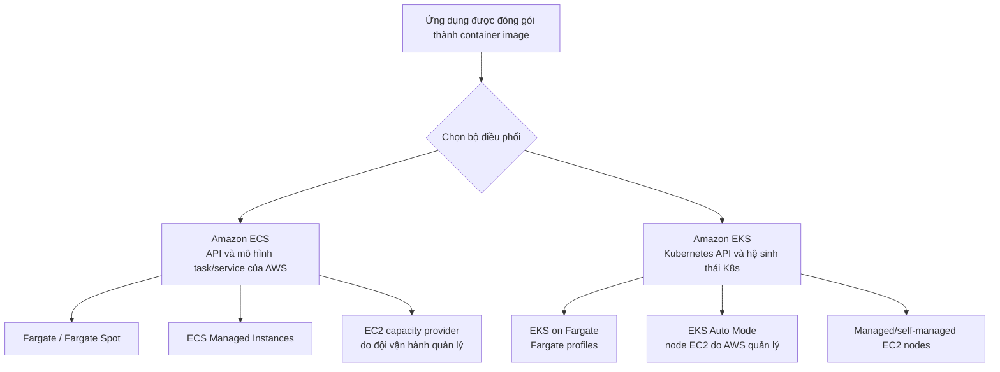
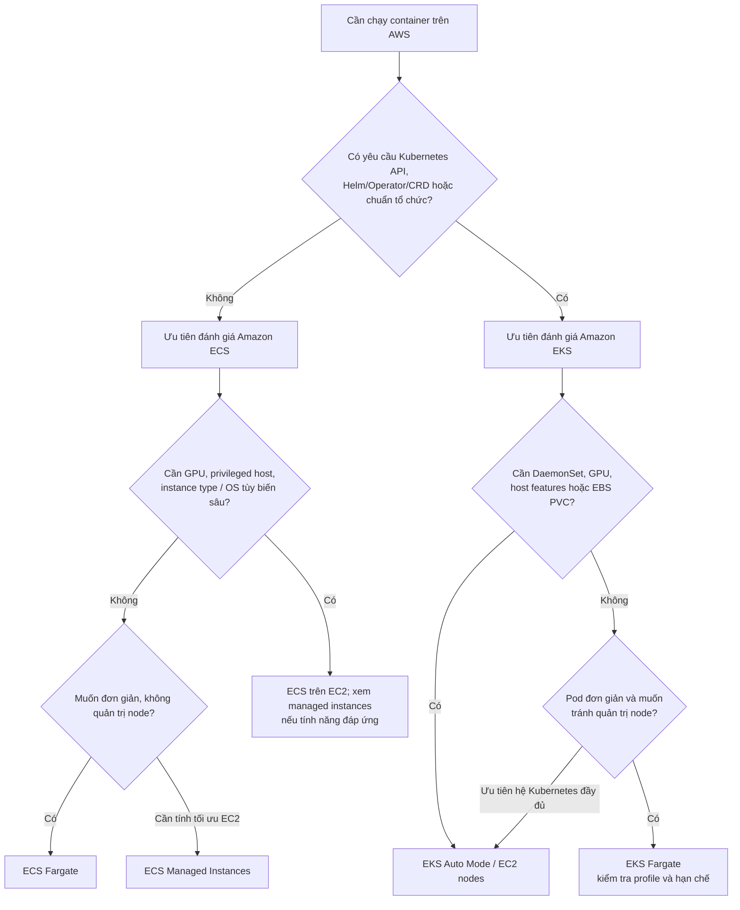
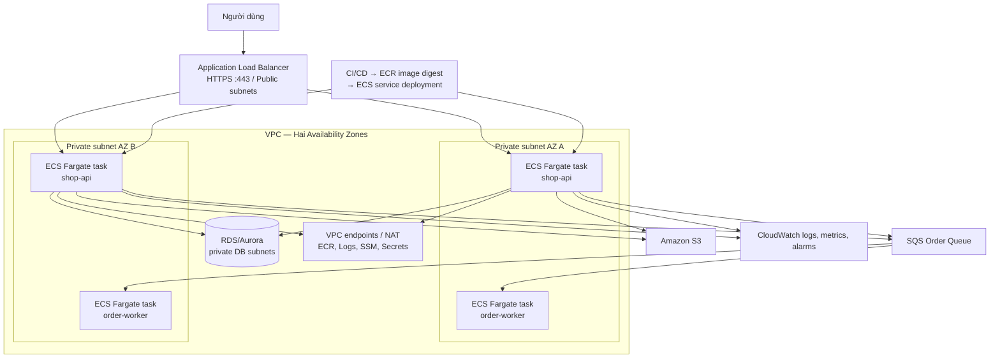
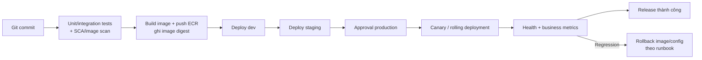
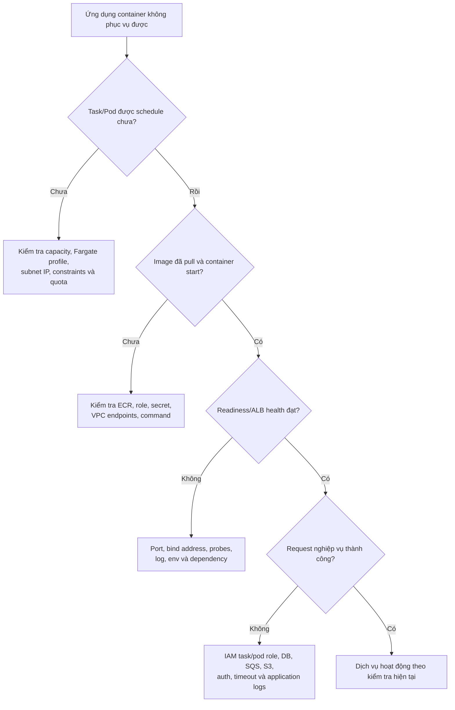

# Lựa chọn ECS, EKS và Fargate cho ứng dụng container trên AWS

Khi chuyển một ứng dụng từ máy chủ truyền thống sang container, nhóm phát triển thường gặp ba tên dịch vụ: **Amazon Elastic Container Service (Amazon ECS)**, **Amazon Elastic Kubernetes Service (Amazon EKS)** và **AWS Fargate**. Cả ba đều liên quan đến chạy container, nhưng chúng **không nằm cùng một cấp độ lựa chọn**. ECS và EKS là nền tảng **điều phối container (orchestration)**; Fargate là một mô hình **cung cấp tài nguyên tính toán không cần quản trị máy chủ (serverless compute)** mà cả ECS và EKS có thể sử dụng.

Bài này thuộc chương **Container với ECS** của module **CLOUD_PROVIDERS_AWS**. Trong hệ sinh thái AWS bao gồm Region/Availability Zone, IAM, VPC, EC2, lưu trữ S3/EBS/EFS, cơ sở dữ liệu, tích hợp SQS/EventBridge và serverless, việc chọn nền tảng container cần cân bằng **độ phức tạp, yêu cầu tính toán, mức kiểm soát hạ tầng, bảo mật, giám sát, phục hồi và chi phí**. Trọng tâm ở đây là phương pháp **lựa chọn ECS, EKS và Fargate** theo ngữ cảnh ứng dụng thực, thay vì chọn theo mức độ phổ biến của công nghệ.

## 1. Kết quả học tập

Sau bài học, người học có thể:

1. Giải thích sự khác biệt giữa **orchestrator (ECS/EKS)** và **compute capacity (Fargate/EC2/managed compute)**.
2. Chọn ECS hay EKS dựa trên kinh nghiệm vận hành, nhu cầu Kubernetes API/CRD/Helm, hệ sinh thái công cụ và yêu cầu triển khai.
3. Chọn Fargate, EC2, ECS Managed Instances hoặc EKS Auto Mode phù hợp với workload và nhu cầu kiểm soát máy chủ.
4. Hiểu khái niệm **ECS cluster, task definition, task, service, capacity provider** và các khái niệm đối ứng **EKS cluster, Deployment, Pod, Service, node**.
5. Thiết kế container an toàn trong VPC với IAM role, security group, private subnets, ALB, ECR, secrets và log.
6. Dự kiến tài nguyên, autoscaling, lịch cập nhật, chiến lược rollout, khả năng phục hồi và chi phí.
7. Phân tích các giới hạn đặc thù như Fargate không hỗ trợ GPU hoặc privileged workload và yêu cầu bổ sung khi dùng Kubernetes.

## 2. Phân biệt ba lớp: ứng dụng, bộ điều phối và tài nguyên chạy

Hãy nhìn vấn đề theo ba câu hỏi:

| Lớp quyết định | Câu hỏi | Ví dụ lựa chọn |
|---|---|---|
| **Ứng dụng** | Chạy image/container gì, bao nhiêu bản sao, cần tài nguyên/dữ liệu nào? | Web API Java, worker Node.js, batch Python |
| **Điều phối** | Ai quyết định đặt container ở đâu, duy trì bản sao, triển khai, service discovery? | **Amazon ECS** hoặc **Amazon EKS** |
| **Compute** | CPU/RAM/node được cung cấp và quản trị ra sao? | **AWS Fargate**, **EC2**, **ECS Managed Instances**, **EKS Auto Mode** |

Vì vậy:

- **ECS + Fargate** là một kiến trúc hoàn chỉnh để chạy container.
- **ECS + EC2** cũng là một kiến trúc hoàn chỉnh, nhưng đội vận hành quản lý máy EC2.
- **EKS + Fargate** dùng Kubernetes để điều phối Pod trên Fargate.
- **EKS + EC2 managed node groups**, hoặc **EKS Auto Mode**, chạy các Pod trên node EC2 với mức quản trị khác nhau.

Không có kiến trúc độc lập tên là “chỉ dùng Fargate” mà không có hệ thống điều phối hoặc dịch vụ AWS hỗ trợ tương ứng.

### 2.1. Sơ đồ quyết định hai chiều



**Lưu ý hiện đại:** bên cạnh hai lựa chọn lâu đời là Fargate và EC2 tự quản, AWS đã bổ sung **ECS Managed Instances** và **EKS Auto Mode**. Chúng giảm công vận hành node nhưng không đồng nhất với Fargate. Khi dự án có yêu cầu Kubernetes hoặc phần cứng chuyên biệt, nên đánh giá những lựa chọn này thay vì chỉ so sánh hai ô ECS Fargate và EKS EC2.

## 3. Amazon ECS: điều phối container theo cách của AWS

**Amazon ECS** là dịch vụ container orchestration của AWS. Người vận hành mô tả **task definition** (image, CPU, memory, port, IAM, log), sau đó ECS duy trì **service** với số task mong muốn hoặc chạy task một lần. ECS tích hợp với Elastic Load Balancing, AWS IAM, CloudWatch, ECR, EventBridge và Auto Scaling.

### 3.1. Những thành phần của ECS

| Thành phần | Ý nghĩa | Ví dụ |
|---|---|---|
| **Cluster** | Nhóm logic các task/service và các loại capacity được sử dụng | `shop-prod-cluster` |
| **Task definition** | Bản khai báo có revision về container, image, tài nguyên, role và log | `shop-api:14` |
| **Task** | Một lần thực thi task definition; có thể gồm nhiều container cùng task | 1 API container + sidecar |
| **Service** | Duy trì desired count, triển khai phiên bản mới và phục hồi task lỗi | `shop-api-service` chạy 3 task |
| **Capacity provider** | Cách ECS cấp/quản lý tài nguyên chạy task | `FARGATE`, `FARGATE_SPOT`, EC2 ASG, managed instances |
| **Service Auto Scaling** | Điều chỉnh desired count theo metric hoặc lịch | Tăng từ 3 lên 8 task khi CPU cao |
| **Amazon ECR** | Registry lưu container image | Image `shop-api:1.4.2` |

**ECS task không đồng nghĩa EC2 instance.** Một EC2 instance có thể chạy nhiều task trong mô hình EC2; một Fargate task được cấp tài nguyên compute được quản lý mà người dùng không đăng nhập vào host underlying.

### 3.2. Vì sao ECS thường đơn giản hơn cho nhóm chỉ triển khai trên AWS?

ECS có mô hình triển khai gọn và tập trung vào AWS:

- Task definition và ECS service thay cho Kubernetes manifests/controllers.
- IAM **task role** để workload gọi S3/SQS/Secrets Manager; IAM **task execution role** để ECS agent/runtime lấy image, log và secret cần thiết khi khởi chạy.
- Service có thể đăng ký target vào **Application Load Balancer (ALB)**.
- CloudWatch Logs, EventBridge và Service Auto Scaling tích hợp với ECS.
- Có thể dùng AWS CLI, AWS CDK/CloudFormation/Terraform và pipeline CI/CD để triển khai.

ECS phù hợp khi tổ chức ưu tiên **ít thành phần điều phối phải tự thiết kế**, đội ngũ đã quen với AWS IAM/VPC, và không có nhu cầu mạnh về Kubernetes CRD, Operator hoặc công cụ điều hành chuẩn Kubernetes.

### 3.3. Các lựa chọn tài nguyên của ECS

| ECS capacity | AWS quản lý gì? | Đội của bạn quản lý gì? | Khi nên cân nhắc |
|---|---|---|---|
| **ECS trên Fargate** | Máy chủ và nền compute chạy task | Image, task definition, cấu hình network, IAM, security, app | Workload thông thường, biến động tải, ưu tiên vận hành gọn |
| **ECS Fargate Spot** | Nền compute Spot cho task hỗ trợ | Thiết kế chịu gián đoạn/khởi động lại, capacity strategy | Batch/worker retry được, không yêu cầu luôn chạy |
| **ECS Managed Instances** | Cấp phát, chọn, mở rộng, vá và vòng đời EC2 được dịch vụ quản lý theo khả năng | Task, yêu cầu tài nguyên, cấu hình mạng/role, ứng dụng, chi phí | Muốn linh hoạt như EC2 nhưng ít công quản trị node |
| **ECS trên EC2 (ASG capacity provider)** | Nền dịch vụ ECS; EC2 và Auto Scaling do AWS cung cấp | AMI/OS, ECS agent, scale capacity, patching, instance lựa chọn | GPU, hardware cụ thể, custom AMI, privileged workload |

Khi dùng ECS, **capacity providers** thường là cách cấu hình compute linh hoạt hơn so với chỉ đặt launch type. Một ECS cluster có thể có nhiều loại capacity, nhưng một **capacity provider strategy** phải tuân theo các quy tắc kết hợp capacity provider mà ECS hỗ trợ; không giả định có thể tùy ý trộn Fargate và nhóm EC2 trong cùng một strategy.

## 4. Amazon EKS: Kubernetes được quản lý trên AWS

**Amazon EKS** cung cấp một Kubernetes control plane được AWS vận hành. Người dùng tương tác qua Kubernetes API, `kubectl`, Helm, controller, Deployment/Service/Ingress và các thành phần của hệ sinh thái Kubernetes.

### 4.1. Khái niệm Kubernetes/EKS

| Thành phần | Ý nghĩa | So sánh gần đúng với ECS |
|---|---|---|
| **EKS cluster** | Kubernetes control plane, API và thành phần cấu hình cluster | ECS cluster (khác mô hình điều phối) |
| **Pod** | Đơn vị triển khai nhỏ nhất của Kubernetes, có thể có nhiều container | ECS task (chỉ tương tự về mức nhóm container) |
| **Deployment** | Định nghĩa replica, rolling rollout và trạng thái Pod mong muốn | ECS service |
| **Kubernetes Service** | Địa chỉ truy cập ổn định đến tập Pod | Service discovery/load balancer integration |
| **Namespace** | Phạm vi tên tài nguyên và nhiều chính sách Kubernetes | Không có đối ứng 1:1 trong ECS |
| **Node** | Máy chạy Pod; có thể là EC2 hoặc compute managed | EC2 container instance hoặc hạ tầng compute ẩn |
| **DaemonSet / Operator / CRD** | Mở rộng vận hành và hệ thống Kubernetes | Không có đối ứng ECS chuẩn |
| **Kubernetes RBAC** | Phân quyền truy cập Kubernetes API | IAM permission ECS khác về cơ chế |

EKS phù hợp khi ứng dụng hoặc tổ chức đã dựa vào Kubernetes API: Helm charts, GitOps controllers, Custom Resource Definitions (CRD), Operators, service mesh, policies hay một nền tảng Kubernetes được vận hành thống nhất giữa nhiều môi trường.

### 4.2. AWS quản lý phần nào của EKS?

AWS vận hành **Kubernetes control plane** của EKS. Người dùng vẫn phải chọn cách chạy **worker Pods**, vận hành networking, IAM, image, ứng dụng, cấu hình bảo mật và nhiều add-ons/cluster components theo mô hình compute đã chọn.

| Compute cho EKS | Node/compute | Đặc điểm |
|---|---|---|
| **Managed node groups trên EC2** | AWS hỗ trợ tạo và cập nhật node groups; workload chạy trên EC2 | Bạn vẫn quản lý cấu hình/version, capacity, add-ons và lịch nâng cấp theo trách nhiệm |
| **Self-managed EC2 nodes** | Bạn tự quản lý node lifecycle sâu hơn | Linh hoạt, nhiều việc vận hành |
| **EKS Auto Mode** | AWS quản lý node EC2 và nhiều thành phần hạ tầng cluster theo cơ chế Auto Mode | Vẫn sử dụng Kubernetes; có giới hạn thao tác trên AWS-managed nodes |
| **EKS trên Fargate** | AWS cung cấp compute cho các Pods khớp Fargate profile | Không quản lý EC2 host nhưng có giới hạn Fargate/Kubernetes |

**EKS Auto Mode không phải tên khác của Fargate.** Auto Mode sử dụng các **EC2 instances do AWS quản lý**, hỗ trợ nhiều khả năng node phổ biến như các dạng Spot/GPU trong phạm vi AWS hỗ trợ. EKS trên Fargate chạy Pod theo mô hình Fargate, có bộ giới hạn khác. Khi cần mức tương thích đầy đủ hơn với Kubernetes primitives/agent, nên so sánh Auto Mode hoặc EC2 nodes với EKS Fargate.

### 4.3. Đánh đổi của EKS

Kubernetes có hệ sinh thái lớn và mô hình cấu hình tiêu chuẩn, nhưng EKS yêu cầu hiểu thêm:

- Kubernetes API/RBAC, Namespace và Service Account.
- CNI, DNS, CoreDNS, Service, Ingress/Gateway và cách tích hợp ALB/NLB.
- Add-ons, Controllers, version compatibility và chu kỳ nâng cấp Kubernetes.
- Lưu trữ theo CSI, PersistentVolume/Claim và các giới hạn volume.
- Pod scheduling, requests/limits, HPA và node provisioning.
- Quan sát Pod/Node/control plane, các chính sách admission và tiêu chuẩn bảo mật runtime.

**Không nên chọn EKS chỉ vì container có nhiều microservice.** ECS cũng chạy được nhiều microservice. Chỉ chọn EKS khi lợi ích từ API/hệ sinh thái Kubernetes hoặc tiêu chuẩn tổ chức lớn hơn chi phí và độ phức tạp vận hành.

## 5. AWS Fargate: mô hình compute dùng cùng ECS hoặc EKS

**AWS Fargate** cho phép chạy container mà đội phát triển không tự cấp/patch/đăng nhập EC2 worker hosts. Người dùng khai báo tài nguyên yêu cầu (CPU, memory và một số thuộc tính lưu trữ tùy nền tảng), VPC/subnets/security groups và image; AWS quản trị hạ tầng phía dưới.

Điều đó **không có nghĩa ứng dụng hoàn toàn không cần vận hành**. Đội phát triển vẫn phải cập nhật container image, vá thư viện/runtime, giới hạn quyền IAM, bảo vệ dữ liệu, thiết lập autoscaling, health checks và giám sát chi phí.

### 5.1. Fargate trong ECS và Fargate trong EKS

| Tiêu chí | ECS Fargate | EKS Fargate |
|---|---|---|
| Đơn vị triển khai | **ECS task** | **Kubernetes Pod** |
| Khai báo tài nguyên | Task definition CPU/memory và các container | Pod resources theo Kubernetes và quy tắc sizing Fargate |
| Cách chọn chạy | ECS service/task cùng Fargate capacity provider | Pod khớp **Fargate profile** theo namespace/labels |
| Quyền AWS của workload | IAM **task role** | Thường dùng **IAM Roles for Service Accounts (IRSA)** đối với Pod Fargate |
| Service routing | ECS service + ALB/NLB/Cloud Map khi phù hợp | Kubernetes Service/Ingress và integration với AWS |
| Host OS/daemon | Không SSH host; không privileged/host access | Không dùng DaemonSet/privileged/HostNetwork trên Fargate |
| Spot compute | Có **ECS Fargate Spot** khi đáp ứng yêu cầu | **EKS Fargate Spot không được hỗ trợ** |
| GPU | Không dùng Fargate cho GPU workloads | EKS Fargate cũng không hỗ trợ GPU |

Fargate có cách ly runtime và không cho khách hàng truy cập host. Với tác vụ yêu cầu Docker-in-Docker đặc quyền, kernel module, thiết bị host/GPU hoặc agent cần DaemonSet, hãy đánh giá EC2-based compute thay vì cố sửa manifest để chạy bằng Fargate.

### 5.2. Những giới hạn cụ thể của EKS Fargate

- Pod cần khớp một **Fargate profile** tại thời điểm scheduling; Pod không khớp có thể nằm ở trạng thái `Pending` nếu không có node khác phù hợp.
- Fargate chỉ chạy ở **private subnets** được cấu hình phù hợp; cần đường tới AWS APIs, ECR, log và repository theo kiến trúc.
- Không hỗ trợ **DaemonSet, privileged containers, HostPort, HostNetwork hoặc GPU** như trên EC2 nodes.
- Không dùng **Amazon EBS volume trực tiếp cho Fargate Pods**; Amazon EFS có thể được dùng theo các giới hạn và cách cấu hình mà EKS Fargate hỗ trợ.
- **EKS Pod Identity** hiện không hỗ trợ Pod trên Fargate vì thành phần agent cần node loại hỗ trợ; **IRSA** thường là cơ chế gắn IAM role cho Pod Fargate.
- Không có **Fargate Spot** cho EKS; không thiết kế EKS Fargate như một nhóm Spot thay thế EC2 Spot.

Các giới hạn phụ thuộc phiên bản/khu vực và có thể thay đổi theo AWS; cần đối chiếu hướng dẫn EKS Fargate cho Region và use case thực tế.

### 5.3. Khi Fargate là lựa chọn hợp lý

Fargate thường có lợi khi:

1. Đội nhỏ muốn triển khai API/worker nhanh mà không quản trị AMI, kernel hoặc Auto Scaling Group EC2.
2. Tải không đều, cần trả tiền theo tài nguyên của task/Pod thực tế thay vì giữ nhiều EC2 idle.
3. Workload không yêu cầu quyền host, GPU hoặc storage không được Fargate hỗ trợ.
4. Tổ chức chấp nhận đánh đổi một phần quyền kiểm soát máy chủ để giảm công bảo trì.

Không nên chọn Fargate bằng một quy tắc tuyệt đối cho mọi workload. **Tải lớn ổn định**, yêu cầu cấu hình kernel, khả năng tối ưu bin-packing hoặc quyền sử dụng EC2 Reserved Instances/Savings Plans/Spot có thể khiến mô hình EC2 hoặc managed EC2 compute kinh tế và phù hợp hơn.

## 6. Ma trận quyết định ECS, EKS, Fargate và EC2

### 6.1. Chọn bộ điều phối trước

| Tiêu chí | ECS | EKS |
|---|---|---|
| Cách khai báo | ECS task definitions, services, AWS APIs | Kubernetes manifests, Deployment, Pod, Service, Helm |
| Độ khó bắt đầu | Thường ít khái niệm hơn nếu chỉ dùng AWS | Cần hiểu Kubernetes control plane, API, networking, add-ons |
| Hệ sinh thái | Tích hợp sâu với AWS và hệ công cụ ECS | CRD, Operators, Helm, GitOps, Kubernetes ecosystem |
| Di chuyển giữa các nền Kubernetes | Phải chuyển đổi mô hình ECS khi rời AWS | Kubernetes API có tính chuẩn hóa, nhưng manifest vẫn có thể phụ thuộc cloud |
| Phân quyền | IAM role/identity policies gắn ECS workloads, service APIs | IAM + Kubernetes RBAC, service accounts, IRSA/Pod Identity |
| Vận hành control plane | AWS vận hành ECS | AWS vận hành EKS control plane; người dùng quản trị nhiều cấu hình Kubernetes |
| Chi phí điều phối | ECS không có phí điều phối riêng theo cách dùng ECS thông thường; compute và dịch vụ phụ trợ tính phí | EKS có **phí cluster** theo chính sách giá/vòng đời phiên bản, ngoài compute và add-ons |
| Trường hợp nên chọn | AWS-native API, worker, scheduled task; đội nhỏ hoặc muốn giảm vận hành | Đang sử dụng Kubernetes, Operators/CRDs, GitOps/Helm hoặc chuẩn nền tảng đa đội |

**Phạm vi “portability” của Kubernetes:** dùng Kubernetes giúp tái sử dụng nhiều khái niệm và manifest, nhưng vẫn có thể phụ thuộc **AWS Load Balancer Controller, IAM, EBS/EFS CSI, VPC CNI, S3, Secrets Manager**. Không nên hứa rằng chuyển EKS sang cloud khác chỉ cần đổi endpoint.

### 6.2. Chọn compute trong bộ điều phối

| Yêu cầu | ECS Fargate | ECS Managed Instances | ECS EC2 tự quản | EKS Fargate | EKS Auto Mode / EC2 |
|---|---|---|---|---|---|
| Không quản trị máy chủ | Rất phù hợp | AWS quản lý vòng đời instance | Không | Rất phù hợp | Auto Mode có quản trị node của AWS; EC2 tự quản cần vận hành |
| Kubernetes API | Không | Không | Không | Có | Có |
| GPU/host privileged | Không phù hợp | Xác minh loại instance/tính năng hỗ trợ | Có thể phù hợp | Không | EC2/Auto Mode phù hợp theo giới hạn tính năng |
| DaemonSet/Operator | Không dùng Kubernetes | Không dùng Kubernetes | Không dùng Kubernetes | DaemonSet không hỗ trợ | Nhiều lựa chọn Kubernetes hơn |
| Tải biến động | Tốt | Tốt với auto capacity | Cần scale EC2 capacity | Tốt | Tốt với node autoscaling đúng cấu hình |
| Chi phí node nhàn rỗi | Không tự giữ node EC2 của ứng dụng | Phụ thuộc cách quản lý compute và workload | Có thể trả tiền EC2 idle | Không tự giữ node EC2 của ứng dụng | Phụ thuộc node/lựa chọn Auto Mode |
| Spot | ECS Fargate Spot | Theo lựa chọn/policy hiện hành | EC2 Spot | Không có EKS Fargate Spot | EC2 Spot/Auto Mode theo hỗ trợ |
| Tùy biến OS/AMI | Hạn chế | AWS quản lý OS/AMI và có giới hạn tùy biến | Linh hoạt | Hạn chế | EC2 tự quản linh hoạt hơn; Auto Mode có giới hạn |

Ma trận dùng để **loại trừ phương án không đạt yêu cầu** trước khi so chi phí. Chẳng hạn workload GPU không thể chọn Fargate rồi “cấu hình thêm” để có GPU; phải chuyển sang một compute option thực sự hỗ trợ thiết bị và driver đó.

### 6.3. Cây quyết định thực tế



Cây trên là điểm xuất phát, không phải quyết định tự động. Sau khi chọn ứng viên, cần đối chiếu **service availability theo Region, kiến trúc CPU (x86/ARM), security restrictions, storage, concurrency, observability và tổng chi phí sở hữu (TCO)**.

## 7. Ví dụ kiến trúc ECS Fargate cho ứng dụng bán hàng

Giả sử hệ thống có REST API `shop-api` và worker xử lý đơn hàng `order-worker`. API giao tiếp RDS, S3 và SQS. Phương án ECS Fargate:



**Luồng triển khai và vận hành:**

1. CI tạo container image đã kiểm thử, quét dependency và push vào **Amazon ECR**.
2. CI cập nhật ECS task definition revision tham chiếu image theo **digest** hoặc tag bất biến đã kiểm soát.
3. ECS service chạy số task mong muốn, đăng ký IP/port task vào target group ALB.
4. Khi task bị lỗi hoặc container exit, ECS service cố gắng đưa số task trở lại desired count theo policy.
5. Service Auto Scaling tăng/giảm số task từ CloudWatch metrics hoặc tín hiệu SQS theo cấu hình.
6. App truy cập S3/SQS/Secrets Manager qua **task role** với quyền tối thiểu; thông tin khởi chạy image/log được **execution role** xử lý.

### 7.1. Tại sao private subnet vẫn cần đường ra?

ECS Fargate task ở private subnet vẫn cần tải image từ ECR và ghi log/đọc secret. Trong VPC không có NAT, phải cấu hình **VPC endpoints phù hợp** (ví dụ ECR API, ECR Docker Registry, S3, CloudWatch Logs, Secrets Manager/SSM khi dùng) với route, SG, private DNS và quyền IAM đúng.

Không kết luận “private subnet” nghĩa là không cần mạng outbound. Mỗi task cần đi tới đúng dịch vụ phụ thuộc và endpoint phù hợp; thiếu đường ra có thể khiến task dừng ở trạng thái `PENDING` hoặc `STOPPED` trước khi ứng dụng kịp chạy.

### 7.2. Fargate task có network identity riêng

Với ECS Fargate, task dùng network mode `awsvpc` và được gắn ENI/IP trong subnet đã chọn. Security group của task có thể giới hạn:

| Security group | Ingress | Egress |
|---|---|---|
| `sg-alb` | TCP 443 từ Internet/nguồn được phép | TCP 8080 đến `sg-shop-api` |
| `sg-shop-api` | TCP 8080 từ `sg-alb` | DB port đến `sg-db`, HTTPS đến AWS services cần dùng |
| `sg-db` | DB port từ `sg-shop-api` | Theo DB service/nhu cầu hợp lệ |

Worker `order-worker` không cần mở inbound port từ ALB; nó kéo message từ SQS theo quyền IAM. Với hệ thống nhiều task, cần quy hoạch đủ **IP trong subnet**; số IP còn trống có thể giới hạn scale-out dù CPU quota vẫn còn.

## 8. So sánh mạng giữa ECS và EKS

| Khía cạnh | ECS (đặc biệt Fargate) | EKS |
|---|---|---|
| Gắn tài nguyên mạng | Task ENI ở mode `awsvpc`, SG theo task | Pod IP qua CNI, node networking; Fargate Pod có mô hình mạng riêng |
| Khám phá dịch vụ | ECS Service Connect, Cloud Map, ALB/NLB khi cần | Kubernetes Service/CoreDNS/Ingress; có thể tích hợp ALB/NLB |
| Ingress HTTP | ECS service + ALB target group | Kubernetes Ingress/Gateway + controller phù hợp, hoặc Service loại LoadBalancer |
| Network policy | SG/VPC/NACL và cơ chế ECS liên quan | Kubernetes NetworkPolicy nếu CNI/engine hỗ trợ; thêm SG/VPC |
| Quyền truy cập control plane | IAM quyền ECS APIs | IAM/EKS access entries và Kubernetes RBAC |
| DNS | VPC DNS + AWS Cloud Map/Service Connect | CoreDNS cho `*.svc.cluster.local` + VPC DNS |

**Không mặc định Kubernetes NetworkPolicy tự thực thi** trên mọi EKS cluster. Chức năng này phụ thuộc cấu hình Amazon VPC CNI hoặc network policy engine được triển khai, phiên bản và phạm vi hỗ trợ. Tương tự, dùng namespace không tự tạo ranh giới mạng cứng giữa các tenant.

### 8.1. Chọn private vs public subnet

- **ALB internet-facing** thường nằm ở public subnet có route đúng đến Internet Gateway.
- **Ứng dụng/container tasks hoặc worker Pods** thường ở private subnet nếu không có yêu cầu nhận trực tiếp lưu lượng Internet.
- **Database** nằm ở subnet riêng được giới hạn đường truy cập và quyền.
- **NAT/VPC endpoints** cung cấp egress theo nhu cầu, cân bằng phí và bề mặt mạng.
- **Multi-AZ** giảm nguy cơ một AZ bị lỗi; cần đặt đủ replicas và có điều kiện scheduling/placement tương ứng.

Với EKS, một Pod có thể được tạo trong một namespace nhưng nằm trên node/subnet khác nếu scheduler và cấu hình node phù hợp. Phải hiểu **Pod placement, topology spread constraints, taints/tolerations, node selectors** khi có yêu cầu HA hoặc compliance.

## 9. IAM và bảo mật workload

### 9.1. ECS: task execution role khác task role

| Role | Ai dùng? | Quyền ví dụ |
|---|---|---|
| **Task execution role** | ECS agent/runtime trong quá trình chuẩn bị/chạy task | Pull image ECR, gửi log CloudWatch, đọc secret tham chiếu tại startup khi phù hợp |
| **Task role** | Code ứng dụng bên trong container | `s3:GetObject` prefix riêng, `sqs:ReceiveMessage` queue riêng, đọc secret cần thiết |
| **CI/CD deploy role** | Pipeline đăng ký task definition, cập nhật ECS service | `ecs:RegisterTaskDefinition`, `ecs:UpdateService`, `iam:PassRole` giới hạn role liên quan |

Không nhầm role dùng để **pull image/log** với role mà ứng dụng dùng để gọi AWS APIs. Nếu task role có quyền `AdministratorAccess`, một lỗ hổng RCE trong ứng dụng có thể biến thành truy cập AWS rộng, ngay cả khi Fargate cô lập host.

### 9.2. EKS: IAM cho AWS APIs và RBAC cho Kubernetes API

EKS có hai đường kiểm soát:

1. **Người/CI truy cập Kubernetes API**: được xác thực với IAM/EKS access configuration và phân quyền qua Kubernetes RBAC/access policies theo cấu hình cluster.
2. **Ứng dụng trong Pod gọi AWS services**: dùng IAM role dành cho workload, thường **EKS Pod Identity** ở các node được hỗ trợ hoặc **IRSA** khi cần OIDC federation.

Ví dụ API trong Pod cần đọc một secret từ Secrets Manager. Service Account chỉ định danh workload ở Kubernetes; muốn gọi AWS APIs, phải cấu hình cơ chế cấp temporary AWS credentials tương ứng và policy chỉ cho phép secret đó.

**Giới hạn cần nhớ:** EKS Pod Identity không hỗ trợ Fargate Pods; nếu chạy Fargate Pods, hãy kiểm tra **IRSA** và các quyền **Fargate pod execution role** dùng cho hoạt động hạ tầng riêng. Không sử dụng pod execution role làm quyền nghiệp vụ cho ứng dụng.

### 9.3. Kiểm soát image và secret

- Push image vào ECR từ CI bằng role ngắn hạn và scan image/dependency theo chính sách.
- Ưu tiên **image digest** thay vì tag `latest` không thể truy vết; không sửa image chạy production thủ công.
- Không đưa AWS access key, password DB hoặc private key vào Dockerfile, image layers hoặc environment không được bảo vệ.
- Sử dụng Secrets Manager hoặc SSM Parameter Store phù hợp; với Kubernetes có thể dùng CSI/External Secrets khi đúng quyền và tính năng được hỗ trợ.
- Mã hóa EBS/EFS/S3 và các tài nguyên stateful theo yêu cầu; quản lý KMS key policy cho các principal thật sử dụng dữ liệu.
- Container nên chạy bằng non-root user khi có thể, giảm Linux capabilities, dùng read-only root filesystem theo khả năng ứng dụng, và giảm gói runtime không cần.
- Áp dụng security groups, IAM least privilege, kiểm toán CloudTrail và rà soát quyền `iam:PassRole`, deployment roles.

**Fargate giảm công quản trị host, không tự vá image do bạn cung cấp.** Nếu image chứa thư viện Java, OpenSSL hoặc Node.js có CVE, đội ứng dụng phải rebuild, kiểm thử và redeploy image mới.

## 10. Cách khai báo một ứng dụng bằng ECS Task Definition

Giả sử ứng dụng Java REST API lắng nghe TCP 8080, cần 0,5 vCPU và 1 GiB RAM cho mỗi bản sao. Với **ECS Fargate**, một task definition mẫu có thể là:

```json
{
  "family": "shop-api",
  "networkMode": "awsvpc",
  "requiresCompatibilities": ["FARGATE"],
  "cpu": "512",
  "memory": "1024",
  "executionRoleArn": "arn:aws:iam::111122223333:role/shop-task-execution",
  "taskRoleArn": "arn:aws:iam::111122223333:role/shop-api-task-role",
  "containerDefinitions": [
    {
      "name": "shop-api",
      "image": "111122223333.dkr.ecr.ap-southeast-1.amazonaws.com/shop-api@sha256:<IMAGE_DIGEST>",
      "essential": true,
      "portMappings": [
        {
          "containerPort": 8080,
          "protocol": "tcp"
        }
      ],
      "environment": [
        {
          "name": "APP_ENV",
          "value": "production"
        }
      ],
      "logConfiguration": {
        "logDriver": "awslogs",
        "options": {
          "awslogs-group": "/ecs/shop-api",
          "awslogs-region": "ap-southeast-1",
          "awslogs-stream-prefix": "api"
        }
      }
    }
  ]
}
```

**Đây là mẫu giảng dạy:** thay Account ID, role ARNs, ECR repository và `<IMAGE_DIGEST>` bằng giá trị thật; log group phải được tạo/được cho phép tạo theo chính sách; image phải hỗ trợ CPU architecture và OS tương ứng. Tổng CPU/memory trong mẫu phải thuộc tổ hợp được Fargate hỗ trợ. Khi ứng dụng có sidecar, các container cùng task sẽ chia tài nguyên task và có thể giao tiếp qua `localhost`.

### 10.1. Task Definition chưa phải ECS Service

Task definition chỉ là **bản mô tả**. Để duy trì API có sẵn liên tục, cần tạo một **ECS service** trỏ đến task definition revision:

- Cluster `shop-prod-cluster`.
- Service `shop-api` với `desiredCount=3`.
- Capacity provider `FARGATE` hoặc strategy tương ứng.
- VPC subnets ở ít nhất hai AZ và security group `sg-shop-api`.
- Target group ALB có loại target phù hợp với IP task Fargate.
- Deployment health check/circuit breaker phù hợp với yêu cầu.

Nếu chỉ chạy một task bằng `RunTask` mà không có ECS service, task có thể hoàn tất hoặc dừng mà không được tự phục hồi theo desired count như một service. Ngược lại, **batch worker** hoặc scheduled jobs có thể chủ động dùng `RunTask` theo EventBridge Scheduler thay vì giữ service luôn chạy.

### 10.2. Đọc trạng thái triển khai qua AWS CLI

Ví dụ các lệnh **chỉ xem**:

```bash
aws ecs describe-services \
  --cluster shop-prod-cluster \
  --services shop-api \
  --region ap-southeast-1

aws ecs list-tasks \
  --cluster shop-prod-cluster \
  --service-name shop-api \
  --region ap-southeast-1

aws ecs describe-tasks \
  --cluster shop-prod-cluster \
  --tasks "<TASK_ARN>" \
  --region ap-southeast-1
```

Khi debug deployment, xem `desiredCount`, `runningCount`, `pendingCount`, service events, task `stoppedReason`, container exit code và ALB target health. Trạng thái task `RUNNING` **không đảm bảo endpoint nghiệp vụ đã hoạt động đúng**; cần application readiness/health check.

## 11. Cách khai báo ứng dụng tương đương trên EKS

Với EKS, cùng ứng dụng có thể được mô tả bằng Kubernetes **Deployment** và **Service**:

```yaml
apiVersion: apps/v1
kind: Deployment
metadata:
  name: shop-api
  namespace: shop
spec:
  replicas: 3
  selector:
    matchLabels:
      app: shop-api
  template:
    metadata:
      labels:
        app: shop-api
    spec:
      serviceAccountName: shop-api
      containers:
        - name: shop-api
          image: 111122223333.dkr.ecr.ap-southeast-1.amazonaws.com/shop-api@sha256:<IMAGE_DIGEST>
          ports:
            - containerPort: 8080
          resources:
            requests:
              cpu: "500m"
              memory: "1Gi"
            limits:
              memory: "1Gi"
          readinessProbe:
            httpGet:
              path: /ready
              port: 8080
            initialDelaySeconds: 5
            periodSeconds: 10
          livenessProbe:
            httpGet:
              path: /health
              port: 8080
            initialDelaySeconds: 20
            periodSeconds: 15
---
apiVersion: v1
kind: Service
metadata:
  name: shop-api
  namespace: shop
spec:
  selector:
    app: shop-api
  ports:
    - name: http
      port: 80
      targetPort: 8080
  type: ClusterIP
```

Đây là **mẫu giải thích cơ chế Kubernetes**, không phải một bộ manifest có thể triển khai độc lập trong mọi cluster. Cần tạo namespace `shop`, ServiceAccount `shop-api` cùng quyền IAM phù hợp, image pull permissions và hạ tầng networking/ingress. Muốn công khai API, cấu hình controller và ingress/load balancer tương ứng.

**Nếu chạy bằng EKS Fargate**, Pod còn phải khớp namespace/label selectors trong **Fargate profile**. Cách sizing Pod trên Fargate có yêu cầu về CPU/memory và overhead riêng; các `requests/limits` trong YAML này phục vụ giải thích Kubernetes, không phải cam kết rằng Fargate sẽ cấp đúng 0,5 vCPU và 1 GiB theo bất kỳ tổ hợp nào.

### 11.1. Lệnh quan sát EKS

```bash
kubectl get deployments,pods,services -n shop
kubectl describe deployment shop-api -n shop
kubectl get pods -n shop -o wide
kubectl logs deployment/shop-api -n shop --tail=100
```

Lệnh chạy trên máy có `kubectl`, kubeconfig và quyền Kubernetes API hợp lệ. Khi Pod Pending, kiểm tra `kubectl describe pod`, scheduling events, node capacity hoặc Fargate profile; khi Pod đã Running nhưng chưa Ready, kiểm tra readiness probe, dependency và application logs.

### 11.2. Vì sao hai manifest khác nhau?

ECS định nghĩa tài nguyên theo **task/service và AWS APIs**. EKS theo **Kubernetes object model**, có các controller vận hành desired state. Không có phép chuyển đổi tự động bảo đảm đủ mọi đặc tính giữa task definition ECS và Kubernetes Deployment, nhất là role mapping, networking, service discovery, scheduling và storage.

## 12. Autoscaling và độ sẵn sàng

### 12.1. Các tầng scale cần phân biệt

| Tầng | ECS | EKS |
|---|---|---|
| Tăng số bản sao ứng dụng | ECS Service Auto Scaling điều chỉnh desired task count | Horizontal Pod Autoscaler (HPA) điều chỉnh replicas |
| Tăng tài nguyên máy chủ | Fargate AWS cấp compute; EC2 ASG capacity provider hoặc managed instances | EKS Fargate cấp theo Pod; managed node groups với autoscaler/Karpenter hoặc EKS Auto Mode |
| Mở rộng theo sự kiện | SQS queue depth, CloudWatch metric, custom metric | HPA metrics, KEDA hoặc controllers phù hợp |
| Rollout phiên bản | ECS deployment circuit breaker, rolling update/blue-green theo giải pháp | Kubernetes rolling update, readiness probes, progressive delivery khi có tool |

**Autoscaling ứng dụng khác autoscaling node.** Trên ECS EC2 hoặc EKS EC2, dù service/HPA muốn thêm task/Pod, nếu cluster thiếu EC2 capacity, workload vẫn có thể Pending. Cần thiết kế hai vòng scale phối hợp và tính đến thời gian EC2 boot/warmup.

### 12.2. Chọn metric đúng bài toán

- **Web API:** CPU, memory, request count per target, latency, số kết nối hoặc metric nghiệp vụ.
- **SQS worker:** queue backlog trên mỗi worker, tuổi của message cũ nhất, thời gian xử lý một message và khả năng retry.
- **Batch theo lịch:** số job, deadline, vCPU/RAM yêu cầu, thời gian khởi động và khả năng chạy song song.
- **WebSocket/long request:** số kết nối, thời gian drain và graceful shutdown, không chỉ CPU.

Ví dụ queue có 20.000 message, mỗi worker xử lý trung bình 100 message/phút. Nếu cần xử lý hết trong 10 phút và không có message mới, về mặt năng lực cần ít nhất 20 worker lý tưởng (20.000 / 100 / 10). Trong thực tế cần dự trù retry, chênh lệch kích thước job, thời gian startup và API rate limits của downstream.

### 12.3. Multi-AZ chưa đủ nếu chỉ có một replica

Một ECS service có subnet ở hai AZ nhưng desired count = 1 có thể vẫn chỉ chạy một task tại một thời điểm. Tương tự, Deployment EKS có replicas = 1 không có HA ứng dụng khi Pod hoặc AZ lỗi. Muốn tăng khả năng sẵn sàng:

1. Chạy đủ số bản sao để chịu mất một task/Pod/node.
2. Đặt tasks/Pods phân tán trên các AZ theo khả năng scheduling/placement và capacity thực.
3. Dùng health check/readiness để load balancer chỉ gửi traffic đến instance đủ điều kiện.
4. Thiết lập graceful shutdown/draining nhằm xử lý request còn chạy.
5. Tránh single point of failure ở database, queue consumer checkpoint, secret/DNS hoặc third-party integration.

ECS và EKS duy trì **desired state**, không hứa không có downtime nếu triển khai quá ít replica, cấu hình probe sai hoặc phụ thuộc backend bị lỗi.

## 13. Stateful workloads, storage và các nhu cầu đặc biệt

Ứng dụng web thường dễ đưa vào container vì stateless; database, machine learning và hệ thống cần truy cập host có thể đòi hỏi thêm thiết kế.

| Workload | Phương án nên xem xét | Lý do |
|---|---|---|
| REST API stateless | ECS Fargate hoặc EKS theo tiêu chuẩn tổ chức | Dễ replicate, ALB, autoscaling |
| Worker xử lý SQS có thể retry | ECS Fargate, Fargate Spot hoặc EKS có node/spot phù hợp | Scale theo backlog, thiết kế idempotent |
| Job ngắn chạy theo lịch | ECS RunTask/Fargate hoặc Kubernetes Job/CronJob | Không cần giữ service nhận request liên tục |
| GPU inference/training | ECS EC2 hoặc EKS EC2/Auto Mode với loại GPU được hỗ trợ | Fargate không có GPU |
| Daemon thu log/giám sát trên mọi node | ECS EC2 agent nếu thực sự cần host; EKS EC2/Auto Mode với DaemonSet theo hỗ trợ | Không phù hợp EKS Fargate DaemonSet |
| Database cần block persistent volume | Thường ưu tiên dịch vụ managed như RDS/DynamoDB; nếu bắt buộc tự quản, xem EC2/EKS EC2 + storage | Stateful operation cần backup, availability, CSI và lifecycle |
| File dùng chung giữa nhiều bản sao | S3 cho object; EFS khi cần shared POSIX filesystem và dịch vụ hỗ trợ | Không giữ dữ liệu quan trọng chỉ ở container ephemeral filesystem |
| Ứng dụng cần custom kernel/privileged runtime | ECS EC2 hoặc EKS nodes phù hợp | Fargate giới hạn host privileges |

### 13.1. Lưu trữ Fargate có những loại nào?

- **Ephemeral storage** dành cho working files/cache theo giới hạn/tùy chọn của Fargate; mất đi cùng lifecycle task/Pod và không nên là nơi lưu dữ liệu nghiệp vụ lâu dài.
- **Amazon EFS** có thể dùng cho một số nhu cầu shared filesystem theo cách tích hợp được từng nền tảng hỗ trợ; cần kiểm tra IAM, EFS Access Points, mount/network SG và chi phí.
- **Amazon S3** thích hợp với object như ảnh, tài liệu, xuất báo cáo; S3 không phải filesystem POSIX tương đương ổ đĩa gắn trong container.
- **Amazon EBS** thường phù hợp ứng dụng EC2/EKS EC2 có cơ chế volume cụ thể; **EKS Fargate Pods không gắn EBS trực tiếp**.

Nếu tính nhất quán và transaction là yêu cầu chính, cân nhắc chuyển state sang **RDS/Aurora/DynamoDB** thay vì buộc container phải mang disk bền vững cùng lifecycle.

### 13.2. CPU architecture và image compatibility

EC2 và Fargate hỗ trợ các tổ hợp kiến trúc/OS khác nhau tùy dịch vụ/Region/platform version. Nếu image chỉ build cho `linux/amd64`, không được tự chuyển workload sang node Graviton `arm64`. Pipeline nên build multi-arch image khi cần, gắn platform rõ ràng và kiểm thử các thư viện native/JNI.

Windows containers cũng có giới hạn theo nền tảng, version và chi phí khác với Linux containers. Quyết định khả thi phải xác minh theo AWS documentation cho từng orchestrator/compute mode.

### 13.3. Không đưa database production vào một task tùy tiện

Đặt PostgreSQL vào một ECS task/Pod đơn lẻ có volume tạm sẽ khiến dữ liệu và availability phụ thuộc lifecycle container. Nếu quyết định tự quản database, phải giải quyết replication, backup/restore, persistent storage, security, service discovery và failure recovery. Với đa số ứng dụng nghiệp vụ trên AWS, dịch vụ database managed là điểm xuất phát đáng xem xét.

## 14. Chi phí và tổng chi phí sở hữu (TCO)

Khi so sánh ECS, EKS và Fargate, cần tính **tổng chi phí của phương án hoàn chỉnh**, không chỉ giá vCPU/giờ. Hai workload cùng 2 vCPU và 4 GiB RAM có thể chênh lệch đáng kể do:

- Số task/Pod thực chạy và mức sử dụng CPU/memory trung bình.
- Mức dư thừa compute cần giữ để chịu lỗi AZ, triển khai rolling hoặc tăng tải.
- Chi phí cluster/control plane EKS, node quản lý, compute mode và chính sách vòng đời phiên bản.
- Mức chèn nhiều task/Pod vào một EC2 instance (bin packing).
- Lưu trữ EBS/EFS/ephemeral storage bổ sung, CloudWatch logs, NAT/VPC endpoints và data transfer.
- Công vận hành node/cluster, bảo mật, nâng cấp và quy trình sự cố của đội platform.

### 14.1. Cấu trúc chi phí theo mô hình

| Phương án | Thành phần tính phí chính | Tính chất cần hiểu |
|---|---|---|
| **ECS Fargate** | vCPU + memory thời gian chạy task, ephemeral storage vượt cấu hình bao gồm theo biểu giá; network/log khác | Không giữ EC2 capacity khi task không chạy |
| **ECS Fargate Spot** | Tài nguyên task Spot theo giá và điều kiện hiện hành | Có thể gián đoạn; tối ưu cho workload retry được |
| **ECS trên EC2** | EC2 instance hours/usage, EBS, data transfer, logging | Có thể tối ưu reserved/spot/placement nhưng trả tiền cả phần node idle |
| **ECS Managed Instances** | EC2 compute và khoản phí managed compute theo biểu giá liên quan, cộng lưu trữ/mạng | AWS giúp quản lý node, cần so tổng chi phí và tính năng |
| **EKS Fargate** | Phí EKS cluster + Fargate Pod compute và dịch vụ phụ trợ | Không có Fargate Spot cho EKS |
| **EKS managed/self-managed nodes** | Phí EKS cluster + EC2/EBS + add-ons/mạng/log | Có công nâng cấp nodes, Kubernetes add-ons và security |
| **EKS Auto Mode** | Phí EKS cluster + EC2 compute + phí Auto Mode/managed capability và tài nguyên phụ trợ | Đổi một phần quyền kiểm soát node lấy quản trị tự động |

**Không điền một đơn giá cố định từ bài học vào dự toán production.** Giá và loại phí thay đổi theo Region, cấu hình, thời gian, mức sử dụng và dịch vụ. Đối chiếu AWS Pricing Calculator, Cost Explorer và biểu giá hiện hành của đúng phương án.

### 14.2. Mô hình tính toán minh họa

Giả sử API cần **6 task chạy liên tục**, mỗi task yêu cầu **0,5 vCPU / 1 GiB**:

```text
Nhu cầu logic khi 6 task chạy:
  Tổng vCPU yêu cầu    = 6 × 0,5 = 3 vCPU
  Tổng memory yêu cầu  = 6 × 1   = 6 GiB
  Task-hours trong 30 ngày = 6 × 24 × 30 = 4.320 giờ
```

Với ECS Fargate, tính gần đúng chi phí compute dựa vào **tài nguyên/task thực được provision** và thời lượng chạy theo quy định tính phí. Với ECS EC2, phải chọn đủ số EC2 instances để xếp 6 task, tính cả overhead OS/agent và headroom khi một AZ/node lỗi. Ví dụ chỉ 1 EC2 có vừa đủ 3 vCPU hữu dụng sẽ không đạt mục tiêu HA dù có thể rẻ hơn trên bảng tính.

Để ra quyết định, cần mô phỏng ít nhất ba kịch bản:

1. **Trung bình:** 6 replicas liên tục.
2. **Đỉnh tải:** 18 replicas trong 2 giờ/ngày.
3. **Sự cố:** mất một AZ nhưng vẫn phải đáp ứng SLO.

Thêm chi phí ALB, ECR, log, NAT/endpoints, database và đội vận hành. Nếu hệ thống có tải không ổn định, Fargate thường có lợi về giảm idle compute; nếu tải rất ổn định, EC2 hoặc managed EC2 capacity có thể tối ưu tốt sau khi tính bin packing và mức ưu đãi giá thực tế.

### 14.3. Rủi ro ẩn trong tối ưu chi phí

| Biện pháp | Lợi ích | Nguy cơ nếu áp dụng máy móc |
|---|---|---|
| Dùng Spot cho worker | Giảm chi phí compute theo khả năng hiện hành | Worker phải idempotent, chịu termination/interruption |
| Giảm min replicas production | Giảm tài nguyên nhàn rỗi | Mất HA, cold start hoặc thiếu capacity khi spike |
| Chọn EC2 instances lớn | Tiết kiệm theo lượng compute đã mua | Tạo blast radius lớn khi một node hỏng |
| Tăng mật độ Pod/task trên node | Ít node hơn | Tăng contention, ảnh hưởng latency và failure domain |
| Dùng một NAT Gateway cho nhiều AZ | Có thể giảm chi phí thành phần | Điểm lỗi/liên AZ và phí data transfer cần đánh giá |
| Dùng một EKS cluster chung cho nhiều môi trường | Giảm số cluster fees | Phạm vi ảnh hưởng khi cấu hình/sự cố/permission rộng hơn |

Chi phí là một tiêu chí trong **AWS Well-Architected Framework**, nhưng luôn cần xem cùng Reliability, Security, Performance Efficiency và Operational Excellence.

## 15. Quan sát, kiểm toán và vận hành

### 15.1. Nguồn dữ liệu cần theo dõi

| Mục tiêu | ECS | EKS |
|---|---|---|
| Trạng thái workload | ECS service events, task states/exit codes | Pod events, Deployment conditions, node conditions |
| Application logs | CloudWatch Logs qua awslogs/FireLens theo cấu hình | Fluent Bit/OpenTelemetry/CloudWatch hoặc log stack phù hợp |
| Metrics ứng dụng | CloudWatch/Application Signals/OpenTelemetry | Prometheus/CloudWatch/OpenTelemetry, metrics-server/HPA |
| Ingress | ALB/NLB 4xx/5xx, target health, latency | ALB/NLB + controller/Ingress metrics và Kubernetes events |
| Compute | Fargate task CPU/memory; EC2 host khi dùng node | Pod/container requests/limits, node CPU/memory, scheduling |
| AWS API audit | CloudTrail cho thay đổi ECS/IAM/ALB/ECR | CloudTrail cho EKS/AWS APIs + audit logs Kubernetes nếu cấu hình |
| Security | ECR/Inspector findings, IAM, image scans | Image scanning, Kubernetes audit, RBAC/admission, node controls |
| Phân bổ chi phí | Cost Explorer/CUR, ECS tags và account | Cost Explorer/CUR, cluster/node/workload labels và phân bổ phù hợp |

**CloudTrail không phải nơi lưu stdout của container.** Nó ghi sự kiện AWS APIs theo loại/phạm vi. ECS task logs và Kubernetes Pod logs cần pipeline thu thập riêng, quy tắc retention và quyền truy cập.

### 15.2. Metrics và cảnh báo vận hành mẫu

Với Shop API, có thể xây dashboard gồm:

- **Tỷ lệ request thành công**, HTTP 5xx và p95/p99 latency.
- **Số task/Pod healthy** so với desired replicas.
- CPU/memory sử dụng, OutOfMemory/exit code/restarts.
- ECS deployment failures hoặc EKS Pending/CrashLoopBackOff.
- ALB target health theo AZ và thời gian đăng ký target mới.
- SQS queue backlog, tuổi message cũ nhất và lỗi worker.
- RDS connections/errors và các dependency latency.
- Chi phí compute, log ingestion, NAT/data transfer và cảnh báo biến động bất thường.

Một alert “CPU > 80%” đơn lẻ không đủ chẩn đoán lỗi. Kết hợp **application SLO**, runtime metrics và tình trạng dependency để quyết định scale, rollback hay sửa cấu hình.

### 15.3. Nhật ký sự cố và truy cập khẩn cấp

ECS hỗ trợ cơ chế như **ECS Exec** trong trường hợp phù hợp để kiểm tra container, cần bật/cấp quyền và quản lý logging. EKS dùng `kubectl logs/describe/exec` theo RBAC và chính sách tổ chức. Cả hai cần:

1. Phân quyền quản trị production chặt, ưu tiên quyền ngắn hạn.
2. Ghi nhật ký hành động và session khi tính năng cho phép, hiểu giới hạn của từng loại audit.
3. Tránh sửa trực tiếp container production rồi để thay đổi mất khi task/Pod được thay thế.
4. Có runbook mô tả ai được restart, scale, redeploy, rollback.

**Chỉ sửa tay trong container không phải phương án triển khai bền vững.** Container mới phải được tạo từ image và cấu hình đã được review/IaC quản lý.

## 16. Thiết kế triển khai an toàn và khôi phục

### 16.1. Build một lần, phát hành theo môi trường



**Cùng một image digest** nên được promote giữa dev, staging và production; các môi trường dùng secret, endpoint và resource limits riêng. Việc build lại image ở mỗi môi trường có thể khiến binary production khác với bản đã kiểm thử staging.

### 16.2. Các bước rollout cần có

| Bước | ECS | EKS |
|---|---|---|
| Khai báo version | Task definition revision | Deployment manifest/Helm release version |
| Giới hạn thay đồng thời | ECS deployment configuration, min/max healthy percentages theo cơ chế | RollingUpdate `maxUnavailable`/`maxSurge`, PDB khi phù hợp |
| Readiness | ALB target health, container health check | Readiness probe, Service endpoints, ALB khi có |
| Canaries | Service/traffic routing theo giải pháp | Deployment/controller/Ingress progressive rollout |
| Rollback | Chọn task definition revision/image cũ, thay service config | `kubectl rollout undo` hoặc Helm/GitOps rollback theo policy |
| Bảo vệ dữ liệu | Migration backward-compatible và backup | Tương tự; rolling app không tự rollback schema |

**Có health check không bảo đảm phát hiện mọi regression.** Kiểm tra các luồng nghiệp vụ như “tạo đơn → thanh toán mô phỏng → enqueue SQS → cập nhật trạng thái” và theo dõi error budget sau release.

### 16.3. Rủi ro khi một AZ hoặc Region ngừng hoạt động

- Nhiều replica cần phân bố trên **các AZ thực sự có capacity**.
- ALB phải có healthy targets còn hoạt động và tuyến mạng đến DB/queue.
- Với EC2-based compute, node autoscaling cần có quota và loại instance dự phòng.
- Với Fargate, phải thiết kế subnets có đủ IP và các giới hạn/capacity theo Region, AZ.
- Với ứng dụng cần phục hồi cả Region, phải thiết kế **multi-Region** cho ECR, cluster/services, DNS, dữ liệu và backup; ECS/EKS không tự bảo đảm DR liên Region.

Không nên coi “AWS quản lý control plane” đồng nghĩa AWS tự thiết kế SLO/backup cho ứng dụng. Đội vận hành vẫn phải đặt RTO/RPO, kiểm thử restore và failover.

## 17. Ví dụ quyết định kiến trúc cho doanh nghiệp

### 17.1. Nhóm nhỏ triển khai REST API và SQS worker

**Bối cảnh:** năm developer, một hệ thống AWS-native, không có tài sản Kubernetes sẵn có. Ứng dụng gồm REST API Java và worker nhận message SQS, dữ liệu nằm ở RDS/S3. Tải biến động theo giờ và đội không muốn bảo trì EC2 OS.

**Lựa chọn khởi đầu hợp lý:** ECS Fargate cho API và worker; chạy nhiều task ở hai AZ, service auto scaling theo ALB request count/CPU và SQS queue age. Phân quyền bằng ECS task role, đặt container ở private subnet, dùng ECR, ALB, CloudWatch và Secrets Manager.

Vì sao không mặc định dùng EKS? Hệ thống chưa cần Kubernetes operators/Helm/CRDs; tăng thời gian học và vận hành EKS chưa tạo ra lợi ích rõ. Vì sao không dùng ECS EC2 ngay? Đội chưa có yêu cầu GPU/host OS và chưa có tải ổn định đủ lớn để chứng minh lợi ích tổng chi phí.

### 17.2. Công ty đã có nền tảng Kubernetes dùng GitOps

**Bối cảnh:** nhiều team đang chuẩn hóa Helm, Argo CD hoặc Flux, có CRDs, admission policies, observability DaemonSets, Kubernetes Services và kỹ năng vận hành cluster.

**Lựa chọn cần đánh giá:** Amazon EKS với EKS Auto Mode hoặc EC2 managed node groups tùy yêu cầu control/host tools. Phần Pod có nhu cầu đặc biệt có thể cần EC2; không nên ép mọi Pod lên EKS Fargate khi phụ thuộc DaemonSets hoặc EBS volumes.

Yếu tố quyết định là **năng lực vận hành Kubernetes và nhu cầu nền tảng**, không chỉ số lượng container.

### 17.3. Pipeline xử lý ảnh có GPU

**Bối cảnh:** batch xử lý ảnh bằng CUDA, mỗi job dài 10 phút, có thể retry từ queue.

**Lựa chọn:** ECS trên EC2 GPU hoặc EKS trên EC2 GPU/Auto Mode khi supported. Có thể dùng EC2 Spot cho job chịu gián đoạn, có checkpoint, idempotency và queue re-delivery. **Không chọn Fargate** vì thiếu GPU support.

### 17.4. SaaS đa tenant với yêu cầu cách ly mạnh

**Bối cảnh:** nhiều tenant cần isolation, quyền theo dữ liệu và audit rõ. Dùng ECS task per tenant hay Pod per tenant không tự bảo đảm cách ly dữ liệu.

Đội thiết kế phải kết hợp:

- Ranh giới account/VPC/namespace/cluster phù hợp với mức nhạy cảm.
- IAM role và identity ứng dụng theo tenant; database authorization độc lập.
- Secret, KMS key policy, networking và hạn chế east-west traffic.
- Quota/resource limits theo tenant, monitoring và incident runbook.

**Namespace Kubernetes không tương đương một AWS account**; ECS cluster cũng không tự là security boundary cấp tenant. Nếu mức rủi ro cao, cân nhắc tách account hoặc cluster và kiểm chứng mô hình threat.

### 17.5. Bảng chốt lựa chọn cho bốn tình huống

| Tình huống | Ứng viên chính | Điều cần kiểm chứng trước khi quyết định |
|---|---|---|
| API AWS-native, đội nhỏ | **ECS Fargate** | Tải, runtime, giới hạn Fargate, chi phí theo task |
| Hệ Kubernetes có CRD/Operators | **EKS Auto Mode / EKS EC2** | Add-ons, node features, network, storage, trách nhiệm platform |
| GPU batch | **ECS EC2 hoặc EKS EC2/Auto Mode** | GPU instance availability, driver, Spot interruption |
| API tải lớn rất ổn định | **ECS Managed Instances / ECS EC2**, hoặc EKS nếu đã có chuẩn | So TCO, bin packing, HA, capacity reservations, mức công vận hành |

## 18. Chẩn đoán lỗi thường gặp

### 18.1. ECS task không thể khởi chạy

| Triệu chứng | Nguyên nhân thường gặp | Cách xác minh |
|---|---|---|
| Task nằm `PENDING` rồi `STOPPED` | Thiếu CPU/memory/capacity, không tải được image, init lỗi | ECS service events, `describe-tasks`, `stoppedReason` |
| `CannotPullContainerError` | Image không tồn tại, tag/digest sai, execution role thiếu ECR quyền hoặc task không reach ECR/S3 | ECR image URI, task execution role, subnet NAT/VPC endpoints |
| `ResourceInitializationError` | Không đọc được secret hoặc log config/permissions/endpoint sai | Execution role, Secrets Manager/SSM, CloudWatch Logs, KMS |
| Task RUNNING nhưng ALB unhealthy | Container port khác target group, SG chặn, readiness sai, app bind `127.0.0.1` | Target health, task SG, ALB listener/target group, app logs |
| ECS service desired 4, running 2 | Fargate capacity/quotas, subnet hết IP, lỗi image, EC2 thiếu capacity | Service events, available IP, Service Quotas, capacity providers |
| Task liên tục restart | Application crash, OOM, dependency timeout, health check không phù hợp | Container exitCode, logs, memory, startup time |
| Không đọc được S3/SQS | Task role thiếu quyền, endpoint SG/route/KMS/bucket policy | Caller identity từ workload, IAM policy, networking |

Trong ECS, phải phân biệt **task execution role** và **task role** khi chẩn đoán. Một container không pull được image thường liên quan tới đường khởi chạy/execution role; một app chạy rồi mới nhận `AccessDenied` khi đọc S3 thường liên quan tới task role hoặc resource policy.

### 18.2. EKS Pod không được schedule hoặc không Ready

| Triệu chứng | Nguyên nhân thường gặp | Cách xác minh |
|---|---|---|
| `Pending` / `Unschedulable` | Thiếu node capacity, constraints không khớp, Fargate profile không match | `kubectl describe pod`, events, Fargate profile |
| `ImagePullBackOff` | ECR credentials/node role/network/image URI sai | Pod events, image digest, ECR/network |
| `CrashLoopBackOff` | App crash, liveness probe sai, command/env/secret thiếu | `kubectl logs --previous`, `describe pod`, probes |
| `OOMKilled` | Memory limit thấp hoặc memory leak | Pod/container memory metrics, app heap |
| `ContainerCreating` quá lâu | Image pull, CNI IP shortage, volume mount hoặc node issue | Pod events, CNI/node logs, storage |
| EKS Fargate Pod không chạy | Namespace/labels không khớp profile, private subnets/route sai | Fargate profile selectors, pod events |
| AWS API AccessDenied từ Pod | IRSA/Pod Identity sai, service account sai, IAM/KMS policy chặn | Pod service account, token/role mapping, CloudTrail |
| Kubernetes Service không gọi được | Selector sai, Pod chưa Ready, CoreDNS/network policy lỗi | `kubectl get endpointslices`, Service selector, network |

Khi gặp Pod Pending trên EKS, trước hết kiểm tra **scheduler events và node/profiles**; tăng CPU request vô điều kiện có thể làm tình trạng scheduling còn tệ hơn.

### 18.3. Quy trình debug theo tầng



Không xử lý mọi lỗi bằng cách mở SG `0.0.0.0/0` hoặc gắn `AdministratorAccess`. Thu thập **task ARN/pod name, cluster, Region, image digest, service events, logs, thời điểm lỗi, deployment version và request ID** trước khi thay policy.

## 19. Bài tập và câu hỏi tự đánh giá

### Bài tập A — Chọn ECS hay EKS?

**Tình huống:** công ty có sáu API Node.js và hai SQS workers. Đội chưa dùng Kubernetes, muốn hoàn thành triển khai nhanh và không quản lý EC2. Tất cả API chỉ dùng ALB, S3, SQS, RDS và Secrets Manager.

**Gợi ý đáp án:** **ECS Fargate** là lựa chọn khởi đầu hợp lý. Dùng task definitions, services, task roles, ALB, Service Auto Scaling, ECR và CloudWatch. EKS cũng triển khai được nhưng cần lý do riêng đủ mạnh cho Kubernetes.

**Điều kiện có thể đổi kết quả:** công ty đã có nền tảng EKS chuẩn, policy Kubernetes/GitOps bắt buộc hoặc có yêu cầu Kubernetes-specific controls quan trọng.

### Bài tập B — Fargate có phù hợp không?

Với mỗi workload, cho biết ECS/EKS Fargate có phù hợp hay nên chọn node EC2:

| Workload | Quyết định gợi ý | Giải thích |
|---|---|---|
| REST API stateless CPU 0,5 vCPU | Fargate phù hợp | Không cần host privileges |
| GPU machine learning inference | EC2 GPU/managed compute hỗ trợ | Fargate không hỗ trợ GPU |
| Kubernetes DaemonSet giám sát từng node | EKS EC2/Auto Mode theo hỗ trợ | EKS Fargate không hỗ trợ DaemonSets |
| ECS task cần privileged Docker-in-Docker | ECS EC2 phù hợp hơn | ECS Fargate không cấp privileged host |
| SQS worker có thể retry, yêu cầu tiết kiệm | ECS Fargate Spot hoặc EC2 Spot phù hợp với thiết kế chịu gián đoạn | EKS Fargate Spot không hỗ trợ |
| API Kubernetes sử dụng CRDs/Operators | EKS với compute phù hợp, thường EC2/Auto Mode | ECS không cung cấp Kubernetes API |

### Bài tập C — Phân biệt IAM roles

ECS Fargate task chạy được nhưng ứng dụng nhận:

```text
AccessDenied: sqs:ReceiveMessage on
arn:aws:sqs:ap-southeast-1:111122223333:shop-orders
```

**Câu hỏi:** nên sửa role nào?

**Hướng giải:** ứng dụng dùng **task role** khi gọi SQS; cần kiểm tra action/resource cụ thể và queue policy hoặc KMS key policy nếu queue mã hóa bằng customer managed key. Không cấp `sqs:*` cho **task execution role** chỉ để chữa lỗi. Nếu container không pull được image từ ECR, lúc đó kiểm tra execution role và network trước.

### Bài tập D — Tính capacity và HA

Ứng dụng yêu cầu 3 vCPU/6 GiB RAM tổng cộng để phục vụ tải trung bình. Đội định chạy một EC2 duy nhất hoặc sáu task Fargate loại 0,5 vCPU/1 GiB.

**Yêu cầu:** chỉ ra ít nhất ba khác biệt quan trọng ngoài tổng vCPU/RAM.

**Hướng giải:**

1. Một EC2 là single node failure domain, trong khi sáu task có thể phân bố nhiều AZ nếu cấu hình đúng.
2. EC2 cần capacity headroom và patch/OS management; Fargate giảm trách nhiệm host, tính phí theo task resources.
3. Sáu task cần sáu lượt startup/image pull, ENI/IP, health checks và giới hạn autoscaling; không hứa tương đương hiệu năng tuyệt đối chỉ vì tổng vCPU.
4. Khi mất một AZ, cần đủ replicas/capacity ở AZ còn lại, nếu không SLO vẫn vi phạm.
5. Tổng chi phí gồm node idle/EC2 discounts hoặc Fargate task-hours cùng ALB/log/NAT/endpoints.

### Bài tập E — EKS Fargate Pod Pending

Một Pod ở namespace `analytics` có label `app=report-worker`. EKS cluster có Fargate profile chỉ match namespace `shop`; không có EC2 nodes. Pod vẫn ở trạng thái Pending.

**Hướng giải:** Pod không khớp profile nên không được schedule lên Fargate. Kiểm tra `kubectl describe pod` và profile selectors, sau đó thiết kế profile phù hợp hoặc node capacity tương ứng; xem lại permissions và private subnet. Không sửa IAM policy gọi S3 trước khi Pod được tạo/schedule.

### Bài tập F — Đề xuất kiến trúc cuối cùng

Một doanh nghiệp có:

- 4 API và 3 workers nhận SQS, tải tăng đột biến vào cuối tuần.
- 1 batch GPU chạy mỗi đêm.
- Backend và worker dùng S3, RDS, Secrets Manager.
- Một đội 6 người chưa có Kubernetes, muốn tối ưu công vận hành.

**Phương án tham khảo:** dùng **ECS Fargate** cho API và SQS workers, **ECS EC2 hoặc managed compute hỗ trợ GPU** cho GPU batch; dùng một hoặc nhiều ECS clusters theo ranh giới môi trường/trách nhiệm, IAM task roles riêng, ALB cho API, scheduler/queue cho batch, CloudWatch monitoring và autoscaling theo metric. Không bắt buộc chuyển toàn bộ hệ thống sang EKS chỉ vì có một job GPU.

**Tiêu chí đánh giá:** mô tả rõ lý do chọn orchestrator/capacity, kiến trúc private networking, IAM, autoscaling, data/secret storage, HA, phương án Spot nếu có, cost model và quy trình rollback.

## 20. Checklist trước khi quyết định và triển khai production

### Nhu cầu và lựa chọn nền tảng

- [ ] Đã phân biệt **ECS/EKS là orchestrator**, Fargate/EC2 là cách chạy workload.
- [ ] Đã xác định có thực sự cần Kubernetes API, CRD, Operator hoặc Helm/GitOps không.
- [ ] Đã kiểm tra GPU, privileged, DaemonSet, host access, EBS/EFS và Windows requirements.
- [ ] Đã đánh giá ECS Fargate, ECS Managed Instances, ECS EC2 hoặc EKS Auto Mode/node groups theo phạm vi hỗ trợ.
- [ ] Đã kiểm chứng tính năng, Region, CPU architecture, platform version và Service Quotas.
- [ ] Đã so tổng chi phí compute, cluster, managed mode, ALB, ECR, log, NAT/endpoints và đội vận hành.

### Networking và bảo mật

- [ ] Container image nằm trong registry được quản lý, quét CVE và gắn version/digest truy vết được.
- [ ] Workload ở subnet/SG đúng; không mở SSH/RDP hoặc port ứng dụng không cần thiết.
- [ ] Subnet có đủ địa chỉ IP và đường đến ECR, CloudWatch, Secrets Manager/S3 theo kiến trúc.
- [ ] ECS phân biệt **task role** và **task execution role**; EKS có quyền IAM workload thích hợp.
- [ ] Không dùng access key cố định, credential nằm trong image hoặc secret log.
- [ ] IAM least privilege, quyền deploy/PassRole và truy cập cluster được kiểm toán.
- [ ] Secrets và KMS key policy được kiểm tra bằng principal thực sự gọi AWS API.
- [ ] Với EKS, RBAC, namespace, network policies và add-ons được cấu hình rõ; không mặc định chúng tự hoạt động.

### Triển khai, độ sẵn sàng và vận hành

- [ ] Có desired replicas, health/readiness checks và placement trên nhiều AZ theo SLO.
- [ ] Autoscaling sử dụng metric phù hợp; với EC2 còn có cơ chế mở rộng node.
- [ ] Có canary/rolling rollout, image digest cố định, approval production và tiêu chí rollback.
- [ ] Có timeout, retries/idempotency cho SQS workers và các external dependencies.
- [ ] Dữ liệu quan trọng nằm ngoài container ephemeral filesystem; có backup/restore.
- [ ] Có CloudWatch/logs/traces, application SLO dashboard và alert sự cố.
- [ ] Có runbook debug Pending, ImagePull, OOM, task stops, Pod CrashLoop và IAM deny.
- [ ] Có quy trình cập nhật image, runtime, OS/nodes hoặc chính sách patch theo compute mode.
- [ ] Có diễn tập mất task, mất node/AZ, rollback release và khôi phục dữ liệu.

## 21. Những nguyên tắc cần ghi nhớ

**Bước 1: chọn orchestrator.** ECS phù hợp khi muốn điều phối container theo cách AWS với ít khái niệm hơn. EKS phù hợp khi muốn Kubernetes API và hệ sinh thái Kubernetes.

**Bước 2: chọn compute.** Fargate giảm công quản trị host nhưng có hạn chế về phần cứng/privileges và mô hình giá. EC2/managed EC2 compute hỗ trợ thêm lựa chọn về GPU, host features và tối ưu capacity. EKS Auto Mode và ECS Managed Instances giảm công node mà vẫn cần hiểu các giới hạn dịch vụ cụ thể.

**Bước 3: thiết kế vận hành.** Đảm bảo IAM theo workload, mạng riêng, đúng đường kéo image/secret/log, số replica và autoscaling hợp lý, giám sát API/SQS/DB, backup và rollback. Không một lựa chọn orchestrator nào tự giải quyết tất cả các yếu tố này.

```text
Ứng dụng container
  -> Cần Kubernetes API/CRD/Operator?
       Có  -> EKS -> Auto Mode / EC2 nodes / Fargate theo giới hạn
       Không -> ECS -> Fargate / Managed Instances / EC2
  -> Xác định network + IAM + storage
  -> Autoscaling + multi-AZ + observability
  -> CI/CD + rollback + backup + kiểm soát chi phí
```

Trong module **CLOUD_PROVIDERS_AWS**, lựa chọn giữa ECS, EKS và Fargate là ví dụ rõ nhất của tư duy kiến trúc AWS: **chọn dịch vụ theo yêu cầu kỹ thuật và năng lực đội ngũ, rồi xây dựng vận hành an toàn, đo được, phục hồi được và kiểm soát chi phí**.

### Tài liệu AWS tham khảo

- [Amazon ECS — What is Amazon ECS?](https://docs.aws.amazon.com/AmazonECS/latest/developerguide/Welcome.html)
- [Amazon ECS — Capacity launch type comparison](https://docs.aws.amazon.com/AmazonECS/latest/developerguide/capacity-launch-type-comparison.html)
- [Amazon ECS — Architect your solution](https://docs.aws.amazon.com/AmazonECS/latest/developerguide/ecs-configuration.html)
- [Amazon ECS — Task definitions](https://docs.aws.amazon.com/AmazonECS/latest/developerguide/task_definitions.html)
- [Amazon ECS — Task IAM role](https://docs.aws.amazon.com/AmazonECS/latest/developerguide/task-iam-roles.html)
- [Amazon ECS — Task execution IAM role](https://docs.aws.amazon.com/AmazonECS/latest/developerguide/task_execution_IAM_role.html)
- [Amazon ECS — Fargate security considerations](https://docs.aws.amazon.com/AmazonECS/latest/developerguide/fargate-security-considerations.html)
- [Amazon EKS — What is Amazon EKS?](https://docs.aws.amazon.com/eks/latest/userguide/what-is-eks.html)
- [Amazon EKS — EKS Auto Mode](https://docs.aws.amazon.com/eks/latest/userguide/automode.html)
- [Amazon EKS — AWS Fargate](https://docs.aws.amazon.com/eks/latest/userguide/fargate.html)
- [Amazon EKS — EKS Pod Identity restrictions](https://docs.aws.amazon.com/eks/latest/userguide/pod-identities.html)
- [Amazon EKS — IAM Roles for Service Accounts](https://docs.aws.amazon.com/eks/latest/userguide/iam-roles-for-service-accounts.html)
- [Amazon EKS — Kubernetes workloads](https://docs.aws.amazon.com/eks/latest/userguide/sample-deployment.html)
- [AWS Fargate pricing](https://aws.amazon.com/fargate/pricing/)
- [Amazon EKS pricing](https://aws.amazon.com/eks/pricing/)
- [Amazon ECS pricing](https://aws.amazon.com/ecs/pricing/)
