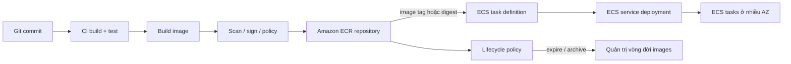
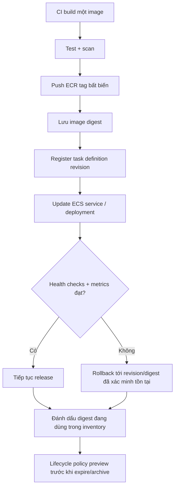
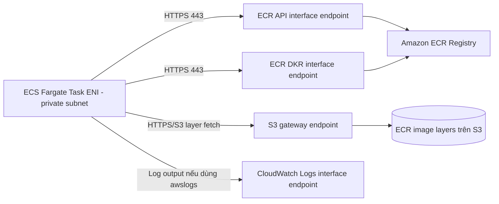
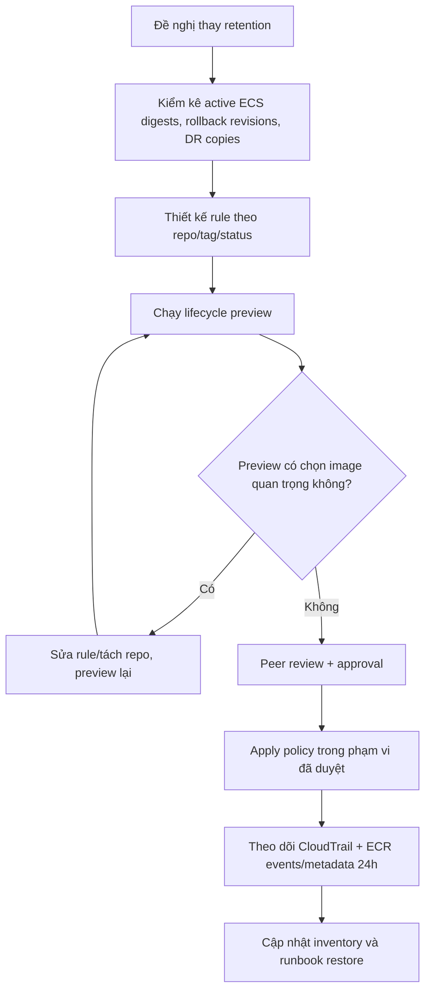

# ECR repository, image tag và lifecycle policy

> **Chương:** Container với ECS · **Mô-đun:** `CLOUD_PROVIDERS_AWS`

## 1. Từ mã nguồn tới container chạy trên ECS

Một ứng dụng Java Spring Boot được đóng gói thành Docker/OCI image, triển khai thành nhiều **Amazon ECS tasks** trải trên hai Availability Zone (AZ). Khi có bản phát hành mới, nhóm CI/CD cần một nơi lưu image đáng tin cậy để ECS kéo về. Đồng thời, đội vận hành cần trả lời: phiên bản nào đang chạy, image nào dùng để rollback, image cũ nào có thể xóa và làm sao phát hiện lỗ hổng trong dependency?

**Amazon Elastic Container Registry (Amazon ECR)** là dịch vụ container registry được AWS quản lý. Nó lưu **container images và các OCI artifacts được hỗ trợ**, cung cấp địa chỉ để Docker/Podman/CI push hoặc pull, tích hợp IAM, encryption, image scanning, replication và **lifecycle policies**. Với ứng dụng trên ECS, ECR là một phần của chuỗi triển khai:



**Ba đối tượng phải phân biệt:**

- **Repository:** kho chứa các image thuộc một ứng dụng hoặc nhóm mục đích; có policy và lifecycle riêng.
- **Image tag:** tên tham chiếu dễ đọc như `1.4.2` hay `git-a1b2c3d`, **có thể thay đổi image mà nó trỏ tới nếu repository cho phép mutable tags**.
- **Image digest:** định danh theo nội dung của manifest, thường `sha256:...`; dùng để tham chiếu chính xác phiên bản image/manifest đã push.

Trong mô-đun `CLOUD_PROVIDERS_AWS`, việc quản lý ECR cần kết nối với **AWS Region/AZ, IAM, VPC endpoints, ECS/EC2/Fargate, CloudWatch, khôi phục/rollback và chi phí lưu trữ**. Cách đặt tag và xóa image ảnh hưởng trực tiếp tới khả năng ECS khởi chạy task mới khi scale-out hoặc thay máy lỗi.

**Mục tiêu học tập:** Sau bài này, người học có thể:

1. Phân biệt private/public registry, repository, manifest, layers, tag, digest và image URI.
2. Tạo private repository, build/tag/push/pull image bằng Docker và AWS CLI.
3. Thiết kế tag strategy, image immutability và chính sách IAM tách CI khỏi ECS.
4. Viết, đọc và **preview** ECR lifecycle policy trước khi áp dụng.
5. Giải thích hai hành động **expire** (xóa) và **transition to archive** (lưu trữ lạnh), cùng rủi ro đối với ECS.
6. Tích hợp image reference với ECS task definition, triển khai/rollback theo digest.
7. Chẩn đoán lỗi pull/push, giám sát scanning, network và chi phí vận hành ECR.

## 2. Amazon ECR: registry, repository, image, manifest và digest

### 2.1. Private ECR và ECR Public

| Khái niệm | Mô tả | Ví dụ sử dụng |
| --- | --- | --- |
| **Amazon ECR Private registry** | Registry riêng trong AWS account và Region, tích hợp IAM và repository policies. | Lưu `orders-api` cho ECS Fargate của doanh nghiệp. |
| **Private repository** | Một kho con trong registry, có tên, cấu hình scanning/tag mutability/encryption và lifecycle policy. | `team-a/orders-api`. |
| **Amazon ECR Public** | Dịch vụ kho image công khai với URI, quyền và cấu hình khác private ECR. | Phân phối base image hoặc công cụ cho cộng đồng. |
| **Image/manifest** | Mô tả cấu hình và tập layers; manifest list/image index có thể tham chiếu nhiều image theo kiến trúc CPU. | Một release chứa image `linux/amd64` và `linux/arm64`. |
| **Image layers** | Các lớp của image được chia sẻ/tái sử dụng theo nội dung. | JRE base layer, dependencies, ứng dụng Java. |
| **Image tag** | Tên tham chiếu dễ đọc, có thể mutable/immutable. | `v1.4.2`, `git-a1b2c3d`. |
| **Image digest** | Hash của manifest/index; giúp định vị bản image xác định. | `sha256:...`. |

Với private ECR, URI thường có dạng:

```text
111122223333.dkr.ecr.ap-southeast-1.amazonaws.com/team-a/orders-api:v1.4.2
|------------ registry / account / Region -------------| |---- repository ----| |tag|
```

Ở đây `111122223333` là **AWS account ID giả định**; `ap-southeast-1` là AWS Region, không phải AZ. Nếu cùng repository được tạo tại Region khác hoặc account khác, URI thay đổi. ECS task ở hai AZ của **cùng Region** thường kéo image qua cùng registry URI theo quyền và mạng của từng task; ECR repository không phải tài nguyên riêng cho mỗi AZ.

### 2.2. Tag và digest khác nhau như thế nào?

Giả sử CI push hai lần:

```text
Lần 1: orders-api:latest  -> sha256:AAA...
Lần 2: orders-api:latest  -> sha256:BBB...
```

Nếu tags **mutable**, `latest` có thể được cập nhật để trỏ tới image mới. Một ECS task đang chạy không tự thay image chỉ vì tag được push lại; khi có deployment mới hoặc task mới, quy tắc resolve image của ECS và digest đã chốt trong deployment sẽ quyết định phiên bản được dùng. Bởi vậy, `latest` không phải bằng chứng đủ để điều tra một bản phát hành.

Với **digest**, URI có dạng:

```text
111122223333.dkr.ecr.ap-southeast-1.amazonaws.com/team-a/orders-api@sha256:<digest-that-exists>
```

Digest phụ thuộc **đúng manifest hoặc image index** được tham chiếu. Với multi-architecture image, digest của manifest list/index khác digest của từng image con. CI/CD cần lưu digest từ kết quả push/describe, không tự suy từ tag hoặc từ file JAR.

**Quan trọng:** Digest giúp ghim chính xác nội dung **nếu image còn tồn tại và có thể pull**. Lifecycle policy vẫn có thể xóa hoặc archive image đó. Vì vậy digest pinning không thay thế **retention/backup/replication** phù hợp và chính sách phát hành.

### 2.3. Image ở registry khác với container đang chạy

| Thành phần | Ở đâu? | Tác động khi image tại ECR bị xóa |
| --- | --- | --- |
| **ECR repository** | Registry AWS | Manifest/layers không còn pull được theo image đã xóa. |
| **ECS task definition** | Cấu hình ECS | Có thể vẫn chứa URI tag/digest cũ; ECS không tự sửa URI. |
| **ECS task đang chạy** | Fargate/EC2 compute | Thường tiếp tục sử dụng image đã có trong môi trường chạy, nhưng không phải bảo đảm cho lần restart/khởi tạo mới. |
| **ECS task mới/scale-out** | Được scheduler khởi tạo | Có thể gặp `CannotPullContainerError` nếu manifest bị xóa/archived hoặc thiếu quyền/mạng. |

ECR không thay thế ECS: ECR **lưu image**, ECS **điều phối chạy container**, IAM quyết định quyền và VPC/network quyết định đường kết nối tới registry.

## 3. Tạo repository và đưa image vào ECR

### 3.1. Chuẩn bị công cụ và danh tính

Ví dụ sử dụng **Docker CLI**, **AWS CLI v2**, IAM identity được cấp quyền push vào repository của tài khoản lab và một image ứng dụng Spring Boot đã được build. Trước thao tác thật:

1. Xác minh account/Region bằng `aws sts get-caller-identity`, tránh push nhầm production.
2. Chọn tên repo, image tag và owner; gắn tags quản trị (project/environment/cost-center) cho **repository resource** khi cần.
3. Dùng IAM least privilege cho CI/nhân viên; không dùng root user hay access key dài hạn lưu trong source code.
4. Xác định đường Internet/VPC endpoint cho Docker client, dung lượng ổ cứng và nơi lưu artifact.
5. Tính chi phí lưu image/scan/network, dọn tài nguyên lab khi được phép.

### 3.2. Tạo private repository

Trên AWS CLI có quyền quản trị repository (các giá trị là **ví dụ**, không chạy trong production nếu chưa review):

```bash
aws sts get-caller-identity

aws ecr create-repository \
  --region ap-southeast-1 \
  --repository-name team-a/orders-api \
  --image-tag-mutability IMMUTABLE \
  --encryption-configuration encryptionType=AES256
```

Lệnh trả về `repositoryUri`, `repositoryArn` và các thuộc tính khác. `IMMUTABLE` chặn **ghi đè tag đã tồn tại**, không chặn image bị xóa qua API hoặc lifecycle. `AES256` dùng cơ chế mã hóa do ECR quản lý; nếu cần customer-managed AWS KMS key, xem `KMS` encryption và kiểm soát key policy theo yêu cầu tổ chức. Cấu hình encryption của repository cần được chọn cẩn thận khi tạo vì không phải mọi tùy chọn có thể thay đổi trực tiếp sau đó.

**Không mặc định bật scan-on-push trong `create-repository` là đủ:** Amazon ECR hỗ trợ thiết lập scanning ở cấp **private registry** để chọn basic/enhanced và bộ lọc repository. Cấu hình scanning/nguồn lỗ hổng cần được quyết định ở cấp tổ chức; xem mục 11.

### 3.3. Đăng nhập Docker vào ECR private registry

```bash
AWS_REGION=ap-southeast-1
ACCOUNT_ID=111122223333
REGISTRY="$ACCOUNT_ID.dkr.ecr.$AWS_REGION.amazonaws.com"

aws ecr get-login-password --region "$AWS_REGION" \
  | docker login --username AWS --password-stdin "$REGISTRY"
```

ECR authorization token dùng cho Docker authentication có thời hạn **12 giờ**; hết hạn thì đăng nhập lại qua AWS CLI. Người dùng hoặc CI role phải có `ecr:GetAuthorizationToken`. Lệnh `--password-stdin` giúp tránh đưa password lên argument list. **Không in token ra log, không commit file `~/.docker/config.json` hay AWS credentials**. Token ECR có phạm vi theo IAM permissions của danh tính đã lấy token, không tự cấp mọi quyền push/pull.

### 3.4. Build, tag và push một phiên bản

Giả sử có `Dockerfile` của ứng dụng Java và repo vừa tạo:

```bash
IMAGE_REPO="$REGISTRY/team-a/orders-api"
RELEASE_TAG="git-a1b2c3d"  # ví dụ tên tag theo commit

docker build -t orders-api:$RELEASE_TAG .
docker tag orders-api:$RELEASE_TAG "$IMAGE_REPO:$RELEASE_TAG"
docker push "$IMAGE_REPO:$RELEASE_TAG"

aws ecr describe-images \
  --region "$AWS_REGION" \
  --repository-name team-a/orders-api \
  --image-ids imageTag="$RELEASE_TAG" \
  --query 'imageDetails[].{Tags:imageTags,Digest:imageDigest,Size:imageSizeInBytes,Pushed:imagePushedAt}' \
  --output json
```

`git-a1b2c3d` là ví dụ; CI thực tế nên dùng **full hoặc short commit SHA đủ tránh trùng lặp**, release version chuẩn hóa và pipeline ID khi cần. Để image chạy đúng CPU architecture của ECS, build/test đúng platform; nếu dùng `buildx` và multi-platform manifest, kiểm tra image index/digest thay vì chỉ tag.

### 3.5. Thử pull bằng chính digest

Sau push, lấy digest từ lệnh `describe-images` rồi:

```bash
docker pull "$IMAGE_REPO@sha256:<digest-from-ecr>"
docker image inspect "$IMAGE_REPO:$RELEASE_TAG"
```

Placeholder `<digest-from-ecr>` phải được thay bằng digest thật, không chạy nguyên văn. Trước khi dùng image trong ECS, kiểm tra image chạy đúng kiến trúc, entrypoint, exposed port, health endpoint và không chứa secrets trong image layers. Image tồn tại trên ECR **không chứng minh** ứng dụng sẽ khởi động thành công trên Fargate/EC2.

## 4. Chiến lược tag và tính bất biến

### 4.1. Các kiểu tag thường gặp

| Kiểu tag | Ví dụ | Dùng cho | Rủi ro |
| --- | --- | --- | --- |
| **Release version** | `v1.4.2` | Theo dõi bản phát hành, audit và rollback. | Mutable tag có thể bị ghi đè; phải kiểm soát. |
| **Commit SHA** | `git-a1b2c3d` | Truy vết mã nguồn, CI build và deployment. | Short SHA quá ngắn hoặc build lại cùng tag có thể gây xung đột. |
| **Environment** | `dev`, `staging` | Trỏ tới bản được dùng trong môi trường. | Tag thường mutable, không chứng minh nội dung deploy. |
| **Floating** | `latest` | Thử nghiệm nhanh và một số workflow cache. | Có thể đổi sang image khác bất kỳ lúc nào. |
| **Digest** | `@sha256:...` | Pin artifact xác định cho task definition. | Image có thể bị xóa/archived và không pull được. |

**Thiết kế đề xuất:** build artifact một lần, kiểm thử và quét image, phát hành bằng tag **không tái sử dụng** và ghi lại digest cùng CI build ID, source commit, test evidence và task definition revision. Đừng chỉ tin một tag `prod` để kết luận phiên bản đang chạy hoặc đã qua security gate.

### 4.2. Image tag mutability

ECR hỗ trợ các lựa chọn:

- **MUTABLE:** cùng tag được push lại để trỏ tới manifest khác.
- **IMMUTABLE:** push image với tag đã có trong repository sẽ thất bại, thường có lỗi `ImageTagAlreadyExistsException`.
- **MUTABLE_WITH_EXCLUSION / IMMUTABLE_WITH_EXCLUSION:** có thể khai báo **exclusion filters** để một số tag patterns có hành vi ngược với chế độ mặc định.

Ví dụ cập nhật một repository có sẵn thành immutable:

```bash
aws ecr put-image-tag-mutability \
  --region ap-southeast-1 \
  --repository-name team-a/orders-api \
  --image-tag-mutability IMMUTABLE
```

Nếu môi trường lab thật sự cần cập nhật `dev-*` nhưng vẫn bảo vệ release tags, có thể xem xét chế độ ngoại lệ:

```bash
aws ecr put-image-tag-mutability \
  --region ap-southeast-1 \
  --repository-name team-a/orders-api \
  --image-tag-mutability IMMUTABLE_WITH_EXCLUSION \
  --image-tag-mutability-exclusion-filters filterType=WILDCARD,filter=dev-*
```

Đây là ví dụ cấu hình tùy chọn, phải đối chiếu AWS CLI/tính năng hiện hành, IAM và policy của tổ chức. Không dùng ngoại lệ cho tag phát hành chính thức nếu yêu cầu tính bất biến. **Immutability chỉ chống overwrite tag, không chống delete/expire/archive**, nên tiếp tục kiểm soát quyền xóa và lifecycle policy.

### 4.3. Nhiều tags có thể trỏ về cùng một image

Một digest có thể có nhiều tag như `git-a1b2c3d`, `v1.4.2` và `prod-approved`. Gắn thêm tag không nhất thiết tạo bản sao riêng của mọi layer. Khi lifecycle policy đánh giá, phải nhìn **toàn bộ tags trên cùng image** và biết rule chọn image chứ không chỉ chọn một chuỗi tag đơn lẻ.

**Bẫy nghiêm trọng:** Một image vừa có `dev-123` vừa có `prod-1.2.3` vẫn khớp rule `dev-*`. Rule dọn dev có thể vô tình xử lý image prod đang dùng. Chỉ dựa vào prefix không phải ranh giới bảo vệ production; **tách repository phát triển và release** là lựa chọn rõ ràng khi retention của hai môi trường khác nhau.

### 4.4. Gắn tag và thay tag không thay ứng dụng đang chạy

Một ECS service đã tạo tasks từ image digest cụ thể không tự thay phiên bản chỉ vì `latest` bị push lại. Ngược lại, nếu đội vận hành force deployment dựa trên một floating tag hoặc tắt cơ chế version consistency, bản được kéo có thể khác kỳ vọng. Luôn ghi lại digest và triển khai **task definition revision** rõ ràng. Xem mục 9 về cách ECS resolve tag sang digest.

## 5. IAM cho ECR: ai được push, ai được pull?

### 5.1. Ba danh tính thường bị nhầm

| Danh tính | Dùng vào việc gì? | Quyền liên quan ECR |
| --- | --- | --- |
| **CI/CD build role** | Docker login, push image, đọc metadata, có thể kích hoạt scan/deploy. | Push/pull đúng repository; không có `DeleteRepository` nếu không cần. |
| **ECS task execution role** | ECS/Fargate agent pull image, ghi CloudWatch Logs, lấy secrets trong task definition khi có cấu hình phù hợp. | Thường `ecr:GetAuthorizationToken`, `BatchGetImage`, `GetDownloadUrlForLayer`. |
| **ECS task role** | Mã ứng dụng chạy **bên trong container** gọi S3, DynamoDB, Secrets Manager... | Không cần ECR pull permissions chỉ để ECS kéo image. Chỉ cần ECR permissions nếu chính ứng dụng trực tiếp gọi ECR API. |

Với **ECS on EC2** có sự khác biệt: container instance IAM role (gắn vào EC2) thường cung cấp một số quyền agent cần cho ECR; task execution role có thể cần cho các tính năng khác theo cấu hình ECS. Với **Fargate**, task execution role là vai trò chuẩn để agent pull private ECR image. Đừng cấp `AdministratorAccess` cho task role của ứng dụng chỉ để sửa lỗi image pull.

### 5.2. Ví dụ chính sách ECR chỉ đọc cho execution role

```json
{
  "Version": "2012-10-17",
  "Statement": [
    {
      "Sid": "ECRAuthorization",
      "Effect": "Allow",
      "Action": "ecr:GetAuthorizationToken",
      "Resource": "*"
    },
    {
      "Sid": "PullOrdersImage",
      "Effect": "Allow",
      "Action": [
        "ecr:BatchGetImage",
        "ecr:GetDownloadUrlForLayer",
        "ecr:BatchCheckLayerAvailability"
      ],
      "Resource": "arn:aws:ecr:ap-southeast-1:111122223333:repository/team-a/orders-api"
    }
  ]
}
```

ARN/account/Region là placeholder. Nếu ECS còn ghi logs CloudWatch hoặc đọc Secrets Manager, phải cấp thêm **đúng** các quyền theo task definition. AWS managed policy `AmazonECSTaskExecutionRolePolicy` là lựa chọn cơ bản phổ biến; khi cần least privilege chặt hơn, dùng policy có scope và điều kiện phù hợp.

### 5.3. Push cần nhóm quyền khác

CI role push image thường cần:

- `ecr:GetAuthorizationToken` trên `*` để Docker đăng nhập.
- `ecr:BatchCheckLayerAvailability`, `ecr:InitiateLayerUpload`, `ecr:UploadLayerPart`, `ecr:CompleteLayerUpload`, `ecr:PutImage` trên **repository cụ thể**.
- `ecr:DescribeImages`/`ecr:DescribeRepositories` nếu pipeline kiểm tra tồn tại image và digest.

Quyền tạo repository, sửa lifecycle policy, thay tag mutability, archive/delete images nên là **quyền quản trị riêng**. Pipeline build không mặc nhiên được sửa retention của production. Với **cross-account ECR pull**, kiểm tra cả IAM identity policy của role ở account ECS và **ECR repository resource policy** tại account sở hữu image. Dùng role assumption/temporary credentials thay vì chép access key giữa các account.

### 5.4. Bảo vệ chuỗi phát hành

- CI/CD dùng federation/assume role với thông tin xác thực ngắn hạn; hạn chế ai được push release tags.
- Dùng tag immutability + digest/commit traceability + IAM policy + approvals; chúng bảo vệ những khía cạnh khác nhau.
- Có thể lưu/sign artifact theo tiêu chuẩn OCI/supply-chain và kiểm tra signatures/provenance trước deploy bằng giải pháp phù hợp; **ECR không tự xác nhận image an toàn chỉ vì push thành công**.
- Bật AWS CloudTrail cho các sự kiện quản trị/API quan trọng, giám sát thay đổi repository policy, lifecycle, tag mutability và hành vi xóa bất thường.
- Với mã nguồn không đáng tin, pipeline phải hạn chế quyền chạy code/build trong môi trường riêng, không cung cấp credentials production cho Docker build.

## 6. Lifecycle policy là gì và xử lý image theo nguyên tắc nào?

**ECR lifecycle policy** là bộ rules dạng JSON gắn với **một private repository**, tự động chọn image dựa trên tags, tuổi, thời điểm pull hoặc số lượng image và thực hiện hành động:

1. **`expire`:** xóa image/manifest khỏi repository theo tiêu chí. Nếu chỉ còn image đang phục vụ ECS mà bị xóa, lần pull tiếp theo có thể thất bại.
2. **`transition` tới `archive`:** chuyển image sang **ECR archival storage class** để lưu dài hạn chi phí thấp hơn trong các use case phù hợp. **Archived image không thể pull** cho tới khi được restore.

Không phải mọi account/Region hoặc công cụ cũ đều có cùng tính năng archive; hãy kiểm tra khả năng hỗ trợ và AWS CLI trước triển khai. **Lifecycle policy không thay thế chính sách triển khai hay chiến lược backup/DR cho image quan trọng**.

### 6.1. Cấu trúc một rule

```json
{
  "rulePriority": 1,
  "description": "Expire untagged images older than 7 days",
  "selection": {
    "tagStatus": "untagged",
    "countType": "sinceImagePushed",
    "countUnit": "days",
    "countNumber": 7
  },
  "action": {
    "type": "expire"
  }
}
```

Đây là **một rule object**; policy hoàn chỉnh cần bọc trong `{"rules": [ ... ]}`. Nội dung quan trọng:

| Thuộc tính | Mục đích | Quy tắc |
| --- | --- | --- |
| `rulePriority` | Thứ tự ưu tiên rule. | Số nhỏ hơn có ưu tiên cao hơn; duy nhất trong policy. |
| `description` | Chú giải cho người quản trị. | Nêu hành vi, phạm vi và lý do retention. |
| `tagStatus` | Chọn `tagged`, `untagged` hoặc `any`. | Với `tagged` cần tagPatternList hoặc tagPrefixList. |
| `tagPrefixList` | Khớp tên tag bắt đầu bằng prefix. | Ví dụ `["dev-"]`; không dùng đồng thời với tagPatternList trong cùng rule. |
| `tagPatternList` | Khớp tag pattern với dấu `*`. | Ví dụ `["feature-*"]`; mỗi pattern có giới hạn wildcard. |
| `countType` | Cách xác định image đến hạn xử lý. | `imageCountMoreThan`, `sinceImagePushed`, `sinceImagePulled`, `sinceImageTransitioned`. |
| `countNumber` | Giới hạn số lượng hoặc số ngày. | Số nguyên dương; không dùng 0. |
| `countUnit` | Đơn vị thời gian. | `days` khi dùng countType theo thời gian, bỏ khi đếm image. |
| `action.type` | Xóa hay chuyển lưu trữ. | `expire` hoặc `transition`. |
| `targetStorageClass` | Lớp lưu trữ đích. | `archive` khi action `transition`. |

Đối với archived image, rule `sinceImageTransitioned` kết hợp `storageClass: "archive"` và hành động `expire` mới phù hợp; việc xóa image archived có thời gian lưu tối thiểu liên quan tính phí, xem mục 8.

### 6.2. Thứ tự đánh giá và quy tắc chọn tag

- **Tất cả rules được đánh giá trước**, sau đó áp dụng kết quả dựa trên `rulePriority`; **1 có ưu tiên cao hơn 2**.
- Mỗi image chỉ có thể được xử lý bởi **tối đa một rule** trong một lần đánh giá.
- Một rule có `tagStatus: "any"` phải có **priority số lớn nhất** để được xử lý cuối cùng trong phạm vi chính sách hợp lệ.
- Với `tagStatus: "tagged"`, phải chọn **`tagPrefixList` hoặc `tagPatternList`**, không dùng cả hai trên cùng rule. Nhiều phần tử trong list được hiểu là image phải có tags đáp ứng **tất cả các điều kiện** được nêu, không phải OR tùy ý.
- `imageCountMoreThan` giữ lại số image mới nhất thuộc tập được chọn, hết phần vượt ngưỡng từ cũ tới mới. Đây là **số image**, không phải số tag.
- `sinceImagePushed` dựa trên thời gian image được push; `sinceImagePulled` dựa trên **thời điểm pull được ECR ghi nhận gần nhất** hoặc mốc thay thế theo quy tắc AWS khi chưa từng pull, không phải lịch sử chính xác từng lần chạy ECS.
- Với image có **manifest list/index** (multi-architecture), một image được manifest list tham chiếu không thể được lifecycle xóa/archive một cách độc lập trước khi xử lý manifest list liên quan. Khi scan preview, cần xem cả manifest list và các image thành phần.
- Hành động dựa trên lifecycle policy được AWS xử lý **trong khoảng 24 giờ sau khi image đủ điều kiện**, không phải cron job chạy chính xác theo phút. Events liên quan được ghi nhận qua CloudTrail.

### 6.3. Retention cần bảo vệ rollback window

Ví dụ bản production được rollback trong tối đa 30 ngày, staging giữ 14 ngày, còn dev image chỉ cần 7 ngày. **Không đặt policy toàn repository kiểu “xóa mọi image trên 7 ngày”** nếu repository vẫn chứa production releases. Chọn một trong các giải pháp:

1. **Tách repository** `orders-api-dev` và `orders-api-prod` với lifecycle policy riêng.
2. Cấu hình tập rules rất cẩn thận cùng approval, preview và kiểm tra từng image/digest trước khi áp dụng.
3. Duy trì danh sách releases/digests đang dùng bởi task definitions, active services và rollback runbooks; không xác định “unused” chỉ bằng age.

Chọn retention cần căn cứ khả năng **ASG/ECS scale-out, phục hồi một AZ, deploy lại từ task definition cũ và rollback**. Task hiện tại đang chạy không bảo đảm image có sẵn cho task thay thế.

## 7. Viết lifecycle policy an toàn cho repository dev

Giả sử có **một repository riêng** `team-a/orders-api-dev`, không chứa production images. Ta muốn:

- Xóa image **untagged** đã được push hơn **7 ngày**.
- Chỉ giữ **20 image mới nhất** mang prefix `dev-`, không đụng các tags không thuộc nhóm này.

Tạo file `lifecycle-dev.json` trong môi trường triển khai chính sách (đây là **nội dung minh họa**, không ghi thêm file vào repository của bài học):

```json
{
  "rules": [
    {
      "rulePriority": 1,
      "description": "Expire untagged dev images older than 7 days",
      "selection": {
        "tagStatus": "untagged",
        "countType": "sinceImagePushed",
        "countUnit": "days",
        "countNumber": 7
      },
      "action": {
        "type": "expire"
      }
    },
    {
      "rulePriority": 2,
      "description": "Retain latest 20 images tagged dev-*",
      "selection": {
        "tagStatus": "tagged",
        "tagPatternList": ["dev-*"],
        "countType": "imageCountMoreThan",
        "countNumber": 20
      },
      "action": {
        "type": "expire"
      }
    }
  ]
}
```

Ví dụ policy này **không có catch-all rule**. Nó sẽ không chủ động xử lý các tagged images chỉ có prefix khác `dev-`; nhưng có thể chọn image **đa tag**, trong đó có `dev-...`. Vì vậy:

1. **Chỉ áp dụng cho repository dev thật sự**, không sao chép vào prod repo.
2. Không gắn cả `dev-*` và `prod-*` cho cùng image khi sử dụng các policies retention khác nhau mà chưa đánh giá kết quả.
3. Chạy **lifecycle preview**, đối chiếu từng digest sắp bị xóa với ECS task definitions, deployments và rollback candidates.
4. Hiểu rằng image untagged vẫn có thể được ECS tham chiếu bằng digest. `untagged` **không đồng nghĩa không được sử dụng**.
5. Tính dung lượng và lịch release; mức 7 ngày/20 images chỉ là **giả định bài tập**, không phải khuyến nghị chung của AWS.

### 7.1. Preview bằng AWS CLI trước khi ghi chính sách

Giả sử file `lifecycle-dev.json` đã tồn tại cục bộ và AWS CLI v2 có quyền tương ứng:

```bash
aws ecr start-lifecycle-policy-preview \
  --region ap-southeast-1 \
  --repository-name team-a/orders-api-dev \
  --lifecycle-policy-text file://lifecycle-dev.json

# Preview được xử lý bất đồng bộ; gọi sau khi status COMPLETE.
aws ecr get-lifecycle-policy-preview \
  --region ap-southeast-1 \
  --repository-name team-a/orders-api-dev \
  --output json
```

Kiểm tra trong kết quả các trường như **`status`, `previewResults`, `imageTags`, `imageDigest`, `appliedRulePriority`, `action`** và thống kê. Nếu status đang `IN_PROGRESS`, chưa được kết luận kết quả; cần đọc lại khi hoàn tất. Nếu `FAILED`, kiểm tra thông báo và cú pháp JSON. Với nhiều image, bảo đảm **không bỏ sót trang kết quả**. Preview là công cụ kiểm soát quan trọng, nhưng nó là ảnh chụp kết quả dự kiến tại thời điểm kiểm tra; image mới có thể được push sau đó.

**Checklist phải hoàn thành trước khi apply:**

- Có owner/approver của repository và người chịu trách nhiệm ECS services sử dụng image.
- Không có active deployments, running task definitions, scheduled jobs hoặc release rollback cần những digest sắp expire.
- Danh sách image muốn giữ đã được bảo vệ bằng quy trình rõ ràng, không chỉ tin rằng tag là immutable.
- Nếu có image index/manifest list, xem cả các artifacts được tham chiếu và OCI referrers.
- Có kế hoạch rollback chính sách; hiểu rằng **gỡ lifecycle policy không tự phục hồi image đã bị xóa**.

### 7.2. Áp dụng policy sau khi được phê duyệt

```bash
aws ecr put-lifecycle-policy \
  --region ap-southeast-1 \
  --repository-name team-a/orders-api-dev \
  --lifecycle-policy-text file://lifecycle-dev.json

# Kiểm tra policy hiện hành.
aws ecr get-lifecycle-policy \
  --region ap-southeast-1 \
  --repository-name team-a/orders-api-dev \
  --output json
```

**Tác động thật:** `put-lifecycle-policy` là thao tác thay đổi repository. Không chạy chỉ để thử trong tài khoản sản xuất; nếu áp dụng policy sai, những image đủ điều kiện có thể được xóa **trong vòng 24 giờ**. Chỉ quay lại rule cũ sau khi xóa chưa đảm bảo phục hồi dữ liệu; muốn giữ bản phát hành cần khôi phục/tái push từ artifact tin cậy hoặc nguồn dự phòng phù hợp.

### 7.3. Bài toán “giữ 20 bản mới nhất” không phải giữ 20 tags

Ví dụ digest A có hai tags `dev-a` và `dev-latest`, digest B có `dev-b`. Dù có **ba tags**, chỉ có **hai image manifests** trong tập được chọn. Khi đánh giá `imageCountMoreThan: 20`, ECR đếm image được match theo quy tắc lifecycle, không đơn giản đếm số chuỗi tag. Nếu một digest cũng chứa tag protected của môi trường khác, preview cần cho thấy nguy cơ trước khi chạy.

## 8. Archive image: lưu trữ lạnh thay vì xóa ngay

AWS ECR hiện hỗ trợ **archival storage class** trong các trường hợp được công bố. Đây là lựa chọn lưu giữ bản phát hành cũ phục vụ audit hoặc phục hồi **không cần pull tức thì**, khác với việc giữ image luôn có thể kéo từ ECR Standard.

| Tiêu chí | **Standard** | **Archive** |
| --- | --- | --- |
| Mục đích | Image đang dùng hoặc cần pull nhanh. | Image ít dùng, giữ dài hạn theo chính sách. |
| Có pull ngay cho ECS được không? | Có, nếu IAM và network cho phép. | **Không**; pull archived image thất bại cho tới khi restore. |
| Tốc độ sử dụng lại | Pull theo thời gian mạng/image. | Cần restore về Standard trước; phải dự trù thời gian. |
| Chính sách lifecycle | Có thể `expire` hoặc `transition`. | Có thể `expire` sau thời gian archive tối thiểu theo quy tắc. |
| Chi phí | Giá Standard storage. | Giá archive và các điều kiện storage duration/restore tương ứng; kiểm tra Region. |

**Điểm quan trọng:** Archived image vẫn có thể xuất hiện trong `describe-images` nhưng ở trạng thái `ARCHIVED`; việc nhìn thấy metadata **không đồng nghĩa image pull được**. AWS ghi nhận việc restore có thể mất **tới khoảng 20 phút**; không xây quy trình autoscaling/rollback cấp phút dựa trên image vẫn đang ở Archive.

### 8.1. Rule chuyển image ít được pull sang Archive

Trong **repository dành riêng cho các bản lịch sử không dùng để scale-out tức thì**, ví dụ policy sau có thể transition các image mang tag `historical-*` nếu không được pull trong hơn **90 ngày**:

```json
{
  "rules": [
    {
      "rulePriority": 1,
      "description": "Archive historical images not pulled in 90 days",
      "selection": {
        "tagStatus": "tagged",
        "tagPatternList": ["historical-*"],
        "countType": "sinceImagePulled",
        "countUnit": "days",
        "countNumber": 90
      },
      "action": {
        "type": "transition",
        "targetStorageClass": "archive"
      }
    }
  ]
}
```

**Cẩn trọng với `sinceImagePulled`:** mốc được tính dựa trên **last recorded pull time** hoặc timestamp thay thế theo quy tắc ECR nếu chưa từng pull/đã restore. Một ECS task đang chạy dài hạn có thể **không thực hiện pull image thường xuyên**; do đó không dùng “90 ngày không pull” để kết luận image không phục vụ production. Hãy kiểm tra các task definitions/deployments và danh sách image cần giữ trước.

### 8.2. Xóa image đã ở Archive

Ví dụ một policy **riêng** cho repository lưu trữ có thể expire archived images đã nằm ở Archive hơn **365 ngày**:

```json
{
  "rules": [
    {
      "rulePriority": 1,
      "description": "Expire archive images after 365 days in archive",
      "selection": {
        "tagStatus": "any",
        "storageClass": "archive",
        "countType": "sinceImageTransitioned",
        "countUnit": "days",
        "countNumber": 365
      },
      "action": {
        "type": "expire"
      }
    }
  ]
}
```

ECR Archive có **minimum storage duration 90 ngày**. Không thể cấu hình lifecycle tự xóa một image archived dưới thời hạn tối thiểu này; nếu xóa thủ công sớm bằng API phù hợp, có thể vẫn bị tính phí thời hạn tối thiểu. **Khoảng 365 ngày trong ví dụ là chính sách giả định**, không phải yêu cầu của AWS.

Khi dùng nhiều rules trong cùng policy, phải kiểm tra các điều kiện hợp lệ về **storage class, priority, tag filters và mọi action**. Không chèn hai policy JSON rời nhau vào repository: mỗi repository có một lifecycle policy chứa tập rules đã được phân tích cùng nhau. Luôn chạy preview theo đúng policy tổng hợp.

### 8.3. Khi nào không nên archive?

Không archive các image:

- Đang được **ECS service/task definition revision** sử dụng để triển khai task mới.
- Cần cho **rollback khẩn cấp** theo RTO ngắn.
- Cần cho **scale-out** và thay task sau sự cố AZ/EC2.
- Là thành phần manifest/index cần cho image đa kiến trúc vẫn hoạt động.
- Chưa có bản dự phòng/khả năng build lại đáng tin cậy và cơ chế lưu provenance phù hợp.

Archive là lựa chọn **tối ưu chi phí lưu trữ dài hạn** khi có quy trình restore rõ ràng, không phải cách “xóa mềm” vô hại. Nếu cần khôi phục image, xác minh trạng thái trở lại `ACTIVE` trước khi ECS pull. Giá archive, restore, storage và regional availability phải tra trên bảng giá ECR hiện hành.

### 8.4. Event và tính nhất quán của vòng đời

ECR lifecycle policies thực thi tự động sau khi image đáp ứng điều kiện, với độ trễ dự kiến trong vòng 24 giờ. Sự kiện expire/archive được AWS ghi nhận trong **CloudTrail**. Nếu có **ECR replication** giữa Regions/accounts, lifecycle policy là chính sách tại repository/Region áp dụng; khả năng sao chép **delete** còn phụ thuộc cấu hình replication deletes. Không mặc định image bị xóa ở một Region sẽ được giữ hoặc xóa y hệt ở mọi nơi: phải xác minh từng đích replication và chiến lược DR.

## 9. Dùng ECR image trong Amazon ECS task definition

Một **ECS task definition** mô tả image, CPU/memory, roles, network mode, ports, logging, environment và những điều kiện chạy container. Với **ECS Fargate**, task definition thường dùng `awsvpc` network mode và `executionRoleArn` để ECS agent pull image từ ECR.

### 9.1. Ví dụ JSON task definition cho Spring Boot

```json
{
  "family": "orders-api",
  "networkMode": "awsvpc",
  "requiresCompatibilities": ["FARGATE"],
  "cpu": "256",
  "memory": "512",
  "executionRoleArn": "arn:aws:iam::111122223333:role/ecsTaskExecutionRole",
  "taskRoleArn": "arn:aws:iam::111122223333:role/ordersAppTaskRole",
  "containerDefinitions": [
    {
      "name": "orders-api",
      "image": "111122223333.dkr.ecr.ap-southeast-1.amazonaws.com/team-a/orders-api@sha256:<real-digest>",
      "essential": true,
      "portMappings": [
        { "containerPort": 8080, "protocol": "tcp" }
      ],
      "logConfiguration": {
        "logDriver": "awslogs",
        "options": {
          "awslogs-group": "/ecs/orders-api",
          "awslogs-region": "ap-southeast-1",
          "awslogs-stream-prefix": "ecs"
        }
      }
    }
  ]
}
```

**Chưa chạy được nguyên văn:** account ID, ARN roles, ECR repository URI, digest, CloudWatch Logs group và resource capacity phải tồn tại/hợp lệ. `<real-digest>` là placeholder cần thay, app phải listen cổng 8080 và Fargate CPU/memory/architecture cần khớp với image. Nếu dùng ALB với tasks `awsvpc`, target group thường cần **target type `ip`**, không phải `instance`.

Phân quyền quan trọng:

- **Execution role** cho ECS/Fargate agent pull ECR image và ghi `awslogs` theo policy.
- **Task role** cho code Java gọi S3, DynamoDB, Secrets Manager, SQS…; không cấp ECR admin chỉ vì ứng dụng chạy container.
- IAM trust policies, repo policies, KMS và VPC endpoints phải cùng cho phép đường truy cập theo kiến trúc.

### 9.2. ECS image tag resolution và version consistency

ECS có tính năng **container image version consistency**: trong những ECS service deployments được hỗ trợ, ECS sẽ cố gắng **resolve image tag thành digest** khi triển khai, rồi dùng digest đó để các tasks của cùng deployment chạy cùng phiên bản. Tham số `versionConsistency` trong container definition có thể cho phép/bỏ qua hành vi này theo khả năng hỗ trợ; mặc định thường là `enabled` cho cấu hình được hỗ trợ.

Điều đó dẫn tới các kết luận:

1. **Thay nội dung tag tại ECR không tự cập nhật tasks đang chạy.**
2. **Một deployment mới** có thể resolve tag ở thời điểm khác; ghi lại digest thực tế thay vì chỉ tag.
3. Dùng **image URI theo digest ngay trong task definition** là cách xác định nội dung minh bạch; cần đảm bảo manifest và các platform images liên quan vẫn pull được.
4. Khi ECS không establish digest thành công, kết quả triển khai và rollback còn phụ thuộc loại deployment, agent/platform version và `deployment circuit breaker`; không giả định mọi failure đều tự rollback.
5. Chỉ biết task definition revision chưa đủ nếu ảnh chứa tag mutable và không lưu digest được resolved; nên ghi deployment metadata và kiểm chứng image đã chạy.

Với ECS service đã sử dụng một digest, lần tạo task mới có thể vẫn cần pull từ ECR. **Nếu lifecycle đã xóa hoặc archive image**, việc scale-out, thay task lỗi hoặc rollback về revision cũ có thể bị hỏng dù CI pipeline và task definition vẫn còn.

### 9.3. Quy trình deploy/rollback an toàn



Trong thực tế cần phối hợp **ALB target health**, application readiness, ECS deployment circuit breaker, CloudWatch alarms và các điều kiện deployment. Một rule ECR lifecycle không biết toàn bộ trạng thái ECS services đang dùng digest; muốn bảo vệ image release cần inventory và process riêng.

### 9.4. Image cleanup ảnh hưởng đến các tình huống sự cố

| Tình huống | ECR retention tác động ra sao? | Cách phòng ngừa |
| --- | --- | --- |
| ECS task đang chạy trong AZ A ổn định. | Image bị xóa tại registry không luôn giết container đang chạy ngay. | Không suy ra registry an toàn chỉ từ việc task vẫn healthy. |
| AZ A gặp sự cố, ECS tạo task tại AZ B. | Task mới có thể phải pull digest đã deploy; nếu không tồn tại hoặc archived sẽ thất bại. | Retain active deployment digest, multi-AZ network/pull readiness. |
| Rollback về ECS task definition revision trước. | Revision có thể tham chiếu image đã expire/archive. | Giữ rollback window thực tế và kiểm tra digest trước rollback. |
| Fargate scale-out vào private subnets. | Pull image cần execution role và network đến ECR/S3 layers. | VPC endpoints/NAT phù hợp, IAM/trust/SG/DNS chính xác. |
| Cross-Region disaster recovery. | ECR replica và lifecycle deletes có thể ảnh hưởng image dự phòng. | Chọn replication/retention/restore rõ ràng, tập dượt DR. |

## 10. ECS/Fargate ở private subnet kéo image qua mạng nào?

Một ECS Fargate task chạy `awsvpc` trong **private subnet** không cần public IPv4 để ứng dụng nhận request từ ALB. Nhưng trước khi container chạy, ECS cần **kết nối outbound tới ECR và nơi lưu image layers**; nếu task không có NAT/Internet egress, thường dùng **VPC endpoints (AWS PrivateLink)**.

### 10.1. Những endpoints thường cần khi không có Internet egress

| Endpoint | Loại | Mục đích |
| --- | --- | --- |
| `com.amazonaws.<region>.ecr.api` | **Interface endpoint** | ECR API dùng trong authentication/metadata theo platform version. |
| `com.amazonaws.<region>.ecr.dkr` | **Interface endpoint** | Docker Registry API cho pull/push ECR private images. |
| `com.amazonaws.<region>.s3` | **Gateway endpoint** (hoặc phương án được hỗ trợ) | Đọc image layers mà ECR lưu trong S3; route table của private subnet phải có đường tới endpoint. |
| `com.amazonaws.<region>.logs` | **Interface endpoint** nếu cần | ECS tasks gửi logs tới CloudWatch Logs khi không có đường egress khác. |
| Secrets Manager/SSM endpoints | Interface endpoints tùy nhu cầu | Dùng khi task definition hoặc app gọi API secrets/parameters. |

Với **Fargate Linux platform version 1.4.0 trở lên** và mô hình pull qua endpoints, thường cần cả `ecr.api`, `ecr.dkr` và S3 gateway endpoint; phiên bản cũ có khác biệt. Kiểm tra [AWS ECS task execution role](https://docs.aws.amazon.com/AmazonECS/latest/developerguide/task_execution_IAM_role.html) và [ECR VPC endpoints](https://docs.aws.amazon.com/AmazonECR/latest/userguide/vpc-endpoints.html) cho platform thật.

Các điều kiện thường bỏ sót:

- **Private DNS** được cấu hình phù hợp cho interface endpoints, VPC DNS resolution hoạt động.
- **Security group của interface endpoint** cho inbound TCP 443 từ task ENI/security group; task SG outbound tương ứng.
- **Route table của private subnet** được liên kết S3 gateway endpoint; S3 bucket/endpoint policies không chặn các object/layers ECR yêu cầu.
- **Task execution role** và repository policy cho phép pull; nếu hạn chế bằng `aws:SourceVpce`, phải chỉ đúng endpoint ID và account.
- **ECS image pull khi dùng ECR pull-through cache lần đầu** hoặc các loại image chứa foreign layers có thể đòi đường Internet/NAT theo trường hợp AWS nêu; không giả định endpoints tự đáp ứng mọi registry upstream.



Đây là sơ đồ logic, không thay mô tả chính xác của mọi packet hoặc endpoint implementation. **ALB → task** là đường inbound của ứng dụng; **task → ECR** là đường outbound để chuẩn bị container. Chúng có security groups và yêu cầu routing khác nhau. Thiếu network pull có thể khiến ECS báo `ResourceInitializationError` hoặc `CannotPullContainerError` ngay cả khi ALB/HTTP và code Java hoàn toàn đúng.

### 10.2. Nếu dùng NAT thay vì endpoints

Private subnet có route `0.0.0.0/0` tới NAT gateway phù hợp có thể pull ECR qua endpoint công khai, nhưng phải tính **NAT processing fees, traffic, tính sẵn sàng theo AZ** và network controls. VPC endpoints có thêm chi phí interface endpoint theo AZ/giờ và dữ liệu xử lý; không có thiết kế rẻ nhất cho mọi workload. Cần đo số lần pull (deploy/scale-out), kích thước image và lượng data egress.

## 11. Scanning và bảo vệ supply chain

ECR cung cấp **image scanning** để phát hiện một số lỗ hổng trong package/dependencies khi image được lưu trữ, nhưng không bảo đảm mọi lỗ hổng ứng dụng hoặc rủi ro runtime đều được phát hiện. Trước triển khai production cần đồng thời kiểm tra code, dependencies, CI runners, base image và permissions.

### 11.1. Basic scanning và enhanced scanning

| Tùy chọn | Ý nghĩa | Cách dùng |
| --- | --- | --- |
| **Basic scanning** | ECR hỗ trợ quét lỗ hổng theo cơ chế basic scanner, với các chế độ scan được hỗ trợ. | Phù hợp quét image trong pipeline theo cấu hình registry/repository. |
| **Enhanced scanning (Amazon Inspector)** | Tích hợp Amazon Inspector để có khả năng đánh giá lỗ hổng sâu hơn và theo dõi liên tục tùy cấu hình/hỗ trợ. | Phù hợp security program cần cảnh báo và quản lý findings theo thời gian. |
| **CI scanning/SBOM** | Quét trước push, kiểm tra base/dependencies/provenance, policy gate. | Bổ sung ECR scan để kiểm tra từ lúc build, tránh phát hành artifact không đạt chuẩn. |

**Tốt nhất cấu hình scanning ở cấp ECR private registry** với rule/filter phù hợp theo tài liệu hiện hành, thay vì dựa vào một tùy chọn riêng của một repository mà không hiểu chế độ scanning của toàn registry. Enhanced scanning có thể tạo **chi phí Amazon Inspector**; kiểm tra trước khi bật đại trà.

### 11.2. Xác minh kết quả scan

Ví dụ với image trong một repository đã hỗ trợ và kích hoạt scanning tương ứng:

```bash
aws ecr describe-images \
  --region ap-southeast-1 \
  --repository-name team-a/orders-api \
  --image-ids imageTag=git-a1b2c3d \
  --output json

# Cách lấy findings trực tiếp qua ECR API ở các chế độ được hỗ trợ.
aws ecr describe-image-scan-findings \
  --region ap-southeast-1 \
  --repository-name team-a/orders-api \
  --image-id imageTag=git-a1b2c3d \
  --output json
```

Kết quả và API phù hợp có thể khác giữa **basic và enhanced scanning**, thời điểm image được quét và quyền IAM; với enhanced, cần xem thêm findings trong **Amazon Inspector**. Một image chưa được scan hoặc không có findings **không đồng nghĩa image an toàn**. Security gate nên phân loại severity, khả năng khai thác, exposure, mức độ ảnh hưởng đến runtime, bản vá và thời hạn xử lý, có cơ chế exception được phê duyệt.

### 11.3. Các lớp an toàn khác

1. **Image provenance/signature:** ghi commit, builder identity và checksum/digest; có thể sử dụng OCI signing/attestations phù hợp công cụ của tổ chức.
2. **Base image:** dùng nguồn đáng tin cậy, update rebuild theo lịch; tránh `FROM ...:latest` mà không pin digest khi cần reproducibility.
3. **Secrets:** không nhúng DB password, AWS keys hoặc token vào Dockerfile `ARG`/`ENV`/layers/logs; dùng ECS Secrets Manager/Parameter Store integration và task role đúng.
4. **Immutable tags:** hạn chế overwrite release nhưng vẫn cần IAM chống delete và retention.
5. **Encryption:** ECR repositories được mã hóa at rest; có thể chọn AWS KMS theo mục tiêu; truyền qua registry dùng HTTPS/TLS.
6. **Observability:** CloudTrail ghi API hành động nhạy cảm, EventBridge/CloudWatch/Inspector có thể dùng để chuyển findings/sự kiện đến đội vận hành.
7. **Multi-arch:** test image architecture `linux/amd64`, `linux/arm64` theo CPU setting của ECS task; không chỉ xem tag push thành công.

## 12. Chẩn đoán lỗi push, pull, deploy và lifecycle

Khi Docker hoặc ECS báo lỗi, hãy tách bốn lớp:

1. **Reference:** repository name, Region/account, tag, digest, manifest platform và image status có đúng không?
2. **Identity:** người push/pull, ECR token, execution role, task role, repo policy và KMS có quyền đúng không?
3. **Network:** client/runner có kết nối HTTPS đến ECR không; Fargate task có NAT hoặc endpoints/DNS/SG/S3 layer path không?
4. **Artifact và lifecycle:** image có bị expire/archive không; còn trong rollback window không; tag có immutable không?

### 12.1. Bảng lỗi phổ biến

| Triệu chứng | Nguyên nhân cần xem | Cách xác minh hoặc sửa |
| --- | --- | --- |
| Docker báo `no basic auth credentials`. | Chưa login, ECR token hết hạn, registry URI/Region sai. | `aws sts get-caller-identity`, đăng nhập lại `get-login-password` cho đúng registry. |
| `denied: User ... not authorized` khi push. | CI role thiếu upload/`PutImage`, repository policy/SCP từ chối, trỏ sai account. | Kiểm tra IAM principal, repository ARN, action bị từ chối và CloudTrail. |
| `ImageTagAlreadyExistsException`. | Repo/tag immutable, CI đang dùng tag đã tồn tại. | Dùng release/commit tag mới; không tắt immutability để ghi đè production release. |
| `repository does not exist`. | Sai tên repo, Region, account hoặc repo chưa được tạo. | `describe-repositories`, xem `repositoryUri` và quyền. |
| `manifest unknown` hoặc image not found. | Tag/digest không có, bị expire, đang archived hoặc push chưa hoàn tất. | `describe-images`/`list-images`, kiểm tra image status và lịch lifecycle. |
| ECS báo `CannotPullContainerError`. | Thiếu image, sai digest, permission, registry token, platform image hoặc network. | Xem ECS task `stoppedReason`, execution role, ECR metadata và endpoints. |
| ECS báo `ResourceInitializationError`. | Không lấy được ECR auth, secrets hoặc logs; private subnet thiếu endpoint/NAT/DNS/SG. | Xem stopped reason chi tiết, endpoint `ecr.api`/`ecr.dkr`/S3, IAM role và CloudWatch. |
| Container báo `exec format error`. | Image chỉ build cho kiến trúc CPU khác, sai entrypoint hoặc binary. | Kiểm tra image manifest/platform, ECS `runtimePlatform` và buildx output. |
| ECS task đang chạy nhưng scale-out thất bại. | Image đang chạy trước đó bị xóa/archive, hoặc mạng/role của task mới khác. | Kiểm tra digest của service deployment và retention; thử pull digest trong môi trường được phép. |
| Lifecycle preview chọn nhầm production image. | Image có nhiều tags, rule quá rộng (`any`), sai priority hoặc repository trộn môi trường. | Dừng áp dụng; tách repository, sửa policy và preview lại toàn bộ. |
| Rule JSON bị từ chối khi apply. | Sai `tagStatus`, dùng cả prefix+pattern, thiếu `countUnit` theo thời gian, priority trùng, invalid action. | Đối chiếu ECR lifecycle policy properties và chạy preview trên repo lab. |
| ECR scan không có kết quả như mong đợi. | Registry scanning config không khớp repo, image chưa scan, quyền/Inspector chưa đủ, thời điểm cập nhật. | Kiểm tra scan configuration/status, CloudTrail và Inspector findings. |
| Image archive rồi ECS pull trả lỗi. | Archived image **không pull được** dù `describe-images` vẫn thấy metadata. | Restore image về Standard theo runbook, xác nhận `ACTIVE` trước khi triển khai. |
| Chi phí ECR hoặc NAT tăng đột ngột. | Tích tụ image layers, nhiều lần push/replication, tăng scan, Fargate kéo image quá lớn hoặc qua NAT. | Phân tích Cost Explorer, image size/count, ECS task starts, data transfer và endpoint/NAT metrics. |

### 12.2. Lệnh CLI chỉ đọc để kiểm tra một image

```bash
aws sts get-caller-identity

aws ecr describe-repositories \
  --region ap-southeast-1 \
  --repository-names team-a/orders-api \
  --output json

aws ecr describe-images \
  --region ap-southeast-1 \
  --repository-name team-a/orders-api \
  --image-ids imageTag=git-a1b2c3d \
  --output json

aws ecr list-images \
  --region ap-southeast-1 \
  --repository-name team-a/orders-api \
  --output json

aws ecr get-lifecycle-policy \
  --region ap-southeast-1 \
  --repository-name team-a/orders-api \
  --output json
```

Nếu repository chưa có lifecycle policy, `get-lifecycle-policy` có thể trả lỗi `LifecyclePolicyNotFoundException`; đây không phải dấu hiệu image bị hỏng. Lệnh `describe-images` sẽ thất bại nếu tag cụ thể không có; kiểm tra list/digest khác thay vì suy rằng IAM role không được phép.

Đối với ECS service, điều tra tiếp từ task definition/container image string, task `stoppedReason`, execution role và ECS service events. Không chỉ nhìn `desiredCount` hay ALB `HealthyHostCount` để kết luận ECR bình thường.

### 12.3. Phân biệt lỗi image đã bị xóa và tag bị ghi đè

**Kịch bản A — Tag mutable đổi nội dung:** ECR vẫn có `:latest` nhưng digest đã đổi. Một deployment mới có thể resolve image khác, còn tasks cũ vẫn dùng digest trước. Xác minh `imageDigest` và deployment metadata, không chỉ tag.

**Kịch bản B — Image bị expire:** Repo không còn manifest cho digest; task mới không pull được. Sửa lifecycle policy lúc này chỉ ngăn các lần xóa sau; không phục hồi image đã mất. Cần push lại **artifact đã được build/kiểm thử tương đương** hoặc restore từ nguồn backup đáng tin cậy.

**Kịch bản C — Image archived:** Metadata còn, nhưng image chưa pull được. Khởi chạy **restore image về Standard** qua quy trình được hỗ trợ, đợi trạng thái phục hồi hoàn tất rồi xác minh digest trước deploy. Cần tính thời gian restore vào RTO/rollback SLA.

## 13. Kiểm soát chi phí và dung lượng

ECR có mô hình chi phí theo **dung lượng lưu image/artifacts**, traffic và những tính năng liên quan; bảng giá thay đổi theo Region, storage class và thời điểm. Việc xóa image cũ thường giảm dung lượng tích lũy theo thời gian, nhưng xóa quá sớm làm tăng rủi ro vận hành.

| Thành phần | Yếu tố chi phí | Đề xuất kiểm soát |
| --- | --- | --- |
| **ECR Standard image storage** | GB-month của dữ liệu được lưu, số bản build và kích thước image. | Multi-stage Dockerfile, image nền gọn, tránh push build tạm không có retention. |
| **ECR Archive** | Giá lưu trữ archive, minimum storage duration/restore và điều kiện truy cập. | Chỉ archive bản thật sự không cần pull ngay; đặt retention có approval. |
| **Image scanning** | Cấu hình basic/enhanced và phí Amazon Inspector (nếu áp dụng). | Chọn scanning phù hợp mức rủi ro và scope repository. |
| **Data transfer/replication** | Kéo image qua Region/network có tính phí, sao chép repo giữa accounts/Regions. | Cân nhắc vị trí ECR và ECS, Region DR, dung lượng image. |
| **NAT/VPC interface endpoints** | Fargate private subnet kéo image qua NAT hoặc interface endpoints; phí theo giờ/dữ liệu tùy loại. | Đo traffic pull, số AZ và chi phí thực tế; đừng tạo endpoint dư. |
| **ECS/Fargate/EC2 compute** | Thời gian pull/boot, task retries, scale-out và memory/CPU. | Giảm kích thước image, tránh deployment thất bại do digest missing. |
| **CloudWatch/CloudTrail** | Lưu trữ logs, sự kiện, cảnh báo và truy vấn. | Retention phù hợp, tránh log tokens/secrets. |

### 13.1. Ví dụ đánh đổi retention

Giả sử một đội push 20 image/ngày, mỗi image khác bản trước khoảng 200 MiB dữ liệu có thể tính phí mới. Nếu giữ vô thời hạn, tổng lưu trữ sẽ tăng; nhưng xóa mọi image sau một ngày có thể làm production rollback không thực hiện được. Chính sách hợp lý cần tách:

- **Build tạm/feature branches:** giữ theo số image/ngày và kiểm soát tag rõ ràng.
- **Staging releases:** giữ đủ phiên bản để thử lại hoặc so sánh lỗi.
- **Production releases:** giữ bản đang triển khai và số release cần rollback; chỉ archive khi chấp nhận delay restore.
- **Compliance/legal hold:** retention do chính sách dữ liệu quy định; không để rule tổng quát xóa.

Chi phí thực tế không đơn giản lấy số image × kích thước Docker image hiển thị, vì có layers trùng nhau, cách ECR tính lưu trữ và dữ liệu khác nhau. Hãy dùng **AWS Cost Explorer, ECR metadata, billing reports và bảng giá hiện hành** thay vì suy đoán từ kích thước logic. Không bịa giá cố định giữa các Regions.

### 13.2. Theo dõi tăng trưởng

Định kỳ lập báo cáo:

1. Repository owner, Region, số tags/images theo nhóm `dev`/`release`/`historical`.
2. Image size và tuổi (`imagePushedAt`), last recorded pull time khi có.
3. Digest nào đang được ECS services/task definition revisions, scheduled jobs, DR dùng.
4. Lifecycle policies đang bật, kết quả preview cho tập chuẩn bị xóa/archive.
5. Findings/quá hạn security fixes, trạng thái scanning và IAM/repo policy changes.
6. Tổng chi phí image storage, NAT/private endpoints, scanning và replication theo cost allocation tags hợp lệ.

Mức độ tự động hóa có thể tăng theo quy mô, nhưng vẫn cần **điểm duyệt trước những thay đổi retention có thể xóa artifact**. Làm rõ trách nhiệm giữa nhóm application, platform, security và FinOps.

## 14. Runbook an toàn trước khi bật hoặc sửa lifecycle policy

Đây là trình tự vận hành được đề xuất cho repository có thể ảnh hưởng đến ECS production:



**Trước khi thay đổi**

- Lưu bản sao **policy hiện tại và kết quả preview**, nêu rõ ảnh hưởng theo digest chứ không chỉ theo tag.
- Kiểm tra active ECS service/task definitions, release rollback candidates, scheduled tasks và DR requirements.
- Nếu có nhiều tags trên một image, xem toàn bộ tag list để tránh xóa nhầm.
- Với policy chuyển Archive, kiểm tra **restore lead time**, minimum duration và việc image không còn pull ngay được.
- Dùng staging repository/preview trên dữ liệu đại diện; thiết lập approver và cửa sổ giám sát.

**Trong khi thay đổi**

- Chỉ cập nhật đúng repository/account/Region được phê duyệt.
- Ghi lại actor, timestamp, review ticket, policy version và trạng thái preview.
- Không đồng thời sửa IAM, image tags, ECS task definition và lifecycle trừ khi runbook đã điều phối rõ ràng.
- Nếu phát hiện unexpected candidates sau apply, tạm dừng các hành động tiếp theo và điều tra; không mặc định rollback policy phục hồi image.

**Sau khi thay đổi**

- Theo dõi CloudTrail và các thay đổi image states trong khoảng thời gian ECR thực thi policy.
- Thử ECS scale-out hoặc triển khai từ **một digest đang dùng** trong môi trường được phép để chắc chắn retention vẫn đáp ứng.
- Kiểm tra dashboard, chi phí và bất kỳ `CannotPullContainerError` mới phát sinh.
- Cập nhật tài liệu retention, kiểm thử restore/repush từ nguồn tin cậy và đưa kết quả vào review tiếp theo.

## 15. Bài tập thực hành và tình huống đánh giá

### Bài tập 1 — Từ Docker image đến ECR

Bạn có một ứng dụng Spring Boot đã được kiểm thử, muốn phát hành `orders-api:v1.4.2` qua private ECR:

1. Chọn tên repository và Region, nêu lý do ECR repository nên nằm gần ECS deployment.
2. Viết các lệnh AWS CLI/Docker cần thiết để tạo repository immutable, đăng nhập, build, tag, push và lấy digest.
3. Giải thích vì sao phải dùng `--password-stdin` và credentials tạm thời.
4. Cho biết điều gì xảy ra nếu push lại cùng `v1.4.2` với một manifest khác vào repository immutable.
5. Lập danh sách bằng chứng phát hành: commit SHA, image digest, SBOM/scan, task definition revision và người phê duyệt.

**Tiêu chí đạt:** không dùng access key tĩnh, đúng repository URI/Region, có digest thực tế và không thay tag phát hành đã tồn tại.

### Bài tập 2 — Đọc quan hệ tags và digests

ECR có các image:

| Image digest giả định | Tags | Thời điểm push |
| --- | --- | --- |
| `sha256:AAA...` | `dev-101`, `prod-1.0.0` | 45 ngày trước |
| `sha256:BBB...` | `dev-102` | 20 ngày trước |
| `sha256:CCC...` | `dev-103` | 5 ngày trước |
| `sha256:DDD...` | *(untagged)* | 12 ngày trước |

Hãy trả lời:

1. Policy `tagPatternList:["dev-*"]`, `imageCountMoreThan:2` có thể chọn image nào để expire? Vì sao?
2. Policy `untagged`, `sinceImagePushed:7 days` có thể chọn image nào?
3. Vì sao image A **không an toàn** dù có thêm tag `prod-1.0.0`?
4. Vì sao phải kiểm tra ECS task definition trỏ digest D trước khi xóa nó dù không có tag?
5. Bạn sẽ sửa cấu trúc repositories hoặc promotion flow thế nào để bảo vệ production?

*Các chuỗi `AAA`, `BBB`... chỉ dùng để minh họa, không phải digest SHA-256 hợp lệ.*

### Bài tập 3 — Lifecycle policy JSON và preview

Trong một **repository dev giả lập** có 60 images, yêu cầu: xóa untagged images cũ hơn 10 ngày; giữ 15 dev images mới nhất theo prefix `dev-`; không tự động xóa các images chỉ mang tag `release-*`.

Hãy:

1. Viết JSON policy đầy đủ với hai rules, `rulePriority` duy nhất và action `expire`.
2. Giải thích khác nhau giữa `sinceImagePushed` và `imageCountMoreThan`.
3. Viết lệnh `start-lifecycle-policy-preview` và `get-lifecycle-policy-preview`.
4. Lập bảng những thông tin cần review trước khi chạy `put-lifecycle-policy`.
5. Nêu vì sao preview không thay thế approval và kiểm tra digest đang dùng trên ECS.

**Không cần gọi API thay đổi thực tế** nếu chưa có tài khoản lab được phép. Nếu bài được thực hiện trên AWS, phải có owner phê duyệt và repository chỉ chứa dữ liệu thử nghiệm.

### Bài tập 4 — Archive và rollback

Một nhóm có 15 bản release production, mỗi tháng phát hành một bản. Họ muốn chuyển bản cũ sang ECR Archive sau 90 ngày không pull để tiết kiệm chi phí.

1. Phân tích liệu “không pull 90 ngày” có đồng nghĩa “không dùng” hay không.
2. Viết một rule `transition` sang `archive` với phạm vi tags `historical-*`; không dùng `tagStatus:any` cho toàn production repo.
3. Giải thích điều gì xảy ra nếu ECS task mới cần digest đã archived.
4. Đưa ra RTO/rollback constraint trước khi áp dụng và mô tả bước restore/check status.
5. Trình bày vì sao minimum storage duration 90 ngày của Archive ảnh hưởng tổng chi phí.

### Bài tập 5 — Fargate ở private subnet bị lỗi pull

ECS Fargate service dùng ECR private image, chạy trong VPC private subnets, không có NAT. ECS báo `ResourceInitializationError` khi khởi tạo task; execution role có policy cơ bản ECR pull.

Hãy kiểm tra theo thứ tự:

1. Có `ecr.api` và `ecr.dkr` interface endpoints cùng **Private DNS** đúng không?
2. S3 gateway endpoint có gắn route table của task subnets không?
3. Endpoint SG inbound TCP 443 từ task SG và task SG outbound có phù hợp không?
4. ECS task execution role, ECR repository policy và endpoint policies có cho đúng hành động không?
5. CloudWatch Logs/Secrets Manager có cần endpoints bổ sung không?
6. Với một image build cho `linux/amd64` nhưng Fargate chạy ARM64, triệu chứng có thể khác lỗi network thế nào?

**Tiêu chí đạt:** tách rõ vấn đề image không tồn tại, IAM không có quyền, network không đến ECR, image platform không tương thích và ứng dụng crash sau khi pull thành công.

### Bài tập 6 — Quy trình bảo vệ release trong CI/CD

Thiết kế pipeline: Git commit → build image → unit/integration tests → vulnerability scan → push ECR → lấy digest → register ECS task definition → cập nhật service → theo dõi health/rollback.

Trình bày:

- Quyền của CI role so với ECS task execution role và task role.
- Cách bảo đảm **build một lần, deploy nhiều môi trường** và giữ digest nhất quán.
- Tiêu chí chặn phát hành nếu có critical vulnerabilities chưa được xử lý theo chính sách.
- Chính sách retention theo từng repository dev/staging/prod.
- Cách khôi phục khi image production bị xóa nhầm, so với khi image chỉ archived.
- Dashboard và alarms để phát hiện tăng `CannotPullContainerError`, ECS task starts thất bại hoặc chi phí image storage vượt ngân sách.

### Câu hỏi tự kiểm tra

1. ECR repository có giống ECS cluster hay ECS service không? Vì sao?
2. Tag và digest khác nhau thế nào, đặc biệt với `latest`?
3. Repository ở Region khác có tự có cùng URI với repository ban đầu không?
4. Vì sao việc đặt tag `IMMUTABLE` chưa ngăn lifecycle policy xóa image?
5. Có thể chỉ dùng một rule `dev-*` để bảo vệ tất cả image có tag prod trong cùng repository không?
6. `rulePriority=1` hay `rulePriority=10` có ưu tiên cao hơn?
7. Khi nào `countUnit: "days"` bắt buộc và khi nào cần bỏ?
8. `imageCountMoreThan` đếm image hay đếm số tag text?
9. Tại sao cần preview lifecycle policy trước `put-lifecycle-policy`?
10. `expire` và `transition to archive` khác nhau về khả năng pull/khôi phục?
11. Vì sao `sinceImagePulled` không bảo đảm image đã ngừng được ECS sử dụng?
12. Khi image bị archived, ECS task đang chạy và task mới có thể có hành vi khác nhau ra sao?
13. Trong Fargate, `executionRoleArn` và `taskRoleArn` khác nhau thế nào?
14. Ba endpoints nào thường cần để Fargate private subnet pull ECR qua PrivateLink/S3?
15. Vì sao vulnerability scanning không thay được CI tests và runtime security?
16. Khi cần phục hồi một AZ, lifecycle retention ảnh hưởng thế nào tới ECS scale-out?
17. Vì sao ECR replication không tự đồng nghĩa backup không thể xóa nhầm?
18. Những yếu tố nào ảnh hưởng chi phí ECR ngoài GB lưu trữ image?

## 16. Tài liệu AWS chính thức để tiếp tục học

Tính năng ECR thay đổi theo thời gian, đặc biệt image archive, scan configuration và các tùy chọn tag mutability. Khi triển khai, kiểm tra **AWS Region, quyền IAM, phiên bản AWS CLI, loại repository và tài liệu hiện hành**:

- [Amazon ECR — User Guide / What is ECR?](https://docs.aws.amazon.com/AmazonECR/latest/userguide/what-is-ecr.html)
- [Amazon ECR — Private repositories](https://docs.aws.amazon.com/AmazonECR/latest/userguide/Repositories.html)
- [Amazon ECR — Create a private repository](https://docs.aws.amazon.com/AmazonECR/latest/userguide/repository-create.html)
- [Amazon ECR — Private registry authentication](https://docs.aws.amazon.com/AmazonECR/latest/userguide/registry_auth.html)
- [Amazon ECR — Push an image](https://docs.aws.amazon.com/AmazonECR/latest/userguide/docker-push-ecr-image.html)
- [Amazon ECR — Image tag immutability](https://docs.aws.amazon.com/AmazonECR/latest/userguide/image-tag-mutability.html)
- [Amazon ECR — Lifecycle policies](https://docs.aws.amazon.com/AmazonECR/latest/userguide/LifecyclePolicies.html)
- [Amazon ECR — Lifecycle policy properties](https://docs.aws.amazon.com/AmazonECR/latest/userguide/lifecycle_policy_parameters.html)
- [Amazon ECR — Lifecycle policy examples](https://docs.aws.amazon.com/AmazonECR/latest/userguide/lifecycle_policy_examples.html)
- [Amazon ECR — Lifecycle policy preview](https://docs.aws.amazon.com/AmazonECR/latest/userguide/lpp_creation.html)
- [Amazon ECR — Create a lifecycle policy](https://docs.aws.amazon.com/AmazonECR/latest/userguide/lp_creation.html)
- [Amazon ECR — Archive images](https://docs.aws.amazon.com/AmazonECR/latest/userguide/archive-image.html)
- [Amazon ECR — Archival storage class](https://docs.aws.amazon.com/AmazonECR/latest/userguide/archive_restore_image.html)
- [Amazon ECR — Image scanning](https://docs.aws.amazon.com/AmazonECR/latest/userguide/image-scanning.html)
- [Amazon ECR — VPC endpoints](https://docs.aws.amazon.com/AmazonECR/latest/userguide/vpc-endpoints.html)
- [Amazon ECR — Encryption at rest](https://docs.aws.amazon.com/AmazonECR/latest/userguide/encryption-at-rest.html)
- [Amazon ECR — Replication](https://docs.aws.amazon.com/AmazonECR/latest/userguide/replication.html)
- [Amazon ECR — Using ECR images with ECS](https://docs.aws.amazon.com/AmazonECR/latest/userguide/ECR_on_ECS.html)
- [Amazon ECS — Task execution IAM role](https://docs.aws.amazon.com/AmazonECS/latest/developerguide/task_execution_IAM_role.html)
- [Amazon ECS — Task IAM role](https://docs.aws.amazon.com/AmazonECS/latest/developerguide/task-iam-roles.html)
- [Amazon ECS — Task definition parameters](https://docs.aws.amazon.com/AmazonECS/latest/developerguide/task_definition_parameters.html)
- [Amazon ECS — Image digest resolution in deployments](https://docs.aws.amazon.com/AmazonECS/latest/developerguide/deployment-type-ecs.html)
- [Amazon ECR — Pricing](https://aws.amazon.com/ecr/pricing/)

**Ghi nhớ:** ECR **repository** là nơi lưu OCI images, **tag** là tên tham chiếu có thể mutable/immutable, **digest** định danh manifest cụ thể, còn **lifecycle policy** quyết định thời điểm expire/archive image. Để ECS vận hành an toàn, luôn kết hợp **IAM least privilege, image scanning, VPC egress/PrivateLink, release digest, lifecycle preview, retention phục vụ rollback/scale-out và theo dõi chi phí**. Đừng để một chính sách dọn kho vô tình xóa mất khả năng khôi phục ứng dụng.
