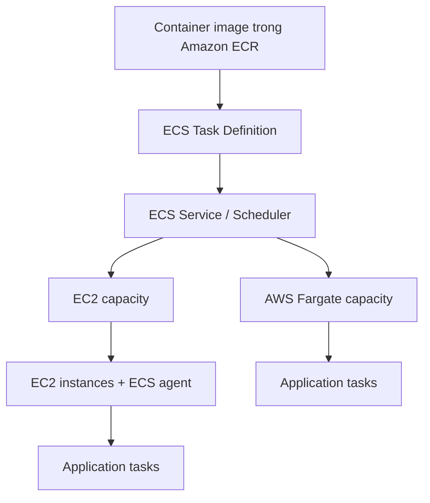
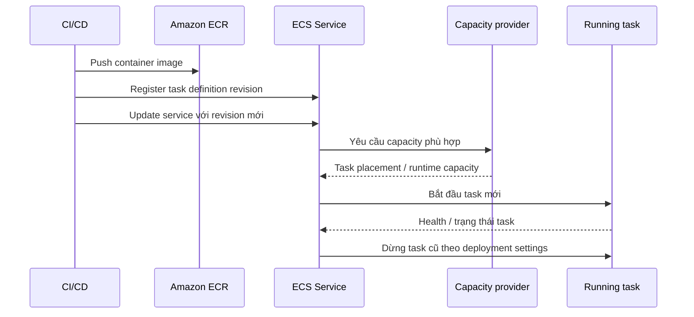
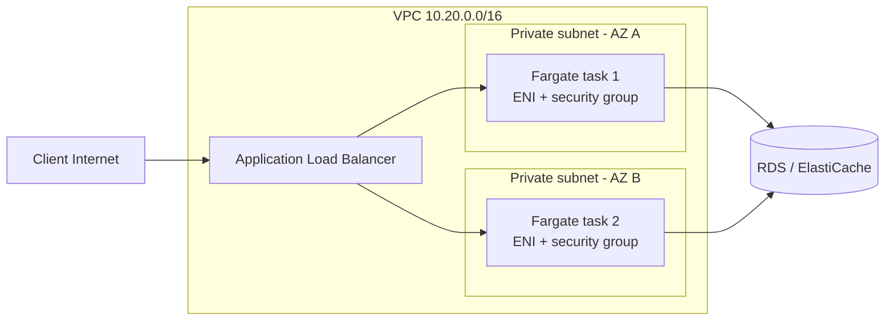
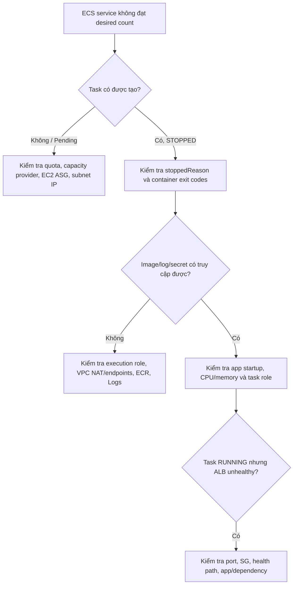

# ECS trên EC2 và ECS trên Fargate

## 1. Bài toán triển khai container trên AWS

Một doanh nghiệp đang chuyển ứng dụng đặt hàng từ máy chủ truyền thống sang container. Nhóm phát triển đã có Docker image cho API, background worker và tác vụ xử lý báo cáo. Ứng dụng cần hoạt động ở nhiều Availability Zone (AZ), kết nối cơ sở dữ liệu trong VPC, tự tăng số bản sao khi lượng truy cập cao và triển khai phiên bản mới mà không làm gián đoạn dịch vụ.

Với **Amazon Elastic Container Service (Amazon ECS)**, doanh nghiệp có thể chọn hai mô hình chạy phổ biến:

- **ECS trên Amazon EC2:** container chạy trên các EC2 instance do đội vận hành cung cấp và quản lý trong ECS cluster. Doanh nghiệp kiểm soát instance type, hệ điều hành, dung lượng và cách dùng tài nguyên trên host.
- **ECS trên AWS Fargate:** container chạy trên năng lực tính toán serverless do AWS quản lý. Đội ứng dụng khai báo CPU, bộ nhớ, network, image và các quyền cần thiết cho task mà không phải tự cấp phát hay vá EC2 worker nodes.

Đây là phần **Container với ECS** trong lộ trình **CLOUD_PROVIDERS_AWS**. Lộ trình khám phá các dịch vụ AWS từ Region/AZ, IAM, VPC, compute, lưu trữ, cơ sở dữ liệu đến tích hợp và serverless; mục tiêu là biết chọn dịch vụ, triển khai an toàn, giám sát được, phục hồi được và kiểm soát chi phí. ECS là nơi các quyết định này gặp nhau: một container chạy tốt trên máy phát triển chưa đủ để bảo đảm hệ thống chạy ổn định trên cloud.

Sau bài học, bạn sẽ có thể giải thích ECS cluster, task definition, task và service; so sánh EC2 với Fargate; thiết kế mạng và quyền IAM; dùng capacity providers và Auto Scaling; xử lý rolling deployment, logging và lỗi triển khai; đồng thời chọn mô hình phù hợp với workload và ngân sách.

## 2. ECS quản lý gì? EC2 và Fargate khác nhau ở đâu?

Amazon ECS là dịch vụ điều phối container (*container orchestration*). Bạn khai báo ứng dụng cần chạy và số bản sao mong muốn; ECS giúp triển khai, duy trì và thay thế các task theo cấu hình. **ECS control plane được AWS quản lý** trong cả hai mô hình. Khác biệt chính nằm ở **compute capacity và trách nhiệm vận hành hạ tầng chạy container**.



| Câu hỏi | ECS trên EC2 | ECS trên Fargate |
| --- | --- | --- |
| Ai cung cấp máy chủ chạy container? | Đội vận hành tạo/duy trì EC2 instances hoặc Auto Scaling group | AWS cung cấp và quản lý compute infrastructure |
| Có cần quản lý AMI, OS patches và ECS agent trên host? | **Có**; có thể tự động hóa bằng ECS-optimized AMI và quy trình cập nhật | **Không** truy cập hoặc vá host underlying infrastructure |
| Đơn vị tài nguyên tính phí chủ yếu | EC2 instance, EBS, network và dịch vụ đi kèm, kể cả khi host còn tài nguyên trống | vCPU, memory, hệ điều hành/kiến trúc và storage bổ sung theo cấu hình/thời gian task, cùng các chi phí liên quan |
| Chọn loại máy vật lý/instance type? | Có: general purpose, compute, memory, GPU, instance storage, kiến trúc CPU… | Không chọn EC2 instance type; chọn cấu hình CPU/memory Fargate được hỗ trợ |
| Khả năng chạy privileged/host-level workloads | Linh hoạt hơn tùy Linux/Windows, ECS và cấu hình | Bị giới hạn bởi mô hình Fargate; không có quyền quản trị host |
| Khả năng triển khai task vào nhiều AZ | Có, khi cung cấp EC2 capacity trong các AZ | Có, khi chọn subnet/AZ phù hợp và dịch vụ có capacity |
| Có bị thiếu capacity không? | Có thể thiếu EC2 instance/CPU/RAM/ENI hoặc không khởi chạy được host | Có thể gặp thiếu Fargate capacity, quota hoặc hạn chế Region/platform |
| Phù hợp với | Tải nền lớn, kiểm soát host, GPU/đặc tính EC2 chuyên biệt | Ứng dụng chuẩn hóa, muốn giảm vận hành host, tải linh hoạt |

**ECS trên EC2 không phải một dịch vụ điều phối hoàn toàn khác Fargate.** Cả hai sử dụng ECS task definitions, services, deployments và nhiều API chung. Bạn có thể để các dịch vụ khác nhau trong cùng ECS cluster sử dụng những capacity providers khác nhau, nhưng **một capacity provider strategy không được trộn lẫn Fargate capacity providers với Auto Scaling group capacity providers** trong cùng một strategy.

## 3. Những khái niệm ECS phải nắm trước khi so sánh

| Thành phần | Vai trò | Ví dụ |
| --- | --- | --- |
| **Container image** | Gói ứng dụng và runtime cần khởi chạy | `shop-api:v1` trong Amazon ECR |
| **Task definition** | Bản khai báo image, CPU, memory, environment, port, logs, IAM roles và volumes | `shop-api-fargate:3` |
| **Task** | Một lần chạy thực tế của task definition, có thể gồm nhiều container | Một API container và một sidecar container |
| **Service** | Duy trì số task mong muốn, thay task lỗi, triển khai phiên bản mới | `shop-api-service`, `desiredCount=4` |
| **Cluster** | Nhóm logic của tasks/services và capacity | `shop-production` |
| **Capacity provider** | Trừu tượng hóa loại compute được dùng và cách phân bổ capacity | `FARGATE`, `FARGATE_SPOT`, ASG capacity provider |
| **Service scheduler** | Chọn nơi và thời điểm đặt task theo yêu cầu/khả năng | Thay task bị STOPPED, hỗ trợ rolling deployment |

**Task definition khác task:** task definition là khuôn mẫu đã đăng ký theo revision; task là một phiên bản chạy cụ thể của khuôn mẫu. **Service khác task chạy một lần:** service duy trì desired count và khởi chạy task thay thế, trong khi `RunTask` phù hợp cho công việc chạy một lần hoặc theo lịch khi không cần dịch vụ luôn duy trì bản sao.

### 3.1. Luồng triển khai ứng dụng ECS



Task definition là bất biến theo revision: khi thay image hoặc khai báo, đăng ký **revision mới**. Việc service chuyển sang revision mới cần deployment và kiểm tra sức khỏe thực tế. Đừng chỉ push image với tag `latest` rồi giả định mọi task đang chạy sẽ tự đổi image.

## 4. ECS trên EC2: kiểm soát host và phân bổ tài nguyên

### 4.1. Kiến trúc hoạt động

Trong mô hình EC2, bạn khởi tạo EC2 instances có container runtime/ECS agent tương thích, cấu hình chúng tham gia ECS cluster và cung cấp quyền IAM **container instance role**. ECS agent trên host giao tiếp với ECS control plane để nhận task cần chạy và báo trạng thái tài nguyên.

```text
ECS Cluster: shop-production
   |
   +-- EC2 Auto Scaling group
       +-- EC2 instance AZ A (ECS agent, Docker/container runtime)
       |    +-- ECS task: shop-api
       |    +-- ECS task: metrics-worker
       +-- EC2 instance AZ B (ECS agent, Docker/container runtime)
            +-- ECS task: shop-api
            +-- ECS task: orders-worker
```

Một EC2 instance có thể chứa **nhiều task** nếu CPU, RAM, networking và những yêu cầu khác còn đủ. Bạn phải bảo đảm host đủ capacity cho task placement; nếu service muốn 10 task nhưng cluster chỉ có 2 instance quá nhỏ, task có thể tiếp tục ở `PENDING` thay vì chạy được.

### 4.2. Những trách nhiệm còn thuộc đội vận hành

1. **Provisioning:** chọn instance type/AMI, VPC subnets, storage, EC2 IAM instance profile, user data và ECS cluster registration.
2. **Patching:** nâng ECS agent/container runtime, cập nhật AMI/OS và khởi tạo lại host an toàn, thường theo quy trình thay node thay vì sửa thủ công.
3. **Capacity planning:** xác định số instance, nhu cầu CPU/RAM/ENI, placement constraints và spare capacity để triển khai/recovery.
4. **Security:** khóa SSH/Session Manager, IMDSv2, security groups, host hardening, EBS encryption và quyền IAM.
5. **Availability:** trải instance lên nhiều AZ, thiết kế Auto Scaling, draining khi thay host và phục hồi khi instance/AZ gặp lỗi.
6. **Cost:** xử lý EC2 nhàn rỗi, right sizing, Savings Plans/Reserved Instances và EC2 Spot theo điều kiện workload.

**ECS-optimized AMI** giúp giảm công cấu hình agent/runtime nhưng không miễn trừ trách nhiệm cập nhật host. Việc dùng Auto Scaling group và launch template là cách phổ biến để cấu hình host thống nhất và xoay vòng theo phiên bản mới.

### 4.3. Đặt task và mức sử dụng tài nguyên

ECS xét khả năng placement theo các yêu cầu của task, khả năng còn lại trên container instance, network mode và placement strategy/constraints. Có thể sử dụng chiến lược `spread` để phân bố task qua AZ/instances hoặc `binpack` để tận dụng CPU/RAM trên ít host hơn, tùy mục tiêu.

| Tình huống | Ưu tiên có thể hợp lý | Đánh đổi |
| --- | --- | --- |
| Cần duy trì service khi một AZ lỗi | Phân bố instances và tasks trên nhiều AZ | Có thể còn capacity trống để dự phòng |
| Batch tasks có thể dồn trên ít host | Binpack theo CPU/memory khi phù hợp | Nếu một host lỗi có thể mất nhiều tasks cùng lúc |
| Ứng dụng cần GPU/thiết bị cụ thể | EC2 instance family hỗ trợ GPU và ECS task requirements | Chi phí và ràng buộc placement cao hơn |
| Muốn dùng EC2 Spot giảm chi phí | ASG Spot hoặc mixed ASG với capacity provider thích hợp | Bắt buộc xử lý EC2 Spot interruption và thiếu capacity |

Đừng chọn chiến lược placement chỉ vì tối ưu số host. Một dịch vụ thanh toán có yêu cầu HA cần sức chịu đựng khi host/AZ hỏng; dồn toàn bộ task vào một EC2 rẻ hơn nhưng có thể biến host đó thành điểm lỗi duy nhất.

### 4.4. ECS task definition mẫu cho EC2

Ví dụ một worker chạy trên Linux EC2 với `bridge` network mode, gửi log tới CloudWatch Logs. Các ARN và repository chỉ là **placeholder**:

```json
{
  "family": "shop-worker-ec2",
  "requiresCompatibilities": ["EC2"],
  "networkMode": "bridge",
  "executionRoleArn": "arn:aws:iam::111122223333:role/ecsTaskExecutionRole",
  "taskRoleArn": "arn:aws:iam::111122223333:role/shopWorkerTaskRole",
  "containerDefinitions": [
    {
      "name": "worker",
      "image": "111122223333.dkr.ecr.ap-southeast-1.amazonaws.com/shop-worker:v1",
      "essential": true,
      "cpu": 256,
      "memoryReservation": 512,
      "logConfiguration": {
        "logDriver": "awslogs",
        "options": {
          "awslogs-group": "/ecs/shop-worker",
          "awslogs-region": "ap-southeast-1",
          "awslogs-stream-prefix": "ecs"
        }
      }
    }
  ]
}
```

Đây là cấu hình **EC2 với Linux bridge networking**, không phải mẫu dành cho Fargate. `memoryReservation` là mức bộ nhớ mềm phục vụ tính toán reservation, khác giới hạn hard memory và không bảo đảm xử lý đúng mọi tình huống thiếu RAM. Với nhiều container, tổng reservation và network/storage vẫn cần vừa năng lực host.

Bạn có thể đăng ký task definition và yêu cầu một lần chạy trên cluster **đã có EC2 container instances**:

```bash
aws ecs register-task-definition \
  --cli-input-json file://shop-worker-ec2.json \
  --region ap-southeast-1

aws ecs run-task \
  --cluster shop-production \
  --task-definition shop-worker-ec2:1 \
  --launch-type EC2 \
  --count 1 \
  --region ap-southeast-1
```

Mã revision `:1` chỉ minh họa; dùng revision/ARN thật trả về từ lệnh đăng ký. Khi cluster thiếu EC2 capacity hoặc task không khớp yêu cầu, `RunTask` có thể trả về `failures`; phải kiểm tra cả `tasks` lẫn `failures`, không chỉ HTTP success. Các lệnh này tác động đến tài nguyên thật và chỉ dùng trong môi trường thử nghiệm có phê duyệt.

## 5. ECS trên Fargate: không phải quản lý EC2 worker nodes

### 5.1. Mô hình hoạt động

Với **AWS Fargate**, bạn khai báo CPU/memory cho task, lựa chọn image, cấu hình VPC networking, IAM roles, logs và storage. ECS sẽ đặt task lên năng lực Fargate khi có đủ capacity và quota. Đội vận hành không cần tạo EC2 instance, không có SSH vào worker host hay quy trình vá ECS agent trên host.

```text
ECS Service (desiredCount = 4)
      |
      +-- Fargate task A (AZ A, task ENI)
      +-- Fargate task B (AZ A, task ENI)
      +-- Fargate task C (AZ B, task ENI)
      +-- Fargate task D (AZ B, task ENI)

AWS quản lý hạ tầng tính toán; ứng dụng vẫn chịu trách nhiệm cấu hình và bảo mật.
```

**Fargate không có nghĩa miễn cấu hình mạng hay miễn quản trị ứng dụng.** Task vẫn phải có VPC subnets, security groups, khả năng tải image, role IAM, logs, secret management và đường kết nối đến các dịch vụ phụ thuộc.

### 5.2. CPU, memory, hệ điều hành và nền tảng

Task chạy trên Fargate phải chọn **cặp task-level CPU và memory** thuộc danh sách được AWS hỗ trợ. Không thể đặt tùy ý `cpu=300` và `memory=750` rồi cho rằng Fargate sẽ nhận. Tùy nền tảng Linux/Windows, kiến trúc x86_64/Arm64 và Fargate platform version, danh sách cặp hợp lệ và khả năng sử dụng các tính năng khác nhau.

Ví dụ các cặp **Linux Fargate** thường gặp:

| vCPU task | Ví dụ memory hợp lệ | Workload mẫu |
| --- | --- | --- |
| 0,25 vCPU | 0,5 GiB, 1 GiB, 2 GiB | Sidecar nhẹ, API nhỏ |
| 0,5 vCPU | 1–4 GiB theo bước cấu hình hợp lệ | API web và worker nhỏ |
| 1 vCPU | 2–8 GiB theo bước hỗ trợ | API hoặc worker tiêu chuẩn |
| 2 vCPU | 4–16 GiB theo bước hỗ trợ | Dịch vụ dùng CPU/RAM lớn hơn |

Đây chỉ là ví dụ để hiểu quan hệ CPU–RAM, **không phải bảng đầy đủ mọi cấu hình Fargate**. Các mức vCPU lớn hơn được hỗ trợ với platform/OS phù hợp. Trước triển khai, cần xem tài liệu ECS task definition parameters và Service Quotas cho Region, kiến trúc, hệ điều hành thật.

**Không nhầm** thông số `cpu`/`memory` **của task** với giới hạn/đặt trước tài nguyên **từng container** trong task definition. Với Fargate, cấp tài nguyên và tính tiền dựa trên cấu hình task tương ứng; nhiều container trong một task cùng sử dụng ngân sách CPU/memory của task đó.

### 5.3. Task definition mẫu cho Fargate

Ví dụ API chạy trên cặp **0,5 vCPU / 1 GiB memory**, Linux x86_64, mở cổng container 8080:

```json
{
  "family": "shop-api-fargate",
  "requiresCompatibilities": ["FARGATE"],
  "networkMode": "awsvpc",
  "cpu": "512",
  "memory": "1024",
  "executionRoleArn": "arn:aws:iam::111122223333:role/ecsTaskExecutionRole",
  "taskRoleArn": "arn:aws:iam::111122223333:role/shopApiTaskRole",
  "runtimePlatform": {
    "cpuArchitecture": "X86_64",
    "operatingSystemFamily": "LINUX"
  },
  "containerDefinitions": [
    {
      "name": "api",
      "image": "111122223333.dkr.ecr.ap-southeast-1.amazonaws.com/shop-api:v1",
      "essential": true,
      "portMappings": [
        { "containerPort": 8080, "protocol": "tcp" }
      ],
      "logConfiguration": {
        "logDriver": "awslogs",
        "options": {
          "awslogs-group": "/ecs/shop-api",
          "awslogs-region": "ap-southeast-1",
          "awslogs-stream-prefix": "ecs"
        }
      }
    }
  ]
}
```

Để chạy mẫu cần có **ECR repository/image thật**, CloudWatch log group `/ecs/shop-api`, IAM roles đúng, VPC/subnets/security groups và các quyền cần thiết. `networkMode=awsvpc` là yêu cầu của Fargate; không thể lấy nguyên task definition EC2 `bridge` ở phần trước để chạy Fargate.

### 5.4. Fargate không phải AWS Lambda

Fargate chạy **container tasks/services** theo khai báo của ECS, có thể là HTTP server lâu dài hoặc job chủ động. AWS Lambda chạy function theo mô hình invocation/event khác, với những giới hạn runtime/concurrency và mô hình tính phí đặc trưng. Fargate phù hợp khi ứng dụng muốn điều khiển process/container, cổng dịch vụ hoặc một job có đặc tính không phù hợp Lambda; nhưng không nhất thiết tối ưu cho mọi tác vụ chạy vài giây.

## 6. Networking: khác biệt quan trọng giữa EC2 và Fargate

### 6.1. Fargate luôn dùng `awsvpc`

Với ECS trên Fargate, mỗi task được gắn một **elastic network interface (task ENI)** trong một subnet của VPC, với địa chỉ IP và **security group** riêng theo cấu hình task/service. Điều này giúp kiểm soát lưu lượng theo nhóm task, tương tự tài nguyên mạng riêng. Subnet phải có đủ địa chỉ IP; nếu thiếu địa chỉ khả dụng, task mới có thể không khởi chạy được dù CPU/memory quota còn.



Nếu đặt task trong **private subnet**, task thường cần **NAT gateway** để truy cập các endpoint Internet hoặc sử dụng **VPC endpoints** phù hợp để pull image ECR, lấy secrets và gửi logs. Ví dụ với private ECR và không có NAT, thường phải xem xét ECR API, ECR DKR, **S3 gateway endpoint** (phục vụ tải image layers) và các endpoints khác như CloudWatch Logs, Secrets Manager tùy tính năng. Phải bật private DNS/route/security group tương ứng và xác minh yêu cầu chính xác của platform version.

Nếu task ở **public subnet** và được gán public IP theo cấu hình, route tới Internet Gateway mới có thể cung cấp Internet egress. **Đặt subnet là public nhưng để `assignPublicIp=DISABLED` không tự bảo đảm task đi Internet được.** Với production, private subnet + load balancer/endpoint thường giúp giảm bề mặt tấn công.

### 6.2. Networking trên ECS EC2 linh hoạt hơn nhưng phức tạp hơn

EC2 launch type có thể hỗ trợ các network modes như `bridge`, `host`, `awsvpc` tùy hệ điều hành, agent, instance và yêu cầu task definition:

| Network mode | Đặc tính | Lưu ý |
| --- | --- | --- |
| `bridge` | Container dùng network bridge/NAT trên host và port mappings | Có thể dùng host port động; phối hợp ALB/service registration đúng cách |
| `host` | Container dùng network namespace của host | Ràng buộc cổng và tăng phụ thuộc vào host, cân nhắc bảo mật |
| `awsvpc` | Mỗi task có ENI/IP riêng | Quản lý security group theo task; cần xem giới hạn ENI/IP trên EC2 |

**Target group của Application Load Balancer:** với Fargate hoặc ECS task dùng `awsvpc`, cần chọn **target type `ip`**. Với một số mô hình EC2 `bridge`/`host`, target type `instance` có thể phù hợp theo port mappings; không tự sao chép cách đăng ký target group của EC2 sang Fargate.

### 6.3. Một task `RUNNING` chưa chắc phục vụ được khách hàng

Các tầng cần cùng hoạt động:

1. VPC/subnet/route cho đường ingress từ ALB và egress tới ECR, logs, database.
2. Security group của ALB cho phép HTTPS từ nguồn dự kiến; security group task cho phép port 8080 từ **security group ALB**, không mở toàn bộ VPC/Internet thiếu kiểm soát.
3. Container thực sự lắng nghe trên port/container interface phù hợp; ALB target group dùng đúng `containerName`, `containerPort` và health check path.
4. IAM role, secrets và database endpoint cho phép ứng dụng khởi tạo.
5. Nếu có nhiều AZ, ứng dụng và dependency có mức sẵn sàng tương ứng; DNS, TLS/certificate và logging hoạt động.

## 7. IAM: ba vai trò thường bị nhầm

### 7.1. ECS task role

**Task role** là danh tính mà **mã ứng dụng bên trong container** sử dụng để gọi AWS API, ví dụ `s3:GetObject` hoặc `dynamodb:Query`. SDK có thể lấy temporary credentials qua ECS task credential endpoint được cung cấp. Không đặt AWS access key dài hạn trong Docker image hoặc environment variables chỉ để ứng dụng đọc S3.

### 7.2. Task execution role

**Task execution role** phục vụ các thao tác thay mặt task trong quá trình khởi chạy/vận hành, ví dụ kéo image từ private ECR, gửi logs bằng log driver hoặc lấy secret cho container definition theo những cấu hình được hỗ trợ. Nó **không nên** là role chứa mọi quyền nghiệp vụ ứng dụng.

### 7.3. EC2 container instance role

Khi ECS chạy trên EC2, host instance thường có **EC2 instance profile/container instance IAM role** để ECS agent đăng ký và tương tác với ECS control plane. Role này khác với task role và task execution role. Với Fargate, đội vận hành không phải tự tạo EC2 container instance role cho một worker node mà họ không quản lý.

| IAM role | Ai sử dụng? | Ví dụ quyền |
| --- | --- | --- |
| **Task role** | Ứng dụng chạy trong task | `s3:GetObject` một prefix, `dynamodb:Query` một bảng |
| **Task execution role** | Hạ tầng ECS thực hiện thao tác cho task | Quyền pull ECR, CloudWatch Logs, secret injection tùy cấu hình |
| **Container instance role** | ECS agent/host EC2 | Đăng ký container instance, cập nhật trạng thái ECS |

**Quyền tối thiểu:** không dùng `AdministratorAccess` cho task role để xử lý nhanh lỗi `AccessDenied`. Cần xem **CloudTrail**, hành động bị từ chối, ARN tài nguyên và **resource policies/KMS key policies/SCP** liên quan. Với EC2 launch type, còn phải hạn chế container không tin cậy tiếp cận EC2 instance metadata hay thông tin xác thực của host.

## 8. Capacity providers, Auto Scaling và Spot

### 8.1. Capacity providers của Fargate

ECS hỗ trợ hai capacity providers thường gặp cho Fargate:

- **`FARGATE`**: chạy task trên Fargate theo mức giá On-Demand Fargate tương ứng.
- **`FARGATE_SPOT`**: tận dụng năng lực Fargate còn dư với mức giá giảm, nhưng **task có thể bị gián đoạn** khi AWS cần thu hồi capacity. Chỉ nên dùng khi ứng dụng chịu được việc task bị stop và khởi chạy lại.

Một **capacity provider strategy** có thể đặt `base` và `weight`. Ví dụ, nếu service cần 6 tasks, cấu hình base 2 cho `FARGATE` và weight còn lại 1:3 giữa FARGATE/FARGATE_SPOT thì về mặt phân bổ mục tiêu, hai task nền dùng FARGATE và các task vượt nền được phân bổ theo trọng số. Kết quả task thực tế có thể khác tạm thời trong quá trình scale hoặc thiếu Spot capacity.

**Base chỉ được cấu hình cho tối đa một capacity provider trong strategy.** `weight=0` loại provider đó khỏi việc phân bổ phần vượt base, và phải có provider có weight dương khi áp dụng. Không cấu hình `FARGATE_SPOT` cho toàn bộ API thanh toán chỉ vì rẻ hơn nếu không có baseline đảm bảo SLO.

### 8.2. Capacity providers của EC2

Với ECS trên EC2, bạn có thể liên kết **EC2 Auto Scaling group** với một **ASG capacity provider**. Khi bật các tính năng **managed scaling** phù hợp, ECS hỗ trợ điều chỉnh số EC2 instances của Auto Scaling group để đáp ứng nhu cầu đặt task.

```text
ECS Service desired count tăng
  -> ECS task cần thêm compute capacity
  -> ASG capacity provider / managed scaling
  -> Auto Scaling group mở rộng EC2 instances
  -> Instance mới đăng ký ECS cluster
  -> ECS sắp xếp task lên host đủ resources
```

**Service Auto Scaling và ASG capacity scaling là hai tầng khác nhau.** Service Auto Scaling tăng/giảm **desired task count** dựa trên CPU, memory, ALB request count hoặc metric ứng dụng; ASG/capacity provider scaling tăng/giảm **số EC2 host** để có chỗ cho các tasks đó. Với Fargate không cần quản lý ASG host capacity riêng, nhưng service vẫn cần Auto Scaling để thay đổi số task.

ASG có thể dùng **On-Demand, EC2 Spot hoặc cách kết hợp được hỗ trợ**. ECS container draining/managed instance draining và Spot interruption handling giúp chuyển công việc khi host sắp dừng, nhưng không đảm bảo mọi request/job hoàn thành nếu thời gian còn lại ngắn. Nếu EC2 capacity provider dùng managed termination protection, phải cấu hình bảo vệ scale-in và các điều kiện ASG tương thích; không bật tùy tiện trên một nhóm EC2 chưa được thiết kế cho nó.

### 8.3. Fargate Spot và EC2 Spot giống và khác nhau

| Khía cạnh | Fargate Spot | EC2 Spot dùng cho ECS |
| --- | --- | --- |
| Đơn vị bị gián đoạn | Fargate task | EC2 instance host, có thể chứa nhiều tasks |
| Quản lý host | AWS | Doanh nghiệp quản lý host/ASG, AMI/agent/draining |
| Nguồn capacity | Fargate spare capacity | EC2 Spot capacity pools theo instance type/AZ |
| Workload thích hợp | Task stateless, batch, worker có retry/checkpoint | Tương tự, cộng nhu cầu host/instance đặc thù |
| Bảo vệ khi thiếu capacity | Dùng baseline FARGATE, retry/scale và nhiều AZ | Dùng On-Demand host baseline, đa dạng EC2 types/AZ, quản lý ASG |

Fargate Spot có thể gửi thông báo gián đoạn với khoảng chuẩn bị giới hạn (thường khoảng hai phút trước khi task bị dừng vì Spot interruption). Container nhận tín hiệu dừng theo quy trình ECS; cần cấu hình **`stopTimeout`** khi phù hợp và bảo đảm ứng dụng xử lý `SIGTERM`, dừng nhận request, lưu checkpoint và kết thúc an toàn. Không dựa hoàn toàn vào khoảng cảnh báo để bảo toàn dữ liệu; xử lý idempotency/retry và lưu trạng thái bên ngoài task vẫn là điều bắt buộc cho workload quan trọng.

## 9. Triển khai mẫu: dịch vụ Fargate sau Application Load Balancer

Giả sử đã có ECS cluster `shop-production`, private subnets thuộc hai AZ, security groups, ALB/target group loại `ip`, IAM roles, ECR image và CloudWatch Logs group. Bạn muốn chạy API `shop-api` với 4 tasks, gồm baseline Fargate và phần thêm bằng Fargate Spot.

### 9.1. Chuẩn bị task definition

Lưu JSON ở phần 5.3 thành `shop-api-fargate.json`, sau đó đăng ký:

```bash
aws ecs register-task-definition \
  --cli-input-json file://shop-api-fargate.json \
  --region ap-southeast-1
```

Đọc ARN và revision trả về; không giả định task definition luôn là `:1` nếu trong môi trường đã có revisions. Nếu bật compatibility `FARGATE`, task definition phải dùng CPU/memory và `awsvpc` hợp lệ, image đúng kiến trúc/OS, role và log configuration phù hợp.

### 9.2. Tạo ECS service với capacity provider strategy

Ví dụ AWS CLI (**chỉ minh họa; không chạy nguyên placeholder**):

```bash
aws ecs create-service \
  --cluster shop-production \
  --service-name shop-api \
  --task-definition shop-api-fargate:1 \
  --desired-count 4 \
  --capacity-provider-strategy \
    capacityProvider=FARGATE,base=2,weight=1 \
    capacityProvider=FARGATE_SPOT,weight=3 \
  --network-configuration \
    'awsvpcConfiguration={subnets=[subnet-11111111111111111,subnet-22222222222222222],securityGroups=[sg-0123456789abcdef0],assignPublicIp=DISABLED}' \
  --load-balancers \
    'targetGroupArn=arn:aws:elasticloadbalancing:ap-southeast-1:111122223333:targetgroup/shop-api/0123456789abcdef,containerName=api,containerPort=8080' \
  --region ap-southeast-1
```

`shop-production`, tên task definition, account ID, subnet IDs, security group ID và target group ARN đều là giá trị ví dụ. Trước khi chạy, cần bảo đảm hai subnets thuộc **những AZ có capacity**, target group được chọn **target type `ip`**, task có đường kéo image ECR và xuất logs, ALB listener có rule forward phù hợp, IAM/service-linked role và quota được đáp ứng.

Nếu không muốn dùng Fargate Spot cho API, có thể chỉ chọn **FARGATE**. Nếu muốn dùng một **`launchType=FARGATE`** đơn lẻ, không gửi đồng thời `--launch-type` và `--capacity-provider-strategy` trong một yêu cầu tạo service: chúng đại diện cho hai cách khai báo capacity khác nhau.

### 9.3. Kiểm tra service thực sự khỏe mạnh

```bash
aws ecs describe-services \
  --cluster shop-production \
  --services shop-api \
  --region ap-southeast-1 \
  --query 'services[0].[status,desiredCount,runningCount,pendingCount,events]'

aws ecs list-tasks \
  --cluster shop-production \
  --service-name shop-api \
  --region ap-southeast-1
```

Khi có task ARN, sử dụng `aws ecs describe-tasks --cluster ... --tasks ...` để đọc `lastStatus`, `desiredStatus`, `stopCode`, `stoppedReason`, trạng thái container và attachment networking khi có. **Running count đủ không đồng nghĩa endpoint API healthy**: cần kiểm tra ALB target health, application logs và một request HTTPS thực.

## 10. Lưu trữ và tính trạng thái của container

### 10.1. Dữ liệu cục bộ là dữ liệu của vòng đời task

Container filesystem/ephemeral storage không nên được coi là nguồn dữ liệu vĩnh viễn. Khi task bị thay thế, ứng dụng có thể mất dữ liệu chỉ nằm trong môi trường task đó. Với Fargate Linux platform hiện đại, task có **ephemeral storage mặc định** theo quy định dịch vụ (thường 20 GiB với platform version phù hợp), có thể cấu hình dung lượng lớn hơn tới giới hạn được hỗ trợ. Phần storage bổ sung có quy tắc tính phí riêng.

Đối với ECS EC2, các container có thể sử dụng storage trên host (EBS hoặc instance store) theo cấu hình Docker/ECS, nhưng phải xử lý vòng đời host, data placement và khả năng di chuyển khi EC2 instance bị thay. Dùng đường dẫn host chung không tự biến dữ liệu thành HA khi AZ/host lỗi.

### 10.2. Lựa chọn bền vững cho dữ liệu ứng dụng

| Nhu cầu dữ liệu | Dịch vụ/cách tiếp cận thường phù hợp |
| --- | --- |
| Ảnh/file object, artifact và backup | **Amazon S3** với IAM, encryption, lifecycle/versioning phù hợp |
| Nhiều tasks Linux cùng dùng thư mục NFS | **Amazon EFS** khi tính năng/launch type/platform hỗ trợ |
| Cơ sở dữ liệu giao dịch | **Amazon RDS/Aurora** hoặc dịch vụ dữ liệu được quản lý phù hợp |
| Hàng đợi công việc để retry | **Amazon SQS** hoặc dịch vụ message queue thích hợp |
| Cache/session dùng chung | **ElastiCache** hoặc dịch vụ cache/session được thiết kế tương ứng |
| Scratch/cache tạm có thể tái tạo | Ephemeral storage của task/container |

Ví dụ một worker nhận message từ SQS và tạo báo cáo nên lưu kết quả cuối ở S3, đánh dấu trạng thái xử lý trong nơi bền vững rồi mới xác nhận message. Khi ECS service thay task vì deployment hoặc Spot interruption, worker mới có thể tiếp tục mà không phụ thuộc ổ đĩa của task cũ.

**ECS EC2 và Fargate có tập tính năng volumes khác nhau.** EFS được hỗ trợ trong những cấu hình phù hợp; các tính năng EBS/task-attached volumes có điều kiện riêng theo launch type, platform version và loại task. Cần xem tài liệu ECS/EBS tại thời điểm triển khai, không mặc định mọi dạng host bind mount, privileged volume hoặc device đều chạy được trên Fargate.

## 11. Triển khai bản mới, health checks và rollback

### 11.1. Rolling deployment

Khi update một ECS service sang task definition revision mới, ECS deployment controller mặc định có thể sử dụng **rolling update**: khởi chạy task mới rồi dừng task cũ theo giới hạn deployment configuration, sức khỏe load balancer và capacity còn lại.

Các tham số thường gặp gồm:

- **`minimumHealthyPercent`**: tỉ lệ tối thiểu của desired count phải tiếp tục đạt trạng thái khỏe mạnh trong deployment theo quy tắc ECS.
- **`maximumPercent`**: giới hạn phần trăm tổng số tasks được phép chạy/được tính trong deployment theo cơ chế ECS.
- **Deployment circuit breaker**: phát hiện deployment thất bại và có thể **rollback** về revision ổn định trước đó khi được bật/đáp ứng điều kiện.
- **CloudWatch alarms**: một số chế độ triển khai ECS hỗ trợ dùng alarm để phát hiện thất bại và rollback.

Nếu EC2 cluster chỉ đủ capacity chính xác cho các tasks đang chạy, deployment yêu cầu khởi tạo bản mới trước khi dừng bản cũ có thể bị kẹt. Fargate không cần quản lý host nhưng vẫn có thể thiếu capacity hoặc lỗi subnet IP/quota. Hãy thiết kế **capacity headroom** và deployment parameters phù hợp thay vì buộc dừng hàng loạt tasks còn healthy.

### 11.2. Health checks ở nhiều tầng

| Kiểm tra | Đối tượng | Ví dụ lỗi được phát hiện |
| --- | --- | --- |
| ECS task/container status | Container process và task | Container crash, thiếu memory, image pull fail |
| Container health check | Lệnh chạy bên trong container khi định nghĩa | Process trả lỗi readiness hoặc ứng dụng không lắng nghe |
| ALB target group health check | HTTP/TCP tới port/path của task | Task RUNNING nhưng `/health` trả 500 hoặc TCP timeout |
| Application/Synthetic test | API nghiệp vụ và dependencies | API trả 200 trên health path nhưng truy vấn database thất bại |

**Health check quá hời hợt** có thể để task lỗi phục vụ traffic; **health check quá nghiêm ngặt** có thể gây thay task liên tục khi dependency bên ngoài chập chờn. Thiết kế readiness và liveness phù hợp, khai báo grace period, timeout và retry theo thời gian startup/đặc tính ứng dụng.

## 12. Giám sát, log và xử lý sự cố ECS

### 12.1. Những số liệu cần theo dõi

| Nhóm | Công cụ | Câu hỏi cần trả lời |
| --- | --- | --- |
| Service desired/running/pending tasks | ECS Console/API, CloudWatch metrics | Có đủ bản sao đáp ứng SLO không? |
| CPU/Memory utilization và reservation | ECS/CloudWatch, Container Insights khi bật | Task thiếu CPU/RAM hay cluster thiếu host capacity? |
| ECS service events và stopped reasons | `describe-services`, `describe-tasks` | Task bị thay vì image, memory, networking hay health? |
| Application logs | `awslogs` → CloudWatch Logs hoặc log routing được hỗ trợ | Lỗi code, exception, dependency, startup là gì? |
| ALB metrics/target health | ALB/CloudWatch | Request lỗi, latency cao, target unhealthy? |
| EC2 node health/ASG scaling | EC2, Auto Scaling, ECS container instances | Host chưa đăng ký hoặc không đủ CPU/RAM/ENI? |
| Chi phí | Cost Explorer, Budgets, ECS/Fargate pricing | Fargate usage, EC2 utilization và hạng mục mạng/log/storage có hợp lý? |

CloudWatch Container Insights có thể giúp xem CPU/memory, task/service và observability chi tiết khi bật với phạm vi hỗ trợ. Cần cân nhắc **chi phí log/metrics** và chính sách retention; ghi mọi request/secret vào log có thể vừa tốn tiền vừa gây rủi ro bảo mật.

### 12.2. Chẩn đoán task không chạy hoặc không nhận traffic



| Triệu chứng | Nguyên nhân khả dĩ | Cách xác minh |
| --- | --- | --- |
| `RESOURCE:CPU`/`RESOURCE:MEMORY` khi đặt task EC2 | Host không còn tài nguyên phù hợp | `describe-container-instances`, ASG desired/current capacity |
| `CannotPullContainerError` | ECR URI/tag sai, thiếu execution role permission, network egress/endpoints | ECS stopped reason, ECR, SG/routes/VPC endpoints |
| `ResourceInitializationError` | Không lấy được secrets/log config/network resources | Task details, execution role, Secrets Manager/Logs/network |
| `Task failed to start`/`STOPPED` | Application crash, runtime/architecture sai, OOM | Container exit code, CloudWatch Logs, task definition |
| Fargate task pending rất lâu | Capacity/quota, thiếu ENI IP hoặc cấu hình subnet | ECS service events, Service Quotas, subnet available IP count |
| EC2 host không xuất hiện trong ECS cluster | Agent không chạy/không đăng ký, instance profile hoặc network sai | EC2 userdata/agent logs, ECS cluster association, IAM instance role |
| Task RUNNING nhưng ALB 503/Unhealthy | Target group type/port/health path/SG sai | ALB target health reasons, task ENI, service load balancer config |
| Service deployment rollback | Task mới thất bại về health/startup hoặc alarm | ECS deployment/events, app logs, target health |

**Không “sửa nhanh” bằng cách cho phép `0.0.0.0/0` vào port ứng dụng hoặc cấp `AdministratorAccess`.** Hãy xác định rõ tầng lỗi: capacity, image/network, IAM, task startup, routing hay application health rồi điều chỉnh đúng phạm vi.

### 12.3. ECS Exec và quyền truy cập container

**ECS Exec** cho phép tương tác với container chạy trong ECS theo cơ chế được hỗ trợ, phục vụ chẩn đoán khi đã bật và cấu hình quyền, Session Manager và logging phù hợp. Không nên coi ECS Exec là lý do duy trì SSH vào production containers hay sửa file thủ công rồi để đó. Các thay đổi chạy trực tiếp trong task có thể mất khi task được thay thế; nguyên tắc là sửa image/IaC/configuration rồi redeploy.

Quản trị viên cần kiểm soát **ai được `ecs:ExecuteCommand`**, task/container nào được phép và cách ghi nhận phiên, đặc biệt đối với workload có dữ liệu nhạy cảm.

## 13. Bảo mật: EC2 và Fargate chia sẻ trách nhiệm đến đâu?

### 13.1. ECS EC2

Doanh nghiệp kiểm soát và phải bảo vệ host EC2: OS/AMI, patches, agent, container runtime, EC2 instance IAM role, host networking và storage. Nhiều tasks có thể dùng chung host; vì vậy cần cân nhắc ranh giới tin cậy, quyền root/privileged, hostPath mounts, IMDS access và quyền người có thể điều khiển Docker/agent. Một container bị xâm nhập trên host cấu hình kém có thể gây hậu quả lớn hơn phạm vi tác vụ của nó.

### 13.2. ECS Fargate

AWS quản lý hạ tầng host và cung cấp ranh giới thực thi cấp task theo mô hình Fargate. Doanh nghiệp vẫn chịu trách nhiệm container image, thư viện phụ thuộc, secrets, task role, VPC security groups, dữ liệu, logging, cấu hình task và ứng dụng. Fargate **không tự bảo vệ** khỏi một API có lỗ hổng SQL injection, IAM role quá rộng hay việc đưa password vào environment variable/log.

### 13.3. Kiểm soát chung cần áp dụng

1. Dùng image được quét, ghim version/digest hoặc quy trình xác thực nguồn image; tránh triển khai tag mơ hồ không kiểm soát.
2. Tách **execution role** khỏi **task role**; cấp quyền tối thiểu và rà soát resource/KMS policies.
3. Lưu secret trong **AWS Secrets Manager** hoặc **Systems Manager Parameter Store** theo nhu cầu, không commit vào source/Dockerfile. Khi secret xoay vòng, cần thiết kế cách task nhận giá trị mới thay vì giả định mọi biến injected tự cập nhật.
4. Áp dụng network segmentation qua subnets, security groups và VPC endpoints, TLS tới client/database và ECR image security.
5. Bật CloudTrail/audit cho thay đổi ECS/task definition/service/IAM; bảo vệ quyền cập nhật task definition, `iam:PassRole` và các role có đặc quyền.
6. Triển khai multi-AZ, health checks, logs, backup và cơ chế giảm tác động khi task/host bị thay thế.

## 14. So sánh chi phí EC2 và Fargate theo workload thực

**Chi phí ECS không chỉ bằng giá một task hoặc một EC2 instance.** ECS trên EC2 thường chịu chi phí EC2 instances và các tài nguyên đi kèm. ECS trên Fargate chịu chi phí compute theo **vCPU và memory của task trong thời gian tính phí** (và những hạng mục như additional ephemeral storage, tùy cấu hình), cộng storage/network/logging. Chi phí ECR, ALB, NAT Gateway, data transfer, CloudWatch và các dịch vụ khác cần được tính riêng ở cả hai mô hình.

### 14.1. Công thức tư duy

Với Fargate cho một nhóm tasks đồng cấu hình:

```text
Fargate compute cost (ước tính)
  ≈ số task chạy trung bình × số giờ được tính
    × (vCPU/task × đơn giá vCPU-giờ
       + GiB memory/task × đơn giá GiB-giờ)
    + phí ephemeral storage bổ sung (nếu có)

Tổng chi phí = compute + ALB + network/NAT + storage + logs + các dịch vụ phụ thuộc
```

Với ECS EC2:

```text
EC2 compute cost (ước tính)
  ≈ tổng giờ chạy của mỗi loại EC2 instance × đơn giá hiệu lực
    + EBS/instance storage có phí + network + logs + các dịch vụ phụ thuộc

Năng lực EC2 đã trả tiền nhưng còn trống vẫn là khoản chi phí.
```

Các đơn giá còn phụ thuộc Region, kiến trúc CPU, hệ điều hành, hình thức On-Demand/Spot, Savings Plans/Reserved Instances và thay đổi giá. Không sử dụng công thức tóm tắt ở trên thay bảng giá chính thức để lập ngân sách production.

### 14.2. Ví dụ so sánh giả định

Giả sử ứng dụng cần **8 tasks**, mỗi task dùng **0,5 vCPU và 1 GiB RAM**, hoạt động liên tục 720 giờ/tháng. Để thực hành, đặt giả định hoàn toàn minh họa:

- **Fargate:** đơn giá giả định `0,05 USD/vCPU-giờ` và `0,005 USD/GiB-giờ`.
- **ECS EC2:** nhóm EC2 host đủ chứa 8 tasks + năng lực dự phòng có tổng giá compute giả định `0,22 USD/giờ`.

| Phương án | Công thức giả định | Compute/tháng |
| --- | --- | ---: |
| Fargate, 8 tasks | `8 × 720 × (0,5 × 0,05 + 1 × 0,005)` | **172,80 USD** |
| EC2 hosts, tổng 0,22 USD/giờ | `720 × 0,22` | **158,40 USD** |

**Không xem con số này là báo giá AWS**; chỉ dùng để học cách so sánh. Nếu Fargate chỉ có **2 tasks vào ban đêm và 8 tasks lúc cao điểm**, chi phí thực tế phụ thuộc tổng task-hours và có thể khác đáng kể. Ngược lại, nếu EC2 hosts chạy 24/7 với nhiều khoảng nhàn rỗi, tỷ lệ utilization thấp có thể khiến EC2 kém hiệu quả. Nếu nhóm phải dành thời gian lớn cho vá host, quản lý ASG/AMI hoặc khắc phục sự cố, **chi phí vận hành con người** cũng nên được tính vào quyết định.

### 14.3. Đừng bỏ sót NAT Gateway và logging

Một thiết kế Fargate private subnets kéo image ECR qua NAT Gateway có thể tạo chi phí NAT theo giờ và data processing đáng kể khi mỗi task liên tục được thay. Với kiến trúc phù hợp, dùng các **VPC endpoints** được hỗ trợ có thể giảm nhu cầu truyền qua NAT, nhưng endpoint (nhất là interface endpoints) cũng có giá. Cần so **chi phí tổng** thay vì chỉ thấy “Fargate trả tiền khi task chạy”.

Với EC2, việc gom nhiều tasks trên cùng host có thể tiết kiệm khi utilization cao; nhưng phải giữ capacity headroom, AZ resilience và chi phí EBS/vá host. Chọn model dựa trên **cost per successful request/job** và khả năng đạt SLO/RTO, không chỉ giá compute/giờ.

## 15. Quy trình quyết định EC2 hay Fargate

| Yêu cầu workload | Ưu tiên đánh giá | Lý do |
| --- | --- | --- |
| API stateless, team nhỏ, tải biến động | **Fargate** | Giảm quản lý host, scale theo task |
| Nhiều service nhỏ, muốn chuẩn hóa VPC/IAM/CI/CD | **Fargate** | Đơn giản hóa tầng compute và phân quyền theo task |
| Khối lượng CPU/RAM rất lớn, đều đặn 24/7 | **ECS EC2** hoặc so sánh cả hai | Tối ưu utilization/giá host khi đã có đội vận hành |
| Cần GPU/host devices, custom kernel hoặc đặc tính instance chuyên biệt | **ECS EC2** | Kiểm soát EC2 instance type và OS/runtime |
| Batch có thể bị gián đoạn | **Fargate Spot** hoặc **ECS EC2 Spot** | Giảm chi phí nếu job có checkpoint/retry/idempotency |
| Ứng dụng Windows hoặc Arm64 | **Kiểm tra hỗ trợ cả hai** | Feature/OS/architecture và cặp CPU-memory khác nhau theo launch type/platform |
| Cần chia sẻ filesystem qua NFS | **Fargate hoặc EC2 với EFS** | Kiểm tra platform, IAM, mount targets, security và hiệu năng |
| Cần giảm gánh nặng vá EC2 hosts | **Fargate** | AWS quản lý underlying compute, team tập trung ứng dụng |

Một tổ chức **không bắt buộc chọn một mô hình duy nhất**. Ví dụ, frontend API và service xử lý event chạy Fargate, còn pipeline xử lý GPU hoặc workload cần host networking đặc biệt chạy ECS EC2 trong các service khác. Tuy vậy, cần thống nhất CI/CD, task IAM, logs, tagging, ngân sách và vận hành để giảm phức tạp khi sử dụng cả hai.

### 15.1. Checklist trước production

1. Xác định workload có stateless không, SLO/RTO, mức tải và nhu cầu CPU/RAM/OS/architecture.
2. Kiểm tra image trong ECR: tag/digest, scan, kiến trúc CPU và khả năng pull từ subnets được chọn.
3. Chọn launch type/capacity provider strategy phù hợp, không trộn Fargate với ASG capacity providers trong cùng strategy.
4. Thiết kế subnets nhiều AZ, IP headroom, SG, ALB target type, NAT/VPC endpoints và TLS.
5. Tách task role, execution role, EC2 instance role (nếu dùng); hạn chế `iam:PassRole`.
6. Thiết lập secrets, CloudWatch Logs, image scanning và quyền truy cập dữ liệu.
7. Tính khả năng scaling: service task count, EC2 ASG capacity khi dùng EC2, quota Fargate/EC2.
8. Thiết kế deployment, health checks, circuit breaker/rollback và capacity headroom.
9. Chuyển dữ liệu bền vững ra S3/EFS/RDS/SQS hoặc hệ thống thích hợp; kiểm thử phục hồi task.
10. Giám sát errors, latency, task STOPPED, ALB health, chi phí và thử thất bại task/AZ có kiểm soát.

## 16. Ba tình huống áp dụng

### Tình huống A — API thương mại điện tử ít người vận hành

Ứng dụng stateless được đóng gói bằng Docker, giao tiếp RDS, có vài chục request/giây ngày thường nhưng tăng mạnh dịp khuyến mãi. Nhóm chỉ có hai người vận hành và không muốn quản lý AMI/OS patching.

**Gợi ý:** dùng **ECS Fargate** trên private subnets của hai AZ, ALB target group `ip`, task role chỉ được quyền đọc các tài nguyên cần thiết, execution role cho ECR/logs. Thiết lập Service Auto Scaling theo CPU/ALB request count, CloudWatch/ALB monitoring, rolling deployment và rollback. Có thể thử Fargate Spot cho phần capacity tăng thêm khi baseline FARGATE bảo đảm mức phục vụ tối thiểu.

### Tình huống B — Đội dữ liệu cần GPU và nhiều tài nguyên trên mỗi host

Pipeline xử lý video dùng GPU và thao tác trên local scratch disk; workload chạy nhiều giờ, lượng tải tương đối đều và đội nền tảng có khả năng quản lý EC2/AMI.

**Gợi ý:** dùng **ECS EC2** với GPU instance types phù hợp, ECS-optimized GPU AMI và task definition có resource requirements được hỗ trợ. Thiết kế Auto Scaling group/capacity provider, giám sát GPU/CPU/RAM, cân nhắc EC2 Spot cho các job có checkpoint. Không chọn Fargate chỉ vì muốn tránh quản lý host nếu Fargate không đáp ứng yêu cầu GPU/thiết bị.

### Tình huống C — Worker xử lý đơn hàng từ SQS

Worker đọc message từ SQS, chuẩn hóa dữ liệu và ghi kết quả vào S3/DynamoDB. Công việc có thể retry; mỗi message có ID để ngăn xử lý trùng lặp. Số lượng job tăng 10 lần trong vài giờ rồi giảm.

**Gợi ý:** dùng ECS Fargate service hoặc `RunTask` theo lô với **FARGATE_SPOT** cho phần workload chịu gián đoạn, hoặc ECS EC2 Spot nếu đã có cụm host được quản lý tốt. Đặt checkpoint/transaction ra ngoài container, cấu hình SQS visibility timeout, dead-letter queue, scaling theo queue depth/age và xử lý `SIGTERM`. Đo giá trên mỗi job **thành công** để so với phương án On-Demand.

## 17. Câu hỏi tự kiểm tra

**Câu 1.** Một ECS service yêu cầu 6 tasks nhưng ECS EC2 cluster chỉ có 1 instance nhỏ; service báo nhiều task `PENDING`. Tăng `desiredCount` lên 12 có giải quyết được không?

**Gợi ý:** Không. Cần tăng **EC2 host capacity** qua ASG/capacity provider hoặc thay task requirements. Service Auto Scaling là số task; không tự đảm bảo có chỗ đặt task trên host nếu không có managed scaling/capacity phù hợp.

**Câu 2.** Vì sao task definition Fargate không được dùng `networkMode=bridge`?

**Gợi ý:** Fargate yêu cầu `awsvpc`; mỗi task có ENI, IP và security groups theo cấu hình. `bridge` chỉ phù hợp trong những mô hình ECS EC2 được hỗ trợ.

**Câu 3.** Ứng dụng trong task cần đọc S3 nhưng không có quyền. Bạn nên sửa ECS task execution role hay task role?

**Gợi ý:** Thường sửa **task role** của ứng dụng và kiểm tra bucket/KMS policies/SCP. Execution role chủ yếu dùng cho thao tác ECS thực hiện thay task như pull ECR/logging.

**Câu 4.** ECS Fargate task chạy trong private subnet, không có public IP, báo `CannotPullContainerError`. Vì sao?

**Gợi ý:** Có thể thiếu đường network tới ECR API/registry/S3 layers, NAT hoặc VPC endpoints phù hợp; cũng có thể execution role thiếu quyền hoặc image URI sai. Đọc stopped reason trước khi mở public access.

**Câu 5.** `FARGATE_SPOT` có tương đương Fargate On-Demand về độ sẵn sàng không?

**Gợi ý:** Không. Fargate Spot có thể bị thu hồi; cần baseline FARGATE cho dịch vụ trọng yếu và thiết kế graceful shutdown, retry/checkpoint. Cả FARGATE cũng cần quota/capacity, multi-AZ và phục hồi task.

**Câu 6.** Vì sao ALB target group dùng cho ECS Fargate phải có `targetType=ip`?

**Gợi ý:** Fargate task chạy với `awsvpc` và có task ENI/IP riêng, không đăng ký qua EC2 instance ID như một số cấu hình ECS EC2 `bridge`.

**Câu 7.** Một API chạy Fargate mất dữ liệu upload khi ECS thay task. Chuyển sang ECS EC2 có tự giải quyết không?

**Gợi ý:** Không. Cần chuyển dữ liệu bền vững sang S3/EFS hoặc dịch vụ thích hợp; việc đổi launch type không tự tạo backup hay HA cho local filesystem.

**Câu 8.** Vì sao EC2 có thể tiết kiệm cho tải nền cao nhưng lại tốn kém cho các task hiếm khi chạy?

**Gợi ý:** EC2 hosts thường phát sinh phí theo giờ chạy ngay cả khi trống; với nhiều task ổn định, tận dụng host tốt có thể giảm đơn giá hiệu lực. Fargate phù hợp khi chỉ trả cho tài nguyên task chạy theo thời gian, nhưng cần so cả phí mạng/storage/logging.

## 18. Ghi nhớ

**ECS trên EC2** và **ECS trên Fargate** cùng sử dụng mô hình **cluster, task definition, task, service và deployment**. Khác biệt lớn nhất: với **EC2**, doanh nghiệp cung cấp, cập nhật và tối ưu hosts; với **Fargate**, AWS quản lý compute infrastructure và doanh nghiệp tập trung khai báo task, networking, IAM, dữ liệu và vận hành ứng dụng.

Hãy chọn dựa trên **yêu cầu workload**, không dựa duy nhất vào nhãn “serverless” hay giá một giờ. Fargate phù hợp cho nhiều ứng dụng container chuẩn hóa và tải linh hoạt; ECS EC2 hữu ích khi cần GPU, instance đặc thù hoặc tận dụng host hiệu quả ở quy mô lớn. Cả hai cần **quyền IAM tối thiểu, VPC/security groups đúng, Auto Scaling, multi-AZ, lưu trữ bền vững, health checks, giám sát và quy trình phục hồi**. Phương án tốt là phương án đạt SLO/RTO với **tổng chi phí hạ tầng và vận hành hợp lý**.

### Tài liệu AWS tham khảo

- [Amazon ECS — Launch types](https://docs.aws.amazon.com/AmazonECS/latest/developerguide/launch_types.html)
- [Amazon ECS — AWS Fargate](https://docs.aws.amazon.com/AmazonECS/latest/developerguide/AWS_Fargate.html)
- [Amazon ECS — Task definitions](https://docs.aws.amazon.com/AmazonECS/latest/developerguide/task_definitions.html)
- [Amazon ECS — Task definition parameters](https://docs.aws.amazon.com/AmazonECS/latest/developerguide/task_definition_parameters.html)
- [Amazon ECS — Capacity providers](https://docs.aws.amazon.com/AmazonECS/latest/developerguide/cluster-capacity-providers.html)
- [Amazon ECS — Auto Scaling group capacity providers](https://docs.aws.amazon.com/AmazonECS/latest/developerguide/asg-capacity-providers.html)
- [Amazon ECS — Fargate capacity providers](https://docs.aws.amazon.com/AmazonECS/latest/developerguide/AWS_Fargate_Capacity_Providers.html)
- [Amazon ECS — Fargate task networking](https://docs.aws.amazon.com/AmazonECS/latest/developerguide/fargate-task-networking.html)
- [Amazon ECS — Task networking with awsvpc](https://docs.aws.amazon.com/AmazonECS/latest/developerguide/task-networking-awsvpc.html)
- [Amazon ECS — Task IAM role](https://docs.aws.amazon.com/AmazonECS/latest/developerguide/task-iam-roles.html)
- [Amazon ECS — Task execution IAM role](https://docs.aws.amazon.com/AmazonECS/latest/developerguide/task_execution_IAM_role.html)
- [Amazon ECS — Service Auto Scaling](https://docs.aws.amazon.com/AmazonECS/latest/developerguide/service-auto-scaling.html)
- [Amazon ECS — Fargate Spot](https://docs.aws.amazon.com/AmazonECS/latest/developerguide/ecs-fargate-spot.html)
- [Amazon ECS — Monitor service deployments](https://docs.aws.amazon.com/AmazonECS/latest/developerguide/service-deployment-monitoring.html)
- [Amazon ECS — Troubleshooting](https://docs.aws.amazon.com/AmazonECS/latest/developerguide/troubleshooting.html)
- [AWS Fargate pricing](https://aws.amazon.com/fargate/pricing/)
- [Amazon ECS pricing](https://aws.amazon.com/ecs/pricing/)
